# Hướng dẫn sử dụng Kepler Hub — dành cho lãnh đạo

> Dành cho **Ban Tổng Giám đốc**, **lãnh đạo bộ phận**, **PMO / chủ dự án**, **thư ký giao ban** và người kiêm **Văn thư**, **Pháp chế**, **Phụ trách nhân sự**.
> Tài liệu này **không gửi cho toàn bộ nhân viên**: có các phần chủ yếu lãnh đạo dùng (duyệt gia hạn, duyệt ở cấp của dự án, tổng hợp giao ban, chấm điểm tuân thủ, bảng công, KPI theo người). Duyệt và chấm mức việc mình giao thì ai là người giao cũng làm, kể cả nhân viên ([Hướng dẫn cho nhân viên](nhan-vien.md), mục 4.11).
>
> Phần dùng chung xem [Hướng dẫn cho nhân viên](nhan-vien.md): đăng nhập (mục 2); kết nối Claude (mục 3); Cập nhật nhanh (mục 5); chấm công, xin nghỉ của chính mình (mục 8). Thông tin cá nhân, đổi mật khẩu, thông báo, nhắc việc, ghi chú, phím tắt, bảng lệnh, thùng rác: [Hướng dẫn thiết lập, chương 8](thiet-lap.md#8-thiết-lập-cá-nhân-mọi-người).
>
> Ảnh chụp từ **bản cài thử, dữ liệu giả**. Ô đỏ có số là chỗ bấm, theo thứ tự.

## Mục lục

1. [Ai làm gì trên Kepler Hub](#1-ai-làm-gì-trên-kepler-hub)
2. [Theo dõi tiến độ](#2-theo-dõi-tiến-độ)
3. [Giao việc](#3-giao-việc)
4. [Duyệt và chấm mức hoàn thành](#4-duyệt-và-chấm-mức-hoàn-thành)
5. [Gia hạn và kiến nghị](#5-gia-hạn-và-kiến-nghị)
6. [Báo cáo tuần của bộ phận](#6-báo-cáo-tuần-của-bộ-phận)
7. [Giao ban thứ Hai](#7-giao-ban-thứ-hai)
8. [Tài liệu: tài liệu dự án, văn thư, quy chế](#8-tài-liệu-tài-liệu-dự-án-văn-thư-quy-chế)
9. [Nhân sự](#9-nhân-sự)
10. [Đối tác (CRM)](#10-đối-tác-crm)
11. [Claude cho lãnh đạo](#11-claude-cho-lãnh-đạo)
12. [Hỏi đáp](#12-hỏi-đáp)

---

## 1. Ai làm gì trên Kepler Hub

Kepler Hub chỉ có **một trục vai** để trả lời "người này là ai trong công ty". Mỗi tài khoản có đúng một vai; quyền đi theo vai (quản trị không chỉnh quyền từng người).

| Vai | Ai | Làm được |
|---|---|---|
| **Ban Tổng Giám đốc (BTGĐ)** | Tổng Giám đốc, các Phó Tổng Giám đốc (thành viên bộ phận Ban Tổng Giám đốc) | Xem toàn công ty (xem đầy đủ mọi việc, bình luận); tạo, quản lý mọi dự án, kể cả MTL; KPI & phân tích; tài liệu mọi dự án; văn thư mọi mức mật; kết luận giao ban; chọn bộ phận thư ký giao ban, PMO, người phụ trách nhân sự, Văn thư, Pháp chế, Người phê duyệt tài liệu nội bộ. Trong **phạm vi phụ trách** của mình: sửa kế hoạch, đổi người giao, xoá, đặt lặp lại việc, duyệt gia hạn, duyệt + chấm mức việc mốc / đường găng (sửa kế hoạch, xoá việc cũng làm được với việc mình giao) |
| **Lãnh đạo bộ phận** | Trưởng / phó bộ phận ("Trưởng phòng", "Phó trưởng ban"… chỉ là chức danh) | Xem dự án của bộ phận, dự án dùng chung, dự án mình là thành viên; xem đầy đủ, bình luận việc do bộ phận mình hoặc người trong bộ phận mình chủ trì; chọn người cho việc giao về bộ phận; tạo, quản lý dự án thường của bộ phận; duyệt ở cấp "Lãnh đạo bộ phận chủ trì" của quy trình duyệt dự án và duyệt việc nhân viên tự giao cho mình; chịu trách nhiệm báo cáo tuần, xem bản tổng hợp giao ban mức tóm tắt; duyệt đơn nghỉ, giải trình chấm công của nhân viên bộ phận; tạo dự thảo văn bản nội bộ dãy D7 của bộ phận |
| **Nhân viên** | Mọi người còn lại | Làm việc mình chủ trì / phối hợp, báo cáo tiến độ; giao việc trong dự án mình làm việc được (khi đó là người giao: sửa kế hoạch, duyệt, chấm mức); quản lý dự án mình là Chủ dự án; lập, gửi báo cáo tuần của bộ phận |
| **Quản trị hệ thống** | IT | Tài khoản (gán vai, bộ phận, khoá, đặt lại mật khẩu), phạm vi phụ trách của BTGĐ, bộ phận, nhãn chung, danh mục, nhật ký hệ thống, thu hồi token Claude. **Không** xem nội dung nghiệp vụ, không dùng Claude với Kepler Hub |

**Phạm vi phụ trách** của một thành viên BTGĐ (quản trị đặt ở Quản trị → Tài khoản → "Quyền & phụ trách"):
- **Toàn công ty**: là BTGĐ phụ trách của mọi việc;
- **các bộ phận được chọn** (Phó Tổng Giám đốc phụ trách): chỉ với việc do các bộ phận đó chủ trì.

Ngoài vai, mỗi người còn có:
- **Quan hệ với từng việc / dự án** (không phải vai): **Người giao** sửa kế hoạch việc mình giao, duyệt và chấm mức việc thường; **Người chủ trì**, **Người phối hợp** làm phần việc của mình; dự án có **Chủ dự án**, **Thành viên**, **Người xem** và một **Người đứng tên dự án**. Quan hệ với dự án chỉ **cộng** quyền: "Người xem" chỉ được thêm quyền xem; ai đã có quyền sửa từ vai (Ban TGĐ, người trong bộ phận của dự án bộ phận) vẫn sửa được.
- **Kiêm nhiệm** do Ban Tổng Giám đốc giao: **Thư ký giao ban** (chọn theo bộ phận) và **PMO** — ở Báo cáo tuần → Tổng hợp → **Thiết lập**; **Phụ trách nhân sự** — ở Nhân sự → **Thiết lập**; **Văn thư**, **Pháp chế** — ở Tài liệu → Văn thư → **Thiết lập**. Cùng màn Thiết lập văn thư còn chọn **Người phê duyệt tài liệu nội bộ** (chỉ thành viên Ban Tổng Giám đốc; để trống = thành viên phụ trách "Toàn công ty"). Kiêm nhiệm hiện ở dòng **Kiêm nhiệm** của trang Thông tin cá nhân và cột **Kiêm nhiệm** ở Quản trị → Tài khoản (Người phê duyệt không hiện ở đây). Cách chọn: [Hướng dẫn thiết lập, mục 4.6](thiet-lap.md#46-thiết-lập-văn-thư), [mục 5.1](thiet-lap.md#51-khối-thiết-lập-ở-cuối-tab-tổng-hợp), [mục 6.2](thiet-lap.md#62-nhân-sự--thiết-lập).

Lưu ý:

- Người chủ trì không tự duyệt việc của mình. BTGĐ là người chủ trì việc mốc / găng thì thành viên Ban Tổng Giám đốc **khác** phụ trách việc đó duyệt; không còn ai phụ trách thì người giao duyệt.
- Việc nhân viên tự giao cho mình: lãnh đạo bộ phận duyệt (không có → người đứng tên dự án → Phó TGĐ phụ trách → Ban Tổng Giám đốc).
- Vai Ban Tổng Giám đốc **nên** trùng thành viên bộ phận Ban Tổng Giám đốc: lệch thì quản trị phải tích "Tôi đã kiểm tra, vẫn lưu", danh sách tài khoản hiện nhãn "Lệch bộ phận BTGĐ", và mọi thành viên Ban Tổng Giám đốc nhận thông báo.

**Ai thiết lập gì, ở đâu** (từng ô: [Hướng dẫn thiết lập](thiet-lap.md)):

| Thiết lập | Ai làm | Mở ở đâu | Hướng dẫn thiết lập |
|---|---|---|---|
| Vai, bộ phận của tài khoản; phạm vi phụ trách của Ban Tổng Giám đốc; khoá tài khoản nghỉ việc | Quản trị hệ thống | Quản trị → **Tài khoản** → **Sửa** / **Quyền & phụ trách** | [chương 7](thiet-lap.md#7-quản-trị-hệ-thống) |
| Tạo dự án; cài đặt dự án (quy trình duyệt, thành viên…); T0, ngưỡng cảnh báo, nhập MTL, giai đoạn | Ban Tổng Giám đốc; lãnh đạo bộ phận (dự án thường của bộ phận); Chủ dự án; Người đứng tên dự án MTL | Nút **+** cạnh nhóm Dự án; trong dự án: **Khác** | [chương 3](thiet-lap.md#3-dự-án-tạo-cài-đặt-và-cấu-hình) |
| Pháp nhân, Văn thư, Pháp chế, Người phê duyệt tài liệu nội bộ | Ban Tổng Giám đốc | Tài liệu → tab Văn thư → **Thiết lập** | [mục 4.6](thiet-lap.md#46-thiết-lập-văn-thư) |
| Bộ phận phải nộp, thứ tự, tuần bắt đầu chấm điểm, lịch tuần nghỉ lễ; bộ phận thư ký, PMO | Ban Tổng Giám đốc; thư ký (trừ bộ phận thư ký, PMO, và lịch của tuần đã qua hạn nộp) | Báo cáo tuần → tab Tổng hợp → khối **Thiết lập** | [mục 5.1](thiet-lap.md#51-khối-thiết-lập-ở-cuối-tab-tổng-hợp) |
| Giờ làm, ngày lễ, phép năm, mạng chấm công; người phụ trách nhân sự | Ban Tổng Giám đốc; người phụ trách nhân sự (trừ ô người phụ trách) | Nhân sự → tab **Thiết lập** (khi bật phân hệ) | [mục 6.2](thiet-lap.md#62-nhân-sự--thiết-lập) |
| Bộ phận phụ trách, người phụ trách, ngừng theo dõi đối tác | Ban Tổng Giám đốc; lãnh đạo bộ phận phụ trách | Đối tác → mở đối tác (khi bật phân hệ) | [mục 6.3](thiet-lap.md#63-đối-tác-thiết-lập-trên-từng-đối-tác) |
| Thông tin cá nhân, mật khẩu, Kết nối Claude, ghi chú, phím tắt | Mỗi người | Menu tên của bạn | [chương 8](thiet-lap.md#8-thiết-lập-cá-nhân-mọi-người) |

**Quy chế quản lý dự án (RACI) sắp ban hành.** Khi có, bảng vai này và skill `kepler-hub` sẽ cập nhật theo quy chế.

---

## 2. Theo dõi tiến độ

### 2.1 Tiến độ các dự án

Menu **Dự án → Tiến độ dự án** (chỉ dự án theo Master Timeline; nút **Cập nhật nhanh việc của tôi** ở đầu trang): mỗi dự án một thẻ — tháng T hiện tại, kế hoạch / thực tế, SPI, KPI, số việc chậm / trễ, mốc kế tiếp, việc cần chú ý.

### 2.2 Tổng quan một dự án

Mở dự án MTL → tab **Tổng quan dự án**: ô số liệu bấm được, **đường cong S** kế hoạch / thực tế, theo giai đoạn, theo bộ phận, **KPI tiến độ theo người chủ trì** (chỉ Ban Tổng Giám đốc xem; mỗi lần xem có ghi nhật ký), mốc chính, cảnh báo gần đây.

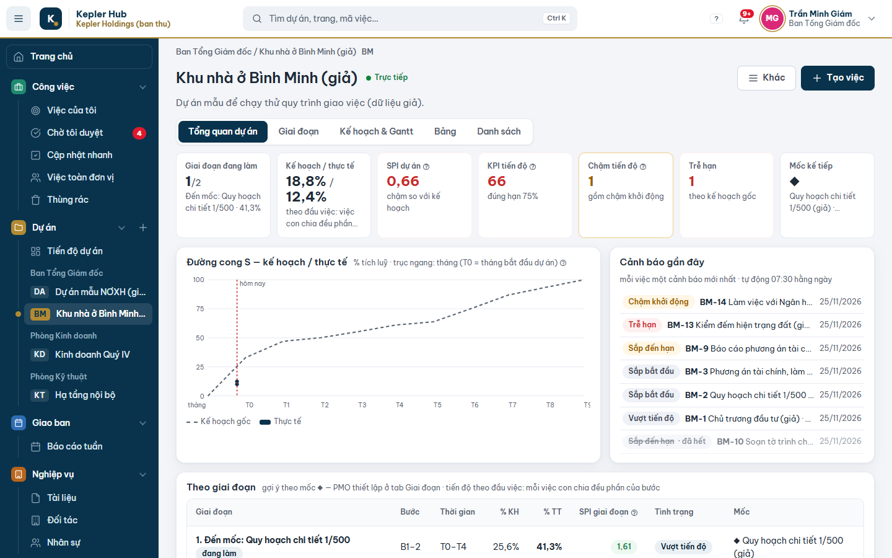

Tab **Kế hoạch & Gantt** (dự án MTL): thanh kế hoạch gốc, % thực tế tô đậm, **đường găng viền đỏ**, mốc ◆, dự báo trễ, vạch hôm nay. Lọc theo bộ phận, tình trạng, giai đoạn.

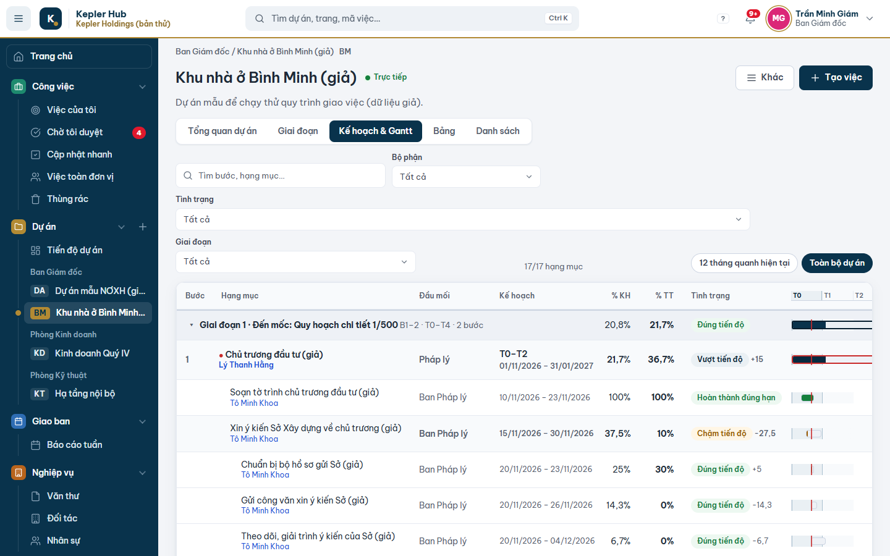

### 2.3 Việc toàn đơn vị và thống kê

- **Công việc → Việc toàn đơn vị**: việc theo người, theo bộ phận; lọc trễ, chờ duyệt… Ban Tổng Giám đốc xem mọi người; lãnh đạo bộ phận xem bộ phận mình; nhân viên không có mục này.

- **Thống kê → Thống kê công việc**: số việc, thời gian làm, KPI theo bộ phận. Ban Tổng Giám đốc xem toàn công ty; lãnh đạo bộ phận và nhân viên xem trong bộ phận mình.

Cảnh báo tiến độ dự án MTL chạy **07:30 hằng ngày** (máy chủ tắt thì chạy bù): người chủ trì, lãnh đạo bộ phận chủ trì, Người đứng tên dự án và Chủ dự án nhận theo từng loại cảnh báo. Hạng mục **đường găng / mốc** bị **Chậm tiến độ** hoặc **Trễ hạn** thì mọi thành viên Ban Tổng Giám đốc nhận thêm thông báo. Ngưỡng cảnh báo của từng dự án: [Hướng dẫn thiết lập, mục 3.5.1](thiet-lap.md#351-tháng-t0-và-ngưỡng-cảnh-báo).

### 2.4 KPI & phân tích (Ban Tổng Giám đốc)

Menu **Thống kê → KPI & phân tích** (chỉ Ban Tổng Giám đốc thấy): thời gian xử lý, đánh giá, xu hướng — số liệu theo người, mọi bộ phận; mỗi lần xem có ghi nhật ký. Lãnh đạo bộ phận và nhân viên chỉ xem KPI của chính mình.

Trọng số điểm KPI tổng hợp (Đúng hạn / Xếp loại / Khối lượng, mặc định 40 / 40 / 20), số ngày cảnh báo "Sắp đến hạn" của việc thường và danh sách nguồn giao việc nằm ở trang **Danh mục dùng chung**: Ban Tổng Giám đốc sửa được nhưng menu chưa có mục, mở bằng địa chỉ `#/catalog`. Xem [Hướng dẫn thiết lập, mục 7.12](thiet-lap.md#712-danh-mục-dùng-chung-quản-trị--danh-mục).

---

## 3. Giao việc

**Tạo dự án, cài đặt dự án.** Nút **+** cạnh nhóm **Dự án** ở menu trái: Ban Tổng Giám đốc tạo cho mọi bộ phận, kể cả kiểu **Theo Master Timeline**; lãnh đạo bộ phận tạo dự án thường của bộ phận mình. Người tạo tự thành Chủ dự án và Người đứng tên dự án. ⚠️ **Mã dự án**, **Bộ phận** và kiểu MTL / thường không đổi được sau khi tạo. **Khác → Cài đặt** (người quản lý dự án): thông tin chung, lưu trữ, xoá dự án, cột trạng thái và giới hạn WIP, quy trình duyệt nhiều cấp, nhãn, việc lặp lại, thành viên. Dự án MTL có thêm trong **Khác**: **Nhập MTL từ Excel**, **Tải mẫu MTL bộ phận**, **T0 & ngưỡng cảnh báo**, **Kiểm tra cảnh báo ngay**; tab **Giai đoạn** → **Thiết lập giai đoạn**. Từng ô, từng nút: [Hướng dẫn thiết lập, chương 3](thiet-lap.md#3-dự-án-tạo-cài-đặt-và-cấu-hình).

1. Mở dự án → nút **Tạo việc** (1) trên thanh tiêu đề dự án, có ở mọi tab (phím `C`). Dự án MTL: nút chỉ hiện khi bạn có chỗ thêm việc.

2. Nhập **Tiêu đề**, **Giai đoạn** (dự án thường: **Chu kỳ (giai đoạn)**), **Việc cha**, **Chủ trì** (1 người; có nút **Giao cho tôi**), **Phối hợp**, **Hạn**, **Ưu tiên**. Mục "Thêm thông tin" có trạng thái, mô tả, ngày bắt đầu, nguồn giao việc, nhãn; người quản lý dự án thấy thêm **Mức duyệt** và lặp lại. Bấm **Tạo việc**.
   - Trong dự án **MTL**: hạng mục gốc do người quản lý dự án (Ban Tổng Giám đốc, Chủ dự án, Người đứng tên dự án) tạo hoặc nhập từ Excel. Người khác chỉ thêm việc con dưới hạng mục mà mình là **người chủ trì** (hoặc người giao), nên **bắt buộc chọn Việc cha**. Hạng mục giao về bộ phận: lãnh đạo bộ phận tự nhận chủ trì thì thêm việc con được; đã giao cho nhân viên thì nhân viên đó chia việc con.
   - **Đường găng** / **Mốc** (chỉ dự án MTL): người giao hoặc **BTGĐ phụ trách của việc** tích ô trong khối MTL của chi tiết hạng mục. Việc găng / mốc do BTGĐ phụ trách của việc duyệt hoàn thành (chưa có ai phụ trách thì người giao duyệt).

3. Bạn thành **người giao**: người chủ trì báo tiến độ, gửi duyệt cho bạn. Sau bạn, phiếu đi tiếp các cấp duyệt của dự án (mục 4.3). Việc mốc / đường găng không qua bạn mà tới BTGĐ phụ trách. Kế hoạch (tên, mô tả, hạn, người chủ trì…) chỉ bạn và BTGĐ phụ trách của việc sửa.

**Kế hoạch gốc** là căn cứ tính chậm / trễ và KPI. Đổi cho một hạng mục: **Điều chỉnh kế hoạch gốc…** trong chi tiết hạng mục — chỉ **người giao** hoặc **BTGĐ phụ trách** của hạng mục, bắt buộc lý do, có lưu vết. Đổi **Tháng T0** (Khác → **T0 & ngưỡng cảnh báo**, người quản lý dự án, bắt buộc lý do) dời kế hoạch gốc của mọi hạng mục ghi theo tháng T. Nhập MTL: **Khác → Nhập MTL từ Excel** do người quản lý dự án (Ban Tổng Giám đốc, Chủ dự án, Người đứng tên dự án) làm; người kiêm PMO chỉ làm được khi được thêm làm Chủ dự án. Lãnh đạo bộ phận dùng **Khác → Tải MTL bộ phận (Excel)** rồi **Nhập MTL bộ phận**, chỉ gắn được dòng con vào bước tổng mà chính mình là người chủ trì. Nhập lại chỉ thêm bước mới, bước đã có giữ nguyên. Chi tiết: [Hướng dẫn thiết lập, mục 3.5](thiet-lap.md#35-dự-án-mtl-các-thiết-lập-riêng).

**Bằng Claude:** "Giao cho Nguyễn Văn A (giả) việc 'Rà soát hồ sơ pháp lý đất đai' trong dự án BM, hạn 5/12." → Claude tra danh bạ, đọc lại người chủ trì, hạn, nội dung, **chờ bạn đồng ý** rồi tạo. Claude không đặt được người phối hợp, ưu tiên, nhãn, mức duyệt, lặp lại: mở việc trên giao diện để thêm. Dự án MTL: Claude chỉ tạo hạng mục khi bạn là người quản lý dự án; còn lại chỉ tạo việc nhánh dưới hạng mục bạn chủ trì hoặc đã giao.

---

## 4. Duyệt và chấm mức hoàn thành

### 4.1 Chờ tôi duyệt

Menu **Công việc → Chờ tôi duyệt**. Các tab: **Phiếu trình** (việc chờ duyệt hoàn thành), **Đề nghị gia hạn**, **Kiến nghị**, **Đơn nghỉ & giải trình**, **Tôi đã gửi**. Số đỏ trên menu và Trang chủ tính phiếu trình, đề nghị gia hạn bạn quyết được, kiến nghị, đơn nghỉ & giải trình; không tính **Tôi đã gửi**. Tab **Đơn nghỉ & giải trình** chỉ có khi bật Nhân sự.

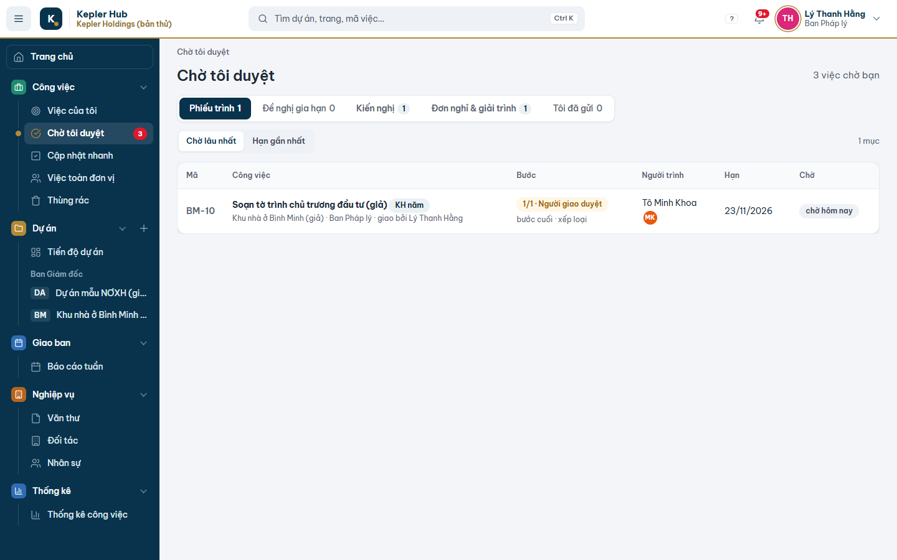

### 4.2 Duyệt một việc

1. Bấm việc trong tab **Phiếu trình** → khung chi tiết hiện ô "Bạn đang duyệt bước…".
2. Chọn **Mức hoàn thành** (1) — bắt buộc: **Xuất sắc / Tốt / Đạt / Cần cải thiện / Kém**. Ghi nhận xét (tuỳ chọn).
3. Bấm **Duyệt hoàn thành** (2). Hoặc **Trả lại** kèm lý do (bắt buộc) → việc về "Đang thực hiện".

- Việc **mốc / đường găng**: phiếu tới **BTGĐ phụ trách của việc**, không tới người giao. Chưa có ai phụ trách (chưa ai phụ trách Toàn công ty, bộ phận chưa có Phó Tổng Giám đốc phụ trách) thì người giao duyệt.
- Việc cha chỉ gửi duyệt được khi mọi việc nhánh đã được duyệt. Con mở lại thì việc cha tự về "Đang thực hiện".
- KPI đúng hạn tính theo **ngày gửi duyệt**, không theo ngày bạn duyệt.
- Đánh giá = mức chấm + nhận xét lúc duyệt, chỉ đọc sau đó.

**Claude không duyệt, không chấm mức, không trả lại thay bạn**, và không đọc được hàng **Chờ tôi duyệt**: Claude chỉ thấy thông báo "Cần duyệt …" trong 50 thông báo gần nhất của bạn, nên danh sách có thể thiếu. Xem đủ phiếu chờ: **Công việc → Chờ tôi duyệt** → tab **Phiếu trình**, sắp **Chờ lâu nhất** (nhãn "chờ … ngày").

### 4.3 Duyệt ở cấp của dự án (sau người giao)

Nhiều dự án thường có quy trình duyệt nhiều cấp (lựa chọn mặc định khi tạo dự án: **1 cấp — Lãnh đạo bộ phận duyệt**). Các cấp này chạy **sau** bước người giao duyệt và chấm mức. Người duyệt mỗi cấp tuỳ cài đặt dự án: **Lãnh đạo bộ phận chủ trì**, **BTGĐ phụ trách**, **Người đứng tên dự án** hoặc **Người được chỉ định**.

1. **Chờ tôi duyệt → Phiếu trình**: cột **Bước** ghi "{cấp}/{tổng} · {tên bước}". Bấm việc → ô "Bạn đang duyệt bước …".
2. Ghi ý kiến (bắt buộc khi không duyệt) → **Duyệt** hoặc **Không duyệt**. Ở bước cuối có thêm ô **Xếp loại khi nghiệm thu** (không bắt buộc).
3. Không duyệt ở cấp nào thì việc cũng về cột "Đang thực hiện" đầu tiên; người chủ trì sửa rồi gửi duyệt lại.

- Người giao vừa duyệt cấp đầu mà cũng là người duyệt cấp kế tiếp thì cấp đó tự qua; lịch sử ghi "Tự động qua: …".
- Một người không duyệt hai cấp của cùng phiếu; người gửi duyệt không tự duyệt các cấp của dự án.
- Đổi số cấp cho một việc: ô **Mức duyệt của việc này** trong chi tiết việc — chỉ BTGĐ phụ trách của việc hoặc người quản lý dự án. (Chữ trên màn Cài đặt ghi "Lãnh đạo bộ phận vẫn chọn tay được cho từng việc", nhưng lãnh đạo bộ phận chỉ chọn được ở dự án mình quản lý.)
- Cài đặt các cấp, mức mặc định, quy tắc tự động: [Hướng dẫn thiết lập, mục 3.3.4](thiet-lap.md#334-quy-trình-duyệt-nhiều-cấp-và-quy-tắc-tự-động) và [mục 3.8](thiet-lap.md#38-quy-trình-duyệt-hệ-thống-thực-sự-chạy-thế-nào).

---

## 5. Gia hạn và kiến nghị

### 5.1 Duyệt gia hạn (BTGĐ phụ trách của việc)

Người chủ trì xin gia hạn → **BTGĐ phụ trách của việc** quyết định (người giao, lãnh đạo bộ phận chỉ theo dõi).

1. **Chờ tôi duyệt → Đề nghị gia hạn**.
2. Xem hạn cũ, hạn đề nghị, lý do → **Duyệt** (1) hoặc **Không duyệt** (phải ghi ý kiến). Duyệt chỉ đổi **Hạn** của việc — hạng mục MTL vẫn tính chậm / trễ, KPI theo kế hoạch gốc.

### 5.2 Trả lời kiến nghị

Báo cáo tiến độ có ô **Kiến nghị, đề xuất**. Kiến nghị hiện ở tab **Chờ tôi duyệt → Kiến nghị** của người giao, lãnh đạo bộ phận chủ trì và Phó Tổng Giám đốc phụ trách bộ phận chủ trì. Bấm dòng kiến nghị → khối **Kiến nghị chờ bạn cho ý kiến**: ghi ý kiến rồi bấm **Duyệt** hoặc **Không duyệt** (không duyệt phải ghi ý kiến). Lãnh đạo bộ phận chủ trì gặp việc vượt thẩm quyền thì bấm **Trình BTGĐ** (kèm ý kiến của bộ phận): người giao và Phó Tổng Giám đốc phụ trách nhận thông báo, kiến nghị rời hàng chờ của lãnh đạo bộ phận. Người báo cáo nhận thông báo khi có ý kiến và khi kiến nghị được trình lên.

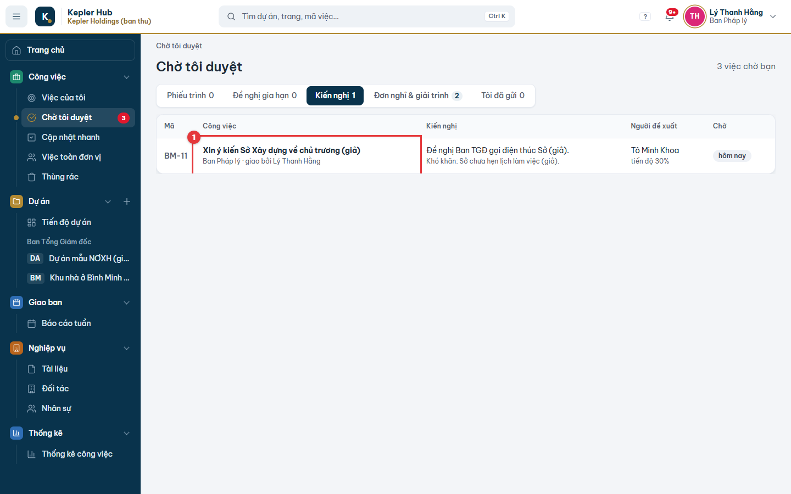

---

## 6. Báo cáo tuần của bộ phận

Lãnh đạo bộ phận chịu trách nhiệm báo cáo tuần của bộ phận (BM-TH-01); mọi người trong bộ phận lập và gửi được. Hạn **17:30 thứ Sáu** (tuần nghỉ lễ: ngày hạn đã được dời — xem chip "Hạn nộp 17:30 …" đầu trang). Nộp sau 17:30 tới 12:00 hôm sau tính nộp muộn; sau đó tính không nộp.

1. **Giao ban → Báo cáo tuần** → tab **Nộp báo cáo**. Báo cáo tự điền sẵn từ MTL, công việc của bộ phận, kế hoạch tuần trước và Action Log (bấm **Làm mới từ MTL và công việc** để lấy lại số liệu mới nhất):
   - **I. Kết quả trong tuần**: việc đã hoàn thành, kế hoạch đã đăng ký, việc TGĐ giao, việc phát sinh;
   - **II. Đang thực hiện, chưa hoàn thành**: mọi việc đã bắt đầu (đang làm, chờ duyệt, bị trả lại); tự chuyển sang báo cáo tuần sau;
   - **III. Nguy cơ chậm tiến độ**: trễ hạn, chậm tiến độ, chậm khởi động, sắp đến hạn (hạng mục MTL: khi % thấp hơn kế hoạch), vướng, việc đăng ký tuần trước mà chưa làm;
   - **IV. Kế hoạch tuần mới**;
   - **V. Kiến nghị khác**: đề xuất không gắn với một việc cụ thể.
2. Dòng **Chậm / Vướng / Quá hạn**: bắt buộc nguyên nhân, giải pháp bộ phận đề xuất và đề nghị hỗ trợ (1): chọn **Ban Giám đốc** (màn hình còn tên cũ, nghĩa là Ban Tổng Giám đốc), một bộ phận, hoặc **Tự xử lý – không cần hỗ trợ**. Chọn Ban Giám đốc hoặc một bộ phận thì ghi thêm cần hỗ trợ việc gì, trước ngày nào. Dòng nào cũng cần người phụ trách và deadline. Máy chủ kiểm, thiếu thì không cho gửi và liệt kê từng lỗi.
3. Bấm **Gửi báo cáo** (2). % ghi luôn vào MTL. Sửa sau thì **Gửi lại**, giờ nộp vẫn tính lần đầu. Từ 08:30 ngày giao ban, báo cáo đã nộp bị khoá (thư ký vẫn sửa được).

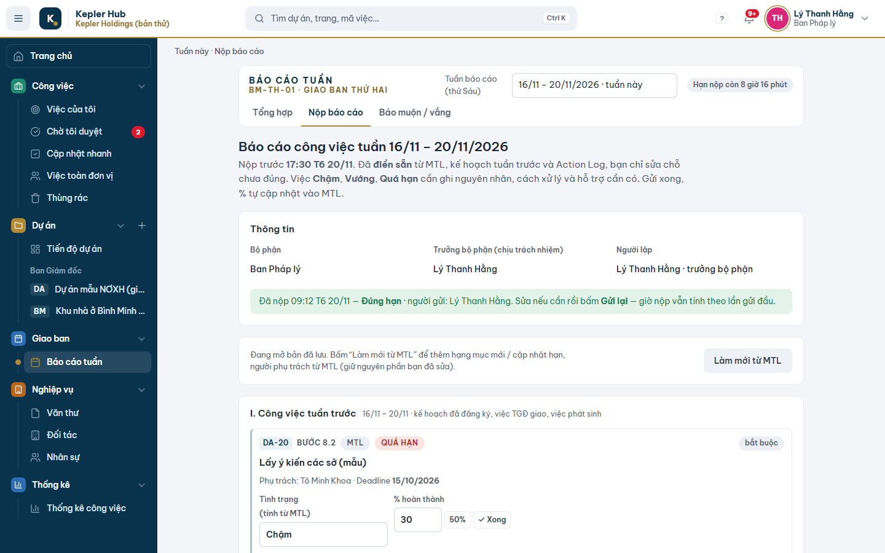

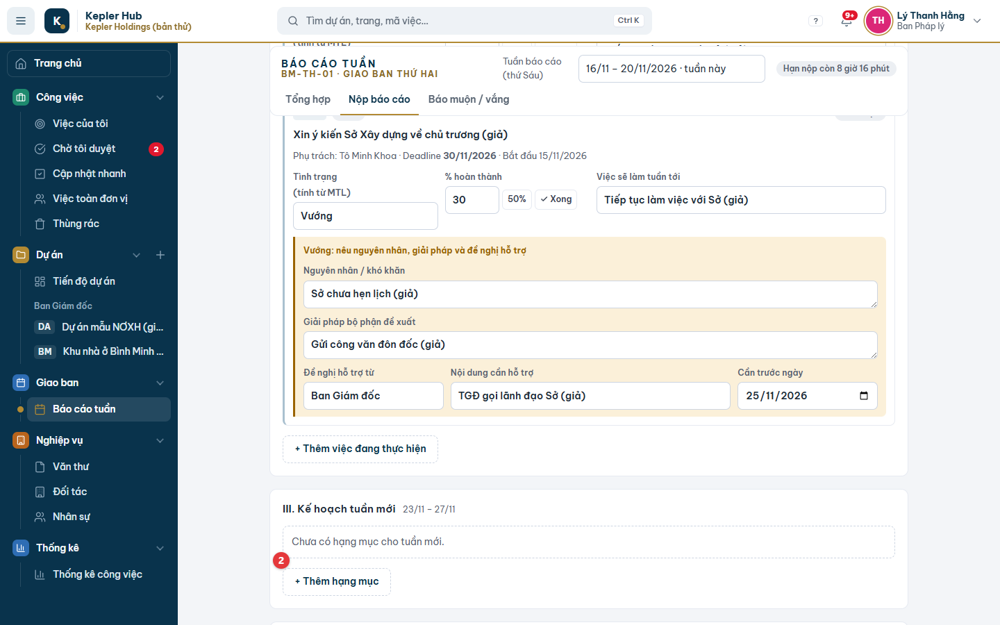

Nộp muộn hoặc không dự được giao ban: tab **Báo muộn / vắng** → báo nộp muộn (trước 17:30 ngày hạn nộp) hoặc báo vắng, cử người dự thay (trước 17:30 thứ Sáu; đột xuất: trước 08:00 ngày họp) → **Gửi thông báo**. Màn hình ghi "Thư ký giao ban và Ban Giám đốc nhận thông báo ngay" — "Ban Giám đốc" là tên cũ của Ban Tổng Giám đốc.

Kepler Hub nhắc **15:00 ngày hạn nộp** khi bộ phận chưa nộp: lãnh đạo bộ phận, người lập báo cáo tuần trước và người đang có bản nháp tuần này nhận. Tuần nghỉ không nhắc.

**Bằng Claude:** "Soạn nháp báo cáo tuần bộ phận tôi; việc chậm thì gợi ý nguyên nhân từ bình luận gần đây và báo cáo tuần trước." → Claude lưu **nháp** sau khi bạn đồng ý. **Gửi báo cáo** là bạn bấm. Báo cáo đã gửi thì Claude không sửa được nữa: sửa và bấm **Gửi lại** trên giao diện.

---

## 7. Giao ban thứ Hai

Dành cho Ban Tổng Giám đốc, Thư ký giao ban, PMO và lãnh đạo bộ phận. Ban Tổng Giám đốc, thư ký, PMO xem bản tổng hợp đầy đủ (cả **Chi tiết từng bộ phận**); lãnh đạo bộ phận xem mức tóm tắt và chi tiết bộ phận mình. Điểm danh, kết luận, Action Log, phát hành, khối Thiết lập: Ban Tổng Giám đốc và thư ký. PMO chỉ xem, không sửa. Nhân viên không có tab **Tổng hợp**.

### 7.1 Tổng hợp

**Giao ban → Báo cáo tuần** → tab **Tổng hợp**: số bộ phận đã nộp, hạng mục quá hạn, chậm / vướng, yêu cầu hỗ trợ; bảng tình trạng nộp theo thứ tự trình bày; rà Action Log tuần trước. 07:35 ngày giao ban, người xem tổng hợp nhận thông báo "Tổng hợp giao ban …: … bộ phận đã nộp".

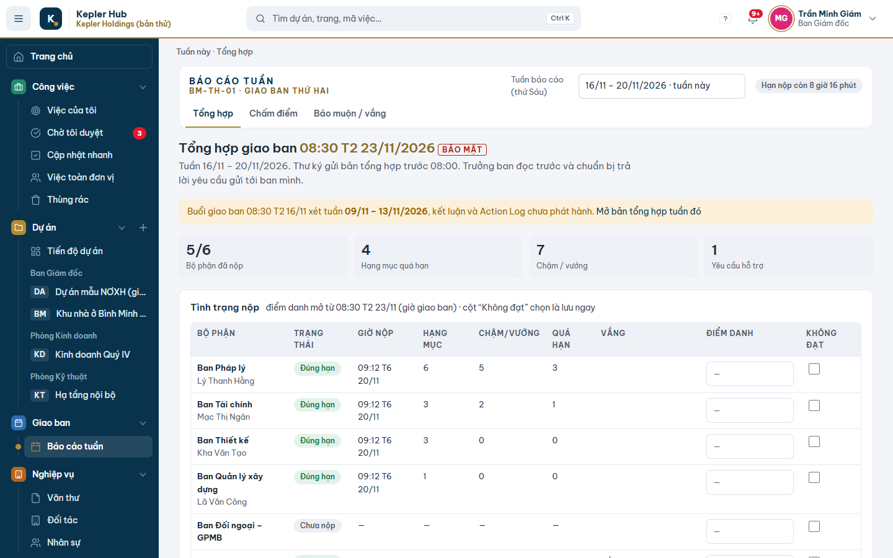

Yêu cầu hỗ trợ gom theo nơi nhận. Với từng yêu cầu, Ban Tổng Giám đốc (hoặc thư ký ghi theo ý kiến Tổng Giám đốc) chọn **Kết luận của TGĐ**: **Chấp thuận**, **Giao bộ phận phối hợp** (chọn thêm **Bộ phận phối hợp**) hoặc **Phương án khác**, ghi **Ghi chú kết luận** nếu cần; chọn là lưu ngay. Nút **+ Action Log** đưa yêu cầu vào Action Log. Còn yêu cầu chưa kết luận thì chưa phát hành được.

### 7.2 Điểm danh, Action Log, phát hành

1. Điểm danh (**Có mặt** / **Đi muộn > 10 phút** / **Vắng**) mở từ 08:30: thư ký hoặc Ban Tổng Giám đốc chọn, lưu ngay khi chọn. Cột **Không đạt** (báo cáo không đạt) đánh dấu lúc nào cũng được.
2. Soạn **Action Log**: **+ Thêm việc** (việc, bộ phận, người phụ trách, hạn) → **Lưu Action Log**. Soạn trước giờ họp được.
3. **Phát hành kết luận + Action Log**: nút chỉ mở **từ giờ giao ban** (08:30). Kepler Hub hỏi lại và báo số yêu cầu hỗ trợ chưa có kết luận — phải kết luận đủ mới phát hành được. Phát hành xong: lãnh đạo mọi bộ phận, người phụ trách từng việc trong Action Log và người xem tổng hợp nhận thông báo; việc tự vào Phần I báo cáo tuần sau. ⚠️ Thông báo đã gửi thì không thu hồi được.

4. **Sao chép bản tổng hợp**: bản tóm tắt để gửi email, mở đầu "BẢO MẬT – chỉ dùng nội bộ": tình trạng nộp, số việc xong / đang làm / nguy cơ chậm từng bộ phận, Action Log, việc có nguy cơ chậm và yêu cầu hỗ trợ; không có danh sách việc xong / đang làm, không có họ tên người phụ trách. Dán vào email công ty hoặc nhóm chat đã được phê duyệt gửi Tổng Giám đốc và lãnh đạo các bộ phận. Ban Tổng Giám đốc, thư ký, PMO có thêm **Sao chép bản đầy đủ** (có danh sách việc của mọi bộ phận): chỉ dùng nội bộ, **không gửi email**, không dán vào nhóm chat chung.

### 7.3 Báo muộn / vắng và chấm điểm tuân thủ

- **Báo muộn / vắng**: danh sách bộ phận báo vắng, người dự thay; thư ký nhập thay bộ phận gửi email (giờ nộp = giờ nhận email).

- **Chấm điểm** (chỉ Ban Tổng Giám đốc và thư ký thấy tab này): điểm tuân thủ tháng theo Phụ lục 1 (100 điểm, trừ theo mức có sẵn). Tháng chưa khép thì chưa lập được ("Tháng chưa khép — lập, trình và duyệt từ đầu tháng sau (sau buổi giao ban cuối tháng)."). Từ đầu tháng sau, thư ký bấm **Trình TGĐ** (thành viên Ban Tổng Giám đốc nhận thông báo "Bảng điểm tuân thủ giao ban tháng … chờ duyệt") → thành viên Ban Tổng Giám đốc bấm **Duyệt và khoá**, đồng ý ở hộp hỏi lại; thư ký và lãnh đạo các bộ phận được chấm nhận thông báo đã duyệt. Đã khoá mà cần sửa: Ban Tổng Giám đốc bấm **Mở khoá**, ghi lý do (bắt buộc) — bảng về bản nháp, thư ký được báo để kiểm tra và trình lại.

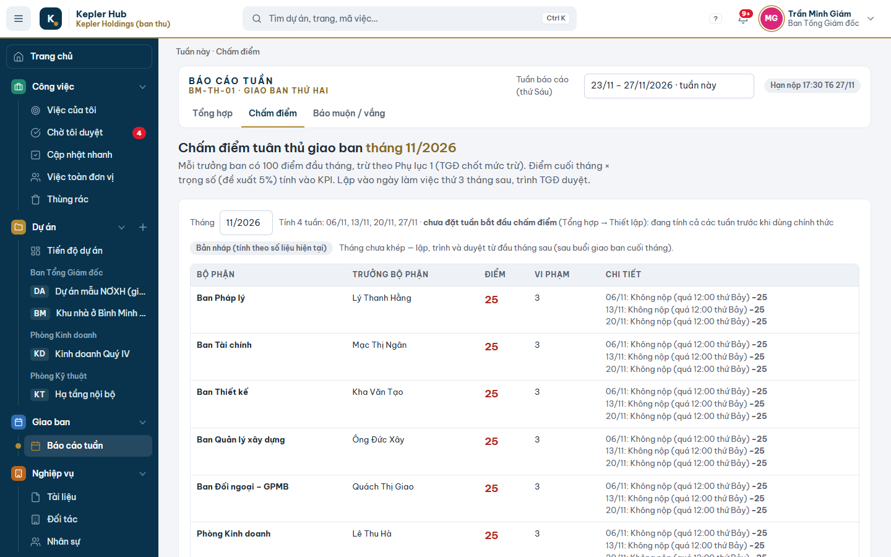

Thiết lập giao ban: tab **Tổng hợp** → cuối trang, khối **Thiết lập** (Ban Tổng Giám đốc và thư ký): bộ phận phải nộp và thứ tự trình bày, tuần bắt đầu chấm điểm, và cho **tuần đang chọn** ở ô "Tuần báo cáo (thứ Sáu)" đầu trang: tuần nghỉ, hạn nộp, ngày giao ban. Ô **Bộ phận thư ký giao ban** và **PMO** chỉ Ban Tổng Giám đốc sửa; sau hạn nộp của một tuần, chỉ Ban Tổng Giám đốc đổi lịch tuần đó. Nhãn ba ô lịch ghi ngày của tuần đang chọn (vd. "Hạn nộp tuần 23/11 – 27/11/2026 …"). Ngày lễ khai ở Nhân sự không tự dời hạn nộp. Đổi lịch tuần thì Kepler Hub tự báo lãnh đạo các bộ phận phải nộp và người lập báo cáo; Ban Tổng Giám đốc đổi lịch của tuần đã qua hạn nộp thì Kepler Hub hỏi lại trước khi lưu (làm đổi điểm tuân thủ). Từng ô: [Hướng dẫn thiết lập, mục 5.1](thiet-lap.md#51-khối-thiết-lập-ở-cuối-tab-tổng-hợp).

**Bằng Claude (chỉ khi tài khoản có quyền xem tổng hợp):** "Tóm tắt tổng hợp giao ban tuần này theo bộ phận: hoàn thành, trễ, vướng mắc cần Ban Tổng Giám đốc quyết." Claude chỉ dùng **bản tổng hợp tóm tắt**; điểm danh, kết luận, phát hành, chấm điểm làm trên giao diện.

---

## 8. Tài liệu: tài liệu dự án, văn thư, quy chế

### 8.0 Tài liệu dự án

Menu **Nghiệp vụ → Tài liệu** → tab **Tài liệu dự án**: mỗi dự án là một thư mục, có hai nguồn — **Theo công việc (tải lên Hub)** (tệp đính kèm trong các việc, xếp theo hạng mục → việc → việc nhánh) và **Thư mục dự án trên NAS** (chỉ đọc). **Xem** (PDF, ảnh) / **Tải về**; mỗi lần xem, tải đều ghi nhật ký. Ô tìm tìm tên tệp ở cả hai nguồn.

- Ban Tổng Giám đốc thấy mọi dự án, kể cả dự án đã đóng.
- Lãnh đạo bộ phận chỉ thấy dự án mình có tên trong **Thành viên** (Chủ dự án, Thành viên, Người xem) hoặc là Người đứng tên — **không** tự thấy tài liệu mọi dự án của bộ phận. Cần xem: nhờ người quản lý dự án thêm bạn vào Thành viên (Khác → **Cài đặt** → Thành viên).
- Mọi thành viên dự án thấy và tải được tệp của mọi việc trong dự án, kể cả việc mình không liên quan (quyết định ngày 24/11/2026).
- Thư mục NAS của dự án do IT tạo, tên bằng mã dự án hoặc bắt đầu bằng "{MÃ}-". Sửa, xoá tệp NAS: làm trên ổ mạng.
- Claude không xem, không tải tệp dự án.

**Sổ văn bản đến, đi**

**Vào sổ** văn bản đến, đi (cấp số ngay) do **Văn thư** (người Ban Tổng Giám đốc chỉ định) và **Ban Tổng Giám đốc** làm. Lãnh đạo bộ phận không vào sổ; văn bản nội bộ của bộ phận (dãy D7), lãnh đạo bộ phận tạo **dự thảo** ở tab **Quy chế, quy định nội bộ**, số cấp khi Người phê duyệt phê duyệt (mục 8.1).

1. **Nghiệp vụ → Tài liệu** → tab **Văn thư** → chọn **Văn bản đến**, **Văn bản đi** hoặc **Tôi xử lý**. Bấm **Vào sổ** (1). (Văn bản nội bộ: tab **Quy chế, quy định nội bộ**, mục 8.1.) Người vừa được chọn làm Văn thư phải tải lại trang (F5) mới thấy nút **Vào sổ**.

2. Chọn **Dãy số** (**D10 · Văn bản đến** ở sổ đến, **D9 · Văn bản đi** ở sổ đi), **Pháp nhân**, **Tên loại** (CV, TB, QĐ, TTr…), **Trích yếu**, **Nơi gửi** / **Nơi nhận**, **Mức bảo mật**, **Độ khẩn**, **Bộ phận**, **Ngày văn bản**. Sổ đến thêm **Số, ký hiệu của bên gửi**, **Người xử lý**, **Hạn** (để trống: tự tính từ ngày vào sổ theo độ khẩn — Thường 7, Khẩn 3, Thượng khẩn 1 ngày làm việc, Hỏa tốc trong ngày) và ô tích "Văn bản có thời hạn pháp lý … — chuyển Pháp chế đồng thời". Sổ đi thêm **Người ký**, **Kênh gửi**, **Hạn** chờ phản hồi.

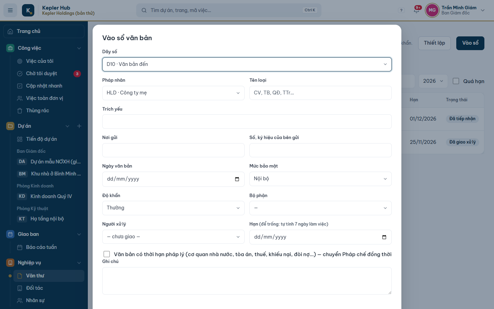

3. Bấm **Vào sổ và cấp số** → có số ngay. ⚠️ Số đã cấp không lấy lại được: vào sổ sai thì **Hủy số** (số hủy vẫn nằm trong sổ, không cấp lại) rồi vào sổ lại. Người xử lý nhận thông báo. Tải bản scan / bản đã ký lên trong trang văn bản (**Tải tệp lên**): Kepler Hub lưu vào thư mục văn thư của bộ phận văn bản trên NAS (`\\192.168.130.2\DATA\<bộ phận>\NN.VanBanDen|Di|NoiBo\<năm>\`), tệp có nhãn **NAS · v…**. Bộ phận chưa có thư mục sổ trên NAS thì tệp lưu trong Kepler Hub (không có nhãn NAS, Kepler Hub không báo).

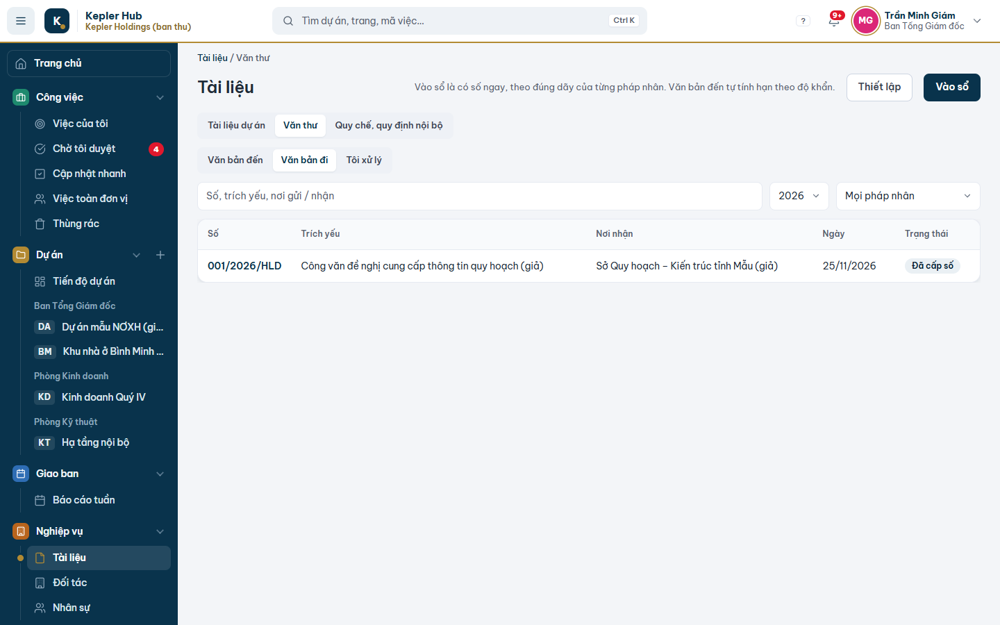

- Ai xem được văn bản đến / đi: **Công khai**, **Nội bộ** — mọi người (trừ Quản trị hệ thống). **Hạn chế** — Ban Tổng Giám đốc, **mọi người trong bộ phận của văn bản** (cả nhân viên), Văn thư (mọi bộ phận), Pháp chế (chỉ văn bản đã "chuyển Pháp chế"), người vào sổ và người xử lý. **Bảo mật cao** — chỉ Ban Tổng Giám đốc, người vào sổ và người xử lý (Văn thư khác không xem được; giao diện chưa có ô nhập danh sách người được xem). Claude không đọc được văn bản Bảo mật cao, kể cả với tài khoản Ban Tổng Giám đốc. "Bộ phận của văn bản" là ô **Bộ phận** lúc vào sổ; để trống thì lấy bộ phận của người xử lý.
- **Thiết lập văn thư** (chỉ Ban Tổng Giám đốc thấy nút **Thiết lập** ở tab Văn thư hoặc tab Quy chế, quy định nội bộ): **Pháp nhân** (mỗi dòng "MÃ · Tên"; dòng đầu là công ty mẹ — dãy D6 của nó ký hiệu "TGĐ"), **Văn thư**, **Pháp chế**, **Người phê duyệt tài liệu nội bộ** (mục 8.1). ⚠️ Ô chọn người là danh sách chọn nhiều: giữ **Ctrl** (Mac: **Cmd**) khi bấm; bấm thường sẽ bỏ chọn mọi người khác, bấm **Lưu** là xoá họ khỏi danh sách. ⚠️ Người phê duyệt đã nghỉ hoặc đổi vai mà vẫn còn trong danh sách thì không ai phê duyệt được — mở Thiết lập, chọn lại. Từng ô: [Hướng dẫn thiết lập, mục 4.6](thiet-lap.md#46-thiết-lập-văn-thư).

Claude **không** vào sổ, không đổi trạng thái, không xem hay tải tệp văn thư, và không có công cụ tra cứu sổ văn thư (chỉ thấy thông báo "Văn bản … giao bạn xử lý"). Ngoại lệ duy nhất: tạo **dự thảo** quy chế kèm một tệp PDF (mục 8.1). Skill `kepler-luu-tai-lieu` chỉ chỗ lưu và cách đặt tên.

### 8.1 Quy chế, quy định nội bộ — phê duyệt

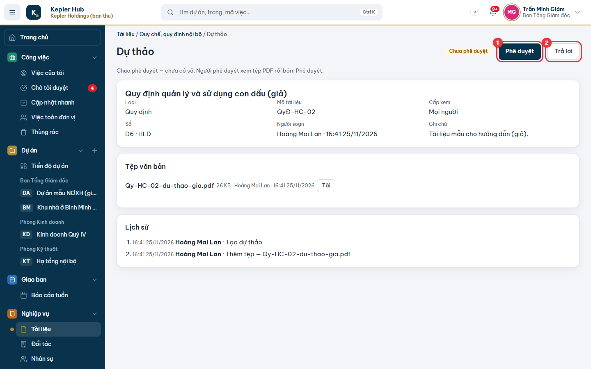

**Nghiệp vụ → Tài liệu** → tab **Quy chế, quy định nội bộ** (sổ nội bộ D5, D6, D7) đi theo luồng phê duyệt, không cấp số ngay; danh sách lọc theo năm phê duyệt (mặc định năm nay):

1. **Tạo dự thảo** (Văn thư, Ban Tổng Giám đốc; lãnh đạo bộ phận với dãy D7 của bộ phận mình): chọn **Dãy số**, **Pháp nhân**, **Bộ phận** (D7), loại (Quy chế, Quy định, Quy trình, Hướng dẫn…),
   tên, **cấp xem**, mã tài liệu (vd. QC-IT-01), ngày hiệu lực, tệp PDF; thêm **Ngày ban hành gốc**, **Thay thế văn bản**, **Ghi chú** nếu cần. Cấp xem không cao hơn vai của bạn (Văn thư là nhân viên chỉ đặt "Mọi người"). ⚠️ Dãy, pháp nhân, bộ phận không sửa được sau khi tạo. Tài liệu ở trạng thái **Chưa phê duyệt**, chưa có số.
2. **Người phê duyệt** (thành viên Ban Tổng Giám đốc được chọn ở **Thiết lập văn thư**; để trống = thành viên Ban Tổng Giám đốc phụ trách "Toàn công ty") nhận thông báo "Tài liệu chờ phê duyệt: …" — dự thảo **không** hiện ở **Chờ tôi duyệt**. Mở tài liệu, bấm **Tải** để xem tệp PDF (chưa xem được ngay trên trình duyệt), rồi bấm **Phê duyệt** → hộp hỏi lại (ghi **Ý kiến** nếu cần) → hệ thống
   cấp số ngay, khoá nội dung và tệp, ghi mã băm của tệp vào lịch sử. ⚠️ Phê duyệt không hoàn tác được. Hoặc bấm **Trả lại** kèm lý do (bắt buộc; để trống thì nút không có tác dụng); người soạn sửa rồi bấm **Gửi lại**.
3. Ngày hiệu lực trống, hôm nay hoặc đã qua → **Hiệu lực** ngay; ngày trong tương lai → **Đã phê duyệt**, khoảng 08:20 sáng ngày đó tự chuyển **Hiệu lực**.
   Văn bản đã ban hành từ trước khi đưa vào Hub: điền **Ngày ban hành gốc** và ngày hiệu lực trong quá khứ.
4. Tệp PDF của dự thảo lưu trên NAS với tên `DuThao-<id>_…` và giữ tên đó sau khi phê duyệt; số chính thức xem trên Kepler Hub.
5. Sửa nội dung tài liệu đã phê duyệt: tạo dự thảo mới, chọn **Thay thế văn bản** — khi bản mới được phê duyệt, bản cũ chuyển **Hết hiệu lực / thay thế**.

**Cấp xem** (thay cho mức bảo mật trong sổ nội bộ): **Mọi người** · **Lãnh đạo** (lãnh đạo bộ phận + Ban Tổng Giám đốc) · **Ban TGĐ**.
Cấp cao xem được tài liệu cấp thấp. Dự thảo chỉ người soạn, Người phê duyệt và Văn thư thấy: Văn thư chỉ thấy dự thảo trong cấp xem theo vai của mình; thành viên Ban Tổng Giám đốc không có tên trong danh sách Người phê duyệt không thấy dự thảo của người khác. Quản trị hệ thống không xem nội dung.

Claude có thể **tạo dự thảo** từ tệp PDF trên máy bạn (công cụ `kepper_vanthu_draft`), không cấp số, không phê duyệt. Chỉ Văn thư, Ban Tổng Giám đốc, lãnh đạo bộ phận (D7) tạo được; Claude hỏi lại loại, tên, cấp xem; không chọn được "Thay thế văn bản"; dự thảo mang nhãn "tạo qua Claude".

---

## 9. Nhân sự

> Phân hệ Nhân sự bật trên bản chạy thật từ 25/11/2026. Việc đầu tiên: Ban Tổng Giám đốc chọn **Người phụ trách nhân sự** và khai ngày lễ ở **Nhân sự → Thiết lập** ([Hướng dẫn thiết lập, mục 6.2](thiet-lap.md#62-nhân-sự--thiết-lập)).

### 9.1 Duyệt đơn nghỉ và giải trình

**Chờ tôi duyệt → Đơn nghỉ & giải trình** (hoặc Nhân sự → **Chờ duyệt**). Đơn của nhân viên → lãnh đạo bộ phận duyệt (bộ phận chưa có lãnh đạo → Ban Tổng Giám đốc); đơn của lãnh đạo bộ phận → Ban Tổng Giám đốc; đơn của thành viên Ban Tổng Giám đốc → thành viên Ban Tổng Giám đốc khác, hoặc người phụ trách nhân sự ghi nhận. Ban Tổng Giám đốc duyệt được mọi đơn. Giải trình chấm công: lãnh đạo bộ phận, Ban Tổng Giám đốc hoặc người phụ trách nhân sự duyệt.

Mỗi đơn hiện số phép còn và **cảnh báo việc đến hạn trong thời gian nghỉ** (cần người làm thay / lùi hạn). Bấm **Duyệt** (1) hoặc **Từ chối**.

### 9.2 Bảng công và danh sách nhân sự

- **Nhân sự → Bảng công**: tổng hợp công bộ phận theo tháng.

- **Nhân sự → Danh sách nhân sự**: Ban Tổng Giám đốc xem hồ sơ và hợp đồng lao động của mọi người; lương ẩn, bấm hiện và **nhập lại mật khẩu** mới thấy, mỗi lượt xem được ghi nhật ký. Lãnh đạo bộ phận chỉ xem thông tin cơ bản của người trong bộ phận (không xem hợp đồng, lương). **Số CCCD** chỉ chính người đó và người phụ trách nhân sự xem — Ban Tổng Giám đốc, lãnh đạo bộ phận không xem. Qua Claude: chỉ 4 số cuối CCCD, không bao giờ có lương.

**Bằng Claude:** "Đơn nghỉ nào đang chờ tôi duyệt? Ai nghỉ trùng ngày giao ban?" / "Tổng hợp công bộ phận tháng 11: ai thiếu công nhiều nhất?" → Claude đọc và tóm tắt; **duyệt đơn** làm trên giao diện.

**Thiết lập nhân sự** (Nhân sự → tab **Thiết lập**; Ban Tổng Giám đốc và người phụ trách nhân sự): giờ vào / ra, nghỉ trưa, phút cho phép đi muộn, ngày phép năm, ngày làm việc, ngày lễ, giới hạn mạng chấm công; ô **Người phụ trách nhân sự** chỉ Ban Tổng Giám đốc chọn (không tự chọn mình). Ngày lễ ở đây dời hạn xử lý văn bản đến nhưng **không** dời hạn nộp báo cáo tuần. Từng ô: [Hướng dẫn thiết lập, mục 6.2](thiet-lap.md#62-nhân-sự--thiết-lập).

---

## 10. Đối tác (CRM)

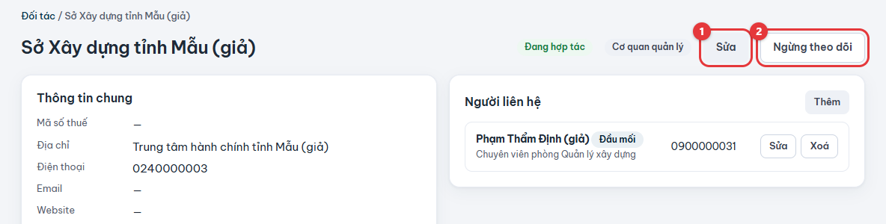

> Phân hệ Đối tác bật trên bản chạy thật từ 25/11/2026.

- Lãnh đạo bộ phận xem đối tác, người liên hệ, nhật ký, hợp đồng của **bộ phận mình phụ trách**; Ban Tổng Giám đốc xem tất cả.
- Việc cần theo dõi nhắc lúc 08:10 người được giao theo dõi; quá hạn 7 ngày thì nhắc thêm người phụ trách và lãnh đạo bộ phận phụ trách.
- Thiết lập trên từng đối tác: **Bộ phận phụ trách** chỉ chọn lúc thêm (Ban Tổng Giám đốc chọn; người khác thêm thì lấy bộ phận của người thêm) và chưa đổi được trên giao diện sau khi tạo; **Người phụ trách** do Ban Tổng Giám đốc hoặc lãnh đạo bộ phận phụ trách đổi (phải là người trong bộ phận phụ trách; Ban Tổng Giám đốc chọn tự do); **Ngừng theo dõi** / **Theo dõi lại**: Ban Tổng Giám đốc hoặc lãnh đạo bộ phận phụ trách. Đối tác không xoá được. Chi tiết: [Hướng dẫn thiết lập, mục 6.3](thiet-lap.md#63-đối-tác-thiết-lập-trên-từng-đối-tác).

**Bằng Claude:** "Việc cần theo dõi với đối tác của bộ phận tôi, việc nào quá hạn?" (Claude gọi phạm vi bộ phận; Ban Tổng Giám đốc: tất cả).

---

## 11. Claude cho lãnh đạo

Cài đặt và kết nối giống nhân viên ([mục 3](nhan-vien.md#3-kết-nối-claude-desktop-với-kepler-hub)). Câu hỏi hay dùng:

| Bạn gõ | Claude làm | Bạn tự làm trên giao diện |
|---|---|---|
| "Hôm nay tôi có gì?" | Gom thông báo (gồm "Cần duyệt …"), việc của bạn, nhắc việc; khi bật Nhân sự: đơn nghỉ chờ bạn duyệt. Claude không đọc được hàng **Chờ tôi duyệt** | Mở **Chờ tôi duyệt** để xem đủ phiếu; duyệt, chấm mức |
| "Tình hình dự án BM: rủi ro, việc găng trễ, mốc sắp tới" | Đọc tổng quan MTL (kế hoạch / thực tế, SPI, chậm, trễ, theo bộ phận, mốc, 30 cảnh báo gần nhất), tóm tắt | Việc chờ duyệt lâu: **Chờ tôi duyệt**, sắp **Chờ lâu nhất** |
| "Giao việc … cho …, hạn …" | Đề xuất, chờ đồng ý, tạo việc (tiêu đề, người chủ trì, hạn, mô tả, việc cha) | Người phối hợp, ưu tiên, nhãn, mức duyệt, lặp lại; đánh dấu mốc / găng; điều chỉnh kế hoạch gốc |
| "Soạn nháp báo cáo tuần bộ phận" | Lưu nháp | **Gửi báo cáo** |
| "Tóm tắt tổng hợp giao ban tuần này" | Đọc bản tổng hợp tóm tắt | Điểm danh, kết luận, Action Log, phát hành, chấm điểm |
| "Đơn nghỉ chờ tôi duyệt" (khi bật Nhân sự) | Liệt kê người, loại nghỉ, ngày, số ngày, lý do | Xem cảnh báo việc đến hạn / giao ban trùng ngày nghỉ; duyệt / từ chối |
| "Lưu tờ trình đã ký ở đâu?" (skill `kepler-luu-tai-lieu`) | Chỉ thư mục, tên tệp | Vào sổ, tải tệp |

Tài khoản **quản trị hệ thống (IT)** không dùng được Claude với Kepler Hub: bấm **Cho phép** sẽ bị từ chối "Tài khoản quản trị hệ thống không dùng Claude để truy cập dữ liệu nghiệp vụ" (mã `NOT_VIA_AI` chỉ gặp khi tài khoản đã có token rồi mới bị đổi sang vai Quản trị). IT không truy cập dữ liệu nghiệp vụ. Quản trị thu hồi token của mọi người ở **Quản trị → Token Claude**.

Kết nối Claude, quản lý máy đã kết nối, thông tin cá nhân, đổi mật khẩu, thông báo, nhắc việc, ghi chú, phím tắt, bảng lệnh, thùng rác: [Hướng dẫn thiết lập, chương 8](thiet-lap.md#8-thiết-lập-cá-nhân-mọi-người). Việc của quản trị (tài khoản, vai, phạm vi phụ trách, bộ phận, nhãn, danh mục, nhật ký, token Claude): [chương 7](thiet-lap.md#7-quản-trị-hệ-thống).

---

## 12. Hỏi đáp

| Câu hỏi | Trả lời |
|---|---|
| Tôi thuộc Ban Tổng Giám đốc mà không sửa được hạn việc? | Việc đó nằm ngoài **phạm vi phụ trách** của bạn (không phụ trách Toàn công ty, không phụ trách bộ phận chủ trì việc), và bạn không phải người giao. Nhờ quản trị đặt phạm vi phụ trách |
| PMO sao không sửa được kế hoạch việc? | Đúng thiết kế: kiêm nhiệm PMO chỉ cho xem bản tổng hợp giao ban đầy đủ, không sửa. Muốn điều phối dự án MTL, Ban Tổng Giám đốc thêm PMO làm **Chủ dự án**: khi đó PMO quản lý dự án (cài đặt, nhập MTL, T0, giai đoạn) nhưng kế hoạch từng việc vẫn do người giao / BTGĐ phụ trách sửa |
| Nút "Phát hành kết luận + Action Log" bị khoá | Chưa tới giờ giao ban. Action Log vẫn soạn và lưu trước được |
| Việc cha không gửi duyệt được | Còn việc nhánh chưa được duyệt hoàn thành |
| Phiếu duyệt việc mốc không tới người giao | Đúng: việc mốc / đường găng do BTGĐ phụ trách của việc duyệt |
| Nhờ Claude đặt 100% có phải là duyệt không? | Không. 100% trên việc MTL = **gửi duyệt** (sang Chờ duyệt). Duyệt vẫn là người duyệt bấm trên giao diện |
| Claude báo "Không đủ quyền" / `NOT_VIA_AI` | Xem bảng lỗi trong [hướng dẫn nhân viên, mục 12](nhan-vien.md#12-hỏi-đáp-và-lỗi-thường-gặp) |
| Tôi là lãnh đạo bộ phận mà không thấy nút **Vào sổ** | Đúng thiết kế: chỉ Văn thư và Ban Tổng Giám đốc vào sổ văn bản đến / đi. Văn bản nội bộ của bộ phận: tab **Quy chế, quy định nội bộ** → **Tạo dự thảo** (dãy D7) |
| Vừa được chọn làm Văn thư mà chưa thấy nút **Vào sổ** / **Tạo dự thảo** | Tải lại trang (F5) |
| Dự thảo quy chế không có trong **Chờ tôi duyệt** | Đúng: Người phê duyệt nhận thông báo "Tài liệu chờ phê duyệt: …" và mở ở tab **Quy chế, quy định nội bộ** |
| Không ai phê duyệt được quy chế | Danh sách Người phê duyệt còn người đã nghỉ / đổi vai, hoặc để trống mà không thành viên Ban Tổng Giám đốc nào phụ trách "Toàn công ty". Ban Tổng Giám đốc mở **Thiết lập văn thư**, chọn lại |
| Lãnh đạo bộ phận không thấy tài liệu dự án của bộ phận | Tài liệu dự án chỉ hiện với thành viên dự án và Ban Tổng Giám đốc. Nhờ người quản lý dự án thêm bạn vào **Thành viên** |
| Không đổi được **Mức duyệt** của một việc | Chỉ BTGĐ phụ trách của việc hoặc người quản lý dự án đổi được |
| Gia hạn đã duyệt mà hạng mục MTL vẫn báo trễ | Gia hạn chỉ đổi Hạn; chậm / trễ, KPI tính theo kế hoạch gốc. Muốn đổi: người giao hoặc BTGĐ phụ trách bấm **Điều chỉnh kế hoạch gốc…** |
| **Phát hành kết luận + Action Log** báo còn yêu cầu hỗ trợ chưa kết luận | Chọn **Kết luận của TGĐ** cho từng yêu cầu rồi phát hành |
| Bảng điểm tuân thủ đã **Duyệt và khoá** nhưng sai | Ban Tổng Giám đốc bấm **Mở khoá** ở tab **Chấm điểm**, ghi lý do; thư ký trình lại, Ban Tổng Giám đốc duyệt lại |
| Đi vắng, muốn uỷ quyền duyệt cho người khác | Giao diện chưa có chức năng uỷ quyền |
| Một người nghỉ việc, việc của họ xử lý thế nào | Khi khoá tài khoản, quản trị tích "Trả việc về lãnh đạo bộ phận để phân công lại": lãnh đạo bộ phận chủ trì hoặc người giao nhận thông báo "Cần phân công lại … (cán bộ nghỉ việc)". Quản trị bỏ ô đó thì người nghỉ vẫn đứng tên các việc đang mở |
