# Hướng dẫn sử dụng Kepler Hub — dành cho lãnh đạo

> Dành cho **Ban Tổng Giám đốc**, **lãnh đạo bộ phận**, **PMO / chủ dự án** và **thư ký giao ban**.
> Tài liệu này **không gửi cho toàn bộ nhân viên**: có các tính năng chỉ lãnh đạo thấy (duyệt, chấm mức, tổng hợp giao ban, chấm điểm, bảng công, KPI theo người).
>
> Phần dùng chung (đăng nhập, cài chứng chỉ, kết nối Claude, cài skill, Cập nhật nhanh, chấm công, xin nghỉ của chính mình) xem [Hướng dẫn cho nhân viên](nhan-vien.md), mục 2–3.
>
> Ảnh chụp từ **bản cài thử, dữ liệu giả**. Ô đỏ có số là chỗ bấm, theo thứ tự.

## Mục lục

1. [Ai làm gì trên Kepler Hub](#1-ai-làm-gì-trên-kepler-hub)
2. [Theo dõi tiến độ](#2-theo-dõi-tiến-độ)
3. [Giao việc](#3-giao-việc)
4. [Duyệt và chấm mức hoàn thành](#4-duyệt-và-chấm-mức-hoàn-thành)
5. [Gia hạn và kiến nghị](#5-gia-hạn-và-kiến-nghị)
6. [Báo cáo tuần của bộ phận](#6-báo-cáo-tuần-của-bộ-phận)
7. [Giao ban thứ Hai](#7-giao-ban-thứ-hai)
8. [Văn thư](#8-văn-thư)
9. [Nhân sự](#9-nhân-sự)
10. [Đối tác (CRM)](#10-đối-tác-crm)
11. [Claude cho lãnh đạo](#11-claude-cho-lãnh-đạo)
12. [Hỏi đáp](#12-hỏi-đáp)

---

## 1. Ai làm gì trên Kepler Hub

Kepler Hub chỉ có **một trục vai** để trả lời "người này là ai trong công ty". Mỗi tài khoản có đúng một vai; quyền đi theo vai (quản trị không chỉnh quyền từng người).

| Vai | Ai | Làm được |
|---|---|---|
| **Ban Tổng Giám đốc (BTGĐ)** | Tổng Giám đốc, các Phó Tổng Giám đốc (thành viên bộ phận Ban Tổng Giám đốc) | Xem toàn công ty, KPI & phân tích, tài liệu mọi dự án; kết luận giao ban, chọn thư ký / PMO / người phụ trách nhân sự / văn thư. Trong **phạm vi phụ trách** của mình: sửa kế hoạch, đổi người giao, duyệt gia hạn, duyệt + chấm mức việc mốc / đường găng |
| **Lãnh đạo bộ phận** | Trưởng / phó bộ phận ("Trưởng phòng", "Phó trưởng ban"… chỉ là chức danh) | Xem toàn bộ việc của bộ phận, bình luận, chọn người cho việc giao về bộ phận; nộp báo cáo tuần; duyệt đơn nghỉ, giải trình chấm công; duyệt việc nhân viên tự giao cho mình |
| **Nhân viên** | Mọi người còn lại | Làm việc mình chủ trì / phối hợp, báo cáo tiến độ, lập báo cáo tuần của bộ phận |
| **Quản trị hệ thống** | IT | Tài khoản, bộ phận, nhãn, nhật ký. **Không** xem nội dung nghiệp vụ |

**Phạm vi phụ trách** của một thành viên BTGĐ (quản trị đặt ở Quản trị → Tài khoản → "Quyền & phụ trách"):
- **Toàn công ty**: là BTGĐ phụ trách của mọi việc;
- **các bộ phận được chọn** (Phó Tổng Giám đốc phụ trách): chỉ với việc do các bộ phận đó chủ trì.

Ngoài vai, mỗi người còn có:
- **Quan hệ với từng việc / dự án** (không phải vai): **Người giao** sửa kế hoạch việc mình giao, duyệt và chấm mức việc thường; **Người chủ trì**, **Người phối hợp** làm phần việc của mình; dự án có **Chủ dự án**, **Thành viên**, **Người xem** (chỉ xem) và một **Người đứng tên dự án**.
- **Kiêm nhiệm** do Ban Tổng Giám đốc giao: **Thư ký giao ban** (theo bộ phận), **PMO**, **Phụ trách nhân sự**, **Văn thư**, **Pháp chế**. Kiêm nhiệm hiện ở trang Thông tin cá nhân.

Lưu ý:

- Người chủ trì không tự duyệt việc của mình. BTGĐ là người chủ trì việc mốc / găng thì BTGĐ **khác** duyệt.
- Việc nhân viên tự giao cho mình: lãnh đạo bộ phận duyệt (không có → người đứng tên dự án → Phó TGĐ phụ trách → Ban Tổng Giám đốc).
- Vai Ban Tổng Giám đốc phải trùng thành viên bộ phận Ban Tổng Giám đốc; lệch thì màn Quản trị cảnh báo.

**Quy chế quản lý dự án (RACI) sắp ban hành.** Khi có, bảng vai này và skill `kepler-hub` sẽ cập nhật theo quy chế.

---

## 2. Theo dõi tiến độ

### 2.1 Tiến độ các dự án

Menu **Dự án → Tiến độ dự án**: mỗi dự án một thẻ — tháng T hiện tại, kế hoạch / thực tế, SPI, KPI, số việc chậm / trễ, mốc kế tiếp, việc cần chú ý.

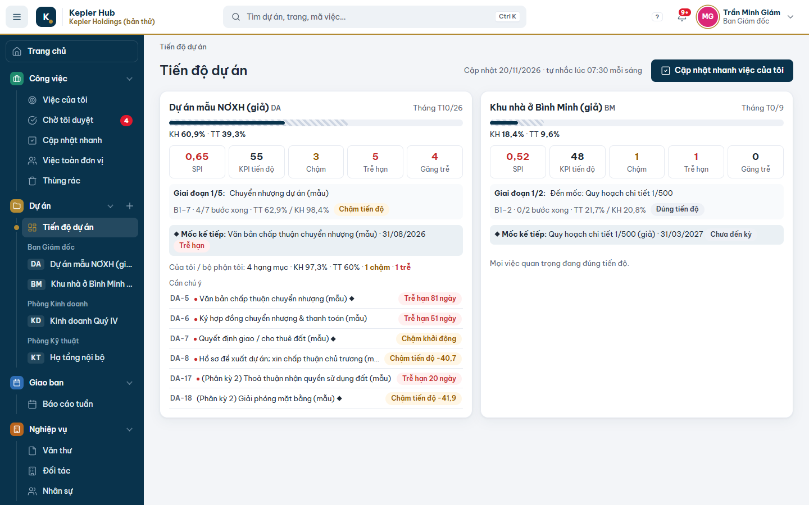

### 2.2 Tổng quan một dự án

Mở dự án → tab **Tổng quan dự án**: ô số liệu bấm được, **đường cong S** kế hoạch / thực tế, theo giai đoạn, theo bộ phận, KPI theo người (chỉ Ban Tổng Giám đốc, lãnh đạo bộ phận — bộ phận mình — và PMO xem; mỗi lần xem có ghi nhật ký), mốc chính, cảnh báo gần đây.

Tab **Kế hoạch & Gantt**: thanh kế hoạch gốc, % thực tế tô đậm, **đường găng viền đỏ**, mốc ◆, dự báo trễ, vạch hôm nay. Lọc theo bộ phận, tình trạng, giai đoạn.

### 2.3 Việc toàn đơn vị và thống kê

- **Công việc → Việc toàn đơn vị**: việc theo người, theo phòng; lọc trễ, chờ duyệt…

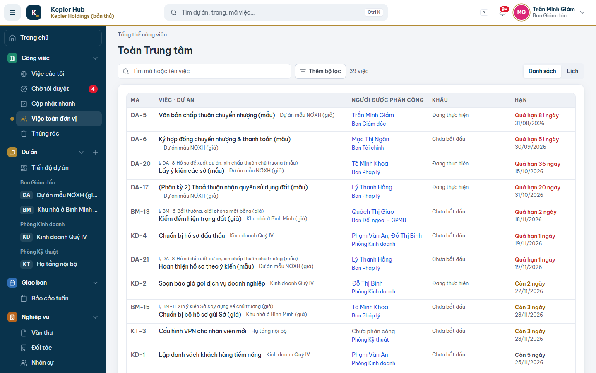

- **Thống kê → Thống kê công việc**: số việc, thời gian làm, KPI theo bộ phận.

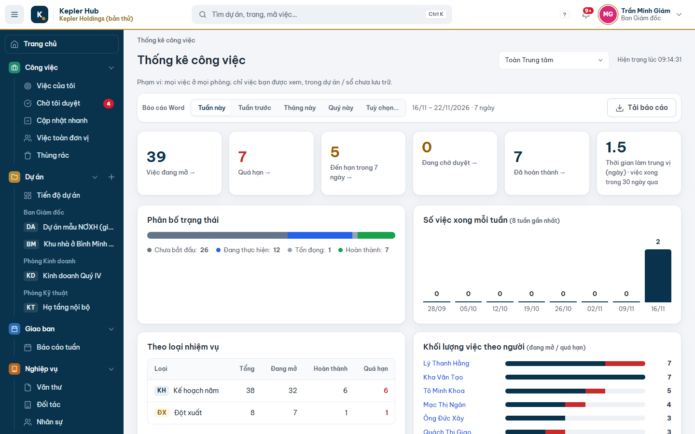

Cảnh báo tiến độ chạy **07:30 hằng ngày**: việc **đường găng / mốc** chậm hoặc trễ thì Ban lãnh đạo nhận thông báo.

---

## 3. Giao việc

1. Mở dự án → **Bảng** → nút **Tạo việc** (1).

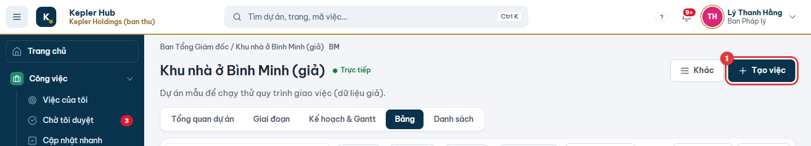

2. Nhập **Tiêu đề**, **Giai đoạn**, **Chủ trì** (1 người), **Phối hợp**, **Hạn**, **Ưu tiên**. Mục "Thêm thông tin" có trạng thái, mô tả, ngày bắt đầu, nguồn giao việc, nhãn. Bấm **Tạo việc**.
   - Trong dự án **MTL**: kế hoạch MTL do người quản lý dự án lập. Lãnh đạo bộ phận thêm việc con trong hạng mục bộ phận mình chủ trì, nên **bắt buộc chọn Việc cha**.
   - **Đường găng** / **Mốc**: người giao hoặc Ban Tổng Giám đốc đánh dấu trong chi tiết việc. Việc găng / mốc do BTGĐ phụ trách của việc duyệt hoàn thành.

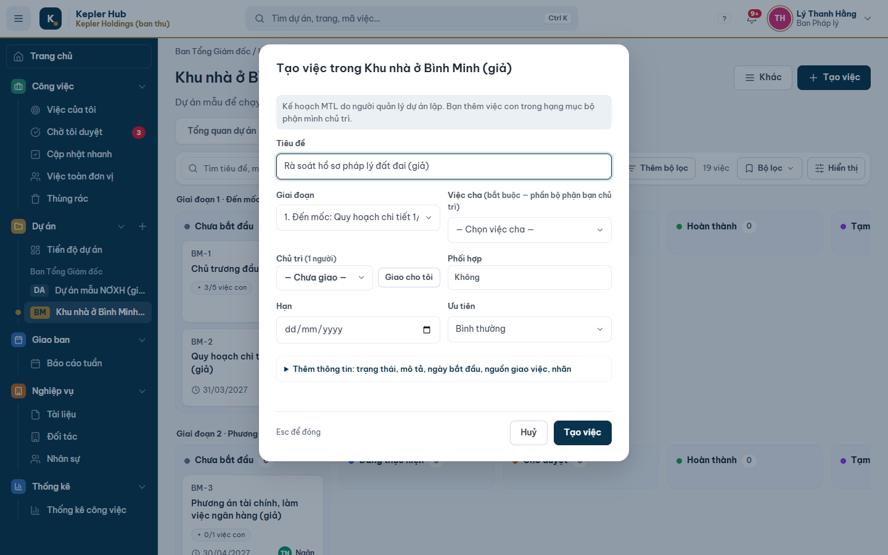

3. Bạn thành **người giao**: người chủ trì báo tiến độ, gửi duyệt cho bạn. Kế hoạch (tên, mô tả, hạn, người chủ trì…) chỉ bạn và BTGĐ phụ trách của việc sửa.

**Kế hoạch gốc** là căn cứ tính chậm / trễ và KPI, chỉ đổi qua **Điều chỉnh kế hoạch gốc** (người quản lý dự án, bắt buộc lý do, có nhật ký). MTL nhập từ Excel: menu **Khác → Nhập MTL từ Excel** (PMO, lãnh đạo bộ phận nhập MTL bộ phận mình).

**Bằng Claude:** "Giao cho Tô Minh Khoa việc 'Rà soát hồ sơ pháp lý đất đai' trong dự án BM, hạn 5/12, phối hợp Ban Tài chính." → Claude tra danh bạ, đọc lại người nhận, hạn, nội dung, **chờ bạn đồng ý** rồi tạo. Với dự án MTL, Hub kiểm thêm quy tắc MTL.

---

## 4. Duyệt và chấm mức hoàn thành

### 4.1 Chờ tôi duyệt

Menu **Công việc → Chờ tôi duyệt**. Các tab: **Phiếu trình** (việc chờ duyệt hoàn thành), **Đề nghị gia hạn**, **Kiến nghị**, **Đơn nghỉ & giải trình**, **Tôi đã gửi**. Số đỏ trên menu và Trang chủ tính tất cả các loại.

### 4.2 Duyệt một việc

1. Bấm việc trong tab **Phiếu trình** → khung chi tiết hiện ô "Bạn đang duyệt bước…".
2. Chọn **Mức hoàn thành** (1) — bắt buộc: **Xuất sắc / Tốt / Đạt / Cần cải thiện / Kém**. Ghi nhận xét (tuỳ chọn).
3. Bấm **Duyệt hoàn thành** (2). Hoặc **Trả lại** kèm lý do (bắt buộc) → việc về "Đang thực hiện".

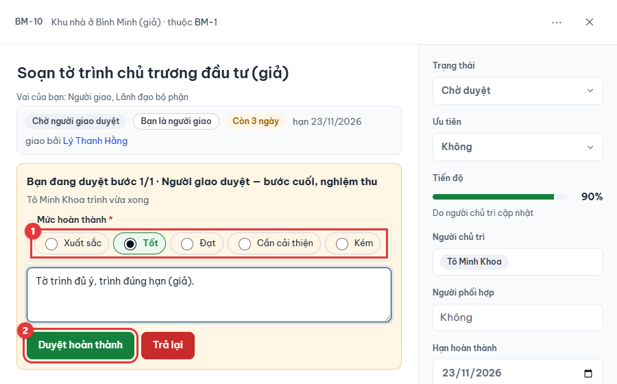

- Việc **mốc / đường găng**: phiếu tới **BTGĐ phụ trách của việc**, không tới người giao.
- Việc cha chỉ gửi duyệt được khi mọi việc nhánh đã được duyệt. Con mở lại thì việc cha tự về "Đang thực hiện".
- KPI đúng hạn tính theo **ngày gửi duyệt**, không theo ngày bạn duyệt.
- Đánh giá = mức chấm + nhận xét lúc duyệt, chỉ đọc sau đó.

**Claude không duyệt, không chấm mức, không trả lại thay bạn.** Hỏi Claude: "Có việc nào chờ tôi duyệt quá 3 ngày không?" → Claude liệt kê, bạn mở Kepler Hub duyệt.

---

## 5. Gia hạn và kiến nghị

### 5.1 Duyệt gia hạn (BTGĐ phụ trách của việc)

Người chủ trì xin gia hạn → **BTGĐ phụ trách của việc** quyết định (người giao, lãnh đạo bộ phận chỉ theo dõi).

1. **Chờ tôi duyệt → Đề nghị gia hạn**.
2. Xem hạn cũ, hạn đề nghị, lý do → **Duyệt** (1) hoặc **Không duyệt**.

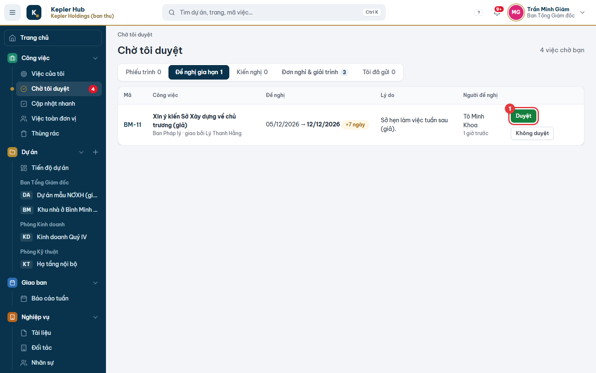

### 5.2 Trả lời kiến nghị

Báo cáo tiến độ có ô **Kiến nghị** gửi lãnh đạo. **Chờ tôi duyệt → Kiến nghị**: đọc, ghi ý kiến trả lời. Người báo cáo nhận thông báo.

---

## 6. Báo cáo tuần của bộ phận

Lãnh đạo bộ phận chịu trách nhiệm báo cáo tuần của bộ phận (BM-TH-01), hạn thứ Sáu.

1. **Giao ban → Báo cáo tuần → Nộp báo cáo**. Báo cáo tự điền sẵn:
   - Phần I: hạng mục MTL của bộ phận đến hạn / quá hạn / xong trong tuần, kế hoạch tuần trước, việc TGĐ giao trong Action Log;
   - Phần II: việc chạy nhiều tuần, việc chưa xong tuần trước;
   - Phần III: hạng mục bắt đầu tuần tới.
2. Dòng **Chậm / Vướng / Quá hạn**: bắt buộc nguyên nhân, giải pháp, đề nghị hỗ trợ (Ban Tổng Giám đốc, bộ phận nào, hoặc "Tự xử lý") (1). Máy chủ kiểm, thiếu thì không cho gửi.
3. Bấm **Gửi báo cáo** (2). % ghi luôn vào MTL. Sửa sau thì **Gửi lại**, giờ nộp vẫn tính lần đầu.

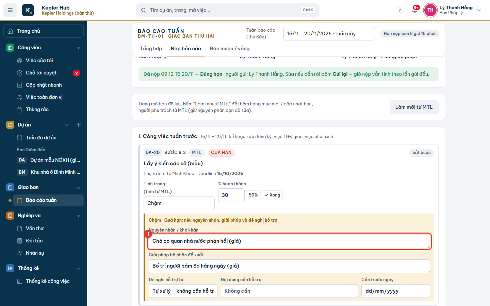

Không dự được giao ban: tab **Báo muộn / vắng** → báo vắng, cử người dự thay.

Kepler Hub nhắc **15:00 ngày hạn nộp** bộ phận chưa nộp.

**Bằng Claude:** "Soạn nháp báo cáo tuần bộ phận tôi; việc chậm thì gợi ý nguyên nhân từ bình luận và báo cáo tiến độ." → Claude lưu **nháp** sau khi bạn đồng ý. **Gửi báo cáo** là bạn bấm.

---

## 7. Giao ban thứ Hai

Dành cho TGĐ, thư ký, PMO, trưởng / phó bộ phận (theo quyền).

### 7.1 Tổng hợp

**Báo cáo tuần → Tổng hợp**: số bộ phận đã nộp, hạng mục quá hạn, chậm / vướng, yêu cầu hỗ trợ; bảng tình trạng nộp theo thứ tự trình bày; rà Action Log tuần trước.

Yêu cầu hỗ trợ gom theo nơi nhận; TGĐ ghi **Kết luận** cho từng yêu cầu.

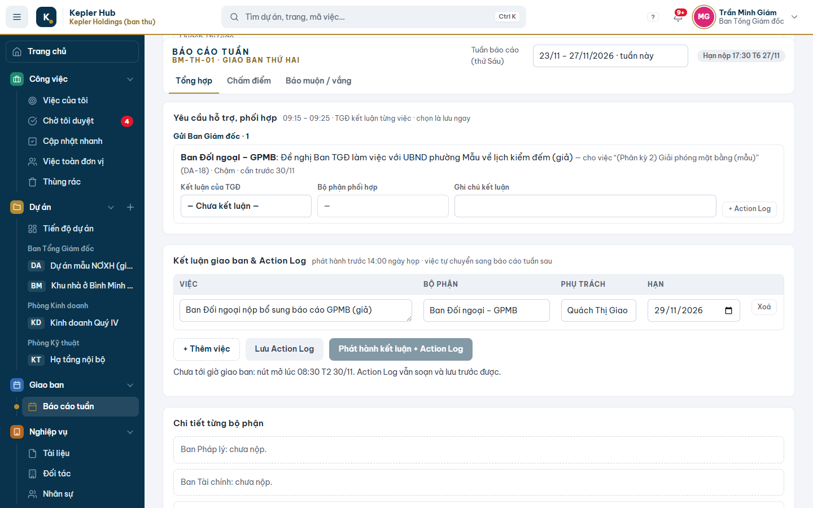

### 7.2 Điểm danh, Action Log, phát hành

1. Từ giờ họp: thư ký **điểm danh**, đánh dấu báo cáo **không đạt** (lưu ngay khi chọn).
2. Soạn **Action Log**: **+ Thêm việc** (việc, bộ phận, người phụ trách, hạn) → **Lưu Action Log**. Soạn trước giờ họp được.
3. **Phát hành kết luận + Action Log**: nút chỉ mở **từ giờ giao ban**. Phát hành xong: trưởng bộ phận nhận thông báo, việc tự vào Phần I báo cáo tuần sau.

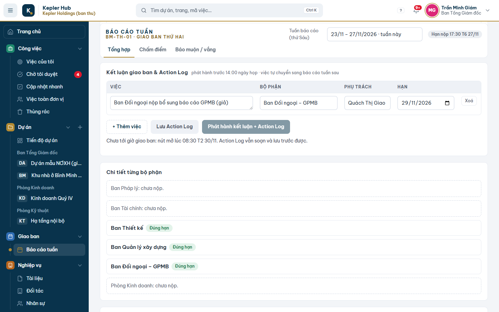

4. **Sao chép bản tổng hợp**: bản có nhãn BẢO MẬT, không có họ tên, để dán vào biên bản.

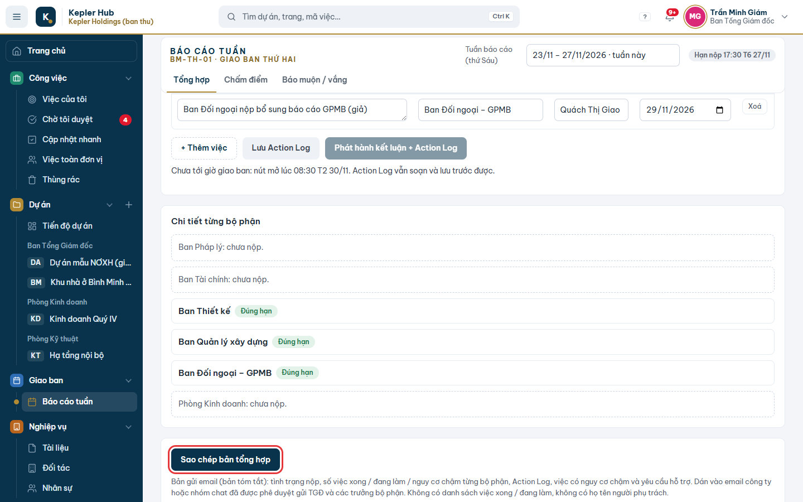

### 7.3 Báo muộn / vắng và chấm điểm tuân thủ

- **Báo muộn / vắng**: danh sách bộ phận báo vắng, người dự thay; thư ký nhập thay bộ phận gửi email (giờ nộp = giờ nhận email).

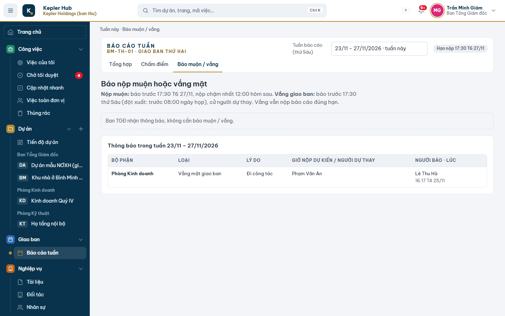

- **Chấm điểm**: điểm tuân thủ tháng theo Phụ lục 1 (100 điểm, mức trừ đề xuất). Thư ký **Trình TGĐ** → TGĐ **Duyệt và khoá**.

Thiết lập bộ phận phải nộp, thứ tự, hạn nộp, ngày họp khi nghỉ lễ: Ban Tổng Giám đốc / thư ký ở **Thiết lập** của trang Báo cáo tuần.

**Bằng Claude (chỉ khi tài khoản có quyền xem tổng hợp):** "Tóm tắt tổng hợp giao ban tuần này theo bộ phận: hoàn thành, trễ, vướng mắc cần Ban Tổng Giám đốc quyết." Claude chỉ dùng **bản tổng hợp tóm tắt**; điểm danh, kết luận, phát hành, chấm điểm làm trên giao diện.

---

## 8. Văn thư

**Vào sổ** (cấp số) do **văn thư** (người Ban Tổng Giám đốc chỉ định), **Ban Tổng Giám đốc**, hoặc **lãnh đạo bộ phận** (riêng dãy D7 — văn bản nội bộ của bộ phận mình).

1. **Nghiệp vụ → Văn thư** → chọn sổ: **Văn bản đến / Văn bản đi / Nội bộ**. Bấm **Vào sổ** (1).

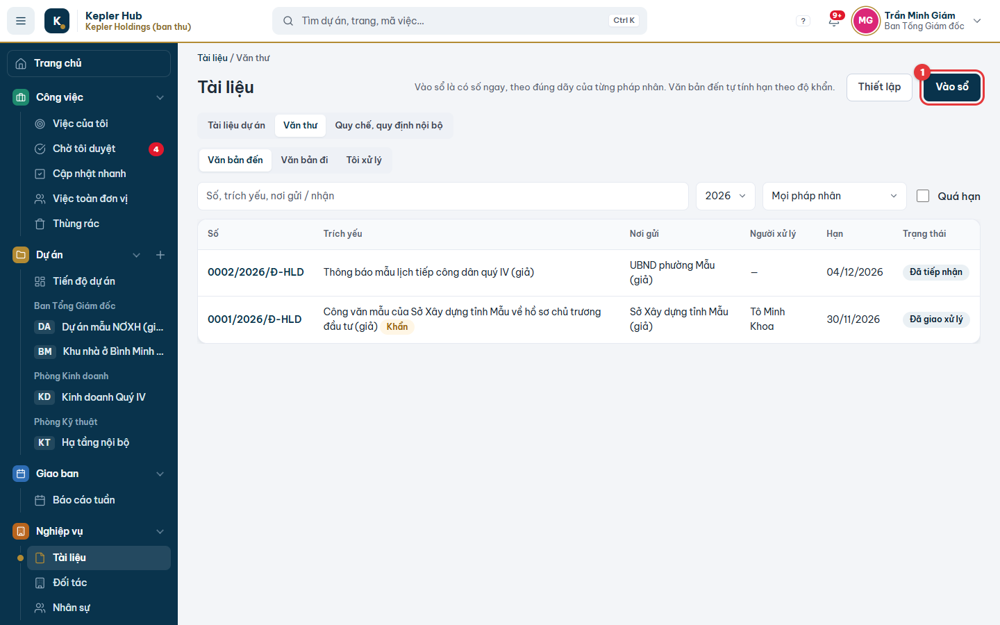

2. Chọn **dãy số** (D5 Quyết định TGĐ / GĐ; D6 văn bản Ban Điều hành; D7 nội bộ bộ phận; D9 văn bản đi; D10 văn bản đến), pháp nhân, tên loại (CV, TB, QĐ, TTr…), trích yếu, nơi gửi / nhận, mức bảo mật, độ khẩn, **người xử lý**, hạn (để trống: tự tính theo độ khẩn). Văn bản có thời hạn pháp lý: tích "chuyển Pháp chế".

3. Lưu → có số ngay. Người xử lý nhận thông báo. Tải bản scan / bản đã ký lên trong văn bản: Kepler Hub lưu thẳng vào `\\192.168.130.2\DATA\<phòng>\NN.VanBanDen|Di|NoiBo\<năm>\`.

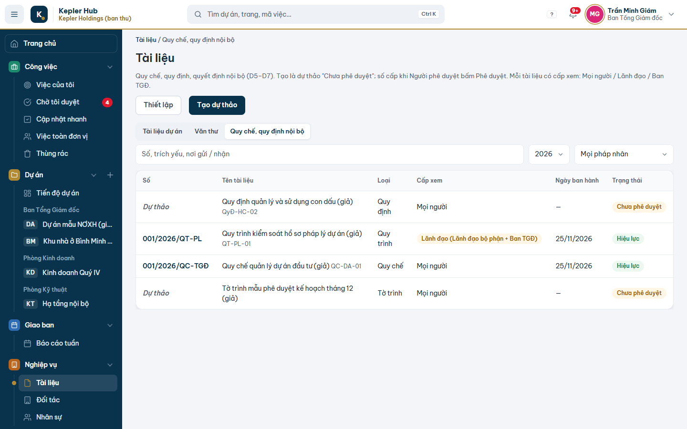

- Mức **Hạn chế / Bảo mật cao**: chỉ người trong danh sách được xem; danh sách văn bản Bảo mật cao do TGĐ / Chủ tịch duyệt, Ban Tổng Giám đốc nhập.
- **Thiết lập** (Ban Tổng Giám đốc): pháp nhân, văn thư, người nhận chuyển Pháp chế.

Claude **không** vào sổ, không tải tệp. Skill `kepler-luu-tai-lieu` chỉ chỗ lưu và cách đặt tên.

---

## 9. Nhân sự

> Phân hệ Nhân sự đang **tắt** trên bản chạy thật cho tới khi Ban Tổng Giám đốc quyết định bật.

### 9.1 Duyệt đơn nghỉ và giải trình

**Chờ tôi duyệt → Đơn nghỉ & giải trình** (hoặc Nhân sự → Chờ duyệt). Đơn nhân viên → lãnh đạo bộ phận duyệt; đơn của lãnh đạo bộ phận → Ban Tổng Giám đốc duyệt.

Mỗi đơn hiện số phép còn và **cảnh báo việc đến hạn trong thời gian nghỉ** (cần người làm thay / lùi hạn). Bấm **Duyệt** (1) hoặc **Từ chối**.

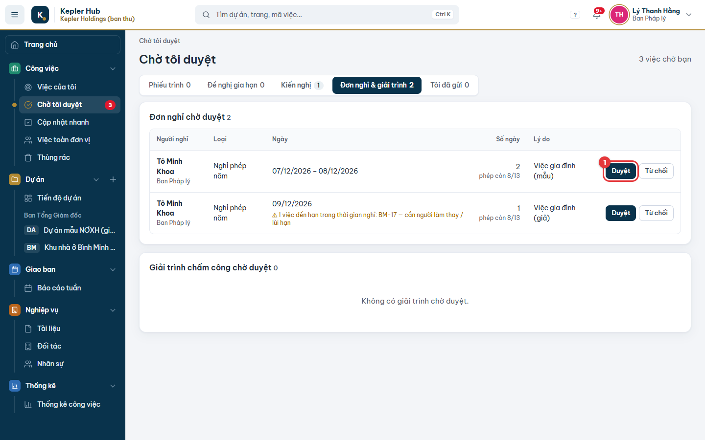

### 9.2 Bảng công và danh sách nhân sự

- **Nhân sự → Bảng công**: tổng hợp công bộ phận theo tháng.

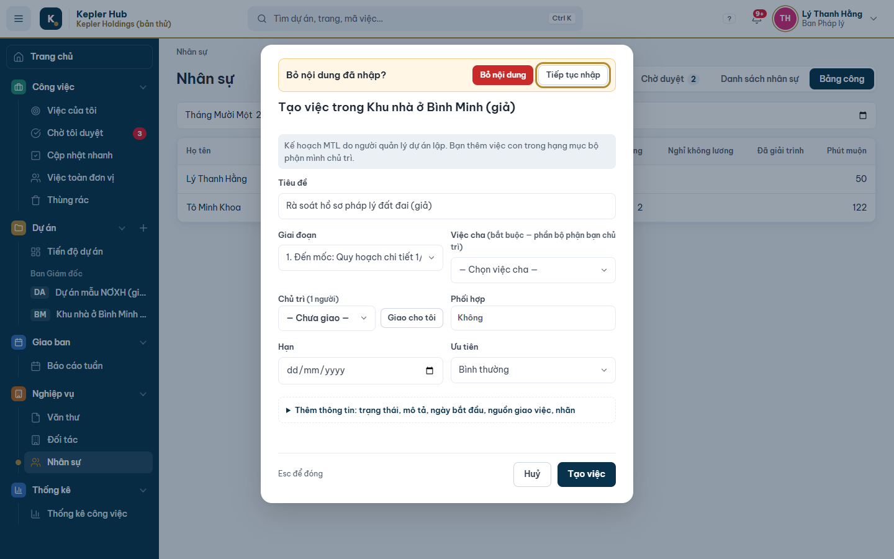

- **Nhân sự → Danh sách nhân sự**: hồ sơ, hợp đồng lao động. Số CCCD, lương được mã hoá; xem đầy đủ phải bấm hiện. **Không bao giờ hiện qua Claude** (Claude chỉ thấy 4 số cuối CCCD, không thấy lương).

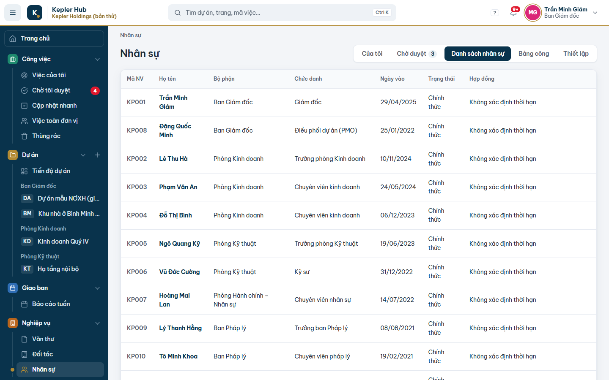

**Bằng Claude:** "Đơn nghỉ nào đang chờ tôi duyệt? Ai nghỉ trùng ngày giao ban?" / "Tổng hợp công bộ phận tháng 11: ai thiếu công nhiều nhất?" → Claude đọc và tóm tắt; **duyệt đơn** làm trên giao diện.

---

## 10. Đối tác (CRM)

- Lãnh đạo bộ phận xem đối tác, người liên hệ, nhật ký, hợp đồng của **bộ phận mình phụ trách**; Ban Tổng Giám đốc xem tất cả.
- Việc cần theo dõi nhắc lúc 08:10.

**Bằng Claude:** "Việc cần theo dõi với đối tác của bộ phận tôi, việc nào quá hạn?" (Claude gọi phạm vi bộ phận; Ban Tổng Giám đốc: tất cả).

---

## 11. Claude cho lãnh đạo

Cài đặt và kết nối giống nhân viên ([mục 3](nhan-vien.md#3-kết-nối-claude-desktop-với-kepler-hub)). Câu hỏi hay dùng:

| Bạn gõ | Claude làm | Bạn tự làm trên giao diện |
|---|---|---|
| "Hôm nay tôi có gì, có gì chờ tôi duyệt?" | Gom thông báo, việc, nhắc việc, mục chờ duyệt (việc + đơn nghỉ) | Duyệt, chấm mức |
| "Tình hình dự án BM: rủi ro, việc găng trễ, việc chờ duyệt lâu" | Đọc tiến độ MTL, việc trong kỳ, tóm tắt | — |
| "Giao việc … cho …, hạn …" | Đề xuất, chờ đồng ý, tạo việc | Đánh dấu mốc / găng, điều chỉnh kế hoạch gốc |
| "Soạn nháp báo cáo tuần bộ phận" | Lưu nháp | **Gửi báo cáo** |
| "Tóm tắt tổng hợp giao ban tuần này" | Đọc bản tổng hợp tóm tắt | Điểm danh, kết luận, Action Log, phát hành, chấm điểm |
| "Đơn nghỉ chờ tôi duyệt" | Liệt kê, cảnh báo trùng việc | Duyệt / từ chối |
| "Lưu tờ trình đã ký ở đâu?" (skill `kepler-luu-tai-lieu`) | Chỉ thư mục, tên tệp | Vào sổ, tải tệp |

Tài khoản **quản trị hệ thống (IT)** không dùng được Claude với Kepler Hub (`NOT_VIA_AI`): IT không truy cập dữ liệu nghiệp vụ. Quản trị thu hồi token của mọi người ở **Quản trị → Token Claude**.

---

## 12. Hỏi đáp

| Câu hỏi | Trả lời |
|---|---|
| Tôi thuộc Ban Tổng Giám đốc mà không sửa được hạn việc? | Việc đó nằm ngoài **phạm vi phụ trách** của bạn (không phụ trách Toàn công ty, không phụ trách bộ phận chủ trì việc), và bạn không phải người giao. Nhờ quản trị đặt phạm vi phụ trách |
| PMO sao không sửa được kế hoạch việc? | Đúng thiết kế: PMO là kiêm nhiệm (xem bản tổng hợp giao ban đầy đủ, quản lý dự án mình làm chủ). Kế hoạch do người giao và BTGĐ phụ trách sửa |
| Nút "Phát hành kết luận + Action Log" bị khoá | Chưa tới giờ giao ban. Action Log vẫn soạn và lưu trước được |
| Việc cha không gửi duyệt được | Còn việc nhánh chưa được duyệt hoàn thành |
| Phiếu duyệt việc mốc không tới người giao | Đúng: việc mốc / đường găng do BTGĐ phụ trách của việc duyệt |
| Nhờ Claude đặt 100% có phải là duyệt không? | Không. 100% trên việc MTL = **gửi duyệt** (sang Chờ duyệt). Duyệt vẫn là người duyệt bấm trên giao diện |
| Claude báo "Không đủ quyền" / `NOT_VIA_AI` | Xem bảng lỗi trong [hướng dẫn nhân viên, mục 12](nhan-vien.md#12-hỏi-đáp-và-lỗi-thường-gặp) |
