# Hướng dẫn sử dụng Kepler Hub — dành cho nhân viên

> Tài liệu này dành cho **mọi nhân viên**. Chỉ nói những gì nhân viên thấy và làm được.
> Ban Tổng Giám đốc, lãnh đạo bộ phận và người được giao kiêm nhiệm (Thư ký giao ban, PMO, Văn thư, Pháp chế, Phụ trách nhân sự — xem dòng **Kiêm nhiệm** ở Thông tin cá nhân) đọc thêm [Hướng dẫn cho lãnh đạo](lanh-dao.md). Bạn được giao kiêm nhiệm mà chưa có tài liệu đó: xin lãnh đạo bộ phận.
>
> Ảnh chụp từ **bản cài thử, dữ liệu giả** (tên người, dự án "Khu nhà ở Bình Minh (giả)" đều là mẫu).
> Ô đỏ có số trong ảnh là chỗ bạn bấm, theo thứ tự.

## Mục lục

1. [Kepler Hub và Claude: hai cách làm cùng một việc](#1-kepler-hub-và-claude-hai-cách-làm-cùng-một-việc)
2. [Lần đầu vào Kepler Hub](#2-lần-đầu-vào-kepler-hub)
3. [Kết nối Claude Desktop với Kepler Hub](#3-kết-nối-claude-desktop-với-kepler-hub)
4. [Làm việc dự án](#4-làm-việc-dự-án)
5. [Cập nhật tiến độ hằng ngày](#5-cập-nhật-tiến-độ-hằng-ngày-cập-nhật-nhanh)
6. [Báo cáo tuần](#6-báo-cáo-tuần)
7. [Tài liệu: tài liệu dự án, văn thư, quy chế](#7-tài-liệu-tài-liệu-dự-án-văn-thư-quy-chế)
8. [Nhân sự: chấm công, xin nghỉ](#8-nhân-sự-chấm-công-xin-nghỉ)
9. [Đối tác (CRM)](#9-đối-tác-crm)
10. [Thiết lập cá nhân: thông báo, nhắc việc, ghi chú, phím tắt, thùng rác](#10-thiết-lập-cá-nhân)
11. [Lúc nào dùng skill nào](#11-lúc-nào-dùng-skill-nào)
12. [Hỏi đáp và lỗi thường gặp](#12-hỏi-đáp-và-lỗi-thường-gặp)

---

## 1. Kepler Hub và Claude: hai cách làm cùng một việc

**Kepler Hub** (https://hub.keplerholdings.vn) là nơi làm việc chung của công ty: dự án theo Master Timeline (MTL), việc và việc nhánh, báo cáo tuần, tài liệu và văn thư; nhân sự, đối tác khi công ty bật.

Mỗi nghiệp vụ trong tài liệu có hai đường:

| | Làm trên giao diện | Làm nhanh bằng Claude |
|---|---|---|
| Cách làm | Mở Kepler Hub trên trình duyệt, bấm theo ảnh | Gõ câu bằng tiếng Việt cho Claude Desktop (đã cài tiện ích Kepler Hub và skill `kepler-hub`) |
| Hợp với | Việc cần nhìn kỹ, việc chỉ người làm được | Tra cứu nhanh, tổng hợp, soạn nháp, cập nhật nhiều việc một lúc |

**Claude dùng đúng quyền của bạn.** Bạn xem, sửa được gì thì Claude được đúng như vậy, không hơn. Mọi thao tác ghi mang tên bạn. Claude sẽ tóm tắt và hỏi lại trước mỗi thao tác ghi. Claude Desktop cũng hỏi bạn trước mỗi lần dùng công cụ ghi, trừ khi bạn đã chọn luôn cho phép — nên để hỏi.

**Những việc chỉ bạn tự làm trên giao diện** (Claude không làm được):

- duyệt, chấm mức hoàn thành, duyệt gia hạn, duyệt đơn nghỉ;
- **nộp** báo cáo tuần (Claude chỉ lưu nháp);
- vào sổ văn bản, tải tệp lên (ngoại lệ: người được tạo dự thảo quy chế nhờ Claude đưa một tệp PDF lên làm dự thảo — mục 7.2), tải tệp về, xuất Excel / Word;
- xoá bất cứ thứ gì;
- giải trình chấm công, chấm vào / ra.

> ⚠️ **Lưu ý về "100%":** với việc trong dự án MTL, khi tiến độ được đặt **100%** thì Kepler Hub tự **gửi duyệt** (việc chuyển sang "Chờ duyệt") nếu mọi việc nhánh đã xong; còn việc nhánh chưa xong thì chỉ ghi %. Dự án thường: đặt 100% không gửi duyệt. Điều này đúng cả khi Claude cập nhật giúp bạn. Chỉ bảo Claude đặt 100% khi việc thật sự xong.

---

## 2. Lần đầu vào Kepler Hub

### 2.1 Mở Kepler Hub

1. Mở Chrome hoặc Edge, vào **https://hub.keplerholdings.vn**.
2. Ở ngoài văn phòng: **bật VPN công ty trước**. Kepler Hub chỉ chạy trong mạng nội bộ.

### 2.2 Trình duyệt báo "Kết nối không riêng tư" / lỗi chứng chỉ

Máy tính của công ty đã được IT cài sẵn chứng chỉ của Kepler Hub, bạn không phải làm gì.

Trình duyệt vẫn báo "Kết nối không riêng tư" hoặc lỗi chứng chỉ: **không** bấm "Nâng cao → Tiếp tục" để bỏ qua, mà **báo IT**.

### 2.3 Đăng nhập

1. Nhập **Tài khoản** và **Mật khẩu** IT cấp, bấm **Đăng nhập** (1).
2. Lần đầu, Kepler Hub bắt đổi mật khẩu. Đặt mật khẩu mới ít nhất 6 ký tự, khác mật khẩu cũ, không dùng lại mật khẩu ở nơi khác.
3. Quên mật khẩu: liên hệ quản trị hệ thống để đặt lại. Quản trị báo riêng mật khẩu mặc định; đăng nhập xong phải đổi ngay. Gõ sai mật khẩu và tài khoản bị khoá cùng báo "Tài khoản hoặc mật khẩu không đúng" (mục 10.2).

Muốn mở Kepler Hub như một ứng dụng riêng (có biểu tượng trên màn hình): bấm **Cài Kepler Hub lên máy** ở cuối khung đăng nhập.

### 2.4 Làm quen màn hình chính

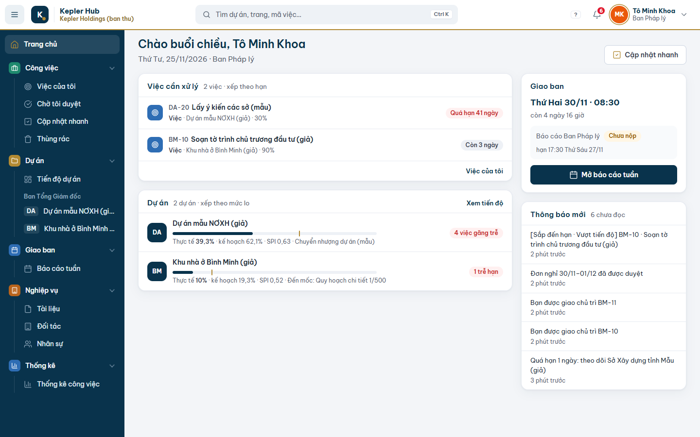

- **Trang chủ:** **Cần xử lý** (việc của bạn quá hạn hoặc đến hạn trong 7 ngày, phiếu chờ bạn duyệt, đề nghị gia hạn, kiến nghị — xếp theo hạn), **Dự án** (các dự án MTL bạn xem được, xếp theo mức lo), **Giao ban** (giờ họp, tình trạng báo cáo của bộ phận bạn), **Thông báo mới**; nút **Cập nhật nhanh** ở góc phải.
- **Menu trái:** **Trang chủ**; **Công việc** (Việc của tôi, Chờ tôi duyệt, Cập nhật nhanh, Thùng rác); **Dự án** (Tiến độ dự án và danh sách dự án bạn xem được); **Giao ban** (Báo cáo tuần); **Nghiệp vụ** (**Tài liệu** — gồm tài liệu dự án, văn thư, quy chế); **Thống kê** (Thống kê công việc).
- **Nghiệp vụ** có **Tài liệu**, **Đối tác**, **Nhân sự**. Văn thư không còn là mục riêng: nó nằm trong **Tài liệu**, ở tab **Văn thư** và tab **Quy chế, quy định nội bộ** (mục 7). **Đối tác** và **Nhân sự** bật từ 25/11/2026; chưa thấy hai mục này thì bấm F5 để tải lại trang.
- **Chuông** góc trên: thông báo (được giao việc, sắp đến hạn, trễ hạn, đơn nghỉ đã duyệt…). Chi tiết: mục 10.4.

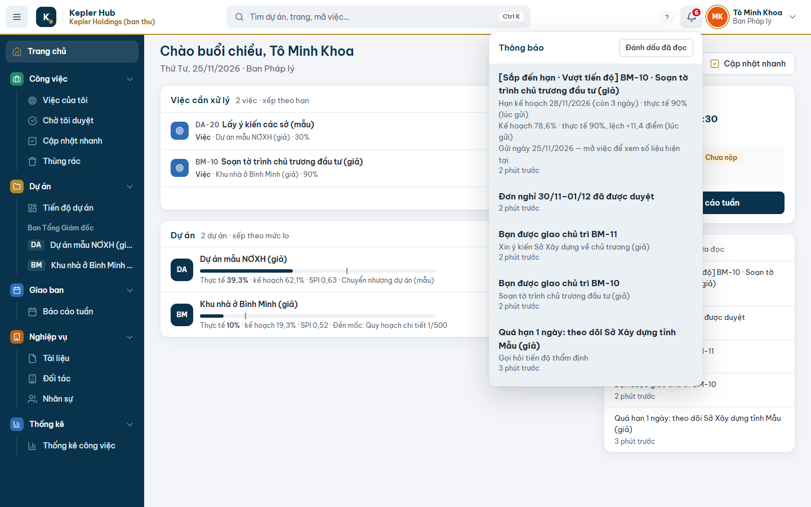

- **Tìm nhanh** (`Ctrl K`): gõ tên dự án, trang, mã việc (vd. `BM-10`), tên việc hoặc số văn bản đã gắn vào việc; gõ từ 2 ký tự mới tìm việc. **Gõ không dấu vẫn ra** ("to trinh" tìm được "Tờ trình"). Chi tiết: mục 10.8.

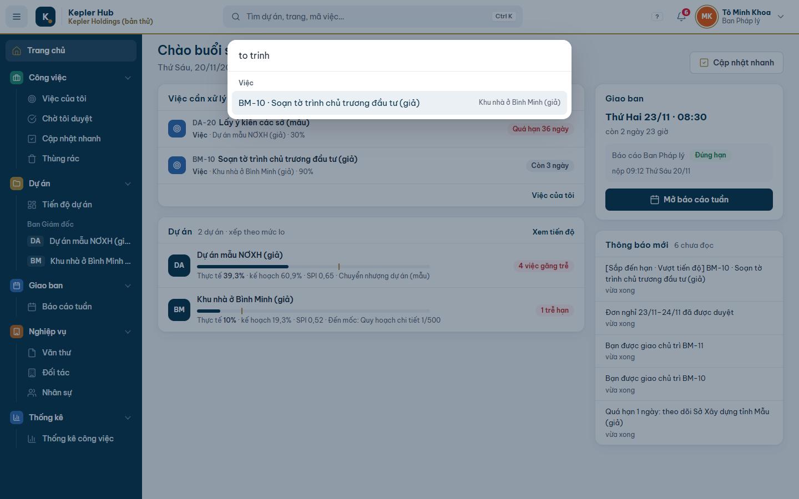

- Khi Kepler Hub có bản mới, thanh **"Có bản mới · Tải lại"** hiện ở đầu trang. Bấm **Tải lại** để dùng bản mới.

---

## 3. Kết nối Claude Desktop với Kepler Hub

Làm **một lần** trên mỗi máy, ở văn phòng hoặc khi đã bật VPN.

**Hai việc khác nhau, đều cần:**

- **Được thêm vào không gian Claude của công ty:** bạn đăng nhập Claude Desktop bằng tài khoản Claude của công ty và có sẵn các skill dùng chung (mục 3.4). Việc này IT hoặc người quản trị Claude của công ty làm, không làm trên Kepler Hub.
- **Kết nối Claude** trên Kepler Hub: nối Claude Desktop của bạn với tài khoản Kepler Hub của chính bạn, để Claude xem, cập nhật đúng phần bạn được làm. Bạn tự làm theo các bước dưới.

Đăng nhập được Claude bằng tài khoản công ty chưa có nghĩa là đã kết nối: chưa làm các bước dưới thì Claude không đọc được dữ liệu Kepler Hub của bạn.

**Thứ tự:** mở trang **Kết nối Claude** (mục 3.1) → **Bước 1** (bắt buộc): cài tiện ích (mục 3.2) → **Bước 2**: bấm **Cho phép** (mục 3.3) → kiểm tra kết nối (mục 3.5). Làm theo các bước mà không kết nối được: **báo IT**.

### 3.1 Mở trang "Kết nối Claude"

Bấm tên của bạn góc trên phải → **Kết nối Claude** (1).

### 3.2 Bước 1 (bắt buộc): cài tiện ích Kepler Hub cho Claude Desktop

1. Trên trang **Kết nối Claude**, dòng **Cài tiện ích**: bấm vào chữ `kepper-claude.mcpb` (1) để tải tệp về thư mục Tải về (Downloads). Tên tệp đúng là "kepper", không phải "kepler".

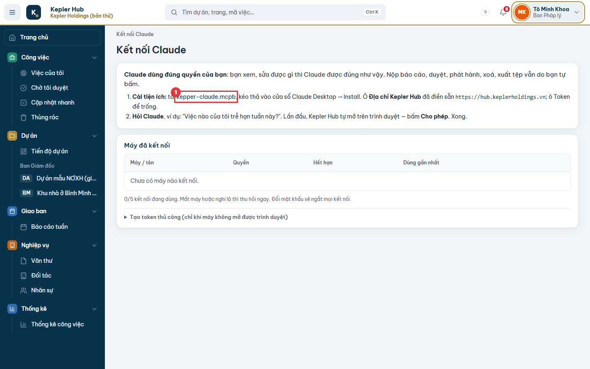

> ⚠️ Thư mục Tải về đã có tệp `kepper-claude.mcpb` cũ thì trình duyệt đặt tên tệp mới là `kepper-claude (1).mcpb`. Phải mở **tệp mới nhất**; mở tệp cũ là cài lại bản cũ. Nên xoá tệp cũ trước khi tải.

2. Mở tệp vừa tải (nhấn đúp tệp trong thư mục Tải về, hoặc bấm vào tệp trong danh sách tải về của trình duyệt). Claude Desktop hiện hộp cài đặt → bấm **Install**. (Kéo thả tệp vào cửa sổ Claude Desktop cũng được.)
3. **Thoát hẳn Claude Desktop rồi mở lại:** chuột phải biểu tượng Claude ở khay hệ thống (góc phải thanh tác vụ) → **Quit**. Đóng cửa sổ là chưa đủ. Máy Mac: bấm `Cmd Q`. Cài mới hay cập nhật tiện ích đều phải làm bước này.
4. Kiểm tra đã cài: Claude Desktop → **Settings → Customize → Connectors**. Dòng **Kepler Hub**, loại *Desktop*, có dấu ✓ ở cột Status.

Tiện ích tải từ Kepler Hub đã điền sẵn mọi cấu hình, bạn không phải sửa gì. Không thấy dòng **Kepler Hub**, hoặc thấy hai dòng Kepler Hub: **báo IT**.

### 3.3 Bước 2 (cách bình thường): bấm "Cho phép"

Bước này nối tiện ích vừa cài với tài khoản Kepler Hub của bạn. Không cần token.

1. Trong Claude Desktop, hỏi một câu bất kỳ về Kepler Hub, ví dụ: **"Tôi là ai trong Kepler Hub?"**
2. Lần đầu, trình duyệt tự mở trang Kepler Hub có thẻ "Claude Desktop xin kết nối với tài khoản của bạn" (đăng nhập Kepler Hub nếu được hỏi). Claude chờ bạn khoảng 45 giây.
3. Trên trang vừa mở:
   - kiểm tra **tên máy** đúng là máy của bạn; Claude đã báo mã (bước 4) thì **mã** trên trang phải trùng mã đó;
   - chọn **Xem và cập nhật** (mặc định) hoặc **Chỉ xem**;
   - bấm **Cho phép** (2).

4. Bấm **Cho phép** kịp trong khoảng 45 giây thì Claude trả lời tiếp câu vừa hỏi, không cần hỏi lại. Chậm hơn, Claude báo *"Chưa kết nối Kepler Hub… bấm "Cho phép" (mã XXXX-XXXX) rồi hỏi lại"*: bấm **Cho phép** trên trang rồi hỏi lại câu vừa rồi. Trình duyệt không tự mở thì bấm vào đường dẫn Claude đưa trong câu trả lời.
5. Từ giờ Claude dùng được Kepler Hub. Kết nối có hiệu lực **30 ngày**; hết hạn thì Claude tự mở lại trang Cho phép.

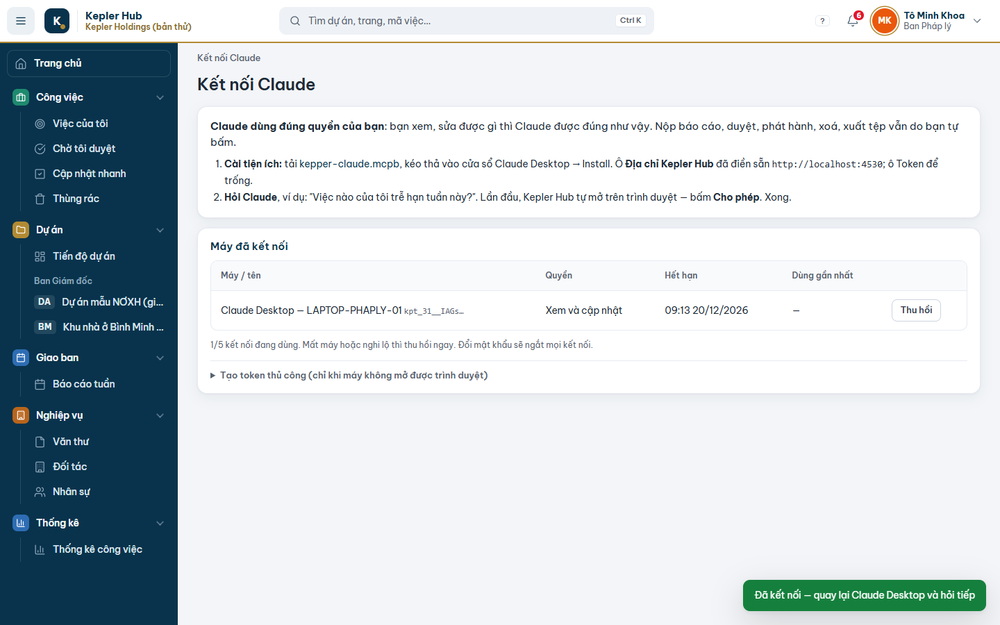

Chỉ bấm **Cho phép** cho yêu cầu do chính bạn vừa tạo trên chính máy này. Trang ghi "đến từ máy khác" hoặc mã không khớp: bấm **Từ chối**.

Trang **Cho phép** không mở được, bấm đường dẫn Claude đưa cũng không vào được: **báo IT**.

**Thu hồi:** mất máy hoặc nghi lộ thì vào **Kết nối Claude → Máy đã kết nối → Thu hồi** (mục 10.3). Mỗi người tối đa 5 máy. Đổi mật khẩu sẽ ngắt mọi kết nối.

### 3.4 Skill Kepler: IT cập nhật cho cả công ty

Hai skill giúp Claude làm việc đúng quy tắc công ty: `kepler-hub` (việc, dự án, báo cáo tuần, nhắc việc, thông báo) và `kepler-luu-tai-lieu` (lưu tài liệu đúng thư mục, đặt tên tệp đúng quy ước).

IT cài và cập nhật hai skill này cho cả công ty trong phần thiết lập tổ chức của Claude: **bạn không phải cài gì, không tự tải skill lên**. Khi có bản mới, thoát hẳn Claude Desktop rồi mở lại là dùng bản mới. Gõ `/kep` trong ô chat mà không thấy skill, hoặc thấy hai skill trùng tên: **báo IT**.

### 3.5 Kiểm tra kết nối

Mục đích: chắc chắn Claude đã nối đúng **tài khoản Kepler Hub của chính bạn** trước khi nhờ Claude làm gì.

Gõ cho Claude:

> **Tôi là ai trong Kepler Hub? Tôi được làm gì qua Claude?**

Claude trả lời họ tên, tài khoản, vai, vai trò giao ban, hạn nộp báo cáo tuần. Kiểm tra họ tên, tài khoản đúng là của bạn. Claude chưa nói tên bộ phận là bình thường.

Họ tên hoặc tài khoản không phải của bạn: dừng lại, vào **Kết nối Claude → Máy đã kết nối** thu hồi kết nối đó, rồi kết nối lại bằng tài khoản của chính bạn.

Thử tiếp: **"Hôm nay tôi có gì?"** — Claude gom thông báo, việc của bạn, nhắc việc thành danh sách: quá hạn → hôm nay → sắp tới.

---

## 4. Làm việc dự án

### 4.1 Bạn liên quan thế nào tới một việc

Trên mỗi việc, bạn chỉ thấy và sửa phần thuộc quan hệ của mình với việc đó (không phải vai của bạn trong công ty). Quan hệ hiện ngay dưới tên việc, ở dòng **"Vai của bạn: …"** (chữ trên màn hình), ví dụ "Vai của bạn: Người chủ trì".

| Dòng "Vai của bạn" ghi | Bạn làm được |
|---|---|
| **Người giao** (bạn tạo việc giao người khác, hoặc chia việc nhánh cho người khác) | Sửa kế hoạch (tên, mô tả, hạn, ưu tiên, nhãn, nguồn), đổi người chủ trì / phối hợp, xoá việc, **duyệt và chấm mức** khi người chủ trì gửi duyệt, cho ý kiến kiến nghị (mục 4.11) |
| **Người chủ trì** | Cập nhật tiến độ, báo cáo tiến độ, chia việc nhánh, gửi kết quả, **Gửi duyệt**, **Xin gia hạn** |
| **Người phối hợp** | Gửi kết quả / tài liệu, bình luận |
| **Chủ dự án / PMO** (bạn là Chủ dự án hoặc Người đứng tên dự án) | Xem đầy đủ, bình luận |
| **Thành viên dự án** (không liên quan tới việc) | Chỉ xem **tóm tắt**: tên, người chủ trì, hạn, trạng thái, % |

Hạn, mốc, đường găng, người chủ trì… là **kế hoạch** của việc: do người giao và **Ban Tổng Giám đốc phụ trách của việc** sửa. Muốn đổi hạn thì **Xin gia hạn** (mục 4.6); có ý kiến khác thì bình luận cho người giao.

### 4.2 Xem việc của tôi

Menu **Công việc → Việc của tôi**: mọi việc bạn chủ trì / phối hợp ở mọi dự án, lọc **Tất cả / Chủ trì / Phối hợp**, xem dạng danh sách hoặc lịch. Nút **Ghi chú của tôi** ở góc phải (mục 10.6).

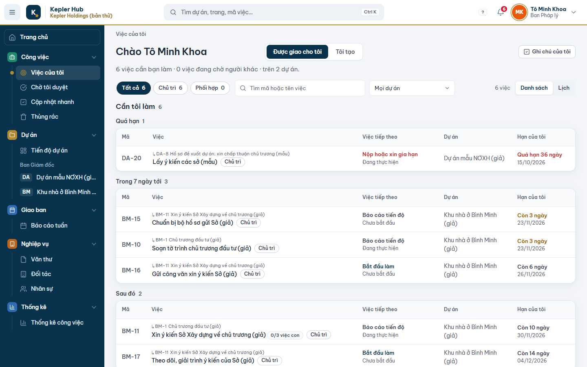

Mở một dự án (menu **Dự án**) để xem toàn cảnh. Dự án theo Master Timeline (MTL) có các tab **Tổng quan dự án**, **Giai đoạn**, **Kế hoạch & Gantt**, **Bảng**, **Danh sách** (Lịch nằm trong **Khác**). Dự án thường có **Bảng**, **Danh sách**, **Lịch**, **Tiến độ kế hoạch**, **Chu kỳ**.

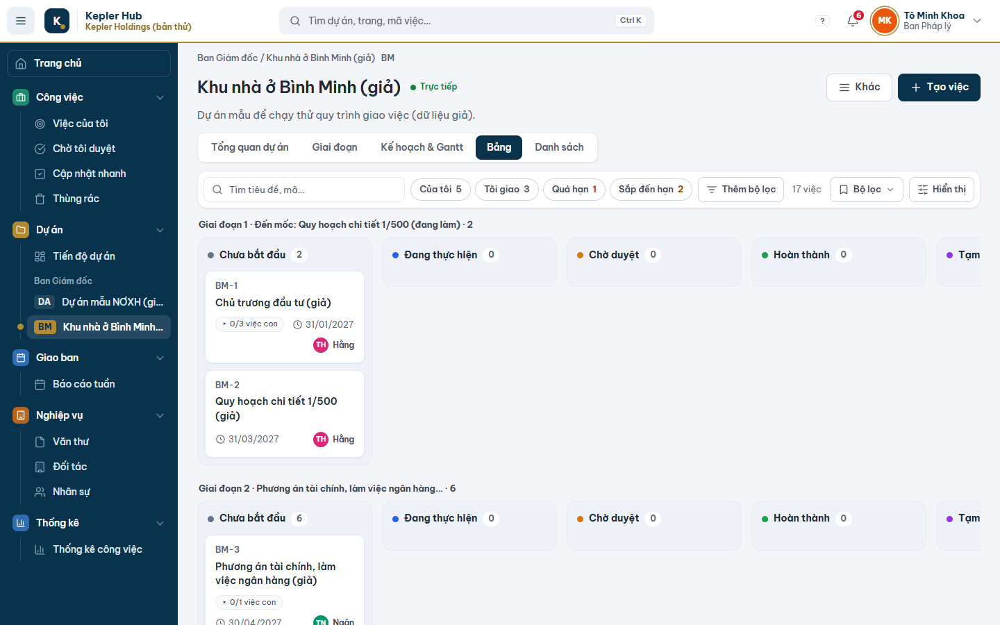

### 4.3 Mở chi tiết một việc

Bấm vào việc → khung chi tiết mở bên phải: trạng thái, kế hoạch gốc, kế hoạch / thực tế, hạn, người giao, khối **Điều hành** (mục 4.6), quy trình duyệt, báo cáo tiến độ, việc nhánh, tab **Kết quả & tài liệu**, **Trao đổi**.

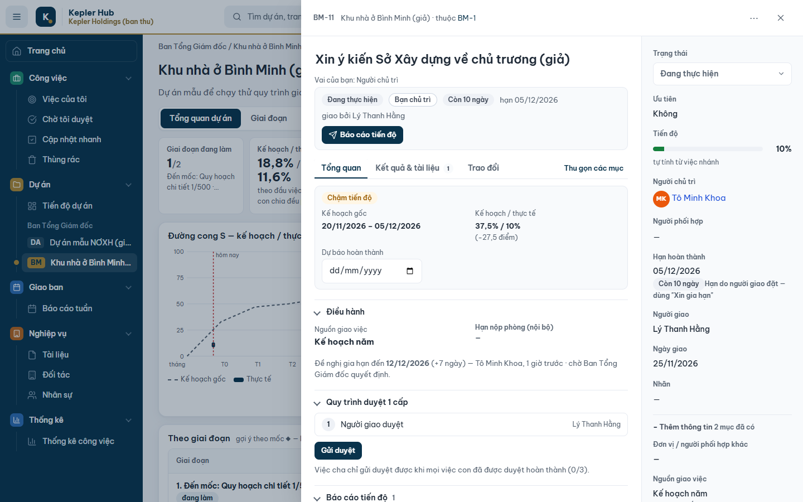

### 4.4 Báo cáo tiến độ

1. Trong việc bạn chủ trì, bấm **Báo cáo tiến độ** (1).
2. Nhập **Tiến độ (%)**, **Đã làm được**; có khó khăn hay kiến nghị thì ghi vào **Khó khăn, vướng mắc**, **Kiến nghị, đề xuất** → **Gửi báo cáo**. Kiến nghị tới người giao, lãnh đạo bộ phận chủ trì và Phó Tổng Giám đốc phụ trách bộ phận chủ trì.

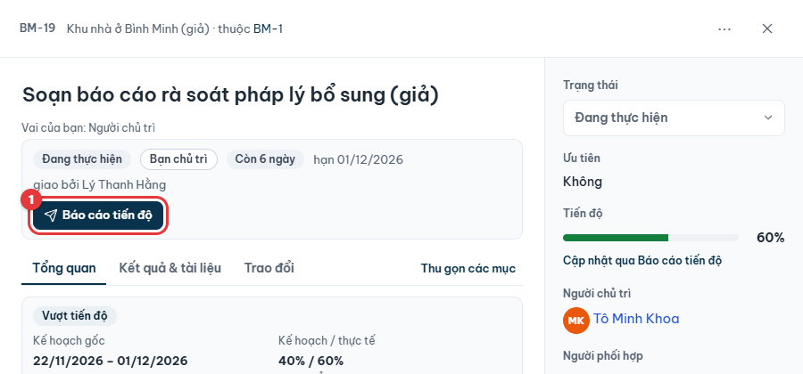

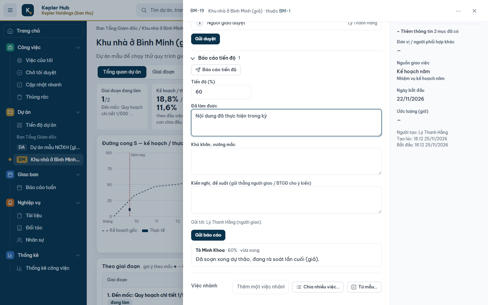

Việc có việc nhánh trong dự án **MTL**: % của việc cha **tự tính** từ việc nhánh (bình quân theo trọng số, mặc định mỗi việc nhánh bằng nhau); cập nhật ở từng việc nhánh, báo cáo tiến độ của việc cha không gửi %. Dự án thường: % việc cha không tự tính — người chủ trì việc cha tự báo tiến độ.

### 4.5 Chia việc nhánh

Checklist đã bỏ; bước nhỏ của một việc giờ là **việc nhánh**. Người chủ trì tự chia việc của mình. Bạn chia việc nhánh thì bạn là **người giao** của việc nhánh: việc nhánh giao người khác thì bạn duyệt (mục 4.11); giao cho chính bạn thì lãnh đạo bộ phận duyệt.

1. Mở việc → mục **Việc nhánh**.
2. Gõ tên vào ô **"Thêm một việc nhánh, Enter để tạo"** (1). Muốn tạo nhiều dòng một lần: **Chia nhiều việc…**
3. Việc cha chỉ gửi duyệt được khi **mọi việc nhánh đã được duyệt hoàn thành** (dòng "Việc cha chỉ gửi duyệt được khi…" ghi x/y).

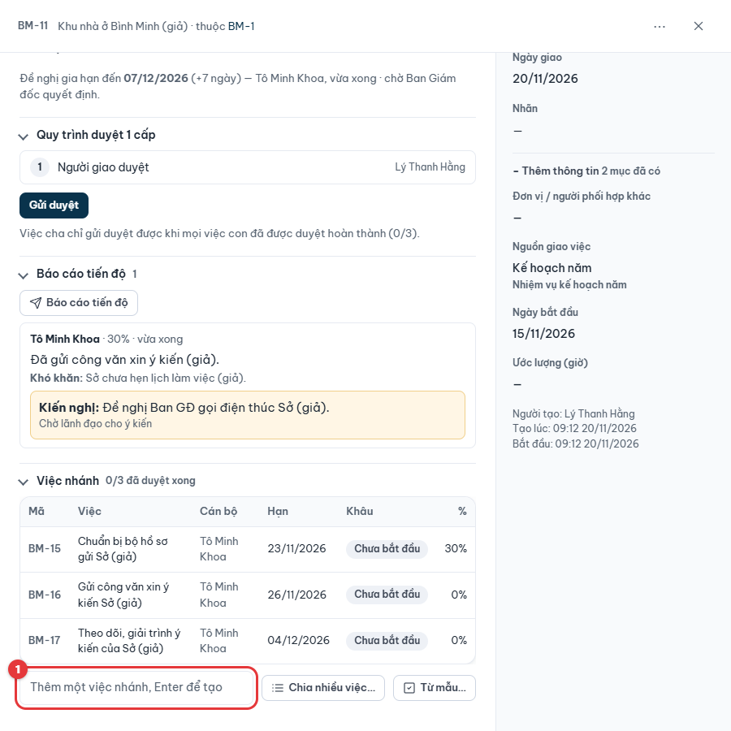

### 4.6 Xin gia hạn

Nút **Xin gia hạn** nằm trong khối **Điều hành** của chi tiết việc. Khối đang thu gọn thì bấm vào tiêu đề **Điều hành** để mở. Phím tắt: **E**.

Nút chỉ hiện khi đủ cả bốn điều:

- bạn là **người chủ trì** của việc;
- việc chưa xong, chưa huỷ;
- chưa có đề nghị gia hạn nào đang chờ;
- việc không ở trạng thái chờ bộ phận tiếp nhận (nhãn "Chờ phòng tiếp nhận").

Việc không giao về bộ phận nào thì không có khối **Điều hành**: nhờ người giao sửa hạn.

1. Mở việc → khối **Điều hành** → **Xin gia hạn** (1).
2. Chọn hạn mới (hoặc bấm +3 / +7 / +14 ngày), ghi lý do → **Gửi đề nghị**.
3. **Ban Tổng Giám đốc phụ trách của việc** quyết định. Trong lúc chờ, việc ghi "chờ Ban Tổng Giám đốc quyết định".

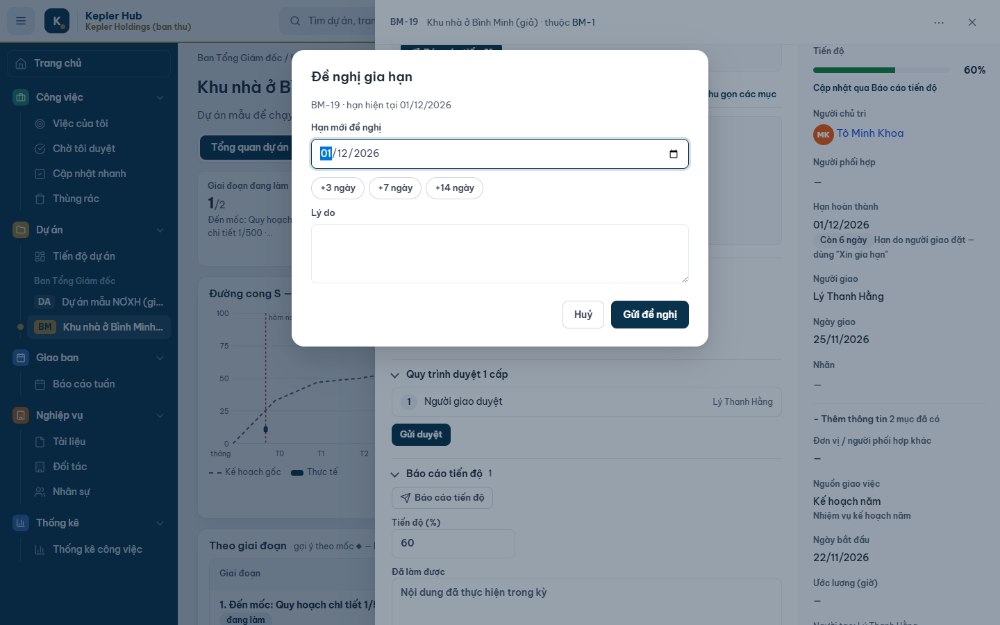

Được duyệt thì chỉ **Hạn** đổi; hạng mục MTL vẫn tính chậm / trễ theo kế hoạch gốc. Không được duyệt thì bạn nhận thông báo kèm lý do.

### 4.7 Gửi duyệt khi xong

1. Mở việc → bấm **Gửi duyệt** (1). Việc trong dự án MTL còn hai cách: báo tiến độ 100% (khi mọi việc nhánh đã xong), hoặc bấm **✓ Gửi duyệt** ở Cập nhật nhanh. Dự án thường: báo 100% chỉ ghi %, bạn vẫn phải bấm **Gửi duyệt**.
2. Việc sang **Chờ duyệt**, chưa tính là hoàn thành.
3. **Ai duyệt:** bước đầu là **người giao** (chấm mức hoàn thành); việc **mốc** hoặc **đường găng** → **BTGĐ phụ trách của việc**; việc bạn tự giao cho mình hoặc người giao đã nghỉ → **lãnh đạo bộ phận** (bộ phận không có lãnh đạo thì người đứng tên dự án, Phó Tổng Giám đốc phụ trách, rồi Ban Tổng Giám đốc). Sau bước đầu, nếu dự án có quy trình duyệt thì phiếu đi tiếp các cấp của dự án (nhiều dự án thường có thêm cấp **Lãnh đạo bộ phận duyệt**); duyệt hết các cấp việc mới thành Hoàn thành. Bạn không tự duyệt việc của mình. Xem phiếu đang ở bước nào, chờ ai: **Chờ tôi duyệt → Tôi đã gửi**; gửi nhầm mà chưa cấp nào xử lý thì bấm **Rút lại**.

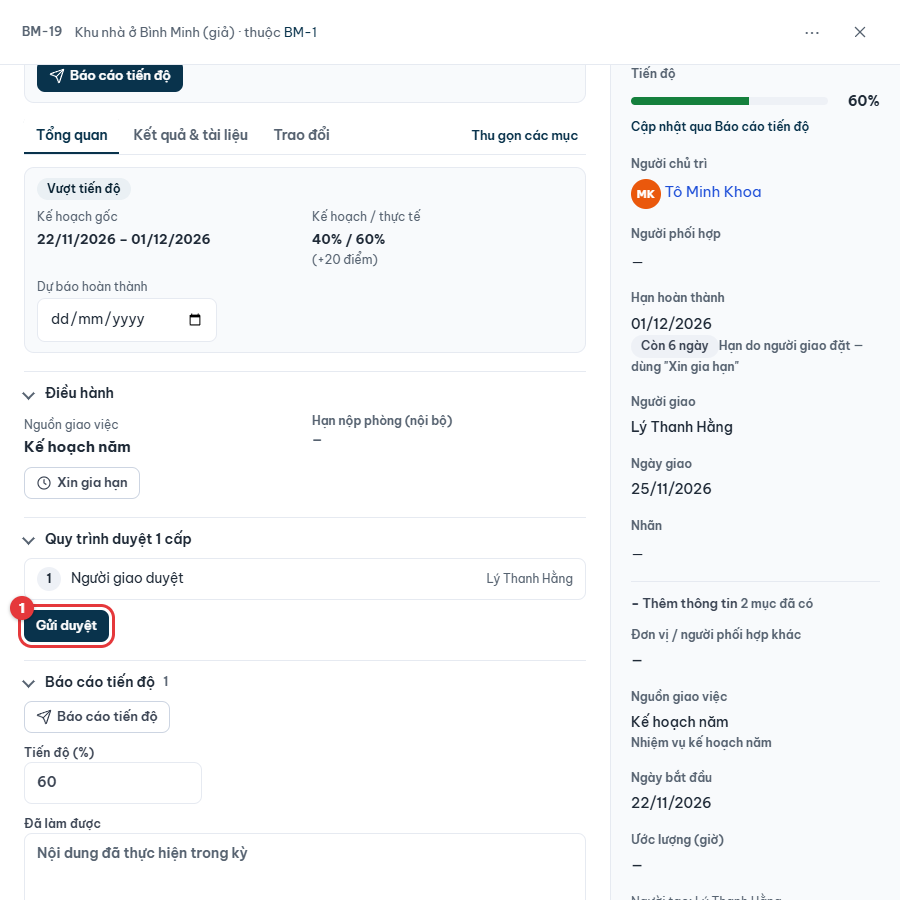

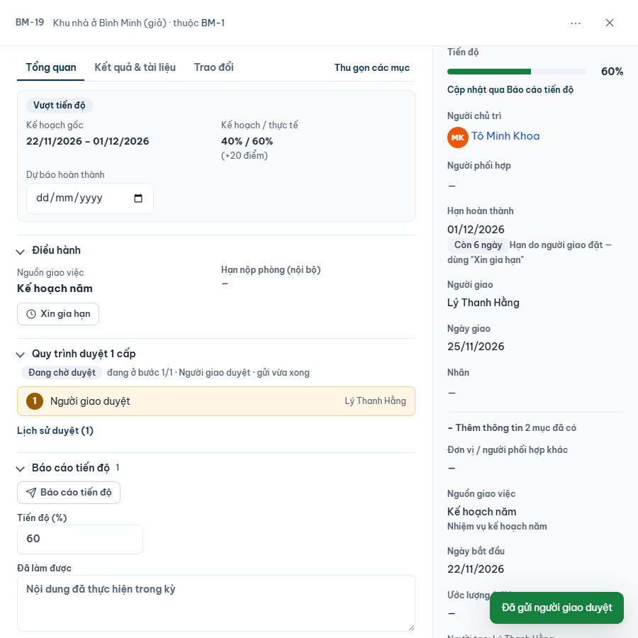

### 4.8 Kết quả duyệt và mức hoàn thành

Người duyệt **chấm mức** khi duyệt: **Xuất sắc / Tốt / Đạt / Cần cải thiện / Kém**, kèm nhận xét. Bạn nhận thông báo và thấy kết quả trong việc. Bị **trả lại** thì việc về "Đang thực hiện" kèm lý do: sửa rồi gửi duyệt lại.

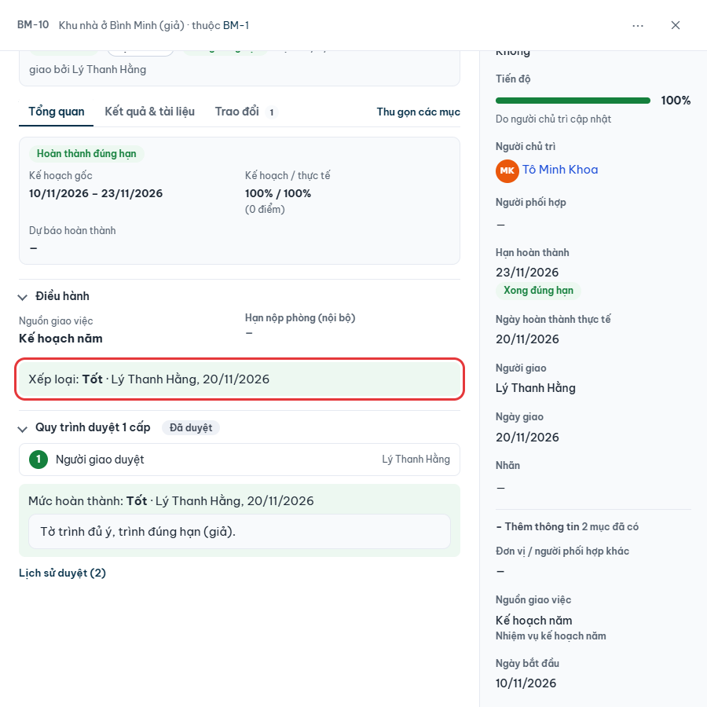

### 4.9 Vì sao tôi chỉ thấy tóm tắt?

Bạn là thành viên dự án nhưng không liên quan tới việc đó (không giao, không chủ trì, không phối hợp). Khung chi tiết việc chỉ hiện tên, người chủ trì, hạn, trạng thái, %; báo cáo tiến độ, đánh giá, bình luận chỉ hiện với người liên quan. Riêng **tệp đính kèm** của mọi việc thì mọi thành viên dự án xem và tải được ở **Nghiệp vụ → Tài liệu → Tài liệu dự án** (mục 7.1). Cần xem thêm: hỏi người chủ trì hoặc người giao.

### 4.10 Làm nhanh bằng Claude (skill `kepler-hub`)

| Bạn gõ | Claude làm |
|---|---|
| "Việc nào của tôi trễ hạn hoặc đến hạn tuần này?" | Đọc việc của bạn, lập bảng theo hạn |
| "Tóm tắt việc BM-11 cho tôi: tiến độ, việc nhánh, bình luận mới" | Đọc chi tiết việc, nêu việc nhánh dạng x/y |
| "Cập nhật BM-15 lên 60%, ghi chú: đã gom đủ hồ sơ pháp lý" | Đọc lại nội dung, **hỏi bạn đồng ý**, rồi cập nhật % và bình luận |
| "Chia BM-11 thành 3 việc nhánh: chuẩn bị hồ sơ, gửi công văn, theo dõi phản hồi; hạn lần lượt 23, 26/11 và 4/12" | Đề xuất danh sách, chờ bạn duyệt rồi tạo việc nhánh |
| "Bình luận vào BM-10, nhắc @Nguyễn Văn A (giả) là tờ trình đã gửi bản mới" | Soạn bình luận, hỏi lại rồi gửi |
| "Việc nào tôi gửi duyệt mà bị trả lại?" | Tra thông báo và việc của bạn |

**Vẫn tự làm trên giao diện:** Gửi duyệt (nút), Xin gia hạn, báo cáo tiến độ có khó khăn, kiến nghị (Claude chỉ ghi % và bình luận), tải tệp kết quả lên, xoá. Nhớ: bảo Claude đặt **100%** = gửi duyệt (việc MTL).

### 4.11 Khi bạn giao việc cho người khác: duyệt và chấm mức

Bạn tạo việc và chọn người khác làm **Chủ trì** (mở dự án → **Tạo việc**, phím `C`; hoặc chia việc nhánh cho đồng nghiệp) thì bạn là **người giao** của việc đó. Người giao:

- sửa kế hoạch của việc (tên, mô tả, hạn, ưu tiên, nhãn, nguồn giao việc), đổi người chủ trì / phối hợp, xoá việc (vào Thùng rác 7 ngày);
- **duyệt và chấm mức** khi người chủ trì gửi duyệt;
- cho ý kiến các **kiến nghị** người chủ trì ghi trong báo cáo tiến độ.

Đề nghị gia hạn của việc bạn giao do Ban Tổng Giám đốc phụ trách của việc quyết định; bạn thấy ở tab **Đề nghị gia hạn** để nắm, không có nút duyệt.

**Duyệt một việc**

1. Menu **Công việc → Chờ tôi duyệt** → tab **Phiếu trình** → bấm việc. Khung chi tiết hiện ô "Bạn đang duyệt bước …".
2. Chọn **Mức hoàn thành** (bắt buộc): **Xuất sắc / Tốt / Đạt / Cần cải thiện / Kém**. Ghi nhận xét nếu cần.
3. Bấm **Duyệt hoàn thành**. Hoặc bấm **Trả lại** kèm lý do (bắt buộc): việc về "Đang thực hiện".

- Sau bạn, phiếu còn đi tiếp các cấp duyệt của dự án nếu có (ví dụ "Lãnh đạo bộ phận duyệt"); duyệt hết các cấp việc mới thành Hoàn thành.
- Mức chấm và nhận xét là đánh giá chính thức của việc, chỉ đọc sau khi duyệt.
- Việc **mốc** / **đường găng** (dự án MTL): Ban Tổng Giám đốc phụ trách của việc duyệt thay bạn.

**Trả lời kiến nghị:** tab **Kiến nghị** → bấm việc → khối "Kiến nghị chờ bạn cho ý kiến": ghi ý kiến rồi bấm **Duyệt** hoặc **Không duyệt** (không duyệt phải ghi ý kiến). Người chủ trì nhận thông báo.

Claude không duyệt, không chấm mức, không trả lời kiến nghị thay bạn.

---

## 5. Cập nhật tiến độ hằng ngày (Cập nhật nhanh)

Trang gom các hạng mục **MTL** bạn chủ trì đang trong kỳ (tháng hiện tại hoặc trễ chưa xong) ở mọi dự án MTL. Cập nhật một chạm, không cần mở từng việc. Việc của dự án thường không có ở đây: mở việc để báo tiến độ, gửi duyệt.

1. **Trang chủ** → nút **Cập nhật nhanh** (1) (hoặc menu Công việc → Cập nhật nhanh).

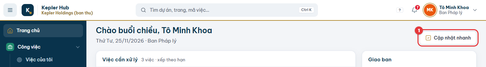

2. Mỗi thẻ là một việc. Đang làm dở: bấm **25% / 50% / 75%** (2) hoặc gõ số %; bấm **Ghi chú** để kèm một dòng (gửi thành bình luận).
3. Xong: bấm **✓ Gửi duyệt** (3). Bấm nhầm thì bấm **Hoàn tác** trên thông báo trong 5 giây: phiếu được rút lại, việc về trạng thái và % cũ.

**Nhắc cập nhật mỗi thứ Năm:** mỗi thứ Năm hằng tuần, lúc 15:00, mỗi người nhận **một** thông báo "Cập nhật tiến độ tuần này: … việc trong kỳ này chưa cập nhật". Thông báo gom các việc dự án MTL bạn chủ trì, trong kỳ cập nhật tháng này, thoả cả hai điều: đã tới ngày bắt đầu, và **5 ngày trở lên** chưa báo tiến độ. Việc chưa giao ai thì lãnh đạo bộ phận chủ trì nhận.

**Bằng Claude:**

- "Liệt kê việc trong kỳ của tôi, việc nào lâu chưa cập nhật?"
- "BM-15 50%, BM-16 25% kèm ghi chú 'đã gửi công văn, chờ Sở hẹn lịch'." → Claude đọc lại từng dòng, chờ bạn đồng ý rồi cập nhật.

---

## 6. Báo cáo tuần

Báo cáo tuần lập **theo bộ phận** (mẫu BM-TH-01), nộp trước **17:30 thứ Sáu** (tuần có nghỉ lễ: theo ngày hạn đã dời, xem chip "Hạn nộp 17:30 …" đầu trang) để giao ban 08:30 thứ Hai. Báo cáo **tự điền sẵn** từ MTL, công việc của bộ phận, kế hoạch tuần trước và Action Log — vì vậy việc quan trọng nhất của nhân viên là **cập nhật tiến độ đúng và kịp** (mục 4, 5).

Mọi người trong bộ phận đều mở được tab **Nộp báo cáo** và lập, gửi báo cáo của bộ phận; lãnh đạo bộ phận chịu trách nhiệm. Khi bạn được giao **lập báo cáo**:

1. Menu **Giao ban → Báo cáo tuần** → tab **Nộp báo cáo**.
2. Xem các phần đã điền sẵn: **I. Kết quả trong tuần**, **II. Đang thực hiện, chưa hoàn thành**, **III. Nguy cơ chậm tiến độ**, **IV. Kế hoạch tuần mới**, **V. Kiến nghị khác**; chỉ sửa chỗ khác thực tế. Bấm **Làm mới từ MTL và công việc** nếu vừa cập nhật tiến độ.
3. Dòng **Chậm / Vướng / Quá hạn** bắt buộc ghi **nguyên nhân**, **giải pháp** và **đề nghị hỗ trợ** (1): chọn **Ban Giám đốc** (tên cũ trên màn hình, nghĩa là Ban Tổng Giám đốc), một bộ phận, hoặc **Tự xử lý – không cần hỗ trợ**; chọn Ban Giám đốc hoặc bộ phận thì ghi thêm cần hỗ trợ việc gì, trước ngày nào. Dòng nào cũng cần người phụ trách và deadline.
4. Báo cáo tự lưu nháp. Xong thì bấm **Gửi báo cáo** (2). Gửi xong, % ghi luôn vào MTL; giờ nộp tính theo lần gửi đầu. Cần sửa sau khi gửi: sửa rồi bấm **Gửi lại**. Từ 08:30 ngày giao ban, báo cáo đã nộp bị khoá (thư ký vẫn sửa được).

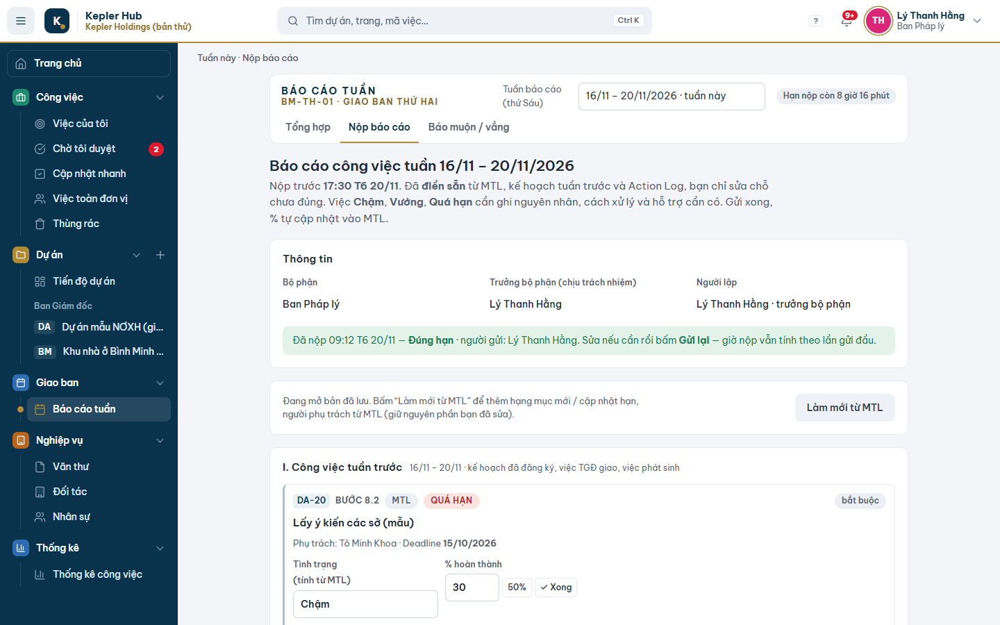

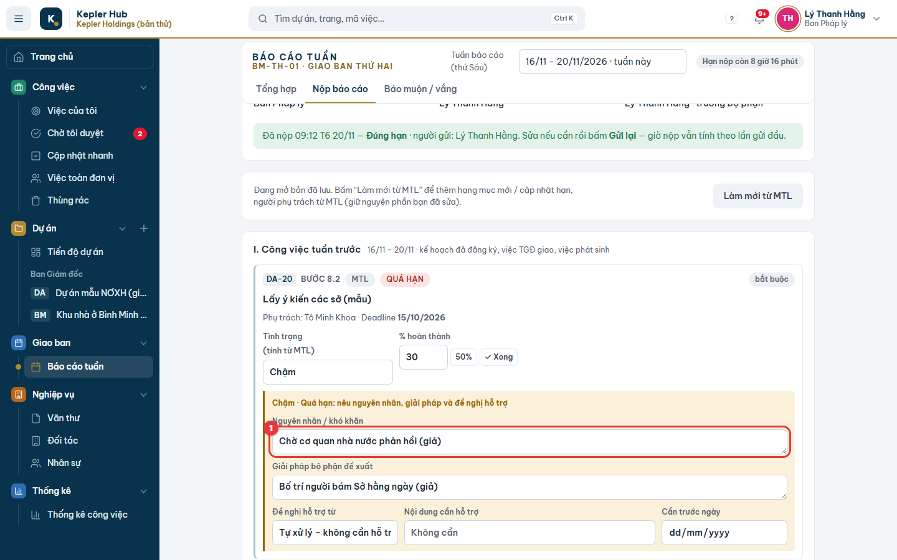

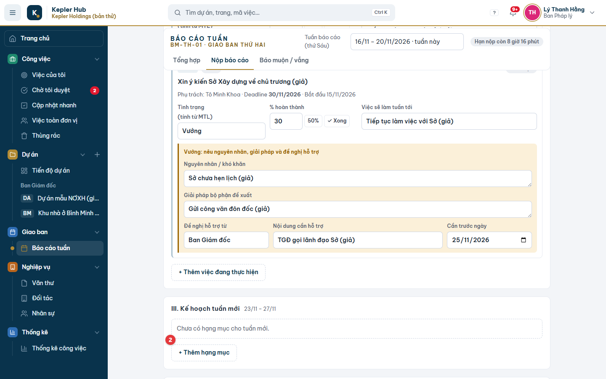

**Bằng Claude:** "Soạn nháp báo cáo tuần này của bộ phận tôi từ việc của tôi và báo cáo tuần trước." → Claude soạn, cho bạn xem, bạn đồng ý thì Claude **lưu nháp**. **Nộp** vẫn là bạn bấm **Gửi báo cáo** trên giao diện. Báo cáo đã gửi thì Claude không sửa được nữa.

---

## 7. Tài liệu: tài liệu dự án, văn thư, quy chế

### 7.1 Tài liệu dự án

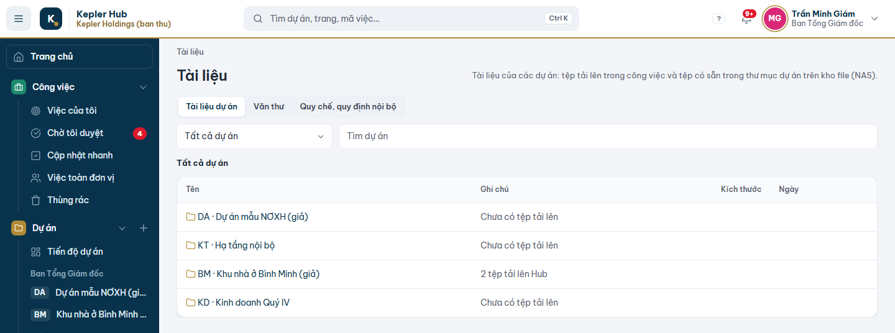

Menu **Nghiệp vụ → Tài liệu** → tab **Tài liệu dự án**. (Bạn chưa là thành viên dự án nào thì menu **Tài liệu** mở thẳng tab **Văn thư**.)

- Chỉ hiện dự án bạn có tên trong **Thành viên** của dự án (Chủ dự án, Thành viên hoặc Người xem) hoặc là Người đứng tên dự án. Dự án "Cả bộ phận" mà bạn làm việc được nhưng chưa có tên trong Thành viên thì không có ở đây.
- Mỗi dự án có hai nguồn:
  - **Theo công việc (tải lên Hub)**: tệp mọi người đính kèm trong các việc, xếp theo hạng mục → việc → việc nhánh. Bấm **Mở việc …** để mở khung chi tiết việc.
  - **Thư mục dự án trên NAS** (chỉ đọc): mọi tệp trong thư mục dự án trên kho file, kể cả tệp không tải qua Kepler Hub. Muốn sửa, xoá, đổi tên: làm trực tiếp trên ổ mạng.
- **Xem** (PDF, ảnh) mở ở thẻ mới; **Tải về** tải tệp. Mỗi lần xem, tải đều được ghi nhật ký.
- Ô tìm: gõ tên tệp (không dấu vẫn ra) để tìm cùng lúc ở cả hai nguồn.
- ⚠️ Tệp bạn đính kèm vào một việc thì **mọi thành viên dự án** xem và tải được ở đây, kể cả người không liên quan tới việc đó. Ban Tổng Giám đốc xem được tài liệu mọi dự án.
- Tải tệp lên: trong khung chi tiết việc → tab **Kết quả & tài liệu** → **Gửi kết quả (đính kèm tệp)** (người chủ trì, người phối hợp). Tối đa 5 tệp một lần, mỗi tệp 25 MB. Dự án có thư mục NAS thì bản gốc lưu thẳng vào NAS, mỗi lần tải là một phiên bản mới, không ghi đè.
- Vừa đính kèm mà chưa thấy ở đây: tải lại trang (F5).
- Claude không xem, không tải tệp dự án.

### 7.2 Văn thư và quy chế nội bộ

Tab **Văn thư** là sổ văn bản **đến** và **đi** của công ty: vào sổ là có số ngay. Tab **Quy chế, quy định nội bộ** là sổ văn bản nội bộ: tài liệu tạo ra ở dạng dự thảo, chỉ có số khi Người phê duyệt phê duyệt. Bản scan được Kepler Hub **lưu thẳng vào thư mục văn thư của bộ phận trên NAS** (`\\192.168.130.2\DATA\<bộ phận>\NN.VanBanDen|Di|NoiBo\<năm>\`), NAS vẫn là bản gốc; bộ phận chưa có thư mục sổ trên NAS thì tệp lưu trong Kepler Hub (không có nhãn **NAS**).

Với nhân viên:

- **Vào sổ** văn bản đến, đi do **Văn thư** (người Ban Tổng Giám đốc chỉ định) hoặc Ban Tổng Giám đốc làm. Bạn nhận được văn bản giấy / email: **chuyển bản scan cho Văn thư**, không tự chép vào thư mục VanBanDen.
- Văn bản **giao bạn xử lý**: bạn nhận thông báo. Menu **Nghiệp vụ → Tài liệu** → tab **Văn thư** → **Tôi xử lý**. Danh sách lọc theo năm: văn bản năm trước còn đang xử lý chỉ hiện khi chọn năm đó ở ô **Năm**.
- **Quy chế, quy định nội bộ** (tab cạnh Văn thư): bạn xem các tài liệu **đã phê duyệt** có cấp xem **Mọi người**. Danh sách lọc theo năm phê duyệt: quy chế ban hành năm trước, còn hiệu lực, chỉ hiện khi chọn năm đó ở ô **Năm**. Tài liệu cấp Lãnh đạo / Ban TGĐ và dự thảo chưa phê duyệt không hiện với bạn. Nếu bạn kiêm Văn thư: bạn tạo được dự thảo cấp Mọi người; **Người phê duyệt** (thành viên Ban Tổng Giám đốc được chọn ở Thiết lập văn thư) phê duyệt thì mới có số.
- Bạn xem được văn bản nào trong sổ đến / đi: **Công khai**, **Nội bộ** — mọi người; **Hạn chế** — người trong bộ phận của văn bản (kể cả nhân viên), Văn thư, Ban Tổng Giám đốc, Pháp chế (văn bản đã chuyển Pháp chế), người vào sổ, người xử lý; **Bảo mật cao** — Ban Tổng Giám đốc, người vào sổ và người xử lý. Claude không có công cụ tra sổ văn thư.

- Mở văn bản để xem số, nơi gửi, độ khẩn, hạn xử lý, lịch sử. Bấm **Bắt đầu xử lý** khi nhận việc, **Báo xong** khi xử lý xong. Bước chỉ đi tiếp, không quay lại. **Báo xong** hỏi lại, cho ghi "Kết quả xử lý"; xong thì Văn thư nhận thông báo để lập hồ sơ.
- Bấm **Tải tệp lên** để thêm bản scan / văn bản trả lời. Trên bản chạy thật, tệp được lưu vào NAS và có nhãn **NAS** kèm phiên bản (ảnh dưới chụp trên bản thử nên không có nhãn này).

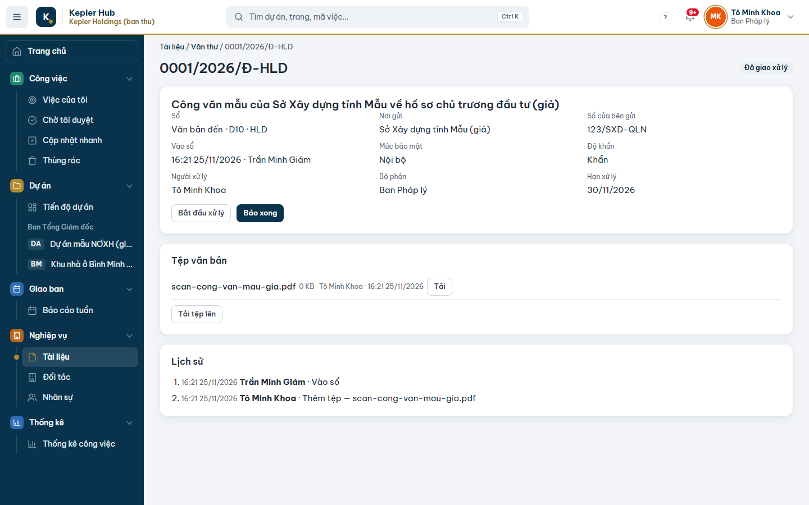

- Ô tìm kiếm lọc ngay khi gõ, gõ không dấu vẫn ra. Gắn văn bản vào việc dự án: trong việc → tab **Kết quả & tài liệu** → khối **Tài liệu, văn bản, sản phẩm** → **Thêm văn bản** → **Chọn từ sổ Văn thư**. Chỉ chọn được văn bản **Công khai** / **Nội bộ** và quy chế cấp "Mọi người"; loại "Căn cứ giao việc" chỉ người giao / Ban Tổng Giám đốc phụ trách của việc thêm.

**Bằng Claude (skill `kepler-luu-tai-lieu`):** "Tôi có bản scan công văn của Sở Xây dựng gửi phòng Pháp lý, lưu ở đâu, đặt tên thế nào?" → Claude chỉ: vào sổ trên Kepler Hub qua Văn thư, hoặc thư mục và tên tệp đúng quy ước. Claude **chỉ chỉ chỗ**, bạn hoặc Văn thư tự lưu.

---

## 8. Nhân sự: chấm công, xin nghỉ

> Phân hệ Nhân sự và Đối tác đã bật trên bản chạy thật từ 25/11/2026. Menu chưa có hai mục này: bấm F5 để tải lại trang.

Menu **Nghiệp vụ → Nhân sự** → **Của tôi**:

1. **Hôm nay:** bấm **Chấm vào** / **Chấm ra** (1). Chưa chấm vào mà bấm chấm ra: Kepler Hub hỏi lại; ngày đó ghi "Thiếu giờ vào", kèm nút **Giải trình**.
2. **Đơn nghỉ của tôi:** bấm **Xin nghỉ** (2).

3. Chọn loại nghỉ, cả ngày / nửa ngày, từ ngày – đến ngày. Kepler Hub hiện ngay **"Phép năm còn X → còn Y sau đơn này"** và báo nếu trùng đơn khác. Lý do ghi ngắn, **không ghi tên bệnh / chẩn đoán**. Bấm **Gửi đơn**.

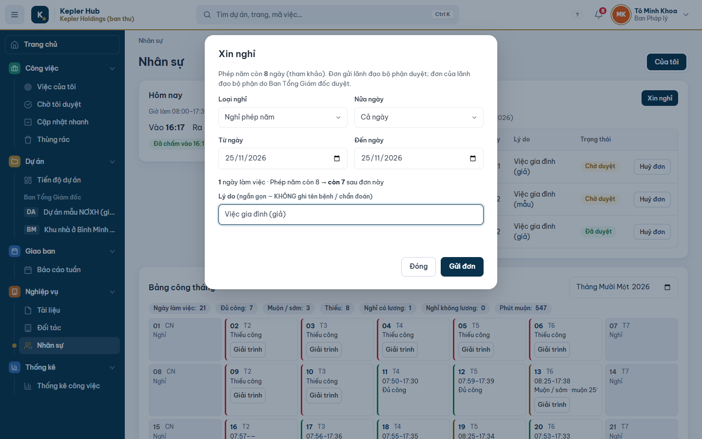

4. Đơn gửi lãnh đạo bộ phận duyệt; bộ phận chưa có lãnh đạo thì Ban Tổng Giám đốc duyệt. Đơn chưa duyệt thì **Huỷ đơn** được; đơn đã duyệt mà huỷ thì lãnh đạo được báo.
5. **Bảng công tháng:** ngày thiếu công / muộn có nút **Giải trình**.

**Bằng Claude:**

- "Tôi còn mấy ngày phép năm? Tháng này tôi thiếu công ngày nào?"
- "Tạo đơn nghỉ phép năm ngày 4/12, cả ngày, lý do việc gia đình." → Claude đọc lại, chờ bạn đồng ý rồi tạo đơn. Claude chỉ tạo đơn **của chính bạn**, không duyệt.

**Vẫn tự làm:** chấm vào / ra, giải trình, huỷ đơn.

---

## 9. Đối tác (CRM)

Danh bạ nhà thầu, tư vấn, cơ quan, ngân hàng, nhà cung cấp: mọi người xem được tên, loại, mã số thuế, địa chỉ, tổng đài. Mỗi đối tác thuộc **một bộ phận phụ trách** và có **một người phụ trách**. Người liên hệ và nhật ký làm việc: người trong bộ phận phụ trách, người phụ trách và Ban Tổng Giám đốc xem. Hợp đồng / gói thầu (kèm giá trị): chỉ lãnh đạo bộ phận phụ trách, người phụ trách và Ban Tổng Giám đốc xem.

1. Menu **Nghiệp vụ → Đối tác**. Gõ để lọc ngay (không dấu vẫn ra), tích **Bộ phận tôi phụ trách** để thu hẹp.

2. Mở đối tác: thông tin chung, người liên hệ, nhật ký làm việc, việc cần theo dõi. Bạn thuộc bộ phận phụ trách (hoặc là người phụ trách): thấy toàn bộ nhật ký. Bạn ở bộ phận khác: chỉ thấy các dòng nhật ký mình ghi hoặc được giao theo dõi.

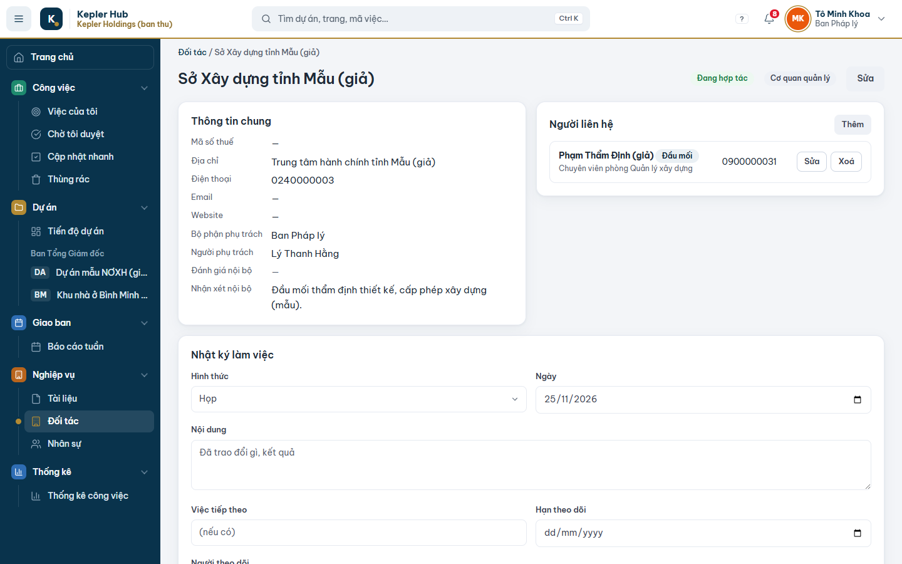

**Bằng Claude:**

- "Tôi có việc gì cần theo dõi với đối tác tuần này?"
- "Ghi nhật ký: hôm nay gọi điện Sở Xây dựng tỉnh Mẫu, Sở hẹn trả lời trước 28/11; hẹn theo dõi ngày 28/11." → Claude đọc lại nguyên văn rồi mới ghi. **Nhật ký không sửa / xoá được.**

---

## 10. Thiết lập cá nhân

Những gì trong mục này chỉ ảnh hưởng tới tài khoản của bạn. Hầu hết mở từ **menu tên của bạn** (góc trên phải).

### 10.1 Thông tin cá nhân

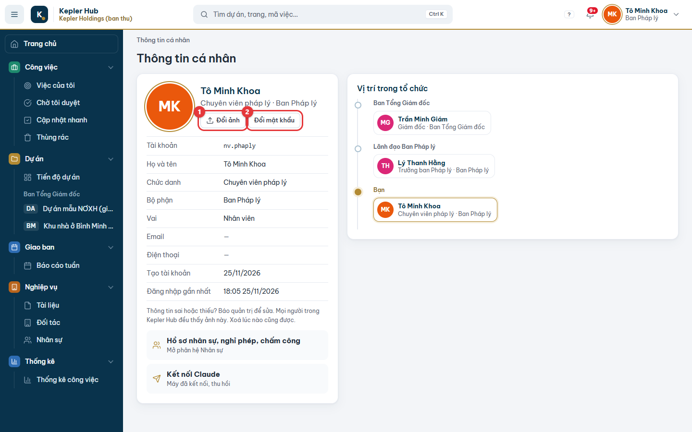

Bấm tên của bạn → **Thông tin cá nhân** (hoặc `Ctrl K` → gõ "thông tin").

- Bạn xem: **Tài khoản**, **Họ và tên**, **Chức danh**, **Bộ phận**, **Vai**, **Kiêm nhiệm** (chỉ hiện khi có: Thư ký giao ban, PMO, Phụ trách nhân sự, Văn thư, Pháp chế), **Email**, **Điện thoại**, **Tạo tài khoản**, **Đăng nhập gần nhất**. Mọi dòng chỉ xem. Sai hoặc thiếu: báo quản trị hệ thống sửa. Ô **Điện thoại** hiện chưa có màn nào sửa được.
- Khối **Vị trí trong tổ chức**: lãnh đạo bộ phận của bạn, Phó Tổng Giám đốc phụ trách, Ban Tổng Giám đốc và những người cùng cấp. Khối trống: nhờ quản trị gán bộ phận, vai cho bạn.
- **Đổi ảnh**: chọn ảnh PNG, JPEG hoặc WebP (tối đa 15 MB); Kepler Hub tự cắt vuông và thu nhỏ. Mọi người trong Kepler Hub đều thấy ảnh này. **Xoá ảnh** xoá ngay, không hỏi lại.
- **Hồ sơ nhân sự, nghỉ phép, chấm công** (chỉ hiện khi công ty bật phân hệ Nhân sự): mở trang Nhân sự của bạn (mục 8).
- **Kết nối Claude**: mở trang ở mục 10.3.

### 10.2 Đổi mật khẩu, quên mật khẩu, phiên đăng nhập

1. **Thông tin cá nhân** → **Đổi mật khẩu**.
2. Nhập **Mật khẩu hiện tại**, **Mật khẩu mới** (ít nhất 6 ký tự, khác mật khẩu hiện tại), **Nhập lại mật khẩu mới**.
3. Bấm **Lưu mật khẩu** → "Đã đổi mật khẩu".

> ⚠️ Đổi mật khẩu đăng xuất Kepler Hub trên các máy khác và làm **mọi kết nối Claude** của bạn mất hiệu lực. Lần tới hỏi Claude, trang **Cho phép** tự mở lại (mục 3.3).

- **Quên mật khẩu:** Kepler Hub không có nút tự lấy lại. Báo quản trị hệ thống đặt lại; quản trị báo riêng mật khẩu mặc định cho bạn; đăng nhập xong Kepler Hub bắt bạn đổi ngay.
- Gõ sai mật khẩu và tài khoản đã bị khoá đều báo cùng một câu "Tài khoản hoặc mật khẩu không đúng". Chắc chắn gõ đúng mà vẫn báo vậy: hỏi quản trị.
- Một lần đăng nhập dùng được **12 giờ**. Hết giờ (hoặc mật khẩu vừa đổi / đặt lại ở nơi khác), Kepler Hub báo "Phiên đăng nhập đã hết, vui lòng đăng nhập lại"; bình luận, báo cáo đang gõ dở vẫn được giữ.
- **Đăng xuất** (menu tên của bạn) xoá phiên trên máy này và xoá cả nội dung đang gõ dở.

### 10.3 Kết nối Claude: quản lý máy đã kết nối

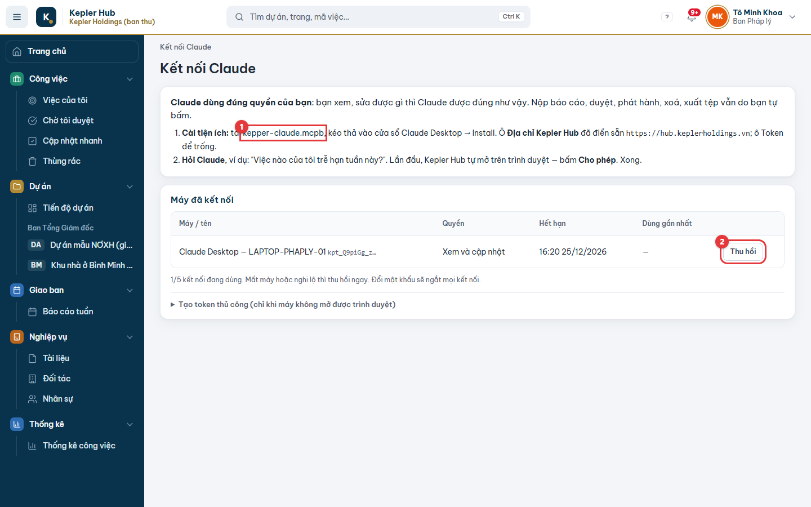

Bấm tên của bạn → **Kết nối Claude**. Cài tiện ích và kết nối lần đầu: mục 3.

- Bảng **Máy đã kết nối**: tên máy, **Quyền** ("Xem và cập nhật" hoặc "Chỉ xem"), **Hết hạn**, **Dùng gần nhất**. Dòng "…/5 kết nối đang dùng": mỗi người tối đa 5 kết nối còn hiệu lực.
- **Thu hồi**: Kepler Hub hỏi lại; thu hồi xong Claude trên máy đó không vào Kepler Hub được nữa. Không hoàn tác — muốn dùng lại thì hỏi Claude để kết nối lại.
- Kết nối hết hiệu lực khi: quá 30 ngày, bạn hoặc quản trị thu hồi (quản trị thu hồi thì bạn nhận thông báo "Quản trị đã thu hồi token Claude …"), bạn đổi mật khẩu hoặc được đặt lại mật khẩu, tài khoản bị khoá.
- Kết nối lại trên cùng một máy thì kết nối cũ của máy đó tự bị thay.

### 10.4 Thông báo (chuông)

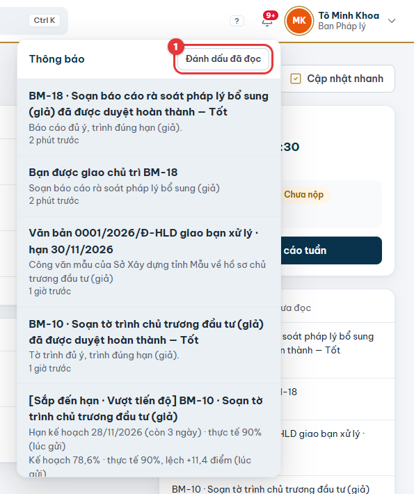

- Chấm đỏ trên chuông là số thông báo chưa đọc (trên 9 ghi "9+"), tự cập nhật.
- Bấm chuông: 50 thông báo mới nhất. Bấm một thông báo: đánh dấu đã đọc và mở việc / trang liên quan. **Đánh dấu đã đọc** đánh dấu **tất cả** là đã đọc; không có "đánh dấu chưa đọc".
- Không có chỗ chọn loại thông báo muốn nhận; không tắt, không xoá được thông báo. Thông báo tự xoá sau 12 tháng.
- Cảnh báo tiến độ của cùng một hạng mục MTL trong ngày được gộp làm một thông báo, ví dụ "[Trễ hạn · Chậm tiến độ] BM-15 · …"; thông báo cũ chưa đọc của hạng mục đó tự chuyển sang đã đọc.

### 10.5 Nhắc việc tự động

Kepler Hub tự nhắc qua chuông. Không có chỗ đổi giờ hay tắt nhắc. Máy chủ tắt đúng giờ thì nhắc được gửi bù khi bật lại.

| Lúc | Nhắc gì (tiêu đề thông báo) | Bạn nhận khi |
|---|---|---|
| 07:30 hằng ngày | Cảnh báo tiến độ MTL: "Sắp bắt đầu", "Chậm khởi động", "Sắp đến hạn", "Chậm tiến độ", "Vượt tiến độ", "Trễ hạn", "Lâu chưa cập nhật" | Bạn chủ trì hạng mục MTL. Hạng mục có việc nhánh: cảnh báo gửi lãnh đạo bộ phận chủ trì, bạn chỉ nhận "Lâu chưa cập nhật" |
| 08:00 hằng ngày | "{mã việc} đến hạn trong 24 giờ" | Bạn chủ trì việc chưa xong có hạn trong 24 giờ tới |
| 08:05 sáng ngày đến hạn | "Nhắc việc hôm nay: {ghi chú}" | Ghi chú của bạn có **Hạn** và chưa đánh dấu xong. Nhắc một lần, quá hạn không nhắc lại |
| 08:10 (khi bật Đối tác) | "Hôm nay: theo dõi {đối tác}", "Quá hạn {n} ngày: theo dõi {đối tác}" | Bạn được giao theo dõi đối tác (nhắc lại khi quá hạn 1, 3, 7 ngày) |
| 08:20 ngày làm việc | "Văn bản {số} đến hạn xử lý hôm nay", "Văn bản {số} đến hạn {ngày}", "Văn bản {số} quá hạn xử lý (hạn {ngày})" | Bạn là người xử lý văn bản đến chưa xong |
| 15:00 thứ Năm hằng tuần | "Cập nhật tiến độ tuần này: {n} việc trong kỳ này chưa cập nhật" — **một** thông báo gom mọi việc | Bạn chủ trì việc dự án MTL trong kỳ cập nhật tháng này, đã tới ngày bắt đầu và **5 ngày trở lên** chưa báo tiến độ (mục 5). Việc chưa giao ai: lãnh đạo bộ phận chủ trì nhận |
| 15:00 ngày hạn nộp báo cáo tuần | "Báo cáo tuần {bộ phận}: hạn nộp 17:30 hôm nay" | Bộ phận bạn chưa nộp, và bạn là lãnh đạo bộ phận, người lập báo cáo tuần trước hoặc người đang có bản nháp tuần này |

Ngoài ra còn các thông báo khi có việc xảy ra: được giao việc, có phiếu cần bạn duyệt, việc được duyệt hoặc bị trả lại, đề nghị gia hạn được đồng ý hoặc không, kiến nghị có ý kiến, đơn nghỉ được duyệt, văn bản giao bạn xử lý.

### 10.6 Ghi chú của tôi

Mở: **Công việc → Việc của tôi** → nút **Ghi chú của tôi** ở góc phải; hoặc gõ `G` rồi `N`; hoặc `Ctrl K` → "Ghi chú của tôi". Chỉ bạn thấy: "Chỉ bạn nhìn thấy các ghi chú này — kể cả quản trị hệ thống và cấp trên cũng không xem được."

1. Gõ vào ô "Ghi nhanh một việc cần làm… (Enter để lưu)" (tối đa 300 ký tự). Muốn được nhắc: chọn **Hạn (tuỳ chọn)**. Bấm Enter hoặc **Thêm**.
2. Bấm tiêu đề ghi chú để mở: sửa **Nội dung**, ghi chi tiết (tối đa 5.000 ký tự), đổi **Hạn** → **Lưu**.
3. Xong việc: tích ô bên trái. Ghi chú chuyển xuống nhóm đã xong (bấm "Hiện … ghi chú đã xong" để xem lại) và hết nhắc.
4. **Ghim lên đầu** để giữ ghi chú quan trọng ở đầu danh sách.
5. **Chuyển thành việc…**: chọn **Dự án**, để nguyên **Giao cho tôi** (đã tích sẵn) → **Tạo việc**. Ghi chú được đánh dấu xong, mang nhãn "Đã thành việc". Việc bạn tự giao cho mình thì khi xong, lãnh đạo bộ phận duyệt.
6. **Xoá**: Kepler Hub hỏi "Xoá ghi chú này? Không khôi phục được." ⚠️ Ghi chú xoá là mất hẳn, không vào Thùng rác.

- Tối đa 500 ghi chú; đầy thì xoá bớt ghi chú đã xong.
- Bấm thông báo "Nhắc việc hôm nay" mở trang **Việc của tôi**; bấm **Ghi chú của tôi** để thấy ghi chú.

### 10.7 Phím tắt

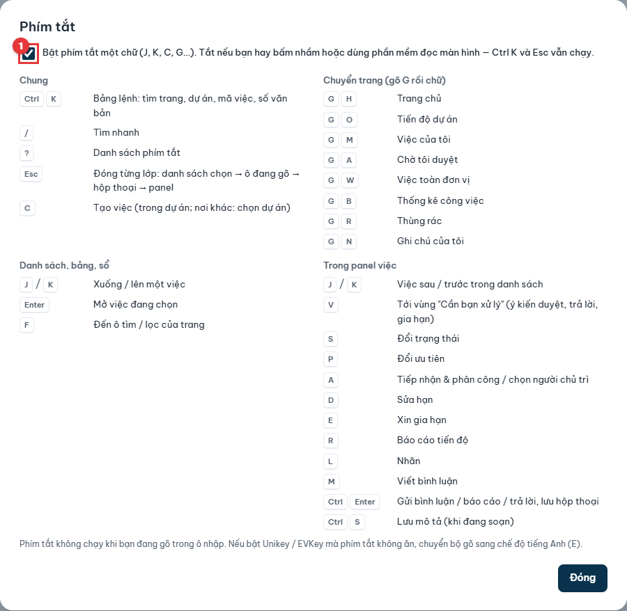

Bấm **?** trên thanh đầu trang (hoặc phím `?`) để mở hộp **Phím tắt**.

| Nhóm | Phím |
|---|---|
| Chung | `Ctrl K` bảng lệnh · `/` tìm nhanh · `?` danh sách phím tắt · `Esc` đóng từng lớp (danh sách chọn → ô đang gõ → hộp thoại → khung chi tiết) · `C` tạo việc (trong dự án; nơi khác: chọn dự án) |
| Chuyển trang (gõ `G` rồi chữ) | `G H` Trang chủ · `G O` Tiến độ dự án · `G M` Việc của tôi · `G A` Chờ tôi duyệt · `G B` Thống kê công việc · `G R` Thùng rác · `G N` Ghi chú của tôi |
| Danh sách, bảng, sổ | `J` / `K` xuống / lên một việc · `Enter` mở việc đang chọn · `F` đến ô tìm / lọc |
| Trong khung chi tiết việc | `J` / `K` việc sau / trước · `V` tới vùng "Cần bạn xử lý" · `S` đổi trạng thái · `P` đổi ưu tiên · `A` tiếp nhận & phân công · `D` sửa hạn · `E` xin gia hạn · `R` báo cáo tiến độ · `L` nhãn · `M` viết bình luận · `Ctrl Enter` gửi bình luận / báo cáo · `Ctrl S` lưu mô tả |

- Ô **Bật phím tắt một chữ (J, K, C, G…)** bật sẵn. Tắt nếu bạn hay bấm nhầm hoặc dùng phần mềm đọc màn hình; `Ctrl K`, `Esc` vẫn chạy. Lựa chọn này nhớ theo trình duyệt.
- Phím tắt không chạy khi bạn đang gõ trong ô nhập. Bật Unikey / EVKey mà phím tắt không ăn: chuyển bộ gõ sang chế độ tiếng Anh (E).

### 10.8 Bảng lệnh (tìm nhanh)

Bấm ô **Tìm dự án, trang, mã việc…** trên thanh đầu trang, hoặc `Ctrl K` (hoặc `/`).

- Chưa gõ: **Mở gần đây** (5 việc bạn mở gần nhất trên trình duyệt này), **Hành động** (tạo việc trong dự án đang xem hoặc dự án khác, mở hộp Phím tắt; khi đang mở một việc: báo cáo tiến độ, tới khối duyệt), **Trang**, **Dự án**.
- Gõ từ 2 ký tự: tìm việc theo mã (vd. `BM-10`), tên việc, hoặc số văn bản đã gắn vào việc; tìm cả tên trang, tên / mã dự án. Không phân biệt hoa thường, gõ không dấu vẫn ra. Chỉ ra việc bạn được xem.
- Mũi tên lên / xuống để chọn, `Enter` để mở, `Esc` để đóng.
- Kết nối Claude, Tài liệu, Đối tác, Nhân sự không có trong bảng lệnh: mở bằng menu.

### 10.9 Thùng rác

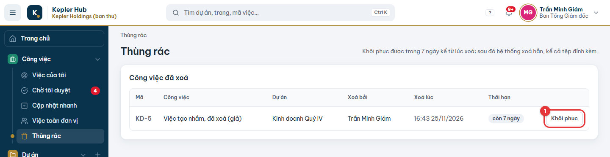

Menu **Công việc → Thùng rác** (hoặc `G` rồi `R`).

- Chỉ liệt kê việc bạn **được xoá** (việc bạn là người giao) và dự án bạn quản lý (bạn là Chủ dự án). Việc người khác giao cho bạn mà bị xoá thì không có ở đây: hỏi người giao.
- Mỗi dòng: **Mã**, **Công việc** (việc con ghi "(việc con)"), **Dự án**, **Xoá bởi**, **Xoá lúc**, **Thời hạn** ("còn … ngày", "còn dưới 1 ngày", "sắp xoá hẳn").
- **Khôi phục**: việc trở lại cùng các việc con bị xoá cùng lúc. Việc con không khôi phục được khi việc cha còn trong thùng rác ("Hãy khôi phục việc cha trước").
- ⚠️ Quá **7 ngày** kể từ lúc xoá, hệ thống xoá hẳn, kể cả tệp đính kèm. Không có nút "Xoá hẳn", và sau 7 ngày không lấy lại được.
- Lúc xoá, phiếu duyệt đang chờ của việc **không** bị huỷ: phiếu tạm ẩn khỏi **Chờ tôi duyệt** của người duyệt; khôi phục là phiếu hiện lại, duyệt tiếp như trước.

### 10.10 Giao diện nhớ theo trình duyệt

- Thu gọn menu trái (nút ba gạch), gập / mở từng nhóm menu, bật / tắt phím tắt một chữ, bộ lọc cuối cùng của từng dự án, cách xem ở **Việc của tôi** (danh sách / lịch; Tất cả / Chủ trì / Phối hợp) được nhớ **trên trình duyệt của máy đang dùng**, không theo tài khoản. Sang máy khác thì về mặc định.
- **Cài Kepler Hub lên máy** (menu tên của bạn; chỉ hiện khi Chrome / Edge cho cài và máy chưa cài): mở Kepler Hub như một ứng dụng riêng.
- Thanh **"Có bản mới · Tải lại"**: bấm **Tải lại** để dùng bản mới; đang gõ dở thì Kepler Hub hỏi lại trước khi tải.

**Bằng Claude:**

- "Nhắc tôi thứ Hai gọi Sở Xây dựng hỏi tiến độ góp ý." → Claude tạo ghi chú có hạn (hỏi lại trước khi tạo).
- "Tôi có ghi chú nào chưa xong?" / "Tôi có thông báo nào chưa đọc quan trọng không?"
- Claude **không** sửa, đánh dấu xong, xoá hay chuyển ghi chú thành việc; không đổi ảnh, mật khẩu; không đánh dấu thông báo đã đọc; không khôi phục từ Thùng rác.

---

## 11. Lúc nào dùng skill nào

| Bạn cần | Dùng | Ví dụ câu hỏi |
|---|---|---|
| Xem / cập nhật việc, việc nhánh, tiến độ, bình luận | Claude + `kepler-hub` | "Việc nào của tôi trễ?", "Cập nhật BM-15 60%" |
| Soạn nháp báo cáo tuần | Claude + `kepler-hub` | "Soạn nháp báo cáo tuần bộ phận tôi" |
| Phép, bảng công, tạo đơn nghỉ của mình | Claude + `kepler-hub` | "Tôi còn mấy ngày phép?" |
| Đối tác: tra cứu, ghi nhật ký, việc theo dõi | Claude + `kepler-hub` | "Việc cần theo dõi với đối tác tuần này" |
| Nhắc việc, thông báo | Claude + `kepler-hub` | "Hôm nay tôi có gì?" |
| Lưu tài liệu ở đâu, đặt tên tệp thế nào | Claude + `kepler-luu-tai-lieu` | "File báo cáo tháng này lưu ở đâu trên NAS?" |
| Gửi duyệt, xin gia hạn, nộp báo cáo, chấm công, giải trình, tải tệp lên / về, xoá | **Giao diện Kepler Hub** | — |
| Xem kỹ Gantt, đường cong S, bảng việc | **Giao diện Kepler Hub** | — |

Quy chế quản lý dự án (RACI) **sắp ban hành**. Khi có, tài liệu và skill sẽ cập nhật theo. Trong lúc chờ, làm theo luật duyệt trong tài liệu này.

---

## 12. Hỏi đáp và lỗi thường gặp

| Thấy | Nghĩa là | Làm gì |
|---|---|---|
| Claude không có công cụ Kepler Hub, không biết Kepler Hub là gì | Chưa cài hoặc chưa bật tiện ích | Làm lại mục 3.2 (nhớ thoát hẳn Claude Desktop rồi mở lại); kiểm tra **Settings → Customize → Connectors → Kepler Hub** đang **Enabled** |
| Vừa cài tiện ích bản mới mà Claude vẫn chạy như bản cũ | Mở nhầm tệp cũ (tệp mới có tên `kepper-claude (1).mcpb`), hoặc chưa thoát hẳn Claude Desktop | Mở tệp mới nhất rồi **Install** lại; **Quit** Claude Desktop ở khay hệ thống rồi mở lại (mục 3.2) |
| Gõ `/kep` không thấy skill, hoặc thấy hai `kepler-hub` | Skill chưa được cấp, hoặc có thêm bản tự tải lên trùng tên | Báo IT (mục 3.4) |
| "Chưa kết nối Kepler Hub… bấm Cho phép (mã …)" | Lần đầu dùng, hoặc kết nối cũ đã hết hạn / bị thu hồi | Bấm **Cho phép** đúng mã trên trang vừa mở, rồi hỏi lại Claude |
| "Chưa xác thực: …" | Token hết hạn, bị thu hồi, hoặc bạn vừa đổi mật khẩu | Hỏi lại Claude để mở trang Cho phép (mục 3.3) |
| "Tài khoản phải đổi mật khẩu trên giao diện trước" | Tài khoản đang bị buộc đổi mật khẩu | Đăng nhập Kepler Hub trên trình duyệt, đổi mật khẩu, rồi kết nối lại |
| "Không kết nối được Kepler Hub tại …" | Máy không vào được mạng công ty, hoặc tiện ích cài từ bản cũ | Bật VPN; mở thử Kepler Hub trên trình duyệt. Vẫn không được: báo IT |
| "Không đủ quyền: …" | Tài khoản của bạn không có quyền làm việc đó (vd. sửa hạn việc người khác giao) | Đúng như thiết kế. Làm đúng đường: xin gia hạn, bình luận cho người giao, hỏi lãnh đạo |
| "… (mở Kepler Hub trên trình duyệt để làm bước này)" — mã `NOT_VIA_AI` | Việc này chỉ làm trên giao diện (duyệt, nộp, xoá, xuất tệp, xem số định danh / lương, sửa hồ sơ nhân sự…) | Mở Kepler Hub làm trực tiếp |
| "Token chỉ đọc…" | Lúc Cho phép bạn chọn **Chỉ xem** | Thu hồi kết nối cũ, kết nối lại và chọn **Xem và cập nhật** |
| Claude / Kepler Hub chỉ hiện tóm tắt việc | Bạn không liên quan tới việc đó (không giao, không chủ trì, không phối hợp) | Xem mục 4.9 |
| Trình duyệt báo lỗi chứng chỉ | Máy chưa được cài chứng chỉ công ty | Báo IT (mục 2.2) |
| Trang không hiện tính năng mới | Đang mở bản cũ | Bấm **Tải lại** trên thanh "Có bản mới", hoặc F5 |
| Menu không có Nhân sự / Đối tác | Trang chưa tải bản mới | Bấm F5. Vẫn không thấy: báo IT |
| Menu không có **Văn thư** | Văn thư nay là một tab trong **Tài liệu** | **Nghiệp vụ → Tài liệu** → tab **Văn thư** |
| Việc của tôi không có trong **Cập nhật nhanh** | Cập nhật nhanh chỉ có hạng mục MTL bạn chủ trì, đang trong kỳ tháng hiện tại hoặc trễ chưa xong | Việc của dự án thường: mở việc → **Báo cáo tiến độ**, **Gửi duyệt** |
| Gửi duyệt nhầm | Phiếu đã sang người duyệt | **Chờ tôi duyệt → Tôi đã gửi** → **Rút lại** (khi chưa cấp nào xử lý); ở Cập nhật nhanh: **Hoàn tác** trong 5 giây |
| Gia hạn đã được duyệt mà hạng mục MTL vẫn báo "Trễ hạn" | Gia hạn chỉ đổi Hạn; chậm / trễ của hạng mục MTL tính theo kế hoạch gốc | Hỏi người giao hoặc Ban Tổng Giám đốc phụ trách của việc về **Điều chỉnh kế hoạch gốc** |
| Bấm **Gửi báo cáo** mà báo thiếu | Còn dòng thiếu người phụ trách, deadline, nguyên nhân, giải pháp hoặc đề nghị hỗ trợ | Sửa từng dòng theo danh sách lỗi; chọn **Ban Giám đốc** / bộ phận thì ghi thêm việc gì, trước ngày nào (mục 6) |
| "Tài khoản hoặc mật khẩu không đúng" dù gõ đúng | Tài khoản có thể đã bị khoá (Kepler Hub báo cùng một câu) | Hỏi quản trị hệ thống |
| "Phiên đăng nhập đã hết, vui lòng đăng nhập lại" | Đã đăng nhập quá 12 giờ, hoặc mật khẩu vừa đổi / đặt lại ở nơi khác | Đăng nhập lại; nội dung đang gõ dở vẫn còn |
| Tab **Tài liệu dự án** không có dự án của tôi | Bạn chưa có tên trong **Thành viên** dự án | Nhờ chủ dự án thêm bạn |
| Không thấy việc đã bị xoá trong **Thùng rác** | Thùng rác chỉ có việc bạn là người giao | Hỏi người giao của việc |
| Claude báo không rõ bộ phận khi hỏi "Tôi là ai" | Tiện ích hiện chưa trả tên bộ phận | Không cần thu hồi kết nối; kiểm tra họ tên, tài khoản |
