# Hướng dẫn sử dụng Kepler Hub — dành cho nhân viên

> Tài liệu này dành cho **mọi nhân viên**. Chỉ nói những gì nhân viên thấy và làm được.
> Ban Tổng Giám đốc, lãnh đạo bộ phận, PMO và thư ký giao ban đọc thêm [Hướng dẫn cho lãnh đạo](lanh-dao.md).
>
> Ảnh chụp từ **bản cài thử, dữ liệu giả** (tên người, dự án "Khu nhà ở Bình Minh (giả)" đều là mẫu).
> Ô đỏ có số trong ảnh là chỗ bạn bấm, theo thứ tự.

## Mục lục

1. [Kepler Hub và Claude: hai cách làm cùng một việc](#1-kepler-hub-và-claude-hai-cách-làm-cùng-một-việc)
2. [Lần đầu vào Kepler Hub](#2-lần-đầu-vào-kepler-hub)
3. [Kết nối Claude desktop với Kepler Hub](#3-kết-nối-claude-desktop-với-kepler-hub)
4. [Làm việc dự án](#4-làm-việc-dự-án)
5. [Cập nhật tiến độ hằng ngày](#5-cập-nhật-tiến-độ-hằng-ngày-cập-nhật-nhanh)
6. [Báo cáo tuần](#6-báo-cáo-tuần)
7. [Văn thư](#7-văn-thư)
8. [Nhân sự: chấm công, xin nghỉ](#8-nhân-sự-chấm-công-xin-nghỉ)
9. [Đối tác (CRM)](#9-đối-tác-crm)
10. [Nhắc việc và thông báo](#10-nhắc-việc-và-thông-báo)
11. [Lúc nào dùng skill nào](#11-lúc-nào-dùng-skill-nào)
12. [Hỏi đáp và lỗi thường gặp](#12-hỏi-đáp-và-lỗi-thường-gặp)

---

## 1. Kepler Hub và Claude: hai cách làm cùng một việc

**Kepler Hub** (https://hub.keplerholdings.vn) là nơi làm việc chung của công ty: dự án theo Master Timeline (MTL), việc và việc nhánh, báo cáo tuần, văn thư, nhân sự, đối tác.

Mỗi nghiệp vụ trong tài liệu có hai đường:

| | Làm trên giao diện | Làm nhanh bằng Claude |
|---|---|---|
| Cách làm | Mở Kepler Hub trên trình duyệt, bấm theo ảnh | Gõ câu bằng tiếng Việt cho Claude desktop (đã cài tiện ích Kepler Hub và skill `kepler-hub`) |
| Hợp với | Việc cần nhìn kỹ, việc chỉ người làm được | Tra cứu nhanh, tổng hợp, soạn nháp, cập nhật nhiều việc một lúc |

**Claude dùng đúng quyền của bạn.** Bạn xem, sửa được gì thì Claude được đúng như vậy, không hơn. Mọi thao tác ghi mang tên bạn. Claude sẽ tóm tắt và hỏi lại trước mỗi thao tác ghi.

**Những việc chỉ bạn tự làm trên giao diện** (Claude không làm được):

- duyệt, chấm mức hoàn thành, duyệt gia hạn, duyệt đơn nghỉ;
- **nộp** báo cáo tuần (Claude chỉ lưu nháp);
- vào sổ văn bản, tải tệp lên, tải tệp về, xuất Excel / Word;
- xoá bất cứ thứ gì;
- giải trình chấm công, chấm vào / ra.

> ⚠️ **Lưu ý về "100%":** với việc trong dự án MTL, khi tiến độ được đặt **100%** thì Kepler Hub tự **gửi duyệt** (việc chuyển sang "Chờ duyệt"). Điều này đúng cả khi Claude cập nhật giúp bạn. Chỉ bảo Claude đặt 100% khi việc thật sự xong.

---

## 2. Lần đầu vào Kepler Hub

### 2.1 Mở Kepler Hub

1. Mở Chrome hoặc Edge, vào **https://hub.keplerholdings.vn**.
2. Ở ngoài văn phòng: **bật VPN công ty trước**. Kepler Hub chỉ chạy trong mạng nội bộ.

### 2.2 Trình duyệt báo "Kết nối không riêng tư" / lỗi chứng chỉ

Kepler Hub dùng chứng chỉ do máy chủ công ty tự cấp. Máy trong domain công ty thường đã được IT cài sẵn. Nếu vẫn báo lỗi, máy bạn cần tin chứng chỉ gốc **một lần**:

- Tên chứng chỉ: **Caddy Local Authority - 2026 ECC Root**
- Dấu vân tay (thumbprint): `42FAD139C8237AD37947FD678C262F7F3AA82C45`

**Không** bấm "Nâng cao → Tiếp tục" để bỏ qua cảnh báo.

**Cách 1 (dễ):** mở **http://hub.keplerholdings.vn/cai-chung-chi**, tải tệp `kepler-hub-ca.crt`, làm theo hướng dẫn trên trang (Windows, macOS, điện thoại).

**Cách 2 (PowerShell, cài cho cả máy):**

1. Tải `kepler-hub-ca.crt` như cách 1 (thường nằm trong thư mục Downloads).
2. Bấm Start, gõ `PowerShell`, chuột phải → **Run as administrator**.
3. Dán từng lệnh:

```powershell
Import-Certificate -FilePath "$env:USERPROFILE\Downloads\kepler-hub-ca.crt" -CertStoreLocation Cert:\LocalMachine\Root
```

```powershell
Get-ChildItem Cert:\LocalMachine\Root | Where-Object Thumbprint -eq '42FAD139C8237AD37947FD678C262F7F3AA82C45' | Select-Object Subject, Thumbprint, NotAfter
```

Lệnh thứ hai phải in ra một dòng có `Caddy Local Authority - 2026 ECC Root`. Không có dòng nào: tệp tải về không đúng, báo IT.

4. Tắt hẳn Chrome / Edge rồi mở lại.

### 2.3 Đăng nhập

1. Nhập **Tài khoản** và **Mật khẩu** IT cấp, bấm **Đăng nhập** (1).
2. Lần đầu, Kepler Hub bắt đổi mật khẩu. Đặt mật khẩu mới, không dùng lại mật khẩu ở nơi khác.
3. Quên mật khẩu: liên hệ quản trị hệ thống để đặt lại.

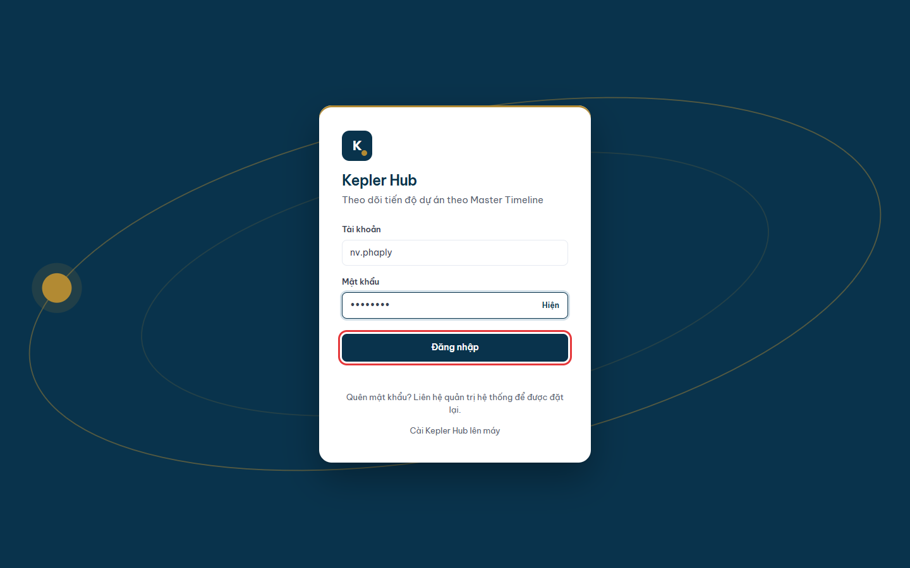

Muốn mở Kepler Hub như một ứng dụng riêng (có biểu tượng trên màn hình): bấm **Cài Kepler Hub lên máy** ở cuối khung đăng nhập.

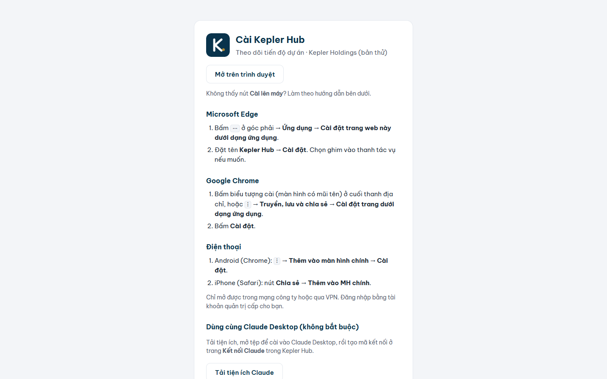

### 2.4 Làm quen màn hình chính


- **Trang chủ:** việc cần xử lý (xếp theo hạn), các dự án bạn tham gia, lịch giao ban, thông báo mới.
- **Menu trái:** Công việc (Việc của tôi, Chờ tôi duyệt, Cập nhật nhanh, Thùng rác), Dự án, Giao ban, Nghiệp vụ (Văn thư, Đối tác, Nhân sự), Thống kê.
- **Chuông** góc trên: thông báo (được giao việc, sắp đến hạn, trễ hạn, đơn nghỉ đã duyệt…).


- **Tìm nhanh** (`Ctrl K`): gõ tên dự án, trang, mã việc (vd. `BM-10`). **Gõ không dấu vẫn ra** ("to trinh" tìm được "Tờ trình").


- Khi Kepler Hub có bản mới, thanh **"Có bản mới · Tải lại"** hiện ở đầu trang. Bấm **Tải lại** để dùng bản mới.

---

## 3. Kết nối Claude desktop với Kepler Hub

Làm **một lần** trên mỗi máy. Cần: Claude desktop đã đăng nhập tài khoản Claude của công ty, máy đang ở văn phòng hoặc bật VPN.

### 3.1 Mở trang "Kết nối Claude"

Bấm tên của bạn góc trên phải → **Kết nối Claude** (1).

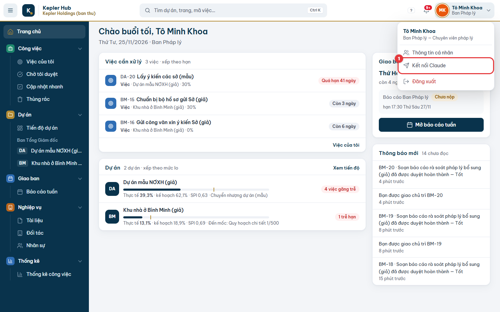

### 3.2 Cài tiện ích Kepler Hub cho Claude desktop

1. Trên trang Kết nối Claude, bấm tải **kepper-claude.mcpb** (1).


2. Mở Claude desktop. Kéo thả tệp `kepper-claude.mcpb` vừa tải vào cửa sổ Claude desktop (hoặc nhấn đúp tệp). Hộp cài đặt hiện ra → bấm **Install**.

3. Kiểm tra đã cài: Claude desktop → **Settings → Customize → Connectors**. Dòng **Kepler Hub**, loại *Desktop*, có dấu ✓ ở cột Status.

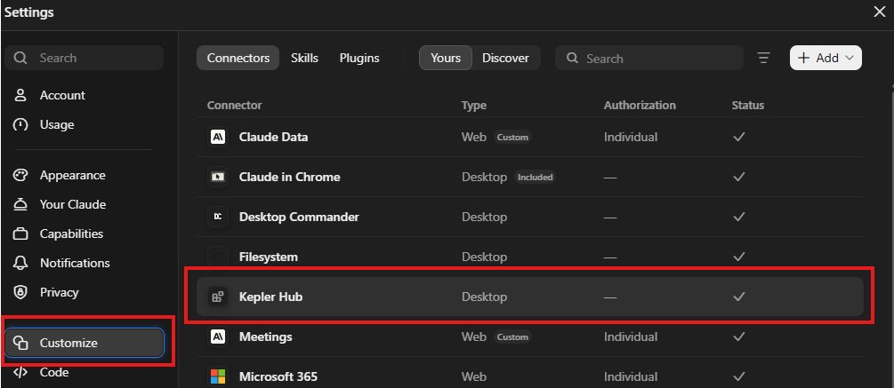

4. Bấm vào **Kepler Hub** để xem cấu hình:
   - công tắc **Enabled** phải bật;
   - **Địa chỉ Kepler Hub:** phải là `https://hub.keplerholdings.vn` (tiện ích từ phiên bản 0.5.1 điền sẵn). Thấy địa chỉ khác, ví dụ `https://kepler-hub.kepler.com` như ảnh dưới, thì sửa thành `https://hub.keplerholdings.vn` → **Save**: nhiều máy không tìm được địa chỉ cũ;
   - **Token Kepler Hub (không bắt buộc): để trống**;
   - có sửa gì thì bấm **Save**.

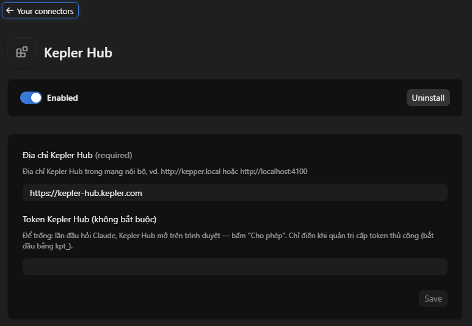

### 3.3 Kết nối nhanh: bấm "Cho phép" (không cần token)

1. Trong Claude desktop, hỏi một câu bất kỳ về Kepler Hub, ví dụ: **"Tôi là ai trong Kepler Hub?"**
2. Lần đầu, Claude báo *"Chưa kết nối Kepler Hub… bấm Cho phép (mã XXXX-XXXX)"*, đồng thời trình duyệt tự mở trang Kepler Hub.

   Ghi lại **mã** Claude báo (dạng `ABCD-1234`) để so với mã trên trang Kepler Hub ở bước sau. Trình duyệt không tự mở thì bấm vào đường dẫn Claude đưa trong câu trả lời.

3. Trên trang vừa mở (đăng nhập Kepler Hub nếu được hỏi):
   - kiểm tra **mã** trên trang trùng với mã Claude báo, và **tên máy** đúng là máy của bạn;
   - chọn **Xem và cập nhật** (mặc định) hoặc **Chỉ xem**;
   - bấm **Cho phép** (2).

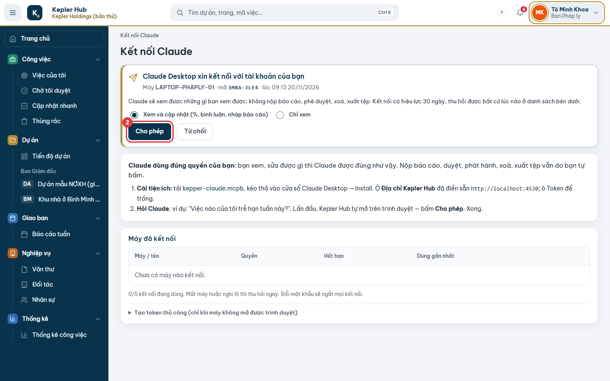

4. Quay lại Claude, hỏi lại câu vừa rồi. Từ giờ Claude dùng được Kepler Hub. Kết nối có hiệu lực **30 ngày**; hết hạn thì Claude tự mở lại trang Cho phép.


Chỉ bấm **Cho phép** cho yêu cầu do chính bạn vừa tạo trên chính máy này. Trang ghi "đến từ máy khác" hoặc mã không khớp: bấm **Từ chối**.

**Thu hồi:** mất máy hoặc nghi lộ thì vào **Kết nối Claude → Máy đã kết nối → Thu hồi**. Mỗi người tối đa 5 máy. Đổi mật khẩu sẽ ngắt mọi kết nối.

### 3.4 Cách dự phòng: tạo token thủ công

Chỉ dùng khi máy không tự mở được trình duyệt (trang Cho phép không hiện).

1. Trang **Kết nối Claude** → mở **Tạo token thủ công**.

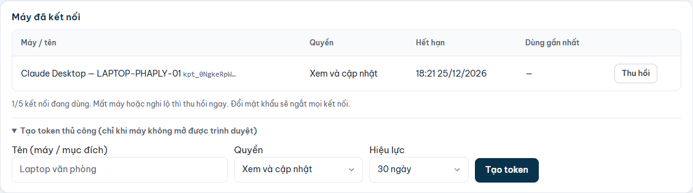

2. Nhập tên máy (vd. "Laptop văn phòng"), chọn quyền và hiệu lực (30 / 60 / 90 ngày) → **Tạo token**.

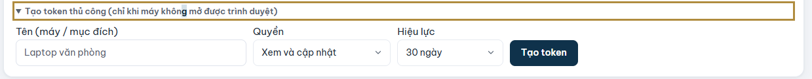

3. **Bấm Sao chép ngay**: Kepler Hub chỉ hiện token **một lần**.

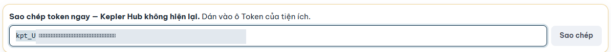

4. Dán vào ô **Token Kepler Hub** trong cấu hình tiện ích (Settings → Customize → Connectors → Kepler Hub, mục 3.2) → **Save**.
5. Không gửi token cho ai, không dán vào chat, không chụp màn hình có token. Lộ token thì **Thu hồi** ngay ở danh sách **Máy đã kết nối**.

### 3.5 Cài skill Kepler cho Claude

Skill giúp Claude biết cách làm việc với Kepler Hub đúng quy tắc công ty:

| Skill | Dùng để |
|---|---|
| `kepler-hub` | Việc, dự án, báo cáo tuần, nhân sự, đối tác, nhắc việc, thông báo |
| `kepler-luu-tai-lieu` | Lưu tài liệu đúng thư mục phòng trên NAS `\\192.168.130.2\DATA`, đặt tên tệp đúng quy ước |

Công ty đã cấp sẵn hai skill này cho mọi người: **bạn không phải cài gì**, chỉ kiểm tra.

1. Claude desktop → **Settings → Customize → Skills → Yours**. Mục **From your organization** có `kepler-hub` và `kepler-luu-tai-lieu`, ghi *required by your organization*.

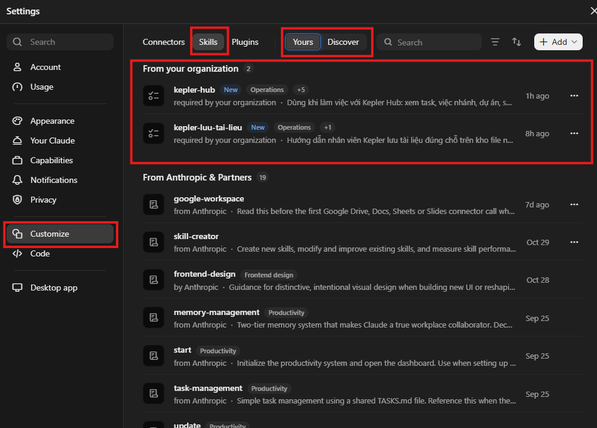

2. Trong ô chat gõ `/kep`: phải thấy **đúng một** `kepler-hub` và một `kepler-luu-tai-lieu`.

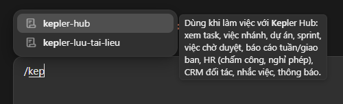

**Không tự tải skill Kepler lên** (+ Add). Tải thêm sẽ thành hai bản cùng tên, Claude có thể dùng nhầm bản cũ. Gõ `/kep` mà thấy hai `kepler-hub` như ảnh dưới: vào **Settings → Customize → Skills**, xoá bản bạn tự tải (bản không ghi *required by your organization*), rồi gõ lại `/kep`.

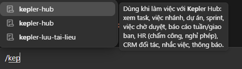

Tuỳ chọn: tiện ích **Kepler NAS** (`kepler-nas.mcpb`, IT cấp) cho Claude **đọc** thư mục NAS bằng chính quyền Windows của bạn, để skill `kepler-luu-tai-lieu` chỉ đúng thư mục có thật. Tiện ích chỉ đọc, không ghi, không xoá.

### 3.6 Câu đầu tiên sau khi kết nối

Gõ cho Claude:

> **Tôi là ai trong Kepler Hub? Tôi được làm gì qua Claude?**

Claude gọi `kepper_whoami` và trả lời: họ tên, tài khoản, bộ phận, vai trò giao ban, hạn nộp báo cáo tuần. Kiểm tra đúng tài khoản của bạn trước khi nhờ Claude làm gì khác.

Tên hoặc bộ phận không đúng của bạn: dừng lại, vào **Kết nối Claude → Máy đã kết nối** thu hồi kết nối đó, rồi kết nối lại bằng tài khoản của chính bạn.

Thử tiếp: **"Hôm nay tôi có gì?"** — Claude gom thông báo, việc của bạn, nhắc việc thành danh sách: quá hạn → hôm nay → sắp tới.

---

## 4. Làm việc dự án

### 4.1 Vai của bạn trên một việc

Trên mỗi việc, bạn chỉ thấy và sửa phần thuộc vai của mình. Vai hiện ngay dưới tên việc: **"Vai của bạn: …"**.

| Vai | Bạn làm được |
|---|---|
| **Người chủ trì** | Cập nhật tiến độ, báo cáo tiến độ, chia việc nhánh, **Gửi duyệt**, **Xin gia hạn** |
| **Người phối hợp** | Gửi tài liệu, bình luận |
| **Thành viên dự án không liên quan** | Chỉ xem **tóm tắt**: tên, người chủ trì, hạn, trạng thái, % |

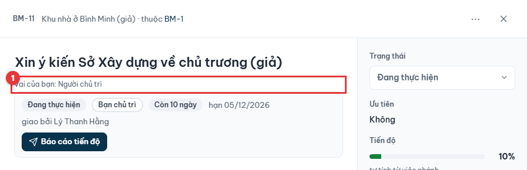

Hạn, mốc, đường găng, người chủ trì… là **kế hoạch** của việc: do người giao và Ban Tổng Giám đốc sửa. Muốn đổi hạn thì **Xin gia hạn**; có ý kiến khác thì bình luận cho người giao.

### 4.2 Xem việc của tôi

Menu **Công việc → Việc của tôi**: mọi việc bạn chủ trì / phối hợp ở mọi dự án, lọc theo vai, xem dạng danh sách hoặc lịch.


Mở một dự án (menu **Dự án**) để xem toàn cảnh: **Tổng quan dự án**, **Giai đoạn**, **Kế hoạch & Gantt**, **Bảng**, **Danh sách**.

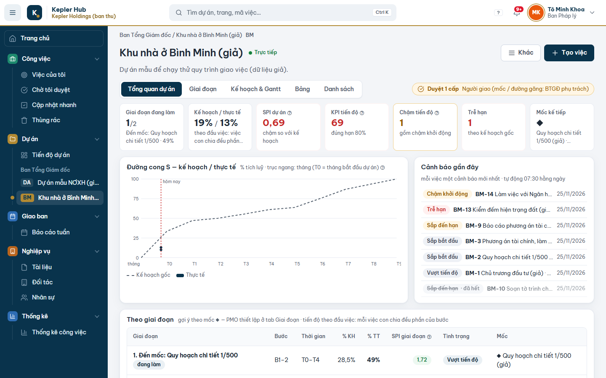


### 4.3 Mở chi tiết một việc

Bấm vào việc → khung chi tiết mở bên phải: trạng thái, kế hoạch gốc, kế hoạch / thực tế, hạn, người giao, quy trình duyệt, báo cáo tiến độ, việc nhánh, tab **Kết quả & tài liệu**, **Trao đổi**.


### 4.4 Báo cáo tiến độ

1. Trong việc bạn chủ trì, bấm **Báo cáo tiến độ** (1).
2. Nhập % mới, việc đã làm được; có khó khăn hay kiến nghị thì ghi vào ô tương ứng → gửi.


Việc có việc nhánh: % của việc cha **tự tính** từ việc nhánh (mỗi việc nhánh một phần bằng nhau). Cập nhật ở từng việc nhánh.

### 4.5 Chia việc nhánh

Checklist đã bỏ; bước nhỏ của một việc giờ là **việc nhánh**. Người chủ trì tự chia việc của mình.

1. Mở việc → mục **Việc nhánh**.
2. Gõ tên vào ô **"Thêm một việc nhánh, Enter để tạo"** (1). Muốn tạo nhiều dòng một lần: **Chia nhiều việc…**
3. Việc cha chỉ gửi duyệt được khi **mọi việc nhánh đã được duyệt hoàn thành** (dòng "Việc cha chỉ gửi duyệt được khi…" ghi x/y).


### 4.6 Xin gia hạn

1. Mở việc → **Xin gia hạn** (1).
2. Chọn hạn mới (hoặc bấm +3 / +7 / +14 ngày), ghi lý do → **Gửi đề nghị**.
3. BTGĐ phụ trách của việc quyết định. Trong lúc chờ, việc ghi "chờ Ban Tổng Giám đốc quyết định".

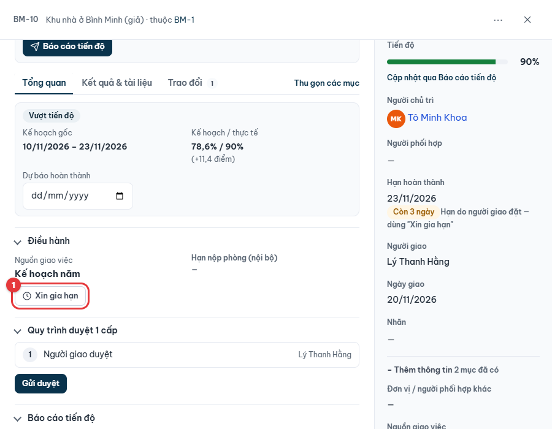


### 4.7 Gửi duyệt khi xong

1. Mở việc → bấm **Gửi duyệt** (1). (Hoặc báo tiến độ 100%, hoặc bấm **✓ Gửi duyệt** ở Cập nhật nhanh.)
2. Việc sang **Chờ duyệt**, chưa tính là hoàn thành.
3. **Ai duyệt:** việc thường → **người giao**; việc **mốc** hoặc **đường găng** → **BTGĐ phụ trách của việc**. Bạn không tự duyệt việc của mình.


### 4.8 Kết quả duyệt và mức hoàn thành

Người duyệt **chấm mức** khi duyệt: **Xuất sắc / Tốt / Đạt / Cần cải thiện / Kém**, kèm nhận xét. Bạn nhận thông báo và thấy kết quả trong việc. Bị **trả lại** thì việc về "Đang thực hiện" kèm lý do: sửa rồi gửi duyệt lại.


### 4.9 Vì sao tôi chỉ thấy tóm tắt?

Bạn là thành viên dự án nhưng không có vai trên việc đó. Kepler Hub chỉ hiện tên, người chủ trì, hạn, trạng thái, %. Tài liệu, báo cáo, đánh giá, bình luận chỉ hiện với người liên quan. Cần xem thêm: hỏi người chủ trì hoặc người giao.

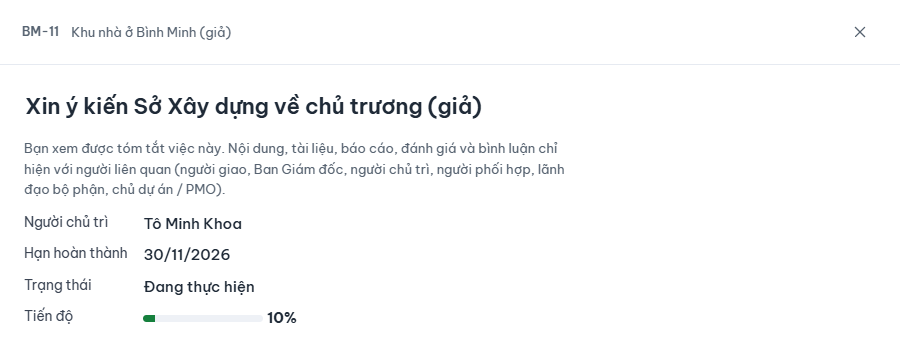

### 4.10 Làm nhanh bằng Claude (skill `kepler-hub`)

| Bạn gõ | Claude làm |
|---|---|
| "Việc nào của tôi trễ hạn hoặc đến hạn tuần này?" | Đọc việc của bạn, lập bảng theo hạn |
| "Tóm tắt việc BM-11 cho tôi: tiến độ, việc nhánh, bình luận mới" | Đọc chi tiết việc, nêu việc nhánh dạng x/y |
| "Cập nhật BM-15 lên 60%, ghi chú: đã gom đủ hồ sơ pháp lý" | Đọc lại nội dung, **hỏi bạn đồng ý**, rồi cập nhật % và bình luận |
| "Chia BM-11 thành 3 việc nhánh: chuẩn bị hồ sơ, gửi công văn, theo dõi phản hồi; hạn lần lượt 23, 26/11 và 4/12" | Đề xuất danh sách, chờ bạn duyệt rồi tạo việc nhánh |
| "Bình luận vào BM-10, nhắc @Lý Thanh Hằng là tờ trình đã gửi bản mới" | Soạn bình luận, hỏi lại rồi gửi |
| "Việc nào tôi gửi duyệt mà bị trả lại?" | Tra thông báo và việc của bạn |

**Vẫn tự làm trên giao diện:** Gửi duyệt (nút), Xin gia hạn, tải tệp kết quả lên, xoá. Nhớ: bảo Claude đặt **100%** = gửi duyệt.

---

## 5. Cập nhật tiến độ hằng ngày (Cập nhật nhanh)

Trang gom mọi việc của bạn đang trong kỳ (tháng hiện tại hoặc trễ chưa xong) ở mọi dự án. Cập nhật một chạm, không cần mở từng việc.

1. **Trang chủ** → nút **Cập nhật nhanh** (1) (hoặc menu Công việc → Cập nhật nhanh).


2. Mỗi thẻ là một việc. Đang làm dở: bấm **25% / 50% / 75%** (2) hoặc gõ số %; bấm **Ghi chú** để kèm một dòng (gửi thành bình luận).
3. Xong: bấm **✓ Gửi duyệt** (3). Bấm nhầm thì hoàn tác được trong 5 giây.

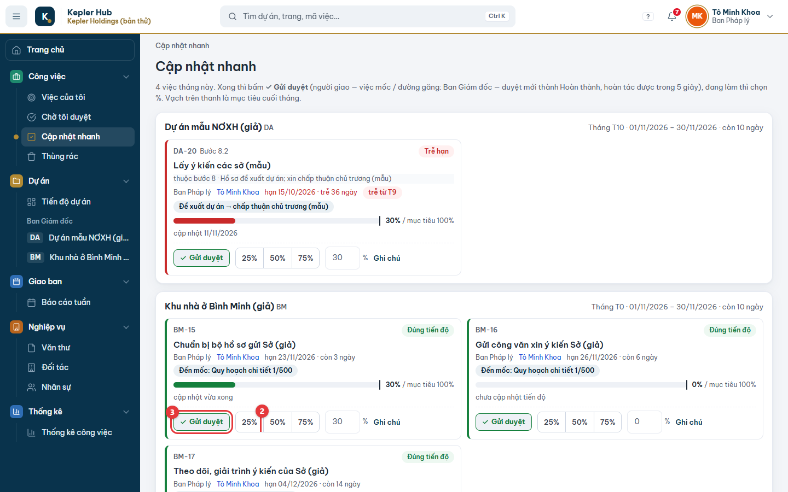

Kepler Hub nhắc lúc **15:00 thứ Năm** nếu việc đã bắt đầu mà 5 ngày chưa cập nhật.

**Bằng Claude:**

- "Liệt kê việc trong kỳ của tôi, việc nào lâu chưa cập nhật?"
- "BM-15 50%, BM-16 25% kèm ghi chú 'đã gửi công văn, chờ Sở hẹn lịch'." → Claude đọc lại từng dòng, chờ bạn đồng ý rồi cập nhật.

---

## 6. Báo cáo tuần

Báo cáo tuần lập **theo bộ phận** (mẫu BM-TH-01), nộp trước hạn thứ Sáu để giao ban thứ Hai. Báo cáo **tự điền sẵn** từ MTL và tiến độ bạn đã cập nhật — vì vậy việc quan trọng nhất của nhân viên là **cập nhật tiến độ đúng và kịp** (mục 4, 5).

Nếu trưởng bộ phận giao bạn **lập báo cáo** của bộ phận:

1. Menu **Giao ban → Báo cáo tuần** → tab **Nộp báo cáo**.
2. Xem các phần I, II, III đã điền sẵn; chỉ sửa chỗ khác thực tế.
3. Dòng **Chậm / Vướng / Quá hạn** bắt buộc ghi **nguyên nhân, giải pháp, đề nghị hỗ trợ** (1).
4. Báo cáo tự lưu nháp. Xong thì bấm **Gửi báo cáo** (2). Gửi xong, % ghi luôn vào MTL; giờ nộp tính theo lần gửi đầu.


**Bằng Claude:** "Soạn nháp báo cáo tuần này của bộ phận tôi từ việc của tôi và báo cáo tuần trước." → Claude soạn, cho bạn xem, bạn đồng ý thì Claude **lưu nháp**. **Nộp** vẫn là bạn bấm **Gửi báo cáo** trên giao diện.

---

## 7. Văn thư

Sổ văn bản **đến, đi, nội bộ** của công ty. Văn bản vào sổ là có số ngay. Bản scan được Kepler Hub **lưu thẳng vào thư mục văn thư của bộ phận trên NAS** (`\\192.168.130.2\DATA\<phòng>\NN.VanBanDen|Di|NoiBo\<năm>\`), NAS vẫn là bản gốc.

Với nhân viên:

- **Vào sổ** do văn thư (người Ban Tổng Giám đốc chỉ định), Ban Tổng Giám đốc, hoặc lãnh đạo bộ phận (văn bản nội bộ của bộ phận) làm. Bạn nhận được văn bản giấy / email: **chuyển bản scan cho văn thư HCNS**, không tự chép vào thư mục VanBanDen.
- Văn bản **giao bạn xử lý**: bạn nhận thông báo. Menu **Nghiệp vụ → Văn thư → tab Tôi xử lý**.

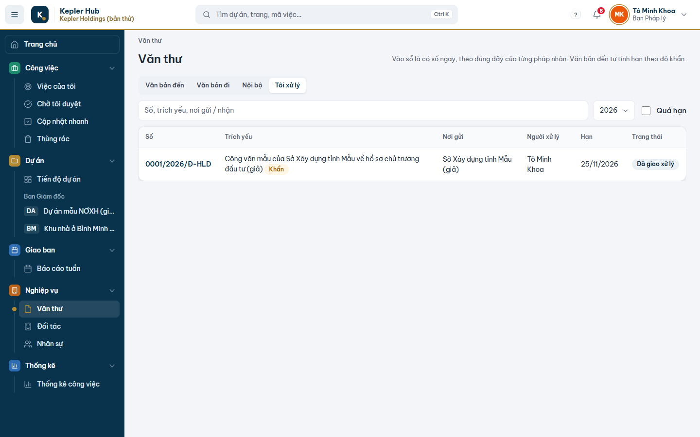

- Mở văn bản để xem số, nơi gửi, độ khẩn, hạn xử lý, lịch sử. Bấm **Bắt đầu xử lý** khi nhận việc, **Báo xong** khi xử lý xong.
- Bấm **Tải tệp lên** để thêm bản scan / văn bản trả lời. Trên bản chạy thật, tệp được lưu vào NAS và có nhãn **NAS** kèm phiên bản (ảnh dưới chụp trên bản thử nên không có nhãn này).


- Ô tìm kiếm lọc ngay khi gõ, gõ không dấu vẫn ra. Gắn văn bản vào việc dự án: trong việc → **Thêm văn bản → Chọn từ sổ Văn thư**.

**Bằng Claude (skill `kepler-luu-tai-lieu`):** "Tôi có bản scan công văn của Sở Xây dựng gửi phòng Pháp lý, lưu ở đâu, đặt tên thế nào?" → Claude chỉ: vào sổ trên Kepler Hub qua văn thư, hoặc thư mục và tên tệp đúng quy ước. Claude **chỉ chỉ chỗ**, bạn hoặc văn thư tự lưu.

---

## 8. Nhân sự: chấm công, xin nghỉ

> Phân hệ Nhân sự và Đối tác có thể **chưa bật** trên bản đang chạy. Nếu menu không có, hoặc trang báo "Tính năng chưa bật", là chưa tới lúc dùng.

Menu **Nghiệp vụ → Nhân sự** → **Của tôi**:

1. **Hôm nay:** bấm **Chấm vào** / **Chấm ra** (1). Chưa chấm vào mà bấm chấm ra: Kepler Hub hỏi lại; ngày đó ghi "Thiếu giờ vào", kèm nút **Giải trình**.
2. **Đơn nghỉ của tôi:** bấm **Xin nghỉ** (2).

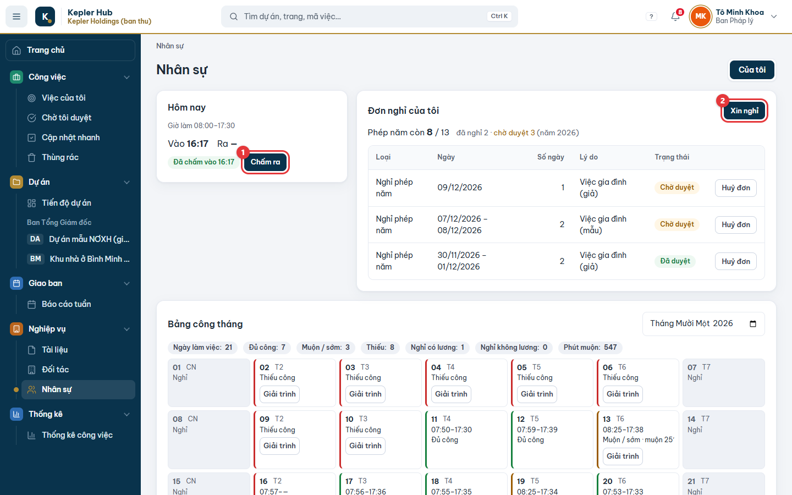

3. Chọn loại nghỉ, cả ngày / nửa ngày, từ ngày – đến ngày. Kepler Hub hiện ngay **"Phép năm còn X → còn Y sau đơn này"** và báo nếu trùng đơn khác. Lý do ghi ngắn, **không ghi tên bệnh / chẩn đoán**. Bấm **Gửi đơn**.


4. Đơn gửi lãnh đạo bộ phận duyệt. Đơn chưa duyệt thì **Huỷ đơn** được; đơn đã duyệt mà huỷ thì lãnh đạo được báo.
5. **Bảng công tháng:** ngày thiếu công / muộn có nút **Giải trình**.

**Bằng Claude:**

- "Tôi còn mấy ngày phép năm? Tháng này tôi thiếu công ngày nào?"
- "Tạo đơn nghỉ phép năm ngày 4/12, cả ngày, lý do việc gia đình." → Claude đọc lại, chờ bạn đồng ý rồi tạo đơn. Claude chỉ tạo đơn **của chính bạn**, không duyệt.

**Vẫn tự làm:** chấm vào / ra, giải trình, huỷ đơn.

---

## 9. Đối tác (CRM)

Danh bạ nhà thầu, tư vấn, cơ quan, ngân hàng, nhà cung cấp. Mỗi đối tác thuộc **một bộ phận phụ trách**; người liên hệ, nhật ký làm việc, hợp đồng chỉ bộ phận đó, người phụ trách và Ban Tổng Giám đốc xem.

1. Menu **Nghiệp vụ → Đối tác**. Gõ để lọc ngay (không dấu vẫn ra), tích **Bộ phận tôi phụ trách** để thu hẹp.

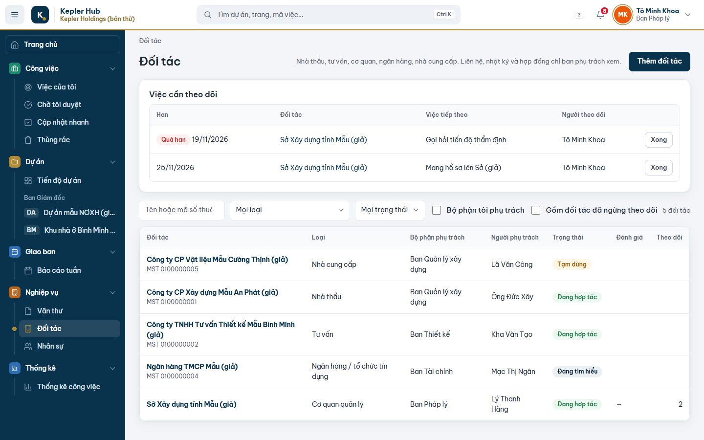

2. Mở đối tác: thông tin chung, nhật ký làm việc, việc cần theo dõi. Bạn chỉ thấy các dòng nhật ký mình ghi hoặc được giao theo dõi.


**Bằng Claude:**

- "Tôi có việc gì cần theo dõi với đối tác tuần này?"
- "Ghi nhật ký: hôm nay gọi điện Sở Xây dựng tỉnh Mẫu, Sở hẹn trả lời trước 28/11; hẹn theo dõi ngày 28/11." → Claude đọc lại nguyên văn rồi mới ghi. **Nhật ký không sửa / xoá được.**

---

## 10. Nhắc việc và thông báo

- **Ghi chú của tôi** (Công việc → Việc của tôi → Ghi chú): việc nhỏ, có hạn nhắc. **Chỉ bạn thấy**, kể cả quản trị và cấp trên cũng không xem được.

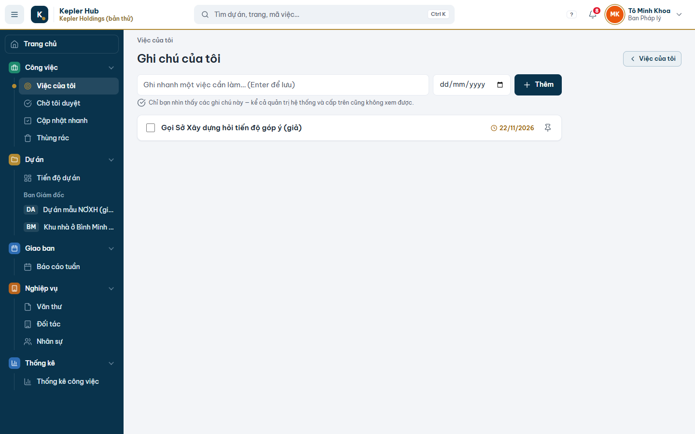

- **Chuông thông báo:** cảnh báo tiến độ (chạy 07:30 hằng ngày), giao việc, duyệt, gia hạn, đơn nghỉ, văn bản giao xử lý.

**Bằng Claude:**

- "Nhắc tôi thứ Hai gọi Sở Xây dựng hỏi tiến độ góp ý." → Claude tạo ghi chú có hạn.
- "Tôi có thông báo nào chưa đọc quan trọng không?"

---

## 11. Lúc nào dùng skill nào

| Bạn cần | Dùng | Ví dụ câu hỏi |
|---|---|---|
| Xem / cập nhật việc, việc nhánh, tiến độ, bình luận | Claude + `kepler-hub` | "Việc nào của tôi trễ?", "Cập nhật BM-15 60%" |
| Soạn nháp báo cáo tuần | Claude + `kepler-hub` | "Soạn nháp báo cáo tuần bộ phận tôi" |
| Phép, bảng công, tạo đơn nghỉ của mình | Claude + `kepler-hub` | "Tôi còn mấy ngày phép?" |
| Đối tác: tra cứu, ghi nhật ký, việc theo dõi | Claude + `kepler-hub` | "Việc cần theo dõi với đối tác tuần này" |
| Nhắc việc, thông báo | Claude + `kepler-hub` | "Hôm nay tôi có gì?" |
| Lưu tài liệu ở đâu, đặt tên tệp thế nào | Claude + `kepler-luu-tai-lieu` | "File báo cáo tháng này lưu ở đâu trên NAS?" |
| Gửi duyệt, xin gia hạn, nộp báo cáo, chấm công, giải trình, tải tệp lên / về, xoá | **Giao diện Kepler Hub** | — |
| Xem kỹ Gantt, đường cong S, bảng việc | **Giao diện Kepler Hub** | — |

Quy chế quản lý dự án (RACI) **sắp ban hành**. Khi có, tài liệu và skill sẽ cập nhật theo. Trong lúc chờ, làm theo luật duyệt trong tài liệu này.

---

## 12. Hỏi đáp và lỗi thường gặp

| Thấy | Nghĩa là | Làm gì |
|---|---|---|
| Claude không có công cụ Kepler Hub, không biết Kepler Hub là gì | Chưa cài hoặc chưa bật tiện ích | Làm lại mục 3.2; kiểm tra **Settings → Customize → Connectors → Kepler Hub** đang **Enabled** |
| Gõ `/kep` thấy hai `kepler-hub` | Có thêm một bản skill tự tải lên, trùng tên bản công ty cấp | Settings → Customize → Skills: xoá bản tự tải, giữ bản *required by your organization* (mục 3.5) |
| "Chưa kết nối Kepler Hub… bấm Cho phép (mã …)" | Lần đầu dùng, hoặc kết nối cũ đã hết hạn / bị thu hồi | Bấm **Cho phép** đúng mã trên trang vừa mở, rồi hỏi lại Claude |
| "Chưa xác thực: …" | Token hết hạn, bị thu hồi, hoặc bạn vừa đổi mật khẩu | Hỏi lại Claude để mở trang Cho phép. Dùng token thủ công: tạo token mới (mục 3.4) |
| "Tài khoản phải đổi mật khẩu trên giao diện trước" | Tài khoản đang bị buộc đổi mật khẩu | Đăng nhập Kepler Hub trên trình duyệt, đổi mật khẩu, rồi kết nối lại |
| "Không kết nối được Kepler Hub tại …" | Máy không vào được mạng công ty, hoặc tiện ích dùng địa chỉ cũ `kepler-hub.kepler.com` | Bật VPN; mở thử Kepler Hub trên trình duyệt; sửa ô Địa chỉ trong tiện ích thành `https://hub.keplerholdings.vn` (mục 3.2) |
| "Không đủ quyền: …" | Tài khoản của bạn không có quyền làm việc đó (vd. sửa hạn việc người khác giao) | Đúng như thiết kế. Làm đúng đường: xin gia hạn, bình luận cho người giao, hỏi lãnh đạo |
| "… (mở Kepler Hub trên trình duyệt để làm bước này)" — mã `NOT_VIA_AI` | Việc này chỉ làm trên giao diện (duyệt, nộp, xoá, xuất tệp, xem số định danh / lương, sửa hồ sơ nhân sự…) | Mở Kepler Hub làm trực tiếp |
| "Token chỉ đọc…" | Lúc Cho phép bạn chọn **Chỉ xem** | Thu hồi kết nối cũ, kết nối lại và chọn **Xem và cập nhật** |
| Claude / Kepler Hub chỉ hiện tóm tắt việc | Bạn không có vai trên việc đó | Xem mục 4.9 |
| Trình duyệt báo lỗi chứng chỉ | Máy chưa tin chứng chỉ gốc công ty | Mục 2.2 |
| Trang không hiện tính năng mới | Đang mở bản cũ | Bấm **Tải lại** trên thanh "Có bản mới", hoặc F5 |
| Menu không có Nhân sự / Đối tác | Phân hệ chưa bật | Chờ thông báo của công ty |
