# Hướng dẫn thiết lập và quản trị Kepler Hub

> Dành cho người **thiết lập** Kepler Hub: **Ban Tổng Giám đốc**, **lãnh đạo bộ phận**, người quản lý dự án (**Chủ dự án**, **Người đứng tên dự án**), **Văn thư**, **Thư ký giao ban** và **Quản trị hệ thống** (IT).
> Tài liệu nói **từng màn thiết lập, từng ô, từng nút**: để làm gì, ai thấy, ai sửa được, đổi thì hệ thống chạy khác đi thế nào, lỗi nào hay gặp.
>
> Thao tác hằng ngày (làm việc, báo cáo tiến độ, duyệt, báo cáo tuần…) xem [Hướng dẫn cho nhân viên](nhan-vien.md) và [Hướng dẫn cho lãnh đạo](lanh-dao.md).
> Không cần gửi tài liệu này cho toàn bộ nhân viên. Phần thiết lập cá nhân mọi người cần đã có trong bản nhân viên.

## Mục lục

- [1. Đọc tài liệu này thế nào](#1-đọc-tài-liệu-này-thế-nào)
- [2. Tra nhanh: muốn làm gì thì vào đâu](#2-tra-nhanh-muốn-làm-gì-thì-vào-đâu)
- [3. Dự án: tạo, cài đặt và cấu hình](#3-dự-án-tạo-cài-đặt-và-cấu-hình)
   - [3.1 Ai làm được gì với dự án](#31-ai-làm-được-gì-với-dự-án)
   - [3.2 Tạo dự án](#32-tạo-dự-án)
   - [3.3 Màn Cài đặt dự án](#33-màn-cài-đặt-dự-án)
   - [3.4 Menu "Khác" trên trang dự án](#34-menu-khác-trên-trang-dự-án)
   - [3.5 Dự án MTL: các thiết lập riêng](#35-dự-án-mtl-các-thiết-lập-riêng)
   - [3.6 Chu kỳ (dự án thường)](#36-chu-kỳ-dự-án-thường)
   - [3.7 Nhập công việc (dự án thường)](#37-nhập-công-việc-dự-án-thường)
   - [3.8 Quy trình duyệt: hệ thống thực sự chạy thế nào](#38-quy-trình-duyệt-hệ-thống-thực-sự-chạy-thế-nào)
   - [3.9 Thành viên và vai trong dự án](#39-thành-viên-và-vai-trong-dự-án)
   - [3.10 Bộ lọc đã lưu](#310-bộ-lọc-đã-lưu)
   - [3.11 Viber](#311-viber)
   - [3.12 Lưu trữ, xoá, khôi phục dự án](#312-lưu-trữ-xoá-khôi-phục-dự-án)
   - [3.13 Claude với dự án](#313-claude-với-dự-án)
- [4. Tài liệu: tài liệu dự án, văn thư, quy chế nội bộ](#4-tài-liệu-tài-liệu-dự-án-văn-thư-quy-chế-nội-bộ)
   - [4.1 Khung trang Tài liệu và 3 tab](#41-khung-trang-tài-liệu-và-3-tab)
   - [4.2 Tài liệu dự án](#42-tài-liệu-dự-án)
   - [4.3 Văn thư: văn bản đến, văn bản đi](#43-văn-thư-văn-bản-đến-văn-bản-đi)
   - [4.4 Quy chế, quy định nội bộ](#44-quy-chế-quy-định-nội-bộ)
   - [4.5 Số và ký hiệu văn bản](#45-số-và-ký-hiệu-văn-bản)
   - [4.6 Thiết lập văn thư](#46-thiết-lập-văn-thư)
   - [4.7 Claude ở phần Tài liệu](#47-claude-ở-phần-tài-liệu)
- [5. Báo cáo tuần và giao ban: thiết lập](#5-báo-cáo-tuần-và-giao-ban-thiết-lập)
   - [5.1 Khối "Thiết lập" ở cuối tab Tổng hợp](#51-khối-thiết-lập-ở-cuối-tab-tổng-hợp)
   - [5.2 Các mốc giờ của một tuần giao ban (cố định, không có ô sửa)](#52-các-mốc-giờ-của-một-tuần-giao-ban-cố-định-không-có-ô-sửa)
   - [5.3 Ngày lễ, tuần nghỉ: phải đổi tay từng tuần](#53-ngày-lễ-tuần-nghỉ-phải-đổi-tay-từng-tuần)
   - [5.4 Chấm điểm tuân thủ: tab Chấm điểm và những gì thiết lập ảnh hưởng](#54-chấm-điểm-tuân-thủ-tab-chấm-điểm-và-những-gì-thiết-lập-ảnh-hưởng)
   - [5.5 Các vai trong tuần: ai làm được gì](#55-các-vai-trong-tuần-ai-làm-được-gì)
- [6. Nhân sự và Đối tác: thiết lập](#6-nhân-sự-và-đối-tác-thiết-lập)
   - [6.1 Bật / tắt phân hệ (IT đặt khi cài)](#61-bật--tắt-phân-hệ-it-đặt-khi-cài)
   - [6.2 Nhân sự → Thiết lập](#62-nhân-sự--thiết-lập)
   - [6.3 Đối tác: thiết lập trên từng đối tác](#63-đối-tác-thiết-lập-trên-từng-đối-tác)
- [7. Quản trị hệ thống](#7-quản-trị-hệ-thống)
   - [7.1 Nguyên tắc: quyền chỉ đi theo vai](#71-nguyên-tắc-quyền-chỉ-đi-theo-vai)
   - [7.2 Khung màn Quản trị và những gì Quản trị hệ thống không làm được](#72-khung-màn-quản-trị-và-những-gì-quản-trị-hệ-thống-không-làm-được)
   - [7.3 Quản trị → Tài khoản (danh sách)](#73-quản-trị--tài-khoản-danh-sách)
   - [7.4 Hộp "Tạo tài khoản" / "Sửa tài khoản {tài khoản}"](#74-hộp-tạo-tài-khoản--sửa-tài-khoản-tài-khoản)
   - [7.5 Đổi vai, đổi bộ phận và cảnh báo lệch bộ phận Ban Tổng Giám đốc](#75-đổi-vai-đổi-bộ-phận-và-cảnh-báo-lệch-bộ-phận-ban-tổng-giám-đốc)
   - [7.6 Hộp "Quyền" / "Quyền & phụ trách"](#76-hộp-quyền--quyền--phụ-trách)
   - [7.7 Quy trình khoá tài khoản người nghỉ việc](#77-quy-trình-khoá-tài-khoản-người-nghỉ-việc)
   - [7.8 Đặt lại mật khẩu (Reset MK)](#78-đặt-lại-mật-khẩu-reset-mk)
   - [7.9 Quản trị gốc, luật mật khẩu và chuyện quên mật khẩu](#79-quản-trị-gốc-luật-mật-khẩu-và-chuyện-quên-mật-khẩu)
   - [7.10 Quản trị → Bộ phận](#710-quản-trị--bộ-phận)
   - [7.11 Quản trị → Nhãn](#711-quản-trị--nhãn)
   - [7.12 Danh mục dùng chung (Quản trị → Danh mục)](#712-danh-mục-dùng-chung-quản-trị--danh-mục)
   - [7.13 Quản trị → Nhật ký hệ thống (kèm "Tình trạng vận hành")](#713-quản-trị--nhật-ký-hệ-thống-kèm-tình-trạng-vận-hành)
   - [7.14 Quản trị → Token Claude](#714-quản-trị--token-claude)
   - [7.15 Những gì chỉ IT đặt khi cài (không có màn hình)](#715-những-gì-chỉ-it-đặt-khi-cài-không-có-màn-hình)
- [8. Thiết lập cá nhân (mọi người)](#8-thiết-lập-cá-nhân-mọi-người)
   - [8.1 Đăng nhập lần đầu và trang "Đổi mật khẩu" bắt buộc](#81-đăng-nhập-lần-đầu-và-trang-đổi-mật-khẩu-bắt-buộc)
   - [8.2 Thanh đầu trang và menu tài khoản](#82-thanh-đầu-trang-và-menu-tài-khoản)
   - [8.3 Thông tin cá nhân](#83-thông-tin-cá-nhân)
   - [8.4 Kết nối Claude](#84-kết-nối-claude)
   - [8.5 Thông báo (chuông)](#85-thông-báo-chuông)
   - [8.6 Nhắc việc: nhắc cá nhân và nhắc tự động](#86-nhắc-việc-nhắc-cá-nhân-và-nhắc-tự-động)
   - [8.7 Ghi chú của tôi](#87-ghi-chú-của-tôi)
   - [8.8 Phím tắt](#88-phím-tắt)
   - [8.9 Bảng lệnh (tìm nhanh, `Ctrl K`)](#89-bảng-lệnh-tìm-nhanh-ctrl-k)
   - [8.10 Thùng rác](#810-thùng-rác)
   - [8.11 Tuỳ chọn giao diện được nhớ theo người](#811-tuỳ-chọn-giao-diện-được-nhớ-theo-người)
   - [8.12 Có nhắc tới nhưng không có màn hình: uỷ quyền, liên kết Viber, ô Điện thoại](#812-có-nhắc-tới-nhưng-không-có-màn-hình-uỷ-quyền-liên-kết-viber-ô-điện-thoại)
- [9. Hỏi đáp thiết lập](#9-hỏi-đáp-thiết-lập)

---

## 1. Đọc tài liệu này thế nào

### 1.1 Ai đọc chương nào

| Bạn là | Nên đọc |
|---|---|
| **Ban Tổng Giám đốc** | Chương 3 (dự án), 4 (đặc biệt mục 4.6 **Thiết lập văn thư**: chỉ Ban Tổng Giám đốc làm được), 5 (thiết lập giao ban), 7.1 (quyền đi theo vai và các kiêm nhiệm do Ban Tổng Giám đốc chọn) |
| **Lãnh đạo bộ phận** | Chương 3 (dự án bộ phận, nhập MTL bộ phận), 4.2–4.4 (tài liệu, văn thư, dự thảo D7 của bộ phận), 5.5 (vai trong tuần) |
| **Chủ dự án, Người đứng tên dự án** | Chương 3 |
| **Văn thư**, **Pháp chế** | Chương 4 |
| **Thư ký giao ban**, **PMO** | Chương 5 |
| **Phụ trách nhân sự** | Chương 6 (khi phân hệ Nhân sự được bật) |
| **Quản trị hệ thống** (IT) | Chương 7, mục 6.1 và 7.15 (những gì chỉ IT đặt khi cài) |
| **Mọi người** | Chương 8 (thiết lập cá nhân) |

### 1.2 Quy ước trong tài liệu

- Chữ **đậm** là đúng chữ trên màn hình: tên menu, tab, nút, ô.
- Chữ trong ngoặc kép "…" là thông báo hệ thống hiện ra, đúng nguyên văn.
- Đường dẫn dạng `#/vanthu/thiet-lap` là phần cuối địa chỉ trang. Gõ sau `https://hub.keplerholdings.vn/` là mở thẳng được trang đó, nếu tài khoản có quyền.
- ⚠️ đánh dấu chỗ dễ nhầm, chỗ bấm là không quay lại được, chỗ hệ thống **không hỏi lại**.
- Khối "⚠️ **Chữ trên màn hình ghi** … **nhưng thực tế** …" là chỗ nhãn trên màn hình chưa khớp cách hệ thống chạy. Tài liệu luôn nói theo cách hệ thống **thực sự** chạy. Các chỗ này đã được ghi lại để sửa phần mềm.
- Dòng **Claude:** nói Claude (Claude desktop có tiện ích Kepler Hub) làm được gì ở màn đó. Hầu hết thao tác thiết lập **không** làm qua Claude được.
- Vai dùng mô hình 4 vai hiện hành: **Ban Tổng Giám đốc**, **Lãnh đạo bộ phận**, **Nhân viên**, **Quản trị hệ thống**. Màn hình còn sót chữ cũ ("Trưởng bộ phận", "Ban Giám đốc", "Giám đốc"…) thì tài liệu ghi rõ chữ đó ứng với vai nào.

### 1.3 Trên bản chạy thật

- Ba phân hệ **Văn thư**, **Nhân sự**, **Đối tác** đều đang bật (Nhân sự và Đối tác bật từ 25/11/2026). Việc đầu tiên sau khi bật Nhân sự: Ban Tổng Giám đốc chọn **Người phụ trách nhân sự** và khai ngày lễ (mục 6.2).
- Thiết lập toàn hệ thống (tên công ty, logo, bật phân hệ, Viber) không có màn hình, IT đặt khi cài (mục 7.15).

### 1.4 Cập nhật khi nào

Giao diện đổi nhãn, đổi luật quyền, hoặc có màn thiết lập mới → sửa chương tương ứng trong `docs/huong-dan-su-dung/thiet-lap.md` rồi xuất lại bằng `tools/xuat-huong-dan/build_docx.py`. Không sửa tay tệp Word / PDF.

---

## 2. Tra nhanh: muốn làm gì thì vào đâu

Mỗi dòng là một thao tác thiết lập, kèm chỗ làm và người làm được. Chi tiết ở chương ghi trong ngoặc.

### 2.1 Dự án

| Muốn | Vào | Ai làm được |
|---|---|---|
| Tạo dự án Quy trình công việc / Lịch tuần | Menu trái → **Dự án** → **+** → **Kiểu dự án** | Ban Tổng Giám đốc; Lãnh đạo bộ phận (bộ phận mình) |
| Tạo dự án MTL | Menu trái → **Dự án** → **+** → **Theo Master Timeline**, chọn **Tháng T0** | Ban Tổng Giám đốc |
| Đổi tên, phạm vi xem, mô tả dự án | Trang dự án → **Khác** → **Cài đặt** → **Thông tin chung** → **Lưu** | Người quản lý dự án |
| Đổi Người đứng tên dự án | Cài đặt → **Thông tin chung** → **Người đứng tên dự án** → **Lưu** | Người quản lý dự án |
| Lưu trữ / mở lại dự án | Cài đặt → **Thông tin chung** → **Lưu trữ dự án (chỉ đọc)** → **Lưu** | Người quản lý dự án |
| Xoá dự án | Cài đặt → **Xoá dự án** → gõ mã → **Xoá dự án** | Người quản lý dự án |
| Khôi phục dự án đã xoá | Menu trái → **Công việc** → **Thùng rác** → **Khôi phục** | Người quản lý dự án |
| Đổi tên, thứ tự, nhóm, màu cột | Cài đặt → **Cột trạng thái & giới hạn WIP** → **Lưu cột** | Người quản lý dự án |
| Đặt giới hạn WIP | Cài đặt → **Cột trạng thái & giới hạn WIP** → ô **Giới hạn WIP** → **Lưu cột** | Người quản lý dự án |
| Đổi Quy trình công việc ↔ Lịch tuần | Cài đặt → **Dùng mẫu:** → **Lưu cột** | Người quản lý dự án |
| Thêm, đổi, bỏ cấp duyệt | Cài đặt → **Quy trình duyệt nhiều cấp** → **Lưu quy trình duyệt** | Người quản lý dự án |
| Đặt số cấp mặc định cho việc | Cài đặt → **Việc mới mặc định cần** → **Lưu quy trình duyệt** | Người quản lý dự án |
| Đặt quy tắc duyệt theo nhãn / ưu tiên | Cài đặt → **Quy tắc tự động** → **+ Thêm quy tắc** → **Lưu quy tắc** | Người quản lý dự án |
| Đổi mức duyệt của một việc | Panel việc → **Mức duyệt của việc này** | Người quản lý dự án |
| Thêm, sửa, xoá nhãn riêng của dự án | Cài đặt → **Nhãn của dự án** | Người quản lý dự án (thêm: cả người làm việc được, qua ô Nhãn của việc) |
| Thêm, sửa, xoá nhãn chung | **Quản trị → Nhãn** | Quản trị hệ thống |
| Lập việc lặp lại | Cài đặt → **Việc lặp lại** → **Thêm việc lặp lại** | Người quản lý dự án |
| Lặp lại một việc có sẵn | Panel việc → **Lặp lại việc này** | Người giao, BTGĐ phụ trách của việc |
| Sửa lịch, tạm dừng, xoá, tạo ngay việc lặp lại | Cài đặt → **Việc lặp lại** → **Sửa lịch** / **Tạm dừng** / **Xoá** / **Tạo ngay** | Người quản lý dự án; người giao / BTGĐ phụ trách của việc gốc |
| Thêm, bỏ thành viên, đổi vai trò | Cài đặt → **Thành viên** → **Lưu thành viên** | Người quản lý dự án |
| Cho PMO điều phối dự án MTL | Cài đặt → **Thành viên** → vai trò "Chủ dự án" | Người quản lý dự án |
| Đặt phạm vi phụ trách của thành viên BTGĐ | **Quản trị → Tài khoản** | Quản trị hệ thống |
| Đặt / đổi tháng T0 | Dự án MTL → **Khác** → **T0 & ngưỡng cảnh báo** | Người quản lý dự án MTL |
| Đổi ngưỡng cảnh báo | Dự án MTL → **Khác** → **T0 & ngưỡng cảnh báo** | Người quản lý dự án MTL |
| Chạy cảnh báo ngay | Dự án MTL → **Khác** → **Kiểm tra cảnh báo ngay** | Người quản lý dự án MTL |
| Nhập MTL tổng | Dự án MTL → **Khác** → **Nhập MTL từ Excel** → **Loại**: MTL tổng | Người quản lý dự án MTL |
| Nhập MTL bộ phận | **Khác** → **Nhập MTL từ Excel** → MTL bộ phận (người quản lý dự án); **Khác** → **Nhập MTL bộ phận** (Lãnh đạo bộ phận) | Người quản lý dự án MTL; Lãnh đạo bộ phận (bộ phận mình, bước mình chủ trì) |
| Tải mẫu MTL bộ phận | **Khác** → **Tải mẫu MTL bộ phận** / **Tải MTL bộ phận (Excel)** | Người quản lý dự án, Ban Tổng Giám đốc; Lãnh đạo bộ phận (bộ phận mình) |
| Điều chỉnh kế hoạch gốc | Hạng mục → panel → **Điều chỉnh kế hoạch gốc…** | Người giao, BTGĐ phụ trách của hạng mục |
| Đánh dấu đường găng / mốc | Hạng mục → panel → ô **Đường găng** / **Mốc** | Người giao, BTGĐ phụ trách của hạng mục |
| Thiết lập giai đoạn | Dự án MTL → tab **Giai đoạn** → **Thiết lập giai đoạn** | Người quản lý dự án MTL |
| Tạo chu kỳ | Dự án thường → tab **Chu kỳ** → **Tạo chu kỳ** | Người làm việc được trong dự án |
| Chuyển việc chưa xong sang chu kỳ sau | Tab **Chu kỳ** → "Chuyển <N> việc chưa xong → …" | Người làm việc được trong dự án |
| Xoá chu kỳ | Tab **Chu kỳ** → **Xoá** | Người quản lý dự án |
| Nhập danh sách việc từ Excel | Dự án thường → **Khác** → **Nhập** → **Danh sách đơn giản (Excel)** | Người làm việc được trong dự án |
| Nhập sổ giao việc / kế hoạch công tác năm | **Khác** → **Nhập** → **Sổ giao việc (Excel)** / **Kế hoạch công tác năm (Word)** | Người quản lý dự án |
| Lưu bộ lọc | Thanh lọc → **Bộ lọc** → **Lưu bộ lọc hiện tại…** | Người xem được dự án |
| Chia sẻ bộ lọc | Hộp **Lưu bộ lọc** → **Chia sẻ cho mọi người trong dự án** | Người làm việc được trong dự án |
| Đặt bộ lọc mặc định của mình | **Bộ lọc** → **Đặt làm mặc định của tôi** | Mọi người |
| Xoá bộ lọc của mình | **Bộ lọc** → **Quản lý…** → **Xoá** | Người tạo bộ lọc |
| Bật / tắt Viber | Cấu hình máy chủ | Quản trị hệ thống (IT) |

### 2.2 Tài liệu: tài liệu dự án, văn thư, quy chế

| Muốn | Vào | Ai làm được |
|---|---|---|
| Chọn, đổi, bỏ người làm Văn thư | **Tài liệu** → tab **Văn thư** → **Thiết lập** → ô **Văn thư** (giữ Ctrl / Cmd) → **Lưu** | Ban Tổng Giám đốc |
| Chọn, đổi, bỏ người làm Pháp chế | **Thiết lập** → ô **Pháp chế** → **Lưu** | Ban Tổng Giám đốc |
| Chọn, đổi Người phê duyệt quy chế, quy định | **Thiết lập** → ô **Người phê duyệt tài liệu nội bộ** → **Lưu** | Ban Tổng Giám đốc |
| Dùng "Toàn công ty" làm người duyệt | **Thiết lập** → bỏ chọn hết tên ở ô **Người phê duyệt tài liệu nội bộ** (và bỏ tick tên bị gạch bên dưới, nếu có) → **Lưu** | Ban Tổng Giám đốc |
| Xem ai đang thực sự phê duyệt, vì sao | **Thiết lập** → F5 → dòng **Đang áp dụng** dưới ô **Người phê duyệt tài liệu nội bộ** | Ban Tổng Giám đốc |
| Bỏ hẳn người đã nghỉ, đổi vai khỏi danh sách Người phê duyệt | **Thiết lập** → F5 → bỏ tick "giữ tên trong danh sách" cạnh tên bị gạch → **Lưu** | Ban Tổng Giám đốc |
| Đặt, bỏ phạm vi "Toàn công ty" cho một thành viên Ban Tổng Giám đốc | Quản trị → **Tài khoản** → **Quyền & phụ trách** → **Toàn công ty** → **Lưu phạm vi phụ trách** | Quản trị hệ thống |
| Thêm pháp nhân, sửa tên pháp nhân | **Thiết lập** → ô **Pháp nhân** → **Lưu** | Ban Tổng Giám đốc |
| Chọn công ty mẹ (ký hiệu "TGĐ" ở dãy D6) | **Thiết lập** → đặt dòng công ty mẹ lên đầu ô **Pháp nhân** → **Lưu** (đặt một lần từ đầu; không đổi giữa năm) | Ban Tổng Giám đốc |
| Xem ai đã lưu Thiết lập, lúc nào | Quản trị → **Nhật ký hệ thống** (hành động "Cập nhật", đối tượng "Danh mục", mã `vanthu.config`) | Quản trị hệ thống |
| Khai ngày lễ để tính hạn văn bản đến | Thiết lập Nhân sự (khi phân hệ Nhân sự bật), hoặc IT nạp sẵn | Ban Tổng Giám đốc, người phụ trách nhân sự; IT |
| Tạo thư mục dự án trên NAS | Ổ mạng NAS, ở gốc kho file; tên đúng bằng mã dự án hoặc bắt đầu bằng "MÃ-" | IT |
| Tạo thư mục văn thư của bộ phận trên NAS | Máy chủ và ổ mạng NAS | IT |
| Cho một người xem tài liệu của dự án | **Cài đặt dự án** → **Thành viên** → thêm người, vai **Người xem** | Chủ dự án; Ban Tổng Giám đốc; Lãnh đạo bộ phận (dự án của bộ phận mình) |
| Đưa tệp vào kho dự án | Mở việc → **Kết quả & tài liệu** → **Gửi kết quả (đính kèm tệp)** / **Đính kèm tài liệu giao** | Người giao, Ban Tổng Giám đốc phụ trách việc; người chủ trì, người phối hợp |
| Vào sổ văn bản đến, đi | **Tài liệu** → **Văn thư** → **Vào sổ** | Ban Tổng Giám đốc, Văn thư |
| Giao, đổi người xử lý; đổi hạn, mức bảo mật; ghi mã vận đơn | Chi tiết văn bản → **Sửa / giao xử lý** → **Lưu** | Ban Tổng Giám đốc, Văn thư |
| Chuyển văn bản cho Pháp chế | Ô tick lúc **Vào sổ**, hoặc ô **Chuyển Pháp chế đồng thời** khi **Sửa** | Ban Tổng Giám đốc, Văn thư |
| Hủy số văn bản | Chi tiết văn bản → **Hủy số** → gõ lý do | Ban Tổng Giám đốc, Văn thư |
| Tạo dự thảo quy chế, quy định | **Tài liệu** → **Quy chế, quy định nội bộ** → **Tạo dự thảo** | Ban Tổng Giám đốc, Văn thư; Lãnh đạo bộ phận (D7 của bộ phận mình) |
| Phê duyệt hoặc trả lại dự thảo | Chi tiết dự thảo → **Phê duyệt** / **Trả lại** | Người phê duyệt |
| Đổi cấp xem, ngày hiệu lực sau phê duyệt | Chi tiết tài liệu → **Sửa** → **Lưu** | Ban Tổng Giám đốc, Văn thư |
| Đánh dấu "Hiệu lực" / "Hết hiệu lực" | Chi tiết tài liệu → **Có hiệu lực** / **Hết hiệu lực** | Ban Tổng Giám đốc, Văn thư |
| Thay quy chế cũ bằng bản mới | **Tạo dự thảo** → ô **Thay thế văn bản** → chờ phê duyệt | Ban Tổng Giám đốc, Văn thư; Lãnh đạo bộ phận (D7) |
| Gắn văn bản trong sổ vào một việc | Mở việc → **Kết quả & tài liệu** → **Thêm văn bản** → **Chọn từ sổ Văn thư** | Người giao, Ban Tổng Giám đốc phụ trách việc (căn cứ); người chủ trì, người phối hợp (sản phẩm, văn bản đã phát hành) |
| Tạo dự thảo quy chế qua Claude | Claude Desktop đã kết nối Kepler Hub có quyền ghi | Người được tạo dự thảo trên giao diện |

### 2.3 Báo cáo tuần, Nhân sự, Đối tác, Quản trị, cá nhân

| Muốn | Vào | Ai làm được |
|---|---|---|
| Chọn bộ phận phải nộp báo cáo tuần, thứ tự trình bày | **Giao ban** → **Báo cáo tuần** → tab **Tổng hợp** → cuối trang **Thiết lập** → **Bộ phận phải nộp…** (↑ ↓) → **Lưu thiết lập** | Ban Tổng Giám đốc, thư ký giao ban |
| Chọn bộ phận thư ký giao ban | Cùng khối → **Bộ phận thư ký giao ban (Tổng hợp & Nhân sự)** → **Lưu thiết lập** | Ban Tổng Giám đốc |
| Chọn PMO | Cùng khối → **PMO (xem đầy đủ, không sửa — Ban TGĐ chỉ định)** → **Lưu thiết lập** | Ban Tổng Giám đốc |
| Đặt tuần bắt đầu chấm điểm tuân thủ | Cùng khối → **Tuần bắt đầu chấm điểm tuân thủ** (một ngày thứ Sáu) → **Lưu thiết lập** | Ban Tổng Giám đốc, thư ký |
| Dời hạn nộp một tuần (nghỉ lễ thứ Sáu) | Chọn tuần ở **Tuần báo cáo (thứ Sáu)** → **Thiết lập** → **Hạn nộp tuần này…** → **Lưu thiết lập** | Ban Tổng Giám đốc, thư ký (sau 17:30 ngày hạn: chỉ Ban Tổng Giám đốc) |
| Dời ngày giao ban (nghỉ lễ thứ Hai) | Chọn tuần → **Thiết lập** → **Ngày giao ban…** → **Lưu thiết lập** | Như trên |
| Đánh dấu tuần nghỉ Tết, lễ | Chọn tuần → **Thiết lập** → **Tuần này nghỉ (Tết, lễ)…** → **Lưu thiết lập** | Như trên |
| Trình bảng điểm tuân thủ tháng | **Báo cáo tuần** → tab **Chấm điểm** → **Trình TGĐ** | Thư ký giao ban |
| Duyệt và khoá bảng điểm tuân thủ | **Báo cáo tuần** → tab **Chấm điểm** → **Duyệt và khoá** | Ban Tổng Giám đốc |
| Đổi mức trừ điểm, giờ nhắc, giờ họp | Không có màn (cố định trong phần mềm) | — |
| Bật / tắt phân hệ Nhân sự, Đối tác, Văn thư | Cấu hình máy chạy (khoá `MODULES`), khởi động lại | IT |
| Đặt giờ vào, giờ ra, nghỉ trưa, phút cho phép đi muộn | **Nghiệp vụ** → **Nhân sự** → tab **Thiết lập** → **Lưu thiết lập** | Ban Tổng Giám đốc, Phụ trách nhân sự |
| Khai ngày làm việc, ngày lễ / nghỉ bù | Cùng màn → **Ngày làm việc**, **Ngày lễ / nghỉ bù…** | Ban Tổng Giám đốc, Phụ trách nhân sự |
| Đặt số ngày phép năm | Cùng màn → **Ngày phép năm (≥ 12)** | Ban Tổng Giám đốc, Phụ trách nhân sự |
| Giới hạn mạng được chấm công | Cùng màn → **Chỉ cho chấm công trong mạng văn phòng…** | Ban Tổng Giám đốc, Phụ trách nhân sự |
| Chọn người phụ trách nhân sự | Cùng màn → **Người phụ trách nhân sự…** | Ban Tổng Giám đốc |
| Thêm đối tác, chọn bộ phận phụ trách | **Nghiệp vụ** → **Đối tác** → **Thêm đối tác** | Người có bộ phận (đối tác thuộc bộ phận mình); Ban Tổng Giám đốc chọn bộ phận |
| Đổi người phụ trách đối tác | **Đối tác** → bấm tên đối tác → **Sửa** → **Người phụ trách** | Ban Tổng Giám đốc, Lãnh đạo bộ phận phụ trách |
| Ngừng theo dõi / theo dõi lại đối tác | **Đối tác** → bấm tên đối tác → **Ngừng theo dõi** / **Theo dõi lại** | Ban Tổng Giám đốc, Lãnh đạo bộ phận phụ trách |
| Đổi bộ phận phụ trách đối tác | Không có trên giao diện | IT |
| Tạo tài khoản | **Quản trị** → **Tài khoản** → **Tạo tài khoản** | Quản trị hệ thống |
| Sửa họ tên, chức danh, email, tên đăng nhập | **Quản trị** → **Tài khoản** → **Sửa** | Quản trị hệ thống |
| Đổi vai | **Quản trị** → **Tài khoản** → **Sửa** → **Vai** | Quản trị hệ thống (trừ vai của chính mình) |
| Chuyển bộ phận | **Quản trị** → **Tài khoản** → **Sửa** → **Bộ phận** | Quản trị hệ thống |
| Đặt phạm vi phụ trách của thành viên Ban Tổng Giám đốc | **Quản trị** → **Tài khoản** → **Quyền & phụ trách** → **Lưu phạm vi phụ trách** | Quản trị hệ thống |
| Xem quyền của một vai | **Quản trị** → **Tài khoản** → **Quyền** / **Quyền & phụ trách** | Quản trị hệ thống |
| Khoá tài khoản người nghỉ việc | **Quản trị** → **Tài khoản** → **Sửa** → bỏ **Đang hoạt động**, giữ **Trả việc về lãnh đạo bộ phận để phân công lại** → **Lưu** | Quản trị hệ thống |
| Mở khoá tài khoản | **Quản trị** → **Tài khoản** → **Sửa** → đánh dấu **Đang hoạt động** → **Lưu** | Quản trị hệ thống |
| Đặt lại mật khẩu cho người quên | **Quản trị** → **Tài khoản** → **Reset MK** → **Reset** | Quản trị hệ thống (không với chính mình, không với quản trị gốc) |
| Chọn Văn thư, Pháp chế, Người phê duyệt tài liệu nội bộ | **Nghiệp vụ** → **Tài liệu** → tab **Văn thư** → **Thiết lập** | Ban Tổng Giám đốc |
| Thêm, sửa, khoá, mở bộ phận; đặt bộ phận cấp trên | **Quản trị** → **Bộ phận** → **Thêm bộ phận** / **Sửa** | Quản trị hệ thống |
| Thêm / xoá nhãn chung | **Quản trị** → **Nhãn** | Quản trị hệ thống |
| Đổi số ngày "Sắp đến hạn", nguồn giao việc, trọng số KPI | **Quản trị** → **Danh mục** (người khác gõ `#/catalog`) → **Lưu thiết lập** | Quản trị hệ thống, Ban Tổng Giám đốc |
| Tạo mẫu nhóm việc | **Danh mục** → **+ Thêm mẫu** → **Lưu mẫu** | Quản trị hệ thống, Ban Tổng Giám đốc, Lãnh đạo bộ phận |
| Sửa / xoá mẫu nhóm việc | **Danh mục** → thẻ mẫu → **Lưu mẫu** / **Xoá** | Quản trị hệ thống, Ban Tổng Giám đốc, người tạo mẫu |
| Tra ai đã làm gì, lúc nào | **Quản trị** → **Nhật ký hệ thống** | Quản trị hệ thống |
| Xem tình trạng sao lưu, job tự động | **Quản trị** → **Nhật ký hệ thống** → khối **Tình trạng vận hành** | Quản trị hệ thống |
| Thu hồi token Claude của người mất máy | **Quản trị** → **Token Claude** → **Thu hồi** | Quản trị hệ thống |
| Đổi tên công ty, logo, địa chỉ truy cập, Viber, sao lưu | Cấu hình máy chạy | IT |
| Nhập cơ cấu tổ chức, điện thoại của tài khoản mới | Công cụ nhập tổ chức trên máy chủ | IT |
| Đổi mật khẩu của mình | Menu tài khoản → **Thông tin cá nhân** → **Đổi mật khẩu** | Mọi người, kể cả quản trị gốc |
| Đổi / xoá ảnh đại diện | **Thông tin cá nhân** → **Đổi ảnh** / **Xoá ảnh** | Mọi người |
| Sửa họ tên, chức danh, bộ phận, email của mình | Nhờ Quản trị hệ thống | Quản trị hệ thống |
| Tải tiện ích Claude | Menu tài khoản → **Kết nối Claude** → **kepper-claude.mcpb** | Mọi người trừ Quản trị hệ thống |
| Kết nối Claude, chọn **Chỉ xem** / **Xem và cập nhật** | Hỏi Claude → trang **Kết nối Claude** mở ra → chọn phạm vi → **Cho phép** | Mọi người trừ Quản trị hệ thống |
| Thu hồi kết nối Claude của mình | **Kết nối Claude** → **Máy đã kết nối** → **Thu hồi** | Mọi người trừ Quản trị hệ thống |
| Tạo token Claude thủ công | **Kết nối Claude** → **Tạo token thủ công…** → **Tạo token** → **Sao chép** | Mọi người trừ Quản trị hệ thống |
| Đánh dấu mọi thông báo đã đọc | Chuông → **Đánh dấu đã đọc** | Mọi người |
| Đặt nhắc việc cá nhân | **Việc của tôi** → **Ghi chú của tôi** → ghi chú có **Hạn** | Mọi người trừ Quản trị hệ thống |
| Bật / tắt phím tắt một chữ | Nút **?** → ô **Bật phím tắt một chữ…** | Mọi người |
| Thu gọn / mở rộng menu trái | Nút ba gạch trên thanh đầu trang | Mọi người |
| Khôi phục việc, dự án đã xoá (trong 7 ngày) | **Công việc** → **Thùng rác** → **Khôi phục** | Việc: người giao, BTGĐ phụ trách của việc. Dự án: người quản lý dự án |
| Cài Kepler Hub thành ứng dụng trên máy | Menu tài khoản → **Cài Kepler Hub lên máy** | Mọi người |
| Uỷ quyền duyệt, liên kết Viber, nhập số điện thoại | Không có màn hình | — |

---

## 3. Dự án: tạo, cài đặt và cấu hình

Chương này nói mọi thứ bạn thiết lập được cho một dự án trên Kepler Hub, theo thứ tự bạn thường làm: tạo dự án; màn **Cài đặt** của dự án (7 khối); menu **Khác** trên trang dự án; các thiết lập riêng của dự án theo Master Timeline (MTL); chu kỳ; nhập việc từ tệp; quy trình duyệt; thành viên; bộ lọc đã lưu; Viber; lưu trữ, xoá, khôi phục; và Claude làm được gì ở phần dự án.

Kepler Hub có hai loại dự án. Loại được chọn **một lần lúc tạo và không đổi được về sau**:

| Loại | Kiểu (ô **Kiểu dự án**) | Dùng khi | Ai tạo |
|---|---|---|---|
| Dự án MTL | **Theo Master Timeline** | Kế hoạch chính thức nhiều năm, dùng chung giữa các bộ phận. Hạng mục ghi theo tháng T, có kế hoạch gốc, đường găng, mốc, giai đoạn; hệ thống tự cảnh báo chậm / trễ lúc 07:30 mỗi sáng | Chỉ Ban Tổng Giám đốc |
| Dự án thường | **Quy trình công việc** | Bảng việc của một bộ phận; việc đi qua Tồn đọng → Cần làm → Đang làm → Chờ duyệt → Hoàn thành | Ban Tổng Giám đốc, Lãnh đạo bộ phận |
| Dự án thường | **Lịch tuần** | Bảng chỉ để sắp xếp (vd. ai ở / không ở văn phòng): cột Thứ 2 … Cuối tuần, không có duyệt | Ban Tổng Giám đốc, Lãnh đạo bộ phận |

Hai kiểu của dự án thường đổi qua lại được bằng **Dùng mẫu** ở khối cột (mục 3.3.3). Dự án MTL không đổi thành dự án thường, và ngược lại.

Thuật ngữ dùng trong chương:

- **Bộ phận chủ quản**: bộ phận chọn lúc tạo dự án. **Bộ phận chủ trì**: bộ phận chịu trách nhiệm một việc hay một hạng mục. Ở dự án MTL, mỗi hạng mục có bộ phận chủ trì riêng; ở dự án thường, bộ phận chủ trì thường chính là bộ phận chủ quản.
- **Người quản lý dự án**: người hệ thống cho quản lý một dự án cụ thể (định nghĩa đầy đủ ở mục 3.1).
- **Người giao**, **Người chủ trì**, **Người phối hợp**: quan hệ của một người với một việc. **BTGĐ phụ trách của việc**: thành viên Ban Tổng Giám đốc (BTGĐ) phụ trách "Toàn công ty", hoặc Phó Tổng Giám đốc phụ trách bộ phận chủ trì việc đó.

Ví dụ trong chương dùng dự án mẫu **Khu nhà ở Bình Minh (giả)**, mã **BM**.

### 3.1 Ai làm được gì với dự án

**Ba mức quyền trên một dự án.** Hệ thống tự tính cho từng người, trên từng dự án:

- **Xem dự án**: thấy dự án ở menu trái, mở được trang dự án. Mức chi tiết của từng việc còn tuỳ vai của bạn trên việc đó. Không có quyền xem mà mở đường dẫn thì gặp "Không tìm thấy dự án" — hệ thống không cho biết dự án có tồn tại.
- **Làm việc trong dự án**: tạo việc, tạo nhãn riêng của dự án, tạo chu kỳ, chuyển việc chưa xong sang chu kỳ sau, chia sẻ bộ lọc. Sửa một việc cụ thể còn tuỳ bạn là người giao, người chủ trì… của việc đó (mục 3.9). Dự án đã lưu trữ thì không ai còn quyền này.
- **Quản lý dự án**: mở màn **Cài đặt**, lưu mọi khối của Cài đặt, xoá và khôi phục dự án; với dự án MTL còn nhập MTL tổng, đặt T0 và ngưỡng cảnh báo, chạy cảnh báo, thiết lập giai đoạn. Trong cả chương, **người quản lý dự án** là người có quyền này. Lưu trữ không làm mất quyền này (để còn bỏ lưu trữ được).

**Ai là người quản lý dự án**

| Vai | Dự án thường | Dự án MTL |
|---|---|---|
| **Ban Tổng Giám đốc** | Mọi dự án, kể cả dự án "Chỉ thành viên" | Mọi dự án |
| **Lãnh đạo bộ phận** | Dự án có bộ phận chủ quản là bộ phận mình. Riêng dự án "Chỉ thành viên": phải có tên trong khối Thành viên mới thấy dự án. Cộng thêm dự án mình là **Chủ dự án** | Chỉ dự án mình là **Chủ dự án** hoặc **Người đứng tên dự án** |
| **Nhân viên** | Dự án mình là **Chủ dự án** | Dự án mình là **Chủ dự án** hoặc **Người đứng tên dự án** |
| **Quản trị hệ thống** | Không bao giờ | Không bao giờ |

**Ai xem, ai làm việc được — theo ô "Ai được xem"**

| "Ai được xem" | Ban Tổng Giám đốc | Lãnh đạo bộ phận, Nhân viên của bộ phận chủ quản | Lãnh đạo bộ phận, Nhân viên bộ phận khác | Quản trị hệ thống |
|---|---|---|---|---|
| **Cả bộ phận** | Xem, làm việc | Xem, làm việc — kể cả khi bị đặt "Người xem" | Không thấy dự án. Có tên trong Thành viên: "Chủ dự án" / "Thành viên" thì xem và làm việc; "Người xem" thì chỉ xem | Không thấy |
| **Chỉ thành viên** | Xem, làm việc | Chỉ khi có tên trong Thành viên: "Chủ dự án" / "Thành viên" thì xem và làm việc; "Người xem" thì chỉ xem | Như cột bên trái | Không thấy, kể cả khi được thêm vào Thành viên |
| **Toàn công ty (dùng chung)** | Xem, làm việc | Xem, làm việc | Xem. Làm việc khi có tên trong Thành viên với vai trò "Chủ dự án" / "Thành viên" | Không thấy |

Dự án đã lưu trữ: ai xem được vẫn mở được bằng đường dẫn, nhưng không ai làm việc được.

**Bảng tổng hợp: ai làm được gì với dự án**

| Thao tác | Ban Tổng Giám đốc | Lãnh đạo bộ phận | Nhân viên | Quản trị hệ thống | Cộng thêm theo quan hệ với dự án |
|---|---|---|---|---|---|
| Thấy nút **+** tạo dự án (menu trái, nhóm **Dự án**) | Có | Có | Không | Không | — |
| Tạo dự án **Quy trình công việc** / **Lịch tuần** | Cho mọi bộ phận | Chỉ cho bộ phận mình | Không | Không | — |
| Tạo dự án **Theo Master Timeline** | Có | Không | Không | Không | Không. Người kiêm PMO cũng không tự tạo; Ban Tổng Giám đốc tạo rồi đưa PMO vào làm Chủ dự án |
| Mở **Cài đặt**, lưu mọi khối Cài đặt, xoá, khôi phục dự án | Mọi dự án | Dự án thường của bộ phận mình | Không | Không | **Chủ dự án** (mọi loại dự án); **Người đứng tên dự án** (chỉ dự án MTL) |
| Dự án MTL: **Nhập MTL từ Excel** (MTL tổng, MTL bộ phận của mọi bộ phận), **T0 & ngưỡng cảnh báo**, **Kiểm tra cảnh báo ngay**, **Thiết lập giai đoạn**, **Tải mẫu MTL bộ phận** cho mọi bộ phận | Có | Không | Không | Không | Chủ dự án, Người đứng tên dự án của dự án MTL đó |
| Dự án MTL: **Tải MTL bộ phận (Excel)**, **Nhập MTL bộ phận** của bộ phận mình | Đã có quyền ở dòng trên | Có, khi làm việc được trong dự án. Chỉ gắn được dòng con vào bước tổng mà **chính mình là người chủ trì** | Không | Không | — |
| Dự án MTL: **Điều chỉnh kế hoạch gốc…**, đánh dấu **Đường găng** / **Mốc** của một hạng mục | Chỉ thành viên BTGĐ phụ trách của hạng mục đó | Chỉ khi là người giao của hạng mục | Chỉ khi là người giao của hạng mục | Không | **Người giao** của hạng mục. Người quản lý dự án KHÔNG tự có quyền này |
| Đổi **Mức duyệt của việc này** | Có | Khi là người quản lý dự án | Khi là người quản lý dự án | Không | Chủ dự án; Người đứng tên dự án (chỉ MTL) |
| Thêm nhãn riêng của dự án | Khi làm việc được trong dự án | Như trái | Như trái | Không | — |
| Sửa, xoá nhãn riêng của dự án | Có | Khi là người quản lý dự án | Khi là người quản lý dự án | Không | Chủ dự án; Người đứng tên dự án (chỉ MTL) |
| Tạo, sửa, xoá nhãn chung | Không | Không | Không | Có (**Quản trị → Nhãn**) | — |
| Thêm việc lặp lại ở Cài đặt | Có | Khi là người quản lý dự án | Khi là người quản lý dự án | Không | Chủ dự án; Người đứng tên dự án (chỉ MTL) |
| **Sửa lịch** / **Tạo ngay** / **Tạm dừng** / **Xoá** một lịch lặp lại | Có | Khi là người quản lý dự án | Khi là người quản lý dự án | Không | Người giao, BTGĐ phụ trách của việc gốc (với lịch lập bằng **Lặp lại việc này**) |
| **Tạo chu kỳ**, chuyển việc chưa xong sang chu kỳ sau | Khi làm việc được trong dự án | Như trái | Như trái | Không | — |
| **Xoá** chu kỳ | Có | Khi là người quản lý dự án | Khi là người quản lý dự án | Không | Chủ dự án |
| Kéo việc vượt giới hạn WIP | Có, sau khi bấm **Vẫn chuyển** | Khi là người quản lý dự án | Khi là người quản lý dự án | Không | Chủ dự án; Người đứng tên dự án (chỉ MTL) |
| Nhập **Danh sách đơn giản (Excel)** (dự án thường) | Khi làm việc được trong dự án | Như trái | Như trái | Không | — |
| Nhập **Sổ giao việc (Excel)**, **Kế hoạch công tác năm (Word)** | Có | Khi là người quản lý dự án | Khi là người quản lý dự án | Không | Chủ dự án |
| Lưu bộ lọc của riêng mình | Khi xem được dự án | Như trái | Như trái | Không | — |
| Chia sẻ bộ lọc cho mọi người trong dự án | Khi làm việc được trong dự án | Như trái | Như trái | Không | — |
| Xem bảng **KPI tiến độ theo người chủ trì** (tab Tổng quan dự án của dự án MTL) | Có, số liệu của mọi người | Không thấy bảng | Không thấy bảng | Không | — |

Các kiêm nhiệm **PMO**, **Thư ký giao ban**, **Phụ trách nhân sự**, **Văn thư**, **Pháp chế**, **Người phê duyệt** không thêm quyền nào trong bảng trên.

**Quan hệ với dự án và kiêm nhiệm: cộng thêm gì**

| Quan hệ / kiêm nhiệm | Đặt ở đâu | Cộng thêm ở phần Dự án |
|---|---|---|
| **Chủ dự án** | Cài đặt → **Thành viên** | Quản lý dự án (mọi loại dự án). Trên mọi việc của dự án: xem đầy đủ, bình luận (panel việc ghi vai "Chủ dự án / PMO"). Dự án MTL: nhận cảnh báo tiến độ phần dành cho "PMO" |
| **Thành viên** | Cài đặt → **Thành viên** | Xem dự án (kể cả dự án "Chỉ thành viên"); làm việc trong dự án. Việc của người khác chỉ thấy tóm tắt |
| **Người xem** | Cài đặt → **Thành viên** | Chỉ THÊM quyền xem. Không làm mất quyền đã có từ vai |
| **Người đứng tên dự án** | Cài đặt → **Thông tin chung** | Người duyệt của cấp "Người đứng tên dự án"; xem đầy đủ, bình luận mọi việc; người duyệt dự phòng khi việc tự giao mà bộ phận không có lãnh đạo (mục 3.8). Dự án MTL: quản lý dự án và nhận cảnh báo phần "PMO". Dự án thường: KHÔNG tự có quyền quản lý |
| **Người tạo dự án** | Tự động khi tạo | Thành **Chủ dự án** và **Người đứng tên dự án** |
| **PMO** (kiêm nhiệm) | Báo cáo tuần → **Thiết lập** | Không cộng gì trong dự án. Muốn người kiêm PMO điều phối một dự án MTL: đưa người đó vào làm **Chủ dự án** (hoặc **Người đứng tên dự án**) của dự án đó |
| **Thư ký giao ban** (kiêm nhiệm) | Báo cáo tuần → **Thiết lập** | Không cộng gì trong dự án |
| **BTGĐ phụ trách của một việc** | Quản trị → **Tài khoản** → phạm vi phụ trách ("Toàn công ty" hoặc các bộ phận) | Sửa kế hoạch, điều chỉnh kế hoạch gốc, đánh dấu đường găng / mốc của việc; duyệt gia hạn; duyệt và chấm mức việc mốc / đường găng; là người duyệt của cấp "BTGĐ phụ trách" |

> ⚠️ **Chữ trên màn hình ghi** "PMO" (trên nút, chú thích và thông báo lỗi của dự án MTL, vd. "Chỉ PMO nhập MTL tổng; lãnh đạo bộ phận nhập MTL của bộ phận mình", "PMO sẽ đặt tên và gộp bước cho đúng các giai đoạn của dự án.") **nhưng thực tế** chữ này nghĩa là **người quản lý dự án** (Ban Tổng Giám đốc, Chủ dự án, Người đứng tên dự án MTL), không phải danh sách PMO ở Báo cáo tuần. Trong cảnh báo tiến độ MTL, "PMO" nghĩa là **Người đứng tên dự án + mọi Chủ dự án** của dự án đó.

**Claude:** Claude dùng đúng quyền của bạn trên dự án, nhưng không làm được thao tác thiết lập nào trong chương này (mục 3.13).

### 3.2 Tạo dự án

**Mở ở đâu:** Menu trái → nhóm **Dự án** → nút **+** trên dòng tiêu đề nhóm (rê chuột hiện "Tạo dự án"). Hộp **Tạo dự án** mở ra. Trang **Tiến độ dự án** (`#/home`) khi chưa có dự án MTL nào hiện gợi ý: "Tạo dự án (nút + ở mục Dự án), chọn kiểu Theo Master Timeline, đặt tháng T0 rồi nhập bảng MTL từ Excel."

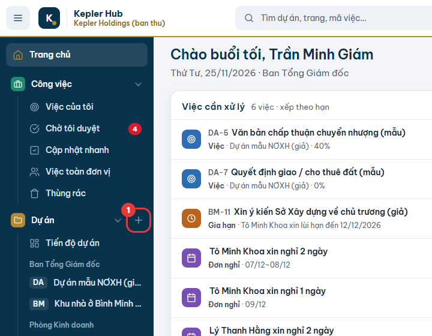

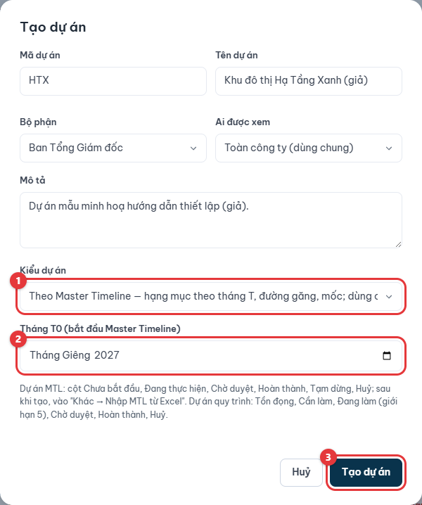

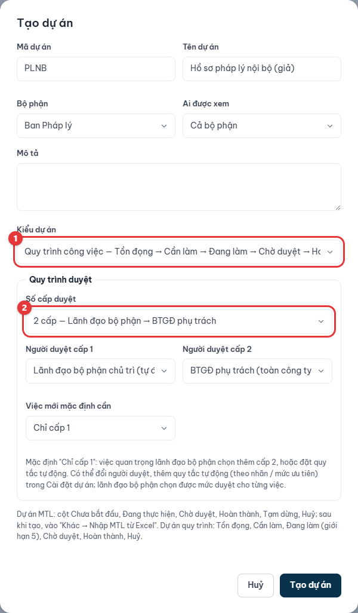

**Ai thấy, ai sửa:**
- **Ban Tổng Giám đốc**: thấy nút **+**; ô **Bộ phận** có mọi bộ phận đang hoạt động; thấy kiểu **Theo Master Timeline** và đây là lựa chọn mặc định.
- **Lãnh đạo bộ phận**: thấy nút **+**; ô **Bộ phận** chỉ có bộ phận của mình; không có kiểu MTL.
- **Nhân viên**, **Quản trị hệ thống**: không thấy nút **+**. Nhân viên cần một dự án riêng thì nhờ lãnh đạo bộ phận tạo rồi đưa mình vào làm **Chủ dự án**.

**Dùng để làm gì:** Lập một dự án mới: kế hoạch MTL dùng chung giữa các bộ phận, bảng quy trình công việc của bộ phận, hoặc bảng lịch tuần. Những gì chọn ở đây quyết định các cột trên Bảng, quy trình duyệt ban đầu và ai thấy dự án. Ba thứ không sửa được sau khi tạo: **Mã dự án**, **Bộ phận**, và dự án là MTL hay không.

**Các bước thường làm**

Dự án MTL (Ban Tổng Giám đốc):
1. Bấm **+** ở nhóm **Dự án**.
2. Gõ **Mã dự án** (vd. `BM`) và **Tên dự án** (vd. "Khu nhà ở Bình Minh (giả)").
3. Chọn **Bộ phận** chủ quản.
4. Để **Kiểu dự án** là **Theo Master Timeline** (mặc định với Ban Tổng Giám đốc). Ô **Ai được xem** tự chuyển sang **Toàn công ty (dùng chung)**; nhóm **Quy trình duyệt** biến mất.
5. Chọn **Tháng T0 (bắt đầu Master Timeline)**, vd. tháng 10/2026.
6. Bấm **Tạo dự án**. Hệ thống mở trang dự án mới.
7. Làm tiếp: Cài đặt → **Thành viên**: thêm người kiêm PMO với vai trò "Chủ dự án" (mục 3.3.7); Cài đặt → **Thông tin chung**: đổi **Người đứng tên dự án** nếu không phải bạn (mục 3.3.1); **Khác** → **Nhập MTL từ Excel** (mục 3.5.3).

Dự án thường:
1. Bấm **+**.
2. Gõ **Mã dự án**, **Tên dự án**; chọn **Bộ phận**, **Ai được xem**; gõ **Mô tả** nếu cần.
3. Chọn **Kiểu dự án**: **Quy trình công việc** hoặc **Lịch tuần**.
4. Với **Quy trình công việc**: chọn **Số cấp duyệt** và người duyệt. Đọc mục 3.8 trước khi chọn.
5. Bấm **Tạo dự án**.

**Từng ô**

| Ô (nguyên văn) | Nghĩa là gì | Điền / chọn thế nào (mặc định) | Đổi thì hệ thống làm gì khác |
|---|---|---|---|
| **Mã dự án** (gợi ý "VD: MKT") | Mã ngắn của dự án | Bắt buộc. 2–10 ký tự, bắt đầu bằng chữ, chỉ gồm chữ không dấu và số. Gõ chữ thường cũng được, hệ thống tự đổi thành chữ in hoa | Thành tiền tố mã việc: dự án `BM` có việc BM-1, BM-2… **Không sửa được sau khi tạo.** Sai mẫu: trình duyệt chặn ngay; máy chủ báo "Mã dự án gồm 2–10 ký tự chữ in hoa/số, bắt đầu bằng chữ". Trùng mã đã có — kể cả mã của dự án đang nằm trong Thùng rác: "Dữ liệu bị trùng: key" |
| **Tên dự án** | Tên hiển thị | Bắt buộc; tối đa 160 ký tự | Hiện ở menu trái, tiêu đề trang dự án, trong thông báo. Đổi sau được ở Cài đặt. Lỗi: "Thiếu Tên dự án"; "Tên dự án vượt 160 ký tự" |
| **Bộ phận** | Bộ phận chủ quản | Ban Tổng Giám đốc: mọi bộ phận đang hoạt động; Lãnh đạo bộ phận: chỉ bộ phận mình. Mặc định là bộ phận của người tạo | Quyết định: ai thấy dự án khi chọn "Cả bộ phận"; Lãnh đạo bộ phận nào quản lý dự án thường; ai là người duyệt cấp "Lãnh đạo bộ phận chủ trì" khi việc không ghi bộ phận chủ trì; dự án nằm dưới tên bộ phận nào ở menu trái. **Không đổi được sau khi tạo.** Lỗi: "Bộ phận không hợp lệ"; "Bạn không có quyền tạo dự án cho bộ phận này" |
| **Ai được xem** | Phạm vi xem | **Cả bộ phận** (mặc định), **Chỉ thành viên**, **Toàn công ty (dùng chung)**. Chọn kiểu MTL mà chưa tự chọn ô này: ô tự chuyển sang **Toàn công ty (dùng chung)**; bỏ kiểu MTL: tự trả về **Cả bộ phận** | Ai thấy dự án, ai làm việc được: bảng ở mục 3.1. Đổi sau được ở Cài đặt. Lỗi: "Phạm vi không hợp lệ" |
| **Mô tả** | Mô tả ngắn | Không bắt buộc; ô nhiều dòng; tối đa 2000 ký tự | Hiện một dòng dưới tên dự án, có nút **Xem thêm** / **Thu gọn**. Lỗi: "Mô tả vượt 2000 ký tự" |
| **Kiểu dự án** | Loại dự án và bộ cột ban đầu | Ba lựa chọn, nguyên văn: "Theo Master Timeline — hạng mục theo tháng T, đường găng, mốc; dùng chung giữa các bộ phận" (chỉ Ban Tổng Giám đốc thấy; mặc định với Ban Tổng Giám đốc); "Quy trình công việc — Tồn đọng → Cần làm → Đang làm → Chờ duyệt → Hoàn thành" (mặc định với Lãnh đạo bộ phận); "Lịch tuần — cột Thứ 2 … Cuối tuần, không duyệt (vd. ai ở / không ở văn phòng)" | MTL: cột **Chưa bắt đầu**, **Đang thực hiện**, **Chờ duyệt**, **Hoàn thành**, **Tạm dừng** (nhóm Cột tự do), **Huỷ**; không có cấp duyệt của dự án; có tab Tổng quan dự án, Giai đoạn, Kế hoạch & Gantt; có cảnh báo tiến độ. Quy trình công việc: cột **Tồn đọng**, **Cần làm**, **Đang làm** (giới hạn WIP 5), **Chờ duyệt**, **Hoàn thành**, **Huỷ**. Lịch tuần: cột **Thứ 2**, **Thứ 3**, **Thứ 4**, **Thứ 5**, **Thứ 6**, **Cuối tuần**, đều là Cột tự do. Người không phải Ban Tổng Giám đốc gửi kiểu MTL bị từ chối: "Chỉ Ban Tổng Giám đốc tạo dự án theo Master Timeline; PMO được đưa vào làm Chủ dự án để điều phối" |
| **Tháng T0 (bắt đầu Master Timeline)** | Tháng 0 của Master Timeline | Chỉ hiện và bắt buộc với kiểu MTL; ô chọn tháng. Hệ thống lưu là ngày 1 của tháng | Mốc quy đổi "tháng T" trong tệp MTL ra ngày: T0 = 10/2026 thì "T2" là tháng 12/2026. Đổi sau ở **Khác** → **T0 & ngưỡng cảnh báo** (mục 3.5.1). Lỗi: "Nhập ngày T0 (tháng bắt đầu của Master Timeline)"; "Ngày T0 không hợp lệ" |
| Nhóm **Quy trình duyệt** › **Số cấp duyệt** | Số cấp duyệt **của dự án**, chạy SAU bước người giao duyệt (bước này luôn có) | "1 cấp — Lãnh đạo bộ phận duyệt" (mặc định), "2 cấp — Lãnh đạo bộ phận → BTGĐ phụ trách", "Không cần duyệt". Cả nhóm ẩn và tự đặt "Không cần duyệt" khi chọn kiểu MTL hoặc Lịch tuần | Tạo sẵn các cấp ở khối **Quy trình duyệt nhiều cấp** (mục 3.3.4). Xem các khối ⚠️ ngay dưới bảng |
| **Người duyệt cấp 1** (hiện khi chọn 1 hoặc 2 cấp) | Ai duyệt cấp thứ nhất của dự án | "Lãnh đạo bộ phận chủ trì (tự động)" (mặc định); "Người đứng tên dự án"; nhóm "Chọn đích danh" gồm các tài khoản Ban Tổng Giám đốc và Lãnh đạo bộ phận | Tên cấp được lưu: "Lãnh đạo bộ phận duyệt" / "Người đứng tên dự án duyệt" / "Duyệt cấp 1". Người chọn đích danh đã bị khoá: "Người duyệt không tồn tại hoặc đã khoá" |
| **Người duyệt cấp 2** (hiện khi chọn 2 cấp) | Ai duyệt cấp thứ hai | "BTGĐ phụ trách (toàn công ty / Phó TGĐ phụ trách bộ phận chủ trì)" (mặc định); nhóm "Chọn đích danh" | Tên cấp được lưu: "BTGĐ duyệt" / "Duyệt cấp 2" |
| **Việc mới mặc định cần** (hiện khi chọn 2 cấp) | Số cấp của dự án áp cho việc không chọn tay, không khớp quy tắc | "Chỉ cấp 1" (mặc định), "Đủ 2 cấp" | "Chỉ cấp 1": việc chỉ qua người giao + cấp 1; việc cần thêm cấp 2 phải chọn tay hoặc đặt quy tắc tự động (mục 3.3.4). Lỗi: "Mức duyệt mặc định không hợp lệ" |

Chữ hướng dẫn trong hộp, nguyên văn:
- Dưới nhóm Quy trình duyệt: "Mặc định "Chỉ cấp 1": việc quan trọng lãnh đạo bộ phận chọn thêm cấp 2, hoặc đặt quy tắc tự động. Có thể đổi người duyệt, thêm quy tắc tự động (theo nhãn / mức ưu tiên) trong Cài đặt dự án; lãnh đạo bộ phận chọn được mức duyệt cho từng việc."
- Cuối hộp: "Dự án MTL: cột Chưa bắt đầu, Đang thực hiện, Chờ duyệt, Hoàn thành, Tạm dừng, Huỷ; sau khi tạo, vào "Khác → Nhập MTL từ Excel". Dự án quy trình: Tồn đọng, Cần làm, Đang làm (giới hạn 5), Chờ duyệt, Hoàn thành, Huỷ."

> ⚠️ **Chữ trên màn hình ghi** "1 cấp — Lãnh đạo bộ phận duyệt" **nhưng thực tế** việc đi qua HAI bước: bước 1 luôn là người giao duyệt và chấm mức; bước 2 mới là Lãnh đạo bộ phận chủ trì. Ví dụ: dự án BM chọn "1 cấp", Nhân viên A chủ trì việc BM-12 do Nhân viên B giao. A gửi duyệt → B duyệt và chấm mức → Lãnh đạo bộ phận chủ trì duyệt → BM-12 thành Hoàn thành. Tương tự, "2 cấp" là ba bước. Chi tiết ở mục 3.8.

> ⚠️ **Chữ trên màn hình ghi** "Không cần duyệt" **nhưng thực tế** với kiểu **Quy trình công việc**, việc vẫn phải qua người giao duyệt và chấm mức mới thành Hoàn thành; "Không cần duyệt" chỉ có nghĩa là không có cấp nào SAU người giao. Chỉ bảng không có cột nhóm Hoàn thành (kiểu **Lịch tuần**) mới thật sự không có duyệt.

> ⚠️ **Chữ trên màn hình ghi** "lãnh đạo bộ phận chọn được mức duyệt cho từng việc" **nhưng thực tế** chỉ người quản lý dự án đổi được mức duyệt của một việc. Lãnh đạo bộ phận chỉ làm được ở dự án mình quản lý.

**Các nút**

| Nút | Làm gì | Có hỏi lại không | Quay lại được không |
|---|---|---|---|
| **Huỷ** | Đóng hộp, bỏ mọi thứ đã nhập | Bấm nút này: đóng ngay, không hỏi. Bấm ra ngoài hộp hoặc phím Esc khi đã nhập: hỏi "Bỏ nội dung đã nhập?" với hai nút **Bỏ nội dung** / **Tiếp tục nhập** | — |
| **Tạo dự án** | Tạo dự án; bạn thành Chủ dự án và Người đứng tên dự án; menu trái nạp lại; chuyển vào trang dự án mới; báo "Đã tạo dự án BM". Lỗi hiện chữ đỏ trong hộp | Không | Không có hoàn tác. Muốn bỏ: **Xoá dự án** (vào Thùng rác, mục 3.12) — mã dự án vẫn bị giữ tới khi hệ thống xoá hẳn |

**⚠️ Dễ nhầm**
- Hộp tạo không có ô Người đứng tên dự án: người tạo tự đứng tên. Đổi ở Cài đặt → **Thông tin chung**.
- Chọn nhầm **Bộ phận** hoặc nhầm loại MTL / thường: không sửa được. Phải xoá dự án và tạo lại bằng mã khác (mã cũ còn bị giữ khoảng 7–8 ngày, tới khi hệ thống xoá hẳn).
- Danh sách "Chọn đích danh" ở hộp này chỉ có Ban Tổng Giám đốc và Lãnh đạo bộ phận. Ở Cài đặt, loại "Người được chỉ định" chọn được mọi tài khoản trừ Quản trị hệ thống (kể cả Nhân viên).
- Lãnh đạo bộ phận vẫn thấy gợi ý "chọn kiểu Theo Master Timeline" ở trang **Tiến độ dự án**, nhưng hộp tạo của Lãnh đạo bộ phận không có kiểu này. Cần dự án MTL: đề nghị Ban Tổng Giám đốc tạo.
- Dự án MTL tạo ra không có cấp duyệt của dự án và mức mặc định là "Không cần duyệt": hạng mục do người giao duyệt; hạng mục mốc / đường găng do BTGĐ phụ trách duyệt.
- Tạo dự án không gửi thông báo cho ai. Hệ thống ghi nhật ký (chỉ Quản trị hệ thống xem).
- Ô **Mô tả** ở đây nhiều dòng, nhưng ô Mô tả ở Cài đặt chỉ một dòng: lần đầu bấm **Lưu** ở Thông tin chung, các dòng bị nối lại thành một (mục 3.3.1).

**Claude:** Không tạo được dự án. Claude chỉ liệt kê các dự án bạn đang xem được (mã, tên, MTL hay thường, phạm vi xem).

### 3.3 Màn Cài đặt dự án

**Mở ở đâu:** Trang dự án → nút **Khác** (góc trên phải) → **Cài đặt** (trang `#/projects/<số dự án>/settings`). Tiêu đề trang: "Cài đặt dự án <mã>", vd. "Cài đặt dự án BM". Thanh vị trí: "<tên dự án> / Cài đặt". Nút **Về bảng công việc** quay lại trang dự án.

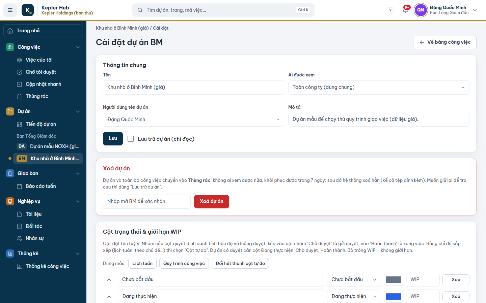

**Ai thấy, ai sửa:** Người quản lý dự án (mục 3.1). Người khác không thấy mục **Cài đặt** trong menu **Khác**; mở thẳng đường dẫn thì thấy "Bạn không có quyền quản lý dự án này.". Quản trị hệ thống mở bất kỳ trang nào của dự án đều bị đưa về **Quản trị → Tài khoản**. Mọi nút lưu đều được máy chủ kiểm lại quyền; thiếu quyền thì báo "Bạn không có quyền quản lý dự án này".

**Dùng để làm gì:** Cấu hình chung của một dự án: tên, phạm vi xem, người đứng tên, lưu trữ / xoá, các cột trên Bảng, quy trình duyệt, nhãn riêng, việc lặp lại, thành viên. Dự án MTL dùng chính màn này. Các thiết lập riêng của MTL (T0, ngưỡng cảnh báo, nhập MTL, chạy cảnh báo, giai đoạn) không nằm ở đây mà ở menu **Khác** và tab **Giai đoạn** (mục 3.5).

Bảy khối, theo thứ tự từ trên xuống:

| Khối | Nút lưu của khối | Mục |
|---|---|---|
| **Thông tin chung** | **Lưu** | 3.3.1 |
| **Xoá dự án** | **Xoá dự án** | 3.3.2 |
| **Cột trạng thái & giới hạn WIP** | **Lưu cột** | 3.3.3 |
| **Quy trình duyệt nhiều cấp** (kèm **Quy tắc tự động**) | **Lưu quy trình duyệt**; **Lưu quy tắc** | 3.3.4 |
| **Nhãn của dự án** | **Lưu** và **Xoá** trên từng nhãn; **+ Thêm nhãn** | 3.3.5 |
| **Việc lặp lại** | **Thêm việc lặp lại** và các nút trên từng dòng | 3.3.6 |
| **Thành viên** | **Lưu thành viên** | 3.3.7 |

> ⚠️ **Mỗi khối có nút lưu riêng. Lưu một khối thì phần đang sửa dở ở khối khác bị mất.** Các nút **Lưu cột**, **Lưu quy trình duyệt**, **Lưu quy tắc**, **Lưu thành viên**, và **Lưu** / **Xoá** / **+ Thêm nhãn** ở khối Nhãn, khi lưu thành công sẽ vẽ lại CẢ trang bằng dữ liệu đang có trên máy chủ. Mọi chỗ đã sửa mà chưa lưu ở các khối khác — kể cả Thông tin chung và các ô đang gõ trong biểu mẫu thêm việc lặp lại — trở về như cũ, không báo gì. Ví dụ: bạn đổi tên dự án ở Thông tin chung nhưng chưa bấm **Lưu**, rồi thêm một thành viên và bấm **Lưu thành viên** → thành viên được lưu, còn ô Tên quay về tên cũ. Nút **Lưu** của Thông tin chung và các nút của khối Việc lặp lại không vẽ lại cả trang. Cách làm an toàn: **sửa xong khối nào, bấm lưu khối đó rồi mới sang khối khác.**

- Không khối nào gửi thông báo cho thành viên khi lưu.
- Mọi lần lưu được ghi vào nhật ký hệ thống; chỉ Quản trị hệ thống xem được, ở **Quản trị → Nhật ký hệ thống**.

**Claude:** Không đọc, không sửa được khối nào của màn Cài đặt.

#### 3.3.1 Thông tin chung

**Mở ở đâu:** Khối đầu tiên của màn Cài đặt.

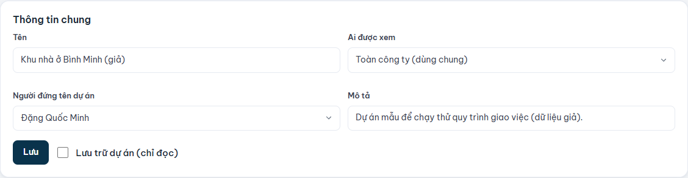

**Ai thấy, ai sửa:** Người quản lý dự án.

**Dùng để làm gì:** Đổi tên, phạm vi xem, Người đứng tên dự án, mô tả; lưu trữ hoặc mở lại dự án.

**Các bước thường làm**
1. Sửa ô cần đổi.
2. Bấm **Lưu**. Hệ thống báo "Đã lưu thông tin"; menu trái nạp lại, tên mới hiện ngay.

**Từng ô**

| Ô (nguyên văn) | Nghĩa là gì | Điền / chọn thế nào (mặc định) | Đổi thì hệ thống làm gì khác |
|---|---|---|---|
| **Tên** | Tên dự án | Bắt buộc; tối đa 160 ký tự (ô không chặn khi gõ, máy chủ chặn khi lưu) | Đổi tên ở menu trái, tiêu đề trang, các thông báo mới. Mã dự án và mã việc (BM-12) không đổi. Lỗi: "Thiếu Tên dự án"; "Tên dự án vượt 160 ký tự" |
| **Ai được xem** | Phạm vi xem | **Cả bộ phận**, **Chỉ thành viên**, **Toàn công ty (dùng chung)**; mặc định là phạm vi đang có | Đổi ngay ai thấy dự án và ai làm việc được (bảng ở mục 3.1). Ví dụ đổi BM từ "Cả bộ phận" sang "Chỉ thành viên": nhân viên trong bộ phận không có tên ở khối Thành viên mất dự án khỏi menu trái từ lần tải trang sau, mở đường dẫn cũ thì thấy "Không tìm thấy dự án"; mọi thành viên Ban Tổng Giám đốc vẫn thấy và quản lý. Lỗi: "Phạm vi không hợp lệ" |
| **Người đứng tên dự án** | Người đứng tên | "—" (để trống) hoặc một tài khoản đang hoạt động trong danh bạ. ⚠️ Danh sách có cả tài khoản Quản trị hệ thống và máy chủ không chặn: **đừng chọn**. Chọn nhầm thì tài khoản đó không được quyền quản lý, nhưng vẫn nhận thông báo "Cần duyệt …" (kèm tên việc) của cấp "Người đứng tên dự án" và, ở dự án MTL, cảnh báo tiến độ phần "PMO"; cấp duyệt đó kẹt vì Quản trị hệ thống không mở được việc. Chọn lại người đứng tên rồi **Lưu** ngay | (1) Là người duyệt của cấp "Người đứng tên dự án", nếu khối Quy trình duyệt có cấp này. (2) Xem đầy đủ, bình luận mọi việc của dự án. (3) Dự án MTL: được quản lý dự án (Cài đặt, nhập MTL, T0, xoá dự án…) và nhận cảnh báo phần "PMO". (4) Dự án thường: không tự có quyền quản lý nếu không là Chủ dự án. Lưu KHÔNG tự thêm người này vào khối Thành viên. Lỗi: "Người đứng tên dự án không hợp lệ" |
| **Mô tả** | Mô tả dự án | Ô một dòng; tối đa 2000 ký tự | Hiện dưới tên dự án. Lỗi: "Mô tả vượt 2000 ký tự" |
| **Lưu trữ dự án (chỉ đọc)** | Lưu trữ / mở lại dự án | Ô đánh dấu; dự án đang lưu trữ thì ô đang được đánh dấu | Đánh dấu rồi **Lưu** = lưu trữ; bỏ đánh dấu rồi **Lưu** = mở lại. Hậu quả ở mục 3.12 |

**Các nút**

| Nút | Làm gì | Có hỏi lại không | Quay lại được không |
|---|---|---|---|
| **Lưu** | Lưu cả năm ô cùng lúc; menu trái nạp lại; báo "Đã lưu thông tin". Lỗi hiện thông báo màu đỏ | Không — kể cả khi bạn vừa đánh dấu lưu trữ | Được: sửa lại rồi **Lưu**. Lưu trữ: bỏ đánh dấu rồi **Lưu** |

**⚠️ Dễ nhầm**
- ⚠️ Lưu trữ không hỏi lại, và dự án biến khỏi menu trái ngay. Chỗ duy nhất còn liệt kê dự án đã lưu trữ là tab **Tài liệu → Tài liệu dự án** (dòng có chữ "đã đóng"), và từ đó không có nút mở Cài đặt. **Trước khi lưu trữ, chép lại đường dẫn** `#/projects/<số>/settings` để còn mở lại (mục 3.12).
- "Chỉ thành viên" không chặn Ban Tổng Giám đốc: mọi thành viên Ban Tổng Giám đốc vẫn xem và quản lý.
- Dự án MTL đổi sang "Chỉ thành viên": cán bộ các bộ phận có hạng mục vẫn thấy, vì lần nhập MTL đã tự thêm họ vào Thành viên (mục 3.5.3).
- Mô tả nhiều dòng (gõ lúc tạo dự án) bị nối thành một dòng khi bấm **Lưu** ở đây, vì ô Mô tả ở Cài đặt chỉ một dòng.
- Để trống **Người đứng tên dự án** trong khi khối Quy trình duyệt có cấp "Người đứng tên dự án": cấp đó không có ai duyệt, khối hiện "Chưa có người duyệt", và việc gửi duyệt sẽ kẹt ở cấp đó.
- Dự án MTL: chọn ai làm Người đứng tên là giao cho người đó toàn quyền quản lý dự án, kể cả xoá dự án — dù người đó là Nhân viên và không có tên trong Thành viên, với điều kiện người đó xem được dự án. Dự án đặt "Chỉ thành viên" (hoặc "Cả bộ phận" mà người đứng tên thuộc bộ phận khác) thì phải thêm người đó vào Thành viên, nếu không họ chỉ gặp "Không tìm thấy dự án". Màn hình không nhắc điều này.
- Dự án kiểu "Sổ giao việc" cũ (không tạo được từ giao diện hiện nay): ô **Ai được xem** không có lựa chọn của loại này, nên bấm **Lưu** sẽ đổi phạm vi thành "Cả bộ phận" mà không báo. Gặp dự án như vậy, đừng bấm **Lưu** ở khối này; báo Quản trị hệ thống.

**Claude:** Không sửa được. Claude chỉ đọc được loại dự án (MTL / thường) và phạm vi xem.

#### 3.3.2 Xoá dự án

**Mở ở đâu:** Khối thứ hai của màn Cài đặt (khung cảnh báo).

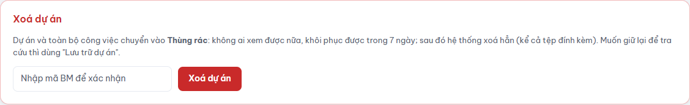

**Ai thấy, ai sửa:** Người quản lý dự án — kể cả Chủ dự án là Nhân viên, và Người đứng tên của dự án MTL.

**Dùng để làm gì:** Chuyển dự án cùng toàn bộ việc vào Thùng rác. Chữ trên khối, nguyên văn: "Dự án và toàn bộ công việc chuyển vào Thùng rác: không ai xem được nữa, khôi phục được trong 7 ngày; sau đó hệ thống xoá hẳn (kể cả tệp đính kèm). Muốn giữ lại để tra cứu thì dùng "Lưu trữ dự án"."

**Các bước thường làm**
1. Gõ mã dự án vào ô "Nhập mã BM để xác nhận" (chữ thường cũng được).
2. Bấm **Xoá dự án**. Hệ thống báo "Đã chuyển dự án BM vào thùng rác" và chuyển bạn tới trang **Thùng rác**.

**Từng ô**

| Ô (nguyên văn) | Nghĩa là gì | Điền / chọn thế nào (mặc định) | Đổi thì hệ thống làm gì khác |
|---|---|---|---|
| Ô có gợi ý "Nhập mã <mã> để xác nhận" | Bước xác nhận xoá | Gõ đúng mã dự án; tối đa 10 ký tự; không phân biệt hoa thường. Mặc định trống | Sai hoặc để trống: báo "Nhập đúng mã dự án "BM" để xác nhận xoá", không xoá gì |

**Các nút**

| Nút | Làm gì | Có hỏi lại không | Quay lại được không |
|---|---|---|---|
| **Xoá dự án** | Đánh dấu dự án đã xoá: dự án biến khỏi các danh sách với mọi người; huỷ MỌI phiếu duyệt đang chờ của dự án; chuyển bạn tới **Thùng rác** | Không có hộp hỏi lại — gõ đúng mã là bước xác nhận | Được trong 7 ngày: **Thùng rác** → **Khôi phục**. Quá 7 ngày, hệ thống xoá hẳn lúc 02:45 sáng, kể cả tệp đính kèm — không lấy lại được. Phiếu duyệt đã bị huỷ không tự mở lại khi khôi phục |

**⚠️ Dễ nhầm**
- ⚠️ Xoá dự án huỷ ngay mọi phiếu duyệt đang chờ; khôi phục không mở lại các phiếu đó (mục 3.12).
- Xoá không gửi thông báo cho thành viên.
- ⚠️ Trong 7 ngày nằm ở Thùng rác, việc chưa xong có Hạn của dự án đã xoá vẫn sinh thông báo 08:00 "<mã việc> đến hạn trong 24 giờ" cho người chủ trì; bấm vào thì "Không tìm thấy công việc". Báo trước người chủ trì.
- Mã dự án bị giữ tới khi hệ thống xoá hẳn: không tạo được dự án mới trùng mã trong thời gian đó.
- Muốn giữ để tra cứu: dùng **Lưu trữ dự án (chỉ đọc)** ở Thông tin chung thay vì xoá.

**Claude:** Không xoá được. Xoá luôn phải làm trên giao diện.

#### 3.3.3 Cột trạng thái & giới hạn WIP

**Mở ở đâu:** Khối thứ ba của màn Cài đặt.

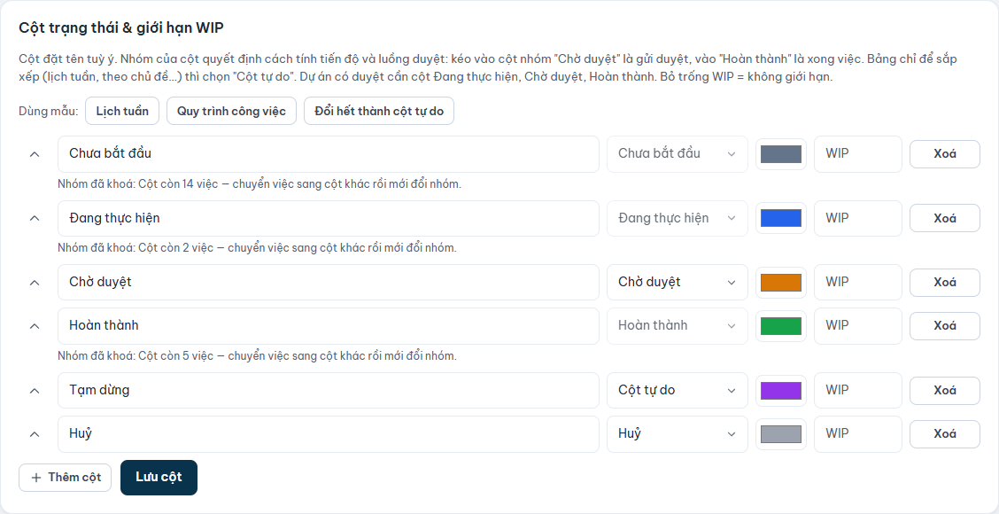

**Ai thấy, ai sửa:** Người quản lý dự án.

**Dùng để làm gì:** Đặt tên, thứ tự, nhóm, màu và giới hạn số việc (WIP) của từng cột trên Bảng. Nhóm của cột là thứ quan trọng nhất: nó quyết định hệ thống hiểu việc trong cột là chưa làm, đang làm, chờ duyệt hay đã xong. Chữ trên khối, nguyên văn: "Cột đặt tên tuỳ ý. Nhóm của cột quyết định cách tính tiến độ và luồng duyệt: kéo vào cột nhóm "Chờ duyệt" là gửi duyệt, vào "Hoàn thành" là xong việc. Bảng chỉ để sắp xếp (lịch tuần, theo chủ đề…) thì chọn "Cột tự do". Dự án có duyệt cần cột Đang thực hiện, Chờ duyệt, Hoàn thành. Bỏ trống WIP = không giới hạn."

**Các bước thường làm**
- Đổi tên, màu hoặc WIP của một cột: sửa trên dòng → **Lưu cột**.
- Thêm cột: **Thêm cột** → gõ tên, chọn nhóm → bấm nút mũi tên để đưa lên đúng vị trí → **Lưu cột**.
- Bỏ cột: chuyển hết việc ra khỏi cột trên Bảng → **Xoá** trên dòng → **Lưu cột**.
- Đổi cả bộ cột sang Lịch tuần hoặc Quy trình công việc: **Dùng mẫu:** → chọn mẫu → kiểm tra từng dòng → **Lưu cột**.

**Từng ô** (mỗi dòng là một cột)

| Ô (nguyên văn) | Nghĩa là gì | Điền / chọn thế nào (mặc định) | Đổi thì hệ thống làm gì khác |
|---|---|---|---|
| Nút mũi tên (chú thích "Lên trên") | Đưa dòng lên trên một bậc | — | Thứ tự dòng = thứ tự cột trên Bảng (từ trái sang phải), sau khi **Lưu cột** |
| Ô **Tên cột** (gợi ý "Tên cột") | Tên cột | Bắt buộc; tối đa 40 ký tự | Tên cột trên Bảng, chữ trong ô Trạng thái của việc, tên trong bộ lọc. Đổi tên không đổi nghĩa của cột (nghĩa do nhóm quyết định). Lỗi: "Thiếu Tên cột"; "Tên cột vượt 40 ký tự" |
| Ô chọn **Nhóm trạng thái** | Nhóm của cột | Bảy lựa chọn: **Tồn đọng**, **Chưa bắt đầu**, **Đang thực hiện**, **Chờ duyệt**, **Hoàn thành**, **Huỷ**, **Cột tự do**. Dòng mới: **Đang thực hiện** (hoặc **Cột tự do** nếu mọi dòng đang là Cột tự do) | Xem bảng "Hệ thống hiểu nhóm cột" ngay dưới. Lỗi: "Nhóm trạng thái không hợp lệ"; "Thiếu nhóm trạng thái" |
| Ô màu (chú thích "Màu") | Màu chấm của cột | Chọn màu; dòng mới mặc định xám | Chỉ để nhìn |
| Ô **Giới hạn WIP** (gợi ý "WIP") | Số việc tối đa trong cột | Số nguyên từ 1; để trống = không giới hạn. Máy chủ ép vào khoảng 1–999: gõ 0 thành 1; số lẻ bị bỏ phần thập phân | Đầu cột hiện "<số việc>/<giới hạn>"; cột đầy thì không chuyển thêm việc vào được (xem "Giới hạn WIP chạy thế nào") |
| Nút **Xoá** trên dòng | Bỏ cột | — | Chỉ bỏ trên màn hình; bấm **Lưu cột** mới thật sự xoá. Cột còn việc: máy chủ không cho xoá, báo "Cột "<tên>" còn <N> việc, hãy chuyển việc trước khi xoá" |

**Hệ thống hiểu nhóm cột**

| Nhóm | Hệ thống hiểu là |
|---|---|
| **Tồn đọng** | Việc chưa làm, để dành. Người chủ trì tự kéo đi, kéo về được |
| **Chưa bắt đầu** | Việc chưa làm. Việc mới tạo mà không chọn trạng thái sẽ vào cột đầu tiên thuộc nhóm này |
| **Đang thực hiện** | Đang làm. Lần đầu việc vào nhóm này, hệ thống ghi thời điểm bắt đầu (dùng cho cảnh báo MTL). Việc bị trả lại khi duyệt về cột đầu tiên thuộc nhóm này |
| **Chờ duyệt** | Kéo việc vào là gửi duyệt: hệ thống mở phiếu duyệt (mục 3.8) |
| **Hoàn thành** | Xong việc, tiến độ 100%. Kéo việc chưa được duyệt vào đây thì hệ thống đưa vào cột **Chờ duyệt** và mở phiếu duyệt |
| **Huỷ** | Không tính vào tiến độ, KPI, cảnh báo |
| **Cột tự do** | Chỉ là tên cột: không tính hoàn thành, không gửi duyệt. Cột **Tạm dừng** của dự án MTL thuộc nhóm này |

**Các nút**

| Nút | Làm gì | Có hỏi lại không | Quay lại được không |
|---|---|---|---|
| **Dùng mẫu:** → **Lịch tuần** | Điền 6 dòng đầu thành "Thứ 2", "Thứ 3", "Thứ 4", "Thứ 5", "Thứ 6", "Cuối tuần", nhóm Cột tự do, bỏ WIP; thiếu dòng thì thêm. Mỗi dòng giữ nguyên cột cũ ở vị trí đó, nên việc trong cột không mất | Không; báo "Đã điền mẫu — bấm "Lưu cột" để áp dụng" | Chưa bấm **Lưu cột** thì tải lại trang là bỏ |
| **Dùng mẫu:** → **Quy trình công việc** | Điền 6 dòng đầu: "Tồn đọng" (nhóm Tồn đọng), "Cần làm" (Chưa bắt đầu), "Đang làm" (Đang thực hiện, WIP 5), "Chờ duyệt" (Chờ duyệt), "Hoàn thành" (Hoàn thành), "Huỷ" (Huỷ) | Như trên | Như trên |
| **Dùng mẫu:** → **Đổi hết thành cột tự do** | Mọi dòng thành nhóm Cột tự do, xoá WIP; giữ tên | Như trên | Như trên |
| **Thêm cột** | Thêm một dòng trống | Không | Bấm **Xoá** trên dòng |
| **Lưu cột** | Thay toàn bộ danh sách cột theo màn hình; vẽ lại cả trang; báo "Đã lưu cột" | Không | Sửa rồi lưu lại. Cột đã xoá phải tạo lại (không mất việc vì chỉ xoá được cột trống) |

Mẫu có ít dòng hơn danh sách đang có: hệ thống nhắc "Còn <N> cột thừa ở cuối — bấm "Xoá" nếu không dùng (cột còn việc thì chuyển việc trước)".

Ràng buộc khi **Lưu cột**, thông báo nguyên văn:
- "Danh sách cột không hợp lệ"; "Dự án cần 1–15 cột"; "Cột không thuộc dự án".
- Dự án đang có cấp duyệt, HOẶC danh sách cột có ít nhất một cột nhóm Hoàn thành, thì phải có đủ ba nhóm Đang thực hiện, Chờ duyệt, Hoàn thành. Thiếu nhóm nào báo nhóm đó: "Dự án có cột Hoàn thành (việc xong phải qua người giao duyệt) cần ít nhất một cột thuộc nhóm "Đang thực hiện"" (tương tự với "Chờ duyệt", "Hoàn thành").
- Dự án kiểu "Sổ giao việc" cũ còn bắt buộc nhóm Chưa bắt đầu: "Sổ giao việc cần ít nhất một cột thuộc nhóm "Chưa bắt đầu"" (tương tự với "Đang thực hiện", "Chờ duyệt", "Hoàn thành").

**Giới hạn WIP chạy thế nào**
- Đầu cột có giới hạn hiện "<số việc trong cột>/<giới hạn>" (chú thích "Giới hạn WIP"); cột đã đầy đổi kiểu hiển thị.
- Cách đếm: mọi việc đang ở cột đó, kể cả việc con; không đếm việc trong Thùng rác.
- Chuyển việc vào cột đã đầy: "Cột "<tên>" đã đạt giới hạn WIP <N> việc". Người quản lý dự án được hỏi thêm: kéo trên Bảng thì "<thông báo trên>. Bạn là quản lý dự án — vẫn chuyển vượt giới hạn?"; đổi trạng thái trong panel việc thì "<thông báo trên>. Vẫn chuyển vượt giới hạn?", với nút **Vẫn chuyển** / **Huỷ**. Người khác chỉ thấy thông báo lỗi.
- Có kiểm WIP: kéo thẻ sang cột khác; đổi trạng thái trong panel việc; tạo việc bằng **Tạo việc** hoặc **+ Thêm việc** (không có lựa chọn vượt, kể cả với người quản lý dự án); việc lặp lại tự tạo.
- Không kiểm WIP: sắp xếp lại trong cùng cột; nhập việc từ tệp; nhập MTL; rút lại phiếu duyệt; duyệt xong và trả lại.
- Ví dụ: cột **Đang làm** của BM có WIP 5 và đang có 5 việc. Nhân viên kéo việc thứ sáu vào → bị chặn. Lãnh đạo bộ phận (người quản lý dự án) kéo → được hỏi, bấm **Vẫn chuyển** → đầu cột hiện "6/5".

**⚠️ Dễ nhầm**
- ⚠️ Đổi NHÓM của một cột đang có việc: hệ thống không chặn, không hỏi. Việc trong cột đổi nghĩa ngay khi lưu. Ví dụ đổi cột "Đang làm" (5 việc) sang nhóm **Hoàn thành**: cả 5 việc thành "xong" mà không qua duyệt; đổi sang **Cột tự do**: 5 việc không còn được tính là đang làm.
- Mẫu điền theo THỨ TỰ dòng: việc đang ở cột dòng 1 sẽ nằm trong cột mới ở dòng 1 (vd. thành "Thứ 2"). Kiểm tra lại từng dòng trước khi **Lưu cột**.
- Đổi dự án đang có cấp duyệt sang Lịch tuần: phải xoá hết cấp duyệt trước (khối Quy trình duyệt, bỏ hết dòng rồi **Lưu quy trình duyệt**), rồi mới **Lưu cột** được. Thông báo lỗi khi đó vẫn nói "Dự án có cột Hoàn thành…" dù bạn đã bỏ hết cột Hoàn thành.
- Cột chỉ còn việc nằm trong Thùng rác vẫn bị coi là "còn việc": báo "Cột "<tên>" còn <N> việc…" dù trên Bảng không còn thẻ nào. Khôi phục các việc đó rồi chuyển đi, hoặc chờ hệ thống xoá hẳn sau 7 ngày.
- Mọi cột là Cột tự do thì tab **Tiến độ kế hoạch** và **Chu kỳ** biến mất.
- Không có mẫu cột MTL trong **Dùng mẫu**. Cột **Tạm dừng** của dự án MTL là Cột tự do: hạng mục tạm dừng VẪN bị tính chậm / trễ và vẫn bị cảnh báo (mục 3.5.1).

**Claude:** Không sửa được cột, không chuyển việc vượt giới hạn WIP.

#### 3.3.4 Quy trình duyệt nhiều cấp và Quy tắc tự động

**Mở ở đâu:** Khối thứ tư của màn Cài đặt. Ô **Mức duyệt của việc này** nằm trong panel chi tiết từng việc; ô **Mức duyệt** nằm trong hộp **Tạo việc** → **Thêm thông tin**.

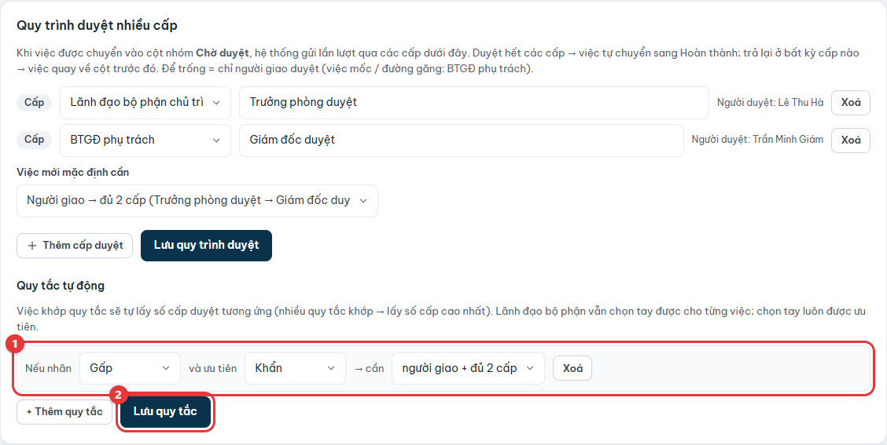

**Ai thấy, ai sửa:** Khối này: người quản lý dự án. Mức duyệt của một việc: người quản lý dự án.

**Dùng để làm gì:** Khai các cấp duyệt của dự án (chạy sau bước người giao duyệt), số cấp mặc định cho việc, và quy tắc tự tăng / giảm số cấp theo nhãn, mức ưu tiên. Đọc mục 3.8 để biết một việc thực sự đi qua những ai.

Chữ trên khối, nguyên văn: "Khi việc được chuyển vào cột nhóm Chờ duyệt, hệ thống gửi lần lượt qua các cấp dưới đây. Duyệt hết các cấp → việc tự chuyển sang Hoàn thành; trả lại ở bất kỳ cấp nào → việc quay về cột trước đó. Để trống = không cần duyệt."

> ⚠️ **Chữ trên màn hình ghi** "Để trống = không cần duyệt" **nhưng thực tế** người giao (hoặc BTGĐ phụ trách, với việc mốc / đường găng) luôn duyệt và chấm mức TRƯỚC các cấp khai ở đây. Để trống chỉ có nghĩa là không có cấp nào sau người giao.

> ⚠️ **Chữ trên màn hình ghi** "trả lại ở bất kỳ cấp nào → việc quay về cột trước đó" **nhưng thực tế** việc bị trả lại luôn về cột đầu tiên thuộc nhóm Đang thực hiện, bất kể trước khi gửi duyệt việc nằm ở cột nào.

**Các bước thường làm**

Thêm hoặc đổi cấp duyệt:
1. Bấm **Thêm cấp duyệt** (dòng mới là "Lãnh đạo bộ phận chủ trì").
2. Chọn loại người duyệt; với "Người được chỉ định" chọn thêm người.
3. Gõ **Tên bước (tuỳ chọn)** nếu muốn.
4. Bấm **Lưu quy trình duyệt**. Trang vẽ lại; dòng "Người duyệt: …" hiện tên người sẽ duyệt.
5. Nếu đây là lần đầu dự án có cấp: sau khi trang vẽ lại mới thấy ô **Việc mới mặc định cần** và phần **Quy tắc tự động**. Chọn mức mặc định rồi **Lưu quy trình duyệt** lần nữa.

Thêm quy tắc tự động:
1. Bấm **+ Thêm quy tắc** → chọn nhãn và / hoặc ưu tiên → chọn số cấp ở **→ cần**.
2. Bấm **Lưu quy tắc**.

**Từng ô — mỗi dòng là một cấp**

| Ô (nguyên văn) | Nghĩa là gì | Điền / chọn thế nào (mặc định) | Đổi thì hệ thống làm gì khác |
|---|---|---|---|
| Nhãn **Cấp** đầu dòng | Đánh dấu dòng | — | Dòng trên cùng là cấp thứ nhất của dự án (chạy ngay sau người giao) |
| Ô chọn loại người duyệt | Ai duyệt cấp này | "Người đứng tên dự án", "Lãnh đạo bộ phận chủ trì", "BTGĐ phụ trách", "Người được chỉ định". Dòng mới: "Lãnh đạo bộ phận chủ trì" | Xem bảng "Ai duyệt theo từng loại" ngay dưới. Lỗi: "Người duyệt không hợp lệ"; "Thiếu loại người duyệt" |
| Ô chọn người (chỉ hiện với "Người được chỉ định") | Người duyệt đích danh | "— Chọn người —" và mọi tài khoản không phải Quản trị hệ thống (cả Nhân viên) | Bắt buộc với loại này. Lỗi: "Người duyệt không hợp lệ"; "Người duyệt không tồn tại hoặc đã khoá" |
| Ô **Tên bước (tuỳ chọn)** | Tên cấp | Tối đa 60 ký tự; để trống thì hệ thống đặt bằng tên loại, vd. "Lãnh đạo bộ phận chủ trì" | Hiện trên phiếu duyệt, trong thông báo "Cần duyệt BM-12 · <tiêu đề> (<tên bước>)" gửi người duyệt cấp đó, và trên nhãn "Duyệt <N> cấp" ở trang dự án. Lỗi: "Tên bước vượt 60 ký tự" |
| Chữ "Người duyệt: <họ tên, cách nhau dấu phẩy>" hoặc chữ đỏ "Chưa có người duyệt" (chú thích "Người sẽ duyệt ở cấp này") | Ai sẽ duyệt cấp này | Chỉ hiện với cấp đã lưu | Tính theo bộ phận chủ quản của dự án. Việc có bộ phận chủ trì khác (thường gặp ở dự án MTL) thì người duyệt thực tế khác dòng này. "Chưa có người duyệt" = phiếu sẽ kẹt ở cấp này |
| Nút **Xoá** trên dòng | Bỏ cấp | — | Chỉ bỏ trên màn hình, tới khi **Lưu quy trình duyệt** |
| **Việc mới mặc định cần** (chỉ hiện khi dự án đã có cấp lúc mở trang) | Số cấp của dự án áp cho việc không chọn tay và không khớp quy tắc | "Đủ <N> cấp" (mặc định), "Không cần duyệt", "<k> cấp đầu (<tên cấp 1> → … → <tên cấp k>)" với k từ 1 tới N−1 | Áp vào LÚC GỬI DUYỆT, cho mọi việc chưa chọn tay — cả việc tạo từ trước. Ví dụ: dự án 2 cấp, đặt "1 cấp đầu (Lãnh đạo bộ phận duyệt)": từ lúc lưu, mọi việc gửi duyệt (không chọn tay, không khớp quy tắc) chỉ qua người giao + Lãnh đạo bộ phận; phiếu đã mở trước đó giữ nguyên. "Không cần duyệt" ở đây vẫn còn người giao duyệt. Lỗi: "Mức duyệt mặc định không hợp lệ" |

**Ai duyệt theo từng loại**

| Loại | Người duyệt | Khi không có ai |
|---|---|---|
| **Người đứng tên dự án** | Người đứng tên dự án (ô ở Thông tin chung), cộng người đang được người đó uỷ quyền | Ô Người đứng tên để trống → không ai duyệt, phiếu kẹt |
| **Lãnh đạo bộ phận chủ trì** | Lãnh đạo bộ phận của bộ phận chủ trì việc (việc không ghi bộ phận chủ trì thì lấy bộ phận chủ quản dự án). Với bộ phận Ban Tổng Giám đốc là các thành viên BTGĐ thuộc bộ phận đó. Cộng người đang được họ uỷ quyền | Bộ phận không có Lãnh đạo bộ phận → không ai duyệt, phiếu kẹt |
| **BTGĐ phụ trách** | Thành viên BTGĐ phụ trách "Toàn công ty" + Phó Tổng Giám đốc phụ trách bộ phận chủ trì; cộng người đang được họ uỷ quyền | Chưa ai được đặt phụ trách → mọi thành viên Ban Tổng Giám đốc |
| **Người được chỉ định** | Đúng người đã chọn; cộng người đang được người đó uỷ quyền | Tài khoản đó bị khoá về sau → phiếu kẹt |

**Từng ô — Quy tắc tự động** (chỉ hiện khi dự án đã có cấp lúc mở trang)

Chữ nguyên văn: "Việc khớp quy tắc sẽ tự lấy số cấp duyệt tương ứng (nhiều quy tắc khớp → lấy số cấp cao nhất). Lãnh đạo bộ phận vẫn chọn tay được cho từng việc; chọn tay luôn được ưu tiên."

| Ô (nguyên văn) | Nghĩa là gì | Điền / chọn thế nào (mặc định) | Đổi thì hệ thống làm gì khác |
|---|---|---|---|
| **Nếu nhãn** + ô chọn | Điều kiện về nhãn | "— bất kỳ —" (mặc định) hoặc một nhãn (nhãn chung và nhãn riêng của dự án) | Việc phải mang nhãn này mới khớp. Lỗi: "Nhãn không hợp lệ"; "Có nhãn không thuộc dự án" |
| **và ưu tiên** + ô chọn | Điều kiện về ưu tiên | "— bất kỳ —" (mặc định), "Khẩn", "Cao", "Bình thường", "Thấp", "Không" | Ưu tiên của việc phải đúng bằng giá trị này; việc chưa đặt ưu tiên tính là "Không". Lỗi: "Ưu tiên không hợp lệ" |
| **→ cần** + ô chọn | Số cấp của dự án | "không cần duyệt", "<k> cấp" (k từ 1 tới N−1), "đủ <N> cấp". Dòng mới: "đủ <N> cấp" | Thay mức mặc định cho việc khớp. "không cần duyệt" vẫn còn người giao duyệt. Lỗi: "Số cấp duyệt của quy tắc không hợp lệ" |
| Nút **Xoá** trên dòng | Bỏ quy tắc | — | Chỉ bỏ trên màn hình, tới khi **Lưu quy tắc** |

Mỗi quy tắc phải chọn ít nhất nhãn hoặc ưu tiên: "Mỗi quy tắc cần chọn nhãn hoặc mức ưu tiên". Tối đa: "Tối đa 20 quy tắc". Dữ liệu gửi lên sai: "Danh sách quy tắc không hợp lệ".

Ví dụ: dự án BM có 2 cấp "Lãnh đạo bộ phận duyệt" → "BTGĐ duyệt", **Việc mới mặc định cần** = "1 cấp đầu (Lãnh đạo bộ phận duyệt)", quy tắc "Nếu nhãn Hợp đồng → cần đủ 2 cấp". Việc BM-20 gắn nhãn Hợp đồng: người giao → Lãnh đạo bộ phận → BTGĐ phụ trách. Việc BM-21 không gắn nhãn đó: người giao → Lãnh đạo bộ phận.

**Các nút**

| Nút | Làm gì | Có hỏi lại không | Quay lại được không |
|---|---|---|---|
| **Thêm cấp duyệt** | Thêm dòng cấp "Lãnh đạo bộ phận chủ trì", tên trống | Không | Bấm **Xoá** trên dòng |
| **Lưu quy trình duyệt** | Thay toàn bộ các cấp và mức mặc định; vẽ lại cả trang; báo "Đã lưu quy trình duyệt" | Không | Sửa rồi lưu lại — chỉ khi không còn phiếu nào đang chờ |
| **+ Thêm quy tắc** | Thêm dòng quy tắc | Không | Bấm **Xoá** trên dòng |
| **Lưu quy tắc** | Thay toàn bộ quy tắc; vẽ lại cả trang; báo "Đã lưu quy tắc duyệt" | Không | Sửa rồi lưu lại |

Ràng buộc khi **Lưu quy trình duyệt**, thông báo nguyên văn: "Danh sách bước duyệt không hợp lệ"; "Tối đa 5 cấp duyệt"; "Cần có cột thuộc nhóm REVIEW (Chờ duyệt) để bật duyệt"; "Cần có cột thuộc nhóm "Đang thực hiện" để bật duyệt"; "Cần có cột thuộc nhóm "Hoàn thành" để bật duyệt". Còn phiếu đang chờ mà bạn thực sự đổi các cấp (thêm, bớt, đổi loại, đổi người, đổi tên bước): "Còn <N> yêu cầu đang chờ duyệt, hãy xử lý xong trước khi đổi các bước duyệt". Chỉ đổi **Việc mới mặc định cần** thì luôn lưu được.

**Mức duyệt của một việc** (ngoài màn Cài đặt)

| Ô (nguyên văn) | Nghĩa là gì | Điền / chọn thế nào (mặc định) | Đổi thì hệ thống làm gì khác |
|---|---|---|---|
| **Mức duyệt của việc này** (panel chi tiết việc, mục Quy trình duyệt; chỉ hiện khi dự án có cấp duyệt) | Chọn tay số cấp của dự án cho riêng việc này | Lựa chọn đầu: "Tự động (theo quy tắc / mặc định dự án)" khi việc đang được chọn tay; nếu không thì "Tự động — chỉ người giao" / "Tự động — người giao + đủ <N> cấp" / "Tự động — người giao + <k> cấp". Các lựa chọn số: "Chỉ người giao duyệt"; "Người giao → <k> cấp: <tên các cấp>"; "Người giao → đủ <N> cấp (<tên các cấp>)". Việc mốc / đường găng thay "Người giao" bằng "Ban Tổng Giám đốc" trong các lựa chọn số (lựa chọn 0 hiện "Chỉ ban tổng giám đốc duyệt", chữ thường do lỗi hiển thị). Dòng phụ: "Hiện tại: <mức> · <nguồn>", nguồn là "chọn tay" / "theo quy tắc tự động" / "mặc định của dự án" / "việc nhánh — lãnh đạo phòng duyệt" (chỉ gặp ở sổ giao việc cũ; "lãnh đạo phòng" là tên cũ của Lãnh đạo bộ phận) | Ghi đè quy tắc và mặc định. Khoá khi việc đang chờ duyệt hoặc dự án đã lưu trữ; khi đó chỉ hiện "Mức duyệt: <mức> · <nguồn>". Đang chờ duyệt: "Việc đang chờ duyệt — không đổi được mức duyệt cho tới khi duyệt xong hoặc rút lại". Giá trị sai: "Mức duyệt không hợp lệ" |
| **Mức duyệt** (hộp **Tạo việc** → **Thêm thông tin**; chỉ người quản lý dự án thấy, chỉ khi dự án có cấp duyệt) | Như trên, đặt ngay lúc tạo | "Tự động (theo quy tắc / mặc định dự án)" (mặc định), "Không cần duyệt", "<k> cấp: <tên các cấp>", "Đủ <N> cấp" | Như trên. "Không cần duyệt" ở đây vẫn còn người giao duyệt |

> ⚠️ **Chữ trên màn hình ghi** "Chỉ trưởng dự án / người quản lý dự án được đổi mức duyệt của việc" (thông báo khi không đủ quyền lúc tạo việc kèm mức duyệt; trong panel việc thông báo là "Chỉ Ban Tổng Giám đốc hoặc người quản lý dự án đổi mức duyệt của việc") **nhưng thực tế** "trưởng dự án" là tên cũ, nay là **Người đứng tên dự án** — và Người đứng tên dự án thường cũng không đổi được nếu không là người quản lý dự án. Chỉ người quản lý dự án đổi được mức duyệt.

> ⚠️ **Chữ trên màn hình ghi** "Lãnh đạo bộ phận vẫn chọn tay được cho từng việc" **nhưng thực tế** chỉ người quản lý dự án chọn tay được. Lãnh đạo bộ phận chỉ chọn được ở dự án mình quản lý.

**⚠️ Dễ nhầm**
- "Không cần duyệt" (ở mọi ô) chỉ có nghĩa là không có cấp của DỰ ÁN; người giao (hoặc BTGĐ phụ trách với việc mốc / đường găng) vẫn luôn duyệt.
- **Việc mới mặc định cần** áp cho mọi việc chưa chọn tay vào lúc gửi duyệt, không chỉ việc tạo sau khi đổi.
- Dòng "Người duyệt:" tính theo bộ phận chủ quản dự án. Ở dự án MTL mỗi hạng mục có bộ phận chủ trì riêng, nên "Lãnh đạo bộ phận chủ trì" thực tế khác nhau theo hạng mục.
- Ô **Việc mới mặc định cần** và phần **Quy tắc tự động** chỉ hiện khi dự án đã có cấp lúc mở trang: thêm cấp lần đầu thì lưu trước, trang vẽ lại mới thấy.
- Thêm cấp cho dự án trước đó chưa có cấp (vd. dự án MTL — tạo ra với mức mặc định "Không cần duyệt"): sau khi lưu, mức mặc định thành "Đủ <N> cấp". Từ đó mọi hạng mục gửi duyệt phải qua thêm các cấp này.
- ⚠️ Xoá một nhãn đang dùng trong quy tắc (khối Nhãn): quy tắc không bị xoá theo mà không bao giờ khớp nữa. Mở lại Cài đặt sẽ thấy ô nhãn của quy tắc hiện "— bất kỳ —". Bấm **Lưu quy tắc** khi đó: quy tắc có chọn ưu tiên đổi nghĩa thành "mọi việc có ưu tiên đó"; quy tắc không chọn ưu tiên bị báo "Mỗi quy tắc cần chọn nhãn hoặc mức ưu tiên". Xoá nhãn xong, vào đây sửa hoặc xoá quy tắc tương ứng.
- Không đổi được các cấp khi còn phiếu đang chờ: nhờ người duyệt xử lý hết (duyệt hoặc trả lại), hoặc nhờ người gửi rút lại phiếu chưa ai xử lý, rồi mới đổi.

**Claude:** Không đọc, không sửa được quy trình duyệt; không duyệt thay bạn.

#### 3.3.5 Nhãn của dự án

**Mở ở đâu:** Khối thứ năm của màn Cài đặt. Nhãn riêng còn tạo được ngay trong ô **Nhãn** của hộp Tạo việc và panel việc.

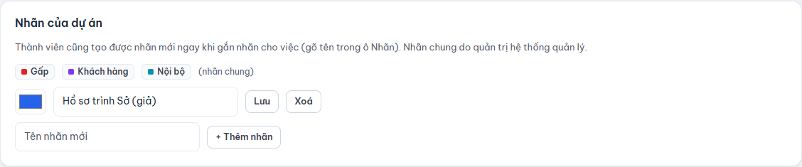

**Ai thấy, ai sửa:** Khối này nằm trong Cài đặt nên chỉ người quản lý dự án thấy. Thêm nhãn riêng: ai làm việc được trong dự án (thêm qua ô Nhãn của việc). Sửa, xoá nhãn riêng: người quản lý dự án. Nhãn chung của toàn công ty: chỉ Quản trị hệ thống, ở **Quản trị → Nhãn**.

**Dùng để làm gì:** Quản lý nhãn riêng của dự án: đổi tên, đổi màu, xoá, thêm. Nhãn dùng để lọc việc và để đặt quy tắc duyệt tự động. Chữ trên khối, nguyên văn: "Thành viên cũng tạo được nhãn mới ngay khi gắn nhãn cho việc (gõ tên trong ô Nhãn). Nhãn chung do quản trị hệ thống quản lý."

**Các bước thường làm**
- Đổi tên / màu: sửa trên dòng nhãn → **Lưu** trên dòng đó.
- Thêm: gõ vào ô **Tên nhãn mới** → **+ Thêm nhãn**.
- Xoá: **Xoá** trên dòng nhãn (không hỏi lại).

**Từng ô**

| Ô (nguyên văn) | Nghĩa là gì | Điền / chọn thế nào (mặc định) | Đổi thì hệ thống làm gì khác |
|---|---|---|---|
| Hàng nhãn chung kèm chữ "(nhãn chung)"; không có thì "Chưa có nhãn chung." | Nhãn chung dùng được trong dự án | Chỉ xem | — |
| Mỗi nhãn riêng: ô màu (chú thích "Màu") | Màu nhãn | Màu hiện tại | Đổi màu chip nhãn ở mọi nơi sau khi bấm **Lưu** trên dòng. Mã màu sai thì giữ màu cũ |
| Mỗi nhãn riêng: ô tên (chú thích "Tên nhãn") | Tên nhãn | Tối đa 40 ký tự; nhiều khoảng trắng liền nhau được gộp làm một | Đổi tên ở mọi việc đang gắn nhãn, trong bộ lọc, trong quy tắc duyệt. Lỗi: "Thiếu Tên nhãn"; "Tên nhãn vượt 40 ký tự"; trùng tên (không phân biệt hoa thường) với nhãn chung hoặc nhãn riêng khác: "Đã có nhãn "<tên>"" |
| Danh sách nhãn riêng trống: "Dự án chưa có nhãn riêng." | — | — | — |
| Ô **Tên nhãn mới** | Tên nhãn sẽ thêm | Tối đa 40 ký tự | Nhãn mới tự nhận màu (xoay vòng 9 màu). Lỗi: "Thiếu Tên nhãn"; "Dự án đã có tối đa 100 nhãn". Trùng tên nhãn có sẵn: KHÔNG báo lỗi và không tạo nhãn mới — hệ thống dùng lại nhãn cũ |

**Các nút**

| Nút | Làm gì | Có hỏi lại không | Quay lại được không |
|---|---|---|---|
| **Lưu** (trên dòng nhãn) | Lưu tên và màu của nhãn đó; vẽ lại cả trang; báo "Đã lưu nhãn" | Không | Sửa lại |
| **Xoá** (trên dòng nhãn) | Xoá hẳn nhãn; gỡ nhãn khỏi mọi việc đang gắn; vẽ lại cả trang; báo "Đã xoá nhãn" | ⚠️ KHÔNG hỏi lại | ⚠️ Không: xoá hẳn, không vào Thùng rác. Tạo lại nhãn cùng tên thì phải gắn lại cho từng việc |
| **+ Thêm nhãn** | Tạo nhãn riêng; vẽ lại cả trang; báo "Đã thêm nhãn <tên>" | Không | Xoá nhãn |

Trong hộp Tạo việc và panel việc: ô **Nhãn** có gợi ý "Chọn hoặc gõ nhãn mới…", ô tìm "Tìm hoặc gõ tên nhãn mới…", và nút "+ Tạo nhãn mới “<tên>”".

**⚠️ Dễ nhầm**
- Thêm nhãn trùng tên nhãn chung hoặc nhãn có sẵn: vẫn báo "Đã thêm nhãn <tên>", nhưng thực ra là nhãn cũ.
- Xoá nhãn đang dùng trong Quy tắc tự động: quy tắc vô hiệu (mục 3.3.4).
- Tối đa 100 nhãn riêng mỗi dự án.

**Claude:** Không tạo, sửa, xoá được nhãn; giao việc qua Claude cũng không gắn được nhãn.

#### 3.3.6 Việc lặp lại

**Mở ở đâu:** Khối thứ sáu của màn Cài đặt. Lịch lặp còn lập được từ panel một việc (**Lặp lại việc này**) và từ hộp **Tạo việc** (mục **Lặp lại** trong **Thêm thông tin**, chỉ người quản lý dự án thấy); các lịch đó cũng hiện ở danh sách này.

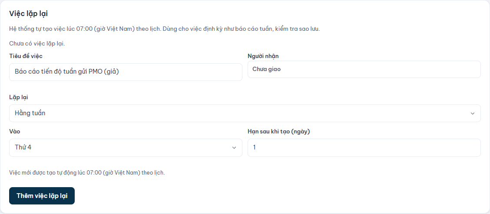

**Ai thấy, ai sửa:** Thêm lịch ở khối này: người quản lý dự án. **Sửa lịch** / **Tạo ngay** / **Tạm dừng** / **Xoá**: người quản lý dự án; với lịch lập từ một việc thì thêm người giao và BTGĐ phụ trách của việc đó. Người khác bấm thì gặp "Chỉ người quản lý dự án, hoặc người giao / BTGĐ phụ trách của việc gốc, sửa lịch lặp lại".

**Dùng để làm gì:** Để hệ thống tự tạo việc định kỳ (báo cáo tuần, kiểm tra sao lưu…) vào buổi sáng theo lịch. Chữ trên khối, nguyên văn: "Hệ thống tự tạo việc lúc 07:00 (giờ Việt Nam) theo lịch. Dùng cho việc định kỳ như báo cáo tuần, kiểm tra sao lưu."

**Các bước thường làm**
1. Gõ **Tiêu đề việc**, chọn **Người nhận**.
2. Chọn **Lặp lại** và chi tiết (**Vào** hoặc **Ngày trong tháng**), **Hạn sau khi tạo (ngày)**.
3. Bấm **Thêm việc lặp lại**. Dòng mới hiện trong danh sách, kèm "Lần tới: <ngày giờ>".

Ví dụ: tiêu đề "Báo cáo tuần BM", người nhận là một nhân viên, **Hằng tuần** vào **Thứ 6**, hạn sau 0 ngày → mỗi thứ Sáu, trong khoảng 07:00–07:15, có một việc mới hạn ngay trong ngày; người nhận được thông báo "Bạn được giao chủ trì BM-<số>".

**Danh sách lịch**
- Đang tải: "Đang tải…"; chưa có lịch: "Chưa có việc lặp lại."
- Mỗi dòng: tiêu đề (chữ đậm); dòng phụ "<lịch> · hạn sau <N> ngày · <họ tên người nhận>"; cột tình trạng "Lần tới: <ngày giờ>" hoặc "Đang tạm dừng".
- Chữ <lịch>: "Mỗi ngày làm việc (T2–T6)", "Mỗi ngày", "Mỗi tuần vào <Thứ 2 … Chủ nhật>", "Ngày <d> mỗi tháng", "Ngày cuối mỗi tháng".

**Từng ô** — biểu mẫu thêm lịch

| Ô (nguyên văn) | Nghĩa là gì | Điền / chọn thế nào (mặc định) | Đổi thì hệ thống làm gì khác |
|---|---|---|---|
| **Tiêu đề việc** | Tiêu đề của mỗi việc được tạo | Bắt buộc; tối đa 300 ký tự | Lỗi: "Thiếu Tiêu đề"; "Tiêu đề vượt 300 ký tự" |
| **Người nhận** (gợi ý "Chưa giao"; có ô "Tìm…" khi danh sách dài) | Người chủ trì của việc được tạo | Chọn nhiều người; mặc định không ai. Danh sách có cả tài khoản Quản trị hệ thống — đừng chọn | Mỗi việc tạo ra giao cho những người này; họ nhận "Bạn được giao chủ trì <mã việc>". Để trống: việc tạo ra chưa có người chủ trì. Chọn tài khoản Quản trị hoặc đã khoá: "Có người nhận không tồn tại hoặc đã khoá"; quá 50 người: "Người nhận không hợp lệ" |
| **Lặp lại** | Tần suất | "Mỗi ngày làm việc (T2–T6)", "Hằng ngày", "Hằng tuần" (mặc định), "Hằng tháng" | "Mỗi ngày làm việc" bỏ thứ Bảy, Chủ nhật (không trừ ngày lễ). Lỗi: "Thiếu tần suất"; "Tần suất không hợp lệ" |
| **Vào** (chỉ với "Hằng tuần") | Thứ trong tuần | "Thứ 2" … "Thứ 7", "Chủ nhật"; mặc định thứ của hôm nay | Lỗi: "Thứ trong tuần không hợp lệ" |
| **Ngày trong tháng** (chỉ với "Hằng tháng") | Ngày tạo việc | "Ngày 1" … "Ngày 28", "Ngày cuối tháng"; mặc định "Ngày 1" | Không có ngày 29–31 (tháng thiếu ngày); muốn cuối tháng thì chọn "Ngày cuối tháng". Lỗi: "Ngày trong tháng phải từ 1 đến 28 (hoặc ngày cuối tháng)" |
| **Hạn sau khi tạo (ngày)** | Hạn của việc = ngày tạo + số này | 0–60; mặc định 1 | 0 = hạn ngay hôm tạo. Lỗi: "Số ngày đến hạn phải từ 0 đến 60" |
| Chữ "Việc mới được tạo tự động lúc 07:00 (giờ Việt Nam) theo lịch." | — | — | — |

Biểu mẫu này không có ô mô tả, nhãn, ưu tiên: việc tạo ra có ưu tiên "Không", không nhãn, không mô tả. Muốn có đủ: lập lịch bằng **Lặp lại việc này** từ một việc mẫu — hệ thống chép cả mô tả, người nhận, nhãn, ưu tiên của việc đó.

**Các nút**

| Nút | Làm gì | Có hỏi lại không | Quay lại được không |
|---|---|---|---|
| **Thêm việc lặp lại** | Tạo lịch; xoá ô Tiêu đề (giữ các ô khác); nạp lại danh sách; báo "Đã thêm việc lặp lại" | Không | **Xoá** lịch |
| **Sửa lịch** | Mở hộp **Sửa lịch lặp lại** | — | — |
| **Tạo ngay** | Tạo ngay một việc từ lịch; KHÔNG đổi lần chạy kế tiếp; báo "Đã tạo BM-<số>". Người bấm thành người giao của việc này | Không | Xoá việc vừa tạo (người giao, BTGĐ phụ trách) |
| **Tạm dừng** / **Bật lại** | Tắt / bật lịch. Bật lại thì "Lần tới" tính lại từ lúc bấm | Không | Bấm lại |
| **Xoá** | Xoá hẳn lịch; việc đã tạo trước đó giữ nguyên | ⚠️ KHÔNG hỏi lại | ⚠️ Không |

Hộp **Sửa lịch lặp lại**: chữ "Đổi lịch sẽ áp dụng từ lần tạo kế tiếp."; các ô **Lặp lại**, **Vào**, **Ngày trong tháng**, **Hạn sau khi tạo (ngày)** như trên; nút **Tạm dừng** (hoặc **Bật lại**), **Bỏ lặp lại** (⚠️ xoá lịch ngay, không hỏi lại), **Huỷ**, **Lưu lịch**. Thông báo: "Đã lưu lịch lặp lại", "Đã tạm dừng lặp lại", "Đã bật lại lặp lại", "Đã bỏ lặp lại"; lỗi hiện chữ đỏ trong hộp. Hộp này KHÔNG đổi được tiêu đề và người nhận: muốn đổi thì xoá lịch rồi thêm lịch mới.

**Hệ thống tạo việc thế nào**
- Hệ thống kiểm 15 phút một lần, nên việc xuất hiện trong khoảng 07:00–07:15.
- Ngày bắt đầu = ngày tạo; hạn = ngày tạo + "Hạn sau khi tạo"; việc vào cột Chưa bắt đầu đầu tiên (không có thì cột đầu tiên không phải Chờ duyệt / Hoàn thành / Huỷ).
- Người giao = người lập lịch. Người đó bị khoá tài khoản hoặc mất quyền làm việc trong dự án: việc vẫn được tạo, người tạo ghi là "Hệ thống", và việc không có người giao.
- Lịch sử việc ghi "đã tạo việc (việc lặp lại)".

**⚠️ Dễ nhầm**
- Máy chủ tắt qua nhiều kỳ: khi bật lại chỉ tạo MỘT việc, không bù đủ các kỳ.
- Tạo việc thất bại (vd. cột Chưa bắt đầu có giới hạn WIP đã đầy): kỳ đó bị bỏ qua, không báo ai, lịch vẫn nhảy sang kỳ sau.
- Dự án lưu trữ hoặc đã xoá: không tạo việc, nhưng lịch vẫn nhảy. **Tạo ngay** ở dự án đã lưu trữ báo "Dự án đã lưu trữ".
- **Xoá** và **Bỏ lặp lại** không hỏi lại.
- Việc do "Hệ thống" tạo (người lập lịch đã bị khoá hoặc mất quyền) không có người giao: chỉ BTGĐ phụ trách sửa được kế hoạch của việc đó. Khi người lập lịch nghỉ việc, người quản lý dự án nên xoá lịch cũ và tự lập lại.

**Claude:** Không lập, sửa, tạm dừng, xoá được lịch lặp lại.

#### 3.3.7 Thành viên

**Mở ở đâu:** Khối cuối cùng của màn Cài đặt.

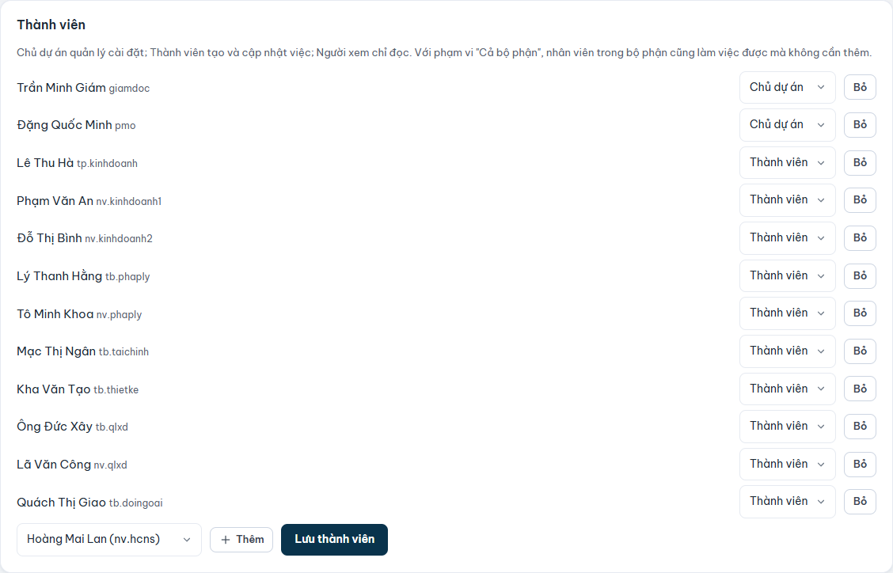

**Ai thấy, ai sửa:** Người quản lý dự án.

**Dùng để làm gì:** Thêm, bỏ người và đặt quan hệ của từng người với dự án: **Chủ dự án**, **Thành viên**, **Người xem**. Ý nghĩa thật của ba quan hệ này ở mục 3.9. Chữ trên khối, nguyên văn: "Chủ dự án quản lý cài đặt; Thành viên tạo và cập nhật việc; Người xem chỉ đọc. Với phạm vi "Cả bộ phận", nhân viên trong bộ phận cũng làm việc được mà không cần thêm."

**Các bước thường làm**
1. Chọn người ở ô chọn cuối khối → **Thêm**. Người đó vào danh sách với vai trò "Thành viên".
2. Đổi vai trò ở ô chọn trên dòng, nếu cần.
3. Bỏ người: **Bỏ** trên dòng.
4. Bấm **Lưu thành viên**.

**Từng ô**

| Ô (nguyên văn) | Nghĩa là gì | Điền / chọn thế nào (mặc định) | Đổi thì hệ thống làm gì khác |
|---|---|---|---|
| Dòng thành viên: họ tên + tên đăng nhập (tài khoản đã khoá hiện "#<số>") | Người đang có tên trong dự án | — | — |
| Ô chọn vai trò trên dòng (trình đọc màn hình đọc là "Vai trò") | Quan hệ với dự án | "Chủ dự án", "Thành viên", "Người xem" | Chủ dự án: quản lý dự án, xem đầy đủ mọi việc, (dự án MTL) nhận cảnh báo phần "PMO". Thành viên: xem và làm việc trong dự án. Người xem: chỉ được THÊM quyền xem. Lỗi: "Vai trò không hợp lệ" |
| Ô chọn người để thêm | Người sẽ thêm | "<Họ tên> (<tên đăng nhập>)" của mọi tài khoản đang hoạt động chưa có trong danh sách. ⚠️ Có cả tài khoản Quản trị hệ thống — **đừng thêm**. Với vai trò "Thành viên" / "Người xem" thì không có tác dụng, nhưng đặt làm "Chủ dự án" ở dự án MTL thì tài khoản đó nhận cảnh báo tiến độ phần "PMO" (mã, tên hạng mục, % kế hoạch / thực tế), tức lộ nội dung nghiệp vụ cho Quản trị hệ thống. Thấy tài khoản Quản trị trong khối Thành viên thì **Bỏ** rồi **Lưu thành viên** | — |

**Các nút**

| Nút | Làm gì | Có hỏi lại không | Quay lại được không |
|---|---|---|---|
| **Thêm** | Thêm người đang chọn vào danh sách với vai trò "Thành viên" (chỉ trên màn hình) | Không | Bấm **Bỏ** |
| **Bỏ** | Bỏ dòng (chỉ trên màn hình) | Không | Thêm lại |
| **Lưu thành viên** | Thay TOÀN BỘ danh sách bằng danh sách trên màn hình; vẽ lại cả trang; báo "Đã lưu thành viên" | Không | Thêm lại người đã bỏ rồi lưu |

Ràng buộc khi lưu, nguyên văn: "Danh sách thành viên không hợp lệ"; "Thành viên không hợp lệ"; "Vai trò không hợp lệ"; "Dự án cần ít nhất một chủ dự án (OWNER)"; "Có thành viên không tồn tại hoặc đã khoá".

**⚠️ Dễ nhầm**
- Người được thêm hay bị bỏ KHÔNG nhận thông báo nào. Hãy báo họ bằng cách khác.
- Danh sách có người đã khoá tài khoản (dòng "#<số>"): **Lưu thành viên** báo "Có thành viên không tồn tại hoặc đã khoá". Bấm **Bỏ** dòng đó rồi lưu lại.
- Phải còn ít nhất một "Chủ dự án".
- ⚠️ Tự đổi mình khỏi "Chủ dự án" khi bạn không có quyền quản lý từ vai: lưu xong, trang vẽ lại thành "Bạn không có quyền quản lý dự án này." — bạn không tự sửa lại được nữa; phải nhờ một người quản lý dự án khác.
- Dự án MTL: mỗi lần nhập MTL, hệ thống tự thêm (vai trò "Thành viên") mọi cán bộ của các bộ phận có hạng mục. Bỏ họ đi thì lần nhập sau lại được thêm vào.
- "Người đứng tên dự án" không tự có trong danh sách này, và có tên ở đây cũng không làm người đó thành Người đứng tên (đặt ở Thông tin chung).
- Muốn người kiêm PMO điều phối dự án MTL: thêm người đó với vai trò "Chủ dự án".

**Claude:** Không thêm, bỏ, đổi vai trò thành viên được. Claude chỉ tra danh bạ.

### 3.4 Menu "Khác" trên trang dự án

**Mở ở đâu:** Menu trái → nhóm **Dự án** → tên dự án (trang `#/projects/<số>`). Danh sách dự án chia theo bộ phận chủ quản; không có dự án nào thì hiện "Chưa có dự án nào bạn được xem.". Dự án đã lưu trữ không có trong danh sách. Nút **Khác** ở góc trên phải trang dự án (chú thích "Giao nhiều việc, nhập / xuất Excel, cài đặt"; trình đọc màn hình đọc là "Thao tác khác").

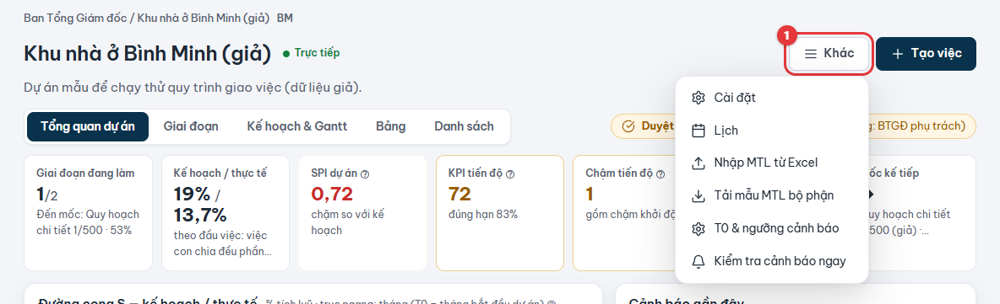

**Ai thấy, ai sửa:** Ai xem được dự án thì mở được trang. Nút **Khác** chỉ hiện khi menu có ít nhất một mục; từng mục hiện theo quyền (bảng dưới). Dự án MTL luôn có mục **Lịch** nên luôn có nút **Khác**. Ở dự án thường, người không quản lý dự án chỉ thấy mục **Nhập** (nếu tạo việc được trong dự án).

**Dùng để làm gì:** Mọi thao tác cấu hình nằm ngoài màn Cài đặt đều mở từ đây, hoặc từ tab **Giai đoạn**, tab **Chu kỳ**, panel chi tiết việc.

**Thành phần ở đầu trang dự án**

| Thành phần (nguyên văn) | Nghĩa là gì | Mặc định | Ghi chú |
|---|---|---|---|
| Tên dự án + dấu **Trực tiếp** (chú thích "Đang cập nhật trực tiếp") | Tiêu đề; dấu hiện khi trang đang tự cập nhật thay đổi của người khác | — | Chỉ để nhìn |
| Mô tả + nút **Xem thêm** / **Thu gọn** | Mô tả dự án | Hiện một dòng | Bấm để mở rộng |
| Tab kiểu xem — dự án thường | **Bảng**, **Danh sách**, **Lịch**, **Tiến độ kế hoạch**, **Chu kỳ** | **Bảng** | **Tiến độ kế hoạch** và **Chu kỳ** ẩn khi mọi cột là Cột tự do |
| Tab kiểu xem — dự án MTL | **Tổng quan dự án**, **Giai đoạn**, **Kế hoạch & Gantt**, **Bảng**, **Danh sách**; thêm tab **Lịch** khi đang xem Lịch | **Tổng quan dự án** | — |
| Nhãn **Duyệt <N> cấp** + tên các cấp nối bằng " → " (chú thích "Quy trình duyệt: <các cấp>") | Tóm tắt các cấp duyệt của dự án | Chỉ hiện khi dự án có cấp duyệt | Xem khối ⚠️ dưới |

> ⚠️ **Chữ trên màn hình ghi** "Duyệt 1 cấp" (hoặc "Duyệt <N> cấp") **nhưng thực tế** con số chỉ đếm các cấp của dự án, không đếm bước người giao duyệt (luôn có). Dự án "Duyệt 1 cấp" thực tế duyệt 2 bước. Trong panel chi tiết một việc, mục **Quy trình duyệt <N> cấp** lại đếm cả bước người giao — nên cùng một dự án, trang dự án ghi "Duyệt 1 cấp" còn panel việc ghi "Quy trình duyệt 2 cấp".

**Các mục trong menu Khác**

| Nút / mục (nguyên văn) | Làm gì | Ai thấy | Có hỏi lại không | Quay lại được không |
|---|---|---|---|---|
| **Cài đặt** (chú thích "Cài đặt dự án") | Mở màn Cài đặt (mục 3.3) | Người quản lý dự án | — | — |
| **Lịch** | Xem dự án MTL dạng lịch | Mọi người xem được dự án MTL | — | — |
| **Nhập MTL từ Excel** | Mở hộp nhập MTL tổng / MTL bộ phận (mục 3.5.3) | Dự án MTL; người quản lý dự án | Có bước **Xem trước** trước khi nhập | Không có hoàn tác hàng loạt |
| **Tải mẫu MTL bộ phận** | Chọn bộ phận, tải tệp Excel điền sẵn (mục 3.5.4) | Dự án MTL; người quản lý dự án | — | — |
| **T0 & ngưỡng cảnh báo** | Đặt tháng T0 và 5 ngưỡng (mục 3.5.1) | Dự án MTL; người quản lý dự án | — | Đổi lại được |
| **Kiểm tra cảnh báo ngay** | Chạy ngay việc kiểm tra cảnh báo cho dự án này (mục 3.5.2) | Dự án MTL; người quản lý dự án | ⚠️ Không hỏi — bấm là chạy | Không thu hồi được thông báo đã gửi |
| **Tải MTL bộ phận (Excel)** | Tải thẳng mẫu MTL của bộ phận mình (mục 3.5.4) | Dự án MTL; Lãnh đạo bộ phận không phải người quản lý dự án, làm việc được trong dự án | — | — |
| **Nhập MTL bộ phận** | Nhập MTL của bộ phận mình (mục 3.5.3) | Như dòng trên | Có bước **Xem trước** | Không có hoàn tác hàng loạt |
| **Nhập** (chú thích "Nhập danh sách việc từ Excel") | Mở hộp **Nhập công việc** (mục 3.7) | Dự án thường; người tạo việc được trong dự án | — | — |

Cạnh nút **Khác** là nút **Tạo việc** (chú thích "Tạo việc (C)", phím tắt C): hiện với người làm việc được trong dự án. Ở dự án MTL, nút chỉ hiện khi bạn có chỗ được thêm việc: người quản lý dự án tạo được hạng mục gốc; người khác chỉ thêm việc con dưới hạng mục mình được tạo việc nhánh (người chủ trì, người giao, BTGĐ phụ trách của hạng mục đó).

**⚠️ Dễ nhầm**
- Chú thích của nút **Khác** nhắc "Giao nhiều việc" và "xuất Excel" nhưng menu không có hai mục này.
- Ở dự án MTL "Toàn công ty (dùng chung)", Lãnh đạo bộ phận của bộ phận khác chỉ thấy **Tải MTL bộ phận (Excel)** / **Nhập MTL bộ phận** khi đã làm việc được trong dự án, tức là đã có tên trong Thành viên. Lần nhập MTL tổng tự thêm cán bộ của các bộ phận có hạng mục vào Thành viên.

**Claude:** Không bấm được mục nào trong menu **Khác**. Claude đọc được danh sách dự án và tổng quan tiến độ dự án MTL (mục 3.13).

### 3.5 Dự án MTL: các thiết lập riêng

Khái niệm dùng trong mục này:

- **Tháng T0**: tháng bắt đầu của Master Timeline. "Tháng T" của một hạng mục đếm từ T0: T0 = 10/2026 thì T1 = 11/2026, T2 = 12/2026.
- **Hạng mục**: một việc của dự án MTL. **Bước**: mã của hạng mục trong bảng MTL (cột "Bước", vd. 8, 8.1, II.3).
- **MTL tổng**: bảng các bước của cả dự án, do người quản lý dự án nhập. **MTL bộ phận**: các dòng con chi tiết hoá một bước tổng, do bộ phận lập.
- **Kế hoạch gốc**: khoảng ngày bắt đầu – kết thúc của hạng mục lấy từ lần nhập đầu; là căn cứ tính chậm, trễ và KPI. Khác với ô **Hạn** của việc.
- **Đường găng**, **Mốc**: hạng mục quan trọng. Hạng mục găng / mốc do BTGĐ phụ trách duyệt hoàn thành, và khi chậm / trễ thì Ban Tổng Giám đốc nhận thêm cảnh báo.
- **Giai đoạn**: nhóm các bước tổng, có tên (vd. "Chuyển nhượng DA" gồm bước 1–9).

Thứ tự thiết lập một dự án MTL mới:
1. Ban Tổng Giám đốc tạo dự án, chọn T0 (mục 3.2).
2. Cài đặt → **Thành viên**: thêm người kiêm PMO với vai trò "Chủ dự án"; **Thông tin chung**: đặt Người đứng tên dự án (mục 3.3).
3. **Khác** → **Nhập MTL từ Excel**, loại **MTL tổng (dự án)** (mục 3.5.3).
4. Lãnh đạo các bộ phận chủ trì nhận thông báo "Bộ phận được giao chủ trì <N> hạng mục MTL BM — cần phân công người phụ trách", rồi tải mẫu và nhập MTL bộ phận (mục 3.5.4, 3.5.3). Đọc lưu ý về người chủ trì bước tổng ở mục 3.5.3 TRƯỚC khi phân công: bước tổng đã giao cho nhân viên thì lãnh đạo bộ phận không tự nhập dòng con cho bước đó được nữa.
5. Tab **Giai đoạn** → **Thiết lập giai đoạn** (mục 3.5.6).
6. **Khác** → **T0 & ngưỡng cảnh báo** nếu cần chỉnh ngưỡng (mục 3.5.1). Cảnh báo tự chạy 07:30 mỗi sáng (mục 3.5.2).

#### 3.5.1 Tháng T0 và ngưỡng cảnh báo

**Mở ở đâu:** Dự án MTL → **Khác** → **T0 & ngưỡng cảnh báo**. Hộp có tiêu đề "T0 & ngưỡng cảnh báo — <tên dự án>". Dự án chưa có T0: tab **Tổng quan dự án** hiện "Chưa đặt ngày T0 — vào "Khác → T0 & ngưỡng cảnh báo"."; tab **Giai đoạn** hiện "Chưa đặt tháng T0." kèm nút **Đặt T0** (người quản lý dự án).

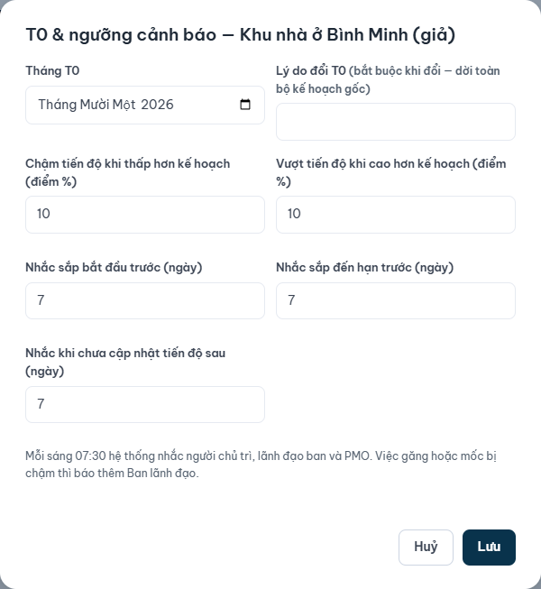

**Ai thấy, ai sửa:** Người quản lý dự án của dự án MTL: Ban Tổng Giám đốc, Chủ dự án, Người đứng tên dự án. Lãnh đạo bộ phận không thấy mục này, trừ khi là Chủ dự án hoặc Người đứng tên.

**Dùng để làm gì:** Đặt tháng T0 (mốc quy đổi tháng T ra ngày) và năm ngưỡng quyết định khi nào một hạng mục bị coi là chậm, vượt, sắp bắt đầu, sắp đến hạn, lâu chưa cập nhật — tức là quyết định ai nhận cảnh báo gì và khi nào.

**Các bước thường làm**
- Đổi ngưỡng: sửa số → **Lưu** → hệ thống báo "Đã lưu".
- Đổi T0: chọn tháng mới, gõ lý do vào ô **Lý do đổi T0** → **Lưu** → hệ thống báo "Đã lưu — dời kế hoạch gốc <N> hạng mục".

**Từng ô**

| Ô (nguyên văn) | Nghĩa là gì | Điền / chọn thế nào (mặc định) | Đổi thì hệ thống làm gì khác |
|---|---|---|---|
| **Tháng T0** | Tháng 0 của MTL | Bắt buộc; ô chọn tháng; mặc định tháng T0 đang có | Chọn tháng KHÁC: kế hoạch gốc của mọi hạng mục ghi theo tháng T được tính lại theo T0 mới. Ví dụ hạng mục "Bắt đầu (T)" = 2, "Kết thúc (T)" = 4: T0 = 10/2026 thì kế hoạch gốc 01/12/2026 → 28/02/2027; đổi T0 sang 11/2026 thì thành 01/01/2027 → 31/03/2027. Hạng mục ghi theo ngày cụ thể không đổi. Ô **Hạn** và **Ngày bắt đầu** của việc KHÔNG đổi. Chọn lại đúng tháng đang có: không đổi gì. Lỗi: "Nhập ngày T0"; "Ngày T0 không hợp lệ" |
| **Lý do đổi T0** (chữ nhỏ "(bắt buộc khi đổi — dời toàn bộ kế hoạch gốc)") | Lý do đổi T0 | Tối đa 500 ký tự; bắt buộc khi dự án đã có T0 và bạn chọn tháng khác | Ghi vào nhật ký hệ thống cùng T0 cũ, T0 mới, số hạng mục bị dời. Thiếu: "Đổi T0 làm dời toàn bộ kế hoạch gốc — nhập lý do"; quá dài: "Lý do vượt 500 ký tự" |
| **Chậm tiến độ khi thấp hơn kế hoạch (điểm %)** | Ngưỡng chậm | 1–50; mặc định 10 | Quyết định tình trạng "Chậm tiến độ" và cảnh báo "Chậm tiến độ"; cũng là ngưỡng % kế hoạch để gắn "Chậm khởi động". Lỗi máy chủ: "Ngưỡng behindPct phải từ 1 đến 50" |
| **Vượt tiến độ khi cao hơn kế hoạch (điểm %)** | Ngưỡng vượt | 1–50; mặc định 10 | Tình trạng và cảnh báo "Vượt tiến độ". Lỗi: "Ngưỡng aheadPct phải từ 1 đến 50" |
| **Nhắc sắp bắt đầu trước (ngày)** | Báo trước ngày bắt đầu kế hoạch | 0–60; mặc định 7 | Cảnh báo "Sắp bắt đầu". Lỗi: "Ngưỡng startSoonDays phải từ 0 đến 60" |
| **Nhắc sắp đến hạn trước (ngày)** | Báo trước ngày kết thúc kế hoạch | 0–60; mặc định 7 | Cảnh báo "Sắp đến hạn"; cũng quyết định mục "nguy cơ chậm" của báo cáo tuần (khi hạng mục đang thấp hơn kế hoạch). Lỗi: "Ngưỡng dueSoonDays phải từ 0 đến 60" |
| **Nhắc khi chưa cập nhật tiến độ sau (ngày)** | Số ngày không cập nhật thì nhắc | 1–60; mặc định 7 | Cảnh báo "Lâu chưa cập nhật". Lỗi: "Ngưỡng staleDays phải từ 1 đến 60" |
| (không có ô) Ân hạn "Chậm khởi động" | Số ngày làm việc sau ngày bắt đầu kế hoạch mà hạng mục chưa động tới vẫn chưa bị coi là chậm | **Mặc định 2 ngày làm việc** (thứ Hai–thứ Sáu), áp cho mọi dự án | Không chỉnh trên giao diện; IT đổi được bằng khoá cấu hình `MTL_LATE_START_GRACE_DAYS` (0–30) rồi khởi động lại (mục 7.15). Ví dụ ở bảng dưới |

Chữ dưới các ô, nguyên văn: "Mỗi sáng 07:30 hệ thống nhắc người chủ trì, lãnh đạo ban và PMO. Việc găng hoặc mốc bị chậm thì báo thêm Ban lãnh đạo."

> ⚠️ **Chữ trên màn hình ghi** "Mỗi sáng 07:30 hệ thống nhắc người chủ trì, lãnh đạo ban và PMO. Việc găng hoặc mốc bị chậm thì báo thêm Ban lãnh đạo." **nhưng thực tế**: "lãnh đạo ban" là tên cũ, nay là **Lãnh đạo bộ phận** chủ trì hạng mục; "PMO" là Người đứng tên dự án + mọi Chủ dự án, và chỉ nhận ba loại Chậm khởi động, Chậm tiến độ, Trễ hạn; "Ban lãnh đạo" là tên cũ, nay là **mọi thành viên Ban Tổng Giám đốc**, và chỉ nhận khi hạng mục găng / mốc bị "Chậm tiến độ" hoặc "Trễ hạn" (không nhận "Chậm khởi động"); loại "Lâu chưa cập nhật" chỉ gửi người chủ trì. Người nhận đúng ở bảng "Loại cảnh báo × người nhận × lặp lại" dưới đây.

**Các nút**

| Nút | Làm gì | Có hỏi lại không | Quay lại được không |
|---|---|---|---|
| **Huỷ** | Đóng hộp | Bấm nút: đóng ngay. Bấm ra ngoài hộp hoặc Esc khi đã nhập: hỏi "Bỏ nội dung đã nhập?" | — |
| **Lưu** | Lưu 5 ngưỡng; nếu tháng T0 đổi thì dời kế hoạch gốc; nạp lại trang dự án. Báo "Đã lưu" hoặc "Đã lưu — dời kế hoạch gốc <N> hạng mục"; lỗi hiện chữ đỏ trong hộp | Không | Ngưỡng: đổi lại được. T0: đổi lại về tháng cũ thì kế hoạch gốc dạng tháng T được tính lại theo tháng cũ (cũng phải nhập lý do). Đổi T0 không gửi thông báo cho ai |

**Hệ thống tính thế nào**

- **% kế hoạch** của một hạng mục hôm nay = (hôm nay − ngày bắt đầu + 1) ÷ (ngày kết thúc − ngày bắt đầu + 1) × 100, theo ngày lịch của kế hoạch gốc, làm tròn 0,1. Trước ngày bắt đầu = 0%; từ ngày kết thúc trở đi = 100%.
- **% thực tế**: % người chủ trì cập nhật. Hạng mục có việc con: bình quân của các việc con (mặc định mỗi việc con nặng bằng nhau; cột "Trọng số" trong tệp MTL làm một việc con nặng hơn); việc con huỷ không tính.
- **Lệch** = % thực tế − % kế hoạch, tính bằng **điểm %** (không phải phần trăm của kế hoạch).
- **Thứ tự xét tình trạng** (nhãn nguyên văn): "Huỷ" → "Chưa có kế hoạch" (hạng mục không có kế hoạch gốc) → "Hoàn thành đúng hạn" / "Hoàn thành trễ hạn" (so ngày hoàn thành với ngày kết thúc kế hoạch gốc) → "Trễ hạn" (đã qua ngày kết thúc) → "Chưa đến kỳ" (chưa tới ngày bắt đầu) → đang trong ân hạn: "Đúng tiến độ" kèm chữ "(mới bắt đầu, chưa tính chậm)" → "Chậm khởi động" → "Chậm tiến độ" → "Vượt tiến độ" → "Đúng tiến độ".

**Mỗi ngưỡng nghĩa là gì — ví dụ bằng số.** Ví dụ chung: hạng mục BM-12 của dự án BM, kế hoạch gốc 01/12/2026 (thứ Ba) → 30/12/2026, tức 30 ngày; ngưỡng để mặc định.

| Ngưỡng | Ví dụ |
|---|---|
| **Chậm tiến độ khi thấp hơn kế hoạch (điểm %)** = 10 | Ngày 10/12: % kế hoạch = 10 ÷ 30 = 33,3%. Thực tế 20% → lệch −13,3 điểm (thấp hơn từ 10 điểm trở lên) → "Chậm tiến độ" → cảnh báo gửi người chủ trì, Lãnh đạo bộ phận chủ trì, Người đứng tên dự án và các Chủ dự án. Thực tế 25% → lệch −8,3 → "Đúng tiến độ", không cảnh báo. Nếu đặt ngưỡng 15 thì 20% cũng là "Đúng tiến độ" |
| **Vượt tiến độ khi cao hơn kế hoạch (điểm %)** = 10 | Ngày 10/12, thực tế 45% → lệch +11,7 → "Vượt tiến độ" → báo người chủ trì và Lãnh đạo bộ phận chủ trì (một lần duy nhất) |
| **Nhắc sắp bắt đầu trước (ngày)** = 7 | Ngày 24/11/2026 còn 7 ngày tới ngày bắt đầu 01/12 → gửi "Sắp bắt đầu" (một lần duy nhất). Ngày 23/11 còn 8 ngày → chưa gửi. Đặt 0 = không bao giờ gửi "Sắp bắt đầu" (hôm trước ngày bắt đầu vẫn còn 1 ngày; từ ngày bắt đầu hạng mục không còn "Chưa đến kỳ") |
| **Nhắc sắp đến hạn trước (ngày)** = 7 | Ngày 23/12 còn 7 ngày tới ngày kết thúc 30/12, hạng mục đang "Đúng tiến độ" / "Chậm tiến độ" / "Vượt tiến độ" / "Chậm khởi động" → gửi "Sắp đến hạn" (một lần duy nhất) |
| **Nhắc khi chưa cập nhật tiến độ sau (ngày)** = 7 | Lần cập nhật % gần nhất là 05/12. Ngày 12/12 đã đủ 7 ngày, hạng mục đang "Đúng tiến độ" / "Chậm tiến độ" / "Vượt tiến độ" → gửi "Lâu chưa cập nhật" cho người chủ trì; vẫn không cập nhật thì nhắc lại 19/12, 26/12. Hạng mục chưa từng cập nhật lần nào không thuộc loại này (nó rơi vào "Chậm khởi động") |
| Ân hạn "Chậm khởi động" = 2 ngày làm việc | BM-12 đang 0%, chưa từng chuyển sang Đang thực hiện, chưa từng cập nhật %. Thứ Tư 02/12: mới qua 1 ngày làm việc → "Đúng tiến độ (mới bắt đầu, chưa tính chậm)". Thứ Năm 03/12: qua 2 ngày làm việc, % kế hoạch = 3 ÷ 30 = 10% — bằng ngưỡng chậm 10 → "Chậm khởi động". Hạng mục dài hơn, 01/12/2026 → 29/01/2027 (60 ngày): ngày 03/12 % kế hoạch chỉ 5% (dưới 10) nên vẫn "Đúng tiến độ"; tới 06/12 (6 ÷ 60 = 10%) mới thành "Chậm khởi động". Hạng mục bắt đầu thứ Sáu 04/12: thứ Hai 07/12 mới qua 1 ngày làm việc (không tính thứ Bảy, Chủ nhật), thứ Ba 08/12 mới hết ân hạn |
| (tự động) "Trễ hạn" | Ngày 31/12/2026 đã qua ngày kết thúc 30/12 mà chưa hoàn thành → "Trễ hạn" 1 ngày; cảnh báo nhắc lại 03/01/2027, 06/01/2027… tới khi xong |

Ngưỡng còn ảnh hưởng: ô "Chậm tiến độ" (gồm cả chậm khởi động) và "Trễ hạn" ở tab Tổng quan dự án; cột "Tình trạng" ở tab Kế hoạch & Gantt; tình trạng giai đoạn ở tab Giai đoạn; phần "đường găng không trễ" của KPI tiến độ; mục nguy cơ chậm của báo cáo tuần.

**Loại cảnh báo × người nhận × lặp lại**

| Loại cảnh báo (nguyên văn) | Khi nào (xét mỗi ngày) | Gửi cho ai | Lặp lại |
|---|---|---|---|
| "Sắp bắt đầu" | Hạng mục "Chưa đến kỳ" và còn ≤ "Nhắc sắp bắt đầu trước" ngày tới ngày bắt đầu kế hoạch | Người chủ trì + Lãnh đạo bộ phận chủ trì | Một lần duy nhất cho mỗi hạng mục |
| "Chậm khởi động" | Đã hết ân hạn 2 ngày làm việc; thực tế 0%; chưa từng chuyển sang Đang thực hiện; chưa từng cập nhật %; % kế hoạch ≥ ngưỡng chậm | Người chủ trì + Lãnh đạo bộ phận chủ trì + "PMO" (Người đứng tên dự án và mọi Chủ dự án). KHÔNG báo Ban Tổng Giám đốc, kể cả hạng mục găng / mốc | 3 ngày một lần, tới khi có cập nhật |
| "Sắp đến hạn" | Hạng mục "Đúng tiến độ" / "Chậm tiến độ" / "Vượt tiến độ" / "Chậm khởi động" và còn ≤ "Nhắc sắp đến hạn trước" ngày tới ngày kết thúc kế hoạch | Người chủ trì + Lãnh đạo bộ phận chủ trì | Một lần duy nhất |
| "Chậm tiến độ" | Thực tế thấp hơn kế hoạch từ ngưỡng chậm trở lên | Người chủ trì + Lãnh đạo bộ phận chủ trì + "PMO". Hạng mục đường găng hoặc mốc: thêm mọi thành viên Ban Tổng Giám đốc | 7 ngày một lần, khi vẫn chậm |
| "Vượt tiến độ" | Thực tế cao hơn kế hoạch từ ngưỡng vượt trở lên | Người chủ trì + Lãnh đạo bộ phận chủ trì | Một lần duy nhất |
| "Trễ hạn" | Đã qua ngày kết thúc kế hoạch gốc mà chưa hoàn thành | Như "Chậm tiến độ", kể cả thêm Ban Tổng Giám đốc với găng / mốc | 3 ngày một lần |
| "Lâu chưa cập nhật" | Hạng mục "Đúng tiến độ" / "Chậm tiến độ" / "Vượt tiến độ" và đã ≥ "Nhắc khi chưa cập nhật tiến độ sau" ngày kể từ lần cập nhật % gần nhất (chưa cập nhật % lần nào thì tính từ lúc chuyển sang Đang thực hiện) | CHỈ người chủ trì; hạng mục chưa có người chủ trì thì Lãnh đạo bộ phận chủ trì | 7 ngày một lần |

Định nghĩa người nhận:
- **Lãnh đạo bộ phận chủ trì**: các tài khoản Lãnh đạo bộ phận của bộ phận chủ trì hạng mục (thành viên Ban Tổng Giám đốc thuộc bộ phận đó cũng tính), cộng người đang được họ uỷ quyền.
- **"PMO"**: Người đứng tên dự án + mọi Chủ dự án của dự án. Không phải danh sách PMO ở Báo cáo tuần.
- **Ban Tổng Giám đốc** (với găng / mốc): MỌI tài khoản Ban Tổng Giám đốc đang hoạt động, không xét phạm vi phụ trách.
- Hạng mục có việc con: người chủ trì của hạng mục cha KHÔNG nhận các loại trên (trừ "Lâu chưa cập nhật"); chỉ Lãnh đạo bộ phận chủ trì (cộng "PMO", Ban Tổng Giám đốc theo loại) nhận. Các việc con có cảnh báo riêng.
- Mỗi loại, trên mỗi hạng mục, tối đa một lần mỗi ngày.

**⚠️ Dễ nhầm**
- Xoá trống một ô ngưỡng rồi **Lưu** = đưa ngưỡng đó về mặc định.
- Đơn vị của ngưỡng chậm / vượt là **điểm %**: ngưỡng 10 nghĩa là lệch 10 điểm (vd. kế hoạch 60%, thực tế 50%), không phải "thấp hơn 10% của kế hoạch".
- **Nhắc sắp đến hạn trước (ngày)** ở đây (riêng từng dự án MTL, mặc định 7) khác với "Số ngày cảnh báo "Sắp đến hạn"" ở trang Danh mục (chung toàn công ty, cho việc thường, mặc định 3).
- **Nhắc khi chưa cập nhật tiến độ sau (ngày)** không ảnh hưởng lời nhắc chiều thứ Năm (cố định 5 ngày, mục 3.5.2).
- Ân hạn chỉ tính thứ Hai–thứ Sáu, không trừ ngày lễ.
- ⚠️ Đổi T0 không dời ô **Hạn** của việc: sau khi đổi, kế hoạch gốc và Hạn có thể lệch nhau (cảnh báo tính theo kế hoạch gốc; nhắc "đến hạn trong 24 giờ" tính theo Hạn).
- "Sắp bắt đầu", "Sắp đến hạn", "Vượt tiến độ" chỉ gửi MỘT lần trong đời hạng mục: điều chỉnh kế hoạch gốc rồi cũng không gửi lại.
- Hạng mục đang ở cột **Tạm dừng** (Cột tự do) vẫn bị tính và vẫn bị cảnh báo. Muốn dừng cảnh báo cho hạng mục tạm dừng: người giao điều chỉnh kế hoạch gốc (mục 3.5.5), hoặc chuyển hạng mục sang **Huỷ**.
- Hạng mục không có kế hoạch gốc ("Chưa có kế hoạch") không bao giờ bị cảnh báo. Hạng mục lập tay trên ứng dụng chỉ có kế hoạch gốc khi có **Hạn** (kế hoạch gốc = ngày bắt đầu, hoặc hôm tạo nếu để trống, tới Hạn).
- Lỗi ngưỡng hiện tên kỹ thuật: "behindPct" = ô Chậm tiến độ; "aheadPct" = Vượt tiến độ; "startSoonDays" = Nhắc sắp bắt đầu; "dueSoonDays" = Nhắc sắp đến hạn; "staleDays" = Nhắc khi chưa cập nhật.

**Claude:** Đọc được T0, tháng T hiện tại, tổng số tháng và bộ ngưỡng đang áp (gồm cả ân hạn) của dự án MTL. Không sửa được.

#### 3.5.2 Chạy cảnh báo tiến độ

**Mở ở đâu:** Chạy tự động lúc 07:30 mỗi ngày, kể cả thứ Bảy, Chủ nhật. Máy chủ tắt đúng giờ thì chạy bù khi bật lại trong ngày. Chạy tay: dự án MTL → **Khác** → **Kiểm tra cảnh báo ngay**. Xem kết quả: chuông thông báo; tab **Tổng quan dự án**, khối **Cảnh báo gần đây** (chữ phụ "mỗi việc một cảnh báo mới nhất · tự động 07:30 hằng ngày").

**Ai thấy, ai sửa:** Nút **Kiểm tra cảnh báo ngay**: người quản lý dự án. Ai nhận gì: bảng ở mục 3.5.1.

**Dùng để làm gì:** So tiến độ thực tế với kế hoạch gốc và nhắc người liên quan. Bấm chạy tay khi vừa nhập MTL, vừa đổi ngưỡng, hoặc trước buổi giao ban, để không phải chờ tới 07:30 sáng hôm sau.

**Các bước thường làm**
1. Dự án MTL → **Khác** → **Kiểm tra cảnh báo ngay**.
2. Hệ thống báo "Đã gửi <N> cảnh báo (<M> thông báo)" hoặc "Không có cảnh báo mới". N là số loại cảnh báo phát sinh; M là số thông báo đã gửi tới người nhận.

**Các nút**

| Nút | Làm gì | Có hỏi lại không | Quay lại được không |
|---|---|---|---|
| **Kiểm tra cảnh báo ngay** | Chạy kiểm tra cho riêng dự án này, theo đúng luật của lần 07:30 (cùng luật chống lặp); đồng thời chụp lại tiến độ hôm nay cho đường cong S | ⚠️ Không hỏi — bấm là chạy | Không thu hồi được thông báo đã gửi. Bấm nhiều lần trong ngày không gửi trùng |

**Không chạy cho:** dự án chưa có T0, dự án đã lưu trữ, dự án đã xoá.

**Nội dung thông báo**
- Mỗi hạng mục MỘT thông báo gộp mọi loại đến hạn trong lần chạy.
- Tiêu đề: "[<các loại, nối bằng " · ", nặng trước>] <mã việc> · <80 ký tự đầu tên hạng mục>", thêm " (đường găng)" nếu là hạng mục găng. Thứ tự nặng trước: Trễ hạn, Chậm khởi động, Chậm tiến độ, Sắp đến hạn, Lâu chưa cập nhật, Vượt tiến độ, Sắp bắt đầu. Ví dụ: "[Trễ hạn · Sắp đến hạn] BM-12 · Lập hồ sơ xin giấy phép xây dựng (giả) (đường găng)".
- Nội dung, mỗi loại một dòng: "Bắt đầu theo kế hoạch <dd/mm/yyyy> (còn <N> ngày)"; "Quá hạn kế hoạch <N> ngày (hạn <dd/mm/yyyy>) · thực tế <x>% (lúc gửi)"; "Hạn kế hoạch <dd/mm/yyyy> (còn <N> ngày) · thực tế <x>% (lúc gửi)"; "Chưa cập nhật tiến độ từ <dd/mm/yyyy>"; với Chậm khởi động / Chậm tiến độ / Vượt tiến độ: "Kế hoạch <x>% · thực tế <y>%, lệch <±z> điểm (lúc gửi)". Dòng cuối: "Gửi ngày <dd/mm/yyyy> — mở việc để xem số liệu hiện tại."
- Thông báo cũ chưa đọc của cùng hạng mục tự được đánh dấu đã đọc (số liệu cũ không còn đúng).
- Viber (chỉ khi máy chủ bật Viber và người nhận đã liên kết): "Kepler Hub — <các loại>: <mã việc>. Mở: <đường dẫn>" — không có tên việc, không có số liệu.
- Không gửi email.

**Khối "Cảnh báo gần đây"** (tab Tổng quan dự án): mỗi hạng mục một dòng, là cảnh báo mới nhất còn đúng. Cảnh báo không còn đúng hiện gạch ngang "<loại> · đã hết", chú thích "Cảnh báo ngày <ngày> không còn đúng — hiện: <tình trạng>", xếp cuối. Không có: "Chưa có cảnh báo.". Khối lấy tối đa 40 cảnh báo mới nhất.

**Thông báo khác của dự án MTL, không chỉnh được**
- Nhắc cập nhật tiến độ tuần: thứ Năm, từ 15:00 (chạy bù tới 20:00). Tiêu đề "Cập nhật tiến độ tuần này: <N> việc trong kỳ này chưa cập nhật", nội dung "Mở "Cập nhật nhanh" và bấm % hoàn thành cho từng việc.". Gửi người phụ trách các hạng mục lá đang trong kỳ tháng hiện tại, đã tới ngày bắt đầu, chưa cập nhật từ 5 ngày trở lên; hạng mục chưa giao người thì gửi Lãnh đạo bộ phận chủ trì. Chỉ trong ứng dụng.
- Khi nhập MTL: "Bộ phận được giao chủ trì <N> hạng mục MTL <mã dự án> — cần phân công người phụ trách" (mục 3.5.3).
- Mọi dự án (không riêng MTL): 08:00 mỗi sáng, người chủ trì nhận "<mã việc> đến hạn trong 24 giờ" cho việc có **Hạn** trong 24 giờ tới.

**⚠️ Dễ nhầm**
- Bấm **Kiểm tra cảnh báo ngay** ở dự án đã lưu trữ luôn ra "Không có cảnh báo mới".
- Người nhận đúng khác chữ trong hộp T0 & ngưỡng: xem khối ⚠️ ở mục 3.5.1.

**Claude:** Đọc được 30 cảnh báo gần nhất của dự án (loại, hạng mục, ngày) và thông báo của chính bạn. Không bấm được **Kiểm tra cảnh báo ngay**.

#### 3.5.3 Nhập MTL tổng và MTL bộ phận

**Mở ở đâu:** Dự án MTL → **Khác** → **Nhập MTL từ Excel** (người quản lý dự án; hộp "Nhập Master Timeline từ Excel") hoặc **Nhập MTL bộ phận** (Lãnh đạo bộ phận; hộp "Nhập MTL bộ phận"). Dự án chưa có hạng mục: tab **Tổng quan dự án** và tab **Giai đoạn** hiện "Chưa có Master Timeline." kèm nút **Nhập MTL từ Excel** cho người quản lý dự án.

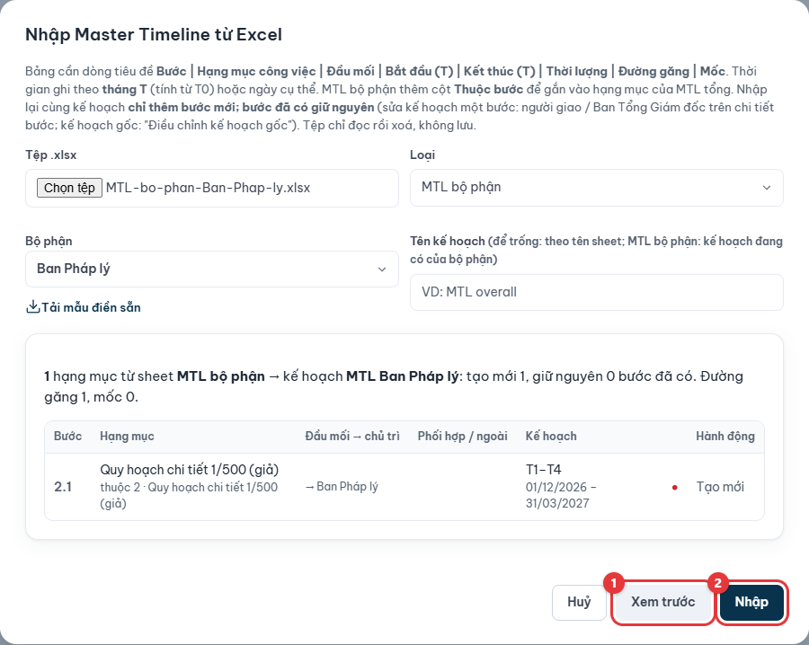

**Ai thấy, ai sửa:**
- **Người quản lý dự án**: nhập MTL tổng và MTL bộ phận của mọi bộ phận; đặt tên kế hoạch; nhập được cả cột Đường găng, Mốc, Trọng số.
- **Lãnh đạo bộ phận** (không phải người quản lý dự án): chỉ nhập MTL bộ phận của bộ phận mình; phải làm việc được trong dự án; mỗi dòng phải gắn vào một bước tổng do bộ phận mình chủ trì VÀ chính mình là người chủ trì bước đó. Không đặt được tên kế hoạch; cột Đường găng, Mốc, Trọng số bị bỏ qua.
- Người khác bị từ chối: "Chỉ PMO nhập MTL tổng; lãnh đạo bộ phận nhập MTL của bộ phận mình" ("PMO" ở đây là người quản lý dự án).

**Dùng để làm gì:** Đưa bảng Master Timeline từ Excel vào hệ thống: **MTL tổng** (các bước của dự án) hoặc **MTL bộ phận** (dòng con chi tiết hoá các bước tổng). Mỗi dòng thành một hạng mục, có kế hoạch gốc lấy từ tệp.

Chữ hướng dẫn trong hộp, nguyên văn:
- Chỉ Lãnh đạo bộ phận thấy: "Cách nhanh nhất: tải MTL bộ phận (Excel) đã điền sẵn → thêm dòng → chọn tệp ở đây → Xem trước → Nhập. Nhập lại chỉ thêm bước mới; bước đã có giữ nguyên. Chỉ gắn được dòng vào bước mình chủ trì."
- Mọi người: "Bảng cần dòng tiêu đề Bước | Hạng mục công việc | Đầu mối | Bắt đầu (T) | Kết thúc (T) | Thời lượng | Đường găng | Mốc. Thời gian ghi theo tháng T (tính từ T0) hoặc ngày cụ thể. MTL bộ phận thêm cột Thuộc bước để gắn vào hạng mục của MTL tổng. Nhập lại cùng kế hoạch chỉ thêm bước mới; bước đã có giữ nguyên (sửa kế hoạch một bước: người giao / Ban Tổng Giám đốc trên chi tiết bước; kế hoạch gốc: "Điều chỉnh kế hoạch gốc"). Tệp chỉ đọc rồi xoá, không lưu."

**Các bước thường làm**

MTL tổng (người quản lý dự án):
1. **Khác** → **Nhập MTL từ Excel**.
2. **Tệp .xlsx**: chọn tệp. **Loại**: **MTL tổng (dự án)**. **Tên kế hoạch**: để trống (lấy theo tên sheet) hoặc gõ tên, vd. "MTL overall".
3. Bấm **Xem trước**. Đọc phần tóm tắt, các cảnh báo, cột **Hành động** của từng dòng.
4. Tệp có nhiều sheet: chọn đúng sheet ở ô **Sheet** (đổi sheet thì tự xem trước lại).
5. Bấm **Nhập**. Hệ thống báo "Đã nhập MTL: tạo <N> hạng mục, giữ nguyên <M> bước đã có".
6. Bấm **Kiểm tra cảnh báo ngay** nếu muốn cảnh báo chạy ngay (mục 3.5.2).

MTL bộ phận (Lãnh đạo bộ phận):
1. **Khác** → **Tải MTL bộ phận (Excel)** (mục 3.5.4). Thêm, sửa dòng trong tệp; mỗi dòng con ghi cột **Thuộc bước** là mã bước tổng.
2. **Khác** → **Nhập MTL bộ phận** → chọn tệp → **Xem trước** → **Nhập**.

**Cấu trúc tệp Excel**

Hệ thống tìm trong 30 dòng đầu của từng sheet một dòng tiêu đề có cột tên hạng mục và cột bắt đầu hoặc kết thúc. Tên cột so không dấu, không phân biệt hoa thường, nên "Bắt đầu (T)", "BAT DAU (T)", "bắt đầu (t)" đều được. Thứ tự cột tuỳ ý. Hệ thống đọc tối đa 40 cột. MỌI sheet trong tệp — kể cả sheet không chứa bảng MTL — phải có không quá 3000 dòng dữ liệu; một sheet vượt thì cả tệp bị từ chối.

| Cột | Tên cột được nhận (viết có dấu hay không đều được) | Bắt buộc | Ghi chú |
|---|---|---|---|
| Bước | "Bước", "STT", "TT", "Mã", "Mã bước" | Không, nhưng NÊN có | Mã riêng của dòng (vd. 1, 8.1, II.3), tối đa 20 ký tự. Là thứ duy nhất để nhận ra "bước đã có" khi nhập lại. Dòng không có Bước thì mỗi lần nhập lại tạo thêm một hạng mục mới |
| Hạng mục | "Hạng mục công việc", "Hạng mục", "Nội dung", "Công việc", "Nội dung công việc", "Tên hạng mục" | Có | Tên hạng mục, tối đa 300 ký tự |
| Đầu mối | "Đầu mối", "Phụ trách", "Người phụ trách", "Đơn vị chủ trì", "Chủ trì", "Bộ phận" | Không | MTL tổng: khớp ra bộ phận chủ trì / phối hợp (bảng "Đầu mối → bộ phận" dưới). MTL bộ phận: khớp ra người phụ trách |
| Bắt đầu | "Bắt đầu (T)", "Bắt đầu", "Từ (T)", "Bắt đầu T", "Ngày bắt đầu", "Từ ngày" | Có (bắt đầu hoặc kết thúc) | Tháng T hoặc ngày cụ thể |
| Kết thúc | "Kết thúc (T)", "Kết thúc", "Đến (T)", "Kết thúc T", "Ngày kết thúc", "Đến ngày", "Hạn" | Có (bắt đầu hoặc kết thúc) | Như trên |
| Thời lượng | "Thời lượng (tháng)", "Thời lượng", "Số tháng" | Không | Hệ thống nhận ra nhưng không dùng |
| Đường găng | "Đường găng", "Găng", "Critical" | Không | Ô có chữ bất kỳ là găng, TRỪ "Không", "No", "0", "False", "-" |
| Mốc | "Mốc", "Mốc chính", "Milestone" | Không | Là mốc khi ô có ký tự ◆ hoặc ♦, hoặc ghi đúng một trong "x", "có", "co", "yes", "mốc", "moc". Chữ khác đi kèm ◆ thành ghi chú mốc (vd. "◆ Có giấy phép" → mốc, ghi chú "Có giấy phép"). ⚠️ Chữ khác KHÔNG có ◆ (vd. "Mốc 1") thì KHÔNG phải mốc |
| Thuộc bước | "Thuộc bước", "Bước MTL", "Hạng mục MTL", "Thuộc hạng mục", "Bước tổng" | Với MTL bộ phận | Mã bước tổng mà dòng này chi tiết hoá |
| Trọng số | "Trọng số" | Không | Số > 0; làm việc con nặng hơn khi tính % của hạng mục cha. Lãnh đạo bộ phận nhập thì bị bỏ qua |
| Ghi chú | "Ghi chú" | Không | Ghi vào ghi chú của hạng mục |

Luật đọc từng dòng:
- **Ô thời gian**: số, "T5", "5", "5,5", "5.5" là tháng T (phần lẻ bị bỏ: 5,5 hiểu là tháng 5); "dd/mm/yyyy", "dd.mm.yyyy", "dd-mm-yyyy" hoặc ô kiểu ngày của Excel là ngày cụ thể. Chỉ có một trong hai ô thì lấy ô đó cho cả hai. Hai ô phải cùng kiểu.
- **Quy đổi tháng T**: bắt đầu = ngày 1 của tháng (T0 + T); kết thúc = ngày cuối của tháng (T0 + T). Ví dụ T0 = 10/2026, "Bắt đầu (T)" = 2, "Kết thúc (T)" = 4 → kế hoạch gốc 01/12/2026 → 28/02/2027. Ngày cụ thể: kế hoạch gốc từ 00:00 ngày bắt đầu tới hết ngày kết thúc.
- **Dòng nhóm**: dòng chỉ có một ô có chữ và không có thời gian, bắt đầu bằng "Phần", "Phân kỳ", "Giai đoạn" (có dấu hay không đều được) hoặc số La Mã kèm "." hay ")" (vd. "II.") → thành tên phần cho các dòng sau. Bước dạng "II.3" mà không có dòng nhóm thì phần là "Phần II".
- Dòng không có thời gian, bắt đầu bằng "Ghi chú", "Lưu ý", "Chú thích": bỏ qua, không báo. Dòng trống: bỏ qua.
- **Cảnh báo khi đọc** (hiện trong phần xem trước, dòng đó bị bỏ qua): "Dòng <N>: "<50 ký tự đầu tên>" thiếu bắt đầu / kết thúc — bỏ qua"; "Dòng <N>: thiếu tên hạng mục — bỏ qua"; "Dòng <N>: bắt đầu và kết thúc phải cùng kiểu (tháng T hoặc ngày) — bỏ qua"; "Dòng <N>: kết thúc (T<x>) trước bắt đầu (T<y>) — bỏ qua"; "Dòng <N>: ngày kết thúc trước ngày bắt đầu — bỏ qua". Bước trùng: "Bước "<mã>" bị trùng — các lần nhập lại sẽ chỉ khớp dòng đầu".

Ví dụ bảng MTL tổng (giả):

| Bước | Hạng mục công việc | Đầu mối | Bắt đầu (T) | Kết thúc (T) | Thời lượng | Đường găng | Mốc |
|---|---|---|---|---|---|---|---|
| PHẦN I — CHUẨN BỊ ĐẦU TƯ | | | | | | | |
| 1 | Nhận chuyển nhượng dự án (giả) | Pháp lý / Tài chính | 0 | 2 | 3 | x | |
| 2 | Lập quy hoạch chi tiết 1/500 (giả) | Thiết kế | 2 | 5 | 4 | x | ◆ Có quyết định phê duyệt |
| 3 | Lấy ý kiến cơ quan quản lý (giả) | Thiết kế / UBND | 3 | 4 | 2 | | |

Dòng 1 hiểu là: bộ phận khớp với "Pháp lý" chủ trì, bộ phận khớp với "Tài chính" phối hợp (nếu công ty có bộ phận mang tên / mã tương ứng); kế hoạch gốc 01/10/2026 → 31/12/2026 với T0 = 10/2026; đường găng. Dòng 3: "UBND" không khớp bộ phận nào nên ghi vào "Cơ quan / đơn vị ngoài".

**Đầu mối → bộ phận** (chỉ MTL tổng). Ô Đầu mối được tách theo "/", ",", ";", "+", "&", " và ", "–", "—". Mỗi phần được khớp lần lượt với: mã bộ phận; tên bộ phận; "Phòng <phần>"; "Ban <phần>"; cách gọi riêng của công ty (Quản trị hệ thống cài trên máy chủ, không có màn hình); rồi bảng gọi tắt mặc định dưới đây. Bộ phận khớp đầu tiên = **chủ trì**; các bộ phận khớp sau = **phối hợp**; phần không khớp = "Cơ quan / đơn vị ngoài". Không khớp bộ phận nào → hạng mục giao cho bộ phận chủ quản dự án.

| Viết trong ô Đầu mối (không dấu, không phân biệt hoa thường) | Khớp với bộ phận có mã |
|---|---|
| "ct", "chu tich", "tgd", "tong giam doc", "gddh", "giam doc dieu hanh", "bld", "bgd", "ban lanh dao", "ban giam doc", "hdqt", "spv" | "BLD", "BGD" hoặc "BLĐ" |
| "pl", "phap ly", "phap che" | "PL" |
| "tc", "tai chinh", "ke toan" | "TC" |
| "tk", "thiet ke" | "TK" |
| "qlxd", "quan ly xay dung", "xay dung" | "QLXD" |
| "kd", "kinh doanh", "ban hang" | "KD" |
| "gr", "doi ngoai", "gpmb", "giai phong mat bang" | "GR" |
| "pmo", "ql du an", "quan ly du an" | "PMO" |

Bảng gọi tắt chỉ có tác dụng nếu công ty có bộ phận mang đúng mã ở cột phải. ⚠️ Bộ phận Ban Tổng Giám đốc trên bản chạy thật có mã "BTGD", nên đầu mối ghi "TGĐ", "Ban giám đốc", "Ban lãnh đạo" sẽ KHÔNG khớp (trừ khi Quản trị hệ thống đã cài cách gọi riêng) — hạng mục đó rơi về bộ phận chủ quản dự án. Cách chắc ăn: ghi đúng mã hoặc đúng tên bộ phận như trong danh mục bộ phận.

**MTL bộ phận — người phụ trách.** Cột Đầu mối / Người phụ trách được khớp với họ tên hoặc tên đăng nhập của người đang hoạt động trong bộ phận đã chọn (không phân biệt dấu, hoa thường). Nhiều người cách nhau "/". Mọi dòng thuộc bộ phận đã chọn. ⚠️ Tên không khớp bị bỏ, phần xem trước không báo — hạng mục khi đó chưa có người phụ trách.

**Từng ô**

| Ô (nguyên văn) | Nghĩa là gì | Điền / chọn thế nào (mặc định) | Đổi thì hệ thống làm gì khác |
|---|---|---|---|
| **Tệp .xlsx** | Tệp Excel cần nhập | Bắt buộc; chỉ .xlsx; tối đa 10 MB | Đọc xong xoá, không lưu tệp; hệ thống chỉ ghi tên tệp và dấu vân tay của tệp. Chưa chọn mà bấm Xem trước: "Chọn tệp Excel". Lỗi máy chủ: "Chưa chọn tệp Excel"; "Chỉ nhận tệp .xlsx"; "Nội dung tệp không khớp với đuôi tệp"; tệp quá 10 MB: "Tệp vượt 25 MB" (con số trong thông báo sai — giới hạn thật là 10 MB); không có bảng MTL: "Không tìm thấy bảng MTL: cần dòng tiêu đề có "Hạng mục công việc" và "Bắt đầu (T)" / "Kết thúc (T)"" |
| **Loại** (chỉ người quản lý dự án thấy) | MTL tổng hay MTL bộ phận | "MTL tổng (dự án)" (mặc định), "MTL bộ phận". Lãnh đạo bộ phận: ô ẩn, luôn là MTL bộ phận | MTL tổng: đầu mối → bộ phận theo bảng trên; không giao người. MTL bộ phận: mọi dòng thuộc bộ phận đã chọn, giao người theo tên |
| **Bộ phận** (hiện khi chọn "MTL bộ phận"; Lãnh đạo bộ phận luôn thấy) + liên kết **Tải mẫu điền sẵn** | Bộ phận của MTL bộ phận | Người quản lý dự án: mọi bộ phận đang hoạt động; Lãnh đạo bộ phận: bộ phận mình. Mặc định bộ phận của bạn | Bộ phận chủ trì của mọi dòng; danh sách người để khớp tên. Lỗi: "Bộ phận không hợp lệ" |
| **Tên kế hoạch** (chữ nhỏ "(để trống: theo tên sheet; MTL bộ phận: kế hoạch đang có của bộ phận)", gợi ý "VD: MTL overall"; chỉ người quản lý dự án thấy) | Tên kế hoạch trong dự án | Tối đa 160 ký tự. Để trống: MTL tổng → "MTL — <tên sheet>"; MTL bộ phận → kế hoạch duy nhất bộ phận đang có, chưa có thì "MTL <tên bộ phận>" | Cùng tên kế hoạch = cùng kế hoạch: nhập lại chỉ thêm bước mới. Tên khác = kế hoạch MỚI: mọi dòng được tạo lại. Lỗi: "Tên kế hoạch vượt 160 ký tự"; tên trùng một kế hoạch khác loại / khác bộ phận: "Tên kế hoạch "<tên>" đang dùng cho kế hoạch khác — đặt tên khác" |
| **Sheet** (chỉ hiện sau **Xem trước**, khi tệp có nhiều sheet có bảng MTL) | Sheet cần nhập | "<tên sheet> (<N> hạng mục)"; mặc định sheet đầu tiên có bảng MTL | Đổi sheet thì tự xem trước lại. Sheet quá dài: "Sheet "<tên>" có <N> dòng dữ liệu, vượt 3000 — tách tệp" |

**Các nút**

| Nút | Làm gì | Có hỏi lại không | Quay lại được không |
|---|---|---|---|
| **Huỷ** | Đóng hộp | — | — |
| **Tải mẫu điền sẵn** | Tải mẫu MTL của bộ phận đang chọn (mục 3.5.4) | Không | — |
| **Xem trước** | Đọc tệp, KHÔNG ghi gì; hiện phần xem trước; bật nút **Nhập** | Không | — |
| **Nhập** (chỉ bấm được sau **Xem trước**; đổi tệp hoặc đổi loại thì tắt lại) | Ghi vào hệ thống | ⚠️ Không hỏi lại | ⚠️ Không có hoàn tác hàng loạt. Bỏ từng hạng mục: người giao chuyển hạng mục sang **Huỷ** (nên dùng), hoặc xoá vào Thùng rác |

**Phần xem trước**, nguyên văn:
- "<N> hạng mục từ sheet <tên sheet> → kế hoạch <tên kế hoạch>: tạo mới <N>, giữ nguyên <M> bước đã có. Đường găng <N>, mốc <N>."
- Nếu có: "Đầu mối không khớp bộ phận (giao cho bộ phận sở hữu dự án, ghi ở "cơ quan / đơn vị ngoài"): <chữ đầu mối> (<số dòng>), …"
- Nếu có: "Không tìm thấy bước MTL tổng: <các bước> — hạng mục sẽ không gắn vào hạng mục cha."
- Nếu có: "<N> cảnh báo khi đọc tệp" (bấm để mở danh sách).
- Bảng cột "Bước", "Hạng mục" (kèm "thuộc <bước · tên>"), "Đầu mối → chủ trì", "Phối hợp / ngoài", "Kế hoạch" (T<x>–T<y> và ngày), biểu tượng găng / mốc, "Hành động": "Đã có — giữ nguyên", "Tạo mới", hoặc "Tạo mới (nhận <x>% của bước <mã>)". Hiện tối đa 80 dòng, còn lại ghi "… và <N> hạng mục khác."

**Kết quả khi bấm Nhập**
- Bước đã có (cùng mã Bước, trong cùng kế hoạch, chưa vào Thùng rác): **GIỮ NGUYÊN** — không cập nhật tên, ngày, găng, mốc, đầu mối.
- Bước mới: thành hạng mục ở cột **Chưa bắt đầu**; kế hoạch gốc, ngày bắt đầu, **Hạn** đều lấy từ tệp; **người giao = người bấm Nhập**; loại việc ghi là "Kế hoạch năm".
- Lần đầu chi tiết hoá một bước tổng đang làm dở (chưa có dòng con, đã > 0%, chưa hoàn thành): dòng con mới nhận % của bước tổng (tối đa 99%) và nằm ở cột **Đang thực hiện**, để % bước tổng không bị tụt.
- Hạng mục mới chưa có người phụ trách: Lãnh đạo bộ phận chủ trì (trừ người bấm nhập) nhận thông báo "Bộ phận được giao chủ trì <N> hạng mục MTL <mã dự án> — cần phân công người phụ trách".
- Mọi cán bộ đang hoạt động của các bộ phận chủ trì / phối hợp được thêm vào Thành viên với vai trò "Thành viên" (người đã có tên giữ nguyên vai trò).
- Hệ thống báo "Đã nhập MTL: tạo <N> hạng mục, giữ nguyên <M> bước đã có"; lỗi hiện chữ đỏ trong hộp. Lần nhập được ghi nhật ký hệ thống. Không gửi email, không Viber.
- Lãnh đạo bộ phận nhập mà có dòng không gắn được: "<N> dòng không thuộc bước MTL tổng nào do bộ phận chủ trì (cột "Thuộc bước"): <tối đa 5 mã bước> — lãnh đạo bộ phận chỉ chi tiết hoá bước bộ phận mình chủ trì", và KHÔNG dòng nào được nhập.

> ⚠️ **Nhập lại chỉ THÊM bước mới, không cập nhật bước đã có.** Sửa tên, ngày, đầu mối trong tệp rồi nhập lại: các dòng đó hiện "Đã có — giữ nguyên" và không đổi gì. Muốn sửa tên / Hạn / đường găng / mốc của một bước: người giao hoặc BTGĐ phụ trách sửa trên panel chi tiết hạng mục. Muốn sửa kế hoạch gốc: **Điều chỉnh kế hoạch gốc…** (mục 3.5.5). Xoá dòng trong tệp cũng KHÔNG xoá hạng mục đã có.

**⚠️ Dễ nhầm**
- ⚠️ Nhập lại mà phần xem trước báo "tạo mới" cho các dòng bạn tưởng đã có: DỪNG, đừng bấm **Nhập**. Nguyên nhân thường gặp: tên kế hoạch khác lần trước (để trống mà sheet đã đổi tên, hoặc gõ tên khác) → hệ thống coi là kế hoạch mới và sẽ tạo trùng toàn bộ; dòng không có mã Bước; hạng mục đó đã bị xoá vào Thùng rác (nhập lại sẽ tạo lại).
- Người bấm **Nhập** trở thành người giao của mọi hạng mục mới. Sau này chỉ người đó (và BTGĐ phụ trách) sửa kế hoạch, điều chỉnh kế hoạch gốc, duyệt hoàn thành các hạng mục ấy. Với dòng do Lãnh đạo bộ phận nhập, chính Lãnh đạo bộ phận là người giao.
- ⚠️ Lãnh đạo bộ phận phải là NGƯỜI CHỦ TRÌ của bước tổng thì mới gắn dòng con vào được — không đủ nếu chỉ là lãnh đạo bộ phận chủ trì. Bước tổng đã giao cho một nhân viên thì Lãnh đạo bộ phận không nhập dòng con cho bước đó được: phần xem trước báo "Không tìm thấy bước MTL tổng: <bước> — hạng mục sẽ không gắn vào hạng mục cha." (nghe như vẫn nhập được), nhưng bấm **Nhập** thì bị từ chối như trên. Cách làm: Lãnh đạo bộ phận giữ mình là người chủ trì bước tổng, nhập dòng con, rồi giao từng dòng con cho nhân viên; hoặc nhờ người quản lý dự án nhập.
- Dòng không ghi **Thuộc bước** cũng bị coi là "không thuộc bước MTL tổng nào" khi Lãnh đạo bộ phận nhập, nhưng phần xem trước không liệt kê — chỉ báo khi bấm **Nhập**.
- Lãnh đạo bộ phận nhập: cột Đường găng, Mốc, Trọng số trong tệp bị bỏ qua, không báo.
- Đầu mối không khớp → hạng mục giao cho bộ phận chủ quản dự án, không bị bỏ đi.
- Dữ liệu MTL là tài liệu Bảo mật: chỉ nhập bằng chức năng này, không gửi tệp ra ngoài.

**Claude:** Không nhập được MTL (gửi tệp qua Claude bị chặn). Việc nhập luôn làm trên giao diện.

#### 3.5.4 Tải mẫu MTL bộ phận

**Mở ở đâu:** Dự án MTL → **Khác** → **Tải mẫu MTL bộ phận** (người quản lý dự án; mở hộp chọn bộ phận) hoặc **Tải MTL bộ phận (Excel)** (Lãnh đạo bộ phận; tải thẳng mẫu của bộ phận mình); hoặc liên kết **Tải mẫu điền sẵn** trong hộp nhập MTL.

**Ai thấy, ai sửa:** Người quản lý dự án và Ban Tổng Giám đốc: mọi bộ phận. Lãnh đạo bộ phận: chỉ bộ phận mình. Người khác bị từ chối với thông báo "Kế hoạch hạng mục MTL do người giao hoặc Ban Tổng Giám đốc sửa; tạo bước MTL tổng, nhập Excel do người quản lý dự án (PMO)" — câu này nói về quyền sửa kế hoạch, không đúng thao tác tải mẫu, nhưng nghĩa là bạn không có quyền tải.

**Dùng để làm gì:** Lấy tệp Excel điền sẵn để bộ phận chi tiết hoá phần việc của mình rồi nhập lại (mục 3.5.3). Chữ trong hộp, nguyên văn: "Tệp Excel điền sẵn: các hạng mục bộ phận đã có (sửa rồi nhập lại theo Bước) và gợi ý một dòng con cho mỗi hạng mục MTL tổng bộ phận chủ trì chưa chi tiết hoá. Kèm danh sách chọn người phụ trách, sheet MTL tổng tham khảo và hướng dẫn. Tài liệu mức Bảo mật; mỗi lần tải được ghi nhật ký."

> ⚠️ **Chữ trên màn hình ghi** "(sửa rồi nhập lại theo Bước)" **nhưng thực tế** nhập lại không sửa các hạng mục đã có (mục 3.5.3). Chỉ dòng mới được thêm.

**Các bước thường làm**
1. **Khác** → **Tải mẫu MTL bộ phận** → chọn **Bộ phận** → **Tải** (Lãnh đạo bộ phận: **Tải MTL bộ phận (Excel)**, tải ngay).
2. Hệ thống báo "Đã tải MTL-bo-phan-<mã bộ phận>-BM.xlsx".
3. Mở tệp, sửa dòng gợi ý (tô vàng), thêm dòng con, chọn người phụ trách.
4. Nhập lại bằng **Nhập MTL bộ phận** / **Nhập MTL từ Excel** → **MTL bộ phận**.

**Từng ô** (hộp "Tải mẫu MTL bộ phận", chỉ người quản lý dự án)

| Ô (nguyên văn) | Nghĩa là gì | Điền / chọn thế nào (mặc định) | Đổi thì hệ thống làm gì khác |
|---|---|---|---|
| **Bộ phận** | Bộ phận cần mẫu | Mọi bộ phận đang hoạt động; mặc định bộ phận của bạn | Nội dung tệp theo bộ phận này. Lỗi: "Bộ phận không hợp lệ" |

**Các nút**

| Nút | Làm gì | Có hỏi lại không | Quay lại được không |
|---|---|---|---|
| **Huỷ** | Đóng hộp | — | — |
| **Tải** | Tải tệp "MTL-bo-phan-<mã bộ phận>-<mã dự án>.xlsx"; ghi nhật ký hệ thống | Không | — |

**Nội dung tệp**
- Sheet **"MTL bộ phận"**: dòng 1 "MTL BỘ PHẬN — <tên bộ phận> — <tên dự án>. Tài liệu BẢO MẬT, chỉ dùng nội bộ. Sửa / thêm dòng rồi nhập lại: Khác → Nhập MTL bộ phận."; dòng tiêu đề "Bước", "Hạng mục công việc", "Người phụ trách", "Bắt đầu", "Kết thúc", "Đường găng", "Mốc", "Thuộc bước", "Ghi chú". Gồm các hạng mục MTL bộ phận đã có, và dòng gợi ý (tô vàng) "<bước>.1" cho mỗi bước tổng bộ phận CHỦ TRÌ chưa có dòng con, chưa xong, với ghi chú "Gợi ý từ bước <mã> MTL tổng — sửa tên / ngày, tách thành nhiều dòng hoặc xoá dòng nếu không cần". Ô "Người phụ trách" có danh sách chọn tên người trong bộ phận; "Đường găng" chọn "x"; "Mốc" chọn "◆"; thêm 200 dòng trống có sẵn danh sách chọn.
- Sheet ẩn **"Danh sách"**: tên người trong bộ phận.
- Sheet **"MTL tổng (tham khảo)"**: cột "Bước", "Hạng mục MTL tổng", "Đầu mối", "Từ tháng T", "Đến tháng T", "Găng", "Mốc", "Vai trò" ("Chủ trì" / "Phối hợp").
- Sheet **"Hướng dẫn"**, nguyên văn:
  1. "CÁCH DÙNG MẪU MTL BỘ PHẬN"
  2. "1. Mỗi dòng ở sheet "MTL bộ phận" là một hạng mục của bộ phận. Có thể sửa tên, thêm dòng, tách một hạng mục thành nhiều dòng (vd. 8.1, 8.2, 8.3)."
  3. "2. Cột "Bước": mã riêng của từng dòng, không trùng. Nhập lại tệp sẽ CẬP NHẬT dòng có cùng Bước và giữ tiến độ đã cập nhật."
  4. "3. Cột "Thuộc bước": bước của MTL tổng mà dòng này chi tiết hoá (xem sheet "MTL tổng (tham khảo)"). Tiến độ bước tổng tự tính từ các dòng con; lần đầu chi tiết hoá một bước đang làm dở, các dòng con nhận % hiện tại của bước đó."
  5. "   Phần việc PHỐI HỢP: chỉ thêm dòng con khi đã thống nhất với bộ phận chủ trì, vì tiến độ bước tổng sẽ tính từ mọi dòng con."
  6. "4. Bắt đầu / Kết thúc: ghi tháng T (vd. 5 hoặc T5) hoặc ngày cụ thể dd/mm/yyyy. Trên cùng một dòng, hai cột phải cùng kiểu."
  7. "5. Người phụ trách: chọn trong danh sách (tên tài khoản trong bộ phận). Nhiều người: cách nhau dấu "/"."
  8. "6. Đường găng: x. Mốc: ◆."
  9. "7. Xoá dòng trong tệp KHÔNG xoá hạng mục đã có — muốn bỏ thì chuyển hạng mục sang "Huỷ" trong ứng dụng."
  10. "8. Kế hoạch gốc (căn cứ tính chậm / trễ và KPI) lấy theo lần nhập đầu. Muốn đổi kế hoạch gốc: báo PMO."
  11. "Tài liệu này chứa kế hoạch dự án — mức BẢO MẬT. Không gửi ra ngoài công ty."

> ⚠️ **Chữ trong tệp mẫu ghi** "Nhập lại tệp sẽ CẬP NHẬT dòng có cùng Bước và giữ tiến độ đã cập nhật." **nhưng thực tế** nhập lại GIỮ NGUYÊN dòng đã có, không cập nhật gì; chỉ dòng có mã Bước mới được thêm.

> ⚠️ **Chữ trong tệp mẫu ghi** "Muốn đổi kế hoạch gốc: báo PMO." **nhưng thực tế** chỉ người giao của hạng mục (người đã bấm nhập) và BTGĐ phụ trách điều chỉnh được kế hoạch gốc; PMO không làm được nếu không là người giao. Với dòng do Lãnh đạo bộ phận nhập, chính Lãnh đạo bộ phận điều chỉnh được (mục 3.5.5).

**⚠️ Dễ nhầm**
- Dòng gợi ý được tạo cho mọi bước tổng bộ phận chủ trì, kể cả bước đã giao cho nhân viên. Lãnh đạo bộ phận nhập lại dòng gợi ý đó sẽ bị từ chối nếu mình không phải người chủ trì bước tổng (mục 3.5.3).
- Không có dòng gợi ý cho phần việc bộ phận chỉ phối hợp: muốn thêm thì tự thêm dòng, sau khi đã thống nhất với bộ phận chủ trì.
- Tệp là tài liệu Bảo mật; mỗi lần tải được ghi nhật ký.

**Claude:** Không tải được tệp ("Xuất / tải tệp không làm qua Claude — làm trên giao diện Kepler Hub").

#### 3.5.5 Điều chỉnh kế hoạch gốc, đường găng, mốc

**Mở ở đâu:** Dự án MTL → bấm một hạng mục (ở Bảng, Danh sách, Kế hoạch & Gantt hoặc Giai đoạn) → panel chi tiết → khối MTL: ô đánh dấu **Đường găng**, **Mốc**, và liên kết **Điều chỉnh kế hoạch gốc…**.

**Ai thấy, ai sửa:** Người giao của hạng mục và BTGĐ phụ trách của hạng mục (phụ trách Toàn công ty, hoặc Phó Tổng Giám đốc phụ trách bộ phận chủ trì). ⚠️ Người quản lý dự án KHÔNG tự có quyền này nếu không phải người giao. Người khác thấy khối MTL ở dạng chỉ đọc; gọi thẳng thì bị từ chối "Chỉ người giao hoặc Ban Tổng Giám đốc điều chỉnh kế hoạch gốc". Dự án đã lưu trữ: không ai sửa được.

**Dùng để làm gì:** Đổi kế hoạch gốc của một hạng mục (căn cứ tính chậm, trễ, KPI) có lý do và lưu vết; đánh dấu đường găng, mốc.

Khối MTL trong panel, nguyên văn: "Bước <mã>", nhãn "Đường găng", nhãn "Mốc", nhãn tình trạng; "Kế hoạch gốc" <ngày> – <ngày> "(T<x>–T<y>)"; "Kế hoạch / thực tế" <x>% / <y>% kèm "(mới bắt đầu, chưa tính chậm)" hoặc "(<±z> điểm)"; "Đầu mối"; "Cơ quan / đơn vị ngoài"; "Dự báo hoàn thành" (người chủ trì sửa được).

**Các bước thường làm**

Điều chỉnh kế hoạch gốc:
1. Mở hạng mục → bấm **Điều chỉnh kế hoạch gốc…**.
2. Sửa tháng T (hoặc ngày), gõ **Lý do điều chỉnh**.
3. Bấm **Lưu** → hệ thống báo "Đã điều chỉnh kế hoạch gốc".

Đánh dấu đường găng / mốc: đánh dấu hoặc bỏ ô **Đường găng** / **Mốc** trong khối MTL. Hệ thống lưu ngay khi bấm, không có nút Lưu, không hỏi lại.

**Từng ô**

| Ô (nguyên văn) | Nghĩa là gì | Điền / chọn thế nào (mặc định) | Đổi thì hệ thống làm gì khác |
|---|---|---|---|
| Ô đánh dấu **Đường găng** | Hạng mục nằm trên đường găng | Theo tệp MTL, hoặc người giao đặt | Bước duyệt đầu tiên thành "Ban Tổng Giám đốc duyệt" (BTGĐ phụ trách) thay người giao, áp cho lần gửi duyệt sau; cảnh báo Chậm tiến độ / Trễ hạn báo thêm mọi thành viên Ban Tổng Giám đốc; tiêu đề cảnh báo thêm " (đường găng)"; tính vào phần "đường găng không trễ" của KPI; giai đoạn gợi ý được cắt sau các mốc trên đường găng |
| Ô đánh dấu **Mốc** | Hạng mục là mốc | Như trên | Như Đường găng về người duyệt và cảnh báo; hiện ở "Mốc chính", "Mốc kế tiếp" (tab Tổng quan), biểu tượng ◆ trên Gantt và Giai đoạn |
| Hộp "Điều chỉnh kế hoạch gốc — <mã việc>", chữ "Kế hoạch gốc dùng để tính chậm, trễ và KPI. Sửa phải ghi lý do, hệ thống lưu lại." | — | — | — |
| **Bắt đầu (tháng T)** / **Kết thúc (tháng T)** (khi hạng mục đang ghi theo tháng T) | Kế hoạch gốc theo tháng T | Số nguyên ≥ 0, bắt buộc; điền sẵn giá trị hiện tại | Kế hoạch gốc tính lại theo T0. Ví dụ T0 = 10/2026, đổi "Kết thúc" từ 4 sang 5: ngày kết thúc từ 28/02/2027 thành 31/03/2027. Lỗi: "Tháng T không hợp lệ" (âm, kết thúc nhỏ hơn bắt đầu, không phải số) |
| **Bắt đầu** / **Kết thúc** (khi hạng mục ghi theo ngày) | Kế hoạch gốc theo ngày | Ô ngày, bắt buộc, để TRỐNG (không điền sẵn — phải gõ lại cả hai ngày) | Kế hoạch gốc = 00:00 ngày bắt đầu → hết ngày kết thúc. Lỗi: "Ngày kế hoạch không hợp lệ" |
| **Lý do điều chỉnh** | Lý do | Bắt buộc; tối đa 500 ký tự | Ghi vào lịch sử việc ("điều chỉnh kế hoạch gốc: <lý do>") và nhật ký hệ thống (kế hoạch cũ, mới, lý do). Lỗi: "Thiếu Lý do điều chỉnh"; "Lý do điều chỉnh vượt 500 ký tự" |

**Các nút**

| Nút | Làm gì | Có hỏi lại không | Quay lại được không |
|---|---|---|---|
| **Điều chỉnh kế hoạch gốc…** | Mở hộp | — | — |
| **Huỷ** | Đóng hộp | — | — |
| **Lưu** | Ghi kế hoạch gốc mới; lỗi hiện chữ đỏ trong hộp | Không | Điều chỉnh lại lần nữa (cũng phải có lý do); kế hoạch cũ còn trong lịch sử việc. Không gửi thông báo cho ai |

**⚠️ Dễ nhầm**
- ⚠️ Điều chỉnh kế hoạch gốc KHÔNG đổi ô **Hạn** của việc (Hạn đổi qua gia hạn); chỉ đổi căn cứ tính chậm, trễ, KPI.
- Hạng mục ghi theo tháng T chỉ sửa được theo tháng T; hạng mục ghi theo ngày chỉ sửa được theo ngày. Hộp không cho đổi kiểu.
- Sau khi điều chỉnh, các cảnh báo "Sắp bắt đầu", "Sắp đến hạn", "Vượt tiến độ" đã gửi trước đó không gửi lại.
- Người giao của hạng mục nhập từ Excel là người đã bấm **Nhập** (mục 3.5.3). PMO, Chủ dự án muốn điều chỉnh mà không phải người giao thì nhờ người giao hoặc BTGĐ phụ trách.
- Bật / tắt Đường găng hay Mốc khi hạng mục đang chờ duyệt: phiếu đang chờ giữ nguyên người duyệt cũ; lần gửi duyệt sau mới theo cờ mới.

**Claude:** Không điều chỉnh kế hoạch gốc, không bật / tắt đường găng, mốc được. Claude đọc được khối MTL của một hạng mục.

#### 3.5.6 Giai đoạn

**Mở ở đâu:** Dự án MTL → tab **Giai đoạn** (`#/projects/<số>?view=sprint`) → nút **Thiết lập giai đoạn**.

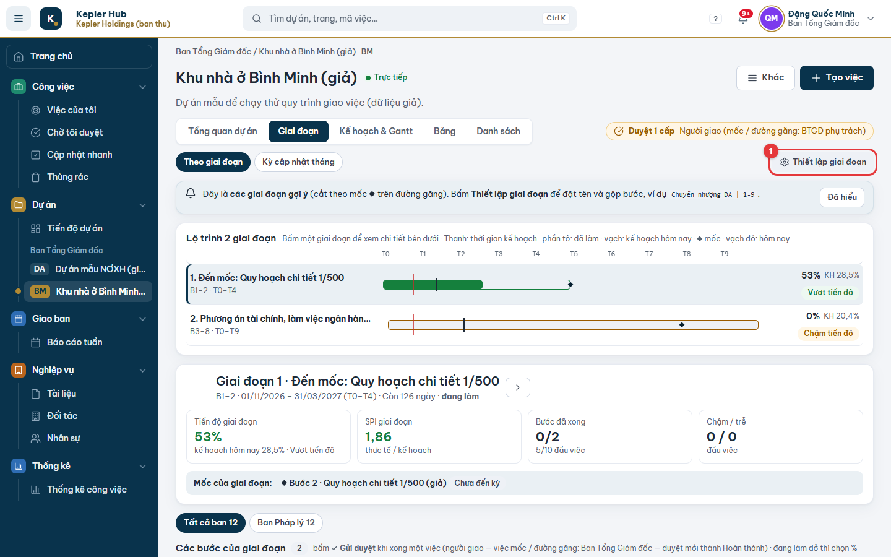

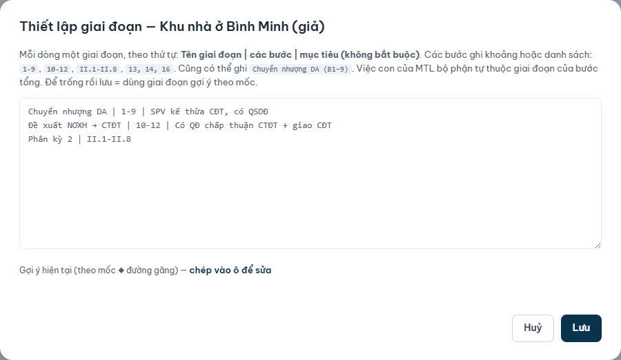

**Ai thấy, ai sửa:** Ai xem được dự án thấy tab. Nút **Thiết lập giai đoạn** chỉ hiện với người quản lý dự án.

**Dùng để làm gì:** Đặt tên và gộp các bước MTL tổng thành giai đoạn — dùng cho lộ trình, chia làn trên Bảng, lọc, tiến độ theo giai đoạn. Chưa thiết lập thì hệ thống tự gợi ý giai đoạn, cắt sau mỗi mốc trên đường găng.

Trên tab, liên quan thiết lập:
- Hai cách xem: **Theo giai đoạn** (mặc định), **Kỳ cập nhật tháng**.
- Chưa thiết lập: khung "Đây là các giai đoạn gợi ý (cắt theo mốc ◆ trên đường găng)." kèm, với người quản lý dự án, "Bấm Thiết lập giai đoạn để đặt tên và gộp bước, ví dụ Chuyển nhượng DA | 1-9."; với người khác, "PMO sẽ đặt tên và gộp bước cho đúng các giai đoạn của dự án."; nút **Đã hiểu** ẩn khung (nhớ theo từng người, trên trình duyệt đang dùng).
- Đã thiết lập mà còn bước chưa thuộc giai đoạn nào: "Bước chưa thuộc giai đoạn nào: <danh sách bước>".
- Chưa có hạng mục: "Chưa có Master Timeline." (kèm **Nhập MTL từ Excel**); chưa có T0: "Chưa đặt tháng T0." (kèm **Đặt T0**).
- Khối "Theo giai đoạn" ở tab Tổng quan ghi "do PMO thiết lập" hoặc "gợi ý theo mốc ◆ — PMO thiết lập ở tab Giai đoạn".

**Các bước thường làm**
1. Tab **Giai đoạn** → **Thiết lập giai đoạn**.
2. Chưa thiết lập: bấm **chép vào ô để sửa** để lấy gợi ý làm điểm xuất phát.
3. Mỗi dòng một giai đoạn: `Tên giai đoạn | các bước | mục tiêu`. Ví dụ:
   - `Chuyển nhượng DA | 1-9 | SPV kế thừa CĐT, có QSDĐ`
   - `Đề xuất NƠXH → CTĐT | 10-12 | Có QĐ chấp thuận CTĐT + giao CĐT`
   - `Phân kỳ 2 | II.1-II.8`
4. Bấm **Lưu** → "Đã lưu <N> giai đoạn" (hoặc "Đã lưu <N> giai đoạn — còn <M> bước chưa xếp").

**Từng ô** (hộp "Thiết lập giai đoạn — <tên dự án>")

Chữ hướng dẫn, nguyên văn: "Mỗi dòng một giai đoạn, theo thứ tự: Tên giai đoạn | các bước | mục tiêu (không bắt buộc). Các bước ghi khoảng hoặc danh sách: 1-9, 10-12, II.1-II.8, 13, 14, 16. Cũng có thể ghi Chuyển nhượng DA (B1–9). Việc con của MTL bộ phận tự thuộc giai đoạn của bước tổng. Để trống rồi lưu = dùng giai đoạn gợi ý theo mốc."

| Ô (nguyên văn) | Nghĩa là gì | Điền / chọn thế nào (mặc định) | Đổi thì hệ thống làm gì khác |
|---|---|---|---|
| Ô nhiều dòng (gợi ý 3 dòng mẫu như ở bước 3) | Danh sách giai đoạn | Đã thiết lập: nội dung hiện tại; chưa: trống. Dòng trống và dòng bắt đầu bằng "#" bị bỏ qua. Tên tối đa 120 ký tự, phần bước 200, mục tiêu 300. Bước viết "B10", "Bước 10", "b10" đều hiểu là "10"; "II.1-8" hiểu là II.1 tới II.8; dấu "–", "—", "−" coi như "-"; ngăn cách bằng "," hoặc ";". Khoảng "1-9" gồm mọi bước tổng có mã từ 1 tới 9 theo thứ tự tự nhiên (gồm cả mã như 3.1, 3.2 nếu có); các bước dạng II.1 xếp sau mọi bước đánh số thường | Gán mỗi bước tổng vào một giai đoạn; dòng con thuộc giai đoạn của bước tổng; đổi lộ trình, chia làn trên Bảng, bộ lọc, tiến độ theo giai đoạn. Lỗi (tối đa 5 lỗi, nối bằng " · "): "Dòng <N>: thiếu tên giai đoạn"; "Dòng <N>: "<tên>" chưa ghi các bước — ví dụ "<tên> \| 1-9""; "Tối đa 30 giai đoạn"; "Giai đoạn "<tên>": không có bước <mã> trong MTL tổng"; "Giai đoạn "<tên>": khoảng <a>-<b> ngược thứ tự"; "Bước <mã> nằm trong cả giai đoạn "<tên 1>" và "<tên 2>""; quá 10.000 ký tự: "Thiết lập giai đoạn quá dài" |
| Chữ "Gợi ý hiện tại (theo mốc ◆ đường găng) — chép vào ô để sửa" (chỉ khi chưa thiết lập) | Lấy gợi ý vào ô | — | — |

**Các nút**

| Nút | Làm gì | Có hỏi lại không | Quay lại được không |
|---|---|---|---|
| **Thiết lập giai đoạn** | Mở hộp | — | — |
| **chép vào ô để sửa** | Chép giai đoạn gợi ý vào ô | Không | Xoá ô |
| **Huỷ** | Đóng hộp | — | — |
| **Lưu** | Lưu thiết lập. Để trống ô rồi lưu = bỏ thiết lập, quay về gợi ý ("Đã bỏ thiết lập — dùng giai đoạn gợi ý"). Lỗi hiện chữ đỏ trong hộp | Không | Gõ lại nội dung cũ rồi lưu. Không gửi thông báo cho ai |

**⚠️ Dễ nhầm**
- "Giai đoạn" (nhóm bước) khác "Kỳ cập nhật tháng" (mỗi tháng lịch một kỳ).
- Thiết lập theo MÃ BƯỚC của MTL tổng. Bước thêm sau khi nhập lại mà chưa nằm trong khoảng nào sẽ hiện ở "Bước chưa thuộc giai đoạn nào"; vào sửa lại thiết lập.
- Một bước chỉ thuộc một giai đoạn.
- "PMO" trong các chữ ở tab này = người quản lý dự án.
- Tab Giai đoạn còn dùng chữ "ban" thay cho "bộ phận": "Tất cả ban", "Lọc theo ban", "Giai đoạn <N> theo ban", "Tổng kết kỳ cập nhật T<N> theo ban", cột "Ban". "Ban" ở đây nghĩa là **bộ phận**.

**Claude:** Không thiết lập được giai đoạn. Claude đọc được giai đoạn đang làm và trang Cập nhật nhanh.

### 3.6 Chu kỳ (dự án thường)

**Mở ở đâu:** Dự án thường → tab **Chu kỳ**. Tab không có ở dự án MTL (dùng **Giai đoạn**, mục 3.5.6) và ở bảng toàn Cột tự do.

**Ai thấy, ai sửa:** Xem: ai xem được dự án. **Tạo chu kỳ**, chuyển việc chưa xong: người làm việc được trong dự án. **Xoá** chu kỳ: người quản lý dự án.

**Dùng để làm gì:** Chia việc theo đợt một tuần hoặc hai tuần và theo dõi tiến độ từng đợt.

**Các bước thường làm**
1. Tab **Chu kỳ** → **Tạo chu kỳ**.
2. Gõ tên (hoặc để trống), kiểm tra ngày **Bắt đầu**, **Kết thúc** → **Tạo** → "Đã tạo chu kỳ".
3. Gắn việc vào chu kỳ: trong panel chi tiết việc chọn chu kỳ (người giao / BTGĐ phụ trách của việc), hoặc lọc Bảng theo chu kỳ rồi **+ Thêm việc**.
4. Cuối đợt: bấm "Chuyển <N> việc chưa xong → <tên chu kỳ sau>".

**Hiển thị mỗi chu kỳ:** tên + nhãn "Đang chạy" / "Sắp tới" / "Đã kết thúc"; "<ngày> – <ngày>", đang chạy thì thêm " · còn <N> ngày"; thanh tiến độ "<số xong>/<số việc> việc · <x>%" (không tính việc Huỷ); danh sách việc. Chu kỳ chưa có việc: "Chưa có việc. Chọn chu kỳ trong panel chi tiết việc hoặc lọc theo chu kỳ rồi thêm nhanh trên Bảng.". Dự án chưa có chu kỳ: "Chưa có chu kỳ. Chu kỳ giúp nhóm lập kế hoạch theo tuần hoặc 2 tuần và theo dõi tiến độ.". Dòng đầu tab: "<N> việc đang mở chưa thuộc chu kỳ nào.". Chu kỳ mới nhất xếp trên cùng.

**Từng ô** (hộp "Tạo chu kỳ")

| Ô (nguyên văn) | Nghĩa là gì | Điền / chọn thế nào (mặc định) | Đổi thì hệ thống làm gì khác |
|---|---|---|---|
| **Tên (để trống: tự đặt)** | Tên chu kỳ | Tối đa 80 ký tự; trống thì hệ thống đặt "Chu kỳ <N>" | Tên trong tab, trong ô chọn chu kỳ của việc, trong bộ lọc. Lỗi: "Tên chu kỳ vượt 80 ký tự" |
| **Bắt đầu** | Ngày bắt đầu | Bắt buộc; mặc định ngày sau ngày kết thúc của chu kỳ cuối cùng, chưa có chu kỳ thì hôm nay | Quyết định "Sắp tới" / "Đang chạy" / "Đã kết thúc". Lỗi: "Ngày bắt đầu không hợp lệ (YYYY-MM-DD)"; "Ngày bắt đầu không hợp lệ" |
| **Kết thúc** | Ngày kết thúc | Bắt buộc; mặc định ngày bắt đầu + 13 ngày (2 tuần) | Như trên. Lỗi: "Ngày kết thúc phải sau ngày bắt đầu"; dài quá 90 ngày: "Chu kỳ tối đa 90 ngày"; trùng thời gian với chu kỳ khác: "Trùng thời gian với chu kỳ "<tên>"" |
| Chữ "Các chu kỳ trong một dự án không được trùng thời gian." | — | — | — |

**Các nút**

| Nút | Làm gì | Có hỏi lại không | Quay lại được không |
|---|---|---|---|
| **Tạo chu kỳ** | Mở hộp "Tạo chu kỳ" | — | — |
| **Tạo** | Tạo chu kỳ; lỗi hiện chữ đỏ trong hộp | Không | Xoá chu kỳ |
| "Chuyển <N> việc chưa xong → <tên chu kỳ sau>" (hiện khi có chu kỳ sau và còn việc chưa xong) | Chuyển mọi việc chưa Hoàn thành / chưa Huỷ của chu kỳ này sang chu kỳ kế tiếp; báo "Đã chuyển <N> việc"; lịch sử từng việc ghi đổi chu kỳ | ⚠️ Không hỏi | Chuyển ngược bằng tay từng việc |
| **Xoá** (trên chu kỳ) | Xoá chu kỳ; việc trong chu kỳ giữ lại nhưng bỏ gắn chu kỳ | Có: "Xoá chu kỳ? Các việc trong chu kỳ vẫn được giữ lại." với nút **Xoá** / **Huỷ** | Không (tạo lại rồi gắn lại từng việc) |

**⚠️ Dễ nhầm**
- Không có nút sửa tên hay ngày của chu kỳ đã tạo. Muốn sửa: xoá rồi tạo lại — các việc mất gắn chu kỳ, phải gắn lại.
- Đang lọc Bảng theo một chu kỳ thì **+ Thêm việc** tự gắn việc mới vào chu kỳ đó.
- Chọn chu kỳ cho một việc trong panel là sửa kế hoạch của việc: chỉ người giao và BTGĐ phụ trách của việc làm được. Nút "Chuyển … việc chưa xong" thì người làm việc được trong dự án đều bấm được, chuyển cả việc của người khác.

**Claude:** Không tạo, xoá, chuyển chu kỳ được.

### 3.7 Nhập công việc (dự án thường)

**Mở ở đâu:** Dự án thường → **Khác** → **Nhập** → hộp **Nhập công việc**. Dự án MTL không có mục này (dùng nhập MTL, mục 3.5.3).

**Ai thấy, ai sửa:** Mục **Nhập**: người tạo việc được trong dự án. Trong hộp: **Sổ giao việc (Excel)** và **Kế hoạch công tác năm (Word)** chỉ hiện với người quản lý dự án; **Danh sách đơn giản (Excel)** hiện với mọi người tạo việc được.

**Dùng để làm gì:** Tạo nhiều việc một lần từ tệp.

**Hộp chọn "Nhập công việc"**

| Lựa chọn (nguyên văn) | Mô tả trên màn hình (nguyên văn) | Ai thấy |
|---|---|---|
| **Sổ giao việc (Excel)** | "Đúng mẫu "Sổ theo dõi, kiểm soát giao việc": nhóm việc / việc nhánh, người giao, chủ trì, phối hợp, hạn, tiến độ, sản phẩm…" | Người quản lý dự án |
| **Kế hoạch công tác năm (Word)** | "Đọc bảng "Phân công công việc cụ thể" → nhiệm vụ + mốc tháng thành việc nhánh, nguồn "Kế hoạch năm"" | Người quản lý dự án |
| **Danh sách đơn giản (Excel)** | "Tiêu đề, mô tả, người nhận, ưu tiên, hạn — theo tệp mẫu" | Người tạo việc được |
| Nút **Huỷ** | Đóng hộp | — |

#### 3.7.1 Danh sách đơn giản (Excel)

Hộp "Nhập công việc từ Excel", chữ nguyên văn: "Dùng tệp mẫu: Tiêu đề, Mô tả, Người nhận (tên tài khoản), Ưu tiên, Bắt đầu, Hạn, Trạng thái. Tối đa 1000 dòng."

**Các bước thường làm**
1. Bấm **Tải tệp mẫu** (tệp "Mau_nhap_BM.xlsx").
2. Điền mỗi việc một dòng, từ dòng 2.
3. Chọn tệp ở ô **Tệp .xlsx** → **Nhập** → "Đã nhập <N> việc".

Cột của tệp mẫu (đọc sheet đầu tiên, bỏ dòng tiêu đề và dòng bắt đầu bằng "Ví dụ:"):

| Cột | Điền thế nào |
|---|---|
| "Tiêu đề" | Bắt buộc (dòng không có tiêu đề bị bỏ qua); tối đa 300 ký tự |
| "Mô tả" | Không bắt buộc |
| "Người nhận (tài khoản, cách nhau dấu phẩy)" | Tên đăng nhập, không phải họ tên |
| "Ưu tiên" | "Khẩn cấp", "Cao", "Trung bình", "Thấp", "Không" (hoặc URGENT, HIGH, MEDIUM, LOW, NONE). Trống = "Không". Lưu ý tên trong tệp khác giao diện: "Khẩn cấp" = **Khẩn**, "Trung bình" = **Bình thường** |
| "Bắt đầu (YYYY-MM-DD)", "Hạn (YYYY-MM-DD)" | Ngày dạng 2026-12-05 hoặc ô kiểu ngày |
| "Trạng thái" | Tên cột trên Bảng (không phân biệt hoa thường). Trống = cột Chưa bắt đầu đầu tiên. Không nhập thẳng vào cột Chờ duyệt / Hoàn thành |

**Từng ô**

| Ô (nguyên văn) | Nghĩa là gì | Điền / chọn thế nào (mặc định) | Đổi thì hệ thống làm gì khác |
|---|---|---|---|
| **Tệp .xlsx** | Tệp theo mẫu | Bắt buộc; tối đa 5 MB | Mỗi dòng thành một việc. Lỗi: "Chưa chọn tệp Excel"; "Chỉ nhận tệp .xlsx"; "Tệp không có trang tính"; "Không có dòng dữ liệu nào"; "Tối đa 1000 dòng mỗi lần nhập"; "Dòng <N>: tiêu đề quá dài"; "Dòng <N>: không có trạng thái "<tên>""; "Dòng <N>: không nhập thẳng vào cột "<tên>""; "Dòng <N>: không có tài khoản "<tên>""; "Dòng <N>: ưu tiên "<chữ>" không hợp lệ"; "Dòng <N>: Ngày bắt đầu không hợp lệ"; "Dòng <N>: Hạn không hợp lệ"; quá 5 MB: "Tệp vượt 25 MB" (con số sai — giới hạn thật 5 MB). Một dòng lỗi thì KHÔNG dòng nào được nhập |

**Các nút**

| Nút | Làm gì | Có hỏi lại không | Quay lại được không |
|---|---|---|---|
| **Tải tệp mẫu** | Tải "Mau_nhap_<mã dự án>.xlsx" | Không | — |
| **Huỷ** | Đóng hộp | — | — |
| **Nhập** | Tạo việc; báo "Đã nhập <N> việc"; lỗi hiện chữ đỏ trong hộp | ⚠️ Không hỏi lại | ⚠️ Không có hoàn tác hàng loạt; xem ⚠️ dưới về việc xoá |

> ⚠️ **Việc nhập bằng "Danh sách đơn giản (Excel)" KHÔNG có người giao.** Panel việc ghi Người giao là "—". Hệ thống vẫn coi người nhập là người duyệt bước đầu khi việc được gửi duyệt, nhưng không ai — kể cả người nhập và người quản lý dự án — sửa được kế hoạch (tên, hạn, ưu tiên, nhãn, chu kỳ), đổi người chủ trì, hay xoá các việc đó, TRỪ BTGĐ phụ trách của việc. Muốn sửa: nhờ BTGĐ phụ trách đặt một người làm Người giao trên panel việc. Nếu cần sửa nhiều về sau, nên tạo việc bằng **Tạo việc** thay vì nhập.

**⚠️ Dễ nhầm**
- Nhập danh sách đơn giản không kiểm giới hạn WIP và không gửi thông báo giao việc cho người nhận. Báo họ bằng cách khác.
- Người nhận phải ghi bằng **tên đăng nhập**, không phải họ tên.

#### 3.7.2 Sổ giao việc (Excel)

Hộp "Nhập sổ giao việc từ Excel", chữ nguyên văn: "Dùng file theo mẫu "Sổ theo dõi, kiểm soát giao việc" (dòng tiêu đề có cột "Nội dung công việc"). Dòng bắt đầu bằng ↳ là việc nhánh của dòng phía trên. Tên người giao / chủ trì / phối hợp được khớp với tài khoản; dòng có "Ngày hoàn thành thực tế" được ghi nhận đã hoàn thành. Cột Trạng thái, Số ngày còn lại tự tính lại; cột "Đã báo Zalo" bỏ qua."

- Ô **Tệp .xlsx**; nút **Huỷ**, **Xem trước**, **Nhập vào sổ** (hiện sau khi xem trước).
- Xem trước: "<N> dòng: <N> việc / nhóm việc, <N> việc nhánh, <N> đã hoàn thành." kèm ghi chú và cảnh báo, hoặc "Đã khớp toàn bộ tên cán bộ.".
- Cảnh báo xem trước: "Chưa có tài khoản cho "<tên>""; "Không khớp đơn vị chủ trì "<tên>" với bộ phận nào (<N> dòng) — chỉ ghi vào Ghi chú"; ""<tên dự án>" không phải sổ giao việc của đơn vị: bỏ qua cột "Đơn vị chủ trì" (<N> dòng), chỉ ghi vào Ghi chú".
- Xong: "Đã nhập <N> dòng vào sổ". Lỗi: "Chưa chọn tệp Excel"; "Chỉ nhận tệp .xlsx"; "Không tìm thấy dòng tiêu đề "Nội dung công việc" (dùng đúng mẫu sổ giao việc)"; "Không có dòng dữ liệu nào"; "Tối đa 2000 dòng mỗi lần nhập".
- Dòng có "Ngày hoàn thành thực tế" được ghi thẳng là Hoàn thành, không qua duyệt.

#### 3.7.3 Kế hoạch công tác năm (Word)

Hộp "Nhập Kế hoạch công tác năm", chữ nguyên văn: "Chọn văn bản Word (.docx) có bảng "Phân công công việc cụ thể" (TT · Nội dung · Thời gian · Địa điểm · Mô tả · Kết quả dự kiến · Thực hiện). Mỗi nhiệm vụ thành một dòng trong Sổ giao việc (nguồn "Kế hoạch năm"); các mốc "Tháng …: …" thành việc nhánh; "Kết quả dự kiến" thành sản phẩm đầu ra."

- Ô **Tệp kế hoạch (.docx)** (bắt buộc); ô **Người giao việc**: "<họ tên bạn> (tôi)" (mặc định) hoặc một tài khoản Ban Tổng Giám đốc / Lãnh đạo bộ phận khác (kèm chức danh).
- Nút **Huỷ**, **Xem trước**, **Tạo việc từ kế hoạch** (hiện sau khi xem trước).
- Xem trước: "<tên kế hoạch> — <N> nhiệm vụ, <N> mốc (việc nhánh), <N> nhóm nhiệm vụ"; danh sách cảnh báo kèm "Có thể tạo tài khoản cho các cán bộ trên rồi nhập lại, hoặc giao người chủ trì sau."; bảng "TT", "Nhiệm vụ", "Hạn", "Kinh phí (tr.đ)", "Chủ trì", "Mốc".
- Xong: "Đã tạo <N> việc từ kế hoạch". Lỗi: "Chưa chọn tệp Word"; "Chỉ nhận tệp .docx". Cảnh báo: "Chưa có tài khoản cho "<tên>" — việc sẽ chưa có người chủ trì"; "Không khớp đơn vị chủ trì "<đơn vị>" (nhiệm vụ <mã>) với bộ phận nào — chỉ ghi vào Ghi chú"; ""<tên dự án>" không phải sổ giao việc của đơn vị: đơn vị chủ trì chỉ ghi vào Ghi chú, việc không giao về phòng". "Đơn vị", "phòng" trong các thông báo của 3.7.2 và 3.7.3 nghĩa là bộ phận.

**Claude:** Không nhập được, không tải được tệp mẫu (gửi / tải tệp qua Claude bị chặn).

### 3.8 Quy trình duyệt: hệ thống thực sự chạy thế nào

**Mở ở đâu:** Cấu hình ở hộp **Tạo dự án** (mục 3.2) và Cài đặt → **Quy trình duyệt nhiều cấp** (mục 3.3.4); mức duyệt từng việc ở panel việc. Duyệt ở **Công việc → Chờ tôi duyệt** và trong panel việc.

**Ai thấy, ai sửa:** Cấu hình: người quản lý dự án. Ai duyệt: theo luật dưới đây.

**Dùng để làm gì:** Hiểu đúng một việc sẽ đi qua những ai trước khi thành Hoàn thành, để chọn cấu hình đúng và gỡ được phiếu kẹt.

**Khi nào mở phiếu duyệt**
- Người chủ trì kéo việc vào cột nhóm **Chờ duyệt**, hoặc bấm **Gửi duyệt** trong panel việc, hoặc **✓ Gửi duyệt** ở Cập nhật nhanh, hoặc (dự án MTL) báo tiến độ 100%.
- Kéo việc chưa được duyệt vào cột nhóm **Hoàn thành**: hệ thống đưa vào **Chờ duyệt** và mở phiếu; báo "Đã chuyển vào "Chờ duyệt" — việc thành Hoàn thành khi người giao duyệt và chấm mức" (việc mốc / găng: "… khi Ban Tổng Giám đốc duyệt và chấm mức"). Kéo vào Chờ duyệt: "Đã gửi người giao duyệt" (hoặc "Đã gửi Ban Tổng Giám đốc duyệt").
- Chỉ người chủ trì gửi duyệt. Việc cha chỉ gửi duyệt được khi mọi việc con (trừ việc huỷ) đã được duyệt hoàn thành: "Còn <N> việc con chưa được duyệt hoàn thành (<x>/<y>) — chưa thể gửi duyệt việc cha".
- Bảng không có cột nhóm Hoàn thành (vd. Lịch tuần): không bao giờ có duyệt.

**Chuỗi bước của một phiếu**
1. **Bước đầu luôn là "Người giao duyệt"**: người giao duyệt và BẮT BUỘC chấm mức "Xuất sắc" / "Tốt" / "Đạt" / "Cần cải thiện" / "Kém". Việc là **mốc** hoặc nằm trên **đường găng**: bước đầu là "Ban Tổng Giám đốc duyệt" — BTGĐ phụ trách của việc duyệt và chấm mức thay người giao.
2. Sau đó là **k cấp đầu** của dự án (khai ở mục 3.3.4), theo thứ tự. k được chọn theo thứ tự ưu tiên: (a) mức chọn tay trên việc; (b) quy tắc tự động khớp — nhiều quy tắc khớp thì lấy số lớn nhất; (c) **Việc mới mặc định cần** — để trống là đủ mọi cấp.
3. Chuỗi được chốt lúc gửi duyệt. Đổi cấu hình sau đó không ảnh hưởng phiếu đang chờ (và hệ thống cũng không cho đổi các cấp khi còn phiếu chờ).

**"Người giao" thực tế là ai**
- Là người giao của việc. Việc không có người giao thì lấy người nhập việc.
- Người đó cũng là người chủ trì (việc tự giao cho mình), hoặc đã bị khoá tài khoản → hệ thống lần lượt tìm: Lãnh đạo bộ phận của bộ phận chủ trì (hoặc bộ phận của người chủ trì, hoặc bộ phận chủ quản dự án) → Người đứng tên dự án → Phó Tổng Giám đốc phụ trách bộ phận đó → mọi thành viên Ban Tổng Giám đốc. Không bao giờ là chính người chủ trì.
- Việc mốc / găng: BTGĐ phụ trách "Toàn công ty" + Phó Tổng Giám đốc phụ trách bộ phận chủ trì (trừ người chủ trì). Chưa có ai được đặt phụ trách → quay về người giao như việc thường.
- Người đang được uỷ quyền thay những người trên cũng duyệt được.

**Luật khi duyệt** (thông báo nguyên văn)
- Người chủ trì không tự duyệt việc của mình: "Người chủ trì không tự duyệt việc của mình".
- Người gửi duyệt không tự duyệt các cấp của dự án: "Không thể tự duyệt việc do chính mình gửi duyệt".
- Một người không duyệt hai cấp của cùng phiếu: "Bạn đã duyệt ở bước trước của phiếu này — bước sau do người khác duyệt".
- **Ngoại lệ tự qua**: người giao vừa duyệt bước đầu mà cũng là người duyệt chính thức (không tính uỷ quyền) của cấp kế tiếp → cấp đó tự qua; lịch sử ghi "Tự động qua: <họ tên> đã duyệt ở cấp người giao". Có thể tự qua liên tiếp nhiều cấp.
- Bước đầu chưa chấm mức: "Hãy chấm mức hoàn thành (Xuất sắc / Tốt / Đạt / Cần cải thiện / Kém) trước khi duyệt".
- Trả lại phải ghi lý do: "Trả lại phải ghi lý do".
- Không phải người duyệt của bước: "Chỉ người giao việc (hoặc người duyệt thay theo uỷ quyền) được duyệt và chấm mức hoàn thành" (bước người giao); "Việc mốc / đường găng: BTGĐ phụ trách (phụ trách toàn công ty hoặc Phó Tổng Giám đốc phụ trách bộ phận chủ trì) duyệt và chấm mức hoàn thành" (bước BTGĐ); "Bạn không phải người duyệt ở bước này" (các cấp dự án).

**Kết quả**
- **Duyệt hết các bước**: việc vào cột Hoàn thành đầu tiên, tiến độ 100%. Ngày hoàn thành = **ngày gửi duyệt** (KPI đúng hạn không bị tính trễ vì người duyệt chậm).
- **Trả lại ở bất kỳ bước nào**: phiếu đóng; việc về cột đầu tiên thuộc nhóm **Đang thực hiện** kèm lý do.
- **Rút lại**: người gửi rút lại được khi chưa bước nào xử lý (vd. bấm nhầm Gửi duyệt rồi bấm Hoàn tác); việc về cột trước khi gửi.

**Thông báo trong ứng dụng** (không email, không Viber), nguyên văn:
- Người duyệt bước đầu: "Cần duyệt <mã việc> (<tên bước>)".
- Người duyệt bước kế: "Cần duyệt <mã việc> · <tiêu đề> (<tên bước kế>)".
- Người gửi, người nhập, người chủ trì: "<mã việc> · <tiêu đề>: đã qua bước "<bước>", chuyển "<bước kế>""; "<mã việc> · <tiêu đề> đã được duyệt hoàn thành — <mức>"; "<mã việc> · <tiêu đề> bị trả lại ở bước <tên bước>".

> ⚠️ **Chữ trên màn hình ghi** "Không cần duyệt" (hộp Tạo dự án, ô Việc mới mặc định cần, quy tắc tự động, ô Mức duyệt khi tạo việc) và "Để trống = không cần duyệt" (khối Quy trình duyệt) **nhưng thực tế** người giao (hoặc BTGĐ phụ trách với việc mốc / đường găng) VẪN duyệt và chấm mức. "Không cần duyệt" chỉ nghĩa là không có cấp nào của dự án chạy sau bước đó. Chỉ bảng không có cột nhóm Hoàn thành mới không có duyệt.

> ⚠️ **Chữ trên màn hình ghi** "1 cấp — Lãnh đạo bộ phận duyệt", "2 cấp — Lãnh đạo bộ phận → BTGĐ phụ trách" (hộp Tạo dự án) và nhãn "Duyệt <N> cấp" (trang dự án) **nhưng thực tế** con số không đếm bước người giao: "1 cấp" là 2 bước, "2 cấp" là 3 bước (trừ khi có cấp tự qua). Riêng panel việc ghi "Quy trình duyệt <N> cấp" có đếm bước người giao.

> ⚠️ **Chữ trên màn hình ghi** "trả lại ở bất kỳ cấp nào → việc quay về cột trước đó" **nhưng thực tế** việc bị trả lại luôn về cột đầu tiên thuộc nhóm Đang thực hiện.

> ⚠️ **Chữ trên màn hình ghi** "lãnh đạo bộ phận chọn được mức duyệt cho từng việc" / "Lãnh đạo bộ phận vẫn chọn tay được cho từng việc" **nhưng thực tế** chỉ người quản lý dự án đổi được mức duyệt của một việc.

**Ví dụ — dự án BM chọn "1 cấp — Lãnh đạo bộ phận duyệt"**

| Tình huống | Đi qua những ai | Số lượt bấm duyệt |
|---|---|---|
| Nhân viên B giao BM-12 cho Nhân viên A | B duyệt + chấm mức → Lãnh đạo bộ phận chủ trì duyệt → Hoàn thành | 2 |
| Lãnh đạo bộ phận giao BM-13 cho Nhân viên A | Lãnh đạo bộ phận duyệt + chấm mức → cấp "Lãnh đạo bộ phận duyệt" tự qua (cùng người) → Hoàn thành | 1 |
| Nhân viên A tự tạo BM-14 và tự làm chủ trì | Lãnh đạo bộ phận (thay người giao) duyệt + chấm mức → cấp "Lãnh đạo bộ phận duyệt" tự qua → Hoàn thành | 1 |
| Ban Tổng Giám đốc giao BM-15 cho Nhân viên A | Thành viên BTGĐ đó duyệt + chấm mức → Lãnh đạo bộ phận chủ trì VẪN phải duyệt sau → Hoàn thành | 2 |
| BM-16 là mốc, Lãnh đạo bộ phận giao cho Nhân viên A | BTGĐ phụ trách duyệt + chấm mức → Lãnh đạo bộ phận chủ trì duyệt → Hoàn thành | 2 |
| Dự án BM đổi thành "Không cần duyệt"; Nhân viên B giao BM-17 cho A | B duyệt + chấm mức → Hoàn thành | 1 |
| Dự án có 2 cấp, mặc định "1 cấp đầu", quy tắc "nhãn Hợp đồng → đủ 2 cấp"; Nhân viên B giao BM-18 (nhãn Hợp đồng) | B duyệt + chấm mức → Lãnh đạo bộ phận → BTGĐ phụ trách → Hoàn thành | 3 |

**Khi phiếu kẹt — "Chưa có người duyệt"**
- Dấu hiệu: khối Quy trình duyệt ở Cài đặt hiện chữ đỏ "Chưa có người duyệt"; trong panel việc, tên người duyệt của bước đang chờ là "Chưa có người duyệt"; việc nằm mãi ở Chờ duyệt.
- Nguyên nhân thường gặp: cấp "Người đứng tên dự án" mà ô Người đứng tên trống; cấp "Người được chỉ định" mà người đó đã bị khoá; cấp "Lãnh đạo bộ phận chủ trì" mà bộ phận chủ trì không có Lãnh đạo bộ phận.
- Cách gỡ: đặt Người đứng tên (mục 3.3.1), hoặc nhờ Quản trị hệ thống đặt vai Lãnh đạo bộ phận cho người phù hợp; người duyệt mới sẽ thấy phiếu trong **Chờ tôi duyệt**. Đổi các cấp của dự án thì phải chờ hết phiếu đang chờ (mục 3.3.4).

**Claude:** Không duyệt, không chấm mức, không trả lại thay bạn. Đặt 100% cho hạng mục MTL qua Claude là **gửi duyệt**, không phải duyệt.

### 3.9 Thành viên và vai trong dự án

**Mở ở đâu:** Danh sách thành viên ở Cài đặt → **Thành viên** (mục 3.3.7); Người đứng tên ở Cài đặt → **Thông tin chung** (mục 3.3.1). Vai của bạn trên một việc hiện ở panel việc ("Vai của bạn: …").

**Ai thấy, ai sửa:** Người quản lý dự án sửa danh sách. Mọi người xem được vai của mình trên từng việc.

**Dùng để làm gì:** Chọn đúng quan hệ cho từng người để họ làm được đúng việc — không thiếu, không thừa.

**Ba quan hệ với dự án — nghĩa thật**

| Quan hệ | Chữ trên màn hình nói | Thực tế |
|---|---|---|
| **Chủ dự án** | "Chủ dự án quản lý cài đặt" | Đúng: quản lý dự án (Cài đặt, xoá, với MTL thêm nhập MTL, T0, giai đoạn…). Cộng thêm: xem đầy đủ, bình luận mọi việc; dự án MTL nhận cảnh báo phần "PMO". KHÔNG tự sửa được kế hoạch của việc người khác giao |
| **Thành viên** | "Thành viên tạo và cập nhật việc" | Thấy dự án (kể cả "Chỉ thành viên"), tạo được việc. Sửa việc thì tuỳ vai trên việc đó; việc của người khác chỉ thấy tóm tắt |
| **Người xem** | "Người xem chỉ đọc" | Chỉ THÊM quyền xem cho người chưa xem được. Người đã có quyền sửa từ vai vẫn sửa được |

> ⚠️ **Chữ trên màn hình ghi** "Người xem chỉ đọc" **nhưng thực tế** chỉ đúng với người không có quyền sửa từ vai. Ban Tổng Giám đốc, và Lãnh đạo bộ phận / Nhân viên cùng bộ phận chủ quản của dự án "Cả bộ phận" hoặc "Toàn công ty (dùng chung)", vẫn làm việc được dù bị đặt "Người xem"; Ban Tổng Giám đốc vẫn quản lý được. Quan hệ với dự án chỉ cộng quyền, không bớt quyền của vai.

> ⚠️ **Chữ trên màn hình ghi** "Thành viên tạo và cập nhật việc" **nhưng thực tế** Thành viên tạo được việc, nhưng với việc do người khác chủ trì / giao thì chỉ thấy tóm tắt (tên, người chủ trì, hạn, trạng thái, %) và không sửa được.

> ⚠️ **Chữ trên màn hình ghi** "Chỉ thành viên" **nhưng thực tế** mọi thành viên Ban Tổng Giám đốc vẫn xem và quản lý dự án đó.

**Vai trên một việc** (panel việc ghi "Vai của bạn: …")

| Vai (chữ trên panel) | Làm được |
|---|---|
| "Người giao", "Ban Tổng Giám đốc" (BTGĐ phụ trách của việc) | Sửa kế hoạch của việc (tên, mô tả, hạn, ưu tiên, nhãn, chu kỳ, đường găng, mốc…), đổi người chủ trì, đổi người giao, xoá việc, đặt lặp lại, đổi mọi trạng thái, điều chỉnh kế hoạch gốc (MTL). BTGĐ phụ trách còn duyệt gia hạn |
| "Người chủ trì" | Cập nhật %, báo cáo tiến độ, gửi duyệt, xin gia hạn, tạo việc nhánh |
| "Người phối hợp" | Gửi sản phẩm, tài liệu, bình luận |
| "Lãnh đạo bộ phận" | Xem đầy đủ; chọn người cho bước giao về bộ phận chưa có người |
| "Chủ dự án / PMO" (Chủ dự án, Người đứng tên dự án, người quản lý dự án, mọi thành viên BTGĐ) | Xem đầy đủ, bình luận |
| "Thành viên dự án" (không có vai nào ở trên) | Chỉ xem tóm tắt |

**Muốn … thì làm …**

| Muốn | Làm |
|---|---|
| Một nhân viên bộ phận khác làm việc trong dự án "Cả bộ phận" | Thêm người đó với vai trò "Thành viên" |
| Một người chỉ cần xem dự án "Chỉ thành viên" | Thêm với vai trò "Người xem" |
| Người kiêm PMO điều phối dự án MTL | Thêm với vai trò "Chủ dự án" (hoặc đặt làm Người đứng tên dự án) |
| Một nhân viên quản lý dự án thường (cài đặt, cột, thành viên…) | Thêm với vai trò "Chủ dự án" |
| Lãnh đạo bộ phận khác nhập MTL bộ phận vào dự án MTL | Họ phải làm việc được trong dự án: có tên "Thành viên" (lần nhập MTL tổng tự thêm cán bộ các bộ phận có hạng mục) |
| Một người duyệt cấp "Người đứng tên dự án" | Đặt ở Thông tin chung → **Người đứng tên dự án** |
| Thu hẹp người thấy dự án thường | Đổi **Ai được xem** sang "Chỉ thành viên" rồi rà khối Thành viên |
| Một người sửa được kế hoạch của một việc | Người giao hiện tại (hoặc BTGĐ phụ trách) đổi **Người giao** trên panel việc — không làm được bằng khối Thành viên |

**⚠️ Dễ nhầm**
- Danh sách thành viên tự thay đổi ở hai lúc: tạo dự án (người tạo và Người đứng tên thành "Chủ dự án"); nhập MTL (cán bộ các bộ phận có hạng mục thành "Thành viên"). Không ai nhận thông báo khi được thêm hay bị bỏ.
- Kiêm nhiệm PMO, Thư ký giao ban không cộng quyền gì trong dự án.
- Quản trị hệ thống có tên trong Thành viên cũng không thấy dự án.

**Claude:** Không sửa được thành viên. Claude cho biết vai của bạn trên một việc khi đọc chi tiết việc.

### 3.10 Bộ lọc đã lưu

**Mở ở đâu:** Trang dự án, kiểu xem **Bảng**, **Danh sách**, **Lịch**, **Tiến độ kế hoạch** → nút **Bộ lọc** trên thanh lọc (trình đọc màn hình đọc là "Bộ lọc đã lưu", hoặc "Bộ lọc đã lưu: <tên>"). Đang dùng một bộ lọc đã lưu thì nút hiện tên bộ lọc; đã thay đổi so với bộ lọc đã lưu thì có chấm (chú thích "Đã thay đổi so với bộ lọc đã lưu").

**Ai thấy, ai sửa:** Ai xem được dự án lưu được bộ lọc của riêng mình. Chia sẻ: người làm việc được trong dự án. Xoá: người tạo bộ lọc.

**Dùng để làm gì:** Lưu bộ lọc đang dùng để mở lại nhanh; chia sẻ cho mọi người trong dự án; đặt bộ lọc mặc định khi mở dự án.

**Các bước thường làm**
1. Chọn các bộ lọc trên thanh lọc.
2. **Bộ lọc** → **Lưu bộ lọc hiện tại…** → gõ **Tên bộ lọc** → (tuỳ chọn) đánh dấu **Chia sẻ cho mọi người trong dự án** → **Lưu**.
3. Muốn mở dự án là áp ngay: áp bộ lọc đó → **Bộ lọc** → **Đặt làm mặc định của tôi**.

**Từng ô**

| Ô (nguyên văn) | Nghĩa là gì | Điền / chọn thế nào (mặc định) | Đổi thì hệ thống làm gì khác |
|---|---|---|---|
| Menu: nhóm "Của tôi", nhóm "Chung"; nhãn "mặc định", "chung"; mỗi dòng ghi kiểu xem; trống: "Chưa có bộ lọc đã lưu. Chọn bộ lọc rồi lưu lại để dùng lần sau." | Danh sách bộ lọc | — | Bấm một bộ lọc để áp dụng: "Đã áp dụng bộ lọc "<tên>""; nếu bộ lọc lưu cho kiểu xem khác thì trang chuyển sang kiểu xem đó |
| Hộp "Lưu bộ lọc" › **Tên bộ lọc** | Tên | Bắt buộc; tối đa 60 ký tự | Lỗi: "Thiếu Tên bộ lọc"; "Tên bộ lọc vượt 60 ký tự"; "Tối đa 30 bộ lọc mỗi dự án" (30 bộ lọc của mỗi người trong một dự án) |
| Hộp "Lưu bộ lọc" › ô đánh dấu **Chia sẻ cho mọi người trong dự án** (chỉ người làm việc được trong dự án thấy) | Chia sẻ | Không đánh dấu | Mọi người xem được dự án thấy bộ lọc này trong nhóm "Chung". Lỗi: "Chỉ người làm việc trong dự án mới chia sẻ được bộ lọc" |
| Chữ "Lưu kiểu xem <kiểu xem> với: <các bộ lọc>" hoặc "(chưa áp bộ lọc nào)", có thể thêm ", chia làn" | Tóm tắt thứ sẽ lưu | — | — |

**Các nút**

| Nút | Làm gì | Có hỏi lại không | Quay lại được không |
|---|---|---|---|
| **Lưu bộ lọc hiện tại…** | Mở hộp "Lưu bộ lọc" | — | — |
| **Lưu** (trong hộp) | Lưu bộ lọc; báo "Đã lưu bộ lọc", hoặc "Đã lưu bộ lọc. Chưa lưu được: <các bộ lọc>" khi có bộ lọc hệ thống không lưu được | Không | Xoá bộ lọc |
| **Đặt làm mặc định của tôi** / **Bỏ mặc định của tôi** (chỉ hiện khi đang áp một bộ lọc đã lưu) | Đặt / bỏ bộ lọc mặc định khi mở dự án; báo "Đã đặt "<tên>" làm bộ lọc mặc định của bạn" / "Đã bỏ bộ lọc mặc định" | Không | Bấm lại |
| **Quản lý…** → hộp "Bộ lọc của tôi" với nút **Xoá** trên từng bộ lọc và **Đóng** | Xoá bộ lọc của mình | ⚠️ Không hỏi | ⚠️ Không |

**⚠️ Dễ nhầm**
- Bộ lọc mặc định và "bộ lọc dùng lần cuối" chỉ nhớ trên trình duyệt đang dùng; sang máy khác hay trình duyệt khác thì không có.
- Người quản lý dự án không có nút xoá bộ lọc chung của người khác trên giao diện; nhờ người tạo xoá.
- Tab Tổng quan dự án, Giai đoạn, Kế hoạch & Gantt của dự án MTL không có nút **Bộ lọc**.

**Claude:** Không lưu, áp, xoá được bộ lọc.

### 3.11 Viber

**Mở ở đâu:** Không có màn hình. Không có cài đặt Viber theo dự án, cũng không có ngưỡng riêng cho Viber.

**Ai thấy, ai sửa:** Bật / tắt ở cấp máy chủ, do Quản trị hệ thống (IT) cấu hình. Mặc định **tắt**.

**Dùng để làm gì:** Kênh nhắc phụ cho cảnh báo tiến độ MTL.

- Chỉ cảnh báo tiến độ MTL được gửi qua Viber (mục 3.5.2). Nội dung tối thiểu: "Kepler Hub — <các loại cảnh báo>: <mã việc>. Mở: <đường dẫn>" — không tên việc, không số liệu.
- Theo đánh giá bảo vệ dữ liệu của hệ thống, Viber chỉ được bật sau khi xong hồ sơ đánh giá chuyển dữ liệu cá nhân ra nước ngoài (máy chủ Viber ở ngoài Việt Nam) và ghi nhận sự đồng ý của từng nhân viên khi liên kết.
- Trạng thái trên bản đang chạy: tài liệu này chưa xác nhận được Viber đang bật hay tắt; hỏi Quản trị hệ thống.

> ⚠️ **Chữ trên màn hình ghi** (tin nhắn của bot Viber) "Gửi mã 6 số lấy trong Kepler Hub (Tài khoản của tôi → Viber) để liên kết." và "Huỷ trong "Tài khoản của tôi"." **nhưng thực tế** giao diện web hiện không có màn hình **Tài khoản của tôi → Viber**, nên người dùng chưa tự liên kết được.

**Claude:** Không liên kết, không bật / tắt Viber được.

### 3.12 Lưu trữ, xoá, khôi phục dự án

**Mở ở đâu:**
- Lưu trữ / mở lại: Cài đặt → **Thông tin chung** → ô **Lưu trữ dự án (chỉ đọc)** → **Lưu** (mục 3.3.1).
- Xoá: Cài đặt → **Xoá dự án** (mục 3.3.2).
- Khôi phục: Menu trái → nhóm **Công việc** → **Thùng rác** (mô tả "Khôi phục việc đã xoá"; trang `#/trash`). Xoá dự án xong, hệ thống tự chuyển bạn tới đây.

**Ai thấy, ai sửa:** Người quản lý dự án. Khối "Dự án đã xoá" ở Thùng rác chỉ liệt kê dự án bạn quản lý được.

**Dùng để làm gì:** Lưu trữ khi dự án đã xong nhưng cần giữ để tra cứu; xoá khi dự án lập nhầm hoặc không còn cần; khôi phục khi xoá nhầm.

**Lưu trữ khác xoá thế nào**

| | Lưu trữ | Xoá |
|---|---|---|
| Dữ liệu | Giữ nguyên, chỉ đọc, không tự xoá | Vào Thùng rác; sau 7 ngày hệ thống xoá hẳn lúc 02:45, kể cả tệp đính kèm |
| Ai còn thấy | Biến khỏi mọi danh sách, nhưng ai xem được vẫn mở được bằng đường dẫn | Không ai thấy, đường dẫn báo "Không tìm thấy dự án" |
| Phiếu duyệt đang chờ | KHÔNG bị huỷ; vẫn nằm trong **Chờ tôi duyệt** và hệ thống không chặn người duyệt duyệt tiếp | Bị huỷ hết ngay khi xoá |
| Quay lại | Bỏ đánh dấu → **Lưu** | **Khôi phục** trong 7 ngày |
| Hỏi lại | Không | Gõ mã dự án để xác nhận |

**Khi dự án bị lưu trữ**
- Biến khỏi: menu trái, trang **Tiến độ dự án**, **Cập nhật nhanh**, tìm nhanh và tìm kiếm, **Việc của tôi**, phần điền sẵn của Báo cáo tuần. Chỗ còn liệt kê là tab **Tài liệu → Tài liệu dự án** (dòng có chữ "đã đóng"), chỉ với Ban Tổng Giám đốc, thành viên dự án và Người đứng tên; từ đó không có nút mở Cài đặt, nên vẫn phải chép đường dẫn `#/projects/<số>/settings` trước khi lưu trữ.
- Không ai tạo việc, sửa việc, kéo thả, bình luận được nữa; thêm nhãn báo "Bạn không có quyền cập nhật công việc trong dự án này".
- Dừng: cảnh báo tiến độ MTL hằng ngày và nhắc cập nhật thứ Năm; việc lặp lại (không tạo việc, lịch vẫn nhảy; **Tạo ngay** báo "Dự án đã lưu trữ").
- KHÔNG dừng: nhắc "<mã việc> đến hạn trong 24 giờ" lúc 08:00 cho người chủ trì; phiếu duyệt đang chờ.
- Người quản lý dự án vẫn mở được trang dự án và Cài đặt bằng đường dẫn; menu **Khác** vẫn có **Cài đặt** (dự án MTL còn có các mục nhập MTL, T0…). Hệ thống không chặn các mục quản lý đó trên dự án lưu trữ — đừng nhập MTL hay đổi T0 khi dự án đang lưu trữ.

**Các bước thường làm**

Lưu trữ:
1. Chép lại đường dẫn trang Cài đặt (`#/projects/<số>/settings`) vào ghi chú của bạn.
2. Cài đặt → Thông tin chung → đánh dấu **Lưu trữ dự án (chỉ đọc)** → **Lưu**.

Mở lại dự án đã lưu trữ:
1. Mở đường dẫn đã chép.
2. Bỏ đánh dấu **Lưu trữ dự án (chỉ đọc)** → **Lưu**. Dự án hiện lại ở menu trái.
3. Mất đường dẫn: báo Quản trị hệ thống tên mình và lúc lưu trữ. Quản trị hệ thống tra **Quản trị → Nhật ký hệ thống**: dòng thao tác của bạn trên đối tượng "Dự án / sổ" vào lúc đó ghi kèm "#<số>" — đó là số của dự án (nhật ký không hiện tên dự án cho Quản trị hệ thống). Ghép số đó vào `#/projects/<số>/settings`.

Xoá: mục 3.3.2.

Khôi phục:
1. Menu trái → **Công việc** → **Thùng rác**.
2. Khối **Dự án đã xoá** → **Khôi phục** trên dòng dự án → "Đã khôi phục dự án". Dự án hiện lại với mọi người như trước.
3. Rà các việc đang ở cột **Chờ duyệt** (xem ⚠️ dưới).

**Từng ô** (khối "Dự án đã xoá" ở Thùng rác; chữ đầu trang: "Khôi phục được trong 7 ngày kể từ lúc xoá; sau đó hệ thống xoá hẳn, kể cả tệp đính kèm.")

| Ô (nguyên văn) | Nghĩa là gì | Điền / chọn thế nào (mặc định) | Đổi thì hệ thống làm gì khác |
|---|---|---|---|
| "Dự án" | Mã + tên dự án | Chỉ xem | — |
| "Bộ phận" | Bộ phận chủ quản | Chỉ xem | — |
| "Số việc" | Số việc của dự án (gồm cả việc đã nằm trong Thùng rác từ trước) | Chỉ xem | — |
| "Xoá bởi" | Người xoá | Chỉ xem | — |
| "Xoá lúc" | Thời điểm xoá | Chỉ xem | — |
| "Thời hạn" | Còn bao lâu tới lúc xoá hẳn | "còn <N> ngày", "còn dưới 1 ngày", "sắp xoá hẳn" | — |

Khối "Công việc đã xoá" bên dưới có cột "Mã", "Công việc" (kèm "(việc con)"), "Dự án", "Xoá bởi", "Xoá lúc", "Thời hạn"; trống: "Thùng rác trống.".

**Các nút**

| Nút | Làm gì | Có hỏi lại không | Quay lại được không |
|---|---|---|---|
| **Khôi phục** (dòng dự án) | Bỏ đánh dấu xoá; dự án hiện lại với mọi người như trước; báo "Đã khôi phục dự án". Lỗi màu đỏ, vd. "Dự án không nằm trong thùng rác" | Không | Xoá lại |

> ⚠️ **Xoá dự án huỷ mọi phiếu duyệt đang chờ; khôi phục KHÔNG mở lại các phiếu đó.** Việc đang ở cột **Chờ duyệt** lúc xoá sẽ không còn phiếu: người duyệt không thấy trong **Chờ tôi duyệt**, việc nằm mãi ở Chờ duyệt. Sau khi khôi phục, người giao (hoặc BTGĐ phụ trách) kéo từng việc đó về cột Đang thực hiện, rồi người chủ trì gửi duyệt lại.

> ⚠️ **Lưu trữ làm dự án biến khỏi gần như mọi danh sách** (chỉ còn ở tab Tài liệu dự án, dòng "đã đóng") và không hỏi lại. Nhớ chép đường dẫn trước khi lưu trữ.

**⚠️ Dễ nhầm**
- Không có nút "Xoá hẳn ngay"; chỉ hệ thống xoá hẳn sau 7 ngày (lần chạy 02:45 đầu tiên sau đủ 7 ngày).
- Theo cách hệ thống đang chạy, người chủ trì vẫn nhận nhắc "<mã việc> đến hạn trong 24 giờ" cho việc của dự án đã xoá hoặc đã lưu trữ; mở ra thì dự án đã xoá báo "Không tìm thấy dự án".
- Mã dự án đã xoá bị giữ tới khi xoá hẳn.
- Phiếu duyệt của dự án lưu trữ vẫn duyệt được — chưa rõ đây có phải chủ ý của thiết kế; nên xử lý hết phiếu chờ trước khi lưu trữ.

**Claude:** Không lưu trữ, xoá, khôi phục được dự án; không liệt kê được dự án đã lưu trữ hay đã xoá.

### 3.13 Claude với dự án

**Mở ở đâu:** Claude desktop đã kết nối Kepler Hub (cách kết nối: hướng dẫn cho nhân viên, mục 3).

**Ai thấy, ai sửa:** Claude dùng đúng quyền của bạn trên từng dự án. Tài khoản Quản trị hệ thống không dùng được Claude với Kepler Hub ("Tài khoản quản trị hệ thống không dùng token Claude").

**Dùng để làm gì:** Tra cứu nhanh tình hình dự án, giao việc, cập nhật tiến độ. Mọi thao tác thiết lập trong chương này phải làm trên giao diện.

**Claude làm được**

| Bạn gõ (ví dụ) | Claude làm |
|---|---|
| "Tôi xem được những dự án nào?" | Liệt kê dự án bạn xem được: số, mã, tên, MTL hay thường, phạm vi xem. Không có dự án đã lưu trữ hay đã xoá |
| "Tình hình dự án BM: T0, ngưỡng cảnh báo, việc găng trễ" | Đọc tổng quan dự án MTL: T0, tháng T hiện tại, tổng số tháng, bộ ngưỡng cảnh báo đang áp (gồm ân hạn), % kế hoạch / thực tế, SPI, số chậm, trễ, theo bộ phận, mốc, giai đoạn đang làm, 30 cảnh báo gần nhất |
| "Chi tiết BM-12" | Đọc chi tiết hạng mục, gồm khối MTL (kế hoạch gốc, kế hoạch / thực tế, đầu mối) và vai của bạn |
| "Giao việc … trong dự án BM, hạn …" | Hỏi lại, chờ bạn đồng ý rồi tạo việc. Dự án MTL: chỉ người quản lý dự án tạo hạng mục gốc; việc nhánh theo quyền trên việc cha. Không đặt được nhãn, mức duyệt, lặp lại, đường găng, mốc |
| "Có cảnh báo tiến độ nào mới gửi cho tôi?" | Đọc thông báo của bạn, gồm cảnh báo MTL |

**Claude không làm được** (không có công cụ, và máy chủ từ chối với "Thao tác này cần người dùng tự làm trên giao diện Kepler Hub (nộp, phê duyệt, xoá, phát hành, quản trị)" hoặc "Thao tác này không làm qua Claude (xuất tệp / quản trị) — làm trên giao diện Kepler Hub" / "Xuất / tải tệp không làm qua Claude — làm trên giao diện Kepler Hub"): tạo dự án; mọi khối Cài đặt (thông tin chung, lưu trữ, xoá, cột / WIP, quy trình duyệt, quy tắc, nhãn, việc lặp lại, thành viên); T0 và ngưỡng; chạy cảnh báo; nhập và tải mẫu MTL; điều chỉnh kế hoạch gốc; đường găng, mốc; thiết lập giai đoạn; chu kỳ; nhập công việc; khôi phục từ Thùng rác; bộ lọc đã lưu; liên kết Viber; duyệt.

> ⚠️ Nhờ Claude đặt **100%** cho hạng mục MTL = **gửi duyệt** (việc sang Chờ duyệt), không phải duyệt.

---

## 4. Tài liệu: tài liệu dự án, văn thư, quy chế nội bộ

Mục **Tài liệu** gom ba loại giấy tờ vào một chỗ:

- **Tài liệu dự án**: tệp mọi người đính kèm trong các việc của dự án, và tệp có sẵn trong thư mục dự án trên kho file NAS.
- **Văn thư**: sổ văn bản đến, sổ văn bản đi của công ty. Vào sổ là có số ngay.
- **Quy chế, quy định nội bộ**: quyết định, quy chế, quy định, quy trình, hướng dẫn, tờ trình, thông báo, kế hoạch, báo cáo nội bộ. Tạo ra là dự thảo chưa có số. Người phê duyệt bấm **Phê duyệt** thì mới có số.

**Nút "Thiết lập" để làm gì, ai thấy?**

Nút **Thiết lập** nằm ở đầu trang tab **Văn thư** và tab **Quy chế, quy định nội bộ** (menu **Nghiệp vụ → Tài liệu**), cạnh nút **Vào sổ** / **Tạo dự thảo**. Chỉ người có vai **Ban Tổng Giám đốc** thấy nút này. Lãnh đạo bộ phận, Nhân viên, người kiêm Văn thư, Pháp chế và Quản trị hệ thống đều không thấy, nên không cần tìm. Tab **Tài liệu dự án** không có nút này. Bấm vào là mở màn **Thiết lập văn thư** (trang `#/vanthu/thiet-lap`). Đây là nơi Ban Tổng Giám đốc quyết "ai làm gì" với văn bản của công ty, gồm 4 điều:

1. **Pháp nhân**: những công ty có sổ và dãy số riêng. Mã pháp nhân nằm trong số văn bản, ví dụ `0001/2026/Đ-HLD`. Pháp nhân ở dòng đầu được coi là công ty mẹ.
2. **Văn thư**: những người được vào sổ và cấp số văn bản đến, đi; sửa, giao xử lý, hủy số; tạo dự thảo quy chế. Văn thư nhận báo "đã xử lý xong — lập hồ sơ" và nhắc văn bản đến chưa giao ai.
3. **Pháp chế**: những người nhận văn bản đến "có thời hạn pháp lý" và được xem văn bản "Hạn chế" đã chuyển cho Pháp chế.
4. **Người phê duyệt tài liệu nội bộ**: những thành viên Ban Tổng Giám đốc được bấm **Phê duyệt** / **Trả lại** dự thảo quy chế, quy định. Để trống, hoặc trong danh sách không còn ai hợp lệ (đã nghỉ, đổi vai), thì quyền này thuộc thành viên Ban Tổng Giám đốc có phạm vi phụ trách "Toàn công ty"; không ai phụ trách "Toàn công ty" thì thuộc mọi thành viên Ban Tổng Giám đốc.

Bấm **Lưu** là máy chủ áp dụng ngay. Thiết lập này không chỉnh gì ở tab **Tài liệu dự án**. Chi tiết ở mục 4.6.

**Ai xem, ai làm được gì**

Bốn hàng đầu là 4 vai. Ba hàng cuối là kiêm nhiệm do Ban Tổng Giám đốc chọn ở **Thiết lập văn thư**: kiêm nhiệm cộng thêm quyền vào quyền của vai, không thay vai. Trên màn hình, "Ban TGĐ" là chữ viết tắt của vai Ban Tổng Giám đốc.

| Bạn là | Tab **Tài liệu dự án** | Tab **Văn thư** (văn bản đến, đi) | Tab **Quy chế, quy định nội bộ** | Nút **Thiết lập** |
|---|---|---|---|---|
| **Ban Tổng Giám đốc** | Xem, tải tệp của mọi dự án, kể cả dự án đã đóng, không cần là thành viên | Xem mọi văn bản, mọi mức bảo mật. Vào sổ, sửa, giao xử lý, bấm mọi bước trạng thái, hủy số, tải lên và gỡ tệp. Sáng thứ Hai nhận bản tổng hợp văn bản đến quá hạn | Xem cả 3 cấp xem. Tạo dự thảo dãy D5, D6, D7 (mọi bộ phận). Sau phê duyệt: sửa ghi chú, cấp xem, ngày hiệu lực; bấm **Có hiệu lực**, **Hết hiệu lực**, **Hủy số**. Không thấy dự thảo của người khác, trừ khi là Người phê duyệt hoặc kiêm Văn thư. Chỉ Người phê duyệt mới phê duyệt | Thấy, sửa, lưu |
| **Lãnh đạo bộ phận** | Chỉ dự án mình là thành viên (Chủ dự án, Thành viên, Người xem) hoặc đứng tên. **Không** tự thấy dự án của bộ phận mình | Xem "Công khai", "Nội bộ"; "Hạn chế" thuộc bộ phận mình; văn bản giao mình xử lý. Văn bản đến của bộ phận mình: bấm **Bắt đầu xử lý**, **Báo xong**, nhận nhắc khi quá hạn. Tải tệp lên văn bản của bộ phận mình. Không vào sổ | Xem tài liệu đã phê duyệt cấp "Mọi người" và "Lãnh đạo". Tạo dự thảo D7 của bộ phận mình; sửa, gửi lại, hủy dự thảo do mình soạn | Không thấy |
| **Nhân viên** | Như Lãnh đạo bộ phận | Xem "Công khai", "Nội bộ"; "Hạn chế" thuộc bộ phận mình; văn bản giao mình xử lý. Với văn bản đến giao mình: bấm **Bắt đầu xử lý**, **Báo xong**, tải tệp lên | Chỉ xem tài liệu đã phê duyệt cấp "Mọi người". Không tạo dự thảo | Không thấy |
| **Quản trị hệ thống** | Không vào được | Không vào được | Không vào được | Không thấy. Chỉ xem được nhật ký các lần lưu Thiết lập (Quản trị → **Nhật ký hệ thống**) |
| Kiêm **Văn thư** | Không thêm gì | Thêm: vào sổ dãy D9, D10; sửa, giao xử lý, bấm mọi bước, hủy số, tải lên và gỡ tệp; xem "Hạn chế" của mọi bộ phận; "Bảo mật cao" chỉ khi chính mình vào sổ. Nhận báo "đã xử lý xong — lập hồ sơ" và nhắc văn bản đến chưa giao ai | Thêm: tạo dự thảo D5, D6, D7 cho mọi bộ phận; xem, sửa, gửi lại, hủy, thêm và gỡ tệp dự thảo của người khác, nhưng chỉ trong cấp xem theo vai của chính mình; sau phê duyệt làm được như Ban Tổng Giám đốc. Không phê duyệt | Không thấy (trừ khi có vai Ban Tổng Giám đốc) |
| Kiêm **Pháp chế** | Không thêm gì | Thêm: xem văn bản "Hạn chế" đã đánh dấu chuyển Pháp chế; nhận báo mỗi khi có văn bản chuyển Pháp chế | Không thêm gì | Không thấy (trừ khi có vai Ban Tổng Giám đốc) |
| **Người phê duyệt** (chỉ chọn được người vai Ban Tổng Giám đốc) | Như Ban Tổng Giám đốc | Như Ban Tổng Giám đốc | Thêm: xem mọi dự thảo; bấm **Phê duyệt**, **Trả lại**; nhận báo "Tài liệu chờ phê duyệt" | Thấy (vì là Ban Tổng Giám đốc) |

Quan hệ với từng văn bản cũng mở quyền, không cần vai:

- **Người vào sổ** và **người xử lý** luôn xem được văn bản đó, kể cả mức "Bảo mật cao", và tải tệp lên được.
- **Người soạn** luôn xem được tài liệu nội bộ mình soạn, kể cả khi sau đó cấp xem bị nâng cao hơn vai của mình.
- Ô **Người phê duyệt** để trống hoặc không còn ai hợp lệ: thành viên Ban Tổng Giám đốc có phạm vi "Toàn công ty" chính là Người phê duyệt (không ai có phạm vi này: mọi thành viên Ban Tổng Giám đốc). Ai đang thực sự duyệt: xem dòng **Đang áp dụng** ở **Thiết lập** (mục 4.6.8).

Kiêm nhiệm Văn thư, Pháp chế hiện ở trang Thông tin cá nhân (dòng **Kiêm nhiệm**) và cột **Kiêm nhiệm** ở Quản trị → **Tài khoản**. Người phê duyệt không hiện ở hai chỗ này.

**Hai hệ quyền xem — đừng lẫn**

Văn thư có hai cách quyết "ai xem được", tùy sổ.

**Hệ 1 — sổ Văn bản đến, Văn bản đi: theo Mức bảo mật** (chọn lúc vào sổ, sửa được sau):

| Mức bảo mật | Ai xem được |
|---|---|
| **Công khai** | Mọi tài khoản trừ Quản trị hệ thống |
| **Nội bộ** (mặc định) | Như "Công khai". Trên Hub hai mức này có cùng phạm vi xem |
| **Hạn chế** | Ban Tổng Giám đốc; mọi Văn thư; người vào sổ; người xử lý; **mọi người thuộc bộ phận của văn bản**, kể cả Nhân viên; Pháp chế, nếu văn bản được đánh dấu chuyển Pháp chế |
| **Bảo mật cao** | Ban Tổng Giám đốc; người vào sổ; người xử lý. Văn thư khác, Lãnh đạo bộ phận, Pháp chế: không |

"Bộ phận của văn bản" là ô **Bộ phận** lúc vào sổ. Ô đó để trống mà có người xử lý thì hệ thống lấy bộ phận của người xử lý. Đổi người xử lý sang người bộ phận khác thì bộ phận của văn bản đổi theo.

**Hệ 2 — sổ Quy chế, quy định nội bộ: theo Cấp xem** (3 cấp, theo vai):

| Cấp xem (nguyên văn) | Ai xem được tài liệu đã phê duyệt |
|---|---|
| **Mọi người** | Mọi tài khoản trừ Quản trị hệ thống |
| **Lãnh đạo (Lãnh đạo bộ phận + Ban TGĐ)** | Mọi Lãnh đạo bộ phận (của mọi bộ phận) và Ban Tổng Giám đốc |
| **Ban TGĐ** | Chỉ Ban Tổng Giám đốc |

Dự thảo (chưa phê duyệt hoặc bị trả lại) thì hẹp hơn: chỉ người soạn, Người phê duyệt và Văn thư thấy. Văn thư cũng không vượt cấp theo vai của mình.

Khác nhau ở chỗ:

- Hệ 1 xét **bộ phận** và **quan hệ** với văn bản. Hệ 2 chỉ xét **vai**: không xét bộ phận, không có Pháp chế, không có "người xử lý".
- Ví dụ hệ 1: văn bản đến mức "Hạn chế", bộ phận Tài chính. Mọi người phòng Tài chính xem được, kể cả Nhân viên. Lãnh đạo phòng Thiết kế không xem được.
- Ví dụ hệ 2: quy chế cấp "Lãnh đạo". Lãnh đạo mọi bộ phận xem được. Một Nhân viên phòng Hành chính kiêm Văn thư không xem được, vì vai Nhân viên thấp hơn cấp "Lãnh đạo".
- Sổ nội bộ không có ô **Mức bảo mật**. Sổ đến, đi không có ô **Cấp xem**.

---

### 4.1 Khung trang Tài liệu và 3 tab

**Mở ở đâu:** Menu trái, nhóm **Nghiệp vụ** → **Tài liệu** (trang `#/tai-lieu`). Khi thu gọn menu hoặc dùng điện thoại: bảng **Ứng dụng** → ô **Tài liệu** (dòng mô tả "Tài liệu dự án, văn thư, quy chế nội bộ").

**Ai thấy, ai sửa:** Mọi tài khoản trừ **Quản trị hệ thống**. Quản trị hệ thống không có nhóm menu **Nghiệp vụ**; gõ thẳng địa chỉ trang nghiệp vụ thì bị chuyển về Quản trị → **Tài khoản**.

**Dùng để làm gì:** Chọn loại tài liệu cần làm việc. Mỗi tab là một khu riêng, quyền riêng.

**Các bước thường làm**

1. Bấm **Tài liệu** ở menu trái.
2. Chọn tab cần dùng: **Tài liệu dự án**, **Văn thư** hoặc **Quy chế, quy định nội bộ**.
3. Trong tab **Văn thư**, chọn tiếp sổ: **Văn bản đến**, **Văn bản đi** hoặc **Tôi xử lý**.

**Các nút**

| Nút | Làm gì | Có hỏi lại không | Quay lại được không |
|---|---|---|---|
| Tab **Tài liệu dự án** | Mở danh sách dự án (trang `#/tai-lieu?tab=du-an`) | Không | Có, chỉ là chuyển tab |
| Tab **Văn thư** | Mở sổ **Văn bản đến** (trang `#/vanthu?book=DEN`) | Không | Có |
| Tab **Quy chế, quy định nội bộ** | Mở sổ nội bộ (trang `#/vanthu?book=NOIBO`) | Không | Có |

Hai tab **Văn thư** và **Quy chế, quy định nội bộ** chỉ có khi máy chủ bật phân hệ Văn thư. Bản chạy thật bật sẵn. Phân hệ tắt thì chỉ còn tab **Tài liệu dự án**; gõ thẳng `#/vanthu` sẽ báo "Không tìm thấy API".

**⚠️ Dễ nhầm**

- Bấm **Tài liệu** ở menu khi bạn **không là thành viên dự án nào**: trang tự nhảy sang tab **Văn thư**, sổ **Văn bản đến**. Ví dụ: văn thư phòng Hành chính chưa thuộc dự án nào bấm **Tài liệu** là thấy ngay sổ đến. Tab **Tài liệu dự án** vẫn bấm được.
- Tiêu đề trang luôn là **Tài liệu**. Dòng chữ nhỏ cạnh tiêu đề đổi theo tab.
- Thanh vị trí ghi "Tài liệu / Văn thư" hoặc "Tài liệu / Quy chế, quy định nội bộ", rồi tới số văn bản hoặc chữ "Dự thảo". Riêng màn Thiết lập ghi "Văn thư / Thiết lập".
- Menu "Văn thư" cũ nay là **Tài liệu**. Hướng dẫn cũ ghi "Nghiệp vụ → Văn thư" thì hiểu là **Nghiệp vụ → Tài liệu → tab Văn thư**.

**Claude:** Không có thao tác ở khung trang.

---

### 4.2 Tài liệu dự án

Tab này cho xem mọi tệp của các dự án bạn được xem, duyệt như thư mục: mỗi dự án là một thư mục; trong dự án có hai nguồn tệp.

**Ai thấy gì ở tab Tài liệu dự án** (máy chủ kiểm mọi lần mở, mọi lần tải):

| Vai | Thấy dự án nào |
|---|---|
| **Ban Tổng Giám đốc** | Mọi dự án chưa xoá, kể cả dự án đã đóng. Không cần là thành viên |
| **Lãnh đạo bộ phận** | Chỉ dự án mình là thành viên (vai trong dự án **Chủ dự án**, **Thành viên** hoặc **Người xem**) hoặc là **người đứng tên dự án** |
| **Nhân viên** | Như Lãnh đạo bộ phận |
| **Quản trị hệ thống** | Không thấy gì |

⚠️ **Lãnh đạo bộ phận không tự thấy tài liệu dự án của bộ phận mình** nếu không là thành viên, dù vẫn thấy dự án đó ở menu **Dự án**. Ví dụ: Lãnh đạo phòng Thiết kế mở được dự án "Khu nhà ở Bình Minh (giả)" (mã BM) ở menu **Dự án**, nhưng tab **Tài liệu dự án** không có BM. Cách làm: nhờ người quản lý dự án vào **Cài đặt dự án** → khối **Thành viên**, thêm Lãnh đạo đó với vai **Người xem**.

⚠️ **Tài liệu dự án rộng hơn panel việc.** Mọi thành viên dự án thấy tên mọi việc có tệp và tải được tệp của các việc đó, kể cả việc mình không liên quan (trong panel việc, họ chỉ thấy bản tóm tắt của việc đó). Đây là quyết định của chủ dự án ngày 24/11/2026. Tệp không muốn cả dự án thấy thì đừng đính kèm vào việc.

Người ngoài dự án gõ thẳng địa chỉ của dự án: trang lặng lẽ quay về danh sách dự án của họ, không báo lỗi.

#### 4.2.1 Danh sách dự án

**Mở ở đâu:** **Tài liệu** → tab **Tài liệu dự án** (trang `#/tai-lieu?tab=du-an`).

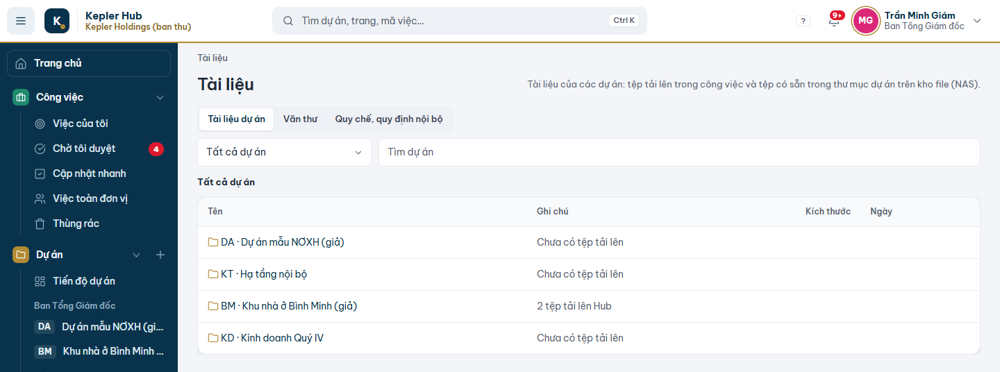

**Ai thấy, ai sửa:** Như bảng ở đầu mục 4.2. Trang này chỉ để xem, không ai sửa gì ở đây.

**Dùng để làm gì:** Tìm dự án cần lấy tài liệu. Mỗi dòng là một dự án; cột **Ghi chú** cho biết dự án có bao nhiêu tệp tải lên Hub và có thư mục trên NAS không.

**Các bước thường làm**

1. Gõ vài chữ của mã hoặc tên dự án vào ô tìm, hoặc chọn dự án ở ô chọn bên trái.
2. Bấm dòng dự án để mở (mục 4.2.2).

**Từng ô**

| Ô (nguyên văn) | Nghĩa là gì | Điền / chọn thế nào (mặc định) | Đổi thì hệ thống làm gì khác |
|---|---|---|---|
| Ô chọn dự án (trình đọc màn hình đọc là "Dự án") | Chọn một dự án để mở | Mặc định **Tất cả dự án**. Mỗi dự án hiện "MÃ · Tên"; dự án đã đóng có thêm " (đã đóng)" | Chọn một dự án là mở gốc dự án đó, xoá chữ đang tìm |
| Ô tìm, chữ mờ "Tìm dự án" | Tìm dự án theo mã và tên | Trống. Gõ xong ngừng 0,4 giây là lọc; Enter lọc ngay | Không phân biệt hoa thường, có dấu hay không. Dấu "-", "_", ".", khoảng trắng coi như nhau. Từ khoá ghi lên địa chỉ trang, tải lại vẫn giữ |

**Các nút**

| Nút | Làm gì | Có hỏi lại không | Quay lại được không |
|---|---|---|---|
| Dòng dự án (bấm cả dòng hoặc tên) | Mở gốc dự án (mục 4.2.2) | Không | Có |
| **Tất cả dự án** trên thanh đường dẫn | Về danh sách dự án | Không | Có |

Bảng có các cột **Tên**, **Ghi chú**, **Kích thước**, **Ngày**. Cột **Ghi chú** của mỗi dự án ghép các phần sau, cách nhau bằng dấu "·":

- "*n* tệp tải lên Hub", hoặc "Chưa có tệp tải lên";
- "NAS: *tên thư mục*", nếu dự án có thư mục trên kho file;
- "đã đóng", nếu dự án đã đóng.

Dự án đã đóng xếp cuối danh sách. Trang trống thì hiện một trong hai câu: "Bạn chưa là thành viên dự án nào. Tài liệu dự án chỉ hiện với thành viên dự án và Ban Tổng Giám đốc." hoặc "Không có dự án khớp." (khi đang tìm).

**⚠️ Dễ nhầm**

- Số "tệp tải lên Hub" không đếm tệp của việc đã xoá vào **Thùng rác**.
- Ở danh sách này, ô tìm chỉ tìm **dự án**. Muốn tìm **tệp**, mở một dự án trước (mục 4.2.5).
- Kho NAS đang lỗi: danh sách dự án vẫn hiện, phần NAS ghi lý do lỗi.

**Claude:** Không có công cụ xem tài liệu dự án.

#### 4.2.2 Một dự án: hai nguồn tệp (Hub và NAS)

**Mở ở đâu:** Bấm một dự án ở danh sách, hoặc chọn dự án ở ô chọn (trang `#/tai-lieu?tab=du-an&p=<số dự án>`).

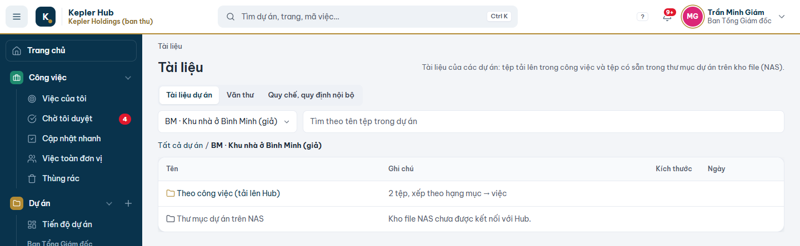

**Ai thấy, ai sửa:** Như mục 4.2. Chỉ xem.

**Dùng để làm gì:** Chọn xem tệp theo cây công việc hay theo thư mục dự án trên NAS.

| Dòng thư mục (nguyên văn) | Ghi chú hiện cạnh | Chứa gì |
|---|---|---|
| **Theo công việc (tải lên Hub)** | "*n* tệp, xếp theo hạng mục → việc" | Tệp mọi người đã đính kèm trong các việc của dự án (mục 4.2.3) |
| **Thư mục dự án trên NAS (*tên thư mục*)** | "Mọi tệp trong thư mục dự án, kể cả tệp không tải qua Hub (chỉ đọc)" | Mọi tệp trong thư mục dự án trên kho file, kể cả tệp chép thẳng vào ổ mạng (mục 4.2.4) |

Khi không mở được thư mục NAS, dòng **Thư mục dự án trên NAS** mờ, không bấm được, kèm một trong ba câu tùy lý do (kho lỗi; dự án chưa có thư mục; Hub chưa nối với NAS):

- "Kho file đang không truy cập được (*mã lỗi*) — thử lại sau hoặc báo IT";
- "Chưa có thư mục cho dự án trên kho file (tên thư mục phải là "*MÃ*" hoặc bắt đầu bằng "*MÃ*-") — liên hệ IT tạo.";
- "Kho file NAS chưa được kết nối với Hub."

Thư mục dự án trên NAS do **IT tạo sẵn** ở gốc kho file. Hub không tự tạo. Tên thư mục phải **đúng bằng mã dự án** hoặc **bắt đầu bằng "MÃ-"**, không phân biệt hoa thường. Ví dụ dự án mã BM: thư mục `BM` hoặc `BM-BinhMinh` khớp; `BM_BinhMinh` và `BMX-BinhMinh` không khớp.

Thanh đường dẫn: **Tất cả dự án** → "*MÃ* · *Tên*". Bấm từng đoạn để quay lên.

**Claude:** Không có công cụ.

#### 4.2.3 "Theo công việc (tải lên Hub)"

**Mở ở đâu:** Trong một dự án → dòng **Theo công việc (tải lên Hub)** (trang `#/tai-lieu?tab=du-an&p=<số dự án>&src=hub`).

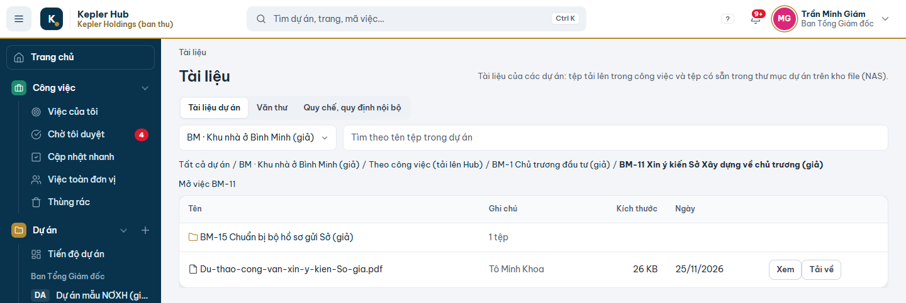

**Ai thấy, ai sửa:** Mọi người xem được tài liệu dự án (mục 4.2). Chỉ xem và tải; không tải lên, không xoá ở đây.

**Dùng để làm gì:** Xem tệp đính kèm trong các việc, xếp như thư mục: hạng mục → việc → việc nhánh. Cần lấy lại bản vẽ, hồ sơ ai đó đã gửi trong một việc mà không phải mở từng việc.

**Các bước thường làm**

1. Bấm dòng thư mục mang mã và tên việc, ví dụ "BM-3 Thiết kế cơ sở". Ghi chú "*n* tệp" đếm cả tệp của việc nhánh.
2. Đi sâu tới việc cần tìm. Trong một việc có liên kết **Mở việc *mã việc*** để mở panel chi tiết việc.
3. Bấm **Xem** hoặc **Tải về** ở dòng tệp.

**Các nút**

| Nút | Làm gì | Có hỏi lại không | Quay lại được không |
|---|---|---|---|
| Dòng thư mục "*mã việc* *tên việc*" | Vào trong việc đó | Không | Có |
| **Mở việc *mã việc*** | Mở panel chi tiết việc trong trang dự án. Panel áp quyền riêng của việc: người không liên quan chỉ thấy tóm tắt | Không | Có |
| **Xem** | Mở tệp ở thẻ trình duyệt mới. Chỉ có với tệp .pdf .png .jpg .jpeg .gif .webp | Không | Có |
| **Tải về** | Tải tệp về máy | Không | Có |

Mỗi dòng tệp có: **Tên**; **Ghi chú** = tên người tải lên, kèm nhãn **Kho file** nếu bản gốc nằm trên NAS (rê chuột: "Bản gốc trong kho file dự án"); **Kích thước** (B, KB, MB); **Ngày** tải lên (rê chuột thấy cả giờ).

Trang trống: "Việc này chưa có tệp." hoặc "Chưa có tệp nào được tải lên trong các việc của dự án."

Lỗi có thể gặp (hiện thông báo đỏ): "Không tìm thấy tệp"; "Tệp không còn trong kho lưu trữ"; "Kho file đang không truy cập được (*mã lỗi*) — thử lại sau hoặc báo IT".

**⚠️ Dễ nhầm**

- Chỉ việc **có tệp** (và các việc cha của nó) mới thành thư mục. Việc không có tệp không hiện.
- Việc đã xoá vào **Thùng rác**: tệp của việc biến khỏi cây và không tải được ở đây.
- Trang giữ dữ liệu cây 30 giây. Vừa đính kèm tệp ở việc rồi quay lại có thể chưa thấy: bấm F5.
- Trang này không xem trước được tệp Word. Muốn xem Word ngay trên trình duyệt, mở việc, dùng nút **Xem** trong panel việc.
- Mỗi lần **Xem** hoặc **Tải về** đều được ghi vào nhật ký hệ thống (IT tra được ai đã mở tệp nào).

**Claude:** Không có công cụ. Claude không xem, không tải nội dung tệp: máy chủ trả "Xuất / tải tệp không làm qua Claude — làm trên giao diện Kepler Hub".

#### 4.2.4 "Thư mục dự án trên NAS" (chỉ đọc)

**Mở ở đâu:** Trong một dự án → dòng **Thư mục dự án trên NAS (*tên thư mục*)** (trang `#/tai-lieu?tab=du-an&p=<số dự án>&src=nas`).

**Ai thấy, ai sửa:** Mọi người xem được tài liệu dự án. **Chỉ đọc**: Hub không tạo, sửa, xoá, đổi tên gì trên NAS ở đây.

**Dùng để làm gì:** Duyệt mọi tệp trong thư mục dự án trên kho file, kể cả tệp chép thẳng vào ổ mạng, không qua Hub. Hữu ích khi làm việc ngoài văn phòng mà không mở được ổ mạng.

**Các nút**

| Nút | Làm gì | Có hỏi lại không | Quay lại được không |
|---|---|---|---|
| Dòng thư mục | Vào thư mục con | Không | Có |
| Từng đoạn trên thanh đường dẫn | Về thư mục cha | Không | Có |
| Mã việc ở cột **Ghi chú** (rê chuột: "Tệp này được tải lên trong việc *mã*") | Mở việc đã đính kèm tệp này | Không | Có |
| **Xem** | Mở tệp ở thẻ mới (PDF, ảnh) | Không | Có |
| **Tải về** | Tải tệp về máy | Không | Có |

Thư mục xếp trước, tệp xếp sau, theo tên (số xếp tự nhiên: "2" trước "10"). Cột **Ngày** là ngày sửa tệp trên NAS. Thư mục không có gì: "Thư mục trống."

Lỗi có thể gặp: "Đường dẫn thư mục không hợp lệ"; "Không phải thư mục"; "Không phải tệp"; "Không tìm thấy thư mục / tệp"; "Kho file đang không truy cập được (vừa bị treo, tạm ngắt ít giây) — thử lại sau hoặc báo IT"; "Kho file đang không truy cập được (*mã lỗi*) — thử lại sau hoặc báo IT"; "Dự án chưa có thư mục trên kho file".

**⚠️ Dễ nhầm**

- Tệp hệ thống bị ẩn: tên bắt đầu bằng "." hoặc "~$", và các mục "@eaDir", "#recycle", "#snapshot", "Thumbs.db", "desktop.ini", "$RECYCLE.BIN", "System Volume Information".
- Liên kết tắt trỏ ra ngoài thư mục dự án bị bỏ qua.
- Muốn sửa, xoá, đổi tên tệp trên NAS: làm trực tiếp trên ổ mạng, ngoài Hub.
- Cả **Xem** lẫn **Tải về** tệp NAS đều ghi nhật ký là "tải về".

**Claude:** Không có công cụ. Claude không tải được tệp NAS.

#### 4.2.5 Tìm tệp trong một dự án

**Mở ở đâu:** Mở một dự án, gõ vào ô tìm (chữ mờ "Tìm theo tên tệp trong dự án").

**Ai thấy, ai sửa:** Như mục 4.2.

**Dùng để làm gì:** Tìm tệp theo tên ở **cả hai nguồn** cùng lúc, không phải đi từng thư mục.

**Từng ô**

| Ô (nguyên văn) | Nghĩa là gì | Điền / chọn thế nào (mặc định) | Đổi thì hệ thống làm gì khác |
|---|---|---|---|
| Ô tìm, chữ mờ "Tìm theo tên tệp trong dự án" | Từ khoá trong tên tệp hoặc tên thư mục | Trống. Tối đa 200 ký tự | Tìm tên tệp tải lên Hub và tên tệp, thư mục trong cả cây NAS. Không phân biệt dấu, hoa thường; "-", "_", ".", khoảng trắng coi như nhau. Ví dụ gõ "ho so" khớp "Hồ_sơ-thiết-kế.pdf" |

Kết quả chia hai khối:

- **Theo công việc (tải lên Hub) · *n***: cột **Ghi chú** có mã việc (bấm để mở việc) và người tải lên.
- **Thư mục dự án trên NAS · *n***: cột **Ghi chú** có đường dẫn thư mục cha, hoặc "(gốc)". Thư mục khớp hiện thành dòng thư mục, ghi chú "thư mục".

Mỗi tệp có **Xem** / **Tải về** như mục 4.2.3, 4.2.4. Không ra gì: "Không có tệp khớp." Thanh đường dẫn ghi "Kết quả tìm "*từ khoá*"".

**⚠️ Dễ nhầm**

- Tìm trên NAS dừng khi đủ 200 kết quả, đã duyệt 20.000 mục, sâu quá 12 tầng thư mục, hoặc quá 3 giây. Khi đó số đếm có dấu "+" và hiện "Nhiều kết quả — gõ cụ thể hơn để thu hẹp."
- NAS lỗi lúc tìm: khối NAS **lặng lẽ biến mất**, chỉ còn khối Hub. Không thấy khối NAS dù dự án có thư mục NAS thì thử lại sau ít phút.

**Claude:** Không có công cụ.

#### 4.2.6 Đưa tệp vào kho dự án (làm trong panel việc)

Trang Tài liệu **không có nút tải lên**. Tệp vào kho dự án qua panel của từng việc.

**Mở ở đâu:** Mở một việc → panel bên phải → tab **Kết quả & tài liệu** → khối **Tài liệu, văn bản, sản phẩm** → nút **Gửi kết quả (đính kèm tệp)** (bạn là người chủ trì, người phối hợp) hoặc **Đính kèm tài liệu giao** (bạn là người giao, hoặc Ban Tổng Giám đốc phụ trách việc).

**Ai thấy, ai sửa:** Người giao và Ban Tổng Giám đốc phụ trách việc gửi tài liệu bên giao (cột **Bên giao gửi**). Người chủ trì, người phối hợp gửi tài liệu bên thực hiện (cột **Bên thực hiện gửi lại**). Người khác nhận "Chỉ người giao, Ban Tổng Giám đốc, người chủ trì hoặc người phối hợp gửi tệp cho việc này".

**Dùng để làm gì:** Gửi hồ sơ kèm khi giao việc, hoặc gửi sản phẩm khi làm xong. Tệp hiện ngay ở **Theo công việc** (mục 4.2.3), và nếu dự án có thư mục NAS thì cả ở **Thư mục dự án trên NAS** (mục 4.2.4).

**Từng ô**

| Ô (nguyên văn) | Nghĩa là gì | Điền / chọn thế nào (mặc định) | Đổi thì hệ thống làm gì khác |
|---|---|---|---|
| Nút chọn tệp **Gửi kết quả (đính kèm tệp)** / **Đính kèm tài liệu giao**, gợi ý "PDF, Office, ảnh, ZIP, TXT/CSV · tối đa 25 MB" | Tệp đính kèm cho việc | Chọn 1 đến 5 tệp một lần; mỗi tệp tối đa 25 MB. Đuôi được nhận: .pdf .png .jpg .jpeg .gif .webp .docx .xlsx .pptx .zip .doc .xls .ppt .txt .csv | Dự án có thư mục NAS: bản gốc lưu vào NAS theo quy ước tên (dưới bảng). Không có: lưu trong kho của Hub. Lỗi: "Loại tệp không được phép. Cho phép: .pdf, .png, .jpg, .jpeg, .gif, .webp, .docx, .xlsx, .pptx, .zip, .doc, .xls, .ppt, .txt, .csv"; "Nội dung tệp không khớp với đuôi tệp"; "Tệp văn bản chứa dữ liệu nhị phân"; "Tệp vượt 25 MB"; "Chưa chọn tệp"; chọn quá 5 tệp: "Tải tệp không hợp lệ" |

Quy ước tên trên NAS: Hub tự đặt tên, **không ghi đè**; mỗi lần tải lên là một phiên bản mới `_v01`, `_v02`. Đường dẫn dạng *thư mục dự án* / *thư mục mảng theo phòng chủ trì hạng mục, nếu IT có cấu hình* / *MÃ-số hạng mục_Tên hạng mục không dấu* / *mã việc_mã bộ phận chủ trì_tên tệp không dấu_vNN_ngày*. Ví dụ: tệp "Bản vẽ mặt bằng.pdf" gửi ngày 25/11/2026 trong việc BM-15 (phòng Thiết kế chủ trì), thuộc hạng mục BM-3 "Thiết kế cơ sở", lưu thành `BM-BinhMinh/BM-3_ThietKeCoSo/BM-15_TKKT_BanVeMatBang_v01_20261125.pdf` (khi IT không cấu hình thư mục mảng; có cấu hình thì thêm một cấp thư mục mảng sau `BM-BinhMinh`). Gửi lại tệp cùng tên thì thành `_v02_`.

**⚠️ Dễ nhầm**

- Chỉ người đã gửi tệp mới xoá được tệp đó, trong panel việc. Tệp trên NAS: hộp xác nhận "Gỡ tệp này khỏi việc? Bản gốc trong kho file được chuyển vào thư mục lưu trữ của dự án (vd. 99.LuuTru), IT lấy lại được khi cần." Tệp lưu trong Hub: "Xoá tệp đính kèm này? Tệp bị xoá hẳn, không khôi phục được."
- Mỗi lần tải lên được ghi nhật ký hệ thống kèm dấu vân tay (mã băm SHA-256) của tệp.

**Claude:** Không tải tệp lên được.

---

### 4.3 Văn thư: văn bản đến, văn bản đi

Tab **Văn thư** là sổ văn bản đến (dãy D10) và sổ văn bản đi (dãy D9) của công ty, theo "Quy định văn thư, lưu trữ" (QyĐ-GA-01). Tab con **Tôi xử lý** gom các văn bản giao bạn xử lý. Quyền xem theo **Mức bảo mật** (hệ 1 ở đầu chương).

#### 4.3.1 Các sổ: Văn bản đến, Văn bản đi, Tôi xử lý

**Mở ở đâu:** **Tài liệu** → tab **Văn thư** (mặc định mở sổ **Văn bản đến**) → tab con **Văn bản đến** (trang `#/vanthu?book=DEN`), **Văn bản đi** (`#/vanthu?book=DI`) hoặc **Tôi xử lý** (`#/vanthu?book=mine`).

**Ai thấy, ai sửa:**

- Xem danh sách: mọi tài khoản trừ Quản trị hệ thống. Mỗi người chỉ thấy văn bản mình được xem (mục 4.3.6).
- Nút **Vào sổ**: Ban Tổng Giám đốc và Văn thư. Lãnh đạo bộ phận, Nhân viên không thấy nút này ở sổ đến, sổ đi.
- Nút **Thiết lập**: chỉ Ban Tổng Giám đốc (mục 4.6).

**Dùng để làm gì:** Tra cứu văn bản đến, đi; văn thư vào sổ văn bản mới; người được giao xem văn bản mình phải xử lý. Dòng mô tả cạnh tiêu đề: "Vào sổ là có số ngay, theo đúng dãy của từng pháp nhân. Văn bản đến tự tính hạn theo độ khẩn."

**Các bước thường làm**

1. Chọn sổ: **Văn bản đến**, **Văn bản đi** hoặc **Tôi xử lý**.
2. Gõ số, trích yếu hoặc nơi gửi vào ô tìm. Đổi **Năm** nếu cần văn bản năm trước. Tick **Quá hạn** để chỉ xem văn bản trễ.
3. Bấm một dòng để mở chi tiết (mục 4.3.3).

**Từng ô** (thanh lọc)

| Ô (nguyên văn) | Nghĩa là gì | Điền / chọn thế nào (mặc định) | Đổi thì hệ thống làm gì khác |
|---|---|---|---|
| Ô tìm, chữ mờ "Số, trích yếu, nơi gửi / nhận" | Tìm văn bản | Trống; tối đa 100 ký tự | Tìm trong số, trích yếu, nơi gửi / nơi nhận **và** số của bên gửi. Không phân biệt hoa thường, có dấu hay không. Dấu "%" và "_" hiểu đúng như chữ gõ |
| Ô chọn năm (trình đọc màn hình đọc là "Năm") | Năm của sổ | Năm nay. Chỉ có 3 lựa chọn: năm nay và 2 năm trước | Chỉ hiện văn bản vào sổ trong năm đó |
| Ô chọn pháp nhân (trình đọc màn hình đọc là "Pháp nhân") | Lọc theo công ty | **Mọi pháp nhân**; mỗi pháp nhân hiện "MÃ · Tên" | Chỉ hiện văn bản của pháp nhân đó. **Ô này chỉ xuất hiện khi Thiết lập có từ 2 pháp nhân trở lên** |
| **Quá hạn** (ô tick) | Chỉ văn bản quá hạn | Không tick | Chỉ hiện văn bản có hạn, hạn đã qua (trước hôm nay), chưa xong, chưa hủy. Chỉ có ở **Văn bản đến** và **Tôi xử lý** |

Danh sách lọc ngay khi bạn gõ (chờ 0,3 giây) hoặc khi đổi ô chọn, tick ô. Enter lọc ngay. Bộ lọc được ghi lên địa chỉ trang, tải lại trang vẫn giữ.

**Các nút**

| Nút | Làm gì | Có hỏi lại không | Quay lại được không |
|---|---|---|---|
| Tab con **Văn bản đến** / **Văn bản đi** / **Tôi xử lý** | Đổi sổ | Không | Có |
| **Vào sổ** | Mở hộp **Vào sổ văn bản** (mục 4.3.2) | Không | Có, đóng hộp là xong |
| **Vào sổ văn bản đầu tiên** | Như **Vào sổ**. Chỉ hiện khi sổ của năm nay chưa có văn bản nào | Không | Có |
| **Xoá bộ lọc** | Hiện khi lọc không ra gì. Xoá ô tìm, bỏ tick **Quá hạn**, bỏ lọc pháp nhân. Không đổi năm | Không | Có |
| **Thiết lập** | Mở màn **Thiết lập văn thư** (mục 4.6) | Không | Có |
| Bấm một dòng | Mở chi tiết văn bản (mục 4.3.3) | Không | Có |

Các cột của bảng:

- **Số**.
- **Trích yếu**, kèm nhãn độ khẩn nếu khác "Thường" ("Khẩn" màu vàng; "Thượng khẩn", "Hỏa tốc" màu đỏ) và nhãn mức bảo mật ("Hạn chế" màu vàng, "Bảo mật cao" màu đỏ; "Công khai", "Nội bộ" không có nhãn).
- **Nơi gửi** (sổ đến, Tôi xử lý) hoặc **Nơi nhận** (sổ đi).
- Sổ đến và Tôi xử lý có thêm **Người xử lý** và **Hạn** (quá hạn thì ngày in đậm màu đỏ). Sổ đi có thêm **Ngày** (ngày văn bản; không có thì ngày vào sổ).
- **Trạng thái**: xanh lá là đã xong; đỏ là quá hạn; xanh dương là đang mở; xám "Đã hủy".

Trang trống thì hiện: "Không có văn bản khớp bộ lọc." (đang lọc); "Không có văn bản nào giao bạn xử lý." (Tôi xử lý); "Chưa có văn bản trong sổ năm này." (sổ trống).

**⚠️ Dễ nhầm**

- **Mọi nhân viên** thấy toàn bộ văn bản mức "Công khai" và "Nội bộ" trong sổ: số, trích yếu, nơi gửi, người xử lý. Văn bản chỉ một nhóm được biết thì chọn "Hạn chế" hoặc "Bảo mật cao".
- **Tôi xử lý** cũng lọc theo năm. Văn bản giao bạn từ năm trước, còn đang xử lý, chỉ hiện khi chọn năm đó.
- Không có lọc theo bộ phận. Lãnh đạo bộ phận muốn xem văn bản của bộ phận thì tìm trong sổ chung.
- Mỗi lần máy chủ trả tối đa 500 văn bản, không chia trang. Sổ quá 500 văn bản trong năm thì dùng ô tìm để thu hẹp.
- Ở **Tôi xử lý**, cột thứ ba luôn ghi **Nơi gửi**, kể cả với văn bản đi. Bấm **Vào sổ** từ tab này thì dãy chọn sẵn là "D9 · Văn bản đi".
- Văn bản đi quá "Hạn chờ phản hồi" chỉ có nhãn trạng thái đỏ. Sổ đi không có ô **Quá hạn** và không có nhắc tự động.
- Bạn vừa được chọn làm Văn thư mà chưa thấy nút **Vào sổ**: tải lại trang (F5).

**Claude:** Không có công cụ xem, tìm sổ văn thư.

#### 4.3.2 Hộp "Vào sổ văn bản"

**Mở ở đâu:** Nút **Vào sổ** (hoặc **Vào sổ văn bản đầu tiên**) ở sổ **Văn bản đến**, **Văn bản đi** hoặc **Tôi xử lý**.

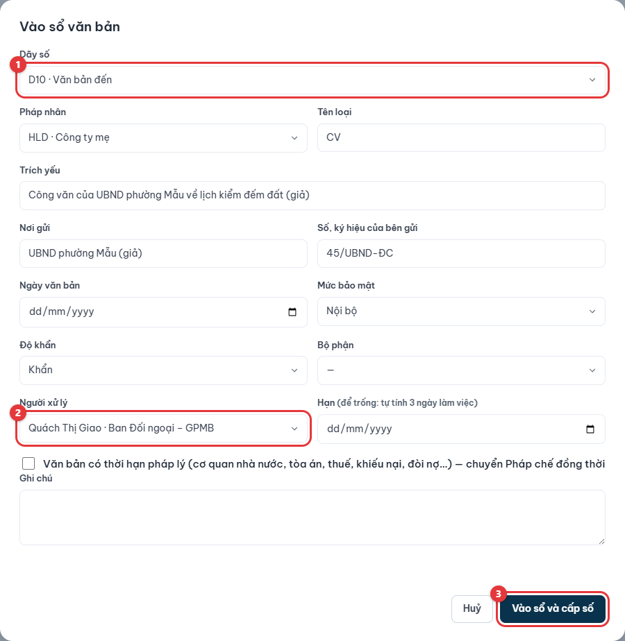

**Ai thấy, ai sửa:** Ban Tổng Giám đốc và Văn thư. Người khác không thấy nút. Nếu cố gọi, máy chủ trả "Chỉ văn thư (do Ban TGĐ chỉ định) hoặc Ban TGĐ vào sổ văn bản".

**Dùng để làm gì:** Ghi một văn bản vào sổ và **cấp số ngay**. Với văn bản đến: giao người xử lý, hệ thống tự tính hạn.

**Các bước thường làm** (văn bản đến)

1. Mở sổ **Văn bản đến** → bấm **Vào sổ**.
2. **Dãy số** đã chọn sẵn "D10 · Văn bản đến". Chọn **Pháp nhân** nhận văn bản.
3. Gõ **Trích yếu** (bắt buộc), **Nơi gửi**, **Số, ký hiệu của bên gửi**; chọn **Ngày văn bản**.
4. Chọn **Mức bảo mật**, **Độ khẩn**, **Bộ phận**, **Người xử lý**. Văn bản không ghi hạn thì để trống ô **Hạn**.
5. Văn bản của cơ quan nhà nước, tòa án, thuế, khiếu nại, đòi nợ: tick ô chuyển Pháp chế.
6. Bấm **Vào sổ và cấp số**. Thông báo "Đã vào sổ: *số*" hiện ra, trang chi tiết mở.
7. Ở trang chi tiết, bấm **Tải tệp lên** để đưa bản scan lên (mục 4.3.3).

Văn bản đi: mở sổ **Văn bản đi** → **Vào sổ**; dãy là "D9 · Văn bản đi"; gõ **Nơi nhận**, **Người ký**, **Kênh gửi**. Ô **Tên loại** quyết định ký hiệu trong số (mục 4.5).

**Từng ô** (ô nào hiện tùy dãy đang chọn)

| Ô (nguyên văn) | Nghĩa là gì | Điền / chọn thế nào (mặc định) | Đổi thì hệ thống làm gì khác |
|---|---|---|---|
| **Dãy số** | Sổ và dãy cấp số | Chỉ các dãy của sổ đang mở mà bạn được vào sổ: "D10 · Văn bản đến" ở sổ đến; "D9 · Văn bản đi" ở sổ đi. Mở từ **Tôi xử lý** thì có cả hai, chọn sẵn D9 | Quyết định sổ, dạng số (mục 4.5) và các ô hiện ra. Lỗi: "Dãy số không hợp lệ" |
| **Pháp nhân** | Công ty nhận (sổ đến) hoặc phát hành (sổ đi) | Danh sách ở **Thiết lập**, dạng "MÃ · Tên"; chọn sẵn dòng đầu | Mã pháp nhân vào số. Mỗi pháp nhân một dãy số riêng. Lỗi: "Pháp nhân không hợp lệ" |
| **Tên loại**, chữ mờ "CV, TB, QĐ, TTr…" | Loại văn bản viết tắt | Trống. Gõ hoặc chọn gợi ý: CV Công văn, TB Thông báo, QĐ Quyết định, TTr Tờ trình, BC Báo cáo, KH Kế hoạch, BB Biên bản, GUQ Giấy ủy quyền, GGT Giấy giới thiệu, ĐX Đề xuất, CT Chỉ thị. Gõ được loại khác | Sổ đi: trống hoặc "CV" cho số dạng `045/2026/HLD` (thêm mã bộ phận nếu chọn **Bộ phận**: `045/2026/HLD-INV`); loại khác cho số dạng `046/2026/TB-HLD`. Sổ đến: chỉ lưu, không vào số. Phải là 2–6 chữ cái (có thể có Đ), không số, không dấu khác; sai thì báo "Tên loại viết tắt 2–6 chữ (vd. CV, TB, QĐ, TTr)" |
| **Trích yếu** | Tóm tắt nội dung | Bắt buộc; tối đa 500 ký tự | Hiện ở danh sách, ô tìm, thông báo. Lỗi: "Thiếu Trích yếu", "Trích yếu vượt 500 ký tự" |
| **Nơi gửi** (sổ đến) / **Nơi nhận** (sổ đi) | Cơ quan gửi hoặc nhận | Trống; tối đa 300 ký tự | Tìm được. Khi gắn văn bản đến vào việc, thành "Nơi ban hành" |
| **Số, ký hiệu của bên gửi** (chỉ sổ đến) | Số in trên văn bản đến | Trống; tối đa 80 ký tự | Tìm được bằng số này |
| **Người ký** (chỉ sổ đi) | Người ký văn bản đi | Trống; tối đa 120 ký tự | Chỉ hiển thị |
| **Ngày văn bản** | Ngày ghi trên văn bản | Trống; chọn ngày | Hiển thị. Sổ đi dùng làm cột **Ngày**. Lỗi: "Ngày không hợp lệ (YYYY-MM-DD)" |
| **Mức bảo mật** | Ai được xem (mục 4.3.6) | **Nội bộ**. Chọn "Công khai", "Nội bộ", "Hạn chế", "Bảo mật cao" | Đổi ngay phạm vi người xem. Chỉ "Công khai", "Nội bộ" gắn được vào việc. Lỗi: "Mức bảo mật không hợp lệ" |
| **Độ khẩn** | Mức khẩn | **Thường**. Chọn "Thường", "Khẩn", "Thượng khẩn", "Hỏa tốc" | Sổ đến: hạn tự tính khi để trống ô **Hạn** (mục 4.3.5). Nhãn màu ở danh sách. Lỗi: "Độ khẩn không hợp lệ" |
| **Bộ phận** | Bộ phận phụ trách văn bản | Trống ("—"); danh sách bộ phận đang hoạt động | Văn bản "Hạn chế": cả bộ phận xem được. Lãnh đạo bộ phận đó bấm được **Bắt đầu xử lý**, **Báo xong**, tải tệp lên, nhận nhắc quá hạn. Bản scan lưu vào thư mục văn thư của bộ phận đó trên NAS. Sổ đi loại "CV": mã bộ phận vào số. Để trống mà có người xử lý thì lấy bộ phận của người xử lý. Lỗi: "Bộ phận không hợp lệ" |
| **Người xử lý** (chỉ sổ đến) | Người được giao xử lý | "— chưa giao —"; danh sách mọi tài khoản đang hoạt động trừ Quản trị, dạng "Họ tên · Bộ phận" | Chọn người: trạng thái bắt đầu ở "Đã giao xử lý"; người đó nhận thông báo "Văn bản *số* giao bạn xử lý · hạn *dd/mm/yyyy*"; văn bản vào tab **Tôi xử lý** của họ. Lỗi: "Người xử lý không hợp lệ" |
| **Hạn** (sổ đến, sổ đi) | Sổ đến: hạn xử lý. Sổ đi: hạn chờ phản hồi | Trống. Gợi ý cạnh nhãn đổi theo **Độ khẩn**: "(để trống: tự tính 7 ngày làm việc)" (Thường), "(để trống: tự tính 3 ngày làm việc)" (Khẩn), "(để trống: tự tính 1 ngày làm việc)" (Thượng khẩn), "(để trống: tự tính trong ngày làm việc)" (Hỏa tốc). Sổ đi: "(hạn chờ phản hồi)" | Sổ đến để trống: hạn tự tính theo độ khẩn, **đếm từ ngày vào sổ**. Sổ đi để trống: không có hạn. Lỗi: "Ngày không hợp lệ (YYYY-MM-DD)" |
| **Kênh gửi** (chỉ sổ đi), chữ mờ "Bưu điện, trực tiếp, email…" | Cách gửi | Trống; tối đa 60 ký tự | Hiện ở dòng "Kênh / mã vận đơn" |
| Ô tick "Văn bản có thời hạn pháp lý (cơ quan nhà nước, tòa án, thuế, khiếu nại, đòi nợ…) — chuyển Pháp chế đồng thời" (chỉ sổ đến) | Đánh dấu chuyển Pháp chế | Không tick | Tick: mọi người trong danh sách **Pháp chế** nhận "Văn bản *số* có thời hạn pháp lý — chuyển Pháp chế" và được xem văn bản dù mức "Hạn chế". Trang chi tiết ghi "Pháp chế: Đã chuyển đồng thời" |
| **Ghi chú** | Ghi chú tự do | Trống; tối đa 1000 ký tự | Hiển thị |

**Các nút**

| Nút | Làm gì | Có hỏi lại không | Quay lại được không |
|---|---|---|---|
| **Huỷ** | Đóng hộp, không lưu | Không | Có |
| **Vào sổ và cấp số** | Cấp số, tạo văn bản, mở trang chi tiết. Thông báo "Đã vào sổ: *số*" | **Không hỏi** | **Không.** Số đã cấp không lấy lại. Sai thì **Hủy số** rồi vào sổ lại; số đã hủy vẫn nằm trong sổ |

Lỗi hiện thành dòng chữ đỏ ngay trong hộp; hộp không đóng.

⚠️ **Vào sổ và cấp số** không hỏi lại và không quay lại được. Kiểm **Dãy số**, **Pháp nhân**, **Tên loại**, **Ngày văn bản**, **Số, ký hiệu của bên gửi**, **Người ký**, **Kênh gửi**, **Bộ phận** trước khi bấm: các ô này không sửa được trong hộp **Sửa** sau đó.

⚠️ **Chữ trên màn hình ghi** "Pháp chế: Đã chuyển đồng thời" **nhưng thực tế** nếu danh sách Pháp chế ở Thiết lập đang trống thì không ai nhận văn bản. Trước khi tick, hỏi Ban Tổng Giám đốc đã chọn Pháp chế chưa.

**⚠️ Dễ nhầm**

- Hạn tự tính đếm từ **ngày vào sổ**, không phải ngày văn bản. Ví dụ: văn bản đề ngày 20/11/2026, vào sổ thứ Tư 25/11/2026, độ khẩn "Khẩn", để trống **Hạn**: hạn là thứ Hai 30/11/2026.
- **Tên loại** phân biệt hoa thường khi so với "CV". Gõ "cv" cho văn bản đi sẽ ra số `001/2026/cv-HLD` thay vì `001/2026/HLD`. Luôn gõ chữ in hoa.
- Không có ô chọn "người được xem thêm" cho văn bản "Bảo mật cao" (mục 4.3.6).
- Nút **Huỷ** (đóng hộp) khác hẳn **Hủy số** (hủy văn bản đã có số).
- Văn bản đi không có ô **Người xử lý** lúc vào sổ, và không có ô **Mã vận đơn**. Điền sau bằng **Sửa / giao xử lý**.

**Claude:** Không vào sổ được. Máy chủ trả "Vào sổ văn bản làm trên giao diện".

#### 4.3.3 Chi tiết một văn bản đến, đi

**Mở ở đâu:** Bấm một dòng ở danh sách sổ; bấm liên kết trong thông báo; hoặc bấm số văn bản trong khối văn bản của một việc (trang `#/vanthu/<số thứ tự văn bản>`).

**Ai thấy, ai sửa:** Người xem được văn bản (mục 4.3.6). Người khác mở liên kết thì thấy "Không tìm thấy văn bản". Nút nào hiện tùy quyền của bạn với văn bản đó.

**Dùng để làm gì:** Xem đủ thông tin, bấm bước xử lý, tải bản scan lên và về, xem lịch sử.

**Các phần trên trang** (chỉ hiện dòng có giá trị)

| Phần (nguyên văn) | Nội dung |
|---|---|
| Tiêu đề | Số văn bản, ví dụ `0001/2026/Đ-HLD`, kèm nhãn trạng thái |
| **Sổ** | Sổ · dãy · pháp nhân, ví dụ "Văn bản đến · D10 · HLD" |
| **Nơi gửi** / **Nơi nhận** | Theo sổ |
| **Số của bên gửi** | Sổ đến |
| **Ngày văn bản** | dd/mm/yyyy |
| **Vào sổ** | Thời điểm vào sổ · người vào sổ |
| **Mức bảo mật**, **Độ khẩn** | |
| **Người xử lý**, **Bộ phận** | |
| **Hạn xử lý** (sổ đến) / **Hạn chờ phản hồi** (sổ đi) | Quá hạn thì in đỏ "*ngày* · quá hạn" |
| **Người ký** | Sổ đi |
| **Kênh / mã vận đơn** | Kênh gửi · mã vận đơn |
| **Pháp chế** | "Đã chuyển đồng thời" nếu đã tick chuyển Pháp chế |
| **Ghi chú** | |
| Dòng đỏ khi đã hủy | "Đã hủy *thời điểm* — *lý do*. Số này giữ nguyên trong sổ, không cấp lại." |
| Khối **Tệp văn bản** | Mỗi tệp: tên, dung lượng KB, người tải lên, thời điểm; nhãn **NAS · v01** nếu bản gốc nằm trên NAS (rê chuột thấy dòng "Bản gốc trên NAS:" kèm đường dẫn đầy đủ trên ổ mạng, bắt đầu bằng `\\192.168.130.2\DATA`). Chưa có tệp: "Chưa có tệp. Bản scan văn bản lưu vào thư mục văn thư của bộ phận trên NAS." |
| Khối **Lịch sử** | Mỗi dòng: thời điểm, người, việc đã làm, ghi chú. Các việc: "Vào sổ", "Đổi trạng thái: *từ* → *sang*", "Giao xử lý", "Sửa thông tin", "Hủy số", "Thêm tệp", "Gỡ tệp" |

**Các bước xử lý văn bản đến**

| Trạng thái (nhãn) | Nút để chuyển tới | Ai bấm được |
|---|---|---|
| **Đã tiếp nhận** | (Trạng thái đầu khi vào sổ chưa có người xử lý) | — |
| **Đã trình** | **Đã trình** | Ban Tổng Giám đốc, Văn thư |
| **Đã giao xử lý** | **Đã giao**. Tự chuyển tới đây khi chọn người xử lý lúc vào sổ, hoặc khi giao người lúc văn bản đang "Đã tiếp nhận" / "Đã trình" | Ban Tổng Giám đốc, Văn thư |
| **Đang xử lý** | **Bắt đầu xử lý** | Ban Tổng Giám đốc, Văn thư, người xử lý, Lãnh đạo bộ phận của văn bản |
| **Đã hoàn thành** | **Báo xong** | Ban Tổng Giám đốc, Văn thư, người xử lý, Lãnh đạo bộ phận của văn bản |
| **Đã lập hồ sơ** | **Lập hồ sơ** | Ban Tổng Giám đốc, Văn thư |

**Các bước của văn bản đi:** **Đã cấp số** (lúc vào sổ) → **Đã gửi** (nút **Đã gửi**) → **Bên nhận đã xác nhận** (nút **Bên nhận đã xác nhận**) → **Đã có phản hồi** (nút **Đã có phản hồi**). Chỉ Ban Tổng Giám đốc và Văn thư bấm được.

Luật chung:

- Trạng thái **chỉ đi tiếp, không quay lại**. Trang chỉ hiện nút của các bước sau bước hiện tại.
- **Bỏ qua bước được.** Ví dụ Văn thư bấm thẳng **Lập hồ sơ** khi văn bản còn "Đã tiếp nhận".
- Được tính là **đã xong** (nhãn xanh lá, không còn quá hạn): "Đã hoàn thành", "Đã lập hồ sơ", "Bên nhận đã xác nhận", "Đã có phản hồi".
- **Hủy số** làm được ở mọi bước. Văn bản đã hủy thì không sửa, không bấm bước, không tải tệp lên được nữa.

**Các nút**

| Nút | Làm gì | Có hỏi lại không | Quay lại được không |
|---|---|---|---|
| **Sửa / giao xử lý** | Mở hộp **Sửa *số*** (mục 4.3.4). Chỉ Ban Tổng Giám đốc, Văn thư; văn bản chưa hủy | Không | Có |
| **Hủy số** (đỏ) | Hủy văn bản. Số giữ nguyên trong sổ, không cấp lại. Thông báo "Đã hủy số". Chỉ Ban Tổng Giám đốc, Văn thư | Có: "Hủy số *số*? Số vẫn giữ trong sổ và không cấp lại cho văn bản khác." kèm ô **Lý do hủy (bắt buộc)**; nút **Hủy số** (đỏ) và **Huỷ**. Ô trống thì hộp không đóng, hiện dòng đỏ "Nhập lý do" | **Không**, không có bỏ hủy |
| **Đã trình**, **Đã giao**, **Bắt đầu xử lý**, **Lập hồ sơ** | Chuyển tới bước đó. Thông báo "Đã cập nhật" | Có: "*tên nút*: chuyển *số* sang "*trạng thái mới*"? Không quay lại được bước trước." **Lập hồ sơ** thêm "Văn bản được tính là đã xong, hết nhắc hạn." Nút đồng ý mang đúng tên bước; **Huỷ** là đóng hộp, không đổi gì | **Không** |
| **Báo xong** | Chuyển "Đã hoàn thành". Nếu người bấm không phải Văn thư, Ban Tổng Giám đốc: mọi Văn thư nhận "Văn bản *số* đã xử lý xong — lập hồ sơ" | Có, cùng cách viết: "Báo xong: chuyển *số* sang "Đã hoàn thành"? Không quay lại được bước trước. Văn bản được tính là đã xong, hết nhắc hạn." kèm ô **Kết quả xử lý (không bắt buộc)**; nút **Báo xong** | **Không** |
| **Đã gửi**, **Bên nhận đã xác nhận**, **Đã có phản hồi** (sổ đi) | Chuyển tới bước đó | Có, cùng cách viết, ví dụ: "Đã gửi: chuyển *số* sang "Đã gửi"? Không quay lại được bước trước." | **Không** |
| **Tải** | Tải tệp về máy. Mọi người xem được văn bản | Không | Có |
| **Gỡ** (đỏ) | Gỡ tệp khỏi văn bản. Thông báo "Đã gỡ tệp". Chỉ Ban Tổng Giám đốc, Văn thư | Có. Tệp trên NAS: "Gỡ tệp khỏi văn bản? Bản trên NAS được chuyển vào thư mục _LuuTru của sổ, không xoá hẳn." Tệp trong Hub: "Gỡ tệp khỏi văn bản? Tệp lưu trong Hub sẽ bị xoá hẳn, không khôi phục được." Nút **Gỡ tệp** (đỏ) | Tệp NAS: bản gốc còn trong thư mục `_LuuTru` của sổ, IT lấy lại bằng tay. Tệp trong Hub: **mất hẳn** |
| **Tải tệp lên** | Chọn một hoặc nhiều tệp: tối đa 5 tệp một lần, 25 MB mỗi tệp, đuôi như mục 4.2.6. Thông báo "Đã tải tệp lên". Ai: Ban Tổng Giám đốc, Văn thư, người vào sổ, người xử lý, Lãnh đạo bộ phận của văn bản; văn bản chưa hủy | Không | Gỡ lại được (Ban Tổng Giám đốc, Văn thư) |

⚠️ Các nút bước **Đã trình**, **Đã giao**, **Bắt đầu xử lý**, **Báo xong**, **Lập hồ sơ**, **Đã gửi**, **Bên nhận đã xác nhận**, **Đã có phản hồi**: hệ thống hỏi lại, nhưng đã bấm nút đồng ý là **không quay lại được**. Đọc kỹ tên bước và trạng thái mới trong câu hỏi. Đồng ý nhầm **Lập hồ sơ** thì văn bản coi như đã xong, hết nhắc hạn.

Ô **Lý do hủy (bắt buộc)**: để trống (hoặc chỉ gõ khoảng trắng) rồi bấm **Hủy số** thì hộp vẫn mở, hiện dòng đỏ "Nhập lý do", văn bản chưa bị hủy. Gõ lý do (tối đa 300 ký tự) rồi bấm lại.

⚠️ Tệp không có nhãn **NAS** (lưu trong Hub): bấm **Gỡ tệp** là **xoá hẳn** khỏi kho của Hub, không khôi phục được; hộp hỏi nói rõ điều này. Chỉ tệp có nhãn **NAS** mới được chuyển vào thư mục `_LuuTru`.

**Tệp lưu ở đâu.** Bản gốc lưu vào thư mục văn thư của **bộ phận của văn bản** trên NAS: thư mục bộ phận → thư mục sổ (dạng `NN.VanBanDen`, `NN.VanBanDi`, `NN.VanBanNoiBo`) → thư mục năm → tệp. Tên tệp gồm số văn bản viết không dấu (dấu "/" thay bằng "-"), tên tệp gốc không dấu, phiên bản và ngày tải. Ví dụ: văn bản đến `0012/2026/Đ-HLD`, bộ phận HCNS, tệp "Công văn Sở Xây dựng.pdf" tải lên ngày 25/11/2026 nằm trong thư mục sổ văn bản đến của HCNS, thư mục con `2026`, tên `0012-2026-D-HLD_CongVanSoXayDung_v01_20261125.pdf`. Không ghi đè: tải lại tệp cùng tên thành `_v02_`.

- Văn bản không có bộ phận: lưu vào thư mục của bộ phận mặc định do IT đặt (thường là HCNS).
- Bộ phận chưa có thư mục sổ trên NAS: tệp lưu trong Hub, **không báo**. Nhận biết bằng việc tệp không có nhãn **NAS**.

**⚠️ Dễ nhầm**

- Lỗi khi bấm bước, tải lên, gỡ tệp hiện ở góc dưới bên phải màn hình, **cùng màu tối như thông báo thường**, không đỏ, và tắt sau khoảng 3,5 giây. Bấm xong nhớ đọc ngay dòng thông báo.
- Lịch sử "Giao xử lý" không ghi tên người được giao; xem dòng **Người xử lý**. Lịch sử "Sửa thông tin" không ghi ô nào đã sửa.
- Trang chỉ có **Tải**, không có **Xem** ngay trên trình duyệt.
- Văn bản đã hủy số vẫn **gỡ** được tệp, dù không tải lên được nữa.
- Hộp hỏi **Hủy số** có hai nút gần giống chữ: **Huỷ** là đóng hộp, không hủy gì; nút đỏ **Hủy số** mới hủy thật.

**Claude:** Không đổi trạng thái, không hủy, không tải tệp lên hay về.

#### 4.3.4 Hộp "Sửa *số*": sửa thông tin, giao xử lý

**Mở ở đâu:** Chi tiết văn bản đến, đi → nút **Sửa / giao xử lý**. Hộp có tiêu đề "Sửa *số văn bản*" và dòng nhắc "Số và ký hiệu không đổi được. Văn bản sai số: hủy số rồi vào sổ lại."

**Ai thấy, ai sửa:** Ban Tổng Giám đốc, Văn thư; văn bản chưa hủy. Người khác: "Chỉ văn thư hoặc Ban TGĐ sửa thông tin vào sổ".

**Dùng để làm gì:** Sửa thông tin đã vào sổ; giao hoặc đổi người xử lý; đổi hạn, mức bảo mật; ghi mã vận đơn; bật chuyển Pháp chế.

**Từng ô**

| Ô (nguyên văn) | Nghĩa là gì | Điền / chọn thế nào (mặc định) | Đổi thì hệ thống làm gì khác |
|---|---|---|---|
| **Trích yếu** | Tóm tắt | Giá trị cũ; bắt buộc; tối đa 500 ký tự | Đổi ở danh sách, tìm kiếm |
| **Nơi nhận** (sổ đi) / **Nơi gửi** (sổ đến) | | Giá trị cũ; tối đa 300 ký tự | |
| **Người xử lý** | Người được giao | Người hiện tại hoặc "— chưa giao —". Có ở cả văn bản đi | Đổi người: người mới nhận "Văn bản *số* giao bạn xử lý · hạn *ngày*". **Bộ phận của văn bản đổi theo bộ phận người mới**. Văn bản đến đang "Đã tiếp nhận" / "Đã trình" tự sang "Đã giao xử lý". Lỗi: "Người xử lý không hợp lệ" |
| **Hạn** | Hạn xử lý / hạn chờ phản hồi | Giá trị cũ. Xoá trống là bỏ hạn | Không tự tính lại khi đổi độ khẩn |
| **Mức bảo mật** | | Giá trị cũ | Đổi ngay người được xem |
| **Độ khẩn** | | Giá trị cũ | Chỉ đổi nhãn. Không đổi hạn đã tính |
| **Mã vận đơn** | Mã bưu gửi | Trống; tối đa 60 ký tự | Hiện ở dòng "Kênh / mã vận đơn" |
| Ô tick **Chuyển Pháp chế đồng thời** (có cả ở văn bản đi) | Đánh dấu chuyển Pháp chế | Giá trị cũ | Bật từ tắt: Pháp chế nhận báo. Tắt: Pháp chế mất quyền xem văn bản "Hạn chế" này, không ai được báo |
| **Ghi chú** | | Giá trị cũ; tối đa 1000 ký tự | |

Không sửa được ở hộp này: **Dãy số**, **Pháp nhân**, **Tên loại**, **Ngày văn bản**, **Số, ký hiệu của bên gửi**, **Người ký**, **Kênh gửi**, **Bộ phận** (bộ phận chỉ đổi theo khi đổi người xử lý). Sai những ô này mà cần đúng: **Hủy số**, vào sổ lại.

**Các nút**

| Nút | Làm gì | Có hỏi lại không | Quay lại được không |
|---|---|---|---|
| **Huỷ** | Đóng hộp, không lưu | Không | Có |
| **Lưu** | Lưu; thông báo "Đã lưu". Lịch sử ghi "Giao xử lý" (khi đổi người) hoặc "Sửa thông tin" | Không | Có, sửa lại |

**⚠️ Dễ nhầm**

- Bỏ người xử lý (chọn "— chưa giao —") không đưa trạng thái về "Đã tiếp nhận".
- Đổi độ khẩn không đổi hạn đã tính. Ví dụ: vào sổ "Thường" ngày 25/11/2026 thì hạn 04/12/2026. Đổi sang "Khẩn", hạn vẫn là 04/12/2026. Muốn hạn 30/11/2026 thì sửa ô **Hạn**.
- Đổi người xử lý sang người phòng khác: văn bản chuyển sang bộ phận đó. Với văn bản "Hạn chế", người phòng cũ mất quyền xem; Lãnh đạo phòng mới nhận nhắc quá hạn; tệp tải lên sau đó vào thư mục NAS của phòng mới.
- Văn bản đi được giao người xử lý sẽ hiện ở **Tôi xử lý** của người đó, nhưng người đó không bấm được bước nào của văn bản đi.
- Người xử lý đã nghỉ (tài khoản bị khoá) không còn trong danh sách chọn, nên ô **Người xử lý** hiện "— chưa giao —". Bấm **Lưu** lúc đó là bỏ người cũ, văn bản thành chưa giao. Chọn người mới trước khi **Lưu**.

**Claude:** Không sửa được.

#### 4.3.5 Hạn xử lý, quá hạn, nhắc tự động

**Mở ở đâu:** Không có màn riêng. Thể hiện ở cột **Hạn**, ô **Quá hạn**, nhãn trạng thái đỏ và chuông thông báo.

**Ai thấy, ai sửa:** Không ai bấm. Hệ thống tự tính, tự nhắc. Hạn của từng văn bản sửa ở hộp **Sửa** (Ban Tổng Giám đốc, Văn thư).

**Dùng để làm gì:** Theo Điều 12 của QyĐ-GA-01, văn bản đến không ghi hạn được tự tính hạn theo độ khẩn. Hệ thống nhắc trước hạn và khi quá hạn.

**Hạn tự tính** (khi ô **Hạn** của văn bản đến để trống). Đếm ngày làm việc kể từ **ngày vào sổ**:

| Độ khẩn | Số ngày làm việc | Vào sổ thứ Tư 25/11/2026 | Vào sổ thứ Bảy 28/11/2026 |
|---|---|---|---|
| **Hỏa tốc** | Trong ngày | 25/11/2026 | 30/11/2026 |
| **Thượng khẩn** | 1 | 26/11/2026 | 01/12/2026 |
| **Khẩn** | 3 | 30/11/2026 | 03/12/2026 |
| **Thường** | 7 | 04/12/2026 | 09/12/2026 |

(Ví dụ giả sử không có ngày lễ trong khoảng đó.) Bỏ qua thứ Bảy, Chủ nhật và ngày lễ. Vào sổ ngày nghỉ thì tính từ ngày làm việc kế tiếp.

⚠️ **Chữ trên màn hình ghi** "(để trống: tự tính 7 ngày làm việc)" **nhưng thực tế** ngày lễ chỉ được trừ khi đã khai trong thiết lập **Nhân sự** (Ban Tổng Giám đốc hoặc người phụ trách nhân sự khai khi phân hệ Nhân sự bật; IT có thể nạp sẵn lúc nhập cơ cấu tổ chức). Phân hệ Nhân sự đang tắt trên bản chạy thật. Nếu chưa ai khai ngày lễ, hạn chỉ bỏ thứ Bảy, Chủ nhật: ngày lễ bị tính như ngày làm việc, và nhắc vẫn gửi vào ngày lễ. Gần kỳ nghỉ lễ, văn thư nên gõ hạn tay.

**Quá hạn** là: có hạn, hạn **trước hôm nay**, chưa xong, chưa hủy. Đúng ngày hạn thì chưa tính là quá hạn.

**Nhắc tự động.** Hệ thống chạy lúc **08:20 hằng ngày**. Máy chủ tắt lúc đó thì chạy bù khi bật lại, nếu còn trước 18:00. Ngày nghỉ (thứ Bảy, Chủ nhật, ngày lễ đã khai) không nhắc. Chỉ xét **văn bản đến** chưa xong, chưa hủy, có hạn tới hết ngày làm việc kế tiếp:

| Trường hợp | Ai nhận | Tiêu đề thông báo (nguyên văn) |
|---|---|---|
| Có người xử lý, chưa quá hạn | Người xử lý | "Văn bản *số* đến hạn xử lý hôm nay", hoặc "Văn bản *số* đến hạn *dd/mm/yyyy*" (hạn là ngày làm việc kế tiếp) |
| Có người xử lý, đã quá hạn | Người xử lý và lãnh đạo của bộ phận văn bản (Lãnh đạo bộ phận; thành viên Ban Tổng Giám đốc nếu thuộc bộ phận đó) | "Văn bản *số* quá hạn xử lý (hạn *dd/mm/yyyy*)" |
| Chưa có người xử lý | Mọi người trong danh sách **Văn thư** (không gửi lãnh đạo) | Một trong ba tiêu đề trên, thêm đuôi " — chưa giao người xử lý". Ví dụ "Văn bản *số* đến hạn xử lý hôm nay — chưa giao người xử lý" |
| Thứ Hai, có văn bản đến quá hạn | Mọi thành viên Ban Tổng Giám đốc | "*n* văn bản đến quá hạn xử lý"; nội dung liệt kê tối đa 10 số văn bản; bấm mở sổ đến đã lọc **Quá hạn** |

Nhắc lặp lại mỗi ngày làm việc tới khi văn bản "Đã hoàn thành", "Đã lập hồ sơ" hoặc bị hủy số.

Ví dụ: văn bản đến hạn thứ Sáu 04/12/2026, giao một chuyên viên phòng Tài chính.

1. Thứ Năm 03/12, khoảng 08:20: chuyên viên nhận "Văn bản *số* đến hạn 04/12/2026".
2. Thứ Sáu 04/12: "Văn bản *số* đến hạn xử lý hôm nay".
3. Thứ Bảy, Chủ nhật: không nhắc.
4. Thứ Hai 07/12: chuyên viên và Lãnh đạo phòng Tài chính nhận "Văn bản *số* quá hạn xử lý (hạn 04/12/2026)". Cùng sáng đó, mọi thành viên Ban Tổng Giám đốc nhận bản tổng hợp "*n* văn bản đến quá hạn xử lý".
5. Thứ Ba trở đi: lặp lại bước 4 (trừ bản tổng hợp, chỉ có vào thứ Hai) tới khi chuyên viên bấm **Báo xong**.

**⚠️ Dễ nhầm**

- Văn bản đi: "Hạn chờ phản hồi" **không** được nhắc. Quá hạn chỉ làm nhãn trạng thái đỏ.
- Danh sách Văn thư trống: văn bản đến chưa giao ai thì không ai được nhắc. Chỉ còn bản tổng hợp thứ Hai cho Ban Tổng Giám đốc khi đã quá hạn.
- Bấm **Đã giao** mà chưa chọn người xử lý: trạng thái là "Đã giao xử lý" nhưng nhắc vẫn đi tới Văn thư với đuôi " — chưa giao người xử lý".
- Văn bản không có bộ phận (và người xử lý không thuộc bộ phận nào): khi quá hạn chỉ người xử lý được nhắc.

**Claude:** Không có công cụ riêng. Thông báo văn thư nằm chung trong danh sách thông báo; hỏi Claude "tôi có thông báo gì mới" là thấy.

#### 4.3.6 Ai xem được văn bản mức nào

**Mở ở đâu:** Không có màn. Áp dụng cho danh sách, chi tiết, tệp, ô tìm và ô chọn khi gắn văn bản vào việc. Máy chủ kiểm mọi lần mở.

**Ai thấy, ai sửa:** Mức bảo mật đặt lúc vào sổ, đổi ở hộp **Sửa** (Ban Tổng Giám đốc, Văn thư).

**Dùng để làm gì:** Chọn đúng mức để văn bản đến đúng người, theo Điều 5 của QyĐ-GA-01.

| Mức bảo mật | Ban Tổng Giám đốc | Lãnh đạo bộ phận | Nhân viên | Văn thư | Pháp chế | Người vào sổ, người xử lý | Quản trị hệ thống |
|---|---|---|---|---|---|---|---|
| **Công khai** | ✔ | ✔ | ✔ | ✔ | ✔ | ✔ | — |
| **Nội bộ** | ✔ | ✔ | ✔ | ✔ | ✔ | ✔ | — |
| **Hạn chế** | ✔ | Chỉ văn bản thuộc bộ phận mình | Chỉ văn bản thuộc bộ phận mình | ✔ mọi bộ phận | Chỉ văn bản đã đánh dấu chuyển Pháp chế | ✔ | — |
| **Bảo mật cao** | ✔ | — | — | Chỉ văn bản do chính mình vào sổ | — | ✔ | — |

Người không xem được: văn bản không có trong danh sách của họ; mở liên kết thì thấy "Không tìm thấy văn bản".

**⚠️ Dễ nhầm**

- "Công khai" và "Nội bộ" có **cùng phạm vi xem** trên Hub: mọi cán bộ.
- "Hạn chế" mở cho **cả bộ phận**, kể cả Nhân viên, không chỉ lãnh đạo. Ví dụ: văn bản "Hạn chế" giao một chuyên viên phòng Tài chính thì mọi người phòng Tài chính xem được.
- "Bảo mật cao": không có ô chọn "người được xem thêm" trên giao diện. Thực tế chỉ Ban Tổng Giám đốc, người vào sổ, người xử lý xem được. Văn thư khác cũng không xem được.
- Hướng dẫn cũ ghi "Mức Hạn chế / Bảo mật cao: chỉ người trong danh sách được xem". Câu đó không đúng; làm theo bảng trên.
- Thôi kiêm Văn thư hoặc Pháp chế: mất quyền xem "Hạn chế" ngay, kể cả khi trình duyệt chưa tải lại.

**Claude:** Không có công cụ xem sổ. Kể cả khi dùng kết nối của Ban Tổng Giám đốc, Claude không đọc được văn bản "Bảo mật cao".

#### 4.3.7 Gắn văn bản trong sổ vào một việc

**Mở ở đâu:** Mở một việc → panel bên phải → tab **Kết quả & tài liệu** → khối **Tài liệu, văn bản, sản phẩm** → nút **Thêm văn bản** → ô **Chọn từ sổ Văn thư** (ô này chỉ có khi phân hệ Văn thư bật).

**Ai thấy, ai sửa:**

- Loại "Căn cứ giao việc": người giao, Ban Tổng Giám đốc phụ trách việc.
- Loại "Sản phẩm tham mưu", "Văn bản đã phát hành": người chủ trì, người phối hợp.
- Ô chọn chỉ liệt kê văn bản **chưa hủy**, mức "Công khai" hoặc "Nội bộ", mà bạn xem được trong sổ. Với quy chế, quy định: chỉ tài liệu **đã phê duyệt**, cấp xem "Mọi người".

**Dùng để làm gì:** Ghi số hiệu, trích yếu của văn bản liên quan vào việc: căn cứ giao việc, sản phẩm tham mưu, văn bản đã phát hành. Chọn từ sổ để điền sẵn, khỏi gõ tay sai số.

**Các bước thường làm**

1. Mở việc → tab **Kết quả & tài liệu** → bấm **Thêm văn bản**.
2. Ô **Chọn từ sổ Văn thư** tự hiện 20 văn bản mới nhất. Gõ số hoặc trích yếu để tìm.
3. Bấm một kết quả. Các ô bên dưới được điền sẵn, dòng nhắc hiện "Đã điền sẵn từ sổ: *số*. Chọn loại rồi bấm Lưu văn bản."
4. Chọn **Loại** → bấm **Lưu văn bản**. Thông báo "Đã thêm văn bản".

**Từng ô**

| Ô (nguyên văn) | Nghĩa là gì | Điền / chọn thế nào (mặc định) | Đổi thì hệ thống làm gì khác |
|---|---|---|---|
| **Chọn từ sổ Văn thư**, chữ mờ "Tìm theo số hoặc trích yếu…"; dòng gợi ý "Chỉ hiện văn bản Công khai, Nội bộ bạn được xem trong sổ. Chọn một văn bản để điền sẵn các ô bên dưới, hoặc tự nhập." | Tìm văn bản trong sổ | Mở **Thêm văn bản** là tự nạp 20 văn bản mới nhất. Gõ xong chờ 0,3 giây; Enter tìm ngay; mũi tên xuống để tới kết quả đầu. Tối đa 100 ký tự | Mỗi kết quả hiện số · trích yếu · tên sổ · ngày. Bấm một kết quả là điền sẵn các ô dưới. Không ra gì: "Không có văn bản phù hợp trong sổ." hoặc "Sổ chưa có văn bản gắn được vào việc." |
| **Loại** | Vai trò của văn bản trong việc | "Căn cứ giao việc", "Sản phẩm tham mưu", "Văn bản đã phát hành" (chỉ các loại bạn được thêm). Chọn sẵn "Sản phẩm tham mưu" nếu bạn là bên thực hiện, ngược lại "Căn cứ giao việc" | "Căn cứ giao việc" hiện ở cột **Bên giao gửi** và cột "Văn bản căn cứ" của Sổ giao việc; hai loại kia hiện ở cột **Bên thực hiện gửi lại**. Lỗi: "Loại văn bản không hợp lệ"; "Văn bản "Căn cứ giao việc" và tài liệu bên giao do người giao hoặc Ban Tổng Giám đốc gửi"; "Sản phẩm, tài liệu bên thực hiện do người chủ trì / người phối hợp gửi" |
| **Số, ký hiệu**, chữ mờ "VD: 45/BC-TT" | Số văn bản | Điền sẵn số trong sổ. Bắt buộc; tối đa 80 ký tự | Tìm nhanh (Ctrl K) tìm được việc theo số này. Lỗi: "Thiếu Số, ký hiệu" |
| **Ngày văn bản** | | Điền sẵn ngày văn bản (không có thì ngày vào sổ) | Lỗi: "Ngày văn bản không hợp lệ" |
| **Nơi ban hành** | | Điền sẵn. Văn bản đến: "*nơi gửi* · số *số của bên gửi*". Văn bản đi, quy chế: tên pháp nhân (lấy ở **Thiết lập**). Dãy D7: tên bộ phận. Tối đa 200 ký tự | |
| **Trích yếu** | | Điền sẵn. Bắt buộc; tối đa 500 ký tự | Lỗi: "Thiếu Trích yếu" |
| **Liên kết (tuỳ chọn)**, chữ mờ "https://…" | Đường dẫn tới văn bản | Điền sẵn đường dẫn tới trang văn bản trong sổ. Tối đa 500 ký tự | Số văn bản trong việc thành liên kết bấm được, mở trang văn bản ở thẻ mới. Lỗi: "Liên kết phải bắt đầu bằng http:// hoặc https://" |
| Dòng nhắc "Không nhập văn bản Mật / Tối mật / Tuyệt mật — chỉ số hiệu, trích yếu." | Quy định phải tự giữ | | Máy chủ không kiểm |

**Các nút**

| Nút | Làm gì | Có hỏi lại không | Quay lại được không |
|---|---|---|---|
| **Thêm văn bản** | Mở / đóng biểu mẫu | Không | Có |
| Một kết quả trong danh sách chọn | Điền sẵn các ô | Không | Có, sửa tay được |
| **Lưu văn bản** | Thêm văn bản vào việc. Thông báo "Đã thêm văn bản". Thiếu số hoặc trích yếu: "Nhập số, ký hiệu và trích yếu" | Không | Có, gỡ được |
| Nút "x" cạnh văn bản (rê chuột: "Gỡ văn bản (bạn đã thêm)") | Gỡ văn bản khỏi việc. Thông báo "Đã gỡ văn bản *số*" kèm nút **Hoàn tác** (giữ 8 giây). Chỉ người đã thêm văn bản đó; người khác nhận "Chỉ người đã gửi tệp / văn bản này được xoá" | **Không hỏi** | Có: bấm **Hoàn tác** ngay |

**⚠️ Dễ nhầm**

- Văn bản "Hạn chế", "Bảo mật cao" không có trong ô chọn, dù bạn xem được trong sổ. Lý do: ai xem được việc cũng sẽ thấy số, trích yếu. Gõ tay thì máy chủ không chặn; dòng nhắc trên biểu mẫu là quy định phải tự giữ.
- "Mật / Tối mật / Tuyệt mật" là thang độ mật của nhà nước, khác thang "Công khai / Nội bộ / Hạn chế / Bảo mật cao" của sổ.
- Văn bản trong việc là **bản chép** số, trích yếu lúc lưu. Sổ sửa hoặc hủy số sau đó thì việc không tự cập nhật.
- Tối đa 50 văn bản mỗi việc: "Tối đa 50 văn bản mỗi việc".
- Quy chế đã "Hết hiệu lực / thay thế" vẫn có trong ô chọn. Kiểm trạng thái trước khi gắn làm căn cứ.
- Ô chọn ghi tên sổ "Văn bản nội bộ" cho quy chế, quy định. Đó chính là tab **Quy chế, quy định nội bộ**.

**Claude:** Không thêm, không gỡ văn bản của việc được. Claude tìm được việc theo số văn bản đã gắn, ví dụ hỏi "việc nào có văn bản số 0012/2026/Đ-HLD?".

---

### 4.4 Quy chế, quy định nội bộ

Tab này là sổ nội bộ, gồm 3 dãy: **D5** (quyết định), **D6** (văn bản cấp công ty), **D7** (văn bản nội bộ của từng bộ phận). Khác sổ đến, đi ở hai điểm:

- Tạo ra là **dự thảo**, trạng thái "Chưa phê duyệt", **chưa có số**. Số chỉ cấp khi **Người phê duyệt** bấm **Phê duyệt**.
- Quyền xem theo **Cấp xem** (hệ 2 ở đầu chương), không theo mức bảo mật.

#### 4.4.1 Danh sách (lọc theo năm)

**Mở ở đâu:** **Tài liệu** → tab **Quy chế, quy định nội bộ** (trang `#/vanthu?book=NOIBO`).

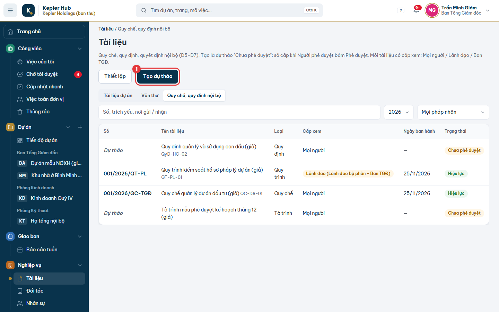

**Ai thấy, ai sửa:**

- Xem: mọi tài khoản trừ Quản trị hệ thống. Mỗi người chỉ thấy tài liệu trong cấp xem của mình, và dự thảo nếu là người soạn, Người phê duyệt hoặc Văn thư (mục 4.4.6).
- Nút **Tạo dự thảo**: Ban Tổng Giám đốc và Văn thư (dãy D5, D6, D7); Lãnh đạo bộ phận (chỉ D7 của bộ phận mình). Nhân viên không kiêm Văn thư không thấy nút.
- Nút **Thiết lập**: chỉ Ban Tổng Giám đốc.

**Dùng để làm gì:** Tra quy chế, quy định đang áp dụng; theo dõi dự thảo đang chờ duyệt. Dòng mô tả cạnh tiêu đề: "Quy chế, quy định, quyết định nội bộ (D5–D7). Tạo là dự thảo "Chưa phê duyệt"; số cấp khi Người phê duyệt bấm Phê duyệt. Mỗi tài liệu có cấp xem: Mọi người / Lãnh đạo / Ban TGĐ."

**Các bước thường làm**

1. Mở tab **Quy chế, quy định nội bộ**.
2. Kiểm ô **Năm**. Mặc định là năm nay. Tài liệu phê duyệt năm trước phải chọn năm đó mới thấy.
3. Gõ số hoặc tên tài liệu vào ô tìm.
4. Bấm một dòng để mở chi tiết (mục 4.4.3).

**Từng ô**

Ô tìm, ô **Năm**, ô **Pháp nhân** giống sổ đến, đi (mục 4.3.1). Tab này **không** có ô **Quá hạn** và không có tab con.

| Ô (nguyên văn) | Nghĩa là gì | Điền / chọn thế nào (mặc định) | Đổi thì hệ thống làm gì khác |
|---|---|---|---|
| Ô tìm, chữ mờ "Số, trích yếu, nơi gửi / nhận" | Tìm tài liệu | Trống; tối đa 100 ký tự | Tìm theo số và tên tài liệu. **Không** tìm theo **Mã tài liệu** (ví dụ QC-IT-01) |
| Ô chọn năm | Năm của tài liệu | Năm nay; chỉ có năm nay và 2 năm trước | Tài liệu đã phê duyệt: năm phê duyệt. Dự thảo: năm tạo |
| Ô chọn pháp nhân | Lọc theo công ty | **Mọi pháp nhân** | Chỉ có khi Thiết lập có từ 2 pháp nhân |

Các cột của bảng:

- **Số**: dự thảo hiện chữ nghiêng "Dự thảo".
- **Tên tài liệu**, kèm mã tài liệu chữ nhỏ.
- **Loại**.
- **Cấp xem**: "Lãnh đạo (Lãnh đạo bộ phận + Ban TGĐ)" nhãn vàng; "Ban TGĐ" nhãn đỏ; "Mọi người" chữ thường.
- **Ngày ban hành**: ngày ban hành gốc (nếu có) hoặc ngày phê duyệt.
- **Trạng thái**: "Chưa phê duyệt" vàng; "Đã trả lại" đỏ; "Đã phê duyệt" xanh dương; "Hiệu lực" xanh lá; "Hết hiệu lực / thay thế" xám; "Đã hủy" xám.

**Các nút**

| Nút | Làm gì | Có hỏi lại không | Quay lại được không |
|---|---|---|---|
| **Tạo dự thảo** / **Tạo dự thảo đầu tiên** (khi sổ năm nay trống) | Mở hộp **Tạo dự thảo tài liệu nội bộ** (mục 4.4.2) | Không | Có |
| **Thiết lập** | Mở **Thiết lập văn thư** (mục 4.6) | Không | Có |
| **Xoá bộ lọc** | Xoá ô tìm, bỏ lọc pháp nhân; giữ năm | Không | Có |
| Bấm một dòng | Mở chi tiết (mục 4.4.3) | Không | Có |

**⚠️ Dễ nhầm**

- **Lọc theo năm, mặc định năm nay.** Quy chế phê duyệt năm trước, dù vẫn đang hiệu lực, chỉ hiện khi chọn năm đó. Ô năm chỉ có 3 năm gần nhất.
- Năm của tài liệu là **năm phê duyệt trên Hub**, không phải năm ban hành gốc. Ví dụ: quy chế ban hành năm 2019, đưa vào Hub và phê duyệt năm 2026, nằm ở năm 2026. Dự thảo tạo tháng 12/2026, phê duyệt tháng 1/2027: lúc còn là dự thảo nằm ở năm 2026; phê duyệt xong chuyển sang năm 2027 và nhận số của năm 2027.
- Tài liệu nội bộ có từ trước khi có luồng phê duyệt (chuyển ngày 24/11/2026) được coi là "Đã phê duyệt", không có người phê duyệt. Lịch sử có dòng "Chuyển sang luồng phê duyệt (văn bản có từ trước)". Cấp xem chuyển một lần theo mức mật cũ: "Bảo mật cao" thành "Ban TGĐ"; "Hạn chế" thành "Lãnh đạo"; còn lại thành "Mọi người". Tài liệu cũ không có ngày hiệu lực thì **không tự** sang "Hiệu lực": Văn thư hoặc Ban Tổng Giám đốc bấm **Có hiệu lực**.
- Dự thảo chờ phê duyệt **không** hiện ở trang **Chờ tôi duyệt**. Người phê duyệt biết qua chuông thông báo và danh sách này.
- Danh sách tối đa 500 tài liệu, không chia trang.

**Claude:** Không có công cụ xem danh sách. Claude chỉ tạo được dự thảo (mục 4.7).

#### 4.4.2 Hộp "Tạo dự thảo tài liệu nội bộ"

**Mở ở đâu:** Tab **Quy chế, quy định nội bộ** → nút **Tạo dự thảo**. Hộp có dòng nhắc: "Tài liệu ở trạng thái Chưa phê duyệt, chưa có số. Người phê duyệt xem tệp PDF rồi bấm Phê duyệt — lúc đó hệ thống cấp số."

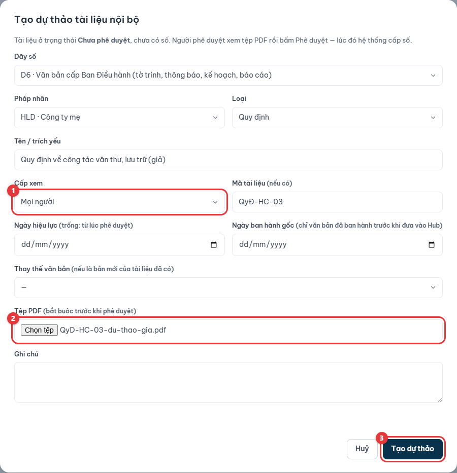

**Ai thấy, ai sửa:**

- Ban Tổng Giám đốc, Văn thư: dãy D5, D6, D7, mọi bộ phận.
- Lãnh đạo bộ phận: chỉ dãy D7 của bộ phận mình.
- Nhân viên không kiêm Văn thư: không thấy nút.

**Dùng để làm gì:** Đưa một quy chế, quy định, quyết định mới (hoặc văn bản cũ đã ban hành ngoài Hub) vào sổ để Người phê duyệt duyệt và cấp số.

**Các bước thường làm**

1. Bấm **Tạo dự thảo**.
2. Chọn **Dãy số**. Theo nhãn của từng dãy: quyết định do Tổng Giám đốc / Giám đốc ký: D5; quy chế, quy định, tờ trình, thông báo, kế hoạch, báo cáo cấp công ty: D6; văn bản nội bộ của một bộ phận: D7.
3. Chọn **Pháp nhân**, **Loại**; gõ **Tên / trích yếu**.
4. Chọn **Cấp xem**.
5. Điền nếu có: **Mã tài liệu**; **Bộ phận** (D7); **Ngày hiệu lực**; **Ngày ban hành gốc** (văn bản cũ); **Thay thế văn bản** (bản mới của tài liệu đã có).
6. Chọn tệp ở ô **Tệp PDF**.
7. Bấm **Tạo dự thảo**. Thông báo "Đã tạo dự thảo — chờ phê duyệt"; trang chi tiết mở; Người phê duyệt nhận thông báo.

**Từng ô**

| Ô (nguyên văn) | Nghĩa là gì | Điền / chọn thế nào (mặc định) | Đổi thì hệ thống làm gì khác |
|---|---|---|---|
| **Dãy số** | Dãy của sổ nội bộ | Chỉ các dãy bạn được tạo: "D5 · Quyết định của TGĐ / GĐ", "D6 · Văn bản cấp Ban Điều hành (tờ trình, thông báo, kế hoạch, báo cáo)", "D7 · Văn bản nội bộ của bộ phận". Chọn sẵn dãy đầu | Quyết định dạng số lúc phê duyệt (mục 4.5). Chọn D7 thì hiện ô **Bộ phận**. Lỗi: "Dãy số không hợp lệ" |
| **Pháp nhân** | Công ty ban hành | Danh sách ở **Thiết lập**; chọn sẵn dòng đầu | D5: mã pháp nhân vào số. D6: công ty mẹ ký hiệu "TGĐ", công ty khác "GĐ.*MÃ*". Mỗi pháp nhân một bộ đếm riêng. Lỗi: "Pháp nhân không hợp lệ" |
| **Loại** | Loại tài liệu, thành ký hiệu trong số | "— chọn —" (bắt buộc chọn). Lựa chọn: "Quy chế" (QC), "Quy định" (QyĐ), "Quy trình" (QT), "Hướng dẫn" (HD), "Quyết định" (QĐ), "Thông báo" (TB), "Kế hoạch" (KH), "Báo cáo" (BC), "Tờ trình" (TTr) | D6, D7: ký hiệu loại vào số. D5 luôn ký hiệu "QĐ", dù chọn loại gì. Lỗi: "Loại tài liệu không hợp lệ" |
| **Tên / trích yếu** | Tên tài liệu | Bắt buộc; tối đa 500 ký tự | Lỗi: "Thiếu Trích yếu", "Trích yếu vượt 500 ký tự" |
| **Cấp xem** | Ai xem được sau khi phê duyệt | Chỉ các cấp **không cao hơn vai của bạn**. Ban Tổng Giám đốc: 3 cấp. Lãnh đạo bộ phận: "Mọi người", "Lãnh đạo (Lãnh đạo bộ phận + Ban TGĐ)". Văn thư vai Nhân viên: chỉ "Mọi người". Chọn sẵn "Mọi người" | Mục 4.4.6. Lỗi: "Cấp xem không hợp lệ"; "Cấp xem không được cao hơn vai của bạn" |
| **Mã tài liệu** "(nếu có)", chữ mờ "vd. QC-IT-01" | Mã quản lý giữ nguyên qua các phiên bản | Trống; tối đa 40 ký tự | Hiện chữ nhỏ cạnh tên ở danh sách. Ô tìm không tìm được theo mã này. Lỗi: "Mã tài liệu vượt 40 ký tự" |
| **Bộ phận** (chỉ khi chọn D7) | Bộ phận ban hành | Chọn sẵn bộ phận của bạn | Mã bộ phận vào số; mỗi bộ phận một dãy D7 riêng; tệp lưu vào thư mục văn thư của bộ phận đó. Bắt buộc với D7: "Văn bản nội bộ của bộ phận cần chọn bộ phận". Lãnh đạo bộ phận chọn bộ phận khác: "Chỉ văn thư, Ban TGĐ hoặc lãnh đạo bộ phận đó cấp số văn bản của bộ phận" (chữ "cấp số" ở đây hiểu là "tạo dự thảo") |
| **Ngày hiệu lực** "(trống: từ lúc phê duyệt)" | Ngày tài liệu bắt đầu áp dụng | Trống | Trống, hôm nay hoặc ngày đã qua: phê duyệt xong là "Hiệu lực" ngay. Ngày trong tương lai: phê duyệt xong là "Đã phê duyệt", tới ngày đó tự sang "Hiệu lực" (khoảng 08:20 sáng). Lỗi: "Ngày không hợp lệ (YYYY-MM-DD)" |
| **Ngày ban hành gốc** "(chỉ văn bản đã ban hành trước khi đưa vào Hub)" | Ngày ban hành thật của văn bản có từ trước | Trống | Hiện ở cột **Ngày ban hành** thay cho ngày phê duyệt, kèm chữ "(ngày ban hành gốc)" ở trang chi tiết. Lịch sử vẫn ghi ngày bấm phê duyệt |
| **Thay thế văn bản** "(nếu là bản mới của tài liệu đã có)" | Bản cũ bị thay | "—". Danh sách mọi tài liệu nội bộ đã có số, chưa hủy, bạn xem được, của mọi năm, dạng "*số* · *tên*" | Khi bản mới được phê duyệt, bản cũ tự chuyển "Hết hiệu lực / thay thế". Lỗi: "Văn bản được thay thế không hợp lệ (phải là tài liệu nội bộ đã phê duyệt, bạn xem được)" |
| **Tệp PDF** "(bắt buộc trước khi phê duyệt)" | Bản PDF Người phê duyệt sẽ xem | Chọn một tệp .pdf; tối đa 25 MB | Tải lên ngay sau khi tạo. Không có PDF thì nút **Phê duyệt** bị khoá. Tải lỗi: "Đã tạo dự thảo nhưng chưa tải được tệp: *lỗi*". Dự thảo vẫn được tạo; tải lại tệp ở trang chi tiết |
| **Ghi chú** | | Trống; tối đa 1000 ký tự | Hiển thị |

**Các nút**

| Nút | Làm gì | Có hỏi lại không | Quay lại được không |
|---|---|---|---|
| **Huỷ** | Đóng hộp, không lưu | Không | Có |
| **Tạo dự thảo** | Tạo dự thảo, tải PDF lên, mở trang chi tiết. Thông báo "Đã tạo dự thảo — chờ phê duyệt". Người phê duyệt (trừ chính bạn) nhận "Tài liệu chờ phê duyệt: *tên*" | Không | Có: **Huỷ dự thảo**. Không mất số vì chưa có số |

⚠️ **Chữ trên màn hình ghi** "D5 · Quyết định của TGĐ / GĐ" và "D6 · Văn bản cấp Ban Điều hành" **nhưng thực tế** "TGĐ / GĐ" là chức danh người ký (Tổng Giám đốc công ty mẹ, Giám đốc công ty con), còn "Ban Điều hành" không phải vai trên Hub. Ai tạo dự thảo, ai duyệt vẫn theo bảng ở đầu chương: tạo là Ban Tổng Giám đốc, Văn thư; duyệt là Người phê duyệt.

**⚠️ Dễ nhầm**

- **Dãy số**, **Pháp nhân**, **Bộ phận** không sửa được sau khi tạo. Chọn sai thì **Huỷ dự thảo** rồi tạo lại.
- Thông báo cho Người phê duyệt gửi **ngay lúc tạo**, trước khi PDF tải xong. Người phê duyệt mở quá sớm có thể thấy "Chưa có tệp PDF".
- Bạn là Người phê duyệt duy nhất và tự tạo dự thảo: không ai nhận thông báo, vì hệ thống không báo cho chính người bấm.
- Tệp Word, Excel kèm theo thì thêm ở trang chi tiết bằng **Tải tệp lên**. Phê duyệt chỉ cần ít nhất một tệp PDF.
- Danh sách **Thay thế văn bản** có cả tài liệu đã "Hết hiệu lực / thay thế". Chọn đúng bản đang áp dụng.

**Claude:** Tạo được dự thảo, nhưng bằng công cụ riêng, không qua hộp này (mục 4.7).

#### 4.4.3 Chi tiết một tài liệu nội bộ

**Mở ở đâu:** Bấm một dòng ở danh sách; hoặc bấm thông báo "Tài liệu chờ phê duyệt", "Tài liệu gửi lại chờ phê duyệt", "Tài liệu đã được phê duyệt", "Tài liệu bị trả lại" (trang `#/vanthu/<số thứ tự tài liệu>`).

**Ai thấy, ai sửa:** Người xem được tài liệu (mục 4.4.6). Nút nào hiện do máy chủ tính cho từng người, từng tài liệu.

**Dùng để làm gì:** Xem tài liệu; Người phê duyệt duyệt hoặc trả lại; người soạn sửa và gửi lại; Văn thư, Ban Tổng Giám đốc đánh dấu hiệu lực.

**Các phần trên trang** (chỉ hiện dòng có giá trị)

| Phần (nguyên văn) | Nội dung |
|---|---|
| Tiêu đề | Số (đã phê duyệt) hoặc "Dự thảo", kèm nhãn trạng thái |
| Dòng nhắc của dự thảo | "Chưa phê duyệt — chưa có số. Người phê duyệt xem tệp PDF rồi bấm Phê duyệt." hoặc "Chưa phê duyệt — chưa có số. **Chưa có tệp PDF**: tải tệp lên trước khi phê duyệt." Bị trả lại thì dòng đỏ: "Đã trả lại: *lý do* — người soạn sửa rồi bấm "Gửi lại"." |
| **Loại**, **Mã tài liệu**, **Cấp xem** | |
| **Sổ** | Dãy · pháp nhân. Dãy D7 ghi kèm mã bộ phận, ví dụ "D7-TCKT · HLD" |
| **Bộ phận** | |
| **Người soạn** | Người tạo · thời điểm; nhãn "tạo qua Claude" nếu tạo qua Claude |
| **Người phê duyệt** | Người · thời điểm phê duyệt |
| **Ngày ban hành** | Ngày ban hành gốc (kèm "(ngày ban hành gốc)") hoặc ngày phê duyệt |
| **Ngày hiệu lực** | Ngày; trống mà đã phê duyệt thì ghi "Từ lúc phê duyệt" |
| **Thay thế văn bản** | Liên kết "xem bản cũ" |
| **Ghi chú** | |
| Khối **Tệp văn bản** | Như văn bản đến, đi (mục 4.3.3) |
| Khối **Lịch sử** | Các việc: "Tạo dự thảo", "Đổi trạng thái: *từ* → *sang*", "Sửa thông tin", "Huỷ dự thảo" (khi chưa có số) hoặc "Hủy số" (khi đã có số), "Thêm tệp", "Gỡ tệp", "Phê duyệt", "Trả lại", "Gửi lại", "Chuyển sang luồng phê duyệt (văn bản có từ trước)" |

**Các nút**

| Nút | Làm gì | Có hỏi lại không | Quay lại được không |
|---|---|---|---|
| **Phê duyệt** | Cấp số ngay, khoá nội dung và tệp. Thông báo "Đã phê duyệt và cấp số". Chỉ Người phê duyệt, dự thảo đang "Chưa phê duyệt". Chưa có PDF thì nút mờ, rê chuột thấy "Chưa có tệp PDF" | Có: "Phê duyệt "*tên*"? Hệ thống cấp số ngay và khoá nội dung, tệp của tài liệu." kèm ô **Ý kiến (không bắt buộc)**; nút **Phê duyệt** | **Không.** Chỉ còn **Hủy số**, số vẫn nằm trong sổ |
| **Trả lại** | Chuyển "Đã trả lại", báo người soạn. Thông báo "Đã trả lại". Chỉ Người phê duyệt, dự thảo đang "Chưa phê duyệt" | Có: "Trả lại "*tên*" cho người soạn?" kèm ô **Lý do trả lại (bắt buộc)**; nút **Trả lại** (đỏ). Ô trống thì hộp không đóng, hiện dòng đỏ "Nhập lý do" | Có: người soạn sửa rồi **Gửi lại** |
| **Gửi lại** | Đưa dự thảo bị trả lại về "Chưa phê duyệt". Thông báo "Đã gửi lại chờ phê duyệt". Người soạn; Văn thư (trong cấp xem của mình) | **Không hỏi** | Có |
| **Sửa** | Mở hộp sửa (mục 4.4.4). Dự thảo: người soạn, Văn thư. Đã phê duyệt: Ban Tổng Giám đốc, Văn thư | Không | Có |
| **Huỷ dự thảo** | Hủy dự thảo. Không có số nên không ảnh hưởng sổ. Thông báo "Đã huỷ dự thảo". Người soạn; Văn thư | Có: "Huỷ dự thảo này? Dự thảo chưa có số nên không ảnh hưởng sổ." kèm ô **Lý do huỷ (bắt buộc)**; nút **Huỷ dự thảo**. Ô trống thì hộp không đóng, hiện dòng đỏ "Nhập lý do" | **Không** |
| **Hủy số** | Hủy tài liệu đã có số; số giữ trong sổ. Thông báo "Đã hủy số". Ban Tổng Giám đốc, Văn thư; tài liệu đã phê duyệt, chưa hủy | Có: "Hủy số *số*? Số vẫn giữ trong sổ và không cấp lại cho văn bản khác." kèm ô **Lý do hủy (bắt buộc)**; nút **Hủy số** (đỏ). Ô trống: như trên | **Không** |
| **Có hiệu lực** | "Đã phê duyệt" sang "Hiệu lực". Thông báo "Đã cập nhật". Ban Tổng Giám đốc, Văn thư | Có: "Có hiệu lực: chuyển *số* sang "Hiệu lực"? Không quay lại được bước trước."; nút **Có hiệu lực** | **Không** |
| **Hết hiệu lực** | "Đã phê duyệt" hoặc "Hiệu lực" sang "Hết hiệu lực / thay thế". Thông báo "Đã cập nhật". Ban Tổng Giám đốc, Văn thư | Có: "Hết hiệu lực: chuyển *số* sang "Hết hiệu lực / thay thế"? Không quay lại được bước trước. Muốn áp dụng lại phải tạo dự thảo thay thế và phê duyệt lại."; nút **Hết hiệu lực** | **Không** |
| **Tải tệp lên** | Thêm tệp (tối đa 5 tệp một lần, 25 MB mỗi tệp). Thông báo "Đã tải tệp lên". **Chỉ dự thảo**: người soạn, Văn thư | Không | Có, gỡ được |
| **Gỡ** | Gỡ tệp khỏi dự thảo. Thông báo "Đã gỡ tệp". **Chỉ dự thảo**: người soạn, Văn thư | Có: như sổ đến, đi (mục 4.3.3); nút **Gỡ tệp** (đỏ) | Tệp NAS còn trong `_LuuTru`; tệp trong Hub **mất hẳn** |
| **Tải** | Tải tệp về máy. Đây là cách duy nhất để xem PDF | Không | Có |

⚠️ **Có hiệu lực**, **Hết hiệu lực** có hỏi lại, nhưng đã đồng ý là không quay lại được. Đồng ý nhầm **Hết hiệu lực** cho một quy chế đang áp dụng thì phải tạo dự thảo mới, chọn **Thay thế văn bản**, đi lại luồng phê duyệt.

Ô lý do của **Trả lại**, **Huỷ dự thảo**, **Hủy số** là bắt buộc: để trống (hoặc chỉ gõ khoảng trắng) rồi bấm nút thì hộp vẫn mở, hiện dòng đỏ "Nhập lý do", tài liệu không đổi gì.

⚠️ Tệp không có nhãn **NAS** bị xoá hẳn khi **Gỡ**, không khôi phục được; hộp hỏi nói rõ điều này.

**⚠️ Dễ nhầm**

- Trang không xem PDF trực tiếp. Bấm **Tải** rồi mở tệp trên máy.
- Hộp hỏi **Huỷ dự thảo** có nút **Huỷ** (đóng hộp, không làm gì) và nút **Huỷ dự thảo** (hủy thật). Hộp **Hủy số** cũng vậy: **Huỷ** là đóng hộp.
- Tệp dự thảo trên NAS mang tên dạng `DuThao-<số thứ tự>_<tên tệp không dấu>_v01_<ngày>.pdf` và **giữ tên đó** sau khi phê duyệt. Số chính thức xem trên Hub.
- Đã phê duyệt thì khoá tệp: không thêm, không gỡ. Cố tải lên thì nhận "Tài liệu đã phê duyệt: không thêm tệp — tạo bản mới thay thế".
- **Hủy số** bản mới không khôi phục bản cũ đã bị nó thay thế. Bản cũ vẫn "Hết hiệu lực / thay thế".
- Lỗi khi bấm nút hiện ở góc dưới bên phải, cùng màu tối như thông báo thường, không đỏ, và tắt sau khoảng 3,5 giây.
- Lỗi có thể gặp: "Chỉ Người phê duyệt (Thiết lập văn thư) phê duyệt tài liệu"; "Chỉ tài liệu sổ nội bộ đi qua phê duyệt"; "Dự thảo đã huỷ"; "Dự thảo đã trả lại — chờ người soạn sửa và gửi lại"; "Tài liệu đã phê duyệt"; "Tài liệu chưa có tệp PDF — Người phê duyệt phải xem đúng bản được duyệt"; "Tài liệu vừa được xử lý ở nơi khác — tải lại trang"; "Chỉ người soạn hoặc Văn thư gửi lại dự thảo đã bị trả lại"; "Chỉ người soạn hoặc Văn thư huỷ dự thảo"; "Chỉ người soạn hoặc Văn thư thêm tệp cho dự thảo"; "Chỉ gỡ tệp của dự thảo (người soạn hoặc Văn thư); tài liệu đã phê duyệt khoá tệp"; "Dự thảo chỉ đổi trạng thái qua Phê duyệt / Trả lại"; "Trạng thái chỉ đi tiếp, không quay lại".

**Claude:** Không phê duyệt, trả lại, gửi lại, sửa, hủy, đổi trạng thái, không tải tệp.

#### 4.4.4 Hộp "Sửa dự thảo" / "Sửa *số*"

**Mở ở đâu:** Chi tiết tài liệu → nút **Sửa**. Dự thảo: hộp "Sửa dự thảo". Đã phê duyệt: hộp "Sửa *số*", kèm dòng nhắc "Tài liệu đã phê duyệt: nội dung và tệp đã khoá. Muốn đổi nội dung, tạo dự thảo mới và chọn "Thay thế văn bản"."

**Ai thấy, ai sửa:**

- Dự thảo: người soạn; Văn thư (trong cấp xem của mình). Người khác: "Chỉ người soạn hoặc Văn thư sửa dự thảo".
- Đã phê duyệt: Ban Tổng Giám đốc, Văn thư. Người khác: "Chỉ Văn thư hoặc Ban TGĐ sửa thông tin tài liệu đã phê duyệt".

**Dùng để làm gì:** Dự thảo: sửa mọi thông tin mô tả trước khi duyệt (thường sau khi bị trả lại). Đã phê duyệt: chỉ đổi vài thông tin không đổi nội dung.

**Từng ô**

| Ô (nguyên văn) | Nghĩa là gì | Có ở hộp nào | Đổi thì hệ thống làm gì khác |
|---|---|---|---|
| **Tên / trích yếu** | Tên tài liệu | Dự thảo (bắt buộc; tối đa 500) | |
| **Loại** | Ký hiệu trong số | Dự thảo | Đổi ký hiệu trong số sẽ cấp |
| **Mã tài liệu** | | Dự thảo (tối đa 40) | |
| **Ngày ban hành gốc** | | Dự thảo | |
| **Thay thế văn bản** | Bản cũ bị thay | Dự thảo | Bản cũ chuyển "Hết hiệu lực / thay thế" khi bản này được phê duyệt. Lỗi: "Văn bản được thay thế không hợp lệ (phải là tài liệu nội bộ đã phê duyệt, bạn xem được)" |
| **Cấp xem** | Ai xem được | Cả hai | Đổi **ngay** người xem được. **Không cần phê duyệt lại.** Không được cao hơn vai người sửa: "Cấp xem không được cao hơn vai của bạn" |
| **Ngày hiệu lực** | | Dự thảo; đã phê duyệt thì chỉ khi đang "Đã phê duyệt" (chưa hiệu lực) | Đổi sang hôm nay hoặc ngày đã qua: lần chạy 08:20 kế tiếp chuyển "Hiệu lực". Tài liệu đã hiệu lực: "Tài liệu đã hiệu lực: không đổi ngày hiệu lực" |
| **Ghi chú** | | Cả hai (tối đa 1000) | |

Gửi ô khác khi tài liệu đã phê duyệt: "Tài liệu đã phê duyệt: không sửa nội dung — tạo bản mới, chọn "Thay thế văn bản"".

**Các nút**

| Nút | Làm gì | Có hỏi lại không | Quay lại được không |
|---|---|---|---|
| **Huỷ** | Đóng hộp, không lưu | Không | Có |
| **Lưu** | Lưu; thông báo "Đã lưu"; lịch sử ghi "Sửa thông tin" | Không | Có, sửa lại |

**⚠️ Dễ nhầm**

- Đổi **Cấp xem** sau phê duyệt có hiệu lực ngay, không qua Người phê duyệt. Ví dụ: Ban Tổng Giám đốc hạ một quy chế từ "Ban TGĐ" xuống "Mọi người" thì mọi nhân viên thấy ngay.
- Văn thư vai Nhân viên không nâng được cấp xem lên "Lãnh đạo" hay "Ban TGĐ".
- Xoá trống **Ngày hiệu lực** của tài liệu "Đã phê duyệt": tài liệu nằm ở "Đã phê duyệt" mãi, tới khi có người bấm **Có hiệu lực**.

**Claude:** Không sửa được.

#### 4.4.5 Vòng đời trạng thái

| Trạng thái (nhãn, màu) | Có số chưa | Ai xem được | Đi tiếp bằng cách nào | Ai làm | Quay lại được không |
|---|---|---|---|---|---|
| **Chưa phê duyệt** (vàng) | Chưa, hiện "Dự thảo" | Người soạn, Người phê duyệt, Văn thư (trong cấp xem theo vai của Văn thư) | **Phê duyệt**: sang "Hiệu lực" (ngày hiệu lực trống, hôm nay hoặc đã qua) hoặc "Đã phê duyệt" (ngày hiệu lực trong tương lai). **Trả lại**: sang "Đã trả lại". **Huỷ dự thảo**: sang "Đã hủy" | Phê duyệt, Trả lại: Người phê duyệt. Huỷ dự thảo: người soạn, Văn thư | Phê duyệt: không. Trả lại: có (Gửi lại). Huỷ: không |
| **Đã trả lại** (đỏ) | Chưa | Như trên | Người soạn sửa, bấm **Gửi lại**: về "Chưa phê duyệt". Hoặc **Huỷ dự thảo** | Người soạn, Văn thư | Có |
| **Đã phê duyệt** (xanh dương) | Có, cấp lúc phê duyệt | Theo cấp xem | Tới ngày hiệu lực (khoảng 08:20, chạy cả ngày nghỉ) hoặc bấm **Có hiệu lực**: sang "Hiệu lực". Bấm **Hết hiệu lực** hoặc bản thay thế được duyệt: sang "Hết hiệu lực / thay thế". **Hủy số**: "Đã hủy" | Hệ thống (theo ngày); Ban Tổng Giám đốc, Văn thư | Không |
| **Hiệu lực** (xanh lá) | Có | Theo cấp xem | Bấm **Hết hiệu lực** hoặc bản thay thế được duyệt: sang "Hết hiệu lực / thay thế". **Hủy số**: "Đã hủy" | Ban Tổng Giám đốc, Văn thư; hệ thống khi bản thay thế được duyệt | Không |
| **Hết hiệu lực / thay thế** (xám) | Có | Theo cấp xem | Chỉ còn **Hủy số** | Ban Tổng Giám đốc, Văn thư | Không, không có nút về "Hiệu lực" |
| **Đã hủy** (xám) | Dự thảo đã hủy: không có số. Tài liệu đã phê duyệt bị hủy: số giữ trong sổ, không cấp lại | Như trước khi hủy | Hết | — | Không |

Thêm:

- Dự thảo chỉ đổi trạng thái qua **Phê duyệt** / **Trả lại**. Cố đổi cách khác thì máy chủ trả "Dự thảo chỉ đổi trạng thái qua Phê duyệt / Trả lại".
- Đã phê duyệt: nội dung và tệp bị khoá (mục 4.4.4).
- Ví dụ một vòng: Văn thư tạo dự thảo "Quy chế công tác phí" ngày 20/11/2026, ngày hiệu lực 01/12/2026. Người phê duyệt trả lại ngày 21/11 vì thiếu phụ lục. Văn thư sửa, tải PDF mới, bấm **Gửi lại**. Ngày 25/11 Người phê duyệt bấm **Phê duyệt**: tài liệu có số, trạng thái "Đã phê duyệt". Sáng 01/12/2026, khoảng 08:20, tự sang "Hiệu lực".

**Claude:** Không đổi được trạng thái nào; chỉ tạo được dự thảo ở trạng thái đầu "Chưa phê duyệt".

#### 4.4.6 Cấp xem và ai làm được gì

**Ai xem được**

| Cấp xem (nguyên văn) | Ban Tổng Giám đốc | Lãnh đạo bộ phận | Nhân viên | Quản trị hệ thống |
|---|---|---|---|---|
| **Mọi người** | ✔ | ✔ | ✔ | — |
| **Lãnh đạo (Lãnh đạo bộ phận + Ban TGĐ)** | ✔ | ✔ (mọi bộ phận) | — | — |
| **Ban TGĐ** | ✔ | — | — | — |

Thêm: **người soạn** luôn xem tài liệu mình soạn. **Dự thảo** ("Chưa phê duyệt", "Đã trả lại") chỉ người soạn, Người phê duyệt và Văn thư thấy; Văn thư chỉ thấy dự thảo trong cấp xem theo vai của chính mình. Không xét bộ phận, phạm vi phụ trách, Pháp chế.

**Ai làm được gì**

| Việc | Ban Tổng Giám đốc | Lãnh đạo bộ phận | Nhân viên | Văn thư (kiêm nhiệm) | Người phê duyệt | Người soạn |
|---|---|---|---|---|---|---|
| Tạo dự thảo | ✔ D5, D6, D7 mọi bộ phận | ✔ chỉ D7 bộ phận mình | — | ✔ mọi dãy, mọi bộ phận | (là Ban Tổng Giám đốc) | |
| Cấp xem được đặt | 3 cấp | "Mọi người", "Lãnh đạo" | "Mọi người" (nếu kiêm Văn thư) | Theo vai của chính mình | | |
| Xem dự thảo của người khác | Chỉ khi là Người phê duyệt hoặc kiêm Văn thư | Chỉ khi kiêm Văn thư | Chỉ khi kiêm Văn thư (cấp "Mọi người") | ✔ trong cấp xem | ✔ | ✔ dự thảo của mình |
| Sửa, gửi lại, hủy dự thảo; thêm, gỡ tệp dự thảo | Chỉ khi là người soạn hoặc kiêm Văn thư | Dự thảo mình soạn | Dự thảo mình soạn (nếu kiêm Văn thư) | ✔ trong cấp xem | — | ✔ |
| **Phê duyệt**, **Trả lại** | Chỉ khi là Người phê duyệt | — | — | — | ✔ | — |
| Sau phê duyệt: sửa ghi chú, cấp xem, ngày hiệu lực; **Có hiệu lực**, **Hết hiệu lực**; **Hủy số** | ✔ | — | — | ✔ | ✔ (là Ban Tổng Giám đốc) | Chỉ khi là Ban Tổng Giám đốc hoặc Văn thư |
| Gắn vào việc | Chỉ tài liệu đã phê duyệt, cấp "Mọi người" | Như trái | Như trái | Như trái | Như trái | Như trái |
| Chọn Người phê duyệt, Văn thư (Thiết lập) | ✔ | — | — | — | ✔ (là Ban Tổng Giám đốc) | — |

**⚠️ Dễ nhầm**

- Văn thư là Nhân viên phòng Hành chính: không thấy dự thảo cấp "Lãnh đạo" của người khác, và khi tạo dự thảo chỉ đặt được "Mọi người".
- Lãnh đạo bộ phận khác bộ phận vẫn xem được tài liệu cấp "Lãnh đạo". Cấp xem không chia theo bộ phận.
- Lãnh đạo bộ phận không thấy dự thảo D7 của bộ phận mình nếu người khác (ví dụ Văn thư) soạn.

**Claude:** Không có công cụ xem. Claude không đọc được tài liệu cấp "Ban TGĐ" và dự thảo của người khác, kể cả khi bạn có quyền.

#### 4.4.7 Người phê duyệt: phê duyệt, trả lại

**Mở ở đâu:** Bấm thông báo "Tài liệu chờ phê duyệt: *tên*" (nội dung "*loại* · *cấp xem*", thêm " · tạo qua Claude" nếu tạo qua Claude) hoặc "Tài liệu gửi lại chờ phê duyệt: *tên*". Hoặc vào tab **Quy chế, quy định nội bộ**, tìm dòng có nhãn "Chưa phê duyệt" (nhớ kiểm ô **Năm**).

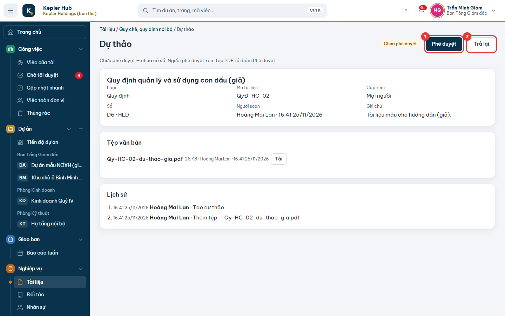

**Ai thấy, ai sửa:** Người có tên trong ô **Người phê duyệt tài liệu nội bộ** ở Thiết lập, còn hoạt động và còn vai Ban Tổng Giám đốc. Ô đó chỉ chọn được người vai Ban Tổng Giám đốc. Ô trống, hoặc không còn ai hợp lệ (đã nghỉ, đổi vai), thì Người phê duyệt là các thành viên Ban Tổng Giám đốc có phạm vi "Toàn công ty"; không ai có phạm vi này thì là mọi thành viên Ban Tổng Giám đốc (mục 4.6.8). Thành viên Ban Tổng Giám đốc khác không thấy nút và không thấy dự thảo.

**Dùng để làm gì:** Duyệt đúng bản PDF và cấp số cho quy chế, quy định; hoặc trả lại kèm lý do.

**Các bước thường làm**

1. Mở dự thảo.
2. Ở khối **Tệp văn bản**, bấm **Tải** tệp PDF, mở trên máy và đọc.
3. Đồng ý: bấm **Phê duyệt** → hộp hỏi "Phê duyệt "*tên*"? Hệ thống cấp số ngay và khoá nội dung, tệp của tài liệu." → gõ **Ý kiến** nếu muốn → bấm **Phê duyệt**. Thông báo "Đã phê duyệt và cấp số".
4. Chưa đồng ý: bấm **Trả lại** → gõ **Lý do trả lại (bắt buộc)** → bấm **Trả lại**. Thông báo "Đã trả lại".

**Phê duyệt xong, hệ thống làm gì**

- Cấp số ngay theo dãy, pháp nhân, **năm phê duyệt** (mục 4.5).
- Ngày ban hành là hôm nay, trừ khi dự thảo có **Ngày ban hành gốc**.
- Trạng thái: "Hiệu lực" (ngày hiệu lực trống, hôm nay hoặc đã qua) hoặc "Đã phê duyệt" (ngày hiệu lực trong tương lai).
- Khoá nội dung và tệp.
- Lịch sử ghi "Phê duyệt", kèm "Số *số*", ý kiến của bạn, và mỗi tệp một dòng "*tên tệp* · SHA-256 *mã băm*". Mã băm là dấu vân tay của tệp: sau này chứng minh được đúng bản PDF nào đã được duyệt.
- Nếu dự thảo có **Thay thế văn bản**: bản cũ chuyển "Hết hiệu lực / thay thế"; lịch sử bản cũ ghi "Đổi trạng thái: *trạng thái cũ* → Hết hiệu lực / thay thế — Thay thế bởi *số mới*". Không ai được báo về bản cũ.
- Người soạn (nếu không phải bạn) nhận "Tài liệu đã được phê duyệt: *số*".

**Trả lại xong, hệ thống làm gì**

- Trạng thái "Đã trả lại"; trang chi tiết hiện dòng đỏ có lý do.
- Người soạn (nếu không phải bạn) nhận "Tài liệu bị trả lại: *tên*", nội dung là lý do.
- Người soạn sửa, bấm **Gửi lại**: dự thảo về "Chưa phê duyệt"; mọi Người phê duyệt (trừ người bấm) nhận "Tài liệu gửi lại chờ phê duyệt: *tên*".

**⚠️ Dễ nhầm**

- Phải **Tải** PDF về máy mới xem được. Trang Văn thư không có nút **Xem**.
- **Phê duyệt** không quay lại được. Sau đó chỉ còn **Hủy số** (số vẫn nằm trong sổ) hoặc tạo bản thay thế.
- Bỏ trống lý do rồi bấm **Trả lại**: hộp không đóng, hiện dòng đỏ "Nhập lý do"; dự thảo chưa bị trả lại cho tới khi bạn gõ lý do và bấm lại.
- Người phê duyệt duyệt được cả dự thảo **do chính mình soạn**. Hệ thống không chặn.
- Hai Người phê duyệt cùng mở một dự thảo: người bấm sau nhận "Tài liệu đã phê duyệt" (hoặc "Dự thảo đã trả lại — chờ người soạn sửa và gửi lại"); nếu hai người bấm gần như cùng lúc thì người chậm hơn nhận "Tài liệu vừa được xử lý ở nơi khác — tải lại trang". Không có chuyện cấp hai số.
- Dự thảo **không** vào trang **Chờ tôi duyệt**.
- Ai đang nhận "Tài liệu chờ phê duyệt": xem dòng **Đang áp dụng** ở Thiết lập (mục 4.6.8). Người trong danh sách đã nghỉ hoặc đổi vai thì không nhận; người dự phòng nhận thay (mục 4.6.9).
- Bấm **Phê duyệt** mà báo lỗi bắt đầu bằng "Dữ liệu bị trùng": số sắp cấp trùng một số đã có. Xem mục 4.5.

**Claude:** Không phê duyệt, không trả lại. Máy chủ trả "Phê duyệt làm trên giao diện Kepler Hub, không qua Claude".

---

### 4.5 Số và ký hiệu văn bản

**Mở ở đâu:** Không có màn. Số hiện ở cột **Số**, tiêu đề trang chi tiết, thông báo.

**Ai thấy, ai sửa:** Không ai gõ số. Hệ thống cấp số lúc bấm **Vào sổ và cấp số** (văn bản đến, đi) hoặc **Phê duyệt** (quy chế, quy định). Số không sửa được.

**Dùng để làm gì:** Số tự động, liên tục theo Điều 7 của QyĐ-GA-01.

**Dạng số theo từng dãy**

| Dãy | Sổ | Dạng số | Ví dụ |
|---|---|---|---|
| **D10** | Văn bản đến | *số thứ tự (ít nhất 4 chữ số)*/*năm*/Đ-*pháp nhân* | `0123/2026/Đ-HLD` |
| **D9** | Văn bản đi | **Tên loại** trống hoặc "CV": *số (ít nhất 3 chữ số)*/*năm*/*pháp nhân*, thêm "-*mã bộ phận*" nếu chọn **Bộ phận**. Loại khác: *số*/*năm*/*loại*-*pháp nhân* | `045/2026/HLD-INV`; `045/2026/HLD`; `046/2026/TB-HLD` |
| **D5** | Quy chế, quy định: quyết định | *số*/*năm*/QĐ-*pháp nhân* (luôn "QĐ", bất kể ô **Loại**) | `002/2026/QĐ-DXA` |
| **D6** | Quy chế, quy định: cấp công ty | Pháp nhân **dòng đầu** ở Thiết lập: *số*/*năm*/*loại*-TGĐ. Pháp nhân khác: *số*/*năm*/*loại*-GĐ.*pháp nhân* | `007/2026/TTr-TGĐ`; `003/2026/TB-GĐ.DXA` |
| **D7** | Quy chế, quy định: của bộ phận | *số*/*năm*/*loại*-*mã bộ phận*; mỗi bộ phận một dãy riêng | `012/2026/TTr-TCKT` |

Vượt 999 (D10: vượt 9999) thì tự thêm chữ số, ví dụ `12345/2026/Đ-HLD`.

**Luật đánh số**

- Mỗi bộ đếm đi theo **dãy, pháp nhân, năm**. Dãy D7 tách thêm theo bộ phận. Sang năm mới, mọi bộ đếm bắt đầu lại từ 1.
- **Loại không có dãy riêng.** Trong cùng dãy, cùng pháp nhân, các loại dùng chung một bộ đếm. Ví dụ sổ đi HLD: công văn được `045/2026/HLD-INV`, thông báo vào sổ ngay sau đó được `046/2026/TB-HLD`.
- Số mới = số lớn nhất đã cấp trong bộ đếm + 1, **tính cả số đã hủy**. Không giữ số, không nhảy số, không dùng lại số đã hủy.
- Dự thảo quy chế **chưa có số**, không chiếm chỗ. Dự thảo bị trả lại hay bị hủy không làm nhảy số. Số cấp lúc bấm **Phê duyệt**, theo năm phê duyệt.
- Nhiều người vào sổ cùng lúc: hệ thống xếp hàng, không cấp trùng số.
- Số sai thì **Hủy số** rồi vào sổ lại. Số đã hủy vẫn nằm trong sổ.

Ví dụ một chuỗi trong năm 2026, sổ đến pháp nhân HLD:

| Việc | Số |
|---|---|
| Văn thư vào sổ văn bản đến đầu tiên của năm | `0001/2026/Đ-HLD` |
| Vào sổ văn bản thứ hai | `0002/2026/Đ-HLD` |
| Hủy số `0002/2026/Đ-HLD` vì vào nhầm | Số `0002` giữ trong sổ, nhãn "Đã hủy" |
| Vào sổ lại văn bản đó | `0003/2026/Đ-HLD` |
| Vào sổ văn bản đến đầu tiên của pháp nhân DXA | `0001/2026/Đ-DXA` (bộ đếm riêng) |
| Văn bản đến đầu tiên năm 2027 của HLD | `0001/2027/Đ-HLD` |

**⚠️ Dễ nhầm**

- **Tên loại** của văn bản đi phân biệt hoa thường khi so với "CV": "cv" cho ra `001/2026/cv-HLD`. Gõ chữ in hoa.
- Văn bản đi loại "CV" có chọn **Bộ phận** thì mã bộ phận vào số; loại khác thì không.
- Đổi thứ tự pháp nhân ở Thiết lập làm đổi ký hiệu D6 của các số cấp **sau đó** (mục 4.6.5). Số đã cấp không đổi.
- ⚠️ **Số D7 không mang mã pháp nhân.** Một bộ phận ra văn bản D7 cho hai pháp nhân khác nhau trong cùng năm thì hai số có thể giống hệt nhau (ví dụ cùng là `001/2026/TTr-TCKT`). Hệ thống không cho hai văn bản trùng số, nên lúc bấm **Phê duyệt** sẽ báo lỗi bắt đầu bằng "Dữ liệu bị trùng" và dự thảo không duyệt được. Để tránh: mỗi bộ phận dùng **một** pháp nhân (thường là công ty mẹ) cho văn bản D7 trong năm. Đã gặp lỗi: hủy dự thảo, tạo lại với đúng pháp nhân đã dùng.
- Hệ thống chỉ có 5 dãy: D5, D6, D7, D9, D10. Dãy hợp đồng D11, D12 không có trong Văn thư.

**Claude:** Không cấp số được.

---

### 4.6 Thiết lập văn thư

**Mở ở đâu:** Menu **Nghiệp vụ** → **Tài liệu** → tab **Văn thư** hoặc tab **Quy chế, quy định nội bộ** → nút **Thiết lập** ở đầu trang, cạnh nút **Vào sổ** / **Tạo dự thảo** (trang `#/vanthu/thiet-lap`). Nút có ở cả ba sổ của tab Văn thư (**Văn bản đến**, **Văn bản đi**, **Tôi xử lý**) và ở tab Quy chế. Gõ thẳng địa chỉ cũng mở được. Tab **Tài liệu dự án** không có nút này.

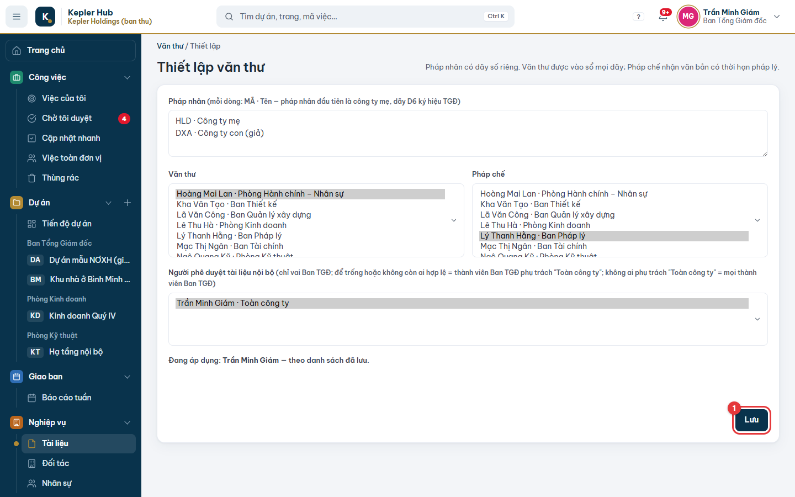

Màn có tiêu đề **Thiết lập văn thư**, dòng mô tả "Pháp nhân có dãy số riêng. Văn thư được vào sổ mọi dãy; Pháp chế nhận văn bản có thời hạn pháp lý." Thanh vị trí ghi "Văn thư / Thiết lập".

**Ai thấy, ai sửa:**

- Chỉ vai **Ban Tổng Giám đốc** thấy nút, mở màn và lưu được. Mọi thành viên Ban Tổng Giám đốc đều sửa được, không riêng Tổng Giám đốc.
- Người khác gõ thẳng địa chỉ thì thấy "Chỉ Ban Tổng Giám đốc thiết lập văn thư."
- Văn thư, Pháp chế không tự sửa được danh sách của mình. Người phê duyệt sửa được vì là Ban Tổng Giám đốc.
- Quản trị hệ thống không vào được màn này; chỉ xem được nhật ký các lần lưu (mục 4.6.10).

**Dùng để làm gì:** Chỉ định "ai làm gì" với văn bản của công ty. Cần vào đây:

- một lần, trước khi văn thư bắt đầu vào sổ;
- khi có người mới làm văn thư, pháp chế; khi người cũ nghỉ việc, chuyển việc;
- khi thêm công ty con, đổi tên công ty;
- khi đổi người duyệt quy chế, quy định;
- khi Người phê duyệt nghỉ việc, đổi vai (mục 4.6.9).

**Các bước thường làm**

1. Mở màn **Thiết lập**, **bấm F5** để chắc thấy thiết lập mới nhất (lý do ở cảnh báo dưới bảng nút).
2. Sửa ô **Pháp nhân** nếu cần.
3. Chọn người ở ba ô **Văn thư**, **Pháp chế**, **Người phê duyệt tài liệu nội bộ**. Giữ **Ctrl** (Windows) hoặc **Cmd** (Mac) khi bấm để chọn nhiều người (mục 4.6.6).
4. Kéo thanh cuộn trong từng ô, kiểm đủ những tên đang tô màu. Dưới ô **Người phê duyệt tài liệu nội bộ**: đọc dòng **Đang áp dụng**; người đã nghỉ, đổi vai (nếu có) hiện gạch tên, muốn xoá hẳn thì bỏ tick "giữ tên trong danh sách".
5. Bấm **Lưu**. Thông báo "Đã lưu thiết lập" hiện ra, trang chuyển về sổ **Văn bản đến**.
6. Báo những người vừa được chọn bấm F5 (mục 4.6.7).

**Từng ô**

| Ô (nguyên văn) | Nghĩa là gì | Điền / chọn thế nào (mặc định) | Đổi thì hệ thống làm gì khác |
|---|---|---|---|
| **Pháp nhân**, gợi ý "(mỗi dòng: MÃ · Tên — pháp nhân đầu tiên là công ty mẹ, dãy D6 ký hiệu TGĐ)". Ô gõ nhiều dòng | Danh sách công ty có sổ, có dãy số riêng | Mỗi dòng một pháp nhân: mã, dấu tách, tên. Chưa thiết lập lần nào thì có sẵn một dòng "HLD · Công ty mẹ". Mã: 2–6 chữ cái A–Z, không số, không chữ Đ, không dấu; gõ chữ thường cũng được, hệ thống đổi sang in hoa. Dấu tách: "·", "-", "–", "\|" hoặc ":". Phải có tên. Ít nhất một dòng. Dòng trống bị bỏ qua. Tên dài quá 120 ký tự bị cắt bớt, không báo | (1) Mã vào số văn bản, ví dụ `Đ-HLD`, `QĐ-DXA`. (2) Mỗi pháp nhân một bộ đếm số riêng. (3) Danh sách **Pháp nhân** trong hộp **Vào sổ văn bản** và **Tạo dự thảo**; dòng đầu được chọn sẵn. (4) **Dòng đầu là công ty mẹ**: dãy D6 của nó ký hiệu "TGĐ", pháp nhân khác ký hiệu "GĐ.*MÃ*" (mục 4.6.5). (5) Từ 2 pháp nhân trở lên: danh sách sổ có thêm ô lọc **Mọi pháp nhân**. (6) Tên pháp nhân điền sẵn vào "Nơi ban hành" khi gắn văn bản đi, quy chế vào việc. (7) Claude tạo dự thảo chỉ dùng được mã có ở đây. Lỗi: "Pháp nhân: mã 2–6 chữ in hoa (vd. HLD, DXA) và tên"; "Mã pháp nhân bị trùng" |
| **Văn thư**. Ô chọn nhiều, cao 6 dòng | Người kiêm văn thư | Mọi tài khoản đang hoạt động trừ Quản trị hệ thống, dạng "Họ tên · Bộ phận". Mặc định: không ai. Tối đa 30 người; chọn quá thì hệ thống chỉ giữ 30 người đầu theo thứ tự trong ô, không báo | Mở thêm quyền và thông báo như bảng ở mục 4.6.2. Lỗi: "Văn thư có tài khoản không hợp lệ" |
| **Pháp chế**. Ô chọn nhiều, cao 6 dòng | Người kiêm pháp chế | Như ô **Văn thư**. Mặc định: không ai. Tối đa 30 người, quá thì cắt bớt không báo | Như bảng ở mục 4.6.2. Lỗi: "Pháp chế có tài khoản không hợp lệ" |
| **Người phê duyệt tài liệu nội bộ**, gợi ý "(chỉ vai Ban TGĐ; để trống hoặc không còn ai hợp lệ = thành viên Ban TGĐ phụ trách "Toàn công ty"; không ai phụ trách "Toàn công ty" = mọi thành viên Ban TGĐ)". Ô chọn nhiều, cao 4 dòng; dưới ô có danh sách người đã lưu nhưng không còn hợp lệ (nếu có) và dòng **Đang áp dụng** | Ai được **Phê duyệt** / **Trả lại** dự thảo quy chế, quy định | Ô chỉ liệt kê tài khoản vai Ban Tổng Giám đốc đang hoạt động, dạng "Họ tên", hoặc "Họ tên · Toàn công ty" với người có phạm vi phụ trách "Toàn công ty". Mặc định: trống. Tối đa 10 người, quá thì cắt bớt không báo. Người đã lưu mà nay đã nghỉ hoặc đổi vai không có trong ô: hiện bên dưới, tên gạch ngang kèm "(đã khoá)" / "(không còn vai Ban Tổng Giám đốc)" và ô tick "giữ tên trong danh sách" (đang tick) | Như mục 4.6.2, 4.6.8 và 4.6.9. Để trống hoặc không còn ai hợp lệ: thành viên Ban Tổng Giám đốc có phạm vi "Toàn công ty" là Người phê duyệt (không ai có: mọi thành viên Ban Tổng Giám đốc). Lưu mà vẫn tick "giữ": người đó ở lại danh sách nhưng không được tính tới khi hợp lệ lại; bỏ tick: xoá khỏi danh sách. Người vừa thành Người phê duyệt nhận "Tài liệu chờ phê duyệt" của từng dự thảo đang chờ. Lỗi: "Người phê duyệt phải là tài khoản vai Ban Tổng Giám đốc đang hoạt động" |

Các lỗi khi bấm **Lưu** (hiện thành dòng đỏ ngay trên nút) và cách xử lý:

| Lỗi (nguyên văn) | Nghĩa là | Làm gì |
|---|---|---|
| "Pháp nhân: mã 2–6 chữ in hoa (vd. HLD, DXA) và tên" | Một dòng pháp nhân sai: thiếu dấu tách, thiếu tên, mã có số, có chữ Đ, dài quá 6 chữ; hoặc ô trống hết | Sửa dòng đó theo mẫu "HLD · Tên công ty" |
| "Mã pháp nhân bị trùng" | Hai dòng cùng mã | Xoá hoặc đổi một dòng |
| "Văn thư có tài khoản không hợp lệ" / "Pháp chế có tài khoản không hợp lệ" | Một người đang chọn vừa bị khoá tài khoản hoặc vừa chuyển sang Quản trị hệ thống, sau lúc bạn mở trang | Bấm F5, chọn lại, **Lưu** |
| "Người phê duyệt phải là tài khoản vai Ban Tổng Giám đốc đang hoạt động" | Người bạn vừa chọn thêm vào ô bị khoá hoặc đổi vai khỏi Ban Tổng Giám đốc sau lúc bạn mở trang. Người đã có trong danh sách đã lưu thì không gây lỗi này: họ được giữ và hiện gạch tên | Bấm F5, chọn lại, **Lưu** |
| "Chỉ Ban TGĐ thiết lập văn thư" | Tài khoản của bạn không còn vai Ban Tổng Giám đốc | Nhờ thành viên Ban Tổng Giám đốc khác |

**Các nút**

| Nút | Làm gì | Có hỏi lại không | Quay lại được không |
|---|---|---|---|
| **Lưu** | Gửi **cả 4 ô** lên máy chủ. Thành công: thông báo "Đã lưu thiết lập"; trình duyệt của bạn nạp lại thông tin văn thư; trang chuyển về sổ **Văn bản đến**, kể cả khi bạn mở từ tab Quy chế. Lỗi: dòng đỏ ngay trên nút, trang không chuyển | **Không hỏi** | Có: sửa lại rồi **Lưu**. Nhưng **không có bản cũ để khôi phục**: ghi lại danh sách cũ trước khi sửa |

Màn này **không có nút Huỷ**. Muốn bỏ thay đổi chưa lưu: rời trang (bấm "Văn thư" trên thanh vị trí, hoặc bấm F5) mà không bấm **Lưu**.

⚠️ **Lưu** không hỏi lại và áp dụng ngay cho mọi người: Văn thư bị bỏ mất quyền vào sổ ngay; Người phê duyệt bị bỏ mất nút **Phê duyệt** ngay. Văn thư, Pháp chế được thêm hay bị bỏ, và Người phê duyệt bị bỏ, không nhận thông báo nào: Ban Tổng Giám đốc tự báo họ. Riêng người vừa thành Người phê duyệt (vừa có tên ở dòng **Đang áp dụng**) nhận "Tài liệu chờ phê duyệt" của từng dự thảo đang chờ, kể cả dự thảo tạo từ năm trước.

⚠️ **Trang Thiết lập hiện số liệu trình duyệt đã nạp từ lần đầu bạn mở mục Văn thư trong phiên làm việc**, không tự lấy mới. Thành viên Ban Tổng Giám đốc khác vừa sửa mà bạn không bấm F5, bạn sẽ thấy danh sách cũ; bấm **Lưu** là ghi đè toàn bộ thay đổi của họ. Hai người cùng sửa thì ai lưu sau thắng, cho cả 4 ô. Luôn bấm F5 trước khi sửa.

⚠️ **Chữ trên màn hình ghi** "Văn thư được vào sổ mọi dãy" **nhưng thực tế** Văn thư vào sổ (có số ngay) chỉ ở dãy D9 (văn bản đi) và D10 (văn bản đến). Với D5, D6, D7, Văn thư chỉ tạo **dự thảo**; số cấp khi Người phê duyệt bấm **Phê duyệt**.

#### 4.6.1 Lưu xong, ai được thêm gì ngay

| Thay đổi | Có hiệu lực ở máy chủ | Trên trình duyệt của người đó |
|---|---|---|
| Thêm một Văn thư | Ngay: vào sổ, sửa, hủy số, xem "Hạn chế", nhận nhắc | Cần F5 mới thấy nút **Vào sổ**, **Tạo dự thảo**. Nút trên trang chi tiết văn bản hiện ngay |
| Bỏ một Văn thư | Ngay: mất mọi quyền văn thư | Vẫn thấy nút **Vào sổ** tới khi F5; bấm thì nhận "Chỉ văn thư (do Ban TGĐ chỉ định) hoặc Ban TGĐ vào sổ văn bản" |
| Thêm, bỏ Pháp chế | Ngay | Không cần F5 |
| Thêm, đổi Người phê duyệt | Ngay. Người vừa thành Người phê duyệt nhận "Tài liệu chờ phê duyệt" của từng dự thảo đang chờ | Không cần F5: mở dự thảo là thấy nút **Phê duyệt** |
| Thêm, sửa pháp nhân | Ngay | Người khác cần F5 mới thấy trong ô **Pháp nhân** và ô lọc |

#### 4.6.2 Mỗi danh sách mở thêm quyền gì

Chỉ tính tài khoản không phải Quản trị hệ thống. Quyền dưới đây **cộng thêm** vào quyền của vai.

| Danh sách | Được làm thêm | Nhận thông báo | Không được |
|---|---|---|---|
| **Văn thư** | Vào sổ (cấp số) văn bản đến D10, văn bản đi D9. Sửa, giao và đổi người xử lý, hủy số văn bản đến, đi. Bấm mọi bước trạng thái ("Đã trình", "Đã giao", "Bắt đầu xử lý", "Báo xong", "Lập hồ sơ", "Đã gửi", "Bên nhận đã xác nhận", "Đã có phản hồi"). Tải lên và gỡ tệp văn bản đến, đi. Xem văn bản "Hạn chế" của **mọi** bộ phận. Sổ nội bộ: tạo dự thảo D5, D6, D7 cho mọi bộ phận; xem, sửa, gửi lại, hủy dự thảo của người khác, thêm và gỡ tệp dự thảo, **trong cấp xem theo vai của chính mình**. Sổ nội bộ sau phê duyệt: sửa ghi chú, cấp xem, ngày hiệu lực; bấm **Có hiệu lực**, **Hết hiệu lực**, **Hủy số**. Hiện "Kiêm nhiệm: Văn thư" ở trang cá nhân và ở Quản trị → Tài khoản | "Văn bản *số* đã xử lý xong — lập hồ sơ" (khi người xử lý hoặc lãnh đạo bộ phận bấm **Báo xong**). Nhắc hằng ngày văn bản đến **chưa giao người xử lý** khi tới hạn, quá hạn (tiêu đề có đuôi " — chưa giao người xử lý") | Không phê duyệt, không trả lại. Không xem "Bảo mật cao" do người khác vào sổ. Không thấy nút **Thiết lập** (trừ khi có vai Ban Tổng Giám đốc). Không cần vai lãnh đạo: Nhân viên làm Văn thư được |
| **Pháp chế** | Xem văn bản "Hạn chế" đã đánh dấu chuyển Pháp chế. Hiện "Kiêm nhiệm: Pháp chế" | "Văn bản *số* có thời hạn pháp lý — chuyển Pháp chế" (khi văn thư tick ô lúc vào sổ, hoặc bật ô khi sửa) | Không có tab hay bộ lọc riêng "văn bản chuyển Pháp chế": tìm qua thông báo hoặc sổ đến. Không có tác dụng ở sổ nội bộ |
| **Người phê duyệt** | Bấm **Phê duyệt**, **Trả lại** dự thảo quy chế, quy định. Xem mọi dự thảo. Chỉ tính người còn hoạt động, còn vai Ban Tổng Giám đốc (mục 4.6.8) | "Tài liệu chờ phê duyệt: *tên*" (dự thảo mới; và khi vừa thành Người phê duyệt: một thông báo cho mỗi dự thảo đang chờ); "Tài liệu gửi lại chờ phê duyệt: *tên*" | Không hiện ở "Kiêm nhiệm" |

Thêm:

- Chọn một thành viên Ban Tổng Giám đốc vào ô **Văn thư**: người đó thêm quyền xem, sửa dự thảo của người khác (vai Ban Tổng Giám đốc vốn không có). Vẫn không phê duyệt được nếu không có tên trong ô **Người phê duyệt**.
- Lãnh đạo bộ phận tạo dự thảo D7 của bộ phận mình **không cần** Thiết lập: tự có theo vai.
- Thiết lập không có tác dụng gì ở tab **Tài liệu dự án**.

#### 4.6.3 Mỗi ô tác động tới màn nào

Bảng này trả lời "Thiết lập để làm gì" theo từng màn: đổi một ô thì ai thấy khác đi, ở chỗ nào.

| Ô ở Thiết lập | Chỗ bị ảnh hưởng | Ai thấy khác đi | Ví dụ |
|---|---|---|---|
| **Pháp nhân** | Ô **Pháp nhân** trong hộp **Vào sổ văn bản** | Ban Tổng Giám đốc, Văn thư | Thêm dòng DXA: văn thư chọn được DXA khi vào sổ |
| **Pháp nhân** | Ô **Pháp nhân** trong hộp **Tạo dự thảo tài liệu nội bộ** | Ban Tổng Giám đốc, Văn thư, Lãnh đạo bộ phận | Lãnh đạo bộ phận tạo dự thảo D7 chọn được DXA |
| **Pháp nhân** | Số của văn bản: mã pháp nhân; ký hiệu "TGĐ" hoặc "GĐ.*MÃ*" của dãy D6 | Mọi người xem sổ | `0001/2026/Đ-DXA`; `001/2026/TB-GĐ.DXA` |
| **Pháp nhân** | Ô lọc **Mọi pháp nhân** ở sổ đến, sổ đi, Tôi xử lý, Quy chế | Mọi người xem sổ | Có từ 2 pháp nhân thì ô lọc mới hiện |
| **Pháp nhân** | "Nơi ban hành" điền sẵn khi gắn văn bản đi, quy chế vào việc | Người gắn văn bản vào việc | Văn bản đi của HLD điền sẵn tên đầy đủ của HLD |
| **Pháp nhân** | Claude tạo dự thảo | Người nhờ Claude | Gõ mã không có ở đây: "Pháp nhân không có trong Kepler Hub: *mã* (có: *danh sách*)" |
| **Văn thư** | Nút **Vào sổ** (sổ đến, sổ đi, Tôi xử lý) và **Tạo dự thảo** (Quy chế) | Người được chọn (sau F5) | |
| **Văn thư** | Trang chi tiết văn bản đến, đi: **Sửa / giao xử lý**, **Hủy số**, mọi nút bước, **Gỡ**, **Tải tệp lên** | Người được chọn | |
| **Văn thư** | Danh sách sổ đến, đi: thấy thêm văn bản "Hạn chế" của mọi bộ phận | Người được chọn | Văn thư phòng Hành chính thấy văn bản "Hạn chế" của phòng Tài chính |
| **Văn thư** | Danh sách Quy chế: thấy dự thảo của người khác, trong cấp xem theo vai của mình | Người được chọn | |
| **Văn thư** | Trang chi tiết quy chế: **Sửa**, **Gửi lại**, **Huỷ dự thảo**, **Tải tệp lên**, **Gỡ** với dự thảo; **Sửa**, **Có hiệu lực**, **Hết hiệu lực**, **Hủy số** với tài liệu đã phê duyệt | Người được chọn | |
| **Văn thư** | Chuông thông báo: "đã xử lý xong — lập hồ sơ"; nhắc văn bản đến chưa giao người xử lý | Người được chọn | Danh sách trống: không ai nhận hai loại báo này |
| **Văn thư** | Dòng **Kiêm nhiệm** ở trang Thông tin cá nhân; cột **Kiêm nhiệm** ở Quản trị → Tài khoản | Người đó; Quản trị hệ thống | |
| **Pháp chế** | Danh sách sổ đến: thấy thêm văn bản "Hạn chế" đã chuyển Pháp chế | Người được chọn | |
| **Pháp chế** | Chuông thông báo: "Văn bản *số* có thời hạn pháp lý — chuyển Pháp chế" | Người được chọn | |
| **Pháp chế** | Dòng, cột **Kiêm nhiệm** | Người đó; Quản trị hệ thống | |
| **Pháp chế** | Ô tick chuyển Pháp chế ở hộp **Vào sổ văn bản** và **Sửa** | Văn thư, Ban Tổng Giám đốc | Trong hộp **Vào sổ văn bản** ô tick chỉ hiện khi chọn dãy D10 (văn bản đến); trong hộp **Sửa** hiện với cả văn bản đến và đi. Ô hiện kể cả khi danh sách Pháp chế trống: tick lúc đó không đến ai |
| **Người phê duyệt** | Trang chi tiết dự thảo: nút **Phê duyệt**, **Trả lại** | Người đang áp dụng (dòng **Đang áp dụng**, mục 4.6.8) | Người được chọn đã nghỉ: thành viên Ban Tổng Giám đốc phụ trách "Toàn công ty" thấy nút thay |
| **Người phê duyệt** | Danh sách Quy chế: thấy mọi dự thảo | Người đang áp dụng | |
| **Người phê duyệt** | Chuông thông báo: "Tài liệu chờ phê duyệt", "Tài liệu gửi lại chờ phê duyệt" | Người đang áp dụng | Thêm một Phó Tổng Giám đốc vào ô: người đó nhận "Tài liệu chờ phê duyệt" của các dự thảo đang chờ |
| **Người phê duyệt** | Trang **Chờ tôi duyệt**, dòng **Kiêm nhiệm** | Không đổi | Dự thảo không vào **Chờ tôi duyệt** |

Thiết lập **không** tác động tới: tab **Tài liệu dự án**, quyền xem việc, dự án, báo cáo tuần, nhân sự.

#### 4.6.4 Văn thư có vai khác nhau thì khác gì

Văn thư là kiêm nhiệm, cộng lên vai. Ở sổ đến, sổ đi, mọi Văn thư làm được như nhau. Ở sổ nội bộ, **vai** của Văn thư quyết cấp xem.

| Việc | Văn thư vai Nhân viên | Văn thư vai Lãnh đạo bộ phận | Văn thư vai Ban Tổng Giám đốc |
|---|---|---|---|
| Vào sổ, sửa, giao xử lý, hủy số, bấm bước, tải lên và gỡ tệp văn bản đến, đi | ✔ | ✔ | ✔ |
| Xem văn bản "Hạn chế" của mọi bộ phận | ✔ | ✔ | ✔ (vai vốn đã có) |
| Xem văn bản "Bảo mật cao" | Chỉ văn bản mình vào sổ hoặc được giao xử lý | Như bên trái | Mọi văn bản (do vai) |
| Tạo dự thảo | D5, D6, D7 cho mọi bộ phận | Như bên trái | Như bên trái |
| Cấp xem đặt được khi tạo, khi sửa | Chỉ "Mọi người" | "Mọi người", "Lãnh đạo" | Cả 3 cấp |
| Xem, sửa, gửi lại, hủy dự thảo của người khác | Chỉ dự thảo cấp "Mọi người" | Dự thảo cấp "Mọi người", "Lãnh đạo" | Mọi dự thảo |
| Xem tài liệu đã phê duyệt | Cấp "Mọi người" (và tài liệu mình soạn) | "Mọi người", "Lãnh đạo" | Cả 3 cấp |
| **Phê duyệt**, **Trả lại** | Không | Không | Chỉ khi có tên trong ô **Người phê duyệt** |
| Thấy nút **Thiết lập** | Không | Không | Có |

Hệ quả thực tế: tài liệu cấp "Lãnh đạo" hoặc "Ban TGĐ" (ví dụ quy chế lương) **không** để Văn thư vai Nhân viên soạn được, vì ô **Cấp xem** của họ chỉ có "Mọi người". Cách làm đúng:

- Thành viên Ban Tổng Giám đốc tự tạo dự thảo với cấp xem đúng; hoặc
- Lãnh đạo bộ phận tự tạo dự thảo D7 cấp "Lãnh đạo" cho bộ phận mình; hoặc
- Ban Tổng Giám đốc chọn thêm một thành viên Ban Tổng Giám đốc vào ô **Văn thư**.

⚠️ Đừng tạo cấp "Mọi người" rồi định nâng cấp xem sau. Dự thảo chỉ người soạn hoặc Văn thư sửa được, và mỗi người chỉ nâng được tới cấp của vai mình: Văn thư vai Nhân viên không nâng được. Còn nếu cứ để phê duyệt, tài liệu hiện với mọi người ngay lúc duyệt, cho tới khi có người sửa cấp xem.

#### 4.6.5 Thứ tự pháp nhân có ý nghĩa gì

**Dòng đầu là công ty mẹ.** Nó quyết hai điều:

1. **Ký hiệu dãy D6.** Văn bản D6 của pháp nhân dòng đầu ký hiệu "TGĐ", ví dụ `007/2026/TTr-TGĐ`. Pháp nhân khác ký hiệu "GĐ." cộng mã, ví dụ `003/2026/TB-GĐ.DXA`.
2. **Lựa chọn sẵn.** Ô **Pháp nhân** trong hộp **Vào sổ văn bản** và **Tạo dự thảo** chọn sẵn pháp nhân dòng đầu.

Các dòng sau chỉ quyết thứ tự hiện trong danh sách chọn và ô lọc.

**Đổi thứ tự** chỉ ảnh hưởng số cấp **sau đó**; số đã cấp không đổi. Ví dụ: đưa dòng "DXA · *tên*" lên trên dòng "HLD · *tên*". Từ lúc đó, thông báo D6 của DXA phê duyệt mang số dạng `004/2026/TB-TGĐ`; D6 của HLD mang số dạng `008/2026/TB-GĐ.HLD` (số thứ tự vẫn đi tiếp theo bộ đếm riêng của từng công ty).

⚠️ **Đừng đổi dòng đầu giữa năm.** Pháp nhân mới đứng đầu dùng ký hiệu "TGĐ" nhưng vẫn đếm bằng bộ đếm riêng của nó, nên số có thể trùng với số "TGĐ" đã cấp cho công ty mẹ cũ (ví dụ cả hai cùng là `001/2026/TB-TGĐ`). Hệ thống không cho hai văn bản trùng số, nên lúc bấm **Phê duyệt** sẽ báo lỗi bắt đầu bằng "Dữ liệu bị trùng" và dự thảo không duyệt được. Đặt dòng đầu một lần, từ đầu.

**Đổi mã pháp nhân** (ví dụ sửa "HLD" thành mã khác):

- Văn bản cũ giữ mã cũ. Mã mới đếm lại từ 1.
- Văn bản mang mã cũ không lọc riêng được nữa: ô lọc chỉ liệt kê mã đang có.
- Nếu đó là công ty mẹ: số D6 mới (ký hiệu "TGĐ") có thể trùng số đã cấp như trên. Số D7 cũng có thể trùng, vì số D7 không mang mã pháp nhân (mục 4.5).
- Vậy: **không đổi mã giữa năm**. Muốn đổi tên công ty thì chỉ sửa phần tên.

**Xoá một dòng:** không xoá văn bản nào. Văn bản cũ của pháp nhân đó vẫn xem được, nhưng không lọc riêng được, không vào sổ hay tạo dự thảo mới được cho pháp nhân đó. Dự thảo của pháp nhân đó đang chờ vẫn duyệt được. Claude báo "Pháp nhân không có trong Kepler Hub: *mã* (có: *danh sách*)".

**Sửa tên:** chỉ đổi chữ hiện ra và "Nơi ban hành" điền sẵn sau đó. Số không đổi.

**Viết dòng cho đúng:**

| Gõ | Kết quả |
|---|---|
| `HLD · Công ty mẹ` | Đúng |
| `HLD - Công ty mẹ`, `HLD: Công ty mẹ`, `hld · Công ty mẹ` | Đúng (mã đổi thành HLD) |
| `HLD Công ty mẹ` (thiếu dấu tách) | Lỗi "Pháp nhân: mã 2–6 chữ in hoa (vd. HLD, DXA) và tên" |
| `HLD ·` (thiếu tên) | Lỗi như trên |
| `ĐXA · Công ty con` (mã có chữ Đ) hoặc `HL1 · Công ty con` (mã có số) | Lỗi như trên |
| `ABC · Công ty A-B` | Lưu được, nhưng tên thành "Công ty A - B": dấu "-", "–", ":", "\|", "·" trong tên bị coi là dấu tách. Tên nên tránh các dấu này |

#### 4.6.6 Chọn nhiều người: giữ Ctrl / Cmd

Ba ô **Văn thư**, **Pháp chế**, **Người phê duyệt tài liệu nội bộ** là ô chọn nhiều của trình duyệt. Người đang được chọn có nền tô màu.

| Muốn | Làm |
|---|---|
| Thêm một người, giữ người cũ | Giữ **Ctrl** (Windows) hoặc **Cmd** (Mac) rồi bấm tên |
| Bỏ một người, giữ người khác | Giữ **Ctrl** / **Cmd** rồi bấm vào tên đang tô màu |
| Chọn một dải tên liền nhau | Bấm tên đầu, giữ **Shift** bấm tên cuối |
| Để trống cả ô (ví dụ ô Người phê duyệt) | Giữ **Ctrl** / **Cmd**, bấm từng tên đang tô màu tới khi không còn tên nào tô màu |
| Bỏ hết thay đổi chưa lưu | Bấm F5 |

⚠️ **Bấm thường (không giữ phím) vào một tên thì chỉ người đó được chọn; mọi người khác trong ô bị bỏ chọn.** Bấm **Lưu** là họ bị xoá khỏi danh sách. Giao diện không có dòng nhắc nào về việc này. Ví dụ: ô **Văn thư** đang có 2 người (văn thư phòng Hành chính và người dự phòng). Bạn bấm thường vào tên văn thư mới rồi **Lưu**: chỉ còn 1 Văn thư là người mới; 2 người cũ mất quyền vào sổ ngay lập tức.

- Ô chỉ cao 6 dòng (ô Người phê duyệt: 4 dòng). Người được chọn có thể nằm khuất phía dưới. Kéo thanh cuộn trong ô để kiểm hết trước khi **Lưu**.
- Đã lỡ **Lưu** sai: chọn lại cho đúng, **Lưu** lần nữa. Không có nút khôi phục bản cũ.
- Trên điện thoại, máy tính bảng: trình duyệt thường mở danh sách có ô tick; chạm để bật, tắt từng người.

#### 4.6.7 Người vừa được chọn phải tải lại trang (F5)

Máy chủ áp dụng thiết lập ngay khi bạn bấm **Lưu**. Nhưng trình duyệt của mỗi người giữ thông tin văn thư (mình có phải Văn thư không, danh sách pháp nhân, danh sách bộ phận) suốt phiên làm việc. Chỉ trình duyệt của người bấm **Lưu** được nạp lại.

Hệ quả cụ thể ở bảng mục 4.6.1. Tóm lại:

- Người **vừa được chọn làm Văn thư** phải bấm **F5** mới thấy nút **Vào sổ**, **Tạo dự thảo**.
- Người **vừa bị bỏ** khỏi Văn thư vẫn thấy nút cũ tới khi F5, nhưng bấm sẽ bị từ chối.
- **Pháp nhân mới** chỉ hiện với người khác sau khi họ F5.
- Người phê duyệt, Pháp chế mới không cần F5.
- Tài khoản mới tạo sau lúc bạn mở trang Thiết lập chưa có trong ô **Văn thư**, **Pháp chế**: bấm F5 rồi chọn.

Câu mẫu để báo người được chọn: "Bạn vừa được giao kiêm Văn thư trên Kepler Hub. Bấm F5 để thấy nút Vào sổ."

#### 4.6.8 Để trống "Người phê duyệt" thì ai duyệt

Hệ thống tính **một** nhóm "Người phê duyệt đang áp dụng", theo thứ tự dưới đây, và dùng nhóm đó ở mọi chỗ: nút **Phê duyệt** / **Trả lại**, quyền xem dự thảo, người nhận "Tài liệu chờ phê duyệt".

1. Những người trong ô **Người phê duyệt tài liệu nội bộ** còn hoạt động **và** còn vai Ban Tổng Giám đốc.
2. Không còn ai như vậy (ô trống, hoặc mọi người trong ô đã nghỉ, đổi vai): **mọi thành viên Ban Tổng Giám đốc đang hoạt động có phạm vi phụ trách "Toàn công ty"**. Trong ô chọn, họ có đuôi "· Toàn công ty".
3. Cũng không có ai phụ trách "Toàn công ty": **mọi thành viên Ban Tổng Giám đốc đang hoạt động**.
4. Không có thành viên Ban Tổng Giám đốc nào đang hoạt động: không ai duyệt được. Màn Thiết lập hiện băng đỏ "Hiện không có Người phê duyệt hợp lệ — dự thảo sẽ không ai duyệt."

Quản trị hệ thống không bao giờ là Người phê duyệt.

- Ai đang áp dụng, vì sao: đọc dòng ngay dưới ô, ví dụ "Đang áp dụng: *họ tên* — theo danh sách đã lưu.", "Đang áp dụng: *họ tên* — theo "Toàn công ty" vì danh sách trống.", "Đang áp dụng: *họ tên* — theo "Toàn công ty" vì danh sách không còn ai hợp lệ.", "Đang áp dụng: *họ tên, họ tên* — mọi thành viên Ban TGĐ, vì danh sách trống và không ai phụ trách "Toàn công ty"." Dòng này tính theo thiết lập **đã lưu** lúc trang được nạp: đổi ô chọn mà chưa **Lưu** thì dòng chưa đổi.
- Ô có ít nhất một người hợp lệ: **chỉ** những người đó duyệt được. Thành viên Ban Tổng Giám đốc có "Toàn công ty" mà không có tên trong ô thì không duyệt được.
- Phạm vi "Toàn công ty" do **Quản trị hệ thống** đặt, không phải Ban Tổng Giám đốc: Quản trị → **Tài khoản** → nút **Quyền & phụ trách** ở dòng tài khoản Ban Tổng Giám đốc → tick **Toàn công ty** → **Lưu phạm vi phụ trách**.
- Ví dụ: ô trống, Quản trị bỏ "Toàn công ty" của Tổng Giám đốc → quyền duyệt chuyển sang **mọi** thành viên Ban Tổng Giám đốc đang hoạt động.
- Mới cài thì ô trống; hệ thống không tự chọn sẵn ai. Mở màn Thiết lập để biết ai đang áp dụng.
- Khuyến nghị: chọn đích danh người duyệt (thường là Tổng Giám đốc), không dựa vào người dự phòng.

| Ô Người phê duyệt | Ai duyệt được | Ai nhận "Tài liệu chờ phê duyệt" |
|---|---|---|
| Trống | Ban Tổng Giám đốc có "Toàn công ty"; không ai có thì mọi thành viên Ban Tổng Giám đốc | Những người đó, trừ người tạo dự thảo |
| Có người, tất cả còn hợp lệ | Chỉ những người trong ô | Những người đó, trừ người tạo dự thảo |
| Có người, một số đã nghỉ hoặc đổi vai | Những người còn hợp lệ | Những người còn hợp lệ, trừ người tạo dự thảo |
| Có người, **tất cả** đã nghỉ hoặc đổi vai | Như ô trống | Như ô trống |
| Không có thành viên Ban Tổng Giám đốc nào đang hoạt động | **Không ai** (băng đỏ ở Thiết lập) | **Không ai** |

#### 4.6.9 Danh sách có người đã nghỉ hoặc đổi vai: hệ thống làm gì, bạn làm gì

"Đã nghỉ" là tài khoản bị khoá (cột **Trạng thái** ghi "Đã khoá" ở Quản trị → Tài khoản). "Đổi vai" là Quản trị hệ thống đổi vai của tài khoản.

**Người phê duyệt.**

- Một người trong ô chỉ được tính khi tài khoản **còn hoạt động** và **còn vai Ban Tổng Giám đốc**. Người đã nghỉ, đổi vai không duyệt được, không nhận báo.
- Nếu **mọi** người trong danh sách đều đã nghỉ hoặc đổi vai: hệ thống tự dùng người dự phòng như khi ô trống (mục 4.6.8), dự thảo vẫn có người duyệt.
- Màn Thiết lập hiện người không còn hợp lệ ngay dưới ô chọn, sau dòng "Đã lưu nhưng không còn hợp lệ — hệ thống không tính những người này:": tên gạch ngang, kèm "(đã khoá)", "(không còn vai Ban Tổng Giám đốc)" hoặc cả hai, và ô tick "giữ tên trong danh sách" đang tick sẵn.
- Bấm **Lưu** mà để nguyên ô tick: người đó vẫn ở danh sách, không bị xoá âm thầm, và tự được tính lại khi Quản trị mở khoá tài khoản hoặc trả vai Ban Tổng Giám đốc. Ví dụ: Quản trị khoá nhầm tài khoản Tổng Giám đốc rồi mở lại: Tổng Giám đốc duyệt tiếp như cũ, không cần sửa Thiết lập.
- Bỏ tick rồi **Lưu**: người đó bị xoá khỏi danh sách. Muốn thêm lại sau này thì người đó phải đang hoạt động, đúng vai.

⚠️ Khi Quản trị khoá tài khoản hoặc đổi vai Người phê duyệt, quyền duyệt chuyển ngay sang người dự phòng, nhưng người dự phòng **không** được báo các dự thảo đã chờ từ trước. Chỉ dự thảo tạo mới hoặc gửi lại sau đó mới báo họ.

**Nên làm** (thành viên Ban Tổng Giám đốc):

1. Mở **Thiết lập**, bấm F5. Đọc dòng **Đang áp dụng**.
2. Ở ô **Người phê duyệt tài liệu nội bộ**, chọn người duyệt mới (giữ Ctrl / Cmd nếu chọn nhiều); hoặc giữ nguyên nếu người dự phòng đang áp dụng là đúng ý.
3. Người đã nghỉ hẳn: bỏ tick "giữ tên trong danh sách".
4. Bấm **Lưu**. Người vừa thành Người phê duyệt nhận "Tài liệu chờ phê duyệt" cho từng dự thảo đang chờ, kể cả dự thảo tạo từ năm trước. Nếu không đổi ai mà dựa vào người dự phòng, báo họ vào tab **Quy chế, quy định nội bộ** tìm các dự thảo "Chưa phê duyệt" (kiểm cả năm trước).

**Phòng trước:** mỗi khi Quản trị khoá tài khoản hoặc đổi vai một thành viên Ban Tổng Giám đốc, mở Thiết lập xem dòng **Đang áp dụng** ngay.

**Văn thư, Pháp chế.**

- Tài khoản bị khoá hoặc chuyển sang Quản trị hệ thống: mất quyền ngay; không còn hiện trong ô ở Thiết lập; tự rơi khỏi danh sách ở lần **Lưu** kế tiếp.
- Đổi vai giữa Nhân viên, Lãnh đạo bộ phận, Ban Tổng Giám đốc: vẫn là Văn thư, Pháp chế. Riêng ở sổ nội bộ, cấp xem của Văn thư đổi theo vai mới.
- Người vừa nghỉ là **Văn thư duy nhất**: không còn ai nhận "đã xử lý xong — lập hồ sơ" và nhắc văn bản chưa giao; chỉ Ban Tổng Giám đốc vào sổ được. Chọn Văn thư mới ngay.
- Người vừa nghỉ là **Pháp chế duy nhất**: văn bản tick chuyển Pháp chế không đến ai, dù trang vẫn ghi "Đã chuyển đồng thời".
- Cột **Kiêm nhiệm** ở Quản trị → Tài khoản vẫn ghi "Văn thư" / "Pháp chế" cho tài khoản đã khoá, tới khi Ban Tổng Giám đốc **Lưu** lại Thiết lập.
- Văn bản do người đã nghỉ vào sổ vẫn còn, số không đổi. Văn bản "Bảo mật cao" do họ vào sổ thì từ đó chỉ Ban Tổng Giám đốc và người xử lý xem được.

#### 4.6.10 Thiết lập không chỉnh những gì; lưu ở đâu; ai biết ai đã sửa

**Không chỉnh ở Thiết lập:**

| Việc | Ai, ở đâu quyết |
|---|---|
| Các dãy số D5, D6, D7, D9, D10 và tên dãy | Cố định trong phần mềm |
| Các loại văn bản (gợi ý ở sổ đến, đi; 9 loại ở sổ nội bộ) | Cố định trong phần mềm |
| Số ngày xử lý theo độ khẩn (trong ngày / 1 / 3 / 7 ngày làm việc) | Cố định trong phần mềm |
| Ngày làm việc, ngày lễ dùng tính hạn và lịch nhắc | Thiết lập Nhân sự (Ban Tổng Giám đốc hoặc người phụ trách nhân sự, khi phân hệ Nhân sự bật); IT nạp sẵn lúc nhập cơ cấu tổ chức |
| Thư mục văn thư của từng bộ phận trên NAS, bộ phận mặc định | IT, trên máy chủ |
| Thư mục dự án trên NAS | IT tạo trên ổ mạng |
| Ai là Ban Tổng Giám đốc, Lãnh đạo bộ phận; ai có phạm vi "Toàn công ty" | Quản trị → **Tài khoản** |
| Lãnh đạo bộ phận tạo dự thảo D7 của bộ phận mình | Tự có theo vai |
| Ai xem được tài liệu dự án | Thành viên dự án: **Cài đặt dự án** → khối **Thành viên** |
| Mức bảo mật, cấp xem của từng văn bản | Trên từng văn bản |

**Lưu ở đâu, ai biết:**

- Thiết lập lưu trên máy chủ, dùng chung cho cả công ty, áp dụng ngay.
- Mỗi lần **Lưu** ghi một dòng ở Quản trị → **Nhật ký hệ thống**: hành động "Cập nhật", đối tượng "Danh mục", dòng mã nhỏ có chữ `vanthu.config`. Chỉ Quản trị hệ thống xem được nhật ký này.
- Dòng nhật ký chỉ có **giá trị sau khi lưu**, không có giá trị trước. Người được chọn ghi bằng mã số tài khoản, không ghi tên. Muốn biết trước đó ai là Văn thư: xem dòng nhật ký của lần lưu trước đó.
- Không ai nhận thông báo khi Thiết lập đổi.
- IT có thể nạp pháp nhân, Văn thư, Pháp chế từ tệp tổ chức lúc cài đặt. Cách nạp này không ghi vào Nhật ký hệ thống.

**Muốn làm, nhưng Thiết lập không có:**

| Muốn | Có làm được không | Cách gần nhất |
|---|---|---|
| Cho Lãnh đạo bộ phận vào sổ văn bản đến, đi **của riêng bộ phận mình** | Không. Hub không có "văn thư bộ phận" cho sổ đến, đi | Chọn họ vào ô **Văn thư**. Khi đó họ vào sổ được cho **mọi** bộ phận và xem "Hạn chế" của **mọi** bộ phận. Riêng dự thảo D7 của bộ phận mình thì Lãnh đạo bộ phận đã tự tạo được, không cần Thiết lập |
| Cho Pháp chế xem mọi văn bản "Hạn chế" | Không | Văn thư tick chuyển Pháp chế cho từng văn bản; hoặc chọn họ làm Văn thư (quyền rộng hơn nhiều) |
| Cho người không có vai Ban Tổng Giám đốc phê duyệt quy chế | Không. Ô chỉ nhận vai Ban Tổng Giám đốc | Không có cách. Vai do Quản trị hệ thống đặt theo đúng chức vụ |
| Cho thêm người xem một văn bản "Bảo mật cao" | Không có ô nhập trên giao diện | Ngoài Ban Tổng Giám đốc, chỉ người vào sổ và **một** người xử lý xem được. Đổi người xử lý thì người cũ mất quyền xem |
| Chọn người duyệt riêng cho từng dãy, từng loại tài liệu | Không. Một danh sách Người phê duyệt dùng cho mọi dự thảo | |
| Đổi số ngày xử lý theo độ khẩn | Không | Gõ hạn tay ở ô **Hạn** từng văn bản |
| Thêm dãy số, thêm loại văn bản mới | Không | Đề nghị sửa phần mềm |

#### 4.6.11 Các tình huống thường gặp

**1. Thêm một văn thư, giữ người cũ.**

1. Mở **Thiết lập**, bấm F5.
2. Ô **Văn thư**: giữ **Ctrl** (Mac: **Cmd**), bấm tên người mới.
3. Kéo thanh cuộn trong ô: người cũ vẫn tô màu, người mới cũng tô màu.
4. Bấm **Lưu**. Báo người mới bấm F5.

**2. Văn thư nghỉ việc, người mới thay.**

1. Mở **Thiết lập**, bấm F5.
2. Ô **Văn thư**: tài khoản đã khoá thì người cũ không còn trong danh sách. Nếu người cũ chưa bị khoá mà vẫn tô màu: giữ **Ctrl** / **Cmd**, bấm tên họ để bỏ.
3. Giữ **Ctrl** / **Cmd**, bấm tên người mới.
4. Bấm **Lưu**. Báo người mới bấm F5.
5. Văn bản đến mà người cũ đang là **người xử lý**: không có ô lọc theo người xử lý, nên Văn thư mới dò cột **Người xử lý** ở sổ **Văn bản đến** (kiểm cả năm trước), mở từng văn bản → **Sửa / giao xử lý** → chọn người xử lý mới (mục 4.3.4).

**3. Văn thư nghỉ phép dài ngày.**

1. Thêm người dự phòng như tình huống 1.
2. Khi văn thư chính đi làm lại: mở **Thiết lập**, F5, giữ **Ctrl** / **Cmd** bấm tên người dự phòng để bỏ, **Lưu**.
3. Người dự phòng mất quyền ngay. Văn bản họ đã vào sổ vẫn giữ nguyên số.

**4. Tổng Giám đốc đi công tác dài ngày, cần người duyệt thay.**

1. Ô **Người phê duyệt tài liệu nội bộ**: giữ **Ctrl** / **Cmd**, bấm thêm tên một Phó Tổng Giám đốc (vai Ban Tổng Giám đốc). **Lưu**.
2. Từ đó cả hai nhận "Tài liệu chờ phê duyệt". Ai bấm trước thì duyệt; người bấm sau nhận "Tài liệu đã phê duyệt" (bấm gần như cùng lúc thì nhận "Tài liệu vừa được xử lý ở nơi khác — tải lại trang").
3. Dự thảo tạo **trước** lúc thêm người: người mới nhận "Tài liệu chờ phê duyệt" cho từng dự thảo đang chờ ngay khi bạn **Lưu**, kèm dòng "Bạn vừa thành Người phê duyệt (Thiết lập văn thư)".
4. Tổng Giám đốc về: giữ **Ctrl** / **Cmd**, bấm tên Phó Tổng Giám đốc để bỏ, **Lưu**.

**5. Thêm công ty con mới.**

1. Ô **Pháp nhân**: thêm một dòng **ở cuối** (không đặt lên đầu), dạng "MÃ · Tên đầy đủ".
2. Bấm **Lưu**. Báo mọi người bấm F5.
3. Nếu đây là pháp nhân thứ 2: danh sách sổ có thêm ô lọc **Mọi pháp nhân**.
4. Văn bản đầu tiên của công ty mới đếm từ 1, ví dụ `0001/2026/Đ-` cộng mã mới.

**6. Công ty con thôi hoạt động.**

- Còn cần lọc riêng văn bản cũ của công ty đó: **giữ nguyên dòng**, dặn văn thư không chọn nó nữa.
- Xoá dòng: văn bản cũ vẫn còn, vẫn xem được, số không đổi; nhưng ô lọc không còn công ty đó và không ai vào sổ mới cho nó được.

**7. Đổi tên công ty, giữ mã.** Sửa phần tên sau dấu "·", **Lưu**. Số văn bản không đổi. Không sửa mã (mục 4.6.5).

**8. Xem hiện ai đang làm Văn thư, Pháp chế, Người phê duyệt.**

| Ai muốn xem | Xem ở đâu | Thấy được |
|---|---|---|
| Ban Tổng Giám đốc | **Thiết lập** (bấm F5, kéo thanh cuộn từng ô) | Cả 3 danh sách. Văn thư, Pháp chế đã nghỉ thì không hiện. Người phê duyệt đã nghỉ, đổi vai hiện gạch tên dưới ô; dòng **Đang áp dụng** cho biết ai đang thực sự duyệt |
| Quản trị hệ thống | Quản trị → **Tài khoản**, cột **Kiêm nhiệm** | Văn thư, Pháp chế. Có thể còn ghi tên tài khoản đã khoá tới lần lưu kế tiếp. Không có Người phê duyệt |
| Từng người | Trang **Thông tin cá nhân**, dòng **Kiêm nhiệm** | Văn thư, Pháp chế của chính mình. Không có Người phê duyệt |

**9. Quản trị vừa khoá tài khoản hoặc đổi vai một thành viên Ban Tổng Giám đốc.** Mở **Thiết lập**, xem dòng **Đang áp dụng** ngay (mục 4.6.9). Nếu người đó là Người phê duyệt duy nhất, hệ thống đã tự chuyển sang người dự phòng nhưng họ không được báo các dự thảo đang chờ: chọn người duyệt mới và **Lưu** (người mới nhận đủ thông báo), hoặc báo người dự phòng vào tab Quy chế tìm dòng "Chưa phê duyệt".

**10. Một Văn thư chuyển sang bộ phận khác.** Vẫn là Văn thư: danh sách theo người, không theo bộ phận. Không còn làm văn thư thì bỏ tên họ ở ô **Văn thư**.

#### 4.6.12 Trước và sau khi bấm Lưu

**Trước khi bấm Lưu:**

- [ ] Đã bấm F5 trên trang Thiết lập.
- [ ] Đã chụp màn hình hoặc ghi lại danh sách cũ. Không có nút khôi phục.
- [ ] Dòng đầu ô **Pháp nhân** là công ty mẹ. Không đổi mã, không đổi dòng đầu giữa năm.
- [ ] Mỗi dòng pháp nhân có dấu tách "·" và có tên.
- [ ] Đã kéo thanh cuộn ở từng ô: đủ người cần chọn, không thừa ai.
- [ ] Ô **Người phê duyệt** có ít nhất một người còn hợp lệ; hoặc bạn chấp nhận người dự phòng (thành viên Ban Tổng Giám đốc mang đuôi "· Toàn công ty"; không có ai thì mọi thành viên Ban Tổng Giám đốc).
- [ ] Tên bị gạch dưới ô **Người phê duyệt** (nếu có): giữ tick nếu người đó sẽ trở lại, bỏ tick nếu đã nghỉ hẳn.
- [ ] Ô **Văn thư** có ít nhất một người. Trống thì chỉ Ban Tổng Giám đốc vào sổ được và không ai nhận nhắc văn bản chưa giao.
- [ ] Ô **Pháp chế** có người, nếu văn thư sẽ tick chuyển Pháp chế.

**Sau khi bấm Lưu:**

| Kiểm | Ở đâu | Đúng khi |
|---|---|---|
| Lưu thành công | Màn hình của bạn | Thấy "Đã lưu thiết lập", trang về sổ **Văn bản đến** |
| Văn thư mới có quyền | Máy của Văn thư, sau F5 | Có nút **Vào sổ** ở sổ đến |
| Kiêm nhiệm đúng | Trang Thông tin cá nhân của người đó; hoặc nhờ IT xem Quản trị → Tài khoản | Ghi "Văn thư" hoặc "Pháp chế" |
| Pháp nhân đúng | Mở hộp **Vào sổ** rồi bấm **Huỷ** (không lưu) | Đủ pháp nhân; dòng chọn sẵn là công ty mẹ |
| Ô lọc pháp nhân | Danh sách sổ | Có **Mọi pháp nhân** khi có từ 2 pháp nhân |
| Người phê duyệt đúng | Mở lại **Thiết lập** | Dòng **Đang áp dụng** ghi đúng người bạn muốn, không có băng đỏ |
| Người phê duyệt nhận báo | Tạo một dự thảo thử rồi **Huỷ dự thảo** (mục 4.6.13) | Người duyệt nhận "Tài liệu chờ phê duyệt" và thấy nút **Phê duyệt** |
| Có nhật ký | Nhờ IT xem Quản trị → **Nhật ký hệ thống** | Có dòng "Cập nhật", "Danh mục" (`vanthu.config`) đúng giờ bạn lưu |

Pháp chế không có cách thử mà không đụng văn bản thật: muốn thử phải vào sổ một văn bản (tốn số) hoặc bật chuyển Pháp chế cho một văn bản có sẵn.

#### 4.6.13 Ví dụ: thiết lập ban đầu đầy đủ

Tình huống (giả): công ty mẹ mã HLD, một công ty con mã DXA. Văn thư chính là một nhân viên phòng Hành chính – Nhân sự; văn thư dự phòng là một nhân viên khác cùng phòng. Pháp chế gồm Lãnh đạo phòng Pháp chế và một chuyên viên pháp chế. Người duyệt quy chế là Tổng Giám đốc (vai Ban Tổng Giám đốc, có phạm vi "Toàn công ty").

**Trước khi làm:** nhờ IT xác nhận các tài khoản trên đã có, đang hoạt động, đúng vai; thư mục văn thư của các bộ phận trên NAS đã có (để bản scan vào NAS thay vì nằm trong Hub).

1. Đăng nhập bằng tài khoản Ban Tổng Giám đốc. Menu **Nghiệp vụ** → **Tài liệu** → tab **Văn thư** → bấm **Thiết lập**. Bấm F5.
2. Ô **Pháp nhân**: xoá dòng mẫu "HLD · Công ty mẹ", gõ hai dòng, dòng HLD ở trên:
   ```
   HLD · Tên đầy đủ của công ty mẹ
   DXA · Tên đầy đủ của công ty con
   ```
3. Ô **Văn thư**: bấm thường vào tên văn thư chính (để bỏ mọi người cũ nếu có). Giữ **Ctrl**, bấm tên văn thư dự phòng. Kéo thanh cuộn kiểm: đúng 2 tên tô màu.
4. Ô **Pháp chế**: bấm thường tên Lãnh đạo phòng Pháp chế; giữ **Ctrl**, bấm tên chuyên viên pháp chế.
5. Ô **Người phê duyệt tài liệu nội bộ**: bấm tên Tổng Giám đốc (có đuôi "· Toàn công ty").
6. Bấm **Lưu**. Thấy "Đã lưu thiết lập", trang về sổ **Văn bản đến**.
7. Báo 4 người vừa được chọn bấm F5.
8. Kiểm tra:
   - Văn thư chính thấy nút **Vào sổ** ở sổ đến, sổ đi; nút **Tạo dự thảo** ở tab Quy chế.
   - Danh sách sổ có thêm ô lọc **Mọi pháp nhân** (vì đã có 2 pháp nhân).
   - Nhờ IT xem Quản trị → Tài khoản: cột **Kiêm nhiệm** của 2 văn thư ghi "Văn thư", của 2 người pháp chế ghi "Pháp chế".
   - Thử Người phê duyệt bằng một dự thảo, **không tốn số**: văn thư chính bấm **Tạo dự thảo**, dãy D6, loại "Thông báo", tên "Dự thảo thử — sẽ hủy", kèm một tệp PDF bất kỳ. Tổng Giám đốc phải nhận "Tài liệu chờ phê duyệt: Dự thảo thử — sẽ hủy" và thấy nút **Phê duyệt** (đừng bấm). Sau đó văn thư bấm **Huỷ dự thảo**, gõ lý do "Thử thiết lập". Dự thảo này vẫn nằm trong danh sách với nhãn "Đã hủy", chỉ người soạn, Người phê duyệt, Văn thư thấy.
   - **Đừng thử bằng Vào sổ**: số đã cấp không lấy lại, sổ sẽ có một số "Đã hủy".
9. Từ đó, nếu sổ năm 2026 chưa có văn bản nào, số đầu tiên sẽ là:

| Văn bản | Số |
|---|---|
| Văn bản đến đầu tiên của HLD | `0001/2026/Đ-HLD` |
| Văn bản đến đầu tiên của DXA | `0001/2026/Đ-DXA` |
| Công văn đi đầu tiên của HLD, chọn bộ phận mã HCNS | `001/2026/HLD-HCNS` |
| Quy chế D6 đầu tiên của HLD được phê duyệt | `001/2026/QC-TGĐ` |
| Thông báo D6 đầu tiên của DXA được phê duyệt | `001/2026/TB-GĐ.DXA` |
| Quyết định D5 đầu tiên của HLD được phê duyệt | `001/2026/QĐ-HLD` |

**⚠️ Dễ nhầm** (cả mục 4.6)

- Văn thư **không** thấy nút **Thiết lập**. Chỉ Ban Tổng Giám đốc.
- Pháp chế không có tác dụng ở sổ nội bộ. Thiết lập không có tác dụng ở tab Tài liệu dự án.
- Sau khi **Lưu**, trang luôn về sổ **Văn bản đến**, kể cả khi bạn mở Thiết lập từ tab Quy chế.

**Claude:** Không đọc, không sửa Thiết lập. Cố lưu qua Claude thì máy chủ trả "Thao tác này cần người dùng tự làm trên giao diện Kepler Hub (nộp, phê duyệt, xoá, phát hành, quản trị)" (kết nối "Chỉ xem" thì nhận "Token chỉ đọc — tạo token có quyền ghi để Claude cập nhật"). Khi tạo dự thảo, Claude chỉ dùng mã pháp nhân và mã bộ phận khai ở đây để kiểm thông tin bạn đưa.

---

### 4.7 Claude ở phần Tài liệu

**Claude làm được gì, không làm được gì**

| Việc | Claude | Ghi chú |
|---|---|---|
| Tạo dự thảo quy chế, quy định từ **một** tệp PDF trên máy bạn | **Có** | Công cụ `kepper_vanthu_draft` ("Tạo dự thảo quy chế / quy định nội bộ (kèm PDF)"), theo đúng quyền của bạn |
| Phê duyệt, trả lại, gửi lại, sửa, hủy dự thảo; đổi trạng thái | Không | "Phê duyệt làm trên giao diện Kepler Hub, không qua Claude" |
| Vào sổ văn bản đến, đi; cấp số | Không | "Vào sổ văn bản làm trên giao diện" |
| Xem, tìm sổ văn thư, sổ quy chế | Không | Không có công cụ. Kể cả khi có, Claude cũng không đọc văn bản "Bảo mật cao", tài liệu cấp "Ban TGĐ", dự thảo của người khác |
| Xem tài liệu dự án | Không | Không có công cụ |
| Tải tệp lên hoặc về (văn thư, tài liệu dự án) | Không | "Xuất / tải tệp không làm qua Claude — làm trên giao diện Kepler Hub" |
| Gắn, gỡ văn bản của việc | Không | |
| Thiết lập văn thư | Không | |
| Tìm việc theo số văn bản đã gắn vào việc | Có | Hỏi Claude tìm việc theo số văn bản |
| Đọc thông báo văn thư (giao xử lý, đến hạn, chờ phê duyệt) | Có | Như mọi thông báo khác |
| Chỉ chỗ lưu, cách đặt tên tệp trên NAS | Có | Skill `kepler-luu-tai-lieu`: chỉ hướng dẫn, không lưu hộ |

**Tạo dự thảo quy chế qua Claude**

**Cần gì:**

- Claude Desktop đã kết nối Kepler Hub **có quyền ghi**. Ở kết nối nhanh, đó là lựa chọn "Xem và cập nhật (%, bình luận, nháp báo cáo)" (chọn sẵn). Chọn "Chỉ xem", hoặc token tạo tay chỉ có quyền đọc, thì Claude báo "Token chỉ đọc — tạo token có quyền ghi để Claude cập nhật".
- Bạn có quyền tạo dự thảo: Văn thư, Ban Tổng Giám đốc (D5, D6, D7), Lãnh đạo bộ phận (D7 của bộ phận mình). Người khác nhận "Chỉ Văn thư, Ban TGĐ hoặc lãnh đạo bộ phận tạo dự thảo tài liệu nội bộ".

**Các bước:**

1. Nói với Claude, ví dụ: "Đưa tệp C:\Users\tenban\Documents\Quy che cong tac phi.pdf lên Kepler Hub làm dự thảo quy chế, dãy D6, pháp nhân HLD, cấp xem Mọi người, mã QC-HCNS-02, hiệu lực từ 01/01/2027."
2. Thiếu loại, tên, cấp xem thì Claude hỏi lại trước khi tạo.
3. Claude Desktop hỏi bạn cho phép chạy công cụ ghi (trừ khi trước đó bạn đã chọn luôn cho phép). Bạn tự bấm cho phép.
4. Claude báo kết quả: trạng thái "Chưa phê duyệt", số "chưa có số (cấp lúc phê duyệt)", và nhắc bước tiếp: "Người phê duyệt mở Kepler Hub → Tài liệu → Quy chế, quy định nội bộ, xem PDF và bấm "Phê duyệt" hoặc "Trả lại" (Claude không phê duyệt)."

**Thông tin Claude cần**

| Thông tin | Bắt buộc | Ràng buộc |
|---|---|---|
| Đường dẫn đầy đủ tới tệp PDF trên máy | Có | Một tệp; đuôi .pdf; tối đa 25 MB; phải là PDF thật |
| Tên / trích yếu | Có | 3–500 ký tự |
| Loại | Có | Quy chế (QC), Quy định (QyĐ), Quy trình (QT), Hướng dẫn (HD), Quyết định (QĐ), Thông báo (TB), Kế hoạch (KH), Báo cáo (BC), Tờ trình (TTr) |
| Dãy | Có | D5, D6 hoặc D7 |
| Mã pháp nhân | Có | Phải có trong **Thiết lập văn thư** |
| Mã bộ phận | Bắt buộc với D7 | Mã bộ phận trên Hub |
| Cấp xem | Không; mặc định "Mọi người" | Không cao hơn vai của bạn |
| Mã tài liệu, ngày hiệu lực, ngày ban hành gốc, ghi chú | Không | Như hộp **Tạo dự thảo** (mục 4.4.2) |

Không có **Thay thế văn bản** qua Claude. Cần thay thế bản cũ: sau khi Claude tạo xong, mở dự thảo trên giao diện → **Sửa** → chọn **Thay thế văn bản** → **Lưu**.

**Lỗi Claude có thể báo** (nguyên văn): "Cần đường dẫn đầy đủ tới tệp PDF (vd. C:\Users\…\tai-lieu.pdf)"; "Chỉ nhận tệp .pdf"; "Không tìm thấy tệp: *đường dẫn*"; "Đường dẫn không phải tệp"; "Tệp lớn hơn 25 MB"; "Tệp không phải PDF hợp lệ"; "Pháp nhân không có trong Kepler Hub: *mã* (có: *danh sách*)"; "Không có bộ phận mã *mã*"; "Văn bản nội bộ của bộ phận cần chọn bộ phận"; "Bạn không tạo được dự thảo ở dãy này"; "Cấp xem không được cao hơn vai của bạn"; "Chỉ Văn thư, Ban TGĐ hoặc lãnh đạo bộ phận tạo dự thảo tài liệu nội bộ"; "Token chỉ đọc — tạo token có quyền ghi để Claude cập nhật". Phân hệ Văn thư tắt: "Không tìm thấy API".

**Trên Hub sau khi Claude tạo:**

- Dự thảo có nhãn "tạo qua Claude" ở dòng **Người soạn**; lịch sử ghi "Tạo dự thảo — Tạo qua Claude".
- Người phê duyệt nhận "Tài liệu chờ phê duyệt: *tên*", nội dung có thêm " · tạo qua Claude".
- Lưu tệp lỗi thì dự thảo bị xoá luôn, không để lại dự thảo thiếu tệp.

⚠️ Dự thảo tạo qua Claude **chỉ nhận tệp PDF**, kể cả khi sau đó bạn tải thêm tệp trên giao diện: tệp Word, Excel bị từ chối "Dự thảo tạo qua Claude chỉ nhận tệp PDF". Cần đính kèm Word, Excel thì tạo dự thảo trên giao diện.

---

---

## 5. Báo cáo tuần và giao ban: thiết lập

Báo cáo tuần có **một** chỗ thiết lập duy nhất: khối **Thiết lập** ở cuối tab **Tổng hợp** của trang Báo cáo tuần. Trong khối có hai loại ô khác hẳn nhau:

| Loại | Gồm các ô | Áp cho | Ai sửa |
|---|---|---|---|
| Thiết lập chung | **Bộ phận phải nộp — theo thứ tự trình bày tại giao ban**, **Bộ phận thư ký giao ban (Tổng hợp & Nhân sự)**, **PMO (xem đầy đủ, không sửa — Ban TGĐ chỉ định)**, **Tuần bắt đầu chấm điểm tuân thủ** | Mọi tuần, từ lúc lưu | Ban Tổng Giám đốc, thư ký (riêng hai ô thư ký và PMO: chỉ Ban Tổng Giám đốc) |
| Lịch của một tuần | **Tuần này nghỉ (Tết, lễ) — không giao ban, không chấm điểm**, **Hạn nộp tuần này (nghỉ lễ thứ Sáu → ngày làm việc liền trước)**, **Ngày giao ban (nghỉ lễ thứ Hai → ngày làm việc kế tiếp)** | **Chỉ tuần đang chọn** ở ô **Tuần báo cáo (thứ Sáu)** đầu trang | Ban Tổng Giám đốc, thư ký; sau hạn nộp của tuần đó: chỉ Ban Tổng Giám đốc |

Những thứ **không có ô** để sửa: các mốc giờ trong tuần (mục 5.2) và mức trừ điểm tuân thủ (mục 5.4). Ngày lễ khai ở Nhân sự **không** dời hạn báo cáo tuần (mục 5.3).

### 5.1 Khối "Thiết lập" ở cuối tab Tổng hợp

**Mở ở đâu:** Menu trái **Giao ban** → **Báo cáo tuần** → tab **Tổng hợp** (trang `#/tuan/tong-hop`) → cuộn xuống cuối trang → bấm dòng **Thiết lập** (bên cạnh có chữ nhỏ "bộ phận phải nộp, thứ tự trình bày, tuần bắt đầu chấm điểm, hạn nộp khi nghỉ lễ") để mở khối. Khối đóng sẵn mỗi lần vào trang. Ban Tổng Giám đốc và thư ký mở trang Báo cáo tuần là vào thẳng tab Tổng hợp. Mở nhanh: `Ctrl K` → gõ "bao cao tuan".

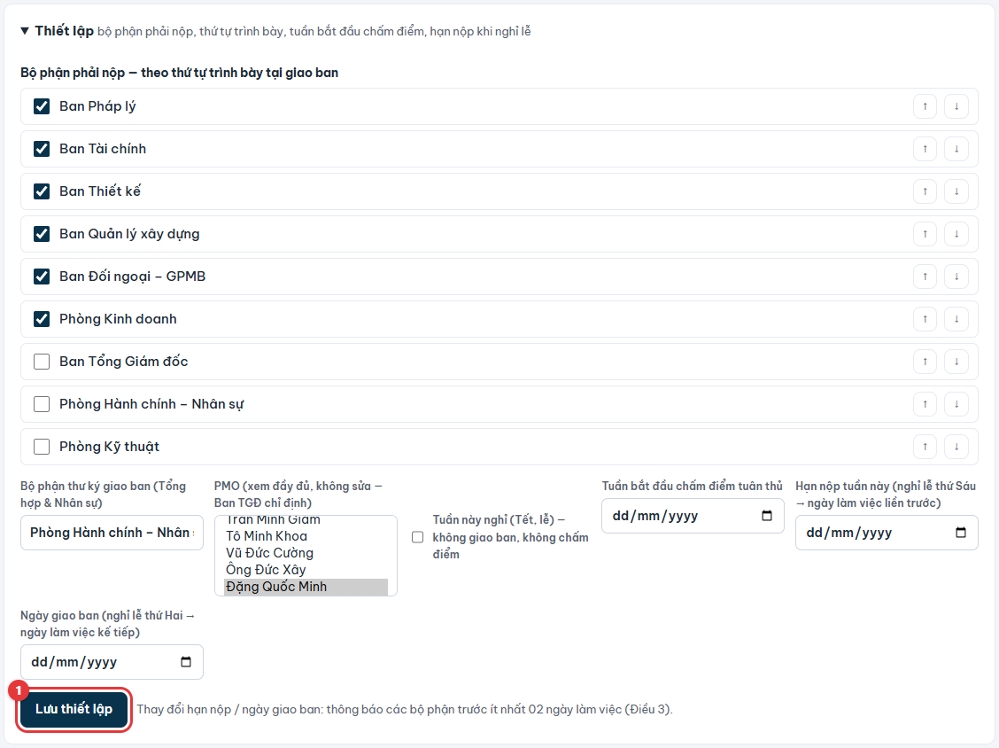

**Ai thấy, ai sửa:**
- **Ban Tổng Giám đốc**: thấy khối, sửa mọi ô, đổi lịch của tuần kể cả sau hạn nộp.
- **Thư ký giao ban** (mọi người đang hoạt động thuộc bộ phận thư ký, trừ người có vai Ban Tổng Giám đốc): thấy khối, sửa mọi ô trừ hai ô **Bộ phận thư ký giao ban** và **PMO** (hai ô này hiện dạng chữ). Sau 17:30 ngày hạn nộp của một tuần, thư ký không đổi được lịch tuần đó nữa.
- **PMO**, **Lãnh đạo bộ phận**, **Nhân viên**: không thấy khối, kể cả người thấy tab Tổng hợp. Đừng tìm.
- **Quản trị hệ thống**: không vào được trang Báo cáo tuần, báo "Tài khoản quản trị hệ thống không xem nội dung nghiệp vụ".

**Dùng để làm gì:** Chốt bộ phận nào phải nộp báo cáo tuần và trình bày theo thứ tự nào tại giao ban; chọn bộ phận làm thư ký giao ban và những người làm PMO; đặt mốc bắt đầu chấm điểm tuân thủ chính thức; dời hạn nộp, ngày giao ban hoặc đánh dấu tuần nghỉ khi có Tết, lễ. Vào đây khi bắt đầu dùng Kepler Hub cho giao ban, khi cơ cấu bộ phận đổi, và trước mỗi tuần có ngày nghỉ.

**Các bước thường làm**

A. Lần đầu: chốt danh sách bộ phận phải nộp (Ban Tổng Giám đốc hoặc thư ký)
1. Mở khối **Thiết lập**. Nếu thấy dòng "Chưa thiết lập: đang lấy tự động các bộ phận chủ trì hạng mục MTL. Chọn đúng 5 bộ phận theo quy chế rồi bấm Lưu." thì danh sách đang ở chế độ tự động.
2. Đánh dấu ô trước tên các bộ phận phải nộp; bỏ dấu bộ phận không phải nộp.
3. Bấm **↑** / **↓** trên từng dòng để xếp đúng thứ tự trình bày tại giao ban. Bộ phận vừa đánh dấu nằm ở vị trí cũ trong danh sách, phải đẩy lên cho đúng chỗ.
4. Bấm **Lưu thiết lập**. Thấy "Đã lưu thiết lập" là xong; dòng "Chưa thiết lập…" biến mất.

B. Chọn bộ phận thư ký giao ban và PMO (chỉ Ban Tổng Giám đốc)
1. Ô **Bộ phận thư ký giao ban (Tổng hợp & Nhân sự)**: chọn một bộ phận.
2. Ô **PMO (xem đầy đủ, không sửa — Ban TGĐ chỉ định)**: bấm tên một người; giữ phím `Ctrl` rồi bấm để chọn thêm hoặc bỏ bớt người.
3. Bấm **Lưu thiết lập**.

C. Đặt tuần bắt đầu chấm điểm (khi bắt đầu dùng chính thức)
1. Ô **Tuần bắt đầu chấm điểm tuân thủ**: chọn ngày **thứ Sáu** của tuần đầu tiên tính điểm.
2. Bấm **Lưu thiết lập**.

D. Dời hạn nộp hoặc ngày giao ban vì nghỉ lễ (làm trước, tối đa một tuần trước tuần đó)
1. Ở ô **Tuần báo cáo (thứ Sáu)** đầu trang, chọn đúng tuần có ngày nghỉ (thường là dòng có chữ "· tuần sau" hoặc "· tuần này").
2. Mở khối **Thiết lập**, điền **Hạn nộp tuần này…** và / hoặc **Ngày giao ban…**.
3. Bấm **Lưu thiết lập**. Đang xem tuần khác tuần này thì chip đầu trang ghi ngày giao ban ("Giao ban {thứ} {dd/mm}"); tới khi tuần đó thành tuần này, chip ghi hạn mới ("Hạn nộp 17:30 {thứ} {dd/mm}").
4. Tự báo các bộ phận (email, nhóm chat): Kepler Hub **không** gửi thông báo nào.

E. Đánh dấu tuần nghỉ (Tết)
1. Chọn đúng tuần ở ô **Tuần báo cáo (thứ Sáu)**.
2. Đánh dấu **Tuần này nghỉ (Tết, lễ) — không giao ban, không chấm điểm** → **Lưu thiết lập**.

**Từng ô**

| Ô (nguyên văn) | Nghĩa là gì | Điền / chọn thế nào (mặc định) | Đổi thì hệ thống làm gì khác |
|---|---|---|---|
| **Tuần báo cáo (thứ Sáu)** (đầu trang, ngoài khối) | Tuần đang xem trên cả trang | Có 10 tuần: tuần này đứng đầu, tiếp theo 8 tuần đã qua (gần nhất trước), tuần sau ở cuối. Mỗi dòng ghi "thứ Hai – thứ Sáu", vd. "23/11 – 27/11/2026 · tuần này", "30/11 – 04/12/2026 · tuần sau". Mặc định: tuần này. Từ thứ Bảy, "tuần này" vẫn là tuần vừa kết thúc; sang thứ Hai mới chuyển sang tuần mới | Đổi tuần thì mọi tab đổi theo tuần đó, **và ba ô lịch trong khối Thiết lập áp cho tuần đó**. Chỉ chọn được tối đa tuần sau, nên lịch nghỉ lễ chỉ đặt trước được một tuần |
| **Bộ phận phải nộp — theo thứ tự trình bày tại giao ban** (mỗi dòng: ô đánh dấu, tên bộ phận, nút **↑**, **↓**) | Bộ phận phải nộp báo cáo tuần và thứ tự trình bày tại giao ban | Đánh dấu bộ phận phải nộp, xếp bằng ↑ ↓. Các bộ phận đã đánh dấu đứng đầu theo thứ tự đã lưu, các bộ phận khác xếp theo tên ở dưới. Chỉ liệt kê bộ phận đang hoạt động. Mặc định (chưa lưu lần nào): **tự động** = các bộ phận đang chủ trì hạng mục của dự án MTL đang chạy, trừ bộ phận có thành viên vai Ban Tổng Giám đốc. Bỏ dấu hết rồi lưu = quay về tự động | Bộ phận được đánh dấu: nhận nhắc 15:00 ngày hạn nộp khi chưa nộp; được đếm trong số "{đã nộp}/{tổng} bộ phận đã nộp"; hiện đúng thứ tự trong bảng tình trạng nộp, phần **Chi tiết từng bộ phận** và bản sao chép; bị chấm điểm tuân thủ. Bộ phận không đánh dấu vẫn lập và nộp được (đã nộp thì hiện ở cuối bảng) nhưng không bị nhắc, không bị chấm điểm. Ví dụ: bỏ dấu "Phòng Kế toán" rồi lưu → 15:00 ngày hạn nộp tới, lãnh đạo Phòng Kế toán không nhận nhắc; tuần đó Phòng Kế toán không nộp cũng không bị trừ 25 điểm. Danh sách của mỗi tuần được **chụp lại** lúc 15:00 ngày hạn nộp (chậm nhất là lần đầu có người mở bản tổng hợp sau 17:30): đổi về sau chỉ ảnh hưởng tuần hiện tại (khi chưa phát hành kết luận) và các tuần sau, điểm các tuần đã qua giữ nguyên |
| **Bộ phận thư ký giao ban (Tổng hợp & Nhân sự)** | Bộ phận mà mọi thành viên là **Thư ký giao ban** | Ban Tổng Giám đốc: ô chọn "— Chưa chọn —" và các bộ phận đang hoạt động. Người khác thấy tên bộ phận, hoặc "— Ban TGĐ chưa chọn —". Mặc định: chưa chọn | Mọi tài khoản đang hoạt động thuộc bộ phận này, **trừ người có vai Ban Tổng Giám đốc**, thành thư ký ngay: thấy khối Thiết lập và tab **Chấm điểm**; nhập thay báo cáo bộ phận khác; báo muộn / vắng thay bộ phận khác và ghi giờ nhận tin; điểm danh, đánh dấu **Không đạt**, soạn Action Log, phát hành; gửi lại báo cáo sau giờ giao ban; trình bảng điểm; nhận thông báo báo muộn / vắng; cột "Kiêm nhiệm" hiện "Thư ký giao ban". Ví dụ: chọn "Phòng Tổng hợp" → nhân viên mới chuyển vào Phòng Tổng hợp cũng thành thư ký; người chuyển đi mất quyền ngay. Để "— Chưa chọn —": không ai là thư ký, chỉ Ban Tổng Giám đốc điều hành giao ban, và **không ai trình được bảng điểm** nên bảng điểm tháng không duyệt được. Lỗi: "Bộ phận thư ký không hợp lệ"; người không phải Ban Tổng Giám đốc gửi thay đổi: "Chỉ Ban Tổng Giám đốc chọn bộ phận thư ký và PMO" |
| **PMO (xem đầy đủ, không sửa — Ban TGĐ chỉ định)** | Danh sách người kiêm **PMO** trong giao ban | Ban Tổng Giám đốc: ô chọn nhiều, giữ `Ctrl` để chọn thêm; liệt kê mọi tài khoản đang hoạt động trừ Quản trị hệ thống. Người khác thấy danh sách tên, hoặc "—". Mặc định: **không ai** | Người được chọn (không phải vai Ban Tổng Giám đốc) xem bản tổng hợp đầy đủ, **Chi tiết từng bộ phận**, các bản đã nộp, danh sách báo muộn / vắng của mọi bộ phận (không thấy ghi chú lý do), nút **Sao chép bản đầy đủ**; không sửa gì; nhận tóm tắt 07:35 và thông báo phát hành kết luận; cột "Kiêm nhiệm" hiện "PMO". Bỏ một người khỏi danh sách → mất các quyền xem trên ngay. Chưa chọn ai = không ai là PMO. Chọn người có vai Ban Tổng Giám đốc thì không đổi gì (họ đã xem đầy đủ) nhưng cột "Kiêm nhiệm" vẫn ghi "PMO". Lỗi: "Danh sách PMO có tài khoản không hợp lệ" (tài khoản đã khoá hoặc Quản trị hệ thống) |
| **Tuần này nghỉ (Tết, lễ) — không giao ban, không chấm điểm** | Đánh dấu tuần đang chọn là tuần nghỉ | Ô đánh dấu, mặc định bỏ trống | Tuần đang chọn: không nhắc 15:00, không gửi tóm tắt 07:35; bấm **Gửi báo cáo** bị báo "Tuần nghỉ — không giao ban, không cần nộp"; bảng tình trạng nộp ghi "Tuần nghỉ — không giao ban"; tuần không bị chấm điểm. Bỏ dấu và lưu → tuần trở lại bình thường. ⚠️ Đánh dấu một tuần **đã qua** là tuần nghỉ thì mọi vi phạm của tuần đó biến khỏi bảng điểm tháng (nếu bảng điểm tháng đó chưa **Duyệt và khoá**) |
| **Tuần bắt đầu chấm điểm tuân thủ** | Thứ Sáu đầu tiên được tính điểm | Ô ngày; phải chọn một ngày thứ Sáu. Mặc định: trống = tính mọi thứ Sáu của tháng | Bảng điểm tháng chỉ tính các tuần từ ngày này. Tab **Chấm điểm** ghi " · bắt đầu chấm từ {dd/mm/yyyy}", hoặc khi trống " · chưa đặt tuần bắt đầu chấm điểm (Tổng hợp → Thiết lập): đang tính cả các tuần trước khi dùng chính thức". Ví dụ: đặt 04/12/2026 → tháng 12/2026 chỉ tính 04/12, 11/12, 18/12, 25/12; tháng 11/2026 không còn tuần nào được tính, mọi bộ phận giữ 100 điểm. Lỗi: "Tuần bắt đầu chấm điểm phải là một ngày thứ Sáu" (báo ngay, chưa lưu gì) |
| **Hạn nộp tuần này (nghỉ lễ thứ Sáu → ngày làm việc liền trước)** | Ngày hạn nộp báo cáo của **tuần đang chọn** | Ô ngày; chỉ nhận một ngày từ thứ Hai đến thứ Sáu của tuần đó. Mặc định: trống = thứ Sáu | Mọi mốc dời theo ngày mới: nhắc 15:00 ngày đó, hạn 17:30 ngày đó, nộp muộn tới 12:00 hôm sau, báo muộn phải gửi trước 17:30 ngày đó mới tính "có thông báo trước", báo vắng có người dự thay phải gửi trước 17:30 ngày đó. Khi tuần đó là tuần này, chip đầu trang ghi "Hạn nộp 17:30 {thứ} {dd/mm}". Ví dụ: thứ Sáu 01/01/2027 nghỉ Tết Dương lịch, đặt 31/12/2026 → nhắc 15:00 thứ Năm 31/12, hạn 17:30 thứ Năm 31/12, nộp muộn tới 12:00 thứ Sáu 01/01. Lỗi: "Hạn nộp phải là một ngày từ thứ Hai đến thứ Sáu của tuần báo cáo"; sau hạn nộp mà không phải Ban Tổng Giám đốc: "Đã qua hạn nộp — chỉ Ban TGĐ đổi lịch của tuần này" |
| **Ngày giao ban (nghỉ lễ thứ Hai → ngày làm việc kế tiếp)** | Ngày họp giao ban xét **tuần đang chọn** | Ô ngày; phải sau thứ Sáu của tuần đó và không quá 10 ngày sau thứ Sáu đó. Mặc định: trống = thứ Hai kế tiếp | Mọi mốc của buổi họp dời theo: tóm tắt gửi 07:35 ngày đó; báo vắng vì "Việc đột xuất" hạn 08:00 ngày đó; họp 08:30 ngày đó; điểm danh và nút **Phát hành kết luận + Action Log** chỉ mở từ 08:30 ngày đó; báo cáo đã nộp bị khoá từ 08:30 ngày đó (trừ thư ký). Ví dụ: nếu thứ Hai 03/05/2027 là ngày nghỉ bù, đặt thứ Ba 04/05/2027 → sáng thứ Hai không có tóm tắt, không mở điểm danh; tất cả dời sang thứ Ba. Lỗi: "Ngày giao ban phải sau thứ Sáu của tuần báo cáo" (cũng báo câu này khi chọn quá 10 ngày); sau hạn nộp mà không phải Ban Tổng Giám đốc: "Đã qua hạn nộp — chỉ Ban TGĐ đổi lịch của tuần này" |
| Mức trừ điểm tuân thủ (**không có ô**) | Số điểm trừ cho từng loại vi phạm | Cố định (bảng ở mục 5.4) | Không sửa được trên giao diện. **Lưu thiết lập** giữ nguyên mức đang dùng |
| Các mốc giờ trong tuần (**không có ô**) | 15:00, 17:30, 12:00, 07:35, 08:00, 08:30, 14:00 | Cố định (mục 5.2) | Chỉ dời theo ngày, không đổi được giờ |

> ⚠️ **Chữ trên màn hình ghi** "Tuần này nghỉ…" và "Hạn nộp tuần này…" **nhưng thực tế** ba ô lịch áp cho tuần đang chọn ở ô **Tuần báo cáo (thứ Sáu)** đầu trang, không nhất thiết là tuần này. Ví dụ: đang xem tuần trước, đánh dấu "Tuần này nghỉ" rồi lưu → tuần trước bị đánh dấu nghỉ, tuần này vẫn giao ban bình thường.

> ⚠️ **Chữ trên màn hình ghi** "Chọn đúng 5 bộ phận theo quy chế rồi bấm Lưu." **nhưng thực tế** máy không kiểm số lượng: chọn 3 hay 8 bộ phận đều lưu được.

> ⚠️ **Chữ trên màn hình ghi** "Thay đổi hạn nộp / ngày giao ban: thông báo các bộ phận trước ít nhất 02 ngày làm việc (Điều 3)." **nhưng thực tế** đổi lịch không gửi thông báo nào. Người đổi lịch phải tự báo các bộ phận.

> ⚠️ **Chữ trên màn hình ghi** "(Tổng hợp & Nhân sự)" ở ô bộ phận thư ký **nhưng thực tế** đó chỉ là gợi ý theo quy chế; chọn bộ phận nào cũng được.

**Các nút**

| Nút | Làm gì | Có hỏi lại không | Quay lại được không |
|---|---|---|---|
| Dòng **Thiết lập** | Mở / đóng khối | Không | — |
| **↑**, **↓** | Đẩy bộ phận lên / xuống một bậc. Chỉ đổi trên màn hình, chưa lưu | Không | Có: bấm ngược lại, hoặc tải lại trang để bỏ |
| **Lưu thiết lập** | Lưu **hai lượt** (xem ngay dưới). Xong: "Đã lưu thiết lập", trang vẽ lại | **Không** | Có: sửa rồi lưu lại. Riêng danh sách đã chụp của các tuần đã qua không đổi; sau hạn nộp chỉ Ban Tổng Giám đốc đổi lịch |

**"Lưu thiết lập" lưu làm hai lượt.** Lượt 1 lưu thiết lập chung (bộ phận phải nộp, tuần bắt đầu chấm điểm; Ban Tổng Giám đốc thêm bộ phận thư ký và PMO). Lượt 2 lưu lịch của tuần đang chọn (tuần nghỉ, hạn nộp, ngày giao ban). Lượt 1 lỗi thì lượt 2 không chạy. Lượt 1 xong mà lượt 2 lỗi thì **phần thiết lập chung đã lưu**, lịch chưa lưu; trang hiện thông báo lỗi đỏ nhưng không tự vẽ lại. Ví dụ: 18:00 thứ Sáu, thư ký sắp lại thứ tự bộ phận và lỡ sửa luôn ô hạn nộp của tuần này → lượt 1 lưu thứ tự mới; lượt 2 báo "Đã qua hạn nộp — chỉ Ban TGĐ đổi lịch của tuần này". Tải lại trang (F5) để thấy cái gì đã lưu.

**⚠️ Dễ nhầm**
- Thứ tự đã đổi bằng ↑ ↓ mất hết nếu rời trang mà chưa bấm **Lưu thiết lập**.
- Đang ở chế độ tự động mà bấm **Lưu thiết lập** (dù không sửa gì) thì danh sách tự động lúc đó thành danh sách cố định. Từ đó bộ phận mới chủ trì hạng mục MTL không tự được thêm.
- Thư ký giao ban gán **theo bộ phận**, không theo người. Muốn thêm một thư ký: chuyển người đó vào bộ phận thư ký (Quản trị → Tài khoản), không có ô chọn từng người.
- Thành viên Ban Tổng Giám đốc thuộc bộ phận thư ký **không** thành thư ký (Ban Tổng Giám đốc không tự trình rồi tự duyệt bảng điểm, không nhập thay).
- Đổi danh sách bộ phận vào sáng thứ Hai giao ban không làm đổi danh sách của tuần đang họp: lúc đó "tuần này" đã sang tuần mới, tuần đang họp đã chụp danh sách từ chiều thứ Sáu.
- Sau 17:30 ngày hạn nộp, thư ký vẫn lưu được thiết lập chung, chỉ không đổi được ba ô lịch của tuần đó. Không sửa ba ô lịch thì không bị báo lỗi.
- Ban Tổng Giám đốc đổi được lịch của cả tuần đã qua. Đánh dấu tuần đã qua là tuần nghỉ, hoặc đổi hạn nộp của nó, làm thay đổi điểm tuân thủ tháng đó nếu bảng điểm chưa **Duyệt và khoá**.

**Claude:** Không sửa được thiết lập, không đổi lịch tuần. Công cụ **Tôi là ai trong Kepler Hub** cho biết bạn là Ban Tổng Giám đốc, thư ký, PMO, lãnh đạo hay người phải nộp, và hạn nộp tuần này. Claude đọc được báo cáo tuần, bản tổng hợp giao ban (lãnh đạo bộ phận chỉ bản tóm tắt) và lưu **nháp** báo cáo tuần; mọi thứ trong khối Thiết lập làm trên giao diện.

### 5.2 Các mốc giờ của một tuần giao ban (cố định, không có ô sửa)

**Mở ở đâu:** Không có màn hình. Các mốc hiện qua chip đầu trang Báo cáo tuần và các thông báo.
**Ai thấy, ai sửa:** Mọi người thấy hệ quả; không ai sửa được giờ. Chỉ **ngày** dời được, bằng hai ô **Hạn nộp tuần này…** và **Ngày giao ban…** (mục 5.1).
**Dùng để làm gì:** Biết chính xác lúc nào hệ thống nhắc, khoá, tính muộn, để dời ngày cho đúng khi nghỉ lễ.

| Mốc | Giờ | Tính theo ngày | Chuyện gì xảy ra |
|---|---|---|---|
| Nhắc bộ phận chưa nộp | 15:00 (máy chủ tắt đúng giờ thì gửi bù tới 17:30) | Ngày hạn nộp | Thông báo "Báo cáo tuần {bộ phận}: hạn nộp 17:30 hôm nay" tới lãnh đạo bộ phận phải nộp chưa nộp, người lập báo cáo tuần trước, người lập bản nháp tuần này. Danh sách bộ phận phải nộp của tuần được chụp lại lúc này |
| Hạn nộp | 17:30 | Ngày hạn nộp | Nộp trước mốc: "Đúng hạn". Báo muộn / báo vắng có người dự thay phải gửi trước mốc này |
| Hết hạn nộp muộn | 12:00 | Ngày hôm sau ngày hạn nộp | Nộp sau 17:30 mà trước mốc này: "Muộn, có báo trước" hoặc "Muộn, không báo". Sau mốc này: "Nộp sau 12:00 T7 (tính không nộp)" hoặc "Không nộp" |
| Tóm tắt tổng hợp | 07:35 (gửi bù tới 12:00) | Ngày giao ban | "Tổng hợp giao ban {dd/mm}: {đã nộp}/{tổng} bộ phận đã nộp" tới Ban Tổng Giám đốc, thư ký, PMO, lãnh đạo bộ phận. Tuần nghỉ: không gửi |
| Hạn báo vắng đột xuất | 08:00 | Ngày giao ban | Báo vắng lý do "Việc đột xuất", có người dự thay, trước mốc này thì không bị trừ |
| Họp | 08:30 | Ngày giao ban | Mở điểm danh và nút **Phát hành kết luận + Action Log** (trước giờ này nút ghi "Chưa tới giờ giao ban: nút mở lúc {giờ}. Action Log vẫn soạn và lưu trước được."). Báo cáo đã nộp bị khoá: ai không phải thư ký bấm gửi lại sẽ nhận "Đã qua giờ giao ban — muốn sửa báo cáo, liên hệ thư ký giao ban" |
| Phát hành kết luận | 14:00 | Ngày giao ban | Chỉ là chữ nhắc trên trang ("phát hành trước 14:00 ngày họp"); máy không chặn phát hành sau 14:00 |

Ví dụ trọn một tuần bình thường: thứ Sáu 27/11/2026 nhắc 15:00, hạn 17:30; thứ Bảy 28/11 hết hạn nộp muộn lúc 12:00; thứ Hai 30/11 tóm tắt 07:35, họp 08:30.

**⚠️ Dễ nhầm**
- Hết hạn nộp muộn là **12:00 hôm sau ngày hạn nộp**, không phải luôn là thứ Bảy. Hạn dời sang thứ Năm thì mốc là 12:00 thứ Sáu, dù trạng thái vẫn ghi chữ "T7" (mục 5.4).
- Lịch gửi tóm tắt 07:35 chỉ chạy từ thứ Hai đến thứ Sáu. Đặt ngày giao ban vào thứ Bảy hoặc Chủ nhật (ô cho phép) thì buổi đó không có thông báo tóm tắt.
- Giờ tính theo **giờ máy chủ**. Máy bạn lệch giờ từ 3 phút trở lên thì Kepler Hub báo đỏ "Giờ máy chủ lệch {n} phút so với máy bạn. Nếu giờ máy bạn đúng, báo quản trị IT — giờ nộp báo cáo tuần tính theo giờ máy chủ."

**Claude:** Công cụ **Tôi là ai trong Kepler Hub** trả hạn nộp của tuần này. Claude không đổi được mốc nào.

### 5.3 Ngày lễ, tuần nghỉ: phải đổi tay từng tuần

**Mở ở đâu:** Khối **Thiết lập** ở cuối tab **Tổng hợp** (mục 5.1), sau khi chọn đúng tuần ở ô **Tuần báo cáo (thứ Sáu)**.
**Ai thấy, ai sửa:** Ban Tổng Giám đốc, thư ký (thư ký chỉ trước 17:30 ngày hạn nộp của tuần đó).
**Dùng để làm gì:** Báo cáo tuần **không biết ngày lễ**. Ngày lễ khai ở Nhân sự → Thiết lập chỉ dùng cho chấm công, nghỉ phép và hạn xử lý văn bản đến (chương 6); nó **không** dời hạn nộp báo cáo tuần, không dời ngày giao ban. Mỗi tuần có ngày nghỉ phải đổi tay ở đây.

**Các bước thường làm**
1. Đầu năm, đánh dấu sẵn trên lịch giấy các tuần có ngày nghỉ rơi vào ngày hạn nộp (thường thứ Sáu) hoặc ngày giao ban (thường thứ Hai).
2. Ô **Tuần báo cáo (thứ Sáu)** chỉ cho chọn tới **tuần sau**. Vì vậy, trong tuần liền trước tuần có ngày nghỉ, chọn dòng "· tuần sau" rồi đặt lịch. Ví dụ: Tết Dương lịch rơi vào thứ Sáu 01/01/2027. Từ thứ Hai 21/12/2026, chọn "28/12 – 01/01/2027 · tuần sau", điền **Hạn nộp tuần này…** = 31/12/2026, bấm **Lưu thiết lập**, rồi tự báo các bộ phận, trước ít nhất 02 ngày làm việc theo quy chế.
3. Cả hạn nộp và ngày giao ban cùng vướng: điền cả hai ô trong một lần. Ví dụ: nếu thứ Sáu 30/04/2027 và thứ Hai 03/05/2027 (nghỉ bù) đều nghỉ → chọn tuần "26/04 – 30/04/2027", **Hạn nộp tuần này…** = 29/04/2027, **Ngày giao ban…** = 04/05/2027.
4. Nghỉ cả tuần (Tết Nguyên đán): đánh dấu **Tuần này nghỉ (Tết, lễ) — không giao ban, không chấm điểm** cho đúng tuần đó.

**Từng ô:** như ba ô lịch ở mục 5.1.

**⚠️ Dễ nhầm**
- Khai ngày lễ ở Nhân sự rồi tưởng báo cáo tuần tự dời: không dời. Hai chỗ độc lập.
- Ngày lễ khai ở **Nhân sự → Thiết lập** không dời hạn nộp báo cáo tuần: chỗ duy nhất "khai nghỉ lễ" cho giao ban là ba ô lịch này.
- Muốn đặt lịch cho tuần còn xa hơn tuần sau: chưa làm được; đợi tới tuần liền trước.

**Claude:** Không đổi được lịch tuần.

### 5.4 Chấm điểm tuân thủ: tab Chấm điểm và những gì thiết lập ảnh hưởng

**Mở ở đâu:** Menu **Giao ban** → **Báo cáo tuần** → tab **Chấm điểm** (trang `#/tuan/diem`; chọn tháng thì địa chỉ thêm `?m=` và tháng, vd. `#/tuan/diem?m=2026-11`).
**Ai thấy, ai sửa:** Xem: Ban Tổng Giám đốc và thư ký. Trình: thư ký. Duyệt và khoá: Ban Tổng Giám đốc (chữ "TGĐ" trên nút và thông báo ứng với mọi thành viên vai Ban Tổng Giám đốc). PMO, Lãnh đạo bộ phận, Nhân viên không có tab này; gõ thẳng địa chỉ `#/tuan/diem` thì trang tự chuyển về tab khác.
**Dùng để làm gì:** Tính điểm tuân thủ giao ban hằng tháng của từng bộ phận (100 điểm trừ dần theo vi phạm), để thư ký trình và Ban Tổng Giám đốc duyệt, khoá. Điểm phụ thuộc trực tiếp vào thiết lập ở mục 5.1: danh sách bộ phận phải nộp, tuần bắt đầu chấm điểm, tuần nghỉ, hạn nộp, ngày giao ban.

Câu đầu trang (nguyên văn): "Mỗi trưởng ban có 100 điểm đầu tháng, trừ theo Phụ lục 1 (TGĐ chốt mức trừ). Điểm cuối tháng × trọng số (đề xuất 5%) tính vào KPI. Lập vào ngày làm việc thứ 3 tháng sau, trình TGĐ duyệt." Chữ "trưởng ban" ở đây ứng với **Lãnh đạo bộ phận**.

**Bảng mức trừ** (cố định, không có ô sửa)

| Vi phạm (nguyên văn) | Trừ | Khi nào bị tính |
|---|---|---|
| "Nộp muộn, có thông báo trước hạn" | 5 | Nộp sau 17:30 ngày hạn nộp, trước 12:00 hôm sau, đã báo muộn trước 17:30 |
| "Nộp muộn, không thông báo trước" | 15 | Như trên nhưng không báo trước |
| "Không nộp (quá 12:00 thứ Bảy)" | 25 | Không nộp, hoặc nộp sau 12:00 hôm sau ngày hạn nộp |
| "Báo cáo không đạt" | 5 | Thư ký / Ban Tổng Giám đốc đánh dấu **Không đạt** cho bộ phận |
| "Đi muộn quá 10 phút, không báo trước" | 5 | Điểm danh chọn "Đi muộn > 10 phút" |
| "Vắng mặt không báo trước" | 25 | Điểm danh "Vắng" mà không có báo vắng hợp lệ |
| "Vắng có báo trước, có người dự thay" | 0 | Điểm danh "Vắng", đã báo vắng có người dự thay trước 17:30 ngày hạn nộp (lý do "Việc đột xuất": trước 08:00 ngày giao ban) |

Điểm = 100 trừ tổng điểm trừ, thấp nhất 0. Ví dụ: tháng có 4 tuần, Phòng Thiết kế một lần "Nộp muộn, không thông báo trước" (−15) và một lần "Báo cáo không đạt" (−5) → 80 điểm, 2 vi phạm.

**Từng ô**

| Ô (nguyên văn) | Nghĩa là gì | Điền / chọn thế nào (mặc định) | Đổi thì hệ thống làm gì khác |
|---|---|---|---|
| **Tháng** | Tháng chấm | 6 tháng gần nhất. Mặc định: tháng của tuần đang chọn ở đầu trang | Bảng tính lại cho tháng chọn |
| Dòng ghi chú tuần | "Tính {n} tuần: {dd/mm}, …" hoặc "Chưa có tuần nào trong tháng được tính"; tiếp theo " · bắt đầu chấm từ {dd/mm/yyyy}" hoặc " · chưa đặt tuần bắt đầu chấm điểm (Tổng hợp → Thiết lập): đang tính cả các tuần trước khi dùng chính thức" | Chỉ đọc | Tính các thứ Sáu của tháng tới tuần hiện tại, từ **Tuần bắt đầu chấm điểm tuân thủ**, bỏ tuần nghỉ |
| Chip trạng thái | "Bản nháp (tính theo số liệu hiện tại)", "Đã trình TGĐ — {người} {giờ}", "Đã duyệt — {người} {giờ} · đã khoá" | Chỉ đọc | Đã trình: hiện đúng bảng đã trình. Đã duyệt: hiện bảng đã khoá, không tính lại nữa |
| Ghi chú tháng chưa khép | "Tháng chưa khép — lập, trình và duyệt từ đầu tháng sau (sau buổi giao ban cuối tháng)." | Chỉ đọc | Tháng khép khi đã qua 08:30 buổi giao ban của thứ Sáu cuối tháng. Chưa khép thì không có nút trình, duyệt |
| Băng cảnh báo thiếu lãnh đạo | "{n} bộ phận chưa có trưởng bộ phận: {tên}. Điểm vẫn tính cho bộ phận nhưng chưa gắn được người chịu trách nhiệm — nhờ quản trị hệ thống cấp quyền “Duyệt công việc” cho trưởng bộ phận." | Chỉ đọc | Hiện khi bộ phận không có tài khoản vai Lãnh đạo bộ phận (hoặc Ban Tổng Giám đốc) thuộc bộ phận đó |
| Bảng: **Bộ phận**, **Trưởng bộ phận**, **Điểm**, **Vi phạm**, **Chi tiết** | Bảng điểm. Cột "Trưởng bộ phận" = các **Lãnh đạo bộ phận** của bộ phận đó, hoặc nhãn "Chưa có trưởng bộ phận". Điểm xanh từ 95, cam từ 80, đỏ dưới 80. Chi tiết mỗi dòng "{dd/mm}: {vi phạm} −{điểm}" hoặc "(không trừ)"; không có thì "Không vi phạm". Bảng trống: "Chưa thiết lập bộ phận phải nộp" | Chỉ đọc | Bộ phận được chấm = bộ phận có trong danh sách phải nộp (đã chụp) ở ít nhất một tuần của tháng |
| Dòng mức trừ | "Mức trừ: " + từng mức, tiếp theo "Vi phạm do nhân viên được giao gửi báo cáo tính cho trưởng bộ phận. Từ 03 lần vi phạm trong một quý: nhắc nhở bằng văn bản." | Chỉ đọc | — |

> ⚠️ **Chữ trên màn hình ghi** "nhờ quản trị hệ thống cấp quyền “Duyệt công việc” cho trưởng bộ phận" **nhưng thực tế** không còn cấp quyền từng người. Cách đúng: Quản trị hệ thống mở Quản trị → Tài khoản → **Sửa** người phụ trách bộ phận đó → **Vai** = **Lãnh đạo bộ phận**, **Bộ phận** = bộ phận đó (chương 7).

> ⚠️ **Chữ trên màn hình ghi** "Điểm cuối tháng × trọng số (đề xuất 5%) tính vào KPI" **nhưng thực tế** điểm KPI (màn KPI & phân tích, dải "Số liệu của tôi") chưa đọc bảng điểm tuân thủ. Hai bảng điểm đang độc lập.

> ⚠️ **Chữ trên màn hình ghi** "(TGĐ chốt mức trừ)" **nhưng thực tế** không có ô nào để chốt mức trừ; hệ thống dùng bảng mức trừ cố định ở trên.

> ⚠️ **Chữ trên màn hình ghi** "Không nộp (quá 12:00 thứ Bảy)" và trạng thái "Nộp sau 12:00 T7 (tính không nộp)" **nhưng thực tế** mốc là 12:00 hôm sau ngày hạn nộp. Hạn dời sang thứ Năm thì mốc là 12:00 thứ Sáu, chữ vẫn ghi "thứ Bảy".

**Các nút**

| Nút | Làm gì | Có hỏi lại không | Quay lại được không |
|---|---|---|---|
| **Trình TGĐ** | Chụp bảng điểm hiện tại, chuyển sang "Đã trình TGĐ". Báo "Đã trình TGĐ bảng điểm". Chỉ thư ký thấy, chỉ khi tháng đã khép và chưa duyệt | Không | Có: trình lại (bảng mới thay bảng cũ) cho tới khi Ban Tổng Giám đốc duyệt |
| **Duyệt và khoá** | Duyệt đúng bảng đã trình và khoá. Báo "Đã duyệt và khoá bảng điểm". Chỉ Ban Tổng Giám đốc thấy, chỉ khi tháng đã khép và đã trình | ⚠️ **Không hỏi lại** | ⚠️ **Không**: không có nút mở khoá; lần sau hệ thống báo "Bảng điểm tháng này đã được duyệt và khoá" |

Lỗi có thể gặp: "Thư ký giao ban lập và trình bảng điểm", "TGĐ duyệt bảng điểm tuân thủ", "Tháng chưa khép (còn buổi giao ban trong tháng) — lập và duyệt bảng điểm từ đầu tháng sau", "Thư ký chưa trình bảng điểm tháng này", "Bảng điểm vừa được trình lại — tải lại trước khi duyệt".

**⚠️ Dễ nhầm**
- Trình hay duyệt đều **không gửi thông báo**. Thư ký trình xong phải tự báo Ban Tổng Giám đốc vào tab Chấm điểm.
- Chưa chọn bộ phận thư ký (mục 5.1) thì không ai trình được, nên không duyệt được.
- Bảng điểm đã duyệt không đổi nữa, kể cả khi sau đó Ban Tổng Giám đốc đánh dấu một tuần của tháng đó là tuần nghỉ.
- Bộ phận không có lãnh đạo vẫn bị tính điểm; chỉ thiếu tên người chịu trách nhiệm.

**Claude:** Không xem được bảng điểm tuân thủ, không trình, không duyệt.

### 5.5 Các vai trong tuần: ai làm được gì

**Mở ở đâu:** Không có màn riêng. Hệ thống tự tính vai trò giao ban của mỗi người mỗi lần mở trang, từ **vai** và **bộ phận** (Quản trị → Tài khoản, chương 7) cộng với hai ô thư ký, PMO (mục 5.1).
**Ai thấy, ai sửa:** Không ai sửa trực tiếp. Muốn đổi vai trò giao ban của một người: đổi vai / bộ phận của họ, hoặc đổi bộ phận thư ký / danh sách PMO.
**Dùng để làm gì:** Trả lời "vì sao tôi không thấy tab Tổng hợp", "vì sao tôi không nhập thay được".

Cách hệ thống xác định:

| Vai trò giao ban | Ai |
|---|---|
| **Ban Tổng Giám đốc** | Mọi tài khoản vai Ban Tổng Giám đốc. Chủ trì, kết luận; không lập báo cáo tuần |
| **Thư ký giao ban** | Thành viên đang hoạt động của bộ phận thư ký, trừ vai Ban Tổng Giám đốc |
| **PMO** | Người có trong danh sách PMO, trừ vai Ban Tổng Giám đốc. Chưa chọn ai = không ai |
| **Lãnh đạo** | Vai Lãnh đạo bộ phận (bản tóm tắt). Vai Ban Tổng Giám đốc cũng được tính là lãnh đạo |
| **Người phải nộp** | Mọi người có bộ phận và không phải vai Ban Tổng Giám đốc. Người không thuộc bộ phận nào không có tab **Nộp báo cáo** |

Một người có nhiều vai trò thì cộng quyền. Ví dụ: Lãnh đạo bộ phận được chọn làm PMO thì xem bản đầy đủ và vẫn lập báo cáo cho bộ phận mình.

**Ai làm được gì**

| Việc | Ban Tổng Giám đốc | Thư ký giao ban | PMO | Lãnh đạo bộ phận | Nhân viên thuộc một bộ phận |
|---|---|---|---|---|---|
| Tab **Tổng hợp** | Bản đầy đủ | Bản đầy đủ | Bản đầy đủ | Bản tóm tắt + chi tiết bộ phận mình ("Trưởng / phó bộ phận nhận bản tổng hợp mức tóm tắt (QC-TH-01 Điều 5); chi tiết các bộ phận khác do thư ký giao ban và Ban TGĐ xem.") | Không có tab |
| **Chi tiết từng bộ phận**, các bản đã nộp của bộ phận khác, **Sao chép bản đầy đủ** | Có | Có | Có | Không | Không |
| **Sao chép bản tổng hợp** (bản gửi email, không có họ tên) | Có | Có | Có | Có | Không |
| Tab **Nộp báo cáo**: lập, lưu nháp, **Gửi báo cáo** cho bộ phận mình | Không ("Ban TGĐ không lập báo cáo tuần — xem bản Tổng hợp") | Có | Có (nếu thuộc một bộ phận) | Có | Có |
| Nhập thay báo cáo bộ phận khác, gửi lại báo cáo sau 08:30 ngày giao ban | Không | Có | Không | Không | Không |
| Tab **Báo muộn / vắng**: báo cho bộ phận mình | Không | Có, và báo thay bộ phận khác, ghi giờ nhận tin | Có | Có | Có |
| Xem danh sách báo muộn / vắng | Mọi bộ phận | Mọi bộ phận | Mọi bộ phận | Bộ phận mình | Báo do mình tạo |
| Xem ghi chú lý do vắng / muộn | Có | Có | Không | Không | Ghi chú mình viết |
| Điểm danh, đánh dấu **Không đạt** | Có | Có | Không | Không | Không |
| Ô **Kết luận của TGĐ** cho từng yêu cầu hỗ trợ | Có | Có (xem ⚠️ dưới) | Chỉ đọc | Chỉ đọc | — |
| Soạn **Action Log**, **Phát hành kết luận + Action Log** | Có | Có | Không | Không | Không |
| Thấy và sửa khối **Thiết lập** | Có | Có, trừ hai ô thư ký / PMO | Không | Không | Không |
| Chọn bộ phận thư ký, danh sách PMO | Có | Không | Không | Không | Không |
| Đổi lịch tuần sau 17:30 ngày hạn nộp | Có | Không | Không | Không | Không |
| Tab **Chấm điểm** | Xem, **Duyệt và khoá** | Xem, **Trình TGĐ** | Không | Không | Không |

> ⚠️ **Chữ trên màn hình ghi** "Kết luận của TGĐ" **nhưng thực tế** thư ký cũng chọn và lưu được kết luận này, giống Ban Tổng Giám đốc.

**Ai nhận thông báo gì**

| Thông báo (nguyên văn) | Lúc | Ai nhận |
|---|---|---|
| "Báo cáo tuần {bộ phận}: hạn nộp 17:30 hôm nay" | 15:00 ngày hạn nộp; chỉ bộ phận phải nộp mà chưa nộp; tuần nghỉ không gửi | Lãnh đạo bộ phận đó, người lập báo cáo tuần trước, người lập bản nháp tuần này |
| "Tổng hợp giao ban {dd/mm}: {đã nộp}/{tổng} bộ phận đã nộp" | 07:35 ngày giao ban; tuần nghỉ không gửi | Ban Tổng Giám đốc, thư ký, PMO, Lãnh đạo bộ phận |
| "{bộ phận} báo nộp báo cáo tuần muộn" / "{bộ phận} báo vắng giao ban {dd/mm}" | Ngay khi có người báo | Ban Tổng Giám đốc và thư ký, trừ người vừa báo |
| "Kết luận giao ban {dd/mm} và Action Log đã phát hành" | Khi bấm phát hành | Lãnh đạo mọi bộ phận đang hoạt động, người phụ trách từng việc trong Action Log, Ban Tổng Giám đốc, thư ký, PMO, trừ người vừa phát hành |

Không có thông báo khi: đổi thiết lập, đổi lịch tuần, trình hoặc duyệt bảng điểm.

**⚠️ Dễ nhầm**
- Lãnh đạo bộ phận mặc định chỉ thấy bản tóm tắt. Muốn xem chi tiết mọi bộ phận: Ban Tổng Giám đốc chọn người đó vào PMO.
- Nhân viên không có tab Tổng hợp, trừ khi thuộc bộ phận thư ký hoặc có trong danh sách PMO.
- Đổi vai một người sang **Ban Tổng Giám đốc** làm họ thôi là thư ký (nếu đang thuộc bộ phận thư ký) và mất tab **Nộp báo cáo**.
- Cột "Trưởng bộ phận" (tab Chấm điểm) và dòng "Trưởng bộ phận (chịu trách nhiệm)" (tab Nộp báo cáo) dùng tên vai cũ; ứng với **Lãnh đạo bộ phận**. Lựa chọn "Ban Giám đốc" ở ô đề nghị hỗ trợ trong báo cáo ứng với **Ban Tổng Giám đốc**.

**Claude:** Công cụ **Tôi là ai trong Kepler Hub** trả các vai trò giao ban của bạn: Ban TGĐ, thư ký, PMO, lãnh đạo, phải nộp, xem tổng hợp, xem chi tiết. Hỏi: "Tôi là ai trong giao ban tuần này, tôi được xem gì?". Claude không đổi được vai trò nào.

## 6. Nhân sự và Đối tác: thiết lập

> Trên bản chạy thật, phân hệ **Nhân sự** và **Đối tác** bật từ 25/11/2026 (khoá mã hoá nhân sự đã tạo; IT cất bản sao khoá ở nơi an toàn, mục 6.1). Ở bản cài khác, menu không có mục **Nhân sự** / **Đối tác**, hoặc trang báo "Tính năng chưa bật cho đơn vị", nghĩa là phân hệ chưa bật.

### 6.1 Bật / tắt phân hệ (IT đặt khi cài)

**Mở ở đâu:** Không có màn hình. IT sửa tệp cấu hình `.env` trên máy chạy Kepler Hub (khoá `MODULES`) rồi khởi động lại ứng dụng.
**Ai thấy, ai sửa:** Chỉ IT có quyền vào máy chủ. Không vai nào trong ứng dụng bật / tắt được trên giao diện, kể cả **Quản trị hệ thống** và **Ban Tổng Giám đốc**. Ban Tổng Giám đốc quyết định bật; IT làm.
**Dùng để làm gì:** Bật những phân hệ tuỳ chọn công ty cần dùng. Mặc định cả ba đều tắt.

**Các bước thường làm** (IT)
1. Ban Tổng Giám đốc quyết định bật phân hệ nào.
2. IT thêm giá trị vào khoá `MODULES`, nhiều giá trị cách nhau dấu phẩy, vd. `MODULES=vanthu,hrm`.
3. Bật Nhân sự: đặt thêm khoá mã hoá `HR_ENC_KEY` và cất bản sao khoá này ở nơi an toàn.
4. Khởi động lại ứng dụng. Người dùng tải lại trang là thấy mục menu mới.
5. Ban Tổng Giám đốc vào thiết lập của phân hệ (mục 6.2) trước khi cho mọi người dùng.

**Từng phân hệ**

| Phân hệ | Giá trị trong `MODULES` | Khi bật | Khi tắt |
|---|---|---|---|
| **Đối tác** | `crm` | Menu **Nghiệp vụ** → **Đối tác**; nhắc việc theo dõi đối tác 08:10 hằng ngày | Mục menu ẩn; mở `#/crm` thấy trang "Tính năng chưa bật cho đơn vị"; công cụ đối tác của Claude báo "Không tìm thấy API" |
| **Nhân sự** | `hrm` (bắt buộc kèm `HR_ENC_KEY`) | Menu **Nghiệp vụ** → **Nhân sự**; nút "Hồ sơ nhân sự, nghỉ phép, chấm công" ở Thông tin cá nhân; nhắc hợp đồng 08:15; xoá IP chấm công quá 90 ngày lúc 03:10 | Mục menu ẩn; mở `#/hrm` thấy trang "Tính năng chưa bật cho đơn vị"; công cụ nhân sự của Claude báo "Không tìm thấy API" |
| **Văn thư** | `vanthu` | Tab **Văn thư** và **Quy chế, quy định nội bộ** trong **Tài liệu**; nhắc văn bản 08:20 | Hai tab ẩn; gõ thẳng `#/vanthu` hiện lỗi "Không tìm thấy API" (không có trang giải thích) |

**Trang "Tính năng chưa bật cho đơn vị"** (khi mở `#/hrm` hoặc `#/crm` lúc phân hệ tắt): câu "Phân hệ **Nhân sự (chấm công, nghỉ phép)** chưa được bật cho đơn vị của bạn. Nếu cần dùng, liên hệ quản trị hệ thống." (hoặc "**Đối tác (CRM)**"), nút **Về Trang chủ** mở `#/today`.

**⚠️ Dễ nhầm**
- Thiếu hoặc sai `HR_ENC_KEY` khi bật Nhân sự: ứng dụng dừng ngay lúc khởi động. Mất khoá này là mất dữ liệu đã mã hoá (số định danh, lương), không khôi phục được.
- Tắt phân hệ không xoá dữ liệu. Bật lại thì dữ liệu cũ còn nguyên.
- Tắt Nhân sự / Văn thư mà thiết lập cũ còn lưu thì cột "Kiêm nhiệm" (Quản trị → Tài khoản, Thông tin cá nhân) vẫn ghi "Phụ trách nhân sự", "Văn thư", "Pháp chế".
- Văn thư dùng **ngày làm việc và ngày lễ** của Nhân sự → Thiết lập để tính hạn văn bản đến. Bản chỉ bật Văn thư, tắt Nhân sự (như bản chạy thật hiện nay) thì không có màn nào khai ngày lễ: Văn thư dùng lịch đã lưu từ trước, chưa từng lưu thì dùng thứ Hai – thứ Sáu, không ngày lễ.
- Người dùng xin "bật Nhân sự", "bật Đối tác": Quản trị hệ thống trong ứng dụng không làm được; chuyển IT.

**Claude:** Khi phân hệ tắt, các công cụ nhân sự (**Hồ sơ và phép của tôi**, **Đơn nghỉ**, **Tạo đơn nghỉ**, **Bảng công tháng**, **Tổng hợp công bộ phận**) và đối tác (**Đối tác (CRM)**, **Chi tiết đối tác**, **Việc cần theo dõi với đối tác**, **Ghi nhật ký làm việc với đối tác**, **Xong việc theo dõi**) báo "Không tìm thấy API". Claude không bật được phân hệ.

### 6.2 Nhân sự → Thiết lập

**Mở ở đâu:** Menu **Nghiệp vụ** → **Nhân sự** → tab **Thiết lập** (trang `#/hrm/settings`). Các tab khác của Nhân sự: **Của tôi** (mọi người), **Chờ duyệt**, **Danh sách nhân sự**, **Bảng công** (Lãnh đạo bộ phận, Ban Tổng Giám đốc, người Phụ trách nhân sự).

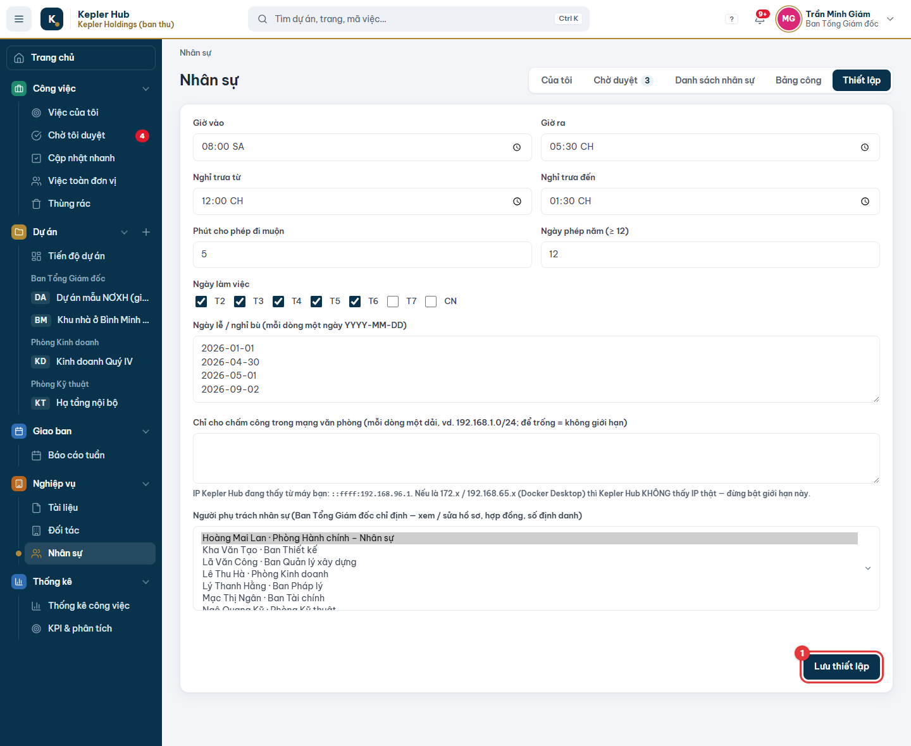

**Ai thấy, ai sửa:**
- **Ban Tổng Giám đốc**: thấy tab, sửa mọi ô, kể cả ô **Người phụ trách nhân sự**.
- **Phụ trách nhân sự** (kiêm nhiệm do Ban Tổng Giám đốc chọn ngay tại đây): thấy tab, sửa giờ làm, ngày làm việc, ngày lễ, phép năm, mạng văn phòng; **không** thấy ô Người phụ trách nhân sự.
- **Lãnh đạo bộ phận**, **Nhân viên**: không có tab Thiết lập.
- **Quản trị hệ thống**: bị chặn cả phân hệ, báo "Quản trị hệ thống không xem dữ liệu nhân sự".
- Người không đủ quyền gửi lưu: "Chỉ Ban Tổng Giám đốc chỉ định người phụ trách nhân sự; Ban Tổng Giám đốc / người phụ trách nhân sự sửa giờ làm, ngày lễ".

**Dùng để làm gì:** Đặt giờ làm, giờ nghỉ trưa, số phút được đi muộn, ngày làm việc trong tuần, danh sách ngày lễ / nghỉ bù, số ngày phép năm, giới hạn mạng được chấm công, và chọn người phụ trách nhân sự. Các con số này quyết định bảng công (đủ công, muộn / sớm, thiếu), số ngày của mỗi đơn nghỉ, số phép năm, và cả hạn xử lý văn bản đến.

**Các bước thường làm**

A. Lần đầu bật Nhân sự (Ban Tổng Giám đốc)
1. Kiểm **Giờ vào**, **Giờ ra**, **Nghỉ trưa từ**, **Nghỉ trưa đến** theo nội quy.
2. Đặt **Phút cho phép đi muộn**, **Ngày phép năm (≥ 12)**.
3. Đánh dấu **Ngày làm việc** (T2 tới CN).
4. Dán danh sách ngày lễ, nghỉ bù cả năm vào ô **Ngày lễ / nghỉ bù (mỗi dòng một ngày YYYY-MM-DD)**, mỗi dòng một ngày dạng năm-tháng-ngày (vd. 2027-01-01).
5. Chọn **Người phụ trách nhân sự** (tối đa 5 người, không chọn chính mình).
6. Bấm **Lưu thiết lập**.

B. Đầu năm hoặc khi có thông báo nghỉ lễ, nghỉ bù
1. Thêm các ngày mới vào ô ngày lễ → **Lưu thiết lập**.
2. Thấy "Đã lưu thiết lập — tính lại số ngày {n} đơn nghỉ" nghĩa là có đơn nghỉ được tính lại số ngày.
3. Nhớ: ngày lễ ở đây **không** dời hạn nộp báo cáo tuần. Tuần nào vướng thì đổi riêng ở Báo cáo tuần (mục 5.3).

C. Bật giới hạn mạng văn phòng
1. Đọc dòng "IP Kepler Hub đang thấy từ máy bạn: {ip}" ngay dưới ô.
2. IP đó là 172.x hoặc 192.168.65.x, hoặc là IP của máy chủ thay vì máy bạn: **đừng bật**; nhờ IT sửa cấu hình để Kepler Hub thấy IP thật.
3. IP đúng là IP máy bạn trong mạng văn phòng: điền dải mạng (vd. 192.168.1.0/24) → **Lưu thiết lập**.
4. Nhờ một người ở ngoài văn phòng thử **Chấm vào**: phải bị chặn.

D. Đổi người phụ trách nhân sự (Ban Tổng Giám đốc)
1. Ô **Người phụ trách nhân sự…**: giữ `Ctrl` và bấm để thêm / bỏ người.
2. **Lưu thiết lập**. Người mới được báo; người bị bỏ không được báo, nên tự báo họ.

**Từng ô**

| Ô (nguyên văn) | Nghĩa là gì | Điền / chọn thế nào (mặc định) | Đổi thì hệ thống làm gì khác |
|---|---|---|---|
| **Giờ vào** | Giờ bắt đầu làm | Giờ:phút. Mặc định 08:00 | Mốc tính đi muộn; thẻ "Hôm nay" ghi "Giờ làm {vào}–{ra}". Lỗi: "Giờ vào không hợp lệ"; thứ tự sai: "Cần: giờ vào < nghỉ trưa ≤ hết nghỉ trưa < giờ ra" |
| **Giờ ra** | Giờ kết thúc | Mặc định 17:30 | Mốc tính về sớm (không có phút cho phép). Ví dụ: chấm ra 17:20 → về sớm 10 phút. Lỗi: "Giờ ra không hợp lệ" |
| **Nghỉ trưa từ** | Đầu giờ nghỉ trưa | Mặc định 12:00 | Ngày nghỉ nửa ngày buổi chiều: giờ ra tính tới mốc này. Lỗi: "Giờ bắt đầu nghỉ trưa không hợp lệ" |
| **Nghỉ trưa đến** | Hết giờ nghỉ trưa | Mặc định 13:30 | Ngày nghỉ nửa ngày buổi sáng: giờ vào tính từ mốc này. Lỗi: "Giờ hết nghỉ trưa không hợp lệ" |
| **Phút cho phép đi muộn** | Số phút được trễ mà không bị tính muộn | Số 0–60. Mặc định 5 | Vào muộn quá số phút này mới thành "muộn"; khi đã tính thì số phút muộn đếm từ **Giờ vào**. Ví dụ: Giờ vào 08:00, cho phép 5: chấm 08:05 → đủ công; chấm 08:07 → muộn **7** phút (không phải 2). Lỗi: "Số phút cho phép đi muộn từ 0 đến 60" |
| **Ngày phép năm (≥ 12)** | Số ngày phép năm cơ bản | Số 12–30. Mặc định 12 | Hạn mức phép năm của mọi người. Cộng 1 ngày cho mỗi 5 năm làm việc. Người vào làm trong năm tính theo số tháng làm việc, làm tròn 0,5 ngày. Ví dụ: đặt 12; người vào làm 15/07/2026 có 6 ngày phép năm 2026; người vào làm năm 2021 có 13 ngày năm 2026. Đây là con số tham khảo, người phụ trách nhân sự chốt. Lỗi: "Ngày phép năm từ 12 đến 30 (BLLĐ 2019 Đ113: tối thiểu 12)" |
| **Ngày làm việc** (ô đánh dấu T2, T3, T4, T5, T6, T7, CN) | Các ngày tính công | Mặc định T2–T6 | Ngày tính công trên bảng công; số ngày của mỗi đơn nghỉ = số ngày làm việc trong khoảng nghỉ. Lưu xong, hệ thống tính lại số ngày của các đơn nghỉ đang chờ duyệt / đã duyệt chưa kết thúc. **Cũng dùng cho Văn thư**: hạn xử lý tự tính của văn bản đến (tính theo ngày làm việc) và ngày nào được gửi nhắc văn bản. Ví dụ: đánh dấu thêm T7 → đơn nghỉ từ thứ Sáu tới thứ Hai tính 3 ngày thay vì 2. Lỗi: "Chọn ít nhất một ngày làm việc" |
| **Ngày lễ / nghỉ bù (mỗi dòng một ngày YYYY-MM-DD)** | Ngày không tính công | Mỗi dòng một ngày, dạng năm-tháng-ngày. Mặc định trống; tối đa 80 ngày | Ngày lễ không tính công, không trừ phép; lưu xong tính lại số ngày đơn nghỉ như trên. **Cũng dùng cho Văn thư** (hạn văn bản đến, ngày gửi nhắc). Ví dụ: văn bản đến độ khẩn "Thượng khẩn" (hạn 1 ngày làm việc) vào sổ thứ Ba 01/09/2026: không khai 02/09/2026 → hạn 02/09; khai 02/09/2026 là ngày lễ → hạn 03/09. **Không** dời hạn nộp báo cáo tuần. Lỗi: "Danh sách ngày lễ không hợp lệ (YYYY-MM-DD, tối đa 80)" |
| **Chỉ cho chấm công trong mạng văn phòng (mỗi dòng một dải, vd. 192.168.1.0/24; để trống = không giới hạn)** + dòng "IP Kepler Hub đang thấy từ máy bạn: {ip}. Nếu là 172.x / 192.168.65.x (Docker Desktop) thì Kepler Hub KHÔNG thấy IP thật — đừng bật giới hạn này." | Mạng được bấm **Chấm vào** / **Chấm ra** | Mỗi dòng một dải mạng dạng 192.168.1.0/24. Mặc định trống = không giới hạn; tối đa 10 dải | Bấm chấm công từ ngoài các dải này bị từ chối: "Chỉ chấm công trong mạng văn phòng — ở ngoài: gửi giải trình". Dữ liệu nhập từ máy chấm công không bị ảnh hưởng. Lỗi: "Mạng văn phòng dạng 192.168.1.0/24 (tối đa 10)" |
| **Người phụ trách nhân sự (Ban Tổng Giám đốc chỉ định — xem / sửa hồ sơ, hợp đồng, số định danh)** — chỉ Ban Tổng Giám đốc thấy | Kiêm nhiệm **Phụ trách nhân sự** | Ô chọn nhiều, giữ `Ctrl` để chọn thêm; mỗi dòng "{họ tên} · {bộ phận}", liệt kê tài khoản đang hoạt động trừ Quản trị hệ thống. Tối đa 5. Mặc định không ai | Người được chọn: xem / sửa hồ sơ, hợp đồng, số định danh, nhập dữ liệu máy chấm công (trừ của chính mình); ghi nhận đơn nghỉ của Ban Tổng Giám đốc; nhận nhắc hợp đồng sắp hết hạn; cột "Kiêm nhiệm" hiện "Phụ trách nhân sự"; Quản trị hệ thống reset mật khẩu của họ thì Ban Tổng Giám đốc được báo. Chưa chọn ai: không ai nhận nhắc hợp đồng. Lỗi: "Tối đa 5 người phụ trách nhân sự"; tự chọn mình: "Ban Tổng Giám đốc không tự chỉ định mình phụ trách nhân sự — nhờ thành viên Ban Tổng Giám đốc khác"; tài khoản không hợp lệ: "Người phụ trách nhân sự không hợp lệ" |

**Các nút**

| Nút | Làm gì | Có hỏi lại không | Quay lại được không |
|---|---|---|---|
| **Lưu thiết lập** | Lưu mọi ô. Xong: "Đã lưu thiết lập", kèm " — tính lại số ngày {n} đơn nghỉ" khi có đơn được tính lại. Lỗi hiện ở dòng đỏ ngay trên nút | Không | Có: sửa rồi lưu lại; các đơn nghỉ chưa kết thúc sẽ được tính lại theo lịch mới |

**Thông báo phát sinh**
- Người **mới** được chọn phụ trách nhân sự nhận "Bạn được Ban Tổng Giám đốc chỉ định phụ trách nhân sự trên Kepler Hub", nội dung "Bạn xem / sửa hồ sơ, hợp đồng, số định danh của nhân sự (trừ của chính mình). Mọi lượt xem số định danh / lương được ghi nhật ký.", bấm vào mở Danh sách nhân sự. Người bị bỏ khỏi danh sách không được báo.
- 08:15 hằng ngày, người phụ trách nhân sự nhận "Hợp đồng {số} ({họ tên}) hết hạn sau 30 ngày" và "Hợp đồng {số} ({họ tên}) hết hạn sau 7 ngày".

**Ai duyệt đơn nghỉ** (không có ô thiết lập; đi theo vai và bộ phận ở Quản trị → Tài khoản)
- Đơn của **Nhân viên**: Lãnh đạo bộ phận của người đó; bộ phận không có lãnh đạo thì Ban Tổng Giám đốc.
- Đơn của **Lãnh đạo bộ phận**, hoặc của người không thuộc bộ phận nào: Ban Tổng Giám đốc.
- Đơn của thành viên **Ban Tổng Giám đốc**: thành viên Ban Tổng Giám đốc khác; người phụ trách nhân sự ghi nhận.

**⚠️ Dễ nhầm**
- Máy chủ chạy sau Docker Desktop hoặc sau một máy trung gian thường thấy IP của máy đó, không thấy IP người dùng. Bật giới hạn mạng lúc này sẽ chặn **mọi người**. Luôn đọc dòng "IP Kepler Hub đang thấy" trước khi bật.
- Người phụ trách nhân sự không tự sửa hồ sơ, hợp đồng, chấm công của chính mình; hồ sơ của họ do Ban Tổng Giám đốc sửa.
- Ô ngày lễ nhận các ngày cách nhau bằng xuống dòng hoặc dấu cách; dấu phẩy làm hỏng dòng và báo lỗi.
- Đổi ngày làm việc hoặc ngày lễ giữa năm: số ngày của các đơn nghỉ chưa kết thúc được tính lại theo lịch mới, kể cả đơn đã duyệt.
- Đổi vai / bộ phận của Lãnh đạo bộ phận (chương 7) làm đổi người duyệt đơn nghỉ của cả hai bộ phận cũ và mới.

**Claude:** Không sửa được thiết lập; gọi lưu qua Claude bị chặn: "Thao tác này cần người dùng tự làm trên giao diện Kepler Hub (nộp, phê duyệt, xoá, phát hành, quản trị)" (kết nối "Chỉ xem": "Token chỉ đọc — tạo token có quyền ghi để Claude cập nhật"). Khi phân hệ bật, Claude đọc hồ sơ và phép của bạn, đơn nghỉ, bảng công, công của bộ phận (theo quyền của bạn) và tạo đơn nghỉ **của chính bạn**; không bao giờ thấy số định danh đầy đủ và lương.

### 6.3 Đối tác: thiết lập trên từng đối tác

**Mở ở đâu:** Menu **Nghiệp vụ** → **Đối tác** (trang `#/crm`) → nút **Thêm đối tác**; hoặc bấm tên một đối tác (trang chi tiết `#/crm/{số}`) → **Sửa**, **Ngừng theo dõi** / **Theo dõi lại**.

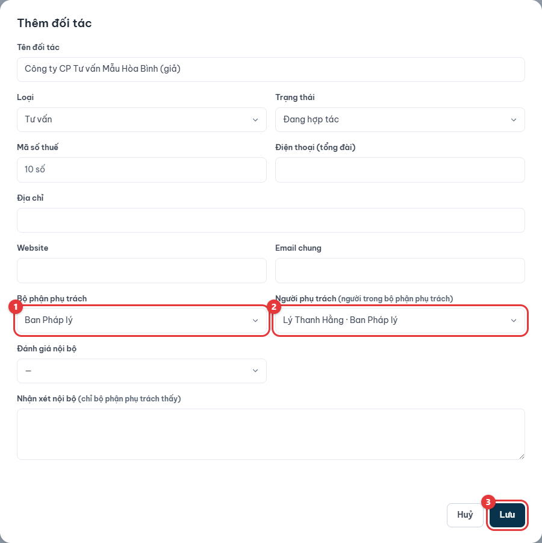

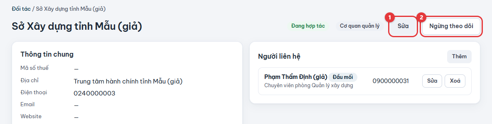

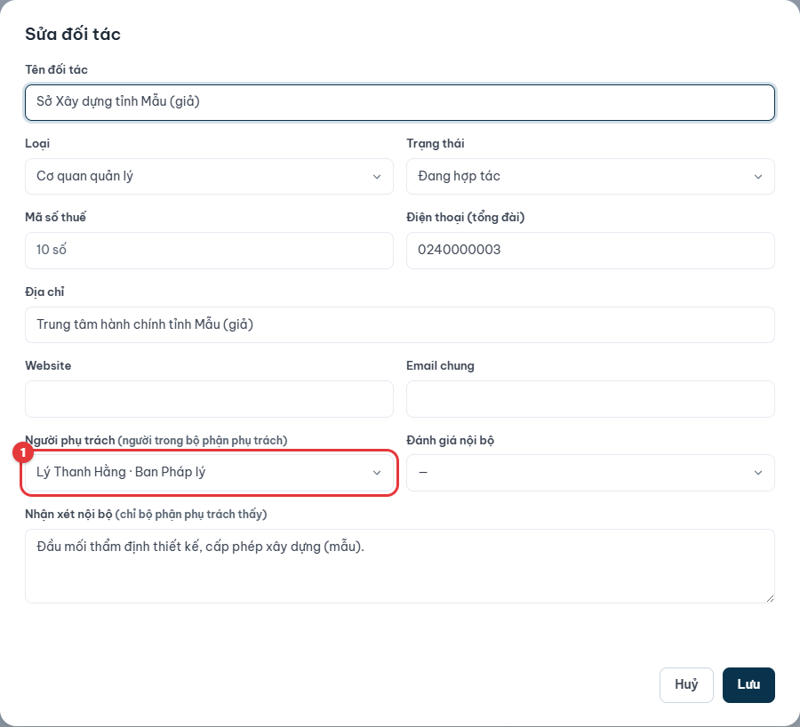

**Ai thấy, ai sửa:**

| Việc | Ban Tổng Giám đốc | Lãnh đạo bộ phận phụ trách | Thành viên khác của bộ phận phụ trách | Người phụ trách đối tác | Người khác |
|---|---|---|---|---|---|
| Xem danh bạ (tên, loại, mã số thuế, địa chỉ, tổng đài) | Có | Có | Có | Có | Có (trừ Quản trị hệ thống) |
| **Thêm đối tác** | Có, chọn bộ phận phụ trách | Có, cho bộ phận mình | Có, cho bộ phận mình | — | Người có bộ phận: có, cho bộ phận mình; không có bộ phận: không ("Tài khoản chưa thuộc bộ phận nào — không tạo được đối tác") |
| **Sửa** thông tin | Có | Có | Có | Có | Không |
| Đổi người phụ trách, **Ngừng theo dõi** / **Theo dõi lại** | Có | Có | Không | Không | Không |
| Xem người liên hệ, nhật ký làm việc | Có | Có | Có | Có | Nhật ký: chỉ dòng mình ghi hoặc được giao theo dõi |
| Xem giá trị hợp đồng / gói thầu | Có | Có | Không | Có | Không |

**Dùng để làm gì:** Đối tác **không có tab "Thiết lập"**. Phần "thiết lập" là ba thứ trên từng đối tác: **bộ phận phụ trách** (quyết định ai xem người liên hệ, nhật ký, hợp đồng và ai nhận nhắc), **người phụ trách** (một cá nhân được xem đầy đủ), và **trạng thái / ngừng theo dõi**. Đặt đúng ngay khi thêm đối tác, vì bộ phận phụ trách không đổi được trên giao diện sau đó.

**Các bước thường làm**

A. Thêm đối tác
1. **Thêm đối tác** → điền **Tên đối tác**, **Loại**, **Trạng thái**, **Mã số thuế** (nếu có).
2. Ban Tổng Giám đốc: chọn **Bộ phận phụ trách**. Người khác: đối tác tự thuộc bộ phận của mình.
3. Lãnh đạo bộ phận / Ban Tổng Giám đốc: chọn **Người phụ trách**; người khác thêm thì chính họ là người phụ trách.
4. **Lưu** → "Đã lưu", trang chi tiết đối tác mở ra.

B. Đổi người phụ trách (Ban Tổng Giám đốc, Lãnh đạo bộ phận phụ trách)
1. Mở đối tác → **Sửa** → ô **Người phụ trách** → chọn người trong bộ phận phụ trách → **Lưu**.

C. Ngừng theo dõi đối tác không còn làm việc
1. Mở đối tác → **Ngừng theo dõi** → hộp hỏi → **Đồng ý**.
2. Muốn xem lại: ở danh sách đánh dấu **Gồm đối tác đã ngừng theo dõi**; mở đối tác → **Theo dõi lại**.

**Từng ô** (hộp **Thêm đối tác** / **Sửa đối tác**)

| Ô (nguyên văn) | Nghĩa là gì | Điền / chọn thế nào (mặc định) | Đổi thì hệ thống làm gì khác |
|---|---|---|---|
| **Tên đối tác** | Tên tổ chức | Bắt buộc, tối đa 200 ký tự | Lỗi: "Thiếu Tên đối tác", "Tên đối tác vượt 200 ký tự" |
| **Loại** | Phân loại | "Nhà thầu" (mặc định khi thêm), "Tư vấn", "Cơ quan quản lý", "Ngân hàng / tổ chức tín dụng", "Nhà cung cấp", "Khác" | Dùng cho bộ lọc **Mọi loại**. Lỗi: "Loại đối tác không hợp lệ" |
| **Trạng thái** | Tình trạng quan hệ | "Đang tìm hiểu", "Đang hợp tác" (mặc định), "Tạm dừng" | Nhãn màu trên danh sách; bộ lọc **Mọi trạng thái**. Khác với **Ngừng theo dõi**: đối tác "Tạm dừng" vẫn hiện trong danh sách. Lỗi: "Trạng thái không hợp lệ" |
| **Mã số thuế** (chữ mờ "10 số") | Mã số thuế | Tuỳ chọn; 10 số, chi nhánh 10 số-3 số | Chặn tạo trùng. Lỗi: "Mã số thuế gồm 10 số (chi nhánh: 10 số-3 số)"; trùng đối tác đang theo dõi: "Mã số thuế đã có: "{tên}" — mở đối tác đó thay vì tạo trùng"; trùng đối tác đã ngừng theo dõi: "Mã số thuế thuộc đối tác đã ngừng theo dõi "{tên}" (#{số}) — mở đối tác đó và bấm "Theo dõi lại""; khi sửa hoặc theo dõi lại: "Mã số thuế đã có ở đối tác đang theo dõi "{tên}"" |
| **Điện thoại (tổng đài)** | Số tổng đài | Tối đa 30 ký tự | Lỗi: "Điện thoại không hợp lệ" |
| **Địa chỉ** | Địa chỉ | Tối đa 300 | Lỗi: "Địa chỉ vượt 300 ký tự" |
| **Website** | Trang web | Tối đa 200 | Lỗi: "Website vượt 200 ký tự" |
| **Email chung** | Email tổ chức | Tối đa 120 | Lỗi: "Email không hợp lệ" |
| **Bộ phận phụ trách** — chỉ khi thêm, chỉ Ban Tổng Giám đốc thấy | Bộ phận chịu trách nhiệm đối tác | Danh sách mọi bộ phận. Người khác thêm: tự lấy bộ phận của người thêm | Quyết định ai xem người liên hệ, nhật ký, hợp đồng; ai nhận nhắc theo dõi. Lỗi: "Chọn bộ phận phụ trách"; chọn bộ phận đã khoá: "Bộ phận phụ trách không hợp lệ" |
| **Người phụ trách (người trong bộ phận phụ trách)** — khi thêm: Lãnh đạo bộ phận, Ban Tổng Giám đốc thấy; khi sửa: Ban Tổng Giám đốc và Lãnh đạo bộ phận phụ trách thấy | Một cá nhân phụ trách đối tác | Mặc định: người đang thêm. Danh sách ghi "{họ tên} · {bộ phận}" | Người phụ trách xem người liên hệ, nhật ký, giá trị hợp đồng; nhận nhắc khi người được giao theo dõi đã nghỉ. Khi thêm, chọn "—" vẫn gán người đang thêm; khi sửa, chọn "—" là bỏ người phụ trách. Lỗi: "Người phụ trách phải thuộc bộ phận phụ trách đối tác" (Ban Tổng Giám đốc chọn tự do); "Người phụ trách không hợp lệ" |
| **Đánh giá nội bộ** | Đánh giá sao | "—", 1 ★ tới 5 ★ | Chỉ người xem được chi tiết thấy |
| **Nhận xét nội bộ (chỉ bộ phận phụ trách thấy)** | Ghi chú nội bộ | Tối đa 2000 ký tự | Lỗi: "Ghi chú vượt 2000 ký tự" |

**Bộ lọc danh sách** (trang `#/crm`): ô tìm "Tên hoặc mã số thuế (gõ không dấu cũng được)", **Mọi loại**, **Mọi trạng thái**, ô đánh dấu **Bộ phận tôi phụ trách**, **Gồm đối tác đã ngừng theo dõi** (mặc định bỏ trống: ẩn đối tác đã ngừng). Lọc ngay khi gõ / chọn; bộ lọc ghi lên địa chỉ trang để gửi link cho người khác.

**Các nút**

| Nút | Làm gì | Có hỏi lại không | Quay lại được không |
|---|---|---|---|
| **Thêm đối tác** | Mở hộp thêm | — | Không xoá được đối tác; chỉ ngừng theo dõi |
| **Sửa** (trang chi tiết) | Mở hộp sửa | — | — |
| **Lưu** / **Huỷ** (trong hộp) | Lưu ("Đã lưu") / đóng | Đóng hộp bằng cách bấm ra nền hoặc `Esc` khi đã nhập: "Bỏ nội dung đã nhập?" | Sửa lại được |
| **Ngừng theo dõi** | Ẩn đối tác khỏi danh sách, giữ dữ liệu; chặn thêm người liên hệ, nhật ký, hợp đồng ("Đối tác đã ngừng theo dõi"); không còn nhắc theo dõi | "Ngừng theo dõi đối tác này? Dữ liệu được giữ, đối tác ẩn khỏi danh sách." — **Đồng ý** / **Huỷ** | Có: **Theo dõi lại** |
| **Theo dõi lại** | Đưa đối tác về danh sách; kiểm trùng mã số thuế | "Theo dõi lại đối tác này?" — **Đồng ý** / **Huỷ** | Có |

**Nhắc theo dõi** (08:10 hằng ngày): việc theo dõi đến hạn hôm nay → "Hôm nay: theo dõi {đối tác}"; quá hạn 1, 3, 7 ngày → "Quá hạn {n} ngày: theo dõi {đối tác}". Người nhận: người được giao theo dõi; người đó đã nghỉ → người phụ trách đối tác, không có thì lãnh đạo bộ phận phụ trách; quá hạn 7 ngày gửi thêm người phụ trách và lãnh đạo bộ phận phụ trách.

**⚠️ Dễ nhầm**
- Sau khi tạo, **không đổi được bộ phận phụ trách trên giao diện** (hộp sửa không có ô này). Ban Tổng Giám đốc kiểm kỹ ô **Bộ phận phụ trách** trước khi lưu; chọn sai thì phải nhờ IT.
- Ô **Bộ phận phụ trách** liệt kê cả bộ phận đã khoá; chọn vào sẽ báo "Bộ phận phụ trách không hợp lệ".
- Chọn "—" ở **Người phụ trách** khi thêm **không** để trống: người đang thêm vẫn thành người phụ trách.
- Câu đầu trang "Liên hệ, nhật ký và hợp đồng chỉ ban phụ trách xem." dùng chữ "ban" theo cách gọi cũ; nghĩa là **bộ phận phụ trách** (cùng người phụ trách và Ban Tổng Giám đốc).
- Người không thuộc bộ phận phụ trách mà được giao theo dõi chỉ thấy các dòng nhật ký mình ghi hoặc được giao.

**Claude:** Đọc danh bạ đối tác, chi tiết đối tác, việc cần theo dõi; ghi nhật ký làm việc (không sửa / xoá được) và đánh dấu xong việc theo dõi, sau khi bạn đồng ý. Claude **không** thêm / sửa đối tác, không đổi bộ phận hay người phụ trách, không ngừng theo dõi.

## 7. Quản trị hệ thống

Chương này dành cho **Quản trị hệ thống** (IT), và cho Ban Tổng Giám đốc muốn biết IT làm được gì, không làm được gì. Quản trị hệ thống quản lý tài khoản, vai, bộ phận, nhãn chung, danh mục dùng chung, nhật ký hệ thống, token Claude và phạm vi phụ trách của Ban Tổng Giám đốc. Quản trị hệ thống **không** xem nội dung nghiệp vụ và **không** gán kiêm nhiệm.

### 7.1 Nguyên tắc: quyền chỉ đi theo vai

**Mở ở đâu:** Không có màn riêng. Bảng quyền của từng vai xem ở Quản trị → **Tài khoản** → nút **Quyền** (hoặc **Quyền & phụ trách**) trên một hàng (mục 7.6).
**Ai thấy, ai sửa:** Vai: Quản trị hệ thống gán (mục 7.4). Phạm vi phụ trách của Ban Tổng Giám đốc: Quản trị hệ thống đặt (mục 7.6). Kiêm nhiệm: Ban Tổng Giám đốc chọn ở ba nơi (bảng dưới). Quan hệ với dự án (Chủ dự án, Người đứng tên dự án, Thành viên, Người xem): người quản lý dự án đặt trong cài đặt dự án.
**Dùng để làm gì:** Biết một người được làm gì là nhờ đâu, để sửa đúng chỗ. Không còn màn "phân quyền từng người": muốn đổi quyền thì đổi vai, hoặc giao kiêm nhiệm / quan hệ với dự án.

Quyền của một người = bốn lớp cộng lại:
1. **Vai**: mỗi tài khoản đúng một vai. Quyền chung suy hoàn toàn từ vai, đổi vai là quyền đổi ngay.
2. **Quan hệ với từng việc / dự án**: Người giao, Người chủ trì, Người phối hợp; Chủ dự án, Người đứng tên dự án, Thành viên, Người xem. Quan hệ chỉ **cộng** quyền, không bớt quyền của vai.
3. **Kiêm nhiệm** do Ban Tổng Giám đốc giao: Thư ký giao ban, PMO, Phụ trách nhân sự, Văn thư, Pháp chế, Người phê duyệt tài liệu nội bộ.
4. **Phạm vi phụ trách**: chỉ với vai Ban Tổng Giám đốc (Toàn công ty, hoặc các bộ phận).

**Bốn vai**

| Vai (nguyên văn ở ô **Vai**) | Dành cho | Quyền chung | Không có |
|---|---|---|---|
| **Ban Tổng Giám đốc** | Tổng Giám đốc, các Phó Tổng Giám đốc. Nên trùng đúng thành viên bộ phận Ban Tổng Giám đốc (bộ phận có mã `BTGD`) | Xem toàn công ty; tạo, quản lý dự án mọi bộ phận kể cả MTL; KPI & phân tích mọi người; bản tổng hợp giao ban đầy đủ, kết luận; chọn thư ký, PMO, người phụ trách nhân sự, văn thư, pháp chế; văn thư mọi mức mật; nhân sự, đối tác mọi bộ phận. Sửa kế hoạch việc, duyệt gia hạn, duyệt việc mốc / đường găng: chỉ trong **phạm vi phụ trách** và việc mình giao | Không lập báo cáo tuần. Không có quyền quản trị |
| **Lãnh đạo bộ phận** | Trưởng, phó bộ phận ("Trưởng phòng", "Phó trưởng ban" chỉ là chức danh) | Trong bộ phận mình: xem, sửa, xoá, duyệt việc; tạo, quản lý dự án thường; dashboard, xuất Excel; lập báo cáo tuần, xem bản tổng hợp tóm tắt; duyệt nghỉ phép, chấm công người trong bộ phận; đối tác của bộ phận gồm giá trị hợp đồng | Phải gán một bộ phận mới là lãnh đạo của bộ phận đó |
| **Nhân viên** | Mọi người còn lại. **Vai mặc định khi tạo tài khoản** | Xem, sửa việc trong phạm vi bộ phận; dashboard bộ phận; lập báo cáo tuần; KPI của chính mình | Không tạo dự án (chỉ quản lý dự án mình là Chủ dự án) |
| **Quản trị hệ thống** | IT | Tài khoản, bộ phận, nhãn chung, danh mục, nhật ký hệ thống, token Claude; đặt phạm vi phụ trách của Ban Tổng Giám đốc | **Không xem**: dự án, công việc, báo cáo, KPI, tài liệu, văn thư, nhân sự, đối tác. Không dùng Claude |

**Kiêm nhiệm: Ban Tổng Giám đốc chọn ở ba nơi khác nhau**

Quản trị hệ thống **không** gán kiêm nhiệm; chỉ nhìn thấy kết quả ở cột **Kiêm nhiệm** của danh sách tài khoản. Tài khoản Quản trị hệ thống không có trong các ô chọn kiêm nhiệm.

| Kiêm nhiệm | Nơi chọn | Đường mở | Chọn theo | Ghi chú |
|---|---|---|---|---|
| **Thư ký giao ban** | 1. Báo cáo tuần | Menu **Giao ban** → **Báo cáo tuần** → tab **Tổng hợp** → cuối trang, khối **Thiết lập** → ô **Bộ phận thư ký giao ban (Tổng hợp & Nhân sự)** | Một **bộ phận**: mọi thành viên (trừ vai Ban Tổng Giám đốc) | Mục 5.1 |
| **PMO** | 1. Báo cáo tuần | Cùng khối → ô **PMO (xem đầy đủ, không sửa — Ban TGĐ chỉ định)** | Từng người | Chưa chọn ai = không ai là PMO. Mục 5.1 |
| **Phụ trách nhân sự** | 2. Nhân sự | Menu **Nghiệp vụ** → **Nhân sự** → tab **Thiết lập** → ô **Người phụ trách nhân sự (Ban Tổng Giám đốc chỉ định — xem / sửa hồ sơ, hợp đồng, số định danh)** | Từng người, tối đa 5, không tự chọn mình | Chỉ khi bật phân hệ Nhân sự (đang tắt). Mục 6.2 |
| **Văn thư** | 3. Văn thư | Menu **Nghiệp vụ** → **Tài liệu** → tab **Văn thư** hoặc **Quy chế, quy định nội bộ** → nút **Thiết lập** (trang `#/vanthu/thiet-lap`, chỉ Ban Tổng Giám đốc thấy nút) → ô **Văn thư** | Từng người, tối đa 30 (quá thì máy bỏ bớt, không báo) | Ô **Pháp nhân** cùng màn: xem phần Văn thư của tài liệu |
| **Pháp chế** | 3. Văn thư | Cùng màn → ô **Pháp chế** | Từng người, tối đa 30 | Nhận văn bản có thời hạn pháp lý được chuyển |
| **Người phê duyệt tài liệu nội bộ** | 3. Văn thư | Cùng màn → ô **Người phê duyệt tài liệu nội bộ (chỉ vai Ban TGĐ; để trống hoặc không còn ai hợp lệ = thành viên Ban TGĐ phụ trách "Toàn công ty"; không ai phụ trách "Toàn công ty" = mọi thành viên Ban TGĐ)** | Thành viên vai Ban Tổng Giám đốc, tối đa 10 | **Không** hiện ở cột "Kiêm nhiệm". Để trống, hoặc mọi người trong ô đã khoá / đổi vai, thì người phê duyệt = thành viên Ban Tổng Giám đốc có phạm vi **Toàn công ty** (mục 7.6); không ai có phạm vi này thì mọi thành viên Ban Tổng Giám đốc |

**Phạm vi phụ trách** (chỉ vai Ban Tổng Giám đốc, Quản trị hệ thống đặt ở mục 7.6): mọi thành viên Ban Tổng Giám đốc xem toàn công ty, nhưng chỉ người có phạm vi mới là **BTGĐ phụ trách** của một việc. **Toàn công ty** = BTGĐ phụ trách của mọi việc. **Các bộ phận** (hiện là "Phó TGĐ phụ trách") = BTGĐ phụ trách của việc do bộ phận đó chủ trì.

**Chức danh không cấp quyền.** Ví dụ: ghi chức danh "Trưởng phòng" nhưng để vai **Nhân viên** thì người đó không duyệt được việc của bộ phận, không lập được dự án, không được tính là lãnh đạo bộ phận ở báo cáo tuần, nghỉ phép, chấm điểm.

**Lãnh đạo của một bộ phận** (người nhận thông báo cấp bộ phận, duyệt cấp bộ phận, nhận nhắc báo cáo tuần, duyệt đơn nghỉ) = mọi tài khoản **đang hoạt động** có vai **Lãnh đạo bộ phận** và được gán bộ phận đó, cộng thành viên vai Ban Tổng Giám đốc được gán bộ phận đó. Màn Bộ phận **không có** ô "lãnh đạo bộ phận": muốn ai là lãnh đạo của Phòng X thì gán cho người đó vai **Lãnh đạo bộ phận** và bộ phận Phòng X.

**⚠️ Dễ nhầm**
- Hỏi "cho anh X quyền duyệt": không có ô quyền từng người. Đổi vai X thành **Lãnh đạo bộ phận** (nếu X là lãnh đạo thật), hoặc để người quản lý dự án đặt X làm người duyệt trong cài đặt dự án.
- Gán vai Ban Tổng Giám đốc chưa đủ để người đó duyệt gia hạn việc nào; phải đặt phạm vi phụ trách (mục 7.6).

**Claude:** Công cụ **Tôi là ai trong Kepler Hub** cho người dùng biết tài khoản, vai và vai trò giao ban của họ. Không công cụ nào đổi vai, kiêm nhiệm hay phạm vi phụ trách.

### 7.2 Khung màn Quản trị và những gì Quản trị hệ thống không làm được

**Mở ở đâu:** Đăng nhập bằng tài khoản vai Quản trị hệ thống → tự vào **Quản trị** → **Tài khoản** (trang `#/admin/users`). Bấm logo "Kepler Hub" góc trái cũng về đây.
**Ai thấy, ai sửa:** Chỉ vai **Quản trị hệ thống** (kể cả quản trị gốc) có nhóm menu **Quản trị**. Ban Tổng Giám đốc, Lãnh đạo bộ phận, Nhân viên không thấy nhóm này.
**Dùng để làm gì:** Chỗ làm việc của IT. Không có nội dung nghiệp vụ.

**Menu Quản trị**

| Mục menu | Trang | Nội dung |
|---|---|---|
| **Tài khoản** | `#/admin/users` | Mục 7.3 – 7.9 |
| **Bộ phận** | `#/admin/departments` | Mục 7.10 |
| **Nhãn** | `#/admin/labels` | Mục 7.11 |
| **Danh mục** | `#/catalog` | Mục 7.12 |
| **Nhật ký hệ thống** | `#/admin/audit` | Mục 7.13 |
| **Token Claude** | `#/admin/tokens` | Mục 7.14 |

Thanh vị trí ghi "Quản trị / {mục}"; tab trình duyệt ghi "Quản trị · Kepler Hub". Menu tài khoản (góc phải) của Quản trị hệ thống chỉ có **Thông tin cá nhân**, **Cài Kepler Hub lên máy**, **Đăng xuất**. Nút tìm nhanh trên thanh đầu trang bị ẩn, nhưng `Ctrl K` vẫn mở bảng lệnh với 4 trang: "Quản trị tài khoản", "Bộ phận", "Nhật ký hệ thống", "Danh mục".

**Quản trị hệ thống không làm được** (kể cả quản trị gốc):
1. Mở mọi trang ngoài Quản trị, Danh mục, Thông tin cá nhân: gõ địa chỉ khác sẽ bị đưa về `#/admin/users`. Không có Trang chủ, Công việc, Dự án, Giao ban, Nghiệp vụ, Thống kê.
2. Xem dự án, việc, tìm việc: danh sách dự án luôn trống.
3. Xem báo cáo tuần ("Tài khoản quản trị hệ thống không xem nội dung nghiệp vụ"), nhân sự ("Quản trị hệ thống không xem dữ liệu nhân sự"), đối tác ("Quản trị hệ thống không xem dữ liệu nghiệp vụ"), KPI, MTL.
4. Dùng Claude: không tạo được token ("Tài khoản quản trị hệ thống không dùng Claude để truy cập dữ liệu nghiệp vụ"); tài khoản bị đổi sang vai Quản trị hệ thống thì token cũ ngừng chạy ("Tài khoản quản trị hệ thống không dùng token Claude").
5. Xem nội dung trước – sau của thao tác nghiệp vụ trong Nhật ký hệ thống: chỉ thấy ai, lúc nào, mã đối tượng ("Ẩn nội dung nghiệp vụ").
6. Xem tên, nội dung việc của người sắp nghỉ: hộp khoá tài khoản chỉ hiện số đếm.
7. Thấy cây tổ chức, kiêm nhiệm ở Thông tin cá nhân (hai khối này không hiện với Quản trị hệ thống).
8. Được chọn làm PMO, Phụ trách nhân sự, Văn thư, Pháp chế.

Ngoại lệ: Quản trị hệ thống vẫn sửa được **Danh mục** (số ngày "Sắp đến hạn", nguồn giao việc, trọng số KPI, mẫu nhóm việc), là các thiết lập có tính nghiệp vụ (mục 7.12).

**Thông báo riêng của Quản trị hệ thống:** 09:00 hằng ngày, khi có vấn đề vận hành nghiêm trọng (sao lưu, job lỗi), mọi tài khoản Quản trị hệ thống đang hoạt động nhận "Kiểm tra vận hành Kepler Hub", bấm vào mở Nhật ký hệ thống; thứ Hai gửi kèm cả các nhắc cấu hình (mục 7.13).

**⚠️ Dễ nhầm**
- Đổi vai một người sang **Quản trị hệ thống** cắt ngay mọi quyền nghiệp vụ, không hỏi lại. Ví dụ: chuyên viên IT kiêm nhập liệu dự án mà để vai Quản trị hệ thống thì không xem được dự án nào; việc đang chủ trì vẫn mang tên họ nhưng họ không mở được.
- Cần một người vừa quản trị vừa làm nghiệp vụ: tạo **hai** tài khoản riêng (một vai Quản trị hệ thống, một vai nghiệp vụ).

**Claude:** Không gì. Claude không gọi được trang Quản trị và tài khoản Quản trị hệ thống không tạo được token.

### 7.3 Quản trị → Tài khoản (danh sách)

**Mở ở đâu:** Menu **Quản trị** → **Tài khoản** (trang `#/admin/users`); trang mặc định sau khi Quản trị hệ thống đăng nhập; bảng lệnh "Quản trị tài khoản".
**Ai thấy, ai sửa:** Chỉ Quản trị hệ thống. Hàng của quản trị gốc không có nút nào.
**Dùng để làm gì:** Xem mọi tài khoản (cả đã khoá); tạo, sửa, khoá, mở khoá; reset mật khẩu; xem quyền theo vai; đặt phạm vi phụ trách của Ban Tổng Giám đốc. Câu đầu trang: "Mỗi tài khoản có đúng một **vai**: Ban Tổng Giám đốc, Lãnh đạo bộ phận, Nhân viên hoặc Quản trị hệ thống. Quyền đi theo vai; thành viên Ban Tổng Giám đốc có thêm **phạm vi phụ trách**."

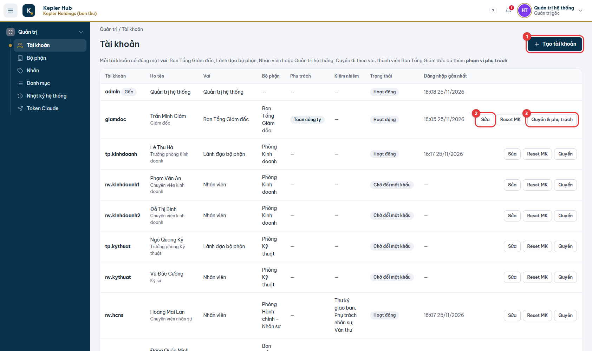

**Từng cột** (chỉ xem)

| Cột (nguyên văn) | Nghĩa là gì | Giá trị | Ghi chú |
|---|---|---|---|
| **Tài khoản** | Tên đăng nhập | Kèm nhãn "Gốc" nếu là quản trị gốc | — |
| **Họ tên** | Họ tên; dòng dưới là chức danh | — | — |
| **Vai** | Tên vai | Kèm nhãn vàng "Lệch bộ phận BTGĐ" khi vai và bộ phận Ban Tổng Giám đốc không khớp (rê chuột thấy lý do); chỉ tính tài khoản đang hoạt động | Mục 7.5 |
| **Bộ phận** | Bộ phận của tài khoản | "—" nếu không thuộc bộ phận; thêm "(đã khoá)" nếu bộ phận đã khoá | — |
| **Phụ trách** | Phạm vi phụ trách | Chỉ với vai Ban Tổng Giám đốc: nhãn "Toàn công ty" (rê chuột: "Phạm vi phụ trách: Toàn công ty — BTGĐ phụ trách của mọi việc") và / hoặc tên các bộ phận; trống thì "Chưa phụ trách". Vai khác: "—" | Sửa ở **Quyền & phụ trách** (mục 7.6) |
| **Kiêm nhiệm** | Các kiêm nhiệm | "Thư ký giao ban", "PMO", "Phụ trách nhân sự", "Văn thư", "Pháp chế"; "—" nếu không có | Không sửa ở đây; Ban Tổng Giám đốc chọn ở ba nơi (mục 7.1) |
| **Trạng thái** | Tình trạng tài khoản | "Chờ đổi mật khẩu" (đang hoạt động, phải đổi mật khẩu ở lần đăng nhập tới), "Hoạt động", "Đã khoá" | — |
| **Đăng nhập gần nhất** | Lần đăng nhập thành công gần nhất | "—" nếu chưa từng | — |

**Các nút**

| Nút | Làm gì | Có hỏi lại không | Quay lại được không |
|---|---|---|---|
| **Tạo tài khoản** | Mở hộp "Tạo tài khoản" (mục 7.4) | — | Không xoá được tài khoản đã tạo (không có nút xoá); chỉ khoá |
| **Sửa** | Mở hộp "Sửa tài khoản {tài khoản}" (mục 7.4) | — | — |
| **Reset MK** | Đặt lại mật khẩu về mật khẩu mặc định (mục 7.8) | Có | **Không** |
| **Quyền** (tài khoản không phải Ban Tổng Giám đốc) / **Quyền & phụ trách** (tài khoản vai Ban Tổng Giám đốc) | Mở hộp xem quyền theo vai; với Ban Tổng Giám đốc thêm phần phạm vi phụ trách (mục 7.6) | — | — |

**⚠️ Dễ nhầm**
- Danh sách không có ô tìm, không có bộ lọc; xếp theo thứ tự tạo tài khoản. Tài khoản đã khoá vẫn nằm trong danh sách. Dùng `Ctrl F` của trình duyệt để tìm tên.
- Nút **Reset MK** hiện cả ở hàng của chính bạn nhưng bấm sẽ báo "Không thể reset mật khẩu tài khoản này". Đổi mật khẩu của mình: Thông tin cá nhân → **Đổi mật khẩu**.
- Một tài khoản Quản trị hệ thống được gán vào bộ phận thư ký giao ban vẫn hiện "Thư ký giao ban" ở cột Kiêm nhiệm, dù không có quyền gì trong giao ban.

**Claude:** Không.

### 7.4 Hộp "Tạo tài khoản" / "Sửa tài khoản {tài khoản}"

**Mở ở đâu:** Quản trị → **Tài khoản** → nút **Tạo tài khoản**, hoặc nút **Sửa** trên một hàng.
**Ai thấy, ai sửa:** Quản trị hệ thống. Không ai sửa được tài khoản quản trị gốc qua hộp này ("Không thể sửa tài khoản quản trị gốc"), không ai khoá được nó ("Không thể khoá tài khoản quản trị gốc"), không tạo thêm được quản trị gốc.
**Dùng để làm gì:** Nhập thông tin tài khoản, gán vai và bộ phận, khoá tài khoản người nghỉ việc (kèm bàn giao), mở lại tài khoản.

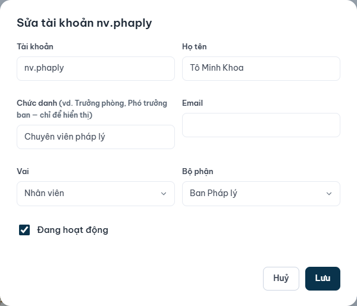

**Các bước thường làm**

A. Tạo tài khoản cho người mới
1. **Tạo tài khoản**.
2. Điền **Tài khoản** (vd. `nv.thietke`), **Họ tên**, **Chức danh**, **Email**.
3. Chọn **Vai** (mặc định **Nhân viên**) và **Bộ phận**.
4. **Mật khẩu ban đầu**: gõ một mật khẩu riêng cho người này, hoặc để trống để dùng mật khẩu mặc định — IT báo riêng cho người dùng; đăng nhập xong phải đổi ngay.
5. Hộp cảnh báo vàng hiện ra (vai và bộ phận Ban Tổng Giám đốc không khớp): kiểm lại; đúng ý thì đánh dấu **Tôi đã kiểm tra, vẫn lưu** (mục 7.5).
6. **Lưu** → "Đã lưu tài khoản". Ban Tổng Giám đốc nhận thông báo tài khoản mới.
7. Báo người dùng tên đăng nhập và mật khẩu ban đầu qua kênh riêng. Lần đăng nhập đầu họ bắt buộc đổi mật khẩu (mục 8.1).
8. Vai Ban Tổng Giám đốc: đặt tiếp phạm vi phụ trách (mục 7.6).

B. Sửa thông tin (họ tên, chức danh, email, tên đăng nhập)
1. **Sửa** trên hàng của người đó → sửa ô → **Lưu**.
2. Đổi **Tài khoản** (tên đăng nhập) thì tự báo người đó tên mới.

**Từng ô**

| Ô (nguyên văn) | Nghĩa là gì | Điền / chọn thế nào (mặc định) | Đổi thì hệ thống làm gì khác |
|---|---|---|---|
| **Tài khoản** | Tên đăng nhập | Bắt buộc; 3–50 ký tự gồm chữ thường, số, dấu chấm, gạch dưới, gạch ngang (gợi ý "Chữ thường, số, . _ -"). Máy chủ tự chuyển chữ thường | Dùng để đăng nhập. Đổi khi sửa: người đó phải đăng nhập bằng tên mới; hệ thống không báo họ. Lỗi: "Tài khoản chỉ gồm chữ thường, số, dấu chấm, gạch dưới hoặc gạch ngang (3–50 ký tự)"; trùng tên đã có: "Dữ liệu bị trùng: …" kèm tên trường kỹ thuật |
| **Họ tên** | Họ tên hiển thị | Bắt buộc, tối đa 120 ký tự | Hiện ở mọi nơi; dùng khi khớp tên cán bộ lúc nhập sổ giao việc từ tệp. Lỗi: "Thiếu Họ tên", "Họ tên vượt 120 ký tự" |
| **Chức danh** (gợi ý "(vd. Trưởng phòng, Phó trưởng ban — chỉ để hiển thị)") | Chức danh in trên giao diện | Tuỳ chọn, tối đa 120 | **Không cấp quyền.** Hiện ở danh sách tài khoản, Thông tin cá nhân, cây tổ chức, menu tài khoản, danh sách chọn người. Cũng dùng để khớp tên khi nhập sổ giao việc từ tệp: ô cán bộ ghi đúng chức danh sẽ khớp tài khoản có chức danh đó. Lỗi: "Chức danh vượt 120 ký tự" |
| **Email** | Email công việc | Tuỳ chọn, tối đa 160; trình duyệt kiểm đúng dạng email | Hiện ở Thông tin cá nhân. Lỗi: "Email vượt 160 ký tự" |
| **Vai** | Một trong 4 vai: "Ban Tổng Giám đốc", "Lãnh đạo bộ phận", "Nhân viên", "Quản trị hệ thống" | Khi tạo: **Nhân viên** | Đổi toàn bộ quyền chung **ngay** (mục 7.5). Mọi lần tạo và mọi lần đổi vai đều báo Ban Tổng Giám đốc. Lỗi: "Vai không hợp lệ"; tự đổi vai của chính mình: "Không tự đổi vai của chính mình — nhờ một quản trị khác" |
| **Bộ phận** | Bộ phận của tài khoản | "— Không thuộc bộ phận —" và các bộ phận đang hoạt động. Khi sửa có thêm bộ phận hiện tại kể cả đã khoá, ghi "(đã khoá)" | Quyết định "bộ phận mình" của mọi quyền; bộ phận lập báo cáo tuần; là lãnh đạo của bộ phận nào; đối tác, nhân sự của bộ phận. Không có bộ phận: không lập được báo cáo tuần ("Tài khoản chưa thuộc bộ phận nào — liên hệ quản trị để gán bộ phận"), không thêm được đối tác. Chuyển sang bộ phận đã khoá: "Bộ phận không tồn tại hoặc đã khoá" (giữ nguyên bộ phận đã khoá hiện tại thì được) |
| **Mật khẩu ban đầu** (chỉ khi tạo; chữ mờ "Để trống: mật khẩu mặc định") | Mật khẩu đầu tiên | Trống = mật khẩu mặc định — IT báo riêng cho người dùng; đăng nhập xong phải đổi ngay | Tài khoản mới **luôn** phải đổi mật khẩu ở lần đăng nhập đầu, kể cả khi bạn gõ mật khẩu riêng. Lỗi: "Mật khẩu phải có ít nhất 6 ký tự và không chỉ gồm khoảng trắng" |
| **Đang hoạt động** (chỉ khi sửa) | Bỏ dấu = khoá; đánh dấu lại = mở khoá | Theo trạng thái hiện tại | Khoá: xem mục 7.7. Mở khoá: người đó đăng nhập lại được bằng mật khẩu cũ |
| Hộp cảnh báo vàng "**{cảnh báo}.** Vai Ban Tổng Giám đốc nên trùng đúng thành viên bộ phận Ban Tổng Giám đốc." + ô **Tôi đã kiểm tra, vẫn lưu** | Hiện khi vai và bộ phận Ban Tổng Giám đốc không khớp | Mục 7.5 | Không đánh dấu thì không lưu được |
| Hộp "Đổi vai: {vai cũ} → {vai mới}" (chỉ khi sửa) | Giải thích hệ quả đổi vai | Chỉ đọc | Mục 7.5 |
| Hộp "Khoá tài khoản (nghỉ việc)" / "Tài khoản đã khoá nhưng còn việc" (chỉ khi sửa) | Số đếm việc và ô bàn giao | Mục 7.7 | Mục 7.7 |
| Câu dưới hộp tạo: "Quyền đi theo vai (xem nút "Quyền" ở danh sách tài khoản)." | Nhắc không có bảng quyền từng người | — | — |

Ô **không có** trong hộp: **Điện thoại** (không màn nào nhập được, mục 8.12); phạm vi phụ trách (ở **Quyền & phụ trách**, mục 7.6); kiêm nhiệm (Ban Tổng Giám đốc chọn ở ba nơi, mục 7.1); mật khẩu khi sửa (dùng **Reset MK**, mục 7.8).

**Các nút**

| Nút | Làm gì | Có hỏi lại không | Quay lại được không |
|---|---|---|---|
| **Huỷ** | Đóng hộp, không lưu. Bấm ra nền hoặc `Esc` khi đã nhập: hỏi ngay trong hộp "Bỏ nội dung đã nhập?" với **Bỏ nội dung** / **Tiếp tục nhập** | — | — |
| **Lưu** | Tạo / cập nhật tài khoản; đổi vai thì đổi quyền; khoá kèm bàn giao thì chạy bàn giao cùng lúc. Xong: "Đã lưu tài khoản", có thể kèm " — quyền đã đổi theo vai mới" và "bàn giao: gỡ khỏi {n} việc, {m} việc chờ phân công lại". Lỗi hiện ở dòng đỏ trong hộp | Không hỏi riêng; chỉ có ô **Tôi đã kiểm tra, vẫn lưu** khi lệch vai / bộ phận | Tạo: không xoá được, chỉ khoá. Đổi vai / bộ phận: đổi lại được, nhưng phạm vi phụ trách đã bị bỏ phải đặt lại, và mỗi lần đổi đều báo Ban Tổng Giám đốc. Khoá: mở lại được, nhưng **không** khôi phục việc đã gỡ, uỷ quyền đã thu hồi, Phó TGĐ phụ trách đã bỏ, token Claude, ghi chú cá nhân đã quá 30 ngày |

**Thông báo phát sinh** (gửi mọi thành viên Ban Tổng Giám đốc đang hoạt động; nội dung luôn kèm "Người thực hiện: {họ tên} ({tài khoản})")
- Mọi lần tạo tài khoản: "Quản trị hệ thống vừa tạo tài khoản {tài khoản} — vai {vai}" (thêm ", bộ phận Ban Tổng Giám đốc" nếu vào bộ phận `BTGD`).
- Mọi lần đổi vai: "Quản trị hệ thống vừa đổi vai tài khoản {tài khoản}: {vai cũ} → {vai mới}".
- Chuyển người vào / ra bộ phận Ban Tổng Giám đốc: "Quản trị hệ thống vừa chuyển {tài khoản} vào bộ phận Ban Tổng Giám đốc" / "… ra khỏi bộ phận Ban Tổng Giám đốc".
- Xác nhận lưu khi lệch: "Quản trị hệ thống xác nhận lưu tài khoản lệch vai / bộ phận: {tài khoản}".
- **Không** báo khi: sửa họ tên, chức danh, email, tên đăng nhập; đổi bộ phận thường; khoá / mở khoá (trừ khi bàn giao bỏ Phó TGĐ phụ trách, mục 7.7).

**⚠️ Dễ nhầm**
- Quản trị hệ thống thường (không phải gốc) bỏ được dấu **Đang hoạt động** của **chính mình**; lưu xong bị đăng xuất ngay và không tự mở lại được. Đừng sửa hàng của chính mình.
- Mật khẩu mặc định giống nhau cho mọi tài khoản. Tạo tài khoản sẵn mà người dùng chưa đăng nhập ngay thì nên gõ **Mật khẩu ban đầu** riêng.

**Claude:** Không. Chỉ làm trên giao diện.

### 7.5 Đổi vai, đổi bộ phận và cảnh báo lệch bộ phận Ban Tổng Giám đốc

**Mở ở đâu:** Quản trị → **Tài khoản** → **Sửa** → ô **Vai**, ô **Bộ phận**.
**Ai thấy, ai sửa:** Quản trị hệ thống, trừ vai của chính mình.
**Dùng để làm gì:** Đổi vai khi một người lên / xuống chức, chuyển bộ phận khi luân chuyển. Đây là cách **duy nhất** để đổi quyền chung của một người.

**Các bước thường làm**
1. **Sửa** trên hàng của người đó.
2. Đổi **Vai** và / hoặc **Bộ phận**. Hộp "Đổi vai: {vai cũ} → {vai mới}" hiện giải thích hệ quả.
3. Hộp cảnh báo vàng hiện (nếu lệch bộ phận Ban Tổng Giám đốc): kiểm lại, đúng ý thì đánh dấu **Tôi đã kiểm tra, vẫn lưu**.
4. **Lưu** → "Đã lưu tài khoản — quyền đã đổi theo vai mới".
5. Vai mới là Ban Tổng Giám đốc: mở **Quyền & phụ trách** đặt phạm vi (mục 7.6).

**Hộp "Đổi vai"** (nguyên văn): "Quyền của tài khoản đổi ngay theo vai mới."; sang Ban Tổng Giám đốc thêm " Ban Tổng Giám đốc sẽ được thông báo; đặt phạm vi phụ trách ở nút "Quyền & phụ trách"."; rời Ban Tổng Giám đốc thêm " Phạm vi phụ trách (toàn công ty, bộ phận) của tài khoản sẽ được bỏ."

**Đổi vai thì chuyện gì xảy ra**

| Đổi sang | Ngay lập tức | Ví dụ |
|---|---|---|
| **Ban Tổng Giám đốc** | Xem toàn công ty; mất tab **Nộp báo cáo**; thôi là thư ký nếu đang thuộc bộ phận thư ký; chưa là BTGĐ phụ trách của việc nào cho tới khi đặt phạm vi; Ban Tổng Giám đốc nhận "… — xem toàn công ty theo vai Ban Tổng Giám đốc" | Phó Tổng Giám đốc mới nhận vai: xem được mọi dự án nhưng chưa duyệt gia hạn việc nào |
| Rời **Ban Tổng Giám đốc** | Bỏ ngay phạm vi phụ trách (Toàn công ty và các bộ phận); Ban Tổng Giám đốc nhận "… — bỏ vai Ban Tổng Giám đốc và phạm vi phụ trách". Gán lại vai Ban Tổng Giám đốc thì phải đặt lại phạm vi | Lỡ tay đổi vai một Phó TGĐ rồi đổi lại: các bộ phận người đó phụ trách đã mất, phải tick lại |
| **Lãnh đạo bộ phận** | Thành lãnh đạo của bộ phận đang gán: duyệt việc của bộ phận, nhận nhắc báo cáo tuần 15:00, xem tổng hợp tóm tắt, duyệt đơn nghỉ, tạo dự án thường của bộ phận | Gán vai cho trưởng phòng mới của Phòng Thiết kế → từ lần nhắc báo cáo tuần tới, người đó nhận nhắc |
| **Nhân viên** | Mất các quyền lãnh đạo ở trên | Trưởng phòng cũ thôi chức: đổi về Nhân viên để không còn duyệt việc bộ phận |
| **Quản trị hệ thống** | Mất mọi quyền nghiệp vụ, không hỏi lại; token Claude ngừng chạy | Xem mục 7.2 |

**Đổi bộ phận thì chuyện gì xảy ra:** "bộ phận mình" của mọi quyền đổi theo. Ví dụ: chuyển Lãnh đạo bộ phận duy nhất của Phòng A sang Phòng B → Phòng A không còn lãnh đạo: nhắc báo cáo tuần 15:00 của Phòng A chỉ còn gửi người lập báo cáo tuần trước và người lập bản nháp, đơn nghỉ của nhân viên Phòng A chuyển lên Ban Tổng Giám đốc, tab Chấm điểm ghi "Chưa có trưởng bộ phận" cho Phòng A; Phòng B có thêm một lãnh đạo. Chuyển người vào bộ phận thư ký giao ban thì người đó thành thư ký (mục 5.1).

**Cảnh báo lệch bộ phận Ban Tổng Giám đốc.** Bộ phận Ban Tổng Giám đốc là bộ phận có **Mã** `BTGD` (đặt ở Quản trị → Bộ phận). Hệ thống muốn vai Ban Tổng Giám đốc trùng đúng thành viên bộ phận này, nhưng không chặn cứng:
- Chọn vai **Ban Tổng Giám đốc** mà bộ phận không phải `BTGD`: "Vai Ban Tổng Giám đốc nhưng không thuộc bộ phận Ban Tổng Giám đốc".
- Chọn bộ phận `BTGD` mà vai khác Ban Tổng Giám đốc: "Thuộc bộ phận Ban Tổng Giám đốc nhưng không có vai Ban Tổng Giám đốc".
- Không áp cho vai Quản trị hệ thống. Khi sửa, chỉ hiện nếu bạn đổi vai hoặc đổi bộ phận.
- Không đánh dấu **Tôi đã kiểm tra, vẫn lưu** thì máy chủ báo "{cảnh báo} — kiểm tra lại, hoặc xác nhận để vẫn lưu" và hộp cảnh báo hiện lại.
- Đánh dấu rồi lưu: lưu được, ghi nhật ký nhạy cảm, Ban Tổng Giám đốc nhận "Quản trị hệ thống xác nhận lưu tài khoản lệch vai / bộ phận: {tài khoản}", danh sách hiện nhãn "Lệch bộ phận BTGĐ" ở hàng đó.

Ví dụ: thư ký riêng của Tổng Giám đốc được đặt vào bộ phận `BTGD` với vai **Nhân viên** → hộp "Thuộc bộ phận Ban Tổng Giám đốc nhưng không có vai Ban Tổng Giám đốc." → đánh dấu xác nhận → lưu; từ đó hàng của người này mang nhãn "Lệch bộ phận BTGĐ".

**⚠️ Dễ nhầm**
- Đổi mã một bộ phận thành `BTGD` (mục 7.10) làm mọi người đang hoạt động trong đó mà không có vai Ban Tổng Giám đốc hiện nhãn "Lệch bộ phận BTGĐ".
- Quản trị hệ thống không tự đổi được vai của chính mình; nhờ một Quản trị hệ thống khác.

**Claude:** Không.

### 7.6 Hộp "Quyền" / "Quyền & phụ trách"

**Mở ở đâu:** Quản trị → **Tài khoản** → nút **Quyền** (tài khoản không phải Ban Tổng Giám đốc) hoặc **Quyền & phụ trách** (tài khoản vai Ban Tổng Giám đốc). Tiêu đề hộp: "Quyền: {họ tên} ({tài khoản})" hoặc "Quyền & phụ trách: {họ tên} ({tài khoản})".
**Ai thấy, ai sửa:** Quản trị hệ thống. Phần bảng quyền **chỉ xem**. Phần phạm vi phụ trách chỉ có với tài khoản vai Ban Tổng Giám đốc và **chỉ đặt ở đây** (màn Bộ phận chỉ hiện kết quả).
**Dùng để làm gì:** Xem "vai này được làm gì" bằng lời; đặt phạm vi phụ trách cho từng thành viên Ban Tổng Giám đốc. Câu đầu hộp: "Vai: **{vai}**. Quyền đi theo vai — muốn đổi quyền thì đổi vai, hoặc giao kiêm nhiệm / quan hệ với dự án (Chủ dự án, Thành viên). Không chỉnh quyền từng người."

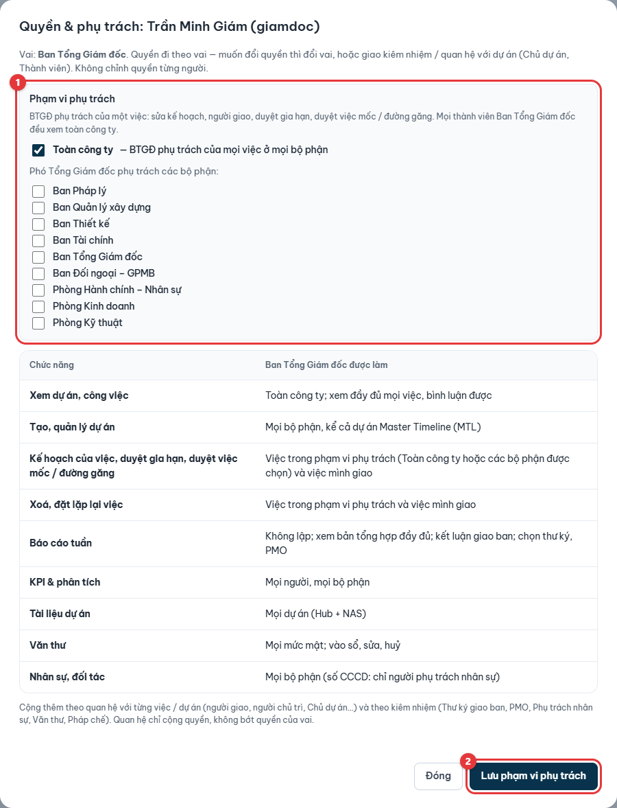

**Các bước thường làm** (đặt phạm vi cho một Phó Tổng Giám đốc)
1. **Quyền & phụ trách** trên hàng của người đó.
2. Tick các bộ phận người đó phụ trách. Bộ phận ghi "(đang: {họ tên})" đang thuộc Phó TGĐ khác: tick là **chuyển** sang người này.
3. Tổng Giám đốc (hoặc người phụ trách chung): tick **Toàn công ty**.
4. **Lưu phạm vi phụ trách** → "Đã lưu phạm vi phụ trách".

**Từng ô**

| Ô (nguyên văn) | Nghĩa là gì | Điền / chọn thế nào (mặc định) | Đổi thì hệ thống làm gì khác |
|---|---|---|---|
| Khối "Phạm vi phụ trách" + câu "BTGĐ phụ trách của một việc: sửa kế hoạch, người giao, duyệt gia hạn, duyệt việc mốc / đường găng. Mọi thành viên Ban Tổng Giám đốc đều xem toàn công ty." | Chỉ hiện với tài khoản vai Ban Tổng Giám đốc | — | — |
| **Toàn công ty** — BTGĐ phụ trách của mọi việc ở mọi bộ phận | Phạm vi Toàn công ty | Ô đánh dấu, mặc định bỏ trống | Người này là BTGĐ phụ trách của **mọi** việc: sửa kế hoạch (tên, hạn, người chủ trì…), đổi người giao, xoá, đặt lặp lại, duyệt gia hạn, duyệt và chấm mức việc mốc / đường găng; là người duyệt ở bước "BTGĐ phụ trách" của mọi quy trình duyệt; là Người phê duyệt tài liệu nội bộ khi Văn thư → Thiết lập để trống ô đó; nhận đề nghị gia hạn của việc thuộc bộ phận chưa có Phó TGĐ phụ trách. Lỗi: "Thiếu lựa chọn "Toàn công ty"" |
| "Phó Tổng Giám đốc phụ trách các bộ phận:" + một ô đánh dấu mỗi bộ phận; bộ phận đang có Phó TGĐ khác ghi thêm "(đang: {họ tên})" | Các bộ phận người này phụ trách | Danh sách = bộ phận đang hoạt động + bộ phận người này đang phụ trách (kể cả đã khoá) | Người này là BTGĐ phụ trách các việc **do bộ phận đó chủ trì** (dự án thường không ghi bộ phận chủ trì thì tính bộ phận của dự án); nhận đề nghị gia hạn của các việc đó; hiện ở cột "Phó TGĐ phụ trách" (màn Bộ phận) và ở cây tổ chức. Mỗi bộ phận tối đa một Phó TGĐ phụ trách: tick bộ phận đang "(đang: X)" là lấy khỏi X, **không hỏi lại**. Lỗi: "Danh sách bộ phận không hợp lệ"; "Bộ phận không tồn tại"; "Bộ phận đã khoá, không nhận thêm vào phạm vi phụ trách: {tên}" |
| Bảng "Chức năng" / "{vai} được làm" | Quyền của vai bằng lời | Chỉ xem | Bảng ngay dưới |
| Câu cuối hộp: "Cộng thêm theo quan hệ với từng việc / dự án (người giao, người chủ trì, Chủ dự án…) và theo kiêm nhiệm (Thư ký giao ban, PMO, Phụ trách nhân sự, Văn thư, Pháp chế). Quan hệ chỉ cộng quyền, không bớt quyền của vai." | — | — | — |

**Nội dung bảng "{vai} được làm"** (nguyên văn)

| Vai | Chức năng | Được làm |
|---|---|---|
| Ban Tổng Giám đốc | Xem dự án, công việc | Toàn công ty; xem đầy đủ mọi việc, bình luận được |
| Ban Tổng Giám đốc | Tạo, quản lý dự án | Mọi bộ phận, kể cả dự án Master Timeline (MTL) |
| Ban Tổng Giám đốc | Kế hoạch của việc, duyệt gia hạn, duyệt việc mốc / đường găng | Việc trong phạm vi phụ trách (Toàn công ty hoặc các bộ phận được chọn) và việc mình giao |
| Ban Tổng Giám đốc | Xoá, đặt lặp lại việc | Việc trong phạm vi phụ trách và việc mình giao |
| Ban Tổng Giám đốc | Báo cáo tuần | Không lập; xem bản tổng hợp đầy đủ; kết luận giao ban; chọn thư ký, PMO |
| Ban Tổng Giám đốc | KPI & phân tích | Mọi người, mọi bộ phận |
| Ban Tổng Giám đốc | Tài liệu dự án | Mọi dự án (Hub + NAS) |
| Ban Tổng Giám đốc | Văn thư | Mọi mức mật; vào sổ, sửa, huỷ |
| Ban Tổng Giám đốc | Nhân sự, đối tác | Mọi bộ phận (số CCCD: chỉ người phụ trách nhân sự) |
| Lãnh đạo bộ phận | Xem dự án, công việc | Dự án của bộ phận, dự án dùng chung, dự án mình là thành viên; sổ giao việc: việc liên quan đến mình và bộ phận |
| Lãnh đạo bộ phận | Tạo, quản lý dự án | Dự án thường của bộ phận mình; dự án mình là Chủ dự án |
| Lãnh đạo bộ phận | Kế hoạch của việc | Việc mình giao; chọn người cho việc giao về bộ phận |
| Lãnh đạo bộ phận | Duyệt | Việc mình giao; cấp "Lãnh đạo bộ phận chủ trì" của quy trình duyệt |
| Lãnh đạo bộ phận | Báo cáo tuần | Lập cho bộ phận; xem bản tổng hợp tóm tắt |
| Lãnh đạo bộ phận | KPI | Của chính mình |
| Lãnh đạo bộ phận | Tài liệu dự án | Dự án mình là thành viên |
| Lãnh đạo bộ phận | Văn thư | Công khai / Nội bộ; Hạn chế của bộ phận mình; vào sổ dãy D7 của bộ phận |
| Lãnh đạo bộ phận | Nhân sự, đối tác | Thông tin cơ bản người trong bộ phận, duyệt nghỉ phép / chấm công; đối tác của bộ phận (gồm giá trị hợp đồng) |
| Nhân viên | Xem dự án, công việc | Dự án của bộ phận, dự án dùng chung, dự án mình là thành viên; sổ giao việc: việc liên quan đến mình |
| Nhân viên | Tạo, quản lý dự án | Không tạo; quản lý dự án mình là Chủ dự án |
| Nhân viên | Kế hoạch của việc | Việc mình giao; làm phần việc mình chủ trì / phối hợp |
| Nhân viên | Báo cáo tuần | Lập cho bộ phận |
| Nhân viên | KPI | Của chính mình |
| Nhân viên | Tài liệu dự án | Dự án mình là thành viên |
| Nhân viên | Văn thư | Công khai / Nội bộ; Hạn chế của bộ phận mình; văn bản mình xử lý |
| Nhân viên | Nhân sự, đối tác | Hồ sơ của mình; đối tác của bộ phận (trừ giá trị hợp đồng) |
| Quản trị hệ thống | Quản trị | Tài khoản, bộ phận, nhãn, nhật ký hệ thống; đặt phạm vi phụ trách của Ban Tổng Giám đốc |
| Quản trị hệ thống | Nội dung nghiệp vụ | Không xem: dự án, công việc, báo cáo, KPI, tài liệu, văn thư, nhân sự, đối tác |

> ⚠️ **Chữ trên màn hình ghi** quyền của Quản trị hệ thống là "Tài khoản, bộ phận, nhãn, nhật ký hệ thống; đặt phạm vi phụ trách của Ban Tổng Giám đốc" **nhưng thực tế** Quản trị hệ thống còn sửa được **Danh mục** (mục 7.12) và xem, thu hồi **Token Claude** của mọi người (mục 7.14).

**Các nút**

| Nút | Làm gì | Có hỏi lại không | Quay lại được không |
|---|---|---|---|
| **Đóng** | Đóng hộp | — | — |
| **Lưu phạm vi phụ trách** (chỉ với tài khoản vai Ban Tổng Giám đốc) | Ghi "Toàn công ty" và danh sách bộ phận. Xong: "Đã lưu phạm vi phụ trách". Không đổi gì so với trước thì không ghi, không báo | ⚠️ **Không**, kể cả khi lấy bộ phận của Phó TGĐ khác | Có: mở lại, sửa, lưu lại; mỗi lần lưu có thay đổi đều báo Ban Tổng Giám đốc |

Lỗi khi lưu: "Chỉ tài khoản vai Ban Tổng Giám đốc có phạm vi phụ trách"; "Tài khoản đã khoá" (nút vẫn hiện ở hàng của thành viên Ban Tổng Giám đốc đã khoá); "Không tự đặt phạm vi phụ trách của chính mình — nhờ một quản trị khác".

**Thông báo phát sinh:** mọi thành viên Ban Tổng Giám đốc đang hoạt động nhận "Quản trị hệ thống vừa đổi phạm vi phụ trách của {tài khoản}", nội dung "Phụ trách Toàn công ty" (kèm " (trực tiếp: {các bộ phận})" nếu có), hoặc "Phụ trách: {các bộ phận}", hoặc "Không phụ trách bộ phận nào". Nhật ký ghi "Đổi phạm vi phụ trách (Ban Tổng Giám đốc)" kèm nhãn "Đã báo Giám đốc".

**⚠️ Dễ nhầm**
- Tick bộ phận đang ghi "(đang: X)" là lấy bộ phận khỏi X mà không hỏi. Ví dụ: tick "Phòng Thiết kế (đang: Phó TGĐ A)" cho Phó TGĐ B → Phó TGĐ A thôi phụ trách Phòng Thiết kế; từ đó đề nghị gia hạn việc của Phòng Thiết kế gửi Phó TGĐ B.
- Bộ phận con **không** thừa hưởng Phó TGĐ phụ trách của bộ phận cha. Ví dụ: Phó TGĐ A phụ trách "Ban Kỹ thuật"; "Phòng Thiết kế" trực thuộc Ban Kỹ thuật mà chưa có Phó TGĐ riêng → cây tổ chức của nhân viên Phòng Thiết kế vẫn hiện Phó TGĐ A, nhưng Phó TGĐ A **không** duyệt được gia hạn việc do Phòng Thiết kế chủ trì. Muốn vậy phải tick thêm Phòng Thiết kế cho Phó TGĐ A.
- Không ai có **Toàn công ty** và bộ phận chủ trì chưa có Phó TGĐ phụ trách → đề nghị gia hạn của việc bộ phận đó không có ai nhận, không ai duyệt được. Luôn để ít nhất một thành viên Ban Tổng Giám đốc có **Toàn công ty**.
- Ô Người phê duyệt tài liệu nội bộ (Văn thư) trống, hoặc chỉ còn người đã khoá / đổi vai, mà bỏ **Toàn công ty** của mọi người → **mọi** thành viên Ban Tổng Giám đốc đang hoạt động thành Người phê duyệt quy chế (dòng **Đang áp dụng** ở Thiết lập văn thư ghi rõ). Muốn đích danh người duyệt, Ban Tổng Giám đốc chọn ở ô đó.
- Rời vai Ban Tổng Giám đốc (mục 7.5) là mất hết phạm vi; khoá tài khoản kèm bàn giao chỉ bỏ các bộ phận, không bỏ dấu Toàn công ty (mục 7.7).

**Claude:** Không. Chỉ làm trên giao diện.

### 7.7 Quy trình khoá tài khoản người nghỉ việc

**Mở ở đâu:** Quản trị → **Tài khoản** → **Sửa** trên hàng người nghỉ → bỏ dấu **Đang hoạt động**.
**Ai thấy, ai sửa:** Quản trị hệ thống. Không khoá được quản trị gốc.
**Dùng để làm gì:** Chặn người nghỉ đăng nhập ngay, và trả việc họ đang làm về đúng người để phân công lại. Không xoá được tài khoản: lịch sử việc, nhật ký vẫn mang tên họ.

**Các bước thường làm**
1. **Sửa** trên hàng người nghỉ. Không cần đổi vai hay bộ phận.
2. Bỏ dấu **Đang hoạt động**. Hộp "Khoá tài khoản (nghỉ việc)" hiện; chờ dòng "Đang đếm việc đang có…" chuyển thành các số đếm.
3. **Giữ** dấu ở ô **Trả việc về lãnh đạo bộ phận để phân công lại** (đã đánh dấu sẵn).
4. Có dòng "Yêu cầu duyệt đang chờ…": ghi lại để báo người quản lý dự án (bước 9).
5. **Lưu** → "Đã lưu tài khoản — bàn giao: gỡ khỏi {n} việc, {m} việc chờ phân công lại".
6. Người nghỉ từng là **Phó TGĐ phụ trách** bộ phận: Ban Tổng Giám đốc nhận "Cần chỉ định Phó Tổng Giám đốc phụ trách: {các bộ phận}". Khi Ban Tổng Giám đốc chọn người thay, mở **Quyền & phụ trách** của người thay và tick các bộ phận đó (mục 7.6).
7. Người nghỉ có **Toàn công ty**: đặt **Toàn công ty** cho thành viên Ban Tổng Giám đốc khác. Hệ thống **không** tự báo việc này.
8. Người nghỉ có kiêm nhiệm (xem cột **Kiêm nhiệm** trước khi khoá) hoặc là Người phê duyệt tài liệu nội bộ: báo Ban Tổng Giám đốc chọn người thay ở đúng nơi (mục 7.1). Khoá tài khoản **không** tự gỡ kiêm nhiệm. Người phê duyệt bị khoá thì quyền duyệt tự chuyển sang người dự phòng (mục 4.6.8), nhưng người dự phòng không được báo các dự thảo đang chờ: vẫn báo Ban Tổng Giám đốc.
9. Báo người quản lý các dự án liên quan: đổi người duyệt ở các bước "Người đứng tên dự án" / "Người được chỉ định" đang trỏ tới người nghỉ, đổi người đứng tên dự án / Chủ dự án nếu là người nghỉ.

**Hộp "Khoá tài khoản (nghỉ việc)"**

| Thành phần (nguyên văn) | Nghĩa là gì |
|---|---|
| Tiêu đề "Khoá tài khoản (nghỉ việc)" | Đang khoá tài khoản đang hoạt động |
| Tiêu đề "Tài khoản đã khoá nhưng còn việc" | Mở **Sửa** một tài khoản đã khoá từ trước mà còn việc (khoá lần trước không bàn giao) |
| "Chỉ hiện số đếm, không hiện nội dung công việc." | Quản trị hệ thống không thấy tên việc |
| "việc đang chủ trì" (kèm "{n} việc chỉ người này chủ trì") | Việc đang mở người này chủ trì; số nhỏ là việc không có người chủ trì nào khác |
| "việc đang phối hợp" | Việc đang mở người này phối hợp |
| "yêu cầu duyệt đang chờ" | Phiếu duyệt đang chờ người này duyệt |
| "uỷ quyền còn hiệu lực" (kèm "{a} giao đi · {b} nhận") | Uỷ quyền duyệt người này giao đi / nhận về |
| "bộ phận đang phụ trách (Phó TGĐ)" | Số bộ phận người này là Phó TGĐ phụ trách |
| Ô **Trả việc về lãnh đạo bộ phận để phân công lại** | Bàn giao tự động. Chỉ hiện khi có việc, uỷ quyền hoặc bộ phận phụ trách. **Đánh dấu sẵn** khi đang khoá; **bỏ trống** khi tài khoản đã khoá từ trước |
| Câu giải thích dưới ô | "Gỡ người này khỏi các việc đang mở (chủ trì, phối hợp). Việc chỉ người này chủ trì: việc giao về bộ phận trở lại "Chờ bộ phận tiếp nhận" và lãnh đạo bộ phận chủ trì được báo; việc khác báo người giao / người đứng tên dự án. Thu hồi uỷ quyền; bỏ phạm vi phụ trách bộ phận và báo Ban Tổng Giám đốc." |
| "Không có việc đang mở cần bàn giao." | Không có gì để bàn giao |
| "Yêu cầu duyệt đang chờ: cấp Lãnh đạo bộ phận / BTGĐ phụ trách tự chuyển cho người còn lại; cấp "Người đứng tên dự án" hoặc "Người được chỉ định" cần đổi người duyệt trong cài đặt dự án." | Hiện khi có phiếu đang chờ người này duyệt |

**Bàn giao làm gì, ví dụ:** nhân viên Phòng Thiết kế nghỉ, đang chủ trì 5 việc, phối hợp 3 việc.
- 3 việc phối hợp: gỡ tên, không báo ai.
- 2 việc có người chủ trì khác cùng làm: gỡ tên, không báo ai.
- 3 việc chỉ người này chủ trì:
  - việc giao về bộ phận, chưa ở bước chờ duyệt → trở lại "Chờ bộ phận tiếp nhận"; lãnh đạo bộ phận chủ trì nhận "Cần phân công lại {mã việc} (cán bộ nghỉ việc)";
  - việc giao về bộ phận đang chờ duyệt → giữ nguyên bước chờ duyệt, gỡ tên; lãnh đạo bộ phận chủ trì được báo;
  - việc không giao về bộ phận → báo người giao; người giao chính là người nghỉ hoặc không còn → báo người đứng tên dự án → lãnh đạo bộ phận.
- Thông báo trên hiện: "Đã lưu tài khoản — bàn giao: gỡ khỏi 8 việc, 3 việc chờ phân công lại".
- Mọi uỷ quyền giao đi / nhận về còn hiệu lực bị thu hồi. Các bộ phận người này là Phó TGĐ phụ trách bị bỏ người phụ trách; Ban Tổng Giám đốc nhận "Cần chỉ định Phó Tổng Giám đốc phụ trách: {các bộ phận}", nội dung "Phó Tổng Giám đốc phụ trách vừa bị khoá tài khoản (nghỉ việc); phiếu trình của bộ phận tạm chuyển về Ban Tổng Giám đốc."
- Mỗi việc bị gỡ có một dòng lịch sử bàn giao trong việc.

**Khoá (có hay không bàn giao) luôn làm:**
- Đăng xuất ngay mọi phiên đăng nhập trên mọi máy.
- Mọi token Claude của người đó mất hiệu lực **vĩnh viễn**; mở khoá lại cũng không dùng lại được.
- Ghi chú cá nhân của người đó bị **xoá sau 30 ngày** kể từ lúc khoá (chạy lúc 02:30 hằng ngày). Mở khoá trước hạn thì ghi chú còn.
- Ảnh đại diện không còn hiện; người đó biến khỏi các danh sách chọn người.
- Người đó đăng nhập nhận "Tài khoản hoặc mật khẩu không đúng" (không nói bị khoá).
- Tài khoản vẫn nằm trong danh sách, trạng thái "Đã khoá".
- **Không** báo Ban Tổng Giám đốc, trừ khi bàn giao bỏ Phó TGĐ phụ trách.

**Các nút:** như hộp Sửa (mục 7.4). **Lưu** không hỏi lại.

> ⚠️ Khoá mà **bỏ** dấu ở ô bàn giao: người nghỉ vẫn đứng tên chủ trì / phối hợp mọi việc đang mở và **không ai được báo**. Ví dụ: nhân viên nghỉ còn 5 việc chủ trì → 5 việc "mồ côi" tới khi lãnh đạo tự phát hiện. Sửa lại: mở **Sửa** tài khoản đó (hộp "Tài khoản đã khoá nhưng còn việc" hiện), đánh dấu ô bàn giao, **Lưu**.

> ⚠️ Bàn giao **không quay lại được**: mở khoá tài khoản không gắn lại tên người đó vào việc, không khôi phục uỷ quyền, không trả lại bộ phận phụ trách.

**⚠️ Dễ nhầm**
- Việc mà người nghỉ là **người giao**: bàn giao không đổi người giao. Ban Tổng Giám đốc phụ trách của việc vẫn sửa kế hoạch và đổi người giao được.
- Người nghỉ việc chỉ cần khoá tài khoản là token Claude mất hiệu lực; không phải thu hồi từng token.
- Mở khoá (đánh dấu lại **Đang hoạt động** → **Lưu**): người đó đăng nhập lại bằng mật khẩu cũ; phải kết nối lại Claude.

**Claude:** Không.

### 7.8 Đặt lại mật khẩu (Reset MK)

**Mở ở đâu:** Quản trị → **Tài khoản** → nút **Reset MK** trên hàng người dùng.
**Ai thấy, ai sửa:** Quản trị hệ thống. Không reset được mật khẩu của chính mình và của quản trị gốc ("Không thể reset mật khẩu tài khoản này").
**Dùng để làm gì:** Người dùng quên mật khẩu. Kepler Hub không có "Quên mật khẩu" tự phục vụ; trang đăng nhập ghi "Quên mật khẩu? Liên hệ quản trị hệ thống để được đặt lại."

**Các bước thường làm**
1. Xác minh đúng người yêu cầu (gọi lại số nội bộ, gặp trực tiếp).
2. **Reset MK** trên hàng của người đó.
3. Hộp **Xác nhận**: "Reset mật khẩu của {tài khoản} về mật khẩu mặc định? Tài khoản sẽ phải đổi mật khẩu ở lần đăng nhập tới." (tài khoản vai Ban Tổng Giám đốc thêm " Đây là tài khoản Ban Tổng Giám đốc — Ban Tổng Giám đốc sẽ được thông báo.") → **Reset**.
4. Thấy "Đã reset mật khẩu". Trạng thái của người đó thành "Chờ đổi mật khẩu".
5. Báo người dùng: mật khẩu mặc định — IT báo riêng cho người dùng; đăng nhập xong phải đổi ngay.
6. Người dùng đăng nhập, gặp trang **Đổi mật khẩu** bắt buộc (mục 8.1), đặt mật khẩu mới.
7. Người dùng có dùng Claude: nhắc họ hỏi lại Claude rồi bấm **Cho phép** để kết nối lại.

**Reset làm gì**
- Mật khẩu cũ mất ngay; tài khoản phải đổi mật khẩu ở lần đăng nhập tới.
- Đăng xuất mọi phiên đang mở trên mọi máy.
- Mọi token Claude của người đó mất hiệu lực.
- Ghi nhật ký "Reset mật khẩu".
- Tài khoản vai Ban Tổng Giám đốc **hoặc** người phụ trách nhân sự: mọi thành viên Ban Tổng Giám đốc nhận "Quản trị hệ thống vừa reset mật khẩu tài khoản {tài khoản} (Ban Tổng Giám đốc)" hoặc "(người phụ trách nhân sự)", nội dung "Tài khoản phải đổi mật khẩu ở lần đăng nhập tới — Người thực hiện: {họ tên} ({tài khoản})"; dòng nhật ký có nhãn "Đã báo Giám đốc".

**Các nút**

| Nút | Làm gì | Có hỏi lại không | Quay lại được không |
|---|---|---|---|
| **Reset MK** | Mở hộp Xác nhận | — | — |
| **Reset** (trong hộp) | Đặt lại mật khẩu | Đây là bước hỏi lại | ⚠️ **Không**: mật khẩu cũ mất; người dùng đặt mật khẩu mới khi đăng nhập |
| **Huỷ** (trong hộp) | Không làm gì | — | — |

> ⚠️ **Chữ trên màn hình ghi** "Ban Tổng Giám đốc sẽ được thông báo" chỉ khi reset tài khoản Ban Tổng Giám đốc **nhưng thực tế** reset mật khẩu người phụ trách nhân sự cũng báo Ban Tổng Giám đốc, dù hộp xác nhận không nói.

**⚠️ Dễ nhầm**
- Mật khẩu mặc định giống nhau cho mọi tài khoản. Chỉ reset khi người dùng sẵn sàng đăng nhập và đổi ngay; đừng reset rồi để đó qua đêm.
- Không có ô "đặt mật khẩu cụ thể" khi sửa tài khoản; gửi mật khẩu khi sửa bị từ chối "Hãy dùng chức năng Reset mật khẩu".
- Đăng nhập sai bao nhiêu lần cũng không khoá tài khoản; tài khoản bị khoá đăng nhập vẫn nhận câu chung "Tài khoản hoặc mật khẩu không đúng". Muốn biết lý do thật: Nhật ký hệ thống, lọc theo người, xem hành động "Đăng nhập không thành công" (lý do "tài khoản không tồn tại", "tài khoản đã khoá" hoặc "sai mật khẩu").

**Claude:** Không. Claude không đổi, không reset mật khẩu; tài khoản đang phải đổi mật khẩu thì Claude báo "Tài khoản phải đổi mật khẩu trên giao diện trước".

### 7.9 Quản trị gốc, luật mật khẩu và chuyện quên mật khẩu

**Mở ở đâu:** Không có màn riêng. Các thao tác nằm ở Quản trị → **Tài khoản** (**Reset MK**, **Mật khẩu ban đầu**), trang **Đổi mật khẩu** bắt buộc (mục 8.1) và Thông tin cá nhân → **Đổi mật khẩu** (mục 8.3).
**Ai thấy, ai sửa:** Quản trị hệ thống reset mật khẩu người khác; mỗi người tự đổi mật khẩu của mình; quản trị gốc chỉ tự đổi được.
**Dùng để làm gì:** Trả lời "quên mật khẩu thì sao" cho từng loại tài khoản.

**Quản trị gốc là gì:** tài khoản Quản trị hệ thống đầu tiên, hệ thống tự tạo ở lần khởi động đầu từ thiết lập IT đặt khi cài (tên đăng nhập và mật khẩu ban đầu nằm trong cấu hình máy chạy), họ tên "Quản trị hệ thống", không bị buộc đổi mật khẩu. Danh sách tài khoản ghi nhãn "Gốc"; nút người dùng góc phải ghi "Quản trị gốc". Hàng của tài khoản gốc không có nút **Sửa**, **Reset MK**, **Quyền**. Không ai khoá, sửa, reset được tài khoản gốc trên giao diện, và không tạo thêm được tài khoản gốc thứ hai.

**Luật mật khẩu và phiên đăng nhập** (cố định, không có ô sửa)

| Luật | Giá trị | Ghi chú |
|---|---|---|
| Độ dài tối thiểu | 6 ký tự, không chỉ gồm khoảng trắng | "Mật khẩu mới phải có ít nhất 6 ký tự và không chỉ gồm khoảng trắng" (tự đổi); "Mật khẩu phải có ít nhất 6 ký tự và không chỉ gồm khoảng trắng" (tạo tài khoản) |
| Mật khẩu mới | Phải khác mật khẩu hiện tại | "Mật khẩu mới phải khác mật khẩu hiện tại" |
| Mật khẩu mặc định | Một mật khẩu chung, cố định trong phần mềm | IT báo riêng cho người dùng; đăng nhập xong phải đổi ngay. Không đổi được trên giao diện |
| Thời hạn một lần đăng nhập | 12 giờ | Hết phiên: "Phiên đăng nhập đã hết, vui lòng đăng nhập lại"; bản nháp đang gõ được giữ |
| Đổi / reset mật khẩu | Đăng xuất mọi phiên khác, token Claude mất hiệu lực | Máy khác đang mở nhận "Phiên đăng nhập đã hết, vui lòng đăng nhập lại" |
| Đăng nhập sai | Không giới hạn số lần, không khoá tài khoản | Mỗi lần sai ghi nhật ký kèm lý do |

**Quên mật khẩu thì sao**

| Ai quên | Làm gì |
|---|---|
| Ban Tổng Giám đốc, Lãnh đạo bộ phận, Nhân viên | Báo Quản trị hệ thống → **Reset MK** (mục 7.8) |
| Quản trị hệ thống thường | Một Quản trị hệ thống khác, hoặc quản trị gốc, bấm **Reset MK** cho người đó |
| **Quản trị gốc** | Không có đường nào trên giao diện: không ai reset được tài khoản gốc. Đổi mật khẩu gốc trong cấu hình máy chạy rồi khởi động lại **không** có tác dụng (tài khoản gốc đã tồn tại thì hệ thống không tạo lại). Chỉ còn cách IT can thiệp trực tiếp cơ sở dữ liệu trên máy chủ; phần mềm không có công cụ hay quy trình viết sẵn cho việc này |

**Các bước nên làm từ trước**
1. Quản trị gốc đổi mật khẩu ngay sau lần đăng nhập đầu: Thông tin cá nhân → **Đổi mật khẩu**.
2. Cất mật khẩu quản trị gốc ở nơi an toàn công ty quy định (két, trình quản lý mật khẩu).
3. Tạo thêm ít nhất một tài khoản vai **Quản trị hệ thống** thường cho người phụ trách IT dùng hằng ngày; hai tài khoản Quản trị hệ thống thường reset mật khẩu cho nhau được.

**⚠️ Dễ nhầm**
- Tài khoản bị khoá đăng nhập nhận đúng câu như sai mật khẩu: "Tài khoản hoặc mật khẩu không đúng". Đừng reset mật khẩu khi người dùng thực ra đang bị khoá; xem cột **Trạng thái** trước.
- Lọc Nhật ký hệ thống theo một người cũng hiện các lần **người khác** gõ sai mật khẩu vào tài khoản đó.

**Claude:** Không.

### 7.10 Quản trị → Bộ phận

**Mở ở đâu:** Menu **Quản trị** → **Bộ phận** (trang `#/admin/departments`); bảng lệnh "Bộ phận".
**Ai thấy, ai sửa:** Màn này chỉ Quản trị hệ thống có. Danh sách bộ phận thì mọi người thấy ở các ô chọn bộ phận khắp nơi.
**Dùng để làm gì:** Danh mục bộ phận của công ty: mã, tên, bộ phận cấp trên; khoá / mở bộ phận khi giải thể, sáp nhập; xem Phó TGĐ phụ trách, số tài khoản, số dự án của từng bộ phận.

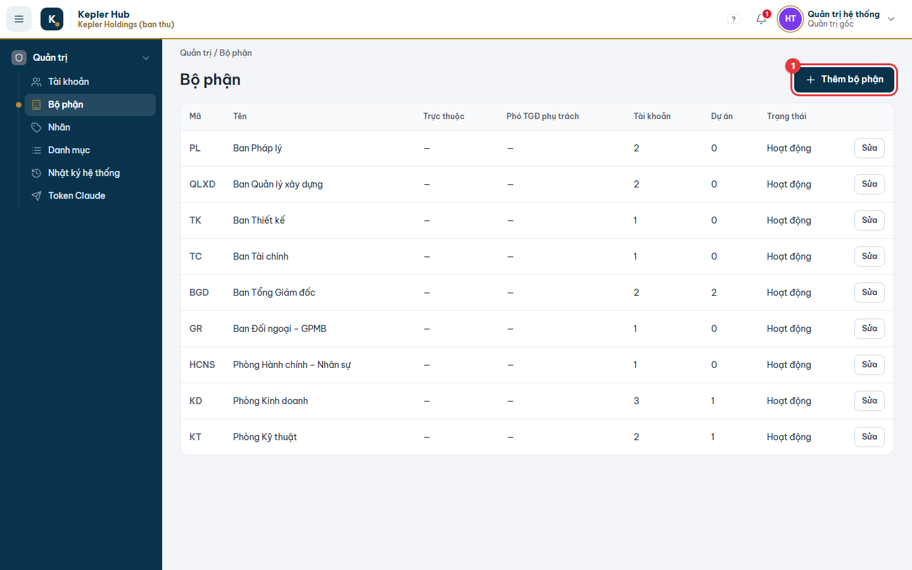

**Các bước thường làm**

A. Thêm bộ phận
1. **Thêm bộ phận** → điền **Mã** (vd. `TKKT`), **Tên** (vd. "Phòng Thiết kế kỹ thuật"), chọn **Trực thuộc** nếu có.
2. **Lưu** → "Đã lưu bộ phận".
3. Gán người vào bộ phận ở Quản trị → Tài khoản (mục 7.4); gán vai **Lãnh đạo bộ phận** cho trưởng, phó bộ phận.
4. Cần Phó TGĐ phụ trách: mở **Quyền & phụ trách** của thành viên Ban Tổng Giám đốc đó và tick bộ phận mới (mục 7.6).
5. Bộ phận phải nộp báo cáo tuần: Ban Tổng Giám đốc / thư ký đánh dấu ở Báo cáo tuần (mục 5.1).

B. Giải thể / sáp nhập bộ phận
1. Chuyển hết người sang bộ phận mới (Quản trị → Tài khoản → **Sửa** từng người → **Bộ phận**).
2. Mở bộ phận cũ → **Sửa** → bỏ dấu **Đang hoạt động** → **Lưu**.
3. Còn người đang hoạt động trong bộ phận: hộp "Phòng còn {n} tài khoản đang hoạt động" hiện; muốn khoá ngay thì đánh dấu **Tôi đã hiểu, vẫn khoá phòng**.

**Từng cột** (danh sách, chỉ xem)

| Cột (nguyên văn) | Nghĩa là gì | Giá trị |
|---|---|---|
| **Mã** | Mã bộ phận | — |
| **Tên** | Tên bộ phận | — |
| **Trực thuộc** | Bộ phận cấp trên | "—" nếu không có |
| **Phó TGĐ phụ trách** | Thành viên Ban Tổng Giám đốc có bộ phận này trong phạm vi phụ trách | "—" nếu chưa có. Người đó đã bị khoá: tên + nhãn "Đã khoá" (rê chuột: "Phó TGĐ phụ trách đã bị khoá tài khoản — phiếu trình của phòng chuyển về Ban Tổng Giám đốc; hãy chọn Phó TGĐ khác"). Chỉ xem; chọn ở **Quyền & phụ trách** của tài khoản Ban Tổng Giám đốc |
| **Tài khoản** | Số tài khoản thuộc bộ phận | Kèm "({n} đã khoá)" nếu có tài khoản đã khoá |
| **Dự án** | Số dự án của bộ phận | — |
| **Trạng thái** | "Hoạt động" hoặc nhãn "Đã khoá"; bộ phận đã khoá mà còn người đang hoạt động thêm nhãn "{n} người còn hoạt động" (rê chuột: "Phòng đã khoá nhưng còn tài khoản đang hoạt động") | Xếp: bộ phận đang hoạt động trước, rồi theo tên |

**Từng ô** (hộp **Thêm bộ phận** / **Sửa bộ phận**)

| Ô (nguyên văn) | Nghĩa là gì | Điền / chọn thế nào (mặc định) | Đổi thì hệ thống làm gì khác |
|---|---|---|---|
| **Mã** | Mã viết tắt | Bắt buộc, tối đa 30 ký tự, không trùng; máy chủ tự chuyển CHỮ HOA | Mã `BTGD` đánh dấu bộ phận Ban Tổng Giám đốc (dùng cho cảnh báo lệch vai, mục 7.5). Mã còn là khoá ghép thư mục NAS của dự án và kho văn thư (IT đặt khi cài), là ký hiệu trong số văn bản dãy D7, là mã Claude dùng khi tạo dự thảo văn thư. Lỗi: "Thiếu Mã bộ phận", "Mã bộ phận vượt 30 ký tự"; trùng: "Dữ liệu bị trùng: …" kèm tên trường kỹ thuật |
| **Tên** | Tên đầy đủ | Bắt buộc, tối đa 200 | Hiện ở mọi nơi. Lỗi: "Thiếu Tên bộ phận", "Tên bộ phận vượt 200 ký tự" |
| **Trực thuộc** (khi sửa bộ phận có cấp dưới, kèm ghi chú "(không chọn được các phòng đang trực thuộc phòng này)") | Bộ phận cấp trên | "— Không —" và mọi bộ phận (cả đã khoá, ghi "(đã khoá)"), trừ chính nó và các bộ phận cấp dưới của nó | **Chỉ** dùng để vẽ cây tổ chức ở Thông tin cá nhân. **Không** cho lãnh đạo bộ phận cấp trên thêm quyền gì ở bộ phận cấp dưới, không truyền Phó TGĐ phụ trách xuống. Lỗi: "Bộ phận cha không tồn tại"; "Không thể đặt trực thuộc vòng: bộ phận được chọn làm cấp trên đang trực thuộc (trực tiếp hoặc gián tiếp) bộ phận này" |
| Dòng "Phó Tổng Giám đốc phụ trách: **{họ tên}** (chọn ở tài khoản Ban Tổng Giám đốc → "Quyền & phụ trách")" | Chỉ xem | "—" nếu chưa có | Sửa ở mục 7.6 |
| **Đang hoạt động** (chỉ khi sửa) | Bỏ dấu = khoá bộ phận | Theo trạng thái hiện tại | Bộ phận khoá: không chọn được cho tài khoản mới hay dự án mới; không thêm được vào phạm vi phụ trách của Ban Tổng Giám đốc; tự rời danh sách phải nộp báo cáo tuần; không chọn được làm bộ phận thư ký hay bộ phận phụ trách đối tác. **Người trong bộ phận không bị khoá** |
| Hộp "Phòng còn {n} tài khoản đang hoạt động" + câu "Khoá phòng không khoá các tài khoản này; họ vẫn thuộc phòng (hiển thị "đã khoá") cho tới khi được chuyển sang phòng khác. Không chọn được phòng này cho tài khoản mới hay dự án mới." + ô **Tôi đã hiểu, vẫn khoá phòng** | Chỉ hiện khi bỏ **Đang hoạt động** mà bộ phận còn người đang hoạt động | Phải đánh dấu mới lưu được | Không đánh dấu: "Phòng còn {n} tài khoản đang hoạt động — đánh dấu "Tôi đã hiểu, vẫn khoá phòng" để tiếp tục." |

Không có ô "Lãnh đạo bộ phận": lãnh đạo của bộ phận là các tài khoản vai **Lãnh đạo bộ phận** gán bộ phận này (mục 7.1).

> ⚠️ **Chữ trên màn hình ghi** "phòng" ("Phòng còn {n} tài khoản…", "Tôi đã hiểu, vẫn khoá phòng", "phiếu trình của phòng…") **nhưng thực tế** đều là **bộ phận** (phòng, ban hay đơn vị nào cũng vậy).

**Các nút**

| Nút | Làm gì | Có hỏi lại không | Quay lại được không |
|---|---|---|---|
| **Thêm bộ phận** | Mở hộp "Thêm bộ phận" | — | Không xoá được bộ phận (không có nút xoá), chỉ khoá |
| **Sửa** | Mở hộp "Sửa bộ phận" | — | — |
| **Huỷ** | Đóng hộp. Bấm ra nền / `Esc` khi đã nhập: "Bỏ nội dung đã nhập?" | — | — |
| **Lưu** | Tạo / cập nhật bộ phận. Xong: "Đã lưu bộ phận" | Chỉ ô **Tôi đã hiểu, vẫn khoá phòng** khi khoá bộ phận còn người | Có: sửa lại; đánh dấu lại **Đang hoạt động** để mở khoá |

**Thông báo phát sinh**
- Đổi **Mã** làm bộ phận **trở thành** hoặc **thôi là** bộ phận Ban Tổng Giám đốc (`BTGD`): mọi thành viên Ban Tổng Giám đốc nhận "Quản trị hệ thống vừa đặt bộ phận {tên} là bộ phận Ban Tổng Giám đốc (mã {mã})" hoặc "Quản trị hệ thống vừa đổi mã bộ phận {tên cũ}: thôi là bộ phận Ban Tổng Giám đốc", nội dung "Mã {mã cũ} → {mã mới}"; nhật ký ghi nhạy cảm.
- Thêm, sửa, khoá, mở bộ phận khác: chỉ ghi nhật ký, không báo ai.

**⚠️ Dễ nhầm**
- Đổi **Mã** của bộ phận đang có thư mục trên NAS làm tệp mới của bộ phận không còn vào đúng thư mục (bảng ghép thư mục do IT đặt theo mã). Ví dụ: đổi `PC` thành `PHAPCHE` thì IT phải sửa bảng ghép thư mục trên máy chạy. Số văn bản dãy D7 cấp sau khi đổi mang ký hiệu mới.
- "Trực thuộc" không chia quyền: lãnh đạo Ban cấp trên không tự xem việc của phòng cấp dưới.
- Khoá bộ phận mà chưa chuyển người: mọi người vẫn thuộc bộ phận đã khoá, vẫn đăng nhập, vẫn làm việc. Nhớ chuyển họ đi.

**Claude:** Không có công cụ sửa bộ phận. Công cụ **Danh bạ** cho Claude biết mã bộ phận của từng người.

### 7.11 Quản trị → Nhãn

**Mở ở đâu:** Menu **Quản trị** → **Nhãn** (trang `#/admin/labels`).
**Ai thấy, ai sửa:** Chỉ Quản trị hệ thống. Người khác gọi tạo / sửa nhãn chung nhận "Chỉ quản trị được tạo nhãn chung", "Chỉ quản trị được sửa nhãn chung".
**Dùng để làm gì:** Quản lý **nhãn chung** toàn công ty, gắn được ở mọi dự án (vd. "Gấp", "Khách hàng", "Nội bộ"). Nhãn riêng của từng dự án do thành viên dự án tự tạo khi gắn nhãn, không quản lý ở đây và không hiện ở đây.

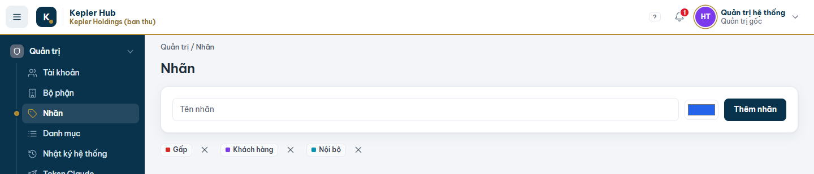

**Các bước thường làm**
1. Gõ tên vào ô **Tên nhãn** (tối đa 40 ký tự), chọn màu.
2. **Thêm nhãn** → nhãn hiện trong danh sách bên dưới.
3. Xoá: bấm dấu X cạnh nhãn → **Xoá**.

**Từng ô**

| Ô (nguyên văn) | Nghĩa là gì | Điền / chọn thế nào (mặc định) | Đổi thì hệ thống làm gì khác |
|---|---|---|---|
| Ô chữ mờ **Tên nhãn** | Tên nhãn chung | Bắt buộc. Ô cho gõ tới 60 ký tự nhưng máy chỉ nhận **40** | Nhãn xuất hiện trong ô **Nhãn** của mọi việc ở mọi dự án. Lỗi: "Thiếu Tên nhãn", "Tên nhãn vượt 40 ký tự"; trùng (không phân biệt hoa thường): "Đã có nhãn "{tên}"" |
| Ô chọn màu | Màu chip nhãn | Mặc định xanh dương | Màu nhãn trên việc |
| Danh sách nhãn | Các nhãn chung hiện có | Trống: "Chưa có nhãn." | — |

**Các nút**

| Nút | Làm gì | Có hỏi lại không | Quay lại được không |
|---|---|---|---|
| **Thêm nhãn** | Tạo nhãn chung | Không | Xoá được bằng nút X |
| Nút X cạnh nhãn | Xoá nhãn và gỡ nhãn khỏi **mọi** việc | "Xoá nhãn này khỏi mọi công việc?" — **Xoá** (đỏ) / **Huỷ** | ⚠️ **Không**: tạo lại nhãn cùng tên thì các việc cũ không tự gắn lại |

**⚠️ Dễ nhầm**
- Không có nút đổi tên, đổi màu nhãn. Muốn đổi tên: tạo nhãn mới, nhờ người dùng gắn lại, rồi mới xoá nhãn cũ.
- Xoá nhãn là gỡ khỏi mọi việc, kể cả việc ở dự án Quản trị hệ thống không nhìn thấy. Hỏi Ban Tổng Giám đốc / người quản lý dự án trước khi xoá.

**Claude:** Không.

### 7.12 Danh mục dùng chung (Quản trị → Danh mục)

**Mở ở đâu:** Menu **Quản trị** → **Danh mục** (trang `#/catalog`, tiêu đề "Danh mục dùng chung"); bảng lệnh "Danh mục". Mục menu chỉ hiện với Quản trị hệ thống. Ban Tổng Giám đốc, Lãnh đạo bộ phận, Nhân viên **không có mục menu nào** dẫn tới đây: gõ thẳng địa chỉ `#/catalog` vào thanh địa chỉ trình duyệt.

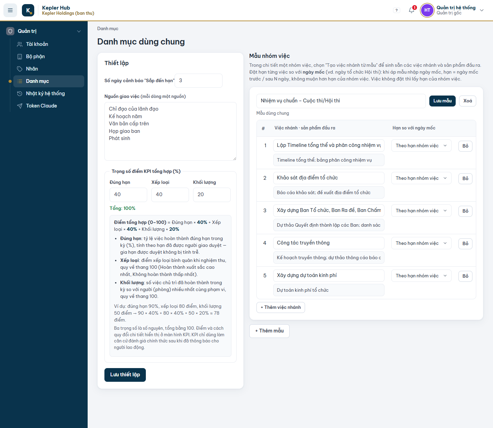

**Ai thấy, ai sửa:**
- Mọi người đã đăng nhập xem được.
- Khối **Thiết lập**: **Quản trị hệ thống** và **Ban Tổng Giám đốc** sửa. Người khác thấy câu "Chỉ Ban Tổng Giám đốc hoặc quản trị được sửa." (hoặc, nếu tạo được mẫu: "Thiết lập do Ban Tổng Giám đốc hoặc quản trị sửa. Bạn tạo được mẫu nhóm việc và sửa mẫu của mình.").
- **Mẫu nhóm việc**: tạo được: Quản trị hệ thống, Ban Tổng Giám đốc, Lãnh đạo bộ phận. Sửa / xoá một mẫu: Quản trị hệ thống, Ban Tổng Giám đốc, hoặc chính người tạo mẫu.
- **Nhân viên**: chỉ xem.

**Dùng để làm gì:** Ba thiết lập dùng chung cho mọi dự án (số ngày "Sắp đến hạn", danh sách nguồn giao việc, trọng số điểm KPI) và các **mẫu nhóm việc** (bộ việc nhánh tạo sẵn, vd. cho một cuộc thi).

**Các bước thường làm**

A. Đổi số ngày "Sắp đến hạn", nguồn giao việc, trọng số KPI (Ban Tổng Giám đốc hoặc Quản trị hệ thống)
1. Sửa ô trong khối **Thiết lập**. Ba ô trọng số phải cộng đúng 100: dòng "Tổng: {n}%" cập nhật khi gõ.
2. **Lưu thiết lập** → "Đã lưu thiết lập".

B. Tạo mẫu nhóm việc (Ban Tổng Giám đốc, Lãnh đạo bộ phận, Quản trị hệ thống)
1. **+ Thêm mẫu** → một thẻ trống hiện ra.
2. Gõ **Tên mẫu**; mỗi dòng gõ **Tên việc nhánh** và **Sản phẩm đầu ra**; chọn hạn so với ngày mốc.
3. **+ Thêm việc nhánh** để thêm dòng; **Bỏ** để bỏ dòng.
4. **Lưu mẫu** → "Đã lưu mẫu".
5. Dùng mẫu: trong chi tiết một nhóm việc, chọn "Tạo việc nhánh từ mẫu".

**Từng ô — khối "Thiết lập"**

| Ô (nguyên văn) | Nghĩa là gì | Điền / chọn thế nào (mặc định) | Đổi thì hệ thống làm gì khác |
|---|---|---|---|
| **Số ngày cảnh báo "Sắp đến hạn"** | Còn từ 0 tới N ngày tới hạn thì việc thường mang trạng thái "Sắp đến hạn" | Số 0–30. Mặc định 3 | Trạng thái "Sắp đến hạn" và đếm ngược màu cam ở danh sách việc thường, sổ giao việc, bảng tổng hợp, tệp Excel (dòng "Sắp đến hạn = còn 0–{n} ngày."), Việc toàn đơn vị, báo cáo tuần (nguy cơ chậm), báo cáo Word. Ví dụ: hôm nay 25/11, việc hạn 30/11 (còn 5 ngày): đặt 3 → "Đang thực hiện"; đặt 5 → "Sắp đến hạn". **Không** đổi cảnh báo tiến độ dự án MTL (mỗi dự án MTL có ô riêng) và **không** đổi nhắc 08:00 "đến hạn trong 24 giờ". Lỗi: "Số ngày cảnh báo phải từ 0 đến 30" |
| **Nguồn giao việc (mỗi dòng một nguồn)** | Danh sách lựa chọn cho ô "Nguồn giao việc" của việc | Mỗi dòng một nguồn; tối đa 30 dòng, mỗi dòng tối đa 120 ký tự; dòng trống, dòng trùng bị bỏ. Mặc định 5 dòng: "Chỉ đạo của lãnh đạo", "Kế hoạch năm", "Văn bản cấp trên", "Họp giao ban", "Phát sinh" | Ô chọn nguồn khi giao việc và bộ lọc theo nguồn ở dự án đổi theo. "Kế hoạch năm" **luôn** có trong ô chọn dù bạn xoá khỏi danh sách. Nguồn bắt đầu bằng "Kế hoạch năm" được tính là nhiệm vụ kế hoạch năm; nguồn khác tính là đột xuất (theo chỉ đạo). Bỏ một nguồn không xoá nguồn đã ghi trên việc cũ. Lỗi: "Danh sách nguồn giao việc không hợp lệ"; "Nguồn giao việc vượt 120 ký tự" |
| Khung **Trọng số điểm KPI tổng hợp (%)**: ba ô **Đúng hạn**, **Xếp loại**, **Khối lượng** | Trọng số ba thành phần của điểm KPI | Số nguyên 0–100, tổng đúng 100. Mặc định 40 / 40 / 20. Dòng "Tổng: {n}%" cập nhật khi gõ; sai thì "Tổng: {n}% — cần đúng 100% (số nguyên)" | Điểm tổng hợp ở màn KPI & phân tích và dải "Số liệu của tôi" tính lại theo trọng số mới. Ví dụ với 40 / 40 / 20: đúng hạn 90%, xếp loại 80, khối lượng 50 → 90 × 40% + 80 × 40% + 50 × 20% = 78 điểm; đổi thành 50 / 30 / 20 → 79 điểm. Thành phần chưa có dữ liệu bị bỏ và chia lại trọng số: chưa có xếp loại thì 90 và 50 tính theo tỷ lệ 40 : 20 → khoảng 76,7 điểm. Chỉ có khối lượng thì chưa có điểm. Lỗi: "Trọng số KPI phải là số nguyên, tổng bằng 100%" (trình duyệt), "Trọng số KPI phải là số nguyên 0–100, tổng bằng 100" (máy chủ) |
| Phần giải thích công thức | "**Điểm tổng hợp (0–100)** = Đúng hạn × {a}% + Xếp loại × {b}% + Khối lượng × {c}%"; ba định nghĩa; dòng "Ví dụ: …"; ghi chú "Ba trọng số là số nguyên, tổng bằng 100. Điểm và cách quy đổi chi tiết hiển thị ở màn hình KPI; KPI chỉ dùng làm căn cứ đánh giá chính thức sau khi đã thông báo cho người lao động." | Chỉ đọc | — |

> ⚠️ **Chữ trên màn hình ghi** "**Khối lượng**: số việc chủ trì đã hoàn thành trong kỳ so với người (phòng) nhiều nhất cùng phạm vi" **nhưng thực tế** máy so với **bình quân** cán bộ cùng bộ phận (cần từ 3 người có số liệu trở lên), tối đa 100 điểm; theo bộ phận thì so số việc bình quân mỗi người của bộ phận với bình quân các bộ phận. Ví dụ: bình quân bộ phận 10 việc, bạn xong 8 việc → khối lượng 80 điểm (không phải so với người nhiều nhất).

> ⚠️ **Chữ trên màn hình ghi** công thức cộng đủ ba thành phần **nhưng thực tế** thành phần chưa có dữ liệu bị bỏ và trọng số chia lại cho các thành phần còn lại (ví dụ ở bảng trên).

**Từng ô — khối "Mẫu nhóm việc"**

Câu hướng dẫn (nguyên văn): "Trong chi tiết một nhóm việc, chọn "Tạo việc nhánh từ mẫu" để sinh sẵn các việc nhánh và sản phẩm đầu ra. Đặt hạn từng việc so với **ngày mốc** (vd. ngày tổ chức Hội thi): khi áp mẫu nhập ngày mốc, hạn = ngày mốc trước / sau N ngày, không muộn hơn hạn của nhóm việc. Việc không đặt thì lấy hạn của nhóm việc."

| Ô (nguyên văn) | Nghĩa là gì | Điền / chọn thế nào (mặc định) | Đổi thì hệ thống làm gì khác |
|---|---|---|---|
| Dòng chủ mẫu: "Mẫu của {họ tên}" / "Mẫu dùng chung" / "Mẫu mới"; người không sửa được thấy thêm " · chỉ người tạo, Ban Tổng Giám đốc hoặc quản trị được sửa" hoặc " · chỉ Ban Tổng Giám đốc hoặc quản trị được sửa" | Ai tạo mẫu, ai sửa được | Mẫu có sẵn "Nhiệm vụ chuẩn – Cuộc thi/Hội thi" (5 việc nhánh) là "Mẫu dùng chung" | — |
| Ô chữ mờ **Tên mẫu** | Tên mẫu | Bắt buộc, tối đa 120, không trùng | Tên hiện khi chọn mẫu lúc "Tạo việc nhánh từ mẫu". Lỗi: "Thiếu Tên mẫu", "Tên mẫu vượt 120 ký tự", "Đã có mẫu cùng tên" |
| Cột **#** | Số thứ tự việc nhánh | Tự đánh lại | — |
| Cột **Việc nhánh · sản phẩm đầu ra**: ô chữ mờ **Tên việc nhánh** và **Sản phẩm đầu ra** | Tên và sản phẩm đầu ra của từng việc nhánh sẽ tạo | Mẫu cần 1–30 việc nhánh; tên tối đa 300, sản phẩm tối đa 500 ký tự; dòng để trống tên bị bỏ khi lưu | Thành tên / sản phẩm đầu ra của việc nhánh khi áp mẫu. Lỗi: "Mẫu cần 1–30 việc nhánh", "Thiếu Tên việc nhánh", "Tên việc nhánh vượt 300 ký tự", "Sản phẩm đầu ra vượt 500 ký tự" |
| Cột **Hạn so với ngày mốc**: ô chọn "Theo hạn nhóm việc" / "Trước ngày mốc" / "Đúng ngày mốc" / "Sau ngày mốc" + ô số "ngày" | Hạn tương đối của việc nhánh | Mặc định "Theo hạn nhóm việc". Chọn Trước / Sau thì ô số hiện, tự điền 7; nhận 0–3650 | Khi áp mẫu: hạn = ngày mốc trước / sau N ngày, không muộn hơn hạn việc cha. Ví dụ: ngày mốc (ngày thi) 15/12, dòng "Trước ngày mốc 7 ngày" → hạn 08/12. Lỗi: ""{tên}": số ngày so với ngày mốc phải là số nguyên từ 0 đến 3650" |

**Các nút**

| Nút | Làm gì | Có hỏi lại không | Quay lại được không |
|---|---|---|---|
| **Lưu thiết lập** | Lưu ba thiết lập. "Đã lưu thiết lập" | Không | Có: sửa rồi lưu lại |
| **+ Thêm mẫu** | Thêm một thẻ mẫu trống (chưa lưu) | — | Tải lại trang để bỏ thẻ chưa lưu |
| **Lưu mẫu** | Tạo / cập nhật mẫu. "Đã lưu mẫu" | Không | Có |
| **Xoá** (trên thẻ mẫu) | Xoá mẫu. "Đã xoá mẫu" | "Xoá mẫu này? Các việc đã tạo từ mẫu không bị ảnh hưởng." — **Xoá** (đỏ) / **Huỷ** | ⚠️ **Không** |
| **+ Thêm việc nhánh** | Thêm một dòng | — | Nút **Bỏ** |
| **Bỏ** (trên dòng) | Bỏ dòng (chưa lưu) | — | Chưa lưu thì tải lại trang |

Lỗi quyền có thể gặp: "Chỉ Ban Tổng Giám đốc hoặc quản trị được sửa danh mục"; "Chỉ Ban Tổng Giám đốc, lãnh đạo phòng (quản lý dự án) hoặc quản trị được tạo mẫu" (chữ "lãnh đạo phòng" ứng với **Lãnh đạo bộ phận**); "Chỉ người tạo mẫu, Ban Tổng Giám đốc hoặc quản trị được sửa / xoá mẫu này"; "Không tìm thấy mẫu".

**⚠️ Dễ nhầm**
- Có **ba** loại "sắp đến hạn" khác nhau: (1) ô ở Danh mục, cho việc thường; (2) ô nhắc sắp đến hạn trong cài đặt cảnh báo của từng dự án MTL; (3) nhắc tự động 08:00 cho việc đến hạn trong 24 giờ, không phụ thuộc thiết lập nào. Đặt Danh mục = 5 không làm dự án MTL cảnh báo sớm hơn.
- Ô giao việc báo "Chưa có mẫu nhóm việc — tạo ở Danh mục" nhưng Lãnh đạo bộ phận không có mục menu Danh mục: gõ `#/catalog`.
- Quản trị hệ thống sửa được trọng số KPI và nguồn giao việc (thiết lập có tính nghiệp vụ). Nên chỉ sửa theo quyết định của Ban Tổng Giám đốc.

**Claude:** Không có công cụ; Claude không sửa được Danh mục và mẫu.

### 7.13 Quản trị → Nhật ký hệ thống (kèm "Tình trạng vận hành")

**Mở ở đâu:** Menu **Quản trị** → **Nhật ký hệ thống** (trang `#/admin/audit`); bảng lệnh "Nhật ký hệ thống"; bấm thông báo "Kiểm tra vận hành Kepler Hub".
**Ai thấy, ai sửa:** Chỉ Quản trị hệ thống. **Ban Tổng Giám đốc không xem được** nhật ký hệ thống (chỉ nhận thông báo các thao tác nhạy cảm). Nhật ký chỉ đọc: không ai sửa, xoá; giữ vô thời hạn.
**Dùng để làm gì:** Tra ai đã làm gì, lúc nào, trên đối tượng nào, từ IP nào; xem tình trạng sao lưu và các job chạy tự động.

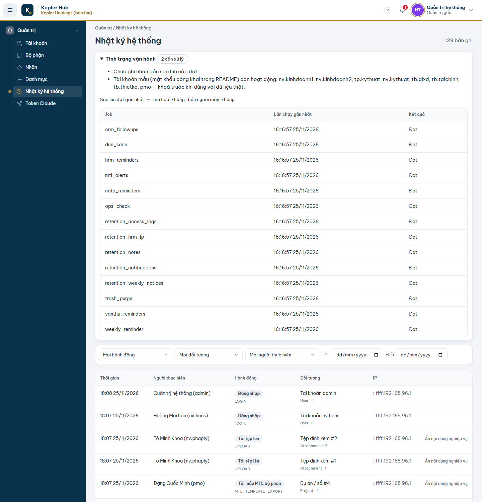

**Các bước thường làm**
1. Mở trang. Khối **Tình trạng vận hành** tự mở khi có vấn đề.
2. Lọc: chọn **Mọi hành động**, **Mọi đối tượng**, **Mọi người thực hiện**, khoảng **Từ** – **Đến**. Lọc chạy ngay khi chọn; địa chỉ trang ghi lại bộ lọc để gửi cho đồng nghiệp IT.
3. Bấm **Trước – sau** trên một dòng để xem giá trị đổi.
4. **Xoá lọc** để về đầy đủ.

**Từng ô — khối "Tình trạng vận hành"**

| Ô (nguyên văn) | Nghĩa là gì | Giá trị |
|---|---|---|
| "Tình trạng vận hành" + nhãn "{n} cần xử lý" hoặc "Bình thường" | Tóm tắt | Có vấn đề thì khối mở sẵn |
| Danh sách vấn đề | Các câu có thể gặp | "Chưa ghi nhận bản sao lưu nào đạt."; "Bản sao lưu đạt gần nhất cách đây {n} giờ." (quá 36 giờ); "Lần sao lưu gần nhất lỗi: {lỗi}."; "Bản sao lưu chưa mã hoá (đặt BACKUP_AGE_RECIPIENT)."; "Chưa có bản sao lưu ngoài máy (đặt BACKUP_COPY / BACKUP_COPY_PATH)."; "Chưa thử khôi phục trong 3 tháng qua (RESTORE_TEST=1, xem deploy/restore.sh)."; "Job lịch chạy lỗi: {tên job}."; "Tài khoản mẫu (mật khẩu công khai trong README) còn hoạt động: {tài khoản} — khoá trước khi dùng với dữ liệu thật."; "Nhật ký truy cập không có tệp mới trong 3 ngày — kiểm tra quyền ghi thư mục LOG_PATH."; "Job dừng giữa chừng (tiến trình tắt khi đang chạy): {tên job}." |
| Dòng "Sao lưu đạt gần nhất: {thời gian} · {n} KB · mã hoá: có/không · bản ngoài máy: có/không · lỗi gần nhất: {thời gian}" | Trạng thái sao lưu | — |
| Bảng **Job** / **Lần chạy gần nhất** / **Kết quả** ("Đạt" hoặc "Lỗi: {lỗi}"); trống: "Chưa có job nào chạy." | Sổ lần chạy các job tự động | Tên job là tên kỹ thuật, bảng dưới |

**Các job chạy tự động** (giờ Việt Nam; máy tắt đúng giờ thì chạy bù trong khung giờ; lỗi thử lại tối đa 3 lần / ngày, cách nhau 20 phút)

| Tên job (hiện trên màn) | Giờ chạy (khung chạy bù) | Làm gì |
|---|---|---|
| `mtl_alerts` | 07:30 | Cảnh báo tiến độ dự án MTL, chụp số liệu đường cong S |
| `weekly_summary` | 07:35 (tới 12:00), thứ Hai – thứ Sáu | Ngày giao ban: gửi tóm tắt tổng hợp |
| `due_soon` | 08:00 | Nhắc người chủ trì việc đến hạn trong 24 giờ |
| `note_reminders` | 08:05 (tới 18:00) | Nhắc việc cá nhân đến hạn hôm nay |
| `crm_followups` | 08:10 (tới 18:00), chỉ khi bật Đối tác | Nhắc việc theo dõi đối tác |
| `hrm_reminders` | 08:15 (tới 18:00), chỉ khi bật Nhân sự | Nhắc hợp đồng lao động hết hạn sau 30 / 7 ngày |
| `vanthu_reminders` | 08:20 (tới 18:00), chỉ khi bật Văn thư | Nhắc văn bản đến hạn / quá hạn xử lý |
| `ops_check` | 09:00 | Kiểm tra vận hành, báo Quản trị hệ thống |
| `mtl_update_reminder` | 15:00 (tới 20:00), thứ Năm | Nhắc cập nhật % việc trong kỳ |
| `weekly_reminder` | 15:00 (tới 17:30), thứ Hai – thứ Sáu | Ngày hạn nộp: nhắc bộ phận chưa nộp báo cáo tuần |
| `retention_notes` | 02:30 | Xoá ghi chú cá nhân của tài khoản đã khoá quá 30 ngày |
| `retention_weekly_notices` | 02:35 | Xoá báo muộn / vắng quá 12 tháng |
| `trash_purge` | 02:45 | Xoá hẳn những gì nằm trong thùng rác quá 7 ngày |
| `retention_notifications` | 02:50 | Xoá thông báo quá 12 tháng |
| `retention_access_logs` | 03:00 | Xoá nhật ký truy cập quá hạn giữ |
| `retention_hrm_ip` | 03:10, chỉ khi bật Nhân sự | Xoá IP chấm công quá 90 ngày |

**Từng ô — bộ lọc và bảng nhật ký**

| Ô (nguyên văn) | Nghĩa là gì | Điền / chọn thế nào (mặc định) | Ghi chú |
|---|---|---|---|
| Tiêu đề "Nhật ký hệ thống" + "{n} bản ghi" | Tổng số dòng khớp bộ lọc | — | — |
| **Mọi hành động** | Lọc theo hành động | Danh sách nhãn tiếng Việt, xếp theo vần | Hành động chưa có nhãn tiếng Việt không chọn được ở đây |
| **Mọi đối tượng** | Lọc theo loại đối tượng | — | — |
| **Mọi người thực hiện** | Lọc theo người | Mọi tài khoản, dạng "{họ tên} ({tài khoản})" | Gồm cả các lần đăng nhập hỏng **vào** tài khoản đó, kể cả do người khác gõ |
| **Từ**, **Đến** | Khoảng ngày, giờ Việt Nam; "Đến" lấy hết ngày | Ô ngày | Lỗi: "Từ ngày không hợp lệ", "Đến ngày không hợp lệ", "Khoảng thời gian không hợp lệ" |
| Cột **Thời gian** | Lúc ghi | Mới nhất trước; 50 dòng / trang | — |
| Cột **Người thực hiện** | "{họ tên} ({tài khoản})"; "Chưa đăng nhập" (đăng nhập hỏng không rõ ai); "Hệ thống" (job tự động) | — | — |
| Cột **Hành động** | Nhãn hành động + mã kỹ thuật bên dưới. Đăng nhập hỏng có lý do "tài khoản không tồn tại" / "tài khoản đã khoá" / "sai mật khẩu". Thao tác nhạy cảm có nhãn "Đã báo Giám đốc" (rê chuột: "Thao tác nhạy cảm — đã thông báo Ban Tổng Giám đốc") | — | — |
| Cột **Đối tượng** | Nhãn đối tượng + tên (tài khoản, bộ phận) hoặc "#{mã}" | — | — |
| Cột **IP** | IP máy thao tác | — | — |
| Cột cuối: nút **Trước – sau** hoặc chữ "Ẩn nội dung nghiệp vụ" (rê chuột: "Nội dung nghiệp vụ không hiển thị cho quản trị hệ thống") | Đối tượng kỹ thuật (Tài khoản, Đăng nhập, Bộ phận, Phân quyền, Nhãn, Danh mục, Mẫu nhóm việc, Uỷ quyền, Token Claude) xem được trước – sau; đối tượng nghiệp vụ bị ẩn | — | — |
| Hộp **Trước – sau**: tiêu đề "{hành động} · {đối tượng} {tên}", dòng "{thời gian} — {người} — IP {ip}", bảng **Trường** / **Trước** / **Sau** | Giá trị đổi, nhãn trường tiếng Việt (Tài khoản, Họ tên, Chức danh, Email, Điện thoại, Vai, Bộ phận, Đang hoạt động, Phải đổi mật khẩu, Mã, Tên, Trực thuộc, Phó TGĐ phụ trách, Màu, các số đếm bàn giao, Số ngày "sắp đến hạn", Nguồn giao việc…) | Không đổi gì: "Không có trường nào thay đổi." Nhật ký phân quyền cũ (trước khi quyền đi theo vai): dòng "Vai: {cũ} → {mới}" và bảng **Thay đổi** ("Thêm" / "Bỏ" / "Đổi phạm vi") · **Quyền** · **Phạm vi**, hoặc "Không có khác biệt." | Ẩn trường kỹ thuật (mã số, ngày tạo / sửa, mật khẩu đã băm) |
| Bảng trống | "Không có bản ghi phù hợp." | — | — |

> ⚠️ **Chữ trên màn hình ghi** "Đã báo Giám đốc" **nhưng thực tế** là đã thông báo mọi thành viên **Ban Tổng Giám đốc** đang hoạt động.

**Mã hành động chưa có nhãn tiếng Việt** (màn hiện nguyên mã):

| Mã hiện trên màn | Nghĩa |
|---|---|
| `AVATAR_UPDATE`, `AVATAR_DELETE` | Người dùng đổi / xoá ảnh đại diện |
| `TOKEN_CONNECT_DENY` | Người dùng bấm **Từ chối** yêu cầu kết nối Claude |
| `VIBER_CONSENT`, `VIBER_UNLINK` | Đồng ý nhận Viber / huỷ liên kết Viber |
| `HR_REVEAL_FAILED`, `HR_SALARY_VIEW`, `HR_ATT_OUT_NO_IN` | Nhập sai mật khẩu khi xem số định danh; xem lương; chấm ra khi thiếu giờ vào |
| `APPROVAL_WITHDRAW` | Rút lại yêu cầu duyệt đã gửi |
| `APPROVE`, `RETURN`, `RESUBMIT`, `CANCEL` (đối tượng `DocRecord`) | Phê duyệt / trả lại / gửi lại / huỷ văn bản, dự thảo |
| `VIEW_KPI_ANALYTICS`, `EXPORT_KPI_ANALYTICS` | Xem / xuất KPI & phân tích |
| `MTL_IMPORT`, `MTL_T0_CHANGE`, `MTL_REBASELINE`, `MTL_ALERTS_RUN` | Nhập MTL từ Excel; đổi ngày T0; điều chỉnh kế hoạch gốc; chạy cảnh báo MTL |
| `PROPOSAL_FORWARD` | Lãnh đạo bộ phận trình kiến nghị lên Ban Tổng Giám đốc |

Đối tượng chưa có nhãn: `DocRecord` (văn bản), `DocFile` (tệp văn bản), `ProjectNasFile` (tệp NAS của dự án), `ProgressReport` (báo cáo tiến độ), `Showcase` (dữ liệu trình diễn).

**Các nút**

| Nút | Làm gì | Có hỏi lại không | Quay lại được không |
|---|---|---|---|
| Đổi bất kỳ ô lọc | Lọc ngay, ghi bộ lọc lên địa chỉ trang | — | — |
| **Xoá lọc** (chỉ khi đang lọc) | Bỏ mọi bộ lọc | — | — |
| **Trước**, **Sau** (hai bên "Trang {p}/{n}") | Sang trang | — | — |
| **Trước – sau** | Mở hộp chi tiết | — | — |
| **Đóng** (hộp chi tiết) | Đóng | — | — |

**⚠️ Dễ nhầm**
- Quản trị hệ thống không xem được nội dung thao tác nghiệp vụ. Ví dụ: dòng "Nộp báo cáo tuần" chỉ cho biết ai nộp, lúc nào; nội dung báo cáo bị ẩn.
- Đối tượng "Danh mục" gom ba thứ khác nhau: thiết lập Danh mục ("Cập nhật danh mục"), thiết lập văn thư ("Cập nhật"), bảng điểm tuân thủ giao ban ("Trình bảng điểm tuân thủ giao ban" / "Duyệt bảng điểm tuân thủ giao ban"). Vì "Danh mục" là đối tượng kỹ thuật, Quản trị hệ thống xem được trước – sau của thiết lập văn thư (danh sách mã người).
- Thao tác người dùng làm qua Claude được đánh dấu riêng khi lưu nhật ký, nhưng màn này **chưa hiện** dấu đó: không phân biệt được trên màn thao tác nào do Claude làm.
- Xem nhật ký không tự ghi nhật ký.

**Claude:** Không.

### 7.14 Quản trị → Token Claude

**Mở ở đâu:** Menu **Quản trị** → **Token Claude** (trang `#/admin/tokens`). Không có trong bảng lệnh.
**Ai thấy, ai sửa:** Chỉ Quản trị hệ thống: xem danh sách token của **mọi người**, thu hồi. Quản trị hệ thống **không tạo** được token cho người khác; mỗi người tự tạo ở trang Kết nối Claude (mục 8.4).
**Dùng để làm gì:** Thu hồi kết nối Claude khi người dùng mất máy, nghi lộ token, dùng bất thường. Màn chỉ có siêu dữ liệu: không thấy mã token, không thấy dữ liệu nghiệp vụ. Câu đầu trang: "Mỗi người tự tạo trong "Kết nối Claude"; Claude dùng đúng quyền của người đó. Thu hồi khi mất máy, nghỉ việc hoặc dùng bất thường."

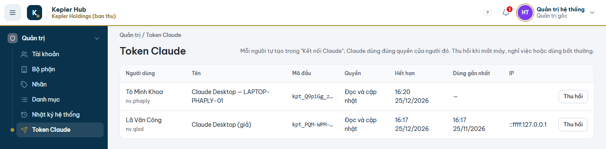

**Các bước thường làm**
1. Người dùng báo mất laptop. Mở trang, tìm dòng có tên người đó và tên máy (vd. "Claude Desktop — LAPTOP-01").
2. **Thu hồi** → hộp hỏi → **Thu hồi**. Thấy "Đã thu hồi".
3. Người dùng nhận thông báo; trên máy mới, họ hỏi Claude và bấm **Cho phép** để kết nối lại.

**Từng cột** (chỉ xem; tối đa 500 token gần nhất)

| Cột (nguyên văn) | Nghĩa là gì | Ghi chú |
|---|---|---|
| **Người dùng** | Họ tên + tài khoản chủ token | — |
| **Tên** | Tên token | Kết nối nhanh tự đặt "Claude Desktop — {tên máy}" |
| **Mã đầu** | 12 ký tự đầu của token | Để đối chiếu với máy người dùng |
| **Quyền** | "Đọc và cập nhật" hoặc "Chỉ đọc" | Cùng nghĩa với "Xem và cập nhật" / "Chỉ xem" ở trang Kết nối Claude |
| **Hết hạn** | Ngày hết hạn, hoặc "Đã thu hồi" | Token hết hạn / đã thu hồi hiện mờ |
| **Dùng gần nhất** | Lần dùng gần nhất | Cập nhật tối đa mỗi phút một lần; "—" nếu chưa dùng |
| **IP** | IP lần dùng gần nhất | — |
| Bảng trống | "Chưa có token." | — |

**Các nút**

| Nút | Làm gì | Có hỏi lại không | Quay lại được không |
|---|---|---|---|
| **Thu hồi** (chỉ dòng còn hiệu lực) | Thu hồi ngay; Claude trên máy đó không gọi được Kepler Hub nữa. Chủ token nhận "Quản trị đã thu hồi token Claude "{tên}"", nội dung "Tạo token mới trong "Kết nối Claude" nếu vẫn cần dùng." | "Thu hồi token này? Người dùng được thông báo." — **Thu hồi** (đỏ) / **Huỷ** | ⚠️ **Không**; người dùng kết nối lại sẽ có token mới |

**⚠️ Dễ nhầm**
- Người nghỉ việc: chỉ cần khoá tài khoản (mục 7.7) là mọi token mất hiệu lực. Thu hồi ở đây dành cho người vẫn làm việc nhưng mất máy.
- Token cũ vẫn hiện trong danh sách (mờ) sau khi hết hạn hoặc bị thu hồi; không xoá được.
- Tiện ích Claude dùng kết nối nhanh tự xin kết nối lại khi token bị thu hồi; người dùng chỉ cần bấm **Cho phép** lần nữa.

**Claude:** Không. Claude không xem, không thu hồi được token.

### 7.15 Những gì chỉ IT đặt khi cài (không có màn hình)

**Mở ở đâu:** Không có màn hình. IT sửa tệp cấu hình `.env` (và thư mục logo) trên máy chạy Kepler Hub, rồi khởi động lại ứng dụng.
**Ai thấy, ai sửa:** Chỉ IT có quyền vào máy chủ. Không vai nào trong ứng dụng sửa được, kể cả Quản trị hệ thống và Ban Tổng Giám đốc. Đổi ở đây **không** ghi nhật ký hệ thống.
**Dùng để làm gì:** Trả lời các yêu cầu "đổi logo", "đổi tên công ty", "bật Nhân sự / Đối tác", "bật Viber", "đổi giờ nhắc": không ai trong ứng dụng làm được, phải chuyển IT.

| Thiết lập | Khoá cấu hình | Mặc định | Người dùng thấy gì khi đổi |
|---|---|---|---|
| Tên công ty | `ORG_NAME` | Trống: chỉ hiện "Kepler Hub" | Tên hiện cạnh "Kepler Hub" ở thanh đầu trang và trong mô tả ứng dụng khi cài lên máy ("Theo dõi tiến độ dự án · {tên}"); tối đa 60 ký tự. Đổi phải khởi động lại |
| Logo | Thư mục logo (4 tệp `logo.png`, `logo-light.png`, `mark.png`, `mark-light.png`) | Không có tệp: chữ "K" và biểu tượng chung | `logo.png` thay chữ "K" ở trang đăng nhập; `mark.png` thay chữ "K" ở thanh đầu trang, và nếu là ảnh vuông từ 144 px trở lên thì thành biểu tượng khi cài ứng dụng. Hai tệp `-light` hiện chưa dùng. Đọc mỗi lần tải trang, không cần khởi động lại |
| Bật phân hệ | `MODULES` (`crm`, `hrm`, `vanthu`) | Tắt cả ba | Mục 6.1 |
| Khoá mã hoá nhân sự | `HR_ENC_KEY` | Bắt buộc khi bật Nhân sự | Mất khoá = mất số định danh, lương đã mã hoá |
| Thông báo qua Viber | `VIBER_ENABLED`, `VIBER_AUTH_TOKEN`, `VIBER_BOT_NAME` | Tắt | Người đã liên kết nhận bản rút gọn cảnh báo tiến độ MTL qua Viber. Hiện không có màn liên kết (mục 8.12) |
| Địa chỉ được phép mở Kepler Hub | `APP_ORIGIN` | — | Mở bằng địa chỉ không có trong danh sách: "Địa chỉ {địa chỉ} chưa được phép — mở Kepler Hub bằng {địa chỉ đầu tiên} hoặc nhờ quản trị thêm vào APP_ORIGIN". Địa chỉ đầu tiên được điền sẵn vào tiện ích Claude |
| Quản trị gốc lần chạy đầu | `ROOT_ADMIN_USERNAME`, `ROOT_ADMIN_PASSWORD` | Tên đăng nhập mặc định `admin` | Chỉ có tác dụng lần chạy đầu (mục 7.9). Mật khẩu ngắn hơn 6 ký tự: máy chủ không khởi động ("ROOT_ADMIN_PASSWORD phải có ít nhất 6 ký tự") |
| Dữ liệu mẫu | `SEED_DEMO`, `ALLOW_DEMO_SEED` | Không | Tạo tài khoản mẫu; còn hoạt động thì "Tình trạng vận hành" báo khoá |
| Lịch chạy tự động | `ENABLE_CRON` | Bật | `false`: tắt mọi nhắc, cảnh báo, xoá theo hạn (mục 7.13) |
| Giới hạn số yêu cầu / phút | `API_RATE_LIMIT`, `TOKEN_RATE_LIMIT` | 600 theo tài khoản; 120 theo token Claude | Vượt: "Quá nhiều yêu cầu, vui lòng thử lại sau". Không áp cho đăng nhập |
| Tin IP do máy trung gian gửi | `TRUST_PROXY` | Không tin | Quyết định IP trong Nhật ký hệ thống và IP chấm công (giới hạn mạng văn phòng, mục 6.2) |
| Khoá ký phiên đăng nhập | `JWT_SECRET` | Bắt buộc, từ 32 ký tự | Đổi khoá: mọi người bị đăng xuất (token Claude không bị ảnh hưởng) |
| Kho tệp dự án trên NAS | `NAS_ROOT`, `NAS_PATH`, `NAS_DEPT_FOLDERS` | Trống = tắt | Thư mục NAS ghép theo **mã bộ phận** (mục 7.10) |
| Kho tệp văn thư | `VANTHU_NAS_ROOT`, `VANTHU_NAS_PATH`, `VANTHU_DEPT_FOLDERS`, `VANTHU_DEFAULT_DEPT` | Trống = tệp lưu trong Hub | Thư mục văn bản ghép theo mã bộ phận |
| Nơi lưu tệp đính kèm, ảnh đại diện | `STORAGE_DRIVER` và các khoá `MINIO_*` | Lưu trên máy chạy | — |
| Xem trước tệp Word | `PREVIEW_URL`, `PREVIEW_TOKEN` | Không dùng | — |
| Sao lưu tự động | `BACKUP_PATH`, `BACKUP_KEEP_DAYS`, `BACKUP_HOUR`, `BACKUP_AGE_RECIPIENT`, `BACKUP_COPY`, `BACKUP_COPY_PATH` | — | Tình trạng hiện ở "Tình trạng vận hành" (mục 7.13) |
| Nhật ký truy cập | `LOG_PATH` | — | Không có tệp mới 3 ngày: "Tình trạng vận hành" báo |
| HTTPS nội bộ | `HUB_HOST`, `HUB_DEFAULT_SNI`, `CADDY_DATA_PATH`, `HUB_CA_URL` | — | Chứng chỉ gốc được đóng vào tiện ích Claude khi người dùng tải |
| Ngày ân hạn "Chậm khởi động" của MTL | `MTL_LATE_START_GRACE_DAYS` | 2 ngày làm việc (nhận 0–30) | Mặc định cảnh báo "Chậm khởi động" của mọi dự án MTL |
| Kỹ thuật khác | Cổng, mật khẩu cơ sở dữ liệu, thư mục dữ liệu | — | Không hiện trên giao diện |

**Công cụ nhập cơ cấu tổ chức** (IT chạy trên máy chủ, có chế độ chạy thử): nhập bộ phận, tài khoản mới và một số thiết lập từ tệp JSON. Bộ phận trùng mã: cập nhật tên, cấp trên. Tài khoản đã có: **giữ nguyên**, không đổi gì. Tài khoản mới: mật khẩu mặc định, phải đổi ở lần đăng nhập đầu. Đây là đường **duy nhất** nhập **Điện thoại** của tài khoản (chỉ cho tài khoản mới) và gán Phó TGĐ phụ trách theo bộ phận; còn đặt được văn thư (pháp nhân, văn thư, pháp chế), nhân sự (người phụ trách, giờ làm, ngày làm, ngày lễ, phép năm), bộ phận thư ký giao ban. Tạo tài khoản bằng công cụ này **không** báo Ban Tổng Giám đốc như khi tạo trên màn Quản trị.

**Cố định trong phần mềm** (không có khoá cấu hình, không có màn; chỉ đổi bằng sửa phần mềm): mật khẩu mặc định; mật khẩu tối thiểu 6 ký tự; phiên đăng nhập 12 giờ; thùng rác 7 ngày; ghi chú của người nghỉ giữ 30 ngày; thông báo giữ 12 tháng; báo muộn / vắng giữ 12 tháng; IP chấm công giữ 90 ngày; mỗi người tối đa 5 token Claude; token thủ công tối đa 90 ngày; kết nối nhanh 30 ngày; mã kết nối 10 phút; các mốc giờ giao ban (mục 5.2); mức trừ điểm tuân thủ (mục 5.4); giờ các job (mục 7.13).

**⚠️ Dễ nhầm**
- Ban Tổng Giám đốc muốn dùng Nhân sự: IT thêm `hrm` vào `MODULES`, đặt `HR_ENC_KEY`, khởi động lại. Quản trị hệ thống trên giao diện không làm được.
- Tên khoá thư mục logo trong tệp cấu hình mẫu và tên ứng dụng thực đọc khác nhau; chạy không qua bộ cài sẵn thì IT phải kiểm lại logo có hiện không.

**Claude:** Không.

## 8. Thiết lập cá nhân (mọi người)

Chương này dành cho mọi người dùng. Mỗi người tự chỉnh phần của mình: mật khẩu, ảnh đại diện, kết nối Claude, ghi chú, phím tắt, cách hiện menu. Họ tên, chức danh, bộ phận, vai, email **chỉ xem**: muốn sửa thì nhờ Quản trị hệ thống. Không có màn chọn loại thông báo muốn nhận.

### 8.1 Đăng nhập lần đầu và trang "Đổi mật khẩu" bắt buộc

**Mở ở đâu:** Mở địa chỉ Kepler Hub (https://hub.keplerholdings.vn) khi chưa đăng nhập. Trang **Đổi mật khẩu** tự hiện ngay sau khi đăng nhập nếu tài khoản mới tạo hoặc vừa được reset mật khẩu.
**Ai thấy, ai sửa:** Mọi người.
**Dùng để làm gì:** Đăng nhập; buộc đổi mật khẩu ban đầu / mật khẩu mặc định trước khi dùng.

**Các bước thường làm**
1. Gõ **Tài khoản** và **Mật khẩu** IT báo → **Đăng nhập**.
2. Trang **Đổi mật khẩu** hiện câu "Tài khoản của bạn cần đổi mật khẩu trước khi tiếp tục.": gõ **Mật khẩu hiện tại** (mật khẩu IT báo), **Mật khẩu mới**, **Nhập lại mật khẩu mới** → **Lưu mật khẩu**.
3. Thấy "Đã đổi mật khẩu", vào Trang chủ (Quản trị hệ thống vào Quản trị → Tài khoản).

**Từng ô**

| Ô (nguyên văn) | Nghĩa là gì | Điền / chọn thế nào (mặc định) | Đổi thì hệ thống làm gì khác |
|---|---|---|---|
| **Tài khoản** | Tên đăng nhập | Bắt buộc; gõ hoa hay thường đều được | — |
| **Mật khẩu** + nút **Hiện** / **Ẩn** | Mật khẩu | Bấm **Hiện** để xem chữ đang gõ | Sai tài khoản, sai mật khẩu **hoặc tài khoản đã khoá**: cùng một câu "Tài khoản hoặc mật khẩu không đúng" |
| Dòng "Caps Lock đang bật" | Cảnh báo phím viết hoa | Tự hiện khi Caps Lock bật (cả ở trang đổi mật khẩu) | — |
| Dòng "Quên mật khẩu? Liên hệ quản trị hệ thống để được đặt lại." | Không có "quên mật khẩu" tự phục vụ | — | Quản trị hệ thống reset (mục 7.8) |
| Logo trên thẻ đăng nhập | Chữ "K", hoặc logo công ty nếu IT đặt (mục 7.15) | — | — |
| **Mật khẩu hiện tại** (trang Đổi mật khẩu) | Mật khẩu IT báo (mật khẩu ban đầu hoặc mật khẩu mặc định) | — | Lỗi: "Mật khẩu hiện tại không đúng" |
| **Mật khẩu mới** | Mật khẩu bạn tự đặt | Tối thiểu 6 ký tự, không chỉ gồm khoảng trắng, khác mật khẩu hiện tại. Không dùng lại mật khẩu ở nơi khác | Lỗi: "Mật khẩu mới phải có ít nhất 6 ký tự và không chỉ gồm khoảng trắng"; "Mật khẩu mới phải khác mật khẩu hiện tại" |
| **Nhập lại mật khẩu mới** | Gõ lại để chắc không gõ nhầm | — | Lỗi: "Mật khẩu nhập lại không khớp" |

**Các nút**

| Nút | Làm gì | Có hỏi lại không | Quay lại được không |
|---|---|---|---|
| **Đăng nhập** | Đăng nhập. Không mở kèm đường dẫn: người dùng nghiệp vụ vào Trang chủ (`#/today`), Quản trị hệ thống vào `#/admin/users` | — | — |
| **Cài Kepler Hub lên máy** (liên kết dưới khung đăng nhập) | Mở trang hướng dẫn cài Kepler Hub thành ứng dụng trên máy | — | — |
| **Lưu mật khẩu** | Đổi mật khẩu rồi vào ứng dụng. "Đã đổi mật khẩu" | — | Đổi lại được ở Thông tin cá nhân |
| **Đăng xuất** (trang Đổi mật khẩu) | Thoát, không đổi mật khẩu | — | — |

**⚠️ Dễ nhầm**
- Chưa đổi mật khẩu thì mọi thao tác khác bị chặn ("Tài khoản phải đổi mật khẩu trước khi tiếp tục"), Claude cũng không dùng được ("Tài khoản phải đổi mật khẩu trên giao diện trước").
- Bị khoá tài khoản thì câu báo giống sai mật khẩu. Gõ đúng mà vẫn báo sai: hỏi Quản trị hệ thống xem tài khoản có bị khoá không, đừng thử mãi.
- Phiên đăng nhập kéo dài 12 giờ. Hết phiên, bị khoá, hoặc mật khẩu bị đổi / reset ở nơi khác: thông báo "Phiên đăng nhập đã hết, vui lòng đăng nhập lại"; nội dung đang gõ dở (bình luận, báo cáo) được giữ để đăng nhập lại vẫn còn.
- Giờ máy chủ lệch với máy bạn từ 3 phút trở lên: thông báo đỏ "Giờ máy chủ lệch {n} phút so với máy bạn. Nếu giờ máy bạn đúng, báo quản trị IT — giờ nộp báo cáo tuần tính theo giờ máy chủ."

**Claude:** Không.

### 8.2 Thanh đầu trang và menu tài khoản

**Mở ở đâu:** Thanh trên cùng của ứng dụng, có trên mọi trang. Bấm tên / ảnh của bạn ở góc phải để mở menu tài khoản.
**Ai thấy, ai sửa:** Mọi người. Quản trị hệ thống không có **Kết nối Claude** và không có ô tìm nhanh.
**Dùng để làm gì:** Lối vào các màn cá nhân và các tuỳ chọn khung giao diện.

**Từng ô và nút**

| Ô / nút (nguyên văn) | Làm gì | Ghi chú |
|---|---|---|
| "Kepler Hub" + tên công ty | Tên công ty do IT đặt; có logo nhỏ nếu IT đặt | Chỉ hiển thị; tab trình duyệt ghi "{tên trang} · Kepler Hub" |
| Nút ba gạch: **Thu gọn menu** / **Mở rộng menu** (máy tính), **Mở menu** (điện thoại) | Thu menu trái thành dải biểu tượng / mở lại | **Nhớ theo người** trên trình duyệt này (mục 8.11) |
| **Ứng dụng** (chỉ hiện khi menu trái đã thu gọn hoặc trên điện thoại) | Bảng ô màu chép lại menu trái, có dòng "Trang chủ — việc cần xử lý hôm nay" | — |
| Ô **Tìm dự án, trang, mã việc…** (phím `Ctrl K`) | Mở bảng lệnh (mục 8.9) | Ẩn với Quản trị hệ thống |
| **?** (gợi ý "Phím tắt (?)") | Mở hộp **Phím tắt** (mục 8.8) | — |
| Chuông | Thông báo (mục 8.5) | — |
| Tên nhóm menu trái (Công việc, Dự án, Giao ban, Nghiệp vụ, Thống kê, Quản trị) | Gập / mở nhóm | **Nhớ theo người** |
| Nút người dùng: họ tên + bộ phận | Mở menu tài khoản. Đầu menu: họ tên, dòng "{bộ phận} — {chức danh}" | Quản trị gốc ghi "Quản trị gốc" |
| **Thông tin cá nhân** | Mở `#/me` (mục 8.3) | — |
| **Kết nối Claude** | Mở `#/claude` (mục 8.4) | Không có với Quản trị hệ thống |
| **Cài Kepler Hub lên máy** | Hộp cài ứng dụng của trình duyệt; cài xong: "Đã cài Kepler Hub — mở từ biểu tượng trên máy" | Chỉ hiện khi Edge / Chrome cho cài và máy chưa cài. Gỡ bằng trình duyệt |
| **Đăng xuất** | Xoá phiên trên máy này, **xoá bản nháp đang gõ dở**, tải lại trang | ⚠️ Không hỏi lại; bản nháp mất hẳn |
| Thanh "Có bản mới · **Tải lại**" (rê chuột: "Kepler Hub vừa được nâng cấp. Tải lại trang để dùng bản mới.") | Tải lại để dùng bản mới | Đang nhập dở: hỏi "Bạn đang nhập dở. Tải lại sẽ mất nội dung chưa lưu." với **Vẫn tải lại** / **Để sau**. Tab ẩn quá 1 phút mà không nhập dở thì tự tải lại |

**⚠️ Dễ nhầm**
- **Đăng xuất** tự tay thì mất bản nháp đang gõ dở; hết phiên (bị đăng xuất) thì bản nháp được giữ.
- Máy dùng chung: luôn **Đăng xuất** khi rời máy.

**Claude:** Không.

### 8.3 Thông tin cá nhân

**Mở ở đâu:** Menu tài khoản → **Thông tin cá nhân** (trang `#/me`); bảng lệnh "Thông tin cá nhân" (gợi ý "Ảnh đại diện, mật khẩu, cây tổ chức").
**Ai thấy, ai sửa:** Mỗi người chỉ thấy của mình; mọi vai kể cả Quản trị hệ thống. Quản trị hệ thống không có cây tổ chức, không có kiêm nhiệm.
**Dùng để làm gì:** Xem thông tin tài khoản của mình; đổi / xoá ảnh đại diện; đổi mật khẩu; xem mình ở đâu trong cây tổ chức (ai ở trên, ai cùng cấp, ai ở dưới).

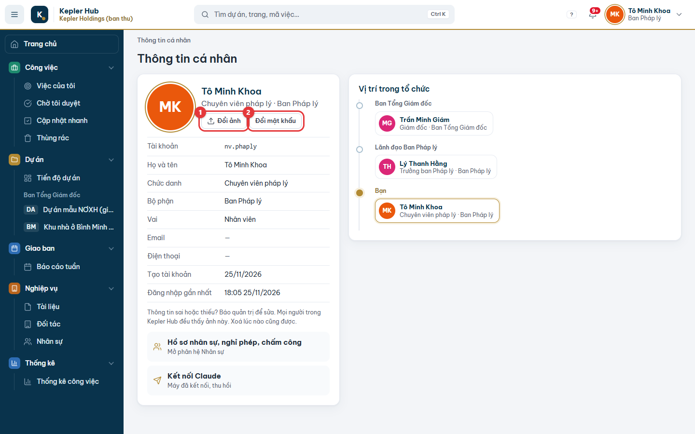

**Các bước thường làm**
- Đổi ảnh: **Đổi ảnh** → chọn tệp PNG, JPEG hoặc WebP → "Đã đổi ảnh đại diện".
- Đổi mật khẩu: **Đổi mật khẩu** → điền 3 ô → **Lưu mật khẩu** → "Đã đổi mật khẩu". Nếu dùng Claude: hỏi Claude một câu, bấm **Cho phép** để kết nối lại.
- Thấy thông tin sai (họ tên, chức danh, bộ phận, vai, email): báo Quản trị hệ thống.
- Cây tổ chức thiếu cấp trên: báo Quản trị hệ thống gán bộ phận, vai, Phó TGĐ phụ trách.

**Từng ô** (đều chỉ xem, trừ ảnh và mật khẩu)

| Ô (nguyên văn) | Nghĩa là gì | Ai sửa | Ghi chú |
|---|---|---|---|
| Đầu thẻ: ảnh, họ tên, dòng "{chức danh hoặc vai} · {bộ phận}" | — | — | — |
| **Tài khoản** | Tên đăng nhập | Quản trị hệ thống | — |
| **Họ và tên** | — | Quản trị hệ thống | — |
| **Chức danh** | Chỉ để hiển thị, không cấp quyền | Quản trị hệ thống | — |
| **Bộ phận** | Bộ phận của bạn | Quản trị hệ thống | Quyết định bạn lập báo cáo tuần cho bộ phận nào, thấy dự án bộ phận nào |
| **Vai** | Ban Tổng Giám đốc / Lãnh đạo bộ phận / Nhân viên / Quản trị hệ thống | Quản trị hệ thống | Quyết định quyền chung (mục 7.1) |
| **Kiêm nhiệm** (chỉ hiện khi có) | Thư ký giao ban, PMO, Phụ trách nhân sự, Văn thư, Pháp chế | Ban Tổng Giám đốc, ở ba nơi (mục 7.1) | Người phê duyệt tài liệu nội bộ không hiện ở đây |
| **Email** | Email công việc | Quản trị hệ thống | — |
| **Điện thoại** | — | **Không màn nào nhập được** | Mục 8.12 |
| **Tạo tài khoản**, **Đăng nhập gần nhất** | Ngày tạo, lần đăng nhập gần nhất | — | — |
| Câu "Thông tin sai hoặc thiếu? Báo quản trị để sửa. Mọi người trong Kepler Hub đều thấy ảnh này. Xoá lúc nào cũng được." | — | — | — |
| Khối **Vị trí trong tổ chức** | Các tầng phía trên (vd. "Lãnh đạo {bộ phận}", "Lãnh đạo {bộ phận cấp trên}", "Phó Tổng Giám đốc phụ trách", "Ban Tổng Giám đốc"); dòng "Bạn · {n} người cùng cấp" và mục mở **Cùng cấp trong bộ phận**; các tầng phía dưới (Lãnh đạo bộ phận thấy "Thành viên {bộ phận}" và "Lãnh đạo {bộ phận cấp dưới}" kèm "{n} người"; Ban Tổng Giám đốc thấy lãnh đạo các bộ phận mình phụ trách, chưa phụ trách bộ phận nào thì thấy các bộ phận cấp cao nhất) | Tự tính từ vai, bộ phận, cây bộ phận, phạm vi phụ trách | Chỉ tính tài khoản và bộ phận đang hoạt động. Phó TGĐ phụ trách lấy theo bộ phận gần nhất phía trên có người phụ trách. Trống: "Chưa có sơ đồ cấp trên, cấp dưới. Nhờ quản trị gán bộ phận, vai và Phó Tổng Giám đốc phụ trách." |

**Các nút**

| Nút | Làm gì | Có hỏi lại không | Quay lại được không |
|---|---|---|---|
| **Đổi ảnh** | Chọn ảnh PNG / JPEG / WebP (tối đa 15 MB); trình duyệt cắt vuông, thu nhỏ còn tối đa 512 px rồi gửi. "Đã đổi ảnh đại diện" | — | Đổi ảnh khác hoặc **Xoá ảnh**; ảnh cũ bị xoá khỏi kho |
| **Xoá ảnh** (chỉ khi đang có ảnh) | Xoá ảnh đại diện. "Đã xoá ảnh đại diện" | ⚠️ **Không hỏi** | Tải ảnh lại |
| **Đổi mật khẩu** | Hộp "Đổi mật khẩu": **Mật khẩu hiện tại**, **Mật khẩu mới**, **Nhập lại mật khẩu mới**, ghi chú "Đổi mật khẩu sẽ làm các kết nối Claude của bạn mất hiệu lực (kết nối lại khi hỏi Claude)."; nút **Huỷ** / **Lưu mật khẩu** | — | Đổi lại được |
| "Hồ sơ nhân sự, nghỉ phép, chấm công" (chỉ khi bật Nhân sự) | Mở `#/hrm` | — | — |
| "Kết nối Claude" ("Máy đã kết nối, thu hồi") | Mở `#/claude` | — | — |

Lỗi ảnh: "Chọn ảnh PNG, JPEG hoặc WebP", "Ảnh gốc quá lớn (tối đa 15 MB)", "Ảnh quá lớn sau khi thu nhỏ", "Ảnh không hợp lệ", "Ảnh quá lớn (tối đa 400 KB sau khi thu nhỏ)", "Chỉ nhận ảnh PNG, JPEG hoặc WebP". Lỗi mật khẩu: như mục 8.1.

> ⚠️ **Chữ trên màn hình ghi** "Kết nối Claude" ở trang Thông tin cá nhân của Quản trị hệ thống **nhưng thực tế** bấm vào sẽ bị đưa về Quản trị → Tài khoản; Quản trị hệ thống không dùng Claude.

**⚠️ Dễ nhầm**
- Đổi mật khẩu đăng xuất mọi phiên ở máy khác và làm mọi kết nối Claude mất hiệu lực.
- Ảnh đại diện hiện cho mọi người dùng. Tài khoản bị khoá thì ảnh không còn hiện.
- Cây tổ chức có thể hiện Phó TGĐ phụ trách của bộ phận cấp trên cho người ở bộ phận cấp dưới, nhưng về quyền, Phó TGĐ đó **không** phải BTGĐ phụ trách việc của bộ phận cấp dưới (mục 7.6).

**Claude:** Công cụ **Tôi là ai trong Kepler Hub** đọc tài khoản và vai. Claude không đổi được ảnh ("Đổi ảnh đại diện trên giao diện Kepler Hub") và không đổi được mật khẩu.

### 8.4 Kết nối Claude

**Mở ở đâu:** Menu tài khoản → **Kết nối Claude** (trang `#/claude`); Thông tin cá nhân → "Kết nối Claude"; trình duyệt tự mở trang này (kèm mã) khi tiện ích Claude xin kết nối; bấm thông báo "Quản trị đã thu hồi token Claude".
**Ai thấy, ai sửa:** Mọi người dùng nghiệp vụ; mỗi người chỉ thấy token của mình (50 dòng gần nhất). Quản trị hệ thống không vào được, không tạo được token.
**Dùng để làm gì:** Cài tiện ích Kepler Hub cho Claude Desktop; cho phép / từ chối máy xin kết nối; xem và thu hồi các máy đã kết nối; tạo token thủ công khi máy không mở được trình duyệt. Câu nguyên văn: "**Claude dùng đúng quyền của bạn**: bạn xem, sửa được gì thì Claude được đúng như vậy. Nộp báo cáo, duyệt, phát hành, xoá, xuất tệp vẫn do bạn tự bấm."

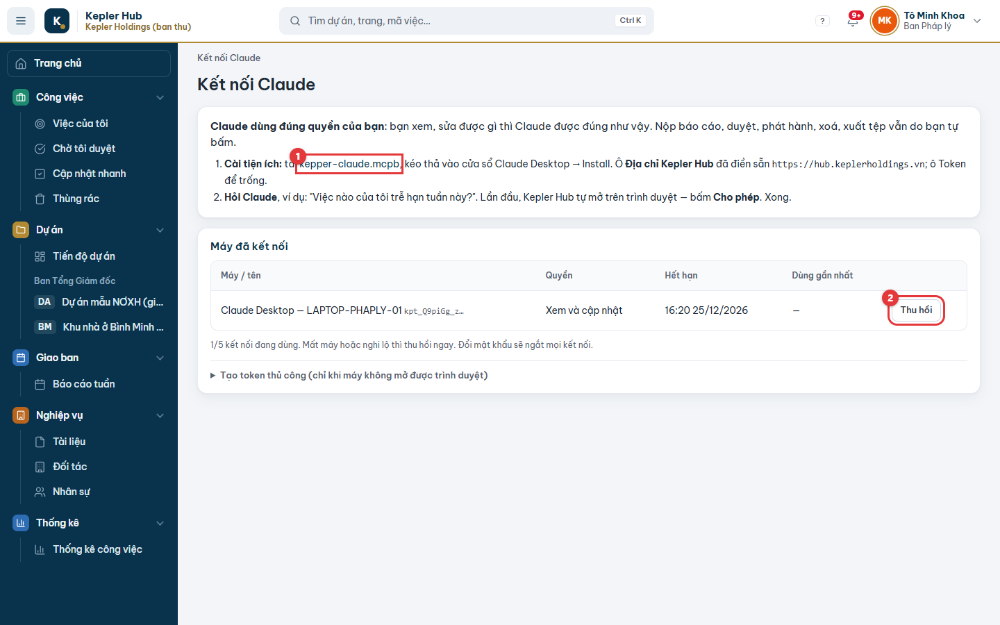

**Các bước thường làm**

A. Kết nối nhanh (cách chính)
1. Bấm tải **kepper-claude.mcpb**, kéo thả vào cửa sổ Claude Desktop → **Install**. Ô **Địa chỉ Kepler Hub** đã điền sẵn; ô Token để trống.
2. Hỏi Claude một câu về Kepler Hub. Trình duyệt tự mở trang Kết nối Claude với thẻ "Claude Desktop xin kết nối với tài khoản của bạn".
3. Kiểm **mã** trên trang trùng mã Claude báo, **tên máy** đúng máy của bạn.
4. Chọn **Xem và cập nhật (%, bình luận, nháp báo cáo)** hoặc **Chỉ xem** → **Cho phép**. Thấy "Đã kết nối — quay lại Claude Desktop và hỏi tiếp".

B. Thu hồi một máy
1. Bảng **Máy đã kết nối** → **Thu hồi** trên dòng máy đó → **Thu hồi**.

C. Token thủ công (chỉ khi máy không tự mở được trình duyệt)
1. Mở mục **Tạo token thủ công (chỉ khi máy không mở được trình duyệt)**.
2. Điền **Tên (máy / mục đích)**, chọn **Quyền**, **Hiệu lực** → **Tạo token**.
3. Bấm **Sao chép** ngay; dán vào ô Token của tiện ích. Kepler Hub không hiện lại token.

**Từng ô**

| Ô (nguyên văn) | Nghĩa là gì | Điền / chọn thế nào (mặc định) | Đổi thì hệ thống làm gì khác |
|---|---|---|---|
| Thẻ yêu cầu kết nối: "Claude Desktop xin kết nối với tài khoản của bạn", dòng "Máy **{tên máy}** · mã **{XXXX-XXXX}** · lúc {thời gian}", câu "Claude sẽ xem được những gì bạn xem được; không nộp báo cáo, phê duyệt, xoá, xuất tệp. Kết nối có hiệu lực 30 ngày, thu hồi được bất cứ lúc nào ở danh sách bên dưới." | Yêu cầu từ tiện ích Claude | Chỉ hiện khi mở bằng mã còn hạn (10 phút) | Máy khác: cảnh báo "Yêu cầu này đến từ **máy khác** với máy bạn đang mở Kepler Hub — chỉ bấm "Cho phép" trên chính máy chạy Claude Desktop."; mã hết hạn: thẻ "Không tìm thấy yêu cầu kết nối." kèm "Yêu cầu kết nối không còn (quá 10 phút) — hỏi lại Claude để tạo yêu cầu mới"; đã xử lý: "Yêu cầu {mã} đã được xử lý. Quay lại Claude Desktop và hỏi tiếp." |
| **Xem và cập nhật (%, bình luận, nháp báo cáo)** / **Chỉ xem** | Phạm vi của kết nối | Mặc định **Xem và cập nhật** | Bảng phạm vi dưới |
| Thẻ hướng dẫn: "**Cài tiện ích:** tải kepper-claude.mcpb, kéo thả vào cửa sổ Claude Desktop → Install. Ô **Địa chỉ Kepler Hub** đã điền sẵn {địa chỉ}; ô Token để trống." và "**Hỏi Claude**, ví dụ: "Việc nào của tôi trễ hạn tuần này?". Lần đầu, Kepler Hub tự mở trên trình duyệt — bấm **Cho phép**. Xong." | Cách cài | Tệp tải về đã điền sẵn địa chỉ Kepler Hub và chứng chỉ HTTPS nội bộ (nếu có) | — |
| Bảng **Máy đã kết nối**: **Máy / tên** (kèm mã đầu), **Quyền** ("Xem và cập nhật" / "Chỉ xem"), **Hết hạn** (hoặc "Đã thu hồi"), **Dùng gần nhất**; trống: "Chưa có máy nào kết nối." | Các token của bạn | Token hết hạn / đã thu hồi hiện mờ | — |
| Dòng "{n}/5 kết nối đang dùng. Mất máy hoặc nghi lộ thì thu hồi ngay. Đổi mật khẩu sẽ ngắt mọi kết nối." | — | Tối đa 5 kết nối còn hiệu lực | — |
| Mục **Tạo token thủ công (chỉ khi máy không mở được trình duyệt)**: **Tên (máy / mục đích)** (chữ mờ "Laptop văn phòng"), **Quyền** ("Xem và cập nhật" / "Chỉ xem"), **Hiệu lực** ("30 ngày" / "60 ngày" / "90 ngày") | Token dán tay vào tiện ích | Tên bắt buộc, tối đa 60 ký tự; hiệu lực mặc định 30 ngày | Lỗi: "Thiếu Tên", "Tên vượt 60 ký tự"; "Mỗi người tối đa 5 token còn hiệu lực — thu hồi token cũ trước" |
| Hộp token vừa tạo: "**Sao chép token ngay — Kepler Hub không hiện lại.** Dán vào ô Token của tiện ích." | Token chỉ hiện một lần | — | Kepler Hub không lưu bản đọc được của token |

**Phạm vi của kết nối**

| Phạm vi | Kết nối được phép | Bị từ chối |
|---|---|---|
| **Chỉ xem** | Đọc mọi thứ bạn xem được (trừ dòng "Cả hai phạm vi") | Mọi thao tác ghi: "Token chỉ đọc — tạo token có quyền ghi để Claude cập nhật" |
| **Xem và cập nhật** | Thêm đúng các thao tác ghi: sửa việc (%, nội dung, người phụ trách — vẫn theo quyền của bạn trên việc), bình luận, chuyển trạng thái, tạo việc, báo cáo tiến độ, đề nghị gia hạn, tạo / sửa ghi chú cá nhân, đánh dấu thông báo đã đọc, lưu **nháp** báo cáo tuần, báo muộn / vắng, ghi nhật ký làm việc với đối tác, đánh dấu xong việc theo dõi đối tác, tạo đơn nghỉ của mình, tạo dự thảo văn thư kèm PDF | Mọi thao tác ghi khác: "Thao tác này cần người dùng tự làm trên giao diện Kepler Hub (nộp, phê duyệt, xoá, phát hành, quản trị)" |
| Cả hai phạm vi | — | Tải / xuất tệp Excel, Word, PDF, CSV, ZIP; tải, xem tệp đính kèm gốc, tệp tài liệu, tệp NAS; trang Quản trị; danh sách token; liên kết Viber; số định danh đầy đủ: "Thao tác này không làm qua Claude (xuất tệp / quản trị) — làm trên giao diện Kepler Hub" |

Kết nối được phép không có nghĩa tiện ích Claude đã có công cụ tương ứng. Tiện ích hiện **chưa có** công cụ cho: chuyển trạng thái (riêng việc MTL, nhờ Claude đặt 100% vẫn là gửi duyệt), gửi báo cáo tiến độ (có khó khăn, kiến nghị), đề nghị gia hạn, sửa / đánh dấu xong ghi chú, đánh dấu thông báo đã đọc, báo muộn / vắng. Các việc này làm trên giao diện.

**Các nút**

| Nút | Làm gì | Có hỏi lại không | Quay lại được không |
|---|---|---|---|
| **kepper-claude.mcpb** (liên kết tải) | Tải tiện ích | — | — |
| **Cho phép** | Tạo token 30 ngày cho máy đó và trao cho tiện ích; kết nối lại cùng máy thì thu hồi token cũ của máy đó. "Đã kết nối — quay lại Claude Desktop và hỏi tiếp" | — | Thu hồi ở bảng |
| **Từ chối** | Từ chối yêu cầu. "Đã từ chối" | — | Hỏi lại Claude để có yêu cầu mới |
| **Thu hồi** (dòng còn hiệu lực) | Thu hồi token. "Đã thu hồi" | "Thu hồi kết nối này? Claude trên máy đó sẽ không truy cập Kepler Hub được nữa (hỏi lại Claude để kết nối lại)." — **Thu hồi** (đỏ) / **Huỷ** | Không; kết nối lại sẽ tạo token mới |
| **Tạo token** | Tạo token thủ công | — | Thu hồi |
| **Sao chép** | Sao chép token. "Đã sao chép token", hoặc "Bôi đen và nhấn Ctrl+C" khi trình duyệt chặn | — | — |

Lỗi khi bấm **Cho phép**: "Chỉ bấm "Cho phép" trên chính máy đang chạy Claude Desktop (yêu cầu này đến từ máy khác)"; "Yêu cầu này đã được xử lý"; "Mỗi người tối đa 5 máy / token còn hiệu lực — thu hồi bớt ở danh sách bên dưới".

> ⚠️ **Chữ trên màn hình ghi** (trong cấu hình tiện ích ở Claude Desktop, mô tả ô Token) "Chỉ điền khi quản trị cấp token thủ công" **nhưng thực tế** quản trị không cấp được token cho ai; token thủ công do chính bạn tạo ở trang này.

**⚠️ Dễ nhầm**
- Phải bấm **Cho phép** trên chính máy chạy Claude Desktop (cùng địa chỉ IP). Ví dụ: Claude trên laptop xin kết nối, bạn mở liên kết trên điện thoại → bị từ chối.
- Kết nối mất hiệu lực khi: bạn hoặc quản trị thu hồi; hết hạn; tài khoản bị khoá; bạn đổi mật khẩu hoặc bị reset mật khẩu; tài khoản đang phải đổi mật khẩu; tài khoản bị đổi sang vai Quản trị hệ thống. Kết nối nhanh: tiện ích tự mở lại trang **Cho phép**. Token dán tay: tiện ích báo lỗi, phải tạo token mới và dán lại (hoặc xoá trống ô Token để chuyển sang kết nối nhanh).
- Claude Desktop hỏi bạn trước mỗi lần dùng công cụ ghi, trừ khi bạn đã chọn luôn cho phép.
- Màn Quản trị → Token Claude gọi cùng phạm vi là "Đọc và cập nhật" / "Chỉ đọc".
- Hỏi Claude "Tôi là ai trong Kepler Hub?": câu trả lời hiện có tài khoản, vai, vai trò giao ban; dòng **bộ phận** hiện để trống dù bạn có bộ phận.

**Claude:** Chính tiện ích Claude khởi động việc xin kết nối. Không công cụ nào tạo hay thu hồi token; tạo, thu hồi làm trên trang này.

### 8.5 Thông báo (chuông)

**Mở ở đâu:** Bấm chuông trên thanh đầu trang.
**Ai thấy, ai sửa:** Mỗi người thấy thông báo của mình; mọi vai kể cả Quản trị hệ thống.
**Dùng để làm gì:** Xem 50 thông báo gần nhất, đánh dấu đã đọc, mở việc / trang liên quan.

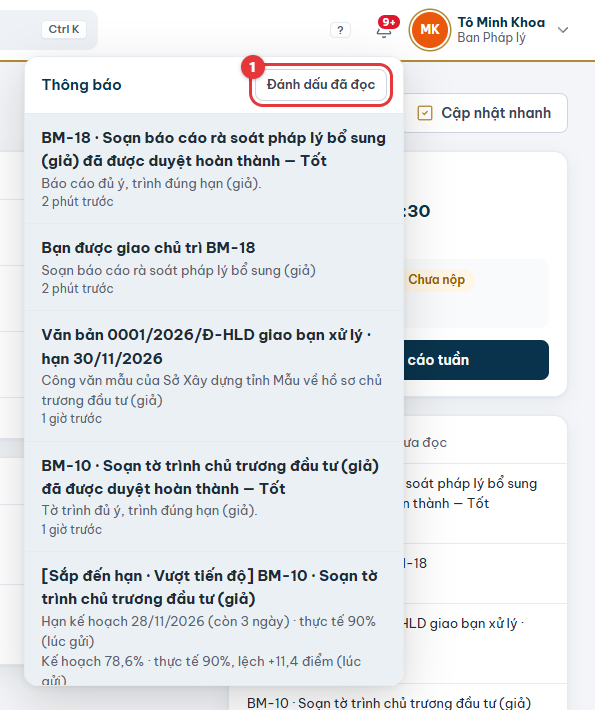

**Từng ô**

| Ô | Nghĩa là gì | Ghi chú |
|---|---|---|
| Chấm đỏ trên chuông | Số thông báo chưa đọc; quá 9 ghi "9+" | Cập nhật mỗi 30 giây khi tab đang mở trước mặt, và ngay khi có thông báo mới |
| Khung **Thông báo** | 50 thông báo mới nhất: tiêu đề đậm, nội dung, thời gian ("vừa xong", "{n} phút trước", "{n} giờ trước", "{n} ngày trước", quá 7 ngày ghi ngày); chưa đọc thì tô nổi | Trống: "Chưa có thông báo" |

**Các nút**

| Nút | Làm gì | Có hỏi lại không | Quay lại được không |
|---|---|---|---|
| **Đánh dấu đã đọc** | Đánh dấu **tất cả** đã đọc, đóng khung | ⚠️ Không hỏi | ⚠️ Không (không có "đánh dấu chưa đọc") |
| Bấm một thông báo | Đánh dấu thông báo đó đã đọc và mở trang liên quan | — | Không |
| Bấm ra ngoài / `Esc` | Đóng khung | — | — |

**Cách hệ thống gộp và giữ thông báo**
- Cảnh báo tiến độ MTL: mọi loại cảnh báo của cùng một việc trong ngày gộp thành **một** thông báo, tiêu đề "[{các loại}] {mã việc} · {tên việc}" (thêm " (đường găng)"), mỗi loại một dòng và "Gửi ngày {dd/mm/yyyy} — mở việc để xem số liệu hiện tại."; thông báo cảnh báo cũ chưa đọc của cùng việc tự chuyển sang đã đọc.
- Giao việc hàng loạt về bộ phận (nhập sổ giao việc): một thông báo gộp cho lãnh đạo mỗi bộ phận "Phòng được giao chủ trì {n} việc {nguồn}" (chữ "Phòng" ứng với bộ phận).
- Thông báo giữ 12 tháng rồi tự xoá.

**⚠️ Dễ nhầm**
- Không có màn chọn loại thông báo muốn nhận, không tắt được thông báo nào; ai nhận gì do luật của hệ thống quyết.
- Không xoá được thông báo.
- **Đánh dấu đã đọc** là đánh dấu tất cả, không phải thông báo đang xem.
- Một số thông báo trỏ tới trang đã bỏ, bấm vào sẽ mở "Tiến độ dự án". Thông báo không có liên kết (vd. các thông báo Quản trị hệ thống gửi Ban Tổng Giám đốc) bấm vào mở "Việc của tôi".

**Claude:** Công cụ **Thông báo** đọc 50 thông báo gần nhất. Claude chưa đánh dấu đã đọc giúp bạn được.

### 8.6 Nhắc việc: nhắc cá nhân và nhắc tự động

**Mở ở đâu:** Không có màn riêng. Nhắc cá nhân = ghi chú có **Hạn** trong **Ghi chú của tôi** (mục 8.7), hoặc nhờ Claude tạo. Mọi nhắc đến qua chuông.
**Ai thấy, ai sửa:** Nhắc cá nhân: chỉ người tạo nhận. Nhắc tự động: theo luật của hệ thống; không có ô chỉnh giờ hay tắt nhắc.
**Dùng để làm gì:** Biết mình sẽ được nhắc gì, lúc nào, để khỏi đặt nhắc trùng.

| Tiêu đề thông báo (nguyên văn) | Lúc | Ai nhận | Ghi chú |
|---|---|---|---|
| "Nhắc việc hôm nay: {tiêu đề ghi chú}" | 08:05 ngày đến hạn (gửi bù tới 18:00) | Người tạo ghi chú, khi ghi chú chưa xong | Bấm vào mở "Việc của tôi" |
| "{mã việc} đến hạn trong 24 giờ" (nội dung: tên việc) | 08:00 | Người chủ trì việc chưa xong có hạn trong 24 giờ tới | Không theo ô "Số ngày cảnh báo" của Danh mục |
| "Cập nhật tiến độ tuần này: {n} việc trong kỳ này chưa cập nhật" (nội dung "Mở "Cập nhật nhanh" và bấm % hoàn thành cho từng việc.") | Thứ Năm 15:00 (tới 20:00) | Người chủ trì việc trong kỳ đã bắt đầu mà từ 5 ngày chưa cập nhật; việc chưa giao người thì lãnh đạo bộ phận chủ trì | — |
| "Báo cáo tuần {bộ phận}: hạn nộp 17:30 hôm nay" | 15:00 ngày hạn nộp | Mục 5.5 | — |
| "Tổng hợp giao ban {dd/mm}: {đã nộp}/{tổng} bộ phận đã nộp" | 07:35 ngày giao ban | Mục 5.5 | — |
| "Hôm nay: theo dõi {đối tác}" / "Quá hạn {n} ngày: theo dõi {đối tác}" | 08:10, khi bật Đối tác | Mục 6.3 | — |
| "Hợp đồng {số} ({họ tên}) hết hạn sau {30 hoặc 7} ngày" | 08:15, khi bật Nhân sự | Người phụ trách nhân sự | — |
| "Văn bản {số} quá hạn xử lý (hạn {dd/mm/yyyy})" / "Văn bản {số} đến hạn xử lý hôm nay" / "Văn bản {số} đến hạn {dd/mm/yyyy}" (thêm " — chưa giao người xử lý"); thứ Hai thêm cho Ban Tổng Giám đốc "{n} văn bản đến quá hạn xử lý" | 08:20, khi bật Văn thư; bỏ qua ngày nghỉ theo lịch ở Nhân sự → Thiết lập | Người xử lý (quá hạn thêm lãnh đạo bộ phận); chưa giao người xử lý → Văn thư | — |
| "Kiểm tra vận hành Kepler Hub" | 09:00 | Quản trị hệ thống | Mục 7.13 |

**⚠️ Dễ nhầm**
- Nhắc cá nhân chỉ gửi **một lần** vào sáng ngày đến hạn, không nhắc lại khi quá hạn. Ví dụ: ghi chú hạn hôm qua chưa xong thì hôm nay không có nhắc.
- Thông báo nhắc cá nhân mở "Việc của tôi", không mở thẳng "Ghi chú của tôi": bấm nút **Ghi chú của tôi** ở góc phải trang đó.
- Máy chủ tắt đúng giờ thì nhắc được gửi bù khi bật lại, trong khung giờ của từng loại.

**Claude:** Công cụ **Tạo nhắc việc** tạo nhắc cá nhân có hạn (sau khi bạn đồng ý); **Nhắc việc của tôi** đọc danh sách. Ví dụ: "Nhắc tôi thứ Hai gọi Sở Xây dựng hỏi tiến độ góp ý."

### 8.7 Ghi chú của tôi

**Mở ở đâu:** Menu **Công việc** → **Việc của tôi** → nút **Ghi chú của tôi** ở góc phải (trang `#/my?mode=notes`); phím `G` rồi `N`; bảng lệnh "Ghi chú của tôi". Nút **Việc của tôi** trên trang ghi chú để quay lại.
**Ai thấy, ai sửa:** Chỉ chủ ghi chú. Câu trên trang: "Chỉ bạn nhìn thấy các ghi chú này — kể cả quản trị hệ thống và cấp trên cũng không xem được." Quản trị hệ thống không vào được trang.
**Dùng để làm gì:** Ghi nhanh việc cá nhân, ý tưởng, việc phát sinh trong cuộc họp; đặt hạn để được nhắc; chuyển thành việc của dự án khi cần.

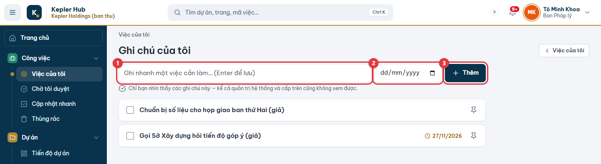

**Các bước thường làm**
1. Gõ vào ô "Ghi nhanh một việc cần làm… (Enter để lưu)", chọn hạn nếu cần → `Enter` hoặc **Thêm**.
2. Bấm tiêu đề ghi chú để mở chi tiết: sửa nội dung, ghi chú dài, hạn → **Lưu**.
3. Xong: đánh dấu ô vuông đầu dòng.
4. Muốn biến thành việc thật: mở ghi chú → **Chuyển thành việc…** → chọn **Dự án** → **Tạo việc**.

**Từng ô**

| Ô (nguyên văn) | Nghĩa là gì | Điền / chọn thế nào (mặc định) | Đổi thì hệ thống làm gì khác |
|---|---|---|---|
| Ô chữ mờ "Ghi nhanh một việc cần làm… (Enter để lưu)" | Nội dung ghi chú mới | Tối đa 300 ký tự | Ghi chú mới lên đầu danh sách. Lỗi: "Thiếu Nội dung", "Nội dung vượt 300 ký tự"; đã có 500 ghi chú: "Tối đa 500 ghi chú — hãy xoá bớt ghi chú đã xong" |
| Ô ngày **Hạn (tuỳ chọn)** | Hạn của ghi chú | Trống | Có hạn = nhắc 08:05 sáng ngày đó (mục 8.6). Nhãn hạn đỏ khi quá hạn hơn 1 ngày, cam khi còn dưới 2 ngày. Lỗi: "Hạn không hợp lệ" |
| Ô đánh dấu đầu dòng ("Đánh dấu xong") | Xong / chưa xong | — | Xong thì không còn nhắc; ghi chú chuyển xuống nhóm đã xong |
| Nhãn "Đã thành việc" (rê chuột: "Đã chuyển thành công việc") | Ghi chú đã chuyển thành việc | — | — |
| Nút ghim ("Ghim lên đầu" / "Bỏ ghim") | Ghim | — | Ghi chú ghim đứng đầu nhóm chưa xong |
| Khi mở một ghi chú: ô nội dung (tối đa 300), ô chữ mờ "Ghi chú chi tiết…" (tối đa 5000), ô **Hạn** | Sửa ghi chú | — | Lỗi: "Ghi chú vượt 5000 ký tự" |
| Trống | "Chưa có ghi chú. Gõ vào ô phía trên để ghi nhanh việc cần nhớ, ý tưởng hay việc phát sinh trong cuộc họp." | — | — |

**Các nút**

| Nút | Làm gì | Có hỏi lại không | Quay lại được không |
|---|---|---|---|
| **Thêm** (hoặc `Enter`) | Tạo ghi chú | — | Xoá |
| Bấm tiêu đề ghi chú | Mở / đóng phần chi tiết | — | — |
| **Lưu** | Lưu sửa đổi. "Đã lưu ghi chú" | — | Sửa lại |
| **Xoá** | Xoá ghi chú | "Xoá ghi chú này? Không khôi phục được." — **Xoá** (đỏ) / **Huỷ** | ⚠️ **Không**: không vào thùng rác |
| **Chuyển thành việc…** | Hộp "Chuyển thành công việc": câu "Tạo việc **{nội dung}** trong dự án, giao cho bạn. Ghi chú được đánh dấu đã xong.", ô **Dự án**, ô **Giao cho tôi** (đánh dấu sẵn), nút **Huỷ** / **Tạo việc**. Xong: "Đã tạo {mã việc}" | — | Việc tạo ra xoá theo luật của việc; ghi chú giữ nhãn "Đã thành việc" |
| "Hiện {n} ghi chú đã xong" / "Ẩn {n} ghi chú đã xong" | Hiện / ẩn nhóm đã xong | — | — |

Lỗi chuyển thành việc: "Bạn chưa có dự án nào được tạo việc"; "Ghi chú đã được chuyển thành công việc".

> ⚠️ **Chữ trên màn hình ghi** "Ghi nhanh việc cá nhân (phím N)" (gợi ý khi rê chuột vào nút **Ghi chú của tôi**) **nhưng thực tế** phím là `G` rồi `N`. Khi đang ở trang ghi chú, phím `C` đưa con trỏ vào ô ghi nhanh.

**⚠️ Dễ nhầm**
- Xoá ghi chú là mất hẳn (khác việc: việc xoá vào thùng rác 7 ngày).
- Người nghỉ việc: ghi chú bị xoá sau 30 ngày kể từ khi tài khoản bị khoá; mở lại tài khoản trước hạn đó thì ghi chú còn.
- Nội dung ghi chú không ghi vào nhật ký hệ thống; chỉ lần chuyển thành việc được ghi.

**Claude:** **Nhắc việc của tôi** (đọc), **Tạo nhắc việc** (tạo ghi chú có hạn). Claude chưa sửa, đánh dấu xong, xoá hay chuyển ghi chú thành việc được.

### 8.8 Phím tắt

**Mở ở đâu:** Nút **?** trên thanh đầu trang (gợi ý "Phím tắt (?)"), phím `?`, hoặc bảng lệnh → "Phím tắt".
**Ai thấy, ai sửa:** Mọi người. Công tắc nhớ theo người trên trình duyệt đang dùng.
**Dùng để làm gì:** Xem danh sách phím tắt; tắt phím tắt một chữ nếu hay bấm nhầm hoặc dùng phần mềm đọc màn hình.

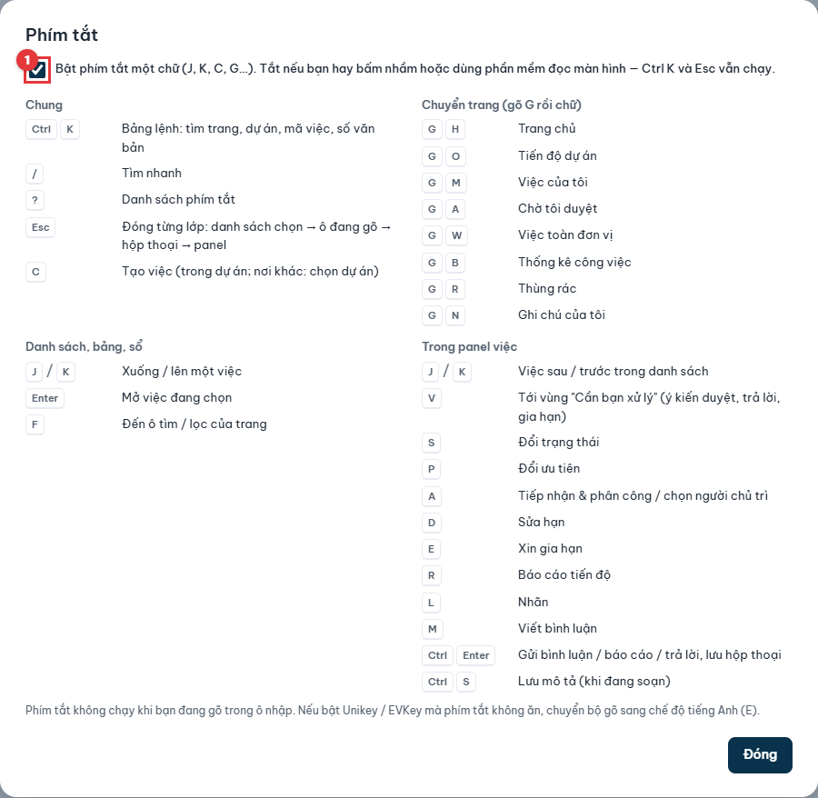

**Từng ô**

| Ô / nhóm (nguyên văn) | Nội dung | Mặc định | Đổi thì hệ thống làm gì khác |
|---|---|---|---|
| Ô đánh dấu "Bật phím tắt một chữ (J, K, C, G…). Tắt nếu bạn hay bấm nhầm hoặc dùng phần mềm đọc màn hình — Ctrl K và Esc vẫn chạy." | Bật / tắt phím một chữ | **Bật** | Tắt thì các phím J, K, C, G, F, /, Enter (trên dòng chọn bằng J/K) và các phím trong panel việc không chạy; `Ctrl K`, `Esc`, `?`, `Ctrl Enter` vẫn chạy. Lưu ngay khi bấm |
| Nhóm "Chung" | "Ctrl K" Bảng lệnh: tìm trang, dự án, mã việc, số văn bản; "/" Tìm nhanh; "?" Danh sách phím tắt; "Esc" Đóng từng lớp: danh sách chọn → ô đang gõ → hộp thoại → panel; "C" Tạo việc (trong dự án; nơi khác: chọn dự án) | — | — |
| Nhóm "Chuyển trang (gõ G rồi chữ)" | "G H" Trang chủ; "G O" Tiến độ dự án; "G M" Việc của tôi; "G A" Chờ tôi duyệt; "G W" Việc toàn đơn vị; "G B" Thống kê công việc; "G R" Thùng rác; "G N" Ghi chú của tôi | Chỉ chạy với trang có trong menu của bạn. Bấm G rồi chờ 0,4 giây sẽ hiện dải gợi ý "G → {các phím}" | — |
| Nhóm "Danh sách, bảng, sổ" | "J / K" Xuống / lên một việc; "Enter" Mở việc đang chọn; "F" Đến ô tìm / lọc của trang | — | — |
| Nhóm "Trong panel việc" (đưa lên đầu khi đang mở panel) | "J / K" Việc sau / trước trong danh sách; "V" Tới vùng "Cần bạn xử lý" (ý kiến duyệt, trả lời, gia hạn); "S" Đổi trạng thái; "P" Đổi ưu tiên; "A" Tiếp nhận & phân công / chọn người chủ trì; "D" Sửa hạn; "E" Xin gia hạn; "R" Báo cáo tiến độ; "L" Nhãn; "M" Viết bình luận; "Ctrl Enter" Gửi bình luận / báo cáo / trả lời, lưu hộp thoại; "Ctrl S" Lưu mô tả (khi đang soạn) | — | — |
| Ghi chú cuối hộp | "Phím tắt không chạy khi bạn đang gõ trong ô nhập. Nếu bật Unikey / EVKey mà phím tắt không ăn, chuyển bộ gõ sang chế độ tiếng Anh (E)." | — | — |

**Các nút**

| Nút | Làm gì | Có hỏi lại không | Quay lại được không |
|---|---|---|---|
| **Đóng** | Đóng hộp (công tắc đã lưu ngay khi bấm) | — | — |

**⚠️ Dễ nhầm**
- Phím tắt không chạy khi đang gõ, khi bộ gõ tiếng Việt đang ghép chữ, khi có hộp thoại mở, hoặc khi đang giữ Ctrl / Alt.
- Phím G + chữ không chạy với trang bạn không có trong menu. Ví dụ: Nhân viên không có quyền xem Thống kê thì `G` `B` không làm gì.
- Tắt phím tắt chỉ có tác dụng trên trình duyệt đang dùng; sang máy khác phải tắt lại.

**Claude:** Không.

### 8.9 Bảng lệnh (tìm nhanh, `Ctrl K`)

**Mở ở đâu:** `Ctrl K`, phím `/` (khi bật phím một chữ), hoặc ô "Tìm dự án, trang, mã việc…" trên thanh đầu trang.
**Ai thấy, ai sửa:** Mọi người. Quản trị hệ thống chỉ thấy 4 trang quản trị. Kết quả việc chỉ gồm việc bạn được xem.
**Dùng để làm gì:** Tìm việc theo mã, tên, số văn bản; nhảy tới trang, dự án, việc mở gần đây; tạo việc nhanh.

**Từng ô**

| Ô / nhóm (nguyên văn) | Nội dung | Ghi chú |
|---|---|---|
| Ô gõ, chữ mờ "Gõ để tìm dự án, trang hoặc mã việc (VD: KD-12)…" | Từ khoá; gõ không dấu vẫn khớp ("tao viec" khớp "Tạo việc") | Gõ từ 2 ký tự thì tìm việc trên máy chủ ("Đang tìm việc…"). Không thấy: "Không tìm thấy "{từ}". Thử mã việc (TT-12), tên việc hoặc số văn bản." Chưa gõ: "Gõ mã việc (VD: TT-12), tên việc hoặc số văn bản" |
| Nhóm "Hành động" | "Báo cáo tiến độ cho {mã}" (R, khi panel việc đang mở có nút báo cáo); "Đi tới khối duyệt của {mã}" (V); "Tạo việc trong {mã dự án} · {tên}" (C, gợi ý "Dự án đang xem"); "Tạo việc trong dự án khác…" / "Tạo việc trong…" (C); "Phím tắt" (gợi ý "Xem và bật / tắt phím tắt", ?) | — |
| Nhóm "Mở gần đây" | Tối đa 5 việc mở gần nhất (chỉ khi chưa gõ) | Trình duyệt chỉ nhớ mã việc; việc mất quyền xem / đã xoá tự biến mất |
| Nhóm "Việc" | Kết quả tìm việc: "{mã} · {tên}", gợi ý tên dự án hoặc "VB {số văn bản}" | — |
| Nhóm "Trang" | "Tiến độ dự án" (gợi ý "Master Timeline: tiến độ, SPI, KPI, cảnh báo"), "Việc của tôi", "Ghi chú của tôi", "Việc toàn đơn vị" ("Mọi việc theo người / bộ phận"), "Chờ tôi duyệt" ("Duyệt, gia hạn, kiến nghị"), "Cập nhật nhanh" ("Kỳ cập nhật tháng: cập nhật % việc tháng này"), "Báo cáo tuần" ("Giao ban: báo cáo, tổng hợp, chấm điểm"), "Thống kê công việc" (khi có quyền), "Thùng rác", "Trang chủ" ("Việc cần xử lý hôm nay"), "Thông tin cá nhân" ("Ảnh đại diện, mật khẩu, cây tổ chức") | Kèm phím G tương ứng nếu có |
| Nhóm "Dự án" | Mỗi dự án bạn được xem; khi đang gõ thêm dòng "{mã} · {tên} — Danh sách" | — |
| Chế độ "Tạo việc trong…" | Chữ mờ "Tạo việc trong dự án nào? Gõ mã hoặc tên dự án…"; chỉ liệt kê dự án bạn tạo được việc | "Không có dự án khớp" / "Bạn chưa tạo được việc trong dự án nào" |

**Các nút**

| Nút | Làm gì |
|---|---|
| Mũi tên lên / xuống, `Ctrl Home` / `Ctrl End`, di chuột | Chọn dòng |
| `Enter` hoặc bấm dòng | Thực hiện dòng đang chọn |
| `Backspace` khi ô trống ở chế độ tạo việc | Về chế độ thường |
| `Esc` / bấm ra nền | Đóng |

**⚠️ Dễ nhầm**
- Nhóm "Trang" không có "Kết nối Claude", "KPI & phân tích", "Tài liệu", "Đối tác", "Nhân sự", "Danh mục": mở các trang này bằng menu (Danh mục: gõ `#/catalog`).
- "Việc toàn đơn vị" có trong bảng lệnh của cả Nhân viên (menu trái chỉ hiện cho Ban Tổng Giám đốc, Lãnh đạo bộ phận); Nhân viên mở ra chỉ thấy việc của mình.

**Claude:** Công cụ **Tìm việc** làm việc giống phần tìm việc của bảng lệnh.

### 8.10 Thùng rác

**Mở ở đâu:** Menu **Công việc** → **Thùng rác** (trang `#/trash`); phím `G` rồi `R`; bảng lệnh "Thùng rác".
**Ai thấy, ai sửa:** Mỗi người chỉ thấy việc mình **được xoá** (người giao, BTGĐ phụ trách của việc) và dự án mình **quản lý được**. Quản trị hệ thống không vào được.
**Dùng để làm gì:** Khôi phục việc, dự án lỡ xoá. Câu đầu trang: "Khôi phục được trong 7 ngày kể từ lúc xoá; sau đó hệ thống xoá hẳn, kể cả tệp đính kèm."

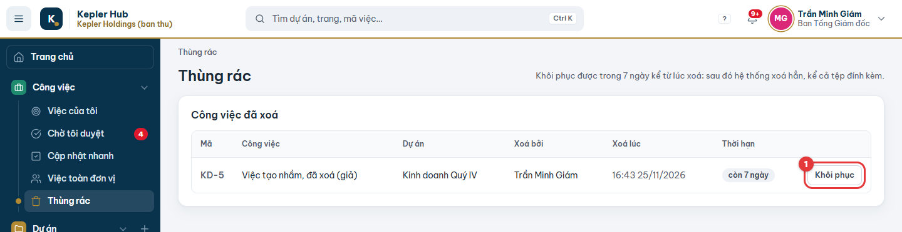

**Từng ô**

| Ô (nguyên văn) | Nội dung |
|---|---|
| Bảng **Dự án đã xoá** (chỉ hiện khi có): **Dự án**, **Bộ phận**, **Số việc**, **Xoá bởi**, **Xoá lúc**, **Thời hạn** | Dự án trong thùng rác |
| Bảng **Công việc đã xoá**: **Mã**, **Công việc** (việc con ghi thêm "(việc con)"), **Dự án**, **Xoá bởi**, **Xoá lúc**, **Thời hạn**; trống: "Thùng rác trống." | Việc trong thùng rác, tối đa 300 dòng |
| Nhãn **Thời hạn** | "còn {n} ngày", "còn dưới 1 ngày", "sắp xoá hẳn" |

**Các nút**

| Nút | Làm gì | Có hỏi lại không | Quay lại được không |
|---|---|---|---|
| **Khôi phục** (việc) | Khôi phục việc cùng các việc con bị xoá cùng lúc. "Đã khôi phục công việc" | Không | Xoá lại được |
| **Khôi phục** (dự án) | Khôi phục dự án. "Đã khôi phục dự án" | Không | Xoá lại được (phải nhập mã dự án) |

Lỗi: "Việc không nằm trong thùng rác", "Hãy khôi phục việc cha trước", "Dự án không nằm trong thùng rác". Không có nút "Xoá hẳn".

**⚠️ Dễ nhầm**
- Khi xoá, các yêu cầu duyệt đang chờ của việc / dự án bị huỷ; khôi phục **không** mở lại các yêu cầu duyệt đó. Người chủ trì phải gửi duyệt lại.
- Việc con không khôi phục được khi việc cha còn trong thùng rác.
- Quá 7 ngày là mất hẳn (xoá lúc 02:45 hằng ngày), kể cả tệp đính kèm.

**Claude:** Không.

### 8.11 Tuỳ chọn giao diện được nhớ theo người

**Mở ở đâu:** Không có màn. Các tuỳ chọn tự nhớ khi bạn bấm.
**Ai thấy, ai sửa:** Từng người, trên **từng trình duyệt**. Lưu trong trình duyệt của máy đang dùng, không lưu trên máy chủ.
**Dùng để làm gì:** Giải thích vì sao "máy tôi hiện khác máy đồng nghiệp", "sang máy khác thì mất cài đặt".

| Tuỳ chọn được nhớ | Ở đâu | Mặc định |
|---|---|---|
| Menu trái thu gọn | Nút ba gạch | Mở rộng |
| Từng nhóm menu trái gập / mở | Tên nhóm menu | Mở |
| Bật / tắt phím tắt một chữ | Hộp Phím tắt | Bật |
| 5 việc mở gần đây (chỉ mã việc) | Bảng lệnh | — |
| Chờ tôi duyệt: sắp theo "Chờ lâu nhất" hay theo hạn | Chờ tôi duyệt | Chờ lâu nhất |
| Việc của tôi: lọc "Tất cả" / "Chủ trì" / "Phối hợp" | Việc của tôi | Tất cả |
| Việc của tôi: xem danh sách hay lịch | Việc của tôi | Danh sách |
| Việc của tôi: khối "Đang chờ người khác" mở | Việc của tôi | Đóng |
| Việc toàn đơn vị: danh sách hay lịch | Việc toàn đơn vị | Danh sách |
| Chế độ lịch (dùng chung Việc của tôi, Việc toàn đơn vị, dự án) | Các trang lịch | — |
| Panel việc: "Mở tất cả các mục" / "Thu gọn các mục" | Panel việc | Gọn |
| Từng khối trong panel việc mở / đóng (mô tả, giao về bộ phận, sổ, duyệt, tiến độ, văn bản, việc nhánh, tệp, bình luận, lịch sử, thêm) | Panel việc | Theo vai trò và khâu |
| Hiển thị việc con lồng hay phẳng | Dự án | Lồng |
| Bộ lọc cuối cùng của từng dự án | Dự án | — |
| Bộ lọc đã lưu được đặt làm mặc định của bạn ("Đã đặt "{tên}" làm bộ lọc mặc định của bạn" / "Đã bỏ bộ lọc mặc định") | Dự án | — |
| Cách chia làn bảng của từng dự án | Dự án | — |
| Danh sách MTL nhóm theo giai đoạn hay không | Dự án MTL | Nhóm |
| Nhóm giai đoạn đang gập trong kế hoạch MTL | Dự án MTL | — |
| Bộ phận đang lọc ở tab "Giai đoạn" | Dự án MTL | Tất cả |
| Đã bấm "Đã hiểu" ở băng giai đoạn gợi ý | Dự án MTL | — |
| Sổ giao việc "Hiện đủ cột" | Sổ giao việc | Tắt |
| Nhân sự → Của tôi: khối "Hồ sơ & hợp đồng" mở | Nhân sự | Đóng |

Dữ liệu trình duyệt **không tách theo người** (máy dùng chung thì người sau thấy theo người trước): các dòng gập trên biểu đồ Gantt của từng dự án; kỳ đang chọn ở dải "Số liệu của tôi". Bản nháp (bình luận, báo cáo, ý kiến) lưu riêng theo người, mất khi đóng tab, xoá khi bấm **Đăng xuất**.

**⚠️ Dễ nhầm**
- Đổi máy hoặc đổi trình duyệt là về mặc định. Ví dụ: thu gọn menu ở máy văn phòng, mở trên laptop vẫn thấy menu đầy đủ.
- Không có nút "khôi phục mặc định"; muốn về mặc định thì xoá dữ liệu trang web của Kepler Hub trong trình duyệt.
- Trình duyệt chặn lưu dữ liệu (chế độ ẩn danh, chính sách công ty) thì tuỳ chọn chỉ nhớ tới khi đóng trang.

**Claude:** Không.

### 8.12 Có nhắc tới nhưng không có màn hình: uỷ quyền, liên kết Viber, ô Điện thoại

**Mở ở đâu:** Không có màn hình nào cho ba thứ này.
**Ai thấy, ai sửa:** Không ai làm được trên giao diện.
**Dùng để làm gì:** Để bạn không mất công tìm. Phần mềm có nhắc tới ba thứ này ở vài chỗ, nhưng chưa có màn để dùng.

| Thứ | Được nhắc ở đâu | Thực tế |
|---|---|---|
| **Uỷ quyền** duyệt / tiếp nhận việc | Hộp khoá tài khoản đếm "uỷ quyền còn hiệu lực" (mục 7.7); thông báo "{họ tên} uỷ quyền cho bạn duyệt / tiếp nhận việc" (bấm vào mở "Tiến độ dự án") | Không có màn tạo / thu hồi uỷ quyền. Lãnh đạo bộ phận đi công tác, nghỉ phép **không tự uỷ quyền được** trên giao diện. Muốn có người duyệt thay: người quản lý dự án đổi người duyệt trong cài đặt dự án, hoặc người đó được gán vai **Lãnh đạo bộ phận** cùng bộ phận |
| **Liên kết Viber** | Bot Viber trả lời "Gửi mã 6 số lấy trong Kepler Hub (Tài khoản của tôi → Viber) để liên kết." và "Đã liên kết tài khoản Kepler Hub. Bạn sẽ nhận nhắc việc tiến độ tại đây. Huỷ trong "Tài khoản của tôi"." | Không có mục "Tài khoản của tôi → Viber" nào. Thông báo qua Viber mặc định tắt (IT bật, mục 7.15); hiện không có màn lấy mã hay huỷ liên kết |
| Ô **Điện thoại** | Hiện ở Thông tin cá nhân (mục 8.3) | Không màn nào nhập được: hộp tài khoản của Quản trị hệ thống không có ô này. Chỉ công cụ nhập tổ chức của IT điền được, và chỉ khi tạo tài khoản mới (mục 7.15). Tài khoản đã có thì ô luôn trống |

> ⚠️ **Chữ trên màn hình ghi** (tin nhắn của bot Viber) "Tài khoản của tôi → Viber" **nhưng thực tế** Kepler Hub không có mục này.

**Claude:** Không. Claude không tạo uỷ quyền, không liên kết Viber, không nhập số điện thoại.

---

## 9. Hỏi đáp thiết lập

### 9.1 Dự án

| Câu hỏi | Trả lời |
|---|---|
| Tôi là Nhân viên, sao không thấy nút + tạo dự án? | Chỉ Ban Tổng Giám đốc và Lãnh đạo bộ phận tạo dự án. Nhờ lãnh đạo bộ phận tạo rồi đưa bạn vào làm Chủ dự án (Cài đặt → Thành viên) |
| Tôi là Lãnh đạo bộ phận, sao không có kiểu "Theo Master Timeline"? | Chỉ Ban Tổng Giám đốc tạo dự án MTL. Ban Tổng Giám đốc tạo xong có thể đưa bạn hoặc PMO vào làm Chủ dự án để quản lý |
| Tạo dự án báo "Dữ liệu bị trùng: key" | Mã dự án đã có — kể cả mã của dự án đang nằm trong Thùng rác (bị giữ tới khi xoá hẳn sau 7 ngày). Dùng mã khác |
| Dự án đặt "Không cần duyệt" mà việc vẫn vào "Chờ duyệt"? | Đúng cách hệ thống chạy: người giao luôn duyệt và chấm mức (việc mốc / găng: BTGĐ phụ trách). "Không cần duyệt" chỉ là không có cấp nào sau người giao. Muốn không có duyệt thì dùng bảng không có cột nhóm Hoàn thành (Lịch tuần) |
| Dự án ghi "Duyệt 1 cấp" mà việc phải qua 2 người? | Con số không đếm bước người giao. "1 cấp" = người giao + Lãnh đạo bộ phận chủ trì. Nếu người giao cũng là Lãnh đạo bộ phận đó thì cấp sau tự qua |
| Lưu quy trình duyệt báo "Còn N yêu cầu đang chờ duyệt…" | Không đổi được các cấp khi còn phiếu chờ. Nhờ người duyệt xử lý hết, hoặc người gửi rút lại phiếu chưa ai xử lý, rồi lưu lại. Chỉ đổi "Việc mới mặc định cần" thì vẫn lưu được |
| Việc nằm mãi ở "Chờ duyệt", khối Quy trình duyệt hiện "Chưa có người duyệt" | Cấp đó không có ai duyệt: Người đứng tên dự án để trống, người được chỉ định đã khoá, hoặc bộ phận chủ trì không có Lãnh đạo bộ phận. Đặt lại người (Thông tin chung) hoặc nhờ Quản trị hệ thống đặt vai Lãnh đạo bộ phận |
| Không xoá được cột: "Cột … còn N việc" dù Bảng trống | Hệ thống đếm cả việc trong Thùng rác. Khôi phục các việc đó rồi chuyển sang cột khác, hoặc chờ hệ thống xoá hẳn sau 7 ngày |
| Lưu cột báo "Dự án có cột Hoàn thành (việc xong phải qua người giao duyệt) cần ít nhất một cột thuộc nhóm …" | Dự án có cấp duyệt hoặc có cột Hoàn thành thì phải có đủ cột nhóm Đang thực hiện, Chờ duyệt, Hoàn thành. Muốn chuyển sang Lịch tuần: xoá hết cấp duyệt trước, rồi mới lưu cột |
| Tôi đổi tên dự án, rồi lưu thành viên, tên quay về cũ? | Mỗi khối Cài đặt có nút lưu riêng; lưu thành viên (và cột, quy trình, quy tắc, nhãn) vẽ lại cả trang, làm mất phần sửa dở ở khối khác. Sửa xong khối nào lưu khối đó |
| Dự án lưu trữ biến mất, làm sao mở lại? | Mở đường dẫn `#/projects/<số>/settings` đã chép, bỏ đánh dấu Lưu trữ → Lưu. Mất đường dẫn: báo Quản trị hệ thống tên bạn và lúc lưu trữ để tra số dự án ("Dự án / sổ #<số>") trong Nhật ký hệ thống |
| Khôi phục dự án xong, việc ở "Chờ duyệt" không ai duyệt? | Xoá dự án đã huỷ các phiếu đó và khôi phục không mở lại. Người giao kéo việc về Đang thực hiện, người chủ trì gửi duyệt lại |
| Nhập lại MTL mà tên, ngày của hạng mục không đổi? | Nhập lại chỉ thêm bước mới, bước đã có giữ nguyên. Sửa tên / hạn trên panel hạng mục (người giao, BTGĐ phụ trách); sửa kế hoạch gốc bằng "Điều chỉnh kế hoạch gốc…" |
| Nhập lại MTL mà xem trước báo "tạo mới" toàn bộ? | Tên kế hoạch khác lần trước (sheet đổi tên, hoặc gõ tên khác), dòng không có mã Bước, hoặc hạng mục đã bị xoá. Đừng bấm Nhập; sửa tên kế hoạch / tên sheet cho trùng lần trước |
| Lãnh đạo bộ phận nhập MTL bộ phận bị báo "… dòng không thuộc bước MTL tổng nào do bộ phận chủ trì …" | Lãnh đạo bộ phận phải là người chủ trì của bước tổng, và mỗi dòng phải ghi "Thuộc bước". Bước tổng đã giao cho nhân viên thì nhờ người quản lý dự án nhập, hoặc tạm đặt mình làm người chủ trì bước tổng |
| Nhập tệp báo "Tệp vượt 25 MB" dù tệp nhỏ hơn | Con số trong thông báo sai. Giới hạn thật: nhập MTL 10 MB, nhập danh sách đơn giản 5 MB. Tách tệp hoặc bỏ bớt định dạng thừa |
| Lưu ngưỡng báo "Ngưỡng behindPct phải từ 1 đến 50" | Tên kỹ thuật của ô "Chậm tiến độ khi thấp hơn kế hoạch". Tương tự: aheadPct = Vượt tiến độ; startSoonDays = Nhắc sắp bắt đầu; dueSoonDays = Nhắc sắp đến hạn; staleDays = Nhắc khi chưa cập nhật |
| Hạng mục đang "Tạm dừng" vẫn bị cảnh báo chậm? | Cột Tạm dừng là Cột tự do, hệ thống vẫn tính theo kế hoạch gốc. Người giao điều chỉnh kế hoạch gốc, hoặc chuyển hạng mục sang Huỷ nếu thật sự dừng |
| Tôi là PMO / Chủ dự án mà không thấy "Điều chỉnh kế hoạch gốc…"? | Chỉ người giao của hạng mục (thường là người đã bấm nhập MTL) và BTGĐ phụ trách điều chỉnh được. Nhờ một trong hai người đó |
| Việc nhập bằng "Danh sách đơn giản" không ai sửa được hạn, không xoá được? | Việc nhập kiểu này không có người giao, nên chỉ BTGĐ phụ trách sửa kế hoạch. Nhờ BTGĐ phụ trách đặt Người giao cho việc trên panel |

### 9.2 Tài liệu: tài liệu dự án, văn thư, quy chế

| Câu hỏi | Trả lời |
|---|---|
| Nút **Thiết lập** ở đâu? Tôi không thấy. | Chỉ người có vai Ban Tổng Giám đốc thấy, ở đầu trang tab **Văn thư** và tab **Quy chế, quy định nội bộ**. Văn thư, Pháp chế, Lãnh đạo bộ phận không thấy: nhờ Ban Tổng Giám đốc làm. |
| Thiết lập văn thư dùng để làm gì? | Chọn pháp nhân (công ty có sổ, dãy số riêng; dòng đầu là công ty mẹ), chọn Văn thư (người vào sổ, cấp số), Pháp chế (người nhận văn bản có thời hạn pháp lý) và Người phê duyệt quy chế, quy định. Xem mục 4.6. |
| Tôi vừa được giao làm Văn thư nhưng không thấy nút **Vào sổ**. | Bấm F5. Trình duyệt giữ thông tin cũ suốt phiên. Vẫn không thấy: nhờ Ban Tổng Giám đốc mở Thiết lập kiểm tên bạn trong ô **Văn thư**. |
| Tôi là Lãnh đạo bộ phận, sao tab **Tài liệu dự án** không có dự án của bộ phận mình? | Tab này chỉ hiện dự án bạn là thành viên hoặc đứng tên. Nhờ người quản lý dự án thêm bạn ở **Cài đặt dự án** → **Thành viên**, vai **Người xem**. |
| Vào sổ nhầm, sửa số được không? | Không. Bấm **Hủy số** (gõ lý do), rồi vào sổ lại. Số đã hủy vẫn nằm trong sổ, không cấp lại. |
| Bấm **Hủy số** (hoặc **Trả lại**, **Huỷ dự thảo**) mà hộp không đóng, hiện dòng đỏ "Nhập lý do". | Ô lý do là bắt buộc; bạn để trống hoặc chỉ gõ khoảng trắng. Gõ lý do rồi bấm lại. Chưa có gì bị hủy hay trả lại. |
| Bấm nhầm **Lập hồ sơ** / **Đã gửi** / **Hết hiệu lực**, quay lại được không? | Hệ thống hỏi lại trước ("… Không quay lại được bước trước."): bấm **Huỷ** ở hộp hỏi thì không đổi gì. Đã bấm nút đồng ý thì không quay lại được: trạng thái chỉ đi tiếp. Ghi giải thích vào **Ghi chú** của văn bản (nút **Sửa / giao xử lý**; với quy chế là nút **Sửa**). Quy chế lỡ "Hết hiệu lực" thì tạo dự thảo mới, chọn **Thay thế văn bản**, đi lại luồng phê duyệt. |
| Văn bản "Hạn chế" ai xem được? | Ban Tổng Giám đốc, mọi Văn thư, người vào sổ, người xử lý, **mọi người thuộc bộ phận của văn bản** (kể cả Nhân viên), và Pháp chế nếu văn bản được đánh dấu chuyển Pháp chế. |
| Sao hạn tự tính của văn bản đến rơi vào ngày lễ? | Ngày lễ chỉ được trừ khi đã khai trong **Nhân sự → Thiết lập** (mục 6.2). Chưa ai khai thì hạn tự tính không trừ ngày lễ: khai ngày lễ, hoặc gần kỳ nghỉ thì văn thư gõ hạn tay ở ô **Hạn**. |
| Quy chế năm ngoái đâu rồi? | Danh sách lọc theo năm, mặc định năm nay. Chọn năm đó ở ô **Năm**. Năm là năm phê duyệt trên Hub. |
| Ô **Người phê duyệt** để trống thì ai duyệt? | Thành viên Ban Tổng Giám đốc có phạm vi "Toàn công ty" (Quản trị hệ thống đặt ở Quản trị → Tài khoản → **Quyền & phụ trách**). Không ai có thì mọi thành viên Ban Tổng Giám đốc. Ô chỉ còn người đã nghỉ, đổi vai cũng vậy. Xem dòng **Đang áp dụng** ở Thiết lập (mục 4.6.8). |
| Người phê duyệt vừa nghỉ việc; ai duyệt các dự thảo đang chờ? | Người dự phòng ở dòng **Đang áp dụng** (thường là thành viên Ban Tổng Giám đốc phụ trách "Toàn công ty"). Họ không được báo các dự thảo đã chờ từ trước: Ban Tổng Giám đốc chọn Người phê duyệt mới rồi **Lưu** (người mới nhận "Tài liệu chờ phê duyệt" của từng dự thảo đang chờ), hoặc báo người dự phòng vào tab Quy chế. Xem mục 4.6.9. |
| Người phê duyệt xem PDF ở đâu? | Ở khối **Tệp văn bản** của dự thảo, bấm **Tải** rồi mở trên máy. Trang Văn thư không có nút **Xem**. |
| Bấm **Gỡ** tệp có mất không? | Tệp có nhãn **NAS**: chuyển vào thư mục `_LuuTru` của sổ, IT lấy lại được. Tệp không có nhãn **NAS**: **mất hẳn**; hộp hỏi ghi rõ "Tệp lưu trong Hub sẽ bị xoá hẳn, không khôi phục được." |
| Bấm **Phê duyệt** báo lỗi bắt đầu bằng "Dữ liệu bị trùng". | Số sắp cấp trùng một số đã có: thường do một bộ phận ra văn bản D7 cho hai pháp nhân, hoặc do đổi pháp nhân dòng đầu giữa năm. Hủy dự thảo, tạo lại với đúng pháp nhân đã dùng; báo IT. Xem mục 4.5, 4.6.5. |
| Lưu Thiết lập báo "Văn thư có tài khoản không hợp lệ". | Một người trong ô vừa bị khoá tài khoản hoặc chuyển sang Quản trị sau lúc bạn mở trang. Bấm F5, chọn lại, **Lưu**. |
| Tôi bấm một tên trong ô **Văn thư**, mọi tên khác mất tô màu. | Bấm thường là chỉ chọn một người. Chưa bấm **Lưu** thì F5 để bỏ thay đổi, rồi giữ **Ctrl** (Mac: **Cmd**) khi bấm từng tên. |
| Sao ô **Chọn từ sổ Văn thư** trong việc không có văn bản "Hạn chế" của tôi? | Ô chọn chỉ có văn bản "Công khai", "Nội bộ" và quy chế đã phê duyệt cấp "Mọi người", vì ai xem được việc cũng thấy số, trích yếu. |
| Người xử lý nghỉ việc, văn bản giao cho họ thì sao? | Văn bản vẫn đứng tên họ và vẫn bị nhắc. Văn thư hoặc Ban Tổng Giám đốc mở văn bản → **Sửa / giao xử lý** → chọn người mới → **Lưu**. |
| Hướng dẫn cũ ghi "Nghiệp vụ → Văn thư", sao tôi không thấy? | Menu nay là **Nghiệp vụ → Tài liệu**, rồi chọn tab **Văn thư** hoặc **Quy chế, quy định nội bộ**. |

### 9.3 Báo cáo tuần, Nhân sự, Đối tác, Quản trị, cá nhân

| Câu hỏi | Trả lời |
|---|---|
| Tôi là thư ký giao ban mà không đổi được hạn nộp, báo "Đã qua hạn nộp — chỉ Ban TGĐ đổi lịch của tuần này"? | Sau 17:30 ngày hạn nộp của một tuần, chỉ Ban Tổng Giám đốc đổi được lịch tuần đó. Đổi lịch trước hạn, hoặc nhờ Ban Tổng Giám đốc (mục 5.1) |
| Đánh dấu "Tuần này nghỉ" rồi mà tuần này vẫn bị nhắc nộp báo cáo? | Ba ô lịch áp cho tuần đang chọn ở ô **Tuần báo cáo (thứ Sáu)** đầu trang. Bạn đã đánh dấu nhầm tuần khác. Chọn đúng tuần, đánh dấu lại, lưu (mục 5.1) |
| Đã dời hạn nộp mà các bộ phận không ai biết? | Kepler Hub không gửi thông báo khi đổi lịch, dù ghi chú nhắc "thông báo các bộ phận trước ít nhất 02 ngày làm việc". Người đổi lịch tự báo (mục 5.1) |
| Bấm "Lưu thiết lập" báo lỗi, nhưng danh sách bộ phận vẫn đổi? | Nút này lưu hai lượt: thiết lập chung trước, lịch tuần sau. Lượt hai lỗi thì lượt một đã lưu. Tải lại trang để xem (mục 5.1) |
| Khai ngày lễ ở Nhân sự rồi mà hạn báo cáo tuần không dời? | Hai chỗ độc lập. Ngày lễ ở Nhân sự chỉ dùng cho chấm công, nghỉ phép, hạn văn bản đến. Dời hạn báo cáo tuần ở Báo cáo tuần → Thiết lập (mục 5.3) |
| Chưa chọn PMO thì ai là PMO? Lãnh đạo bộ phận sao chỉ thấy bản tóm tắt? | Chưa chọn = không ai là PMO. Lãnh đạo bộ phận mặc định chỉ xem bản tóm tắt; muốn xem chi tiết mọi bộ phận, Ban Tổng Giám đốc chọn người đó vào PMO (mục 5.1, 5.5) |
| Lỡ bấm "Duyệt và khoá" bảng điểm tuân thủ? Muốn đổi mức trừ điểm? | Bảng đã duyệt không mở khoá được trên giao diện. Mức trừ điểm cố định trong phần mềm, không có ô sửa (mục 5.4) |
| Menu không có Nhân sự / Đối tác? | Trên bản chạy thật hai phân hệ đã bật (25/11/2026): bấm F5 tải lại trang. Ở bản cài khác: phân hệ chưa bật; chỉ IT bật được, theo quyết định của Ban Tổng Giám đốc (mục 6.1) |
| Bật "Chỉ cho chấm công trong mạng văn phòng" xong không ai chấm công được? | Kepler Hub đang thấy IP của máy trung gian (vd. Docker Desktop 172.x / 192.168.65.x), không thấy IP người dùng. Xoá trống ô, lưu, nhờ IT sửa cấu hình rồi mới bật lại (mục 6.2) |
| Đối tác bị gán nhầm bộ phận phụ trách, đổi ở đâu? | Giao diện không có chỗ đổi bộ phận phụ trách sau khi tạo. Nhờ IT. Lần sau Ban Tổng Giám đốc kiểm kỹ ô **Bộ phận phụ trách** trước khi lưu (mục 6.3) |
| Người mới có chức danh "Trưởng phòng" mà không duyệt được việc của phòng? | Chức danh không cấp quyền. Quản trị hệ thống đổi **Vai** của người đó thành **Lãnh đạo bộ phận** và gán đúng **Bộ phận** (mục 7.1, 7.5) |
| Phó Tổng Giám đốc mới đã có vai Ban Tổng Giám đốc mà không duyệt được gia hạn việc nào? | Vai chỉ cho xem toàn công ty. Quản trị hệ thống mở **Quyền & phụ trách**, tick các bộ phận người đó phụ trách (hoặc **Toàn công ty**), **Lưu phạm vi phụ trách** (mục 7.6) |
| Kiêm nhiệm (thư ký, PMO, văn thư…) gán ở đâu? | Không phải ở Quản trị. Ban Tổng Giám đốc chọn ở ba nơi: Báo cáo tuần → Thiết lập (thư ký, PMO); Nhân sự → Thiết lập (phụ trách nhân sự); Tài liệu → Văn thư → Thiết lập (văn thư, pháp chế, người phê duyệt) (mục 7.1) |
| Nhân viên nghỉ việc, khoá tài khoản thế nào để việc không bị bỏ rơi? | **Sửa** → bỏ **Đang hoạt động** → **giữ** dấu **Trả việc về lãnh đạo bộ phận để phân công lại** → **Lưu**. Khoá làm mất phiên đăng nhập và token Claude; ghi chú cá nhân bị xoá sau 30 ngày (mục 7.7) |
| Quên mật khẩu thì làm sao? | Báo Quản trị hệ thống bấm **Reset MK**. Mật khẩu mặc định — IT báo riêng cho người dùng; đăng nhập xong phải đổi ngay (mục 7.8, 8.1) |
| Quản trị gốc quên mật khẩu? | Không có đường nào trên giao diện; đổi mật khẩu gốc trong cấu hình máy chạy cũng không có tác dụng. Chỉ IT can thiệp trực tiếp cơ sở dữ liệu. Phòng trước: cất mật khẩu gốc an toàn, có thêm tài khoản Quản trị hệ thống thường (mục 7.9) |
| Gõ đúng mật khẩu mà vẫn báo "Tài khoản hoặc mật khẩu không đúng"? | Có thể tài khoản đã bị khoá: câu báo giống hệt sai mật khẩu. Quản trị hệ thống xem cột **Trạng thái** hoặc Nhật ký hệ thống, lý do "tài khoản đã khoá" (mục 7.8, 8.1) |
| Claude báo kết nối không hợp lệ sau khi tôi đổi mật khẩu? | Đổi / reset mật khẩu ngắt mọi kết nối Claude. Hỏi lại Claude một câu, trang Kepler Hub mở ra, bấm **Cho phép**. Dùng token dán tay thì tạo token mới (mục 8.4) |
| Sang máy khác thì menu, phím tắt, bộ lọc về mặc định? | Các tuỳ chọn này nhớ trên từng trình duyệt, không lưu theo tài khoản trên máy chủ (mục 8.11) |
| Muốn uỷ quyền duyệt khi đi công tác, liên kết Viber, nhập số điện thoại? | Chưa có màn hình cho cả ba. Duyệt thay: người quản lý dự án đổi người duyệt trong cài đặt dự án (mục 8.12) |
